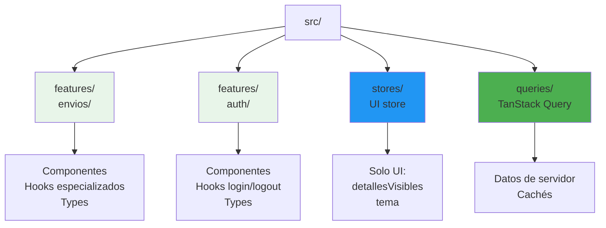
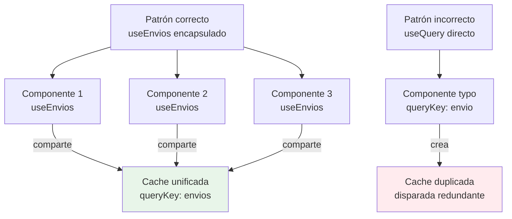

# Módulo 12: Proyecto integrador — SPA con datos reales


## Aprende construyendo

**Servidor del módulo:** el integrador es un proyecto TypeScript nuevo, `rutaflow-react`, creado en el Tema 1 con la plantilla `react-ts` (React 19, Vite 8, TypeScript 7) y Vitest configurado como en el Módulo 0. `npm run dev` lo sirve en `http://localhost:5173`, `npm test` ejecuta la prueba del flujo crítico y `npm run build` revisa los tipos con `tsc -b` antes de empaquetar. Si el puerto cambia, usa el que imprima la terminal. Todo el integrador usa un único dominio: envíos. Aplica lo que aprendiste en el Módulo 11.


### Tema 1: Estructura del proyecto integrador · Avanzado · 45 min

<details open>
<summary><strong>Capa 1 — Lectura</strong></summary>

#### ► DE QUÉ TRATA
Al finalizar vas a organizar el proyecto integrador de RutaFlow en features/envios/ y features/auth/, separando ambos del store de Zustand reservado solo para UI. Prerrequisitos: módulos 0-11 completos.

#### ► CÓMO FUNCIONA


</details>

<details>
<summary><strong>Capa 2 — Construcción</strong></summary>

#### Código y verificación


```
src/
  features/
    envios/
      ListaEnvios.tsx
      useEnvios.ts        ← hook con TanStack Query
    auth/
      RutaProtegida.tsx
      useAuth.ts
  store/
    uiStore.ts             ← Zustand, solo estado de cliente
  router.tsx
```

```bash
npm create vite@latest rutaflow-react -- --template react-ts
cd rutaflow-react
npm install
npm install react-router@8 @tanstack/react-query@5 zustand@5 zod@4
npm install -D vitest @testing-library/react @testing-library/jest-dom @testing-library/user-event jsdom msw@3
npm pkg set scripts.test="vitest run"
```

```text
public/api/envios.json
vite.config.ts           ← reemplaza el de la plantilla
src/
  setupTests.ts
  features/
    envios/
      envio.ts            ← esquema zod y tipo Envio
      useEnvios.ts        ← hook con TanStack Query (Tema 3)
      ListaEnvios.tsx
      flujo.test.tsx      ← prueba del flujo crítico
    auth/
      useAuth.ts
      RutaProtegida.tsx
      PaginaLogin.tsx
  store/
    uiStore.ts            ← Zustand, solo estado de cliente
  router.tsx
  App.tsx                ← reemplaza el de la plantilla
```

```json
[
  { "id": "RF-4471", "zona": "norte", "estado": "pendiente" },
  { "id": "RF-4472", "zona": "norte", "estado": "entregado" },
  { "id": "RF-5101", "zona": "sur", "estado": "pendiente" }
]
```

```ts
import react from '@vitejs/plugin-react'
import { defineConfig } from 'vitest/config'

// https://vite.dev/config/ · https://vitest.dev/config/
export default defineConfig({
  plugins: [react()],
  test: {
    environment: 'jsdom',
    setupFiles: './src/setupTests.ts',
  },
})
```

</details>

### Tema 2: Integrando rutas, TanStack Query y Zustand · Avanzado · 45 min

<details open>
<summary><strong>Capa 1 — Lectura</strong></summary>

#### ► DE QUÉ TRATA
Al finalizar vas a proteger las rutas de features/envios/ con RutaProtegida (que usa useAuth), mientras useEnvios (Tema 3) gestiona su propio ciclo de cache sin ninguna interferencia del store de Zustand. Prerrequisitos: Tema 1 de este módulo.

</details>

<details>
<summary><strong>Capa 2 — Construcción</strong></summary>

#### Código y verificación
```
RutaProtegida (useAuth) → protege las rutas de envíos con layout compartido
ListaEnvios.tsx → consume useEnvios() → TanStack Query gestiona cache/invalidación
uiStore.ts (Zustand) → solo estado de UI pura, desacoplado de useEnvios
```

```jsx
{
  path: '/envios',
  element: <RutaProtegida><LayoutEnvios /></RutaProtegida>,
  children: [{ index: true, element: <ListaEnvios /> }],
},
```

```jsx
const { data: envios, isPending, isError } = useEnvios(); // TanStack Query, independiente de RutaProtegida
const detallesVisibles = useUiStore((s) => s.detallesVisibles); // Zustand, solo UI
```

</details>

### Tema 3: useEnvios — hook dedicado con TanStack Query · Experto · 45 min

<details open>
<summary><strong>Capa 1 — Lectura</strong></summary>

#### ► DE QUÉ TRATA
Al finalizar vas a encapsular useQuery detrás de useEnvios(), de forma que ningún componente de la feature necesite conocer la queryKey ni la queryFn reales. Prerrequisitos: Tema 2 de este módulo.

#### ► CÓMO FUNCIONA


</details>

<details>
<summary><strong>Capa 2 — Construcción</strong></summary>

#### Código y verificación


```ts
import { useQuery } from '@tanstack/react-query'
import { EnviosSchema, type Envio } from './envio.ts'

// Único lugar que conoce la queryKey y la queryFn de los envíos.
export function useEnvios() {
  return useQuery({
    queryKey: ['envios'],
    staleTime: 60_000, // datos frescos un minuto: los consumidores nuevos no repiten la petición
    queryFn: async (): Promise<Envio[]> => {
      const respuesta = await fetch('/api/envios.json')
      if (!respuesta.ok) throw new Error(`HTTP ${respuesta.status}`)
      // El tipo no valida nada en ejecución: parse() sí rechaza datos con otra forma.
      return EnviosSchema.parse(await respuesta.json())
    },
  })
}
```

</details>
