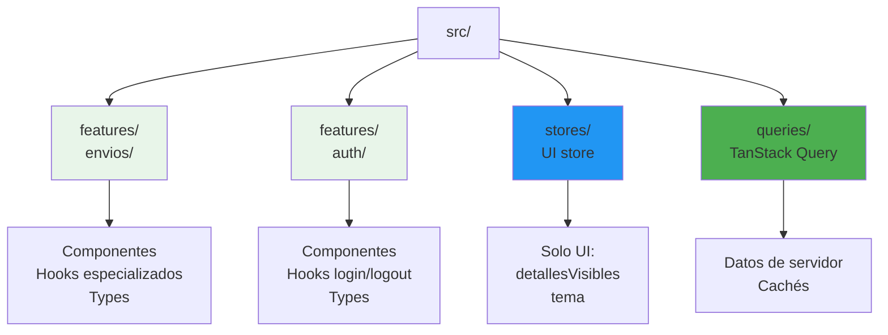
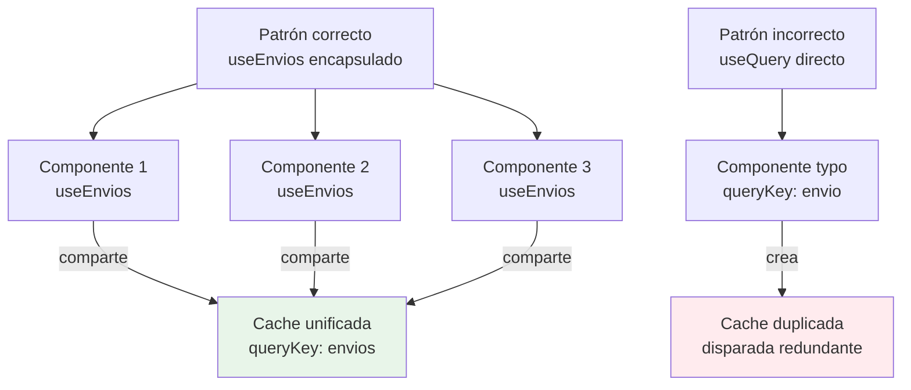

# Módulo 12: Proyecto integrador — SPA con datos reales


## Aprende construyendo

**Servidor del módulo:** el integrador es un proyecto TypeScript nuevo, `rutaflow-react`, creado en el Tema 1 con la plantilla `react-ts` (React 19, Vite 8, TypeScript 7) y Vitest configurado como en el Módulo 0. `npm run dev` lo sirve en `http://localhost:5173`, `npm test` ejecuta la prueba del flujo crítico y `npm run build` revisa los tipos con `tsc -b` antes de empaquetar. Si el puerto cambia, usa el que imprima la terminal. Todo el integrador usa un único dominio: envíos. Aplica lo que aprendiste en el Módulo 11.

### Tema 1: Estructura del proyecto integrador

#### Paso 1 · Objetivo y preparación
Al finalizar vas a organizar el proyecto integrador de RutaFlow en `features/envios/` y `features/auth/`, separando ambos del store de Zustand reservado solo para UI. Prerrequisitos: módulos 0-11 completos.

#### Paso 2 · Contexto y caso real
A lo largo del track construiste piezas sueltas (componentes, rutas, queries, store) en módulos distintos — nadie confirmó todavía que organizarlas en un único proyecto real no termina mezclando responsabilidades que deberían permanecer separadas.

#### Paso 3 · Teoría, modelo mental y analogía
Organizar por feature agrupa cada dominio (envíos, autenticación) con sus propios componentes y hooks; el estado de UI pura vive en un store separado, sin mezclarse con datos de servidor.

**Diagrama: Arquitectura por features**



**¿Por qué es importante?** Separar features por dominio, y aislar el estado de UI puro en un store dedicado sin mezclarlo con datos de servidor, mantiene el proyecto comprensible y evita complicaciones de mezclar estados con ciclos de vida distintos.
**Conceptos clave:** organización por feature, separación entre `features/` y `store/`.

Siguiendo el principio de organización por feature, el proyecto se estructura en `features/envios/` (con `ListaEnvios.tsx` para la vista y `useEnvios.ts` como hook dedicado que encapsula el acceso a datos con TanStack Query) y `features/auth/` (con `RutaProtegida.tsx` y `useAuth.ts`), manteniendo separadas las responsabilidades de dominio de gestión de envíos y de autenticación, comunicándose entre sí únicamente a través de puntos de integración explícitos.

`store/uiStore.ts`, un store de Zustand (Módulo 7) reservado exclusivamente para estado de interfaz puro (por ejemplo, si la barra lateral está abierta o cerrada), vive deliberadamente separado de la lógica de datos de cada feature, reflejando la separación estudiada en el Módulo 7 entre estado de servidor (que pertenece a los hooks de TanStack Query dentro de cada feature) y estado de cliente puro (que pertenece a este store dedicado, sin mezclarse con datos de red).

**Analogía:** la estructura del proyecto integrador es como una empresa con departamentos claramente delimitados por función (envíos, autenticación) más una oficina central separada que gestiona únicamente aspectos generales de la instalación (como si las luces de cierta sección están encendidas), sin que esa oficina central se entrometa en la lógica de negocio específica de cada departamento.

**Diagrama:**

```
src/
  features/
    envios/
      ListaEnvios.tsx
      useEnvios.ts        ← hook con TanStack Query
    auth/
      RutaProtegida.tsx
      useAuth.ts
  store/
    uiStore.ts             ← Zustand, solo estado de cliente
  router.tsx
```


**Límites y decisión de uso:** Organizar por funcionalidades no exige duplicar cada componente compartido ni crear una capa para cada carpeta. Mueve piezas según responsabilidades y cambios conjuntos, manteniendo las pruebas que permiten reorganizar sin alterar comportamiento.

#### Paso 4 · Demostración guiada desde cero
Crea el proyecto del integrador con la plantilla de TypeScript (React 19, Vite 8 y TypeScript 7) junto a `mi-react`, e instala lo que usarán los tres temas, con la versión mayor fijada:

```bash
npm create vite@latest rutaflow-react -- --template react-ts
cd rutaflow-react
npm install
npm install react-router@8 @tanstack/react-query@5 zustand@5 zod@4
npm install -D vitest @testing-library/react @testing-library/jest-dom @testing-library/user-event jsdom msw@3
npm pkg set scripts.test="vitest run"
```

Crea esta estructura (borra `src/App.css` y `src/assets/`, que la plantilla trae y el integrador no usa); cada archivo aparece completo a continuación:

```text
public/api/envios.json
vite.config.ts           ← reemplaza el de la plantilla
src/
  setupTests.ts
  features/
    envios/
      envio.ts            ← esquema zod y tipo Envio
      useEnvios.ts        ← hook con TanStack Query (Tema 3)
      ListaEnvios.tsx
      flujo.test.tsx      ← prueba del flujo crítico
    auth/
      useAuth.ts
      RutaProtegida.tsx
      PaginaLogin.tsx
  store/
    uiStore.ts            ← Zustand, solo estado de cliente
  router.tsx
  App.tsx                ← reemplaza el de la plantilla
```

`public/api/envios.json` (datos estáticos que sirve Vite; el proyecto no tiene backend):

```json
[
  { "id": "RF-4471", "zona": "norte", "estado": "pendiente" },
  { "id": "RF-4472", "zona": "norte", "estado": "entregado" },
  { "id": "RF-5101", "zona": "sur", "estado": "pendiente" }
]
```

`vite.config.ts` (importa `defineConfig` de `vitest/config` para que TypeScript conozca la clave `test`):

```ts
import react from '@vitejs/plugin-react'
import { defineConfig } from 'vitest/config'

// https://vite.dev/config/ · https://vitest.dev/config/
export default defineConfig({
  plugins: [react()],
  test: {
    environment: 'jsdom',
    setupFiles: './src/setupTests.ts',
  },
})
```

`src/setupTests.ts`:

```ts
import '@testing-library/jest-dom/vitest'
import { cleanup } from '@testing-library/react'
import { afterEach } from 'vitest'

// Desmonta lo renderizado por cada prueba para que no se mezclen.
afterEach(cleanup)
```

`src/features/envios/envio.ts`:

```ts
import { z } from 'zod'

// El esquema es la única definición del envío: el tipo se deriva de él.
export const EnvioSchema = z.object({
  id: z.string().regex(/^RF-\d+$/),
  zona: z.enum(['norte', 'sur']),
  estado: z.enum(['pendiente', 'entregado']),
})

export const EnviosSchema = z.array(EnvioSchema)

export type Envio = z.infer<typeof EnvioSchema>
```

`src/features/auth/useAuth.ts`:

```ts
import { create } from 'zustand'

export type Usuario = { nombre: string }

type EstadoAuth = {
  usuario: Usuario | null
  iniciarSesion: (nombre: string) => void
  cerrarSesion: () => void
}

// Única fuente de verdad de la sesión (simulada: no hay backend en este proyecto).
export const useAuth = create<EstadoAuth>()((set) => ({
  usuario: null,
  iniciarSesion: (nombre) => set({ usuario: { nombre } }),
  cerrarSesion: () => set({ usuario: null }),
}))
```

`src/features/auth/RutaProtegida.tsx`:

```tsx
import type { ReactNode } from 'react'
import { Navigate } from 'react-router'
import { useAuth } from './useAuth.ts'

export default function RutaProtegida({ children }: { children: ReactNode }) {
  const usuario = useAuth((s) => s.usuario)
  // Sin sesión, redirige antes de montar a los hijos: sus consultas nunca se disparan.
  return usuario ? children : <Navigate to="/login" replace />
}
```

`SubmitEvent` es el tipo de React 19 para el evento `submit` de un formulario (el antiguo `FormEvent` está marcado como obsoleto en `@types/react` 19). `src/features/auth/PaginaLogin.tsx`:

```tsx
import type { SubmitEvent } from 'react'
import { useNavigate } from 'react-router'
import { useAuth } from './useAuth.ts'

export default function PaginaLogin() {
  const iniciarSesion = useAuth((s) => s.iniciarSesion)
  const navegar = useNavigate()

  function entrar(evento: SubmitEvent<HTMLFormElement>) {
    evento.preventDefault()
    // FormData.get devuelve FormDataEntryValue | null: conviértelo antes de usarlo.
    const nombre = String(new FormData(evento.currentTarget).get('nombre') ?? '').trim()
    if (!nombre) return
    iniciarSesion(nombre)
    navegar('/envios')
  }

  return (
    <form onSubmit={entrar}>
      <h1>Iniciar sesión</h1>
      <label>
        Nombre <input name="nombre" required />
      </label>
      <button type="submit">Entrar</button>
    </form>
  )
}
```

`src/features/envios/useEnvios.ts`:

```ts
import { useQuery } from '@tanstack/react-query'
import { EnviosSchema, type Envio } from './envio.ts'

// Único lugar que conoce la queryKey y la queryFn de los envíos.
export function useEnvios() {
  return useQuery({
    queryKey: ['envios'],
    staleTime: 60_000, // datos frescos un minuto: los consumidores nuevos no repiten la petición
    queryFn: async (): Promise<Envio[]> => {
      const respuesta = await fetch('/api/envios.json')
      if (!respuesta.ok) throw new Error(`HTTP ${respuesta.status}`)
      // El tipo no valida nada en ejecución: parse() sí rechaza datos con otra forma.
      return EnviosSchema.parse(await respuesta.json())
    },
  })
}
```

`src/features/envios/ListaEnvios.tsx`:

```tsx
import { useUiStore } from '../../store/uiStore.ts'
import { useEnvios } from './useEnvios.ts'

function ContadorPendientes() {
  const { data: envios = [] } = useEnvios() // misma caché que ListaEnvios
  return <p>Pendientes: {envios.filter((e) => e.estado === 'pendiente').length}</p>
}

export default function ListaEnvios() {
  const { data: envios, isPending, isError } = useEnvios() // TanStack Query, independiente de RutaProtegida
  const detallesVisibles = useUiStore((s) => s.detallesVisibles) // Zustand, solo UI
  const alternarDetalles = useUiStore((s) => s.alternarDetalles)

  if (isPending) return <p role="status">Cargando envíos…</p>
  if (isError) return <p role="alert">No pudimos cargar los envíos.</p>
  return (
    <section>
      <h1>Envíos</h1>
      <ContadorPendientes />
      <button onClick={alternarDetalles}>{detallesVisibles ? 'Ocultar' : 'Mostrar'} detalles</button>
      <ul>
        {envios.map((envio) => (
          <li key={envio.id}>
            {envio.id}
            {detallesVisibles && ` · ${envio.zona} · ${envio.estado}`}
          </li>
        ))}
      </ul>
    </section>
  )
}
```

`src/store/uiStore.ts`:

```ts
import { create } from 'zustand'

type EstadoUi = {
  detallesVisibles: boolean
  alternarDetalles: () => void
}

// Solo estado de interfaz: nada que venga de la API ni de la sesión.
export const useUiStore = create<EstadoUi>()((set) => ({
  detallesVisibles: false,
  alternarDetalles: () => set((s) => ({ detallesVisibles: !s.detallesVisibles })),
}))
```

`src/router.tsx`:

```tsx
import { createBrowserRouter, Navigate, Outlet, type RouteObject } from 'react-router'
import PaginaLogin from './features/auth/PaginaLogin.tsx'
import RutaProtegida from './features/auth/RutaProtegida.tsx'
import ListaEnvios from './features/envios/ListaEnvios.tsx'

function LayoutEnvios() {
  return (
    <main>
      <nav>RutaFlow · Panel de envíos</nav>
      <Outlet />
    </main>
  )
}

export const rutas: RouteObject[] = [
  { path: '/', element: <Navigate to="/envios" replace /> },
  { path: '/login', element: <PaginaLogin /> },
  {
    path: '/envios',
    element: (
      <RutaProtegida>
        <LayoutEnvios />
      </RutaProtegida>
    ),
    children: [{ index: true, element: <ListaEnvios /> }],
  },
]

export const router = createBrowserRouter(rutas)
```

`src/App.tsx` (reemplaza el de la plantilla; `src/main.tsx` se queda igual):

```tsx
import { QueryClient, QueryClientProvider } from '@tanstack/react-query'
import { RouterProvider } from 'react-router'
import { router } from './router.tsx'

const queryClient = new QueryClient()

export default function App() {
  return (
    <QueryClientProvider client={queryClient}>
      <RouterProvider router={router} />
    </QueryClientProvider>
  )
}
```

`src/features/envios/flujo.test.tsx`, la prueba del flujo crítico con MSW (Módulo 8). MSW 3 llama `onUnhandledFrame` a la opción que antes se llamaba `onUnhandledRequest`:

```tsx
import { QueryClient, QueryClientProvider } from '@tanstack/react-query'
import { render, screen } from '@testing-library/react'
import userEvent from '@testing-library/user-event'
import { http, HttpResponse } from 'msw'
import { setupServer } from 'msw/node'
import { createMemoryRouter, RouterProvider } from 'react-router'
import { afterAll, afterEach, beforeAll, beforeEach, expect, it } from 'vitest'
import { rutas } from '../../router.tsx'
import { useAuth } from '../auth/useAuth.ts'

let peticiones = 0
const server = setupServer(
  http.get('/api/envios.json', () => {
    peticiones++
    return HttpResponse.json([{ id: 'RF-4471', zona: 'norte', estado: 'pendiente' }])
  }),
)
beforeAll(() => server.listen({ onUnhandledFrame: 'error' }))
beforeEach(() => {
  peticiones = 0
  useAuth.setState({ usuario: null }) // el store de Zustand vive entre pruebas
})
afterEach(() => server.resetHandlers())
afterAll(() => server.close())

function renderizar(ruta: string) {
  const router = createMemoryRouter(rutas, { initialEntries: [ruta] })
  // retry: false para que un error se vea al instante y no tras tres reintentos.
  const cliente = new QueryClient({ defaultOptions: { queries: { retry: false } } })
  render(
    <QueryClientProvider client={cliente}>
      <RouterProvider router={router} />
    </QueryClientProvider>,
  )
}

it('sin sesión redirige a /login sin pedir envíos; tras entrar, muestra la lista', async () => {
  renderizar('/envios')
  expect(await screen.findByRole('heading', { name: 'Iniciar sesión' })).toBeInTheDocument()
  expect(peticiones).toBe(0)

  await userEvent.type(screen.getByLabelText('Nombre'), 'Ana')
  await userEvent.click(screen.getByRole('button', { name: 'Entrar' }))
  expect(await screen.findByText('RF-4471')).toBeInTheDocument()
  expect(screen.getByText('Pendientes: 1')).toBeInTheDocument()
  expect(peticiones).toBe(1) // ListaEnvios y ContadorPendientes comparten la misma petición
})

it('si la API cambia la forma de un envío, muestra el error en vez de datos mal tipados', async () => {
  server.use(
    http.get('/api/envios.json', () =>
      HttpResponse.json([{ id: 'RF-4471', zona: 'norte', estado: 'perdido' }]),
    ),
  )
  useAuth.setState({ usuario: { nombre: 'Ana' } })
  renderizar('/envios')
  expect(await screen.findByRole('alert')).toHaveTextContent('No pudimos cargar los envíos.')
})
```

```bash
npm test
npm run build
npm run dev
```

**Resultado esperado:** `npm test` informa en verde las dos pruebas de `flujo.test.tsx`; `npm run build` ejecuta primero `tsc -b`, que revisa los tipos de todo `src/` (pruebas incluidas), y termina con `✓ built`. Abre `http://localhost:5173/envios`: te lleva a `/login`; al entrar con cualquier nombre ves la lista y el contador de pendientes.

```text
 Test Files  1 passed (1)
      Tests  2 passed (2)
```

**Fallo deliberado (tipos):** en `ListaEnvios.tsx`, cambia `{envio.id}` por `{envio.guia}` y ejecuta `npx tsc -b`. **Error esperado:** `error TS2339: Property 'guia' does not exist on type '{ id: string; zona: "norte" | "sur"; estado: "entregado" | "pendiente"; }'`. **Diagnóstico:** el tipo `Envio` sale del esquema de `envio.ts`; si un campo no existe en el esquema, el compilador lo detecta antes de ejecutar. Restaura `envio.id`.

**Explicación por bloques:** `envio.ts` define el envío una sola vez con zod y deriva el tipo con `z.infer`, así el tipo y la validación no se separan. `useEnvios` declara que devuelve `Envio[]` y lo **comprueba** en ejecución con `EnviosSchema.parse`: un tipo de TypeScript desaparece al compilar y no valida lo que llega por la red. La segunda prueba lo demuestra: si la API devuelve `estado: 'perdido'`, `parse` lanza, TanStack Query marca la consulta como error y la pantalla muestra el mensaje en vez de pintar datos que no cumplen el tipo. `create<EstadoAuth>()(...)` es la forma tipada de Zustand 5 (los paréntesis dobles permiten inferir el resto). El `beforeEach` reinicia la sesión porque un store de Zustand es un módulo: vive entre pruebas.

Resultado esperado de la organización: recorriendo el código fuente carpeta por carpeta, ningún archivo de `features/envios/` importa nada de `features/auth/` directamente (ambos se comunican solo a través de `RutaProtegida` en `router.tsx`; la prueba sí usa `useAuth` para preparar la sesión), y `uiStore.ts` no contiene ningún dato que provenga de una API ni de la sesión.

#### Paso 5 · Práctica guiada
Pista: agrega temporalmente el estado de "sesión activa" (que viene de `useAuth`) dentro de `uiStore.ts` de Zustand, "para tenerlo centralizado" — ese es el fallo deliberado: ahora existen dos fuentes para saber si hay sesión activa (el store de Zustand y el propio `useAuth`), y pueden desincronizarse si alguna actualiza sin que la otra se entere.

#### Paso 6 · Práctica independiente
Corrige el Paso 5 quitando el estado de sesión de `uiStore.ts`, dejando que `useAuth` sea la única fuente, y revisa el resto del proyecto buscando otras violaciones similares de la separación por feature.

#### Paso 7 · Cierre
Entrega la estructura organizada por feature del Paso 4, la duplicación de fuente de verdad provocada en el Paso 5, y la revisión del Paso 6; explica por qué integrar todos los módulos del track en un solo proyecto expone violaciones de organización que un módulo aislado nunca mostraría. Siguiente paso: integra rutas, TanStack Query y Zustand coordinadamente. Errores comunes: mezclar features sin un punto de integración explícito, duplicar en un store de UI un dato que ya tiene una fuente de verdad propia, y organizar carpetas por tipo de archivo en vez de por dominio. Fuentes oficiales: https://react.dev/learn/thinking-in-react y https://tanstack.com/query/latest/docs/framework/react/overview.

### Tema 2: Integrando rutas, TanStack Query y Zustand

#### Paso 1 · Objetivo y preparación
Al finalizar vas a proteger las rutas de `features/envios/` con `RutaProtegida` (que usa `useAuth`), mientras `useEnvios` (Tema 3) gestiona su propio ciclo de cache sin ninguna interferencia del store de Zustand. Prerrequisitos: Tema 1 de este módulo.

#### Paso 2 · Contexto y caso real
Un conductor sin sesión activa no debería poder ver `/envios` en absoluto — pero nadie confirmó todavía que la protección de ruta y la consulta de datos no interfieren entre sí de alguna forma inesperada.

#### Paso 3 · Teoría, modelo mental y analogía
`RutaProtegida` verifica la sesión antes de permitir el acceso; `useEnvios` encapsula el acceso a datos; el store de Zustand se mantiene exclusivamente para estado de UI — tres piezas independientes coordinadas a través de puntos de integración explícitos.
**Conceptos clave:** rutas protegidas con layout, estado de servidor centralizado en un hook dedicado.

`RutaProtegida` (Módulo 5) envuelve las rutas de la feature de envíos, verificando la sesión activa mediante `useAuth` antes de permitir el acceso, redirigiendo a `/login` en caso contrario; el layout compartido de esas rutas (con la navegación común) se define una única vez en la configuración de rutas anidadas, evitando duplicarlo en cada vista individual de la feature de envíos.

`useEnvios()` (Tema 3) encapsula completamente el acceso a datos de envíos detrás de un hook dedicado de la feature, de modo que los componentes de vista (`ListaEnvios.tsx`) simplemente invocan ese hook sin necesidad de conocer los detalles de `queryKey`, `queryFn`, ni la configuración específica de TanStack Query subyacente, un nivel de abstracción que hace que la lógica de acceso a datos sea reemplazable o modificable (por ejemplo, cambiando el endpoint real consultado) sin tocar el código de los componentes de vista que simplemente consumen el resultado del hook.

El store de Zustand (`uiStore.ts`) se consume únicamente para estado de interfaz pura, como si los detalles de la lista están visibles, completamente desacoplado de `useEnvios`, que gestiona su propio ciclo de cache, invalidación y refetch de forma independiente mediante TanStack Query, sin ninguna interferencia entre ambos sistemas de estado.

**Analogía:** integrar estas piezas es como coordinar la entrada de seguridad de un edificio (la ruta protegida), un departamento de datos centralizado que sabe cómo consultar y actualizar información real (el hook `useEnvios`), y un panel de control de instalaciones generales completamente separado (el store de Zustand para UI), cada uno operando de forma independiente pero coordinada a través de puntos de integración claros.

**¿Por qué es importante?** Encapsular el acceso a datos detrás de un hook dedicado por feature hace que la lógica de datos sea reemplazable sin afectar los componentes de vista; mantener el estado de UI completamente separado del estado de servidor evita interferencias entre ambos sistemas.

**Diagrama:**

```
RutaProtegida (useAuth) → protege las rutas de envíos con layout compartido
ListaEnvios.tsx → consume useEnvios() → TanStack Query gestiona cache/invalidación
uiStore.ts (Zustand) → solo estado de UI pura, desacoplado de useEnvios
```


#### Paso 4 · Demostración guiada desde cero
Este tema usa el código completo que creaste en el Tema 1. Las dos piezas que se coordinan son la ruta protegida de `src/router.tsx`:

```jsx
{
  path: '/envios',
  element: <RutaProtegida><LayoutEnvios /></RutaProtegida>,
  children: [{ index: true, element: <ListaEnvios /> }],
},
```

y el inicio de `ListaEnvios` en `src/features/envios/ListaEnvios.tsx`:

```jsx
const { data: envios, isPending, isError } = useEnvios(); // TanStack Query, independiente de RutaProtegida
const detallesVisibles = useUiStore((s) => s.detallesVisibles); // Zustand, solo UI
```

Arranca con `npm run dev`, abre `http://localhost:5173/envios` con la pestaña Network de DevTools abierta y ejecuta también `npm test`.

Resultado esperado: un conductor sin sesión es redirigido a `/login` antes de que `ListaEnvios` llegue a montarse, por lo que `useEnvios()` nunca dispara ninguna petición de red para un usuario no autenticado: en Network no aparece `envios.json` hasta que entras, y `flujo.test.tsx` lo comprueba con `expect(peticiones).toBe(0)`.

#### Paso 5 · Práctica guiada
Pista: mueve la llamada a `useEnvios()` a un componente por encima de `RutaProtegida` en el árbol (por ejemplo, el layout raíz de la app) "para cargar los datos más temprano" — ese es el fallo deliberado: ahora `useEnvios()` dispara su petición antes de que `RutaProtegida` verifique la sesión, consultando `/api/envios.json` incluso para un conductor sin sesión activa (y `flujo.test.tsx` falla en `expect(peticiones).toBe(0)`).

#### Paso 6 · Práctica independiente
Corrige el Paso 5 devolviendo `useEnvios()` dentro de `ListaEnvios` (bajo `RutaProtegida`), y confirma con la pestaña Network que ningún conductor sin sesión dispara esa petición. En el proyecto integrador RutaFlow, separa la ruta, la query de envíos y el filtro de Zustand, y prueba la pantalla con red lenta.

#### Paso 7 · Cierre
Entrega la integración correctamente ordenada del Paso 4, la petición indebida provocada en el Paso 5, y la corrección confirmada del Paso 6; explica por qué el orden en el árbol de componentes determina cuándo efectivamente se dispara una consulta de datos. Siguiente paso: estudia useEnvios en profundidad. Errores comunes: disparar consultas de datos sensibles antes de verificar autenticación, mezclar el store de Zustand con lógica de autenticación que ya tiene su propia fuente en `useAuth`, y duplicar el layout de rutas protegidas en cada vista individual. Fuentes oficiales: https://reactrouter.com/start/framework/routing y https://tanstack.com/query/latest/docs/framework/react/overview.
**Implicación práctica:** El orden de envoltura en el árbol de componentes determina si una consulta de datos se dispara antes o después de verificar autenticación, con implicancias reales de seguridad y de tráfico de red innecesario.

### Tema 3: useEnvios — hook dedicado con TanStack Query

#### Paso 1 · Objetivo y preparación
Al finalizar vas a encapsular `useQuery` detrás de `useEnvios()`, de forma que ningún componente de la feature necesite conocer la `queryKey` ni la `queryFn` reales. Prerrequisitos: Tema 2 de este módulo.

#### Paso 2 · Contexto y caso real
Si tres componentes distintos (`ListaEnvios`, `ResumenZona`, `ContadorPendientes`) invocaran `useQuery` directamente cada uno con su propia `queryKey` escrita a mano, un simple typo en uno de ellos (`['envio']` en vez de `['envios']`) rompería silenciosamente la deduplicación entre los tres.

#### Paso 3 · Teoría, modelo mental y analogía
Encapsular `queryKey`/`queryFn` detrás de un hook con nombre significativo centraliza los detalles de acceso a datos en un único lugar — un mostrador de atención específico, sin que quien consulta necesite saber cómo se obtiene la información.

**Diagrama:**



* Cuándo: encapsular `useQuery` siempre cuando múltiples componentes lo usen; no conviene si es usado una única vez en un componente aislado (entonces usa `useQuery` directamente).

**¿Por qué es importante?** Encapsular `queryKey`/`queryFn` detrás de un hook con nombre significativo centraliza los detalles de acceso a datos, facilitando cambios futuros y evitando inconsistencias entre componentes.

#### Paso 4 · Demostración guiada desde cero
El hook ya está en `src/features/envios/useEnvios.ts` (Tema 1):

```ts
import { useQuery } from '@tanstack/react-query'
import { EnviosSchema, type Envio } from './envio.ts'

// Único lugar que conoce la queryKey y la queryFn de los envíos.
export function useEnvios() {
  return useQuery({
    queryKey: ['envios'],
    staleTime: 60_000, // datos frescos un minuto: los consumidores nuevos no repiten la petición
    queryFn: async (): Promise<Envio[]> => {
      const respuesta = await fetch('/api/envios.json')
      if (!respuesta.ok) throw new Error(`HTTP ${respuesta.status}`)
      // El tipo no valida nada en ejecución: parse() sí rechaza datos con otra forma.
      return EnviosSchema.parse(await respuesta.json())
    },
  })
}
```

`ListaEnvios` y su `ContadorPendientes` lo llaman sin escribir `queryKey` ni `queryFn`. Arranca con `npm run dev` y abre la pestaña Network.

Resultado esperado: `ListaEnvios` y `ContadorPendientes` llaman los dos a `useEnvios()` sin que ninguno escriba `queryKey` ni `queryFn` directamente — comparten la misma cache, y en Network aparece una sola petición a `envios.json`. Ejecuta `npm test`: `flujo.test.tsx` lo comprueba con `expect(peticiones).toBe(1)`. (Sin `staleTime`, `ContadorPendientes`, que se monta después de que llegan los datos, provocaría una segunda petición: compruébalo quitándolo.)

#### Paso 5 · Práctica guiada
Pista: agrega un componente `ResumenZona` que, "para un caso puntual", invoque `useQuery` directamente con `queryKey: ['envio']` (singular, un typo) en vez de usar `useEnvios()` — ese es el fallo deliberado: ese componente mantiene su propia cache separada y desincronizada del resto, disparando una petición de red adicional redundante que los otros dos ya tenían cacheada bajo la key correcta.

#### Paso 6 · Práctica independiente
Corrige el Paso 5 devolviendo `ResumenZona` a `useEnvios()`, y agrega un `useCrearEnvio()` complementario que envuelva `useMutation` con su propia invalidación de `['envios']` configurada. Usa el mismo patrón para cualquier otra consulta del integrador y comprueba que dos componentes compartan la misma query sin duplicar peticiones.

#### Paso 7 · Cierre
Entrega `useEnvios()` compartido por varios componentes del Paso 4, la cache duplicada por typo del Paso 5, y `useCrearEnvio()` del Paso 6; explica por qué encapsular el acceso a datos detrás de un hook con nombre significativo previene exactamente la clase de error que ocurrió en el Paso 5. Siguiente paso: cierra el track con el laboratorio integrador completo. Errores comunes: invocar `useQuery` directamente en vez de a través de un hook dedicado, escribir la misma `queryKey` a mano en múltiples lugares, y no extender la misma capa de hooks a las mutaciones relacionadas. Fuentes oficiales: https://tanstack.com/query/latest/docs/framework/react/guides/query-keys y https://react.dev/learn/reusing-logic-with-custom-hooks.

## Laboratorio práctico

**Objetivo del laboratorio:** construir la SPA integradora completa con rutas protegidas, TanStack Query, Zustand para UI, y tests del flujo crítico.

**Requisitos previos:** Módulos 0-11 completados.

| Paso | Acción | Código | Explicación |
|---|---|---|---|
| 1 | Organizar el proyecto por features | Ver Tema 1 | `envios/`, `auth/` separados |
| 2 | Implementar rutas protegidas con layout | Ver Tema 2 | `RutaProtegida` + layout compartido |
| 3 | Conectar TanStack Query con `useEnvios` | Ver Tema 3 | Queries y mutations encapsuladas |
| 4 | Agregar `uiStore` de Zustand solo para UI | Ver Tema 1 | Separado del estado de servidor |
| 5 | Escribir tests del flujo crítico | Tema 1 (`flujo.test.tsx`) y Módulo 8 | Testing Library + MSW |

**Verificación:** el laboratorio (y el track completo) se considera exitoso si la aplicación protege correctamente las rutas de envíos, si el estado de servidor y de UI permanecen completamente separados, y si los tests del flujo crítico pasan de forma determinista sin depender de red real.

**Errores comunes y soluciones**

- **Invocar `useQuery` directamente en cada componente en vez de encapsularlo en un hook dedicado.** Centraliza el acceso a datos en hooks como `useEnvios`.
- **Mezclar estado de UI y de servidor en el mismo store.** Mantén `uiStore` exclusivamente para estado de interfaz pura.
- **Omitir tests del flujo crítico.** Prioriza probar el camino principal completo (login → ver envíos → crear envío) sobre casos secundarios.

---
