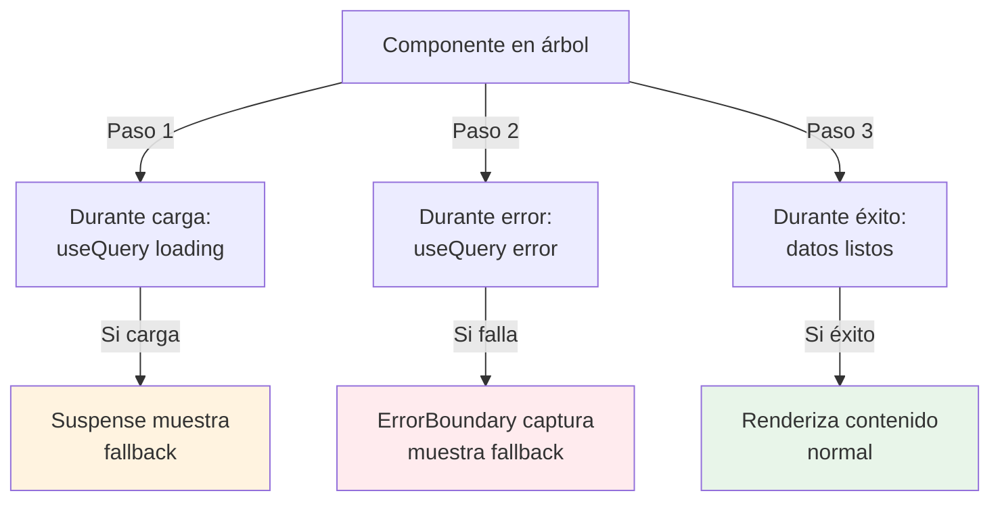
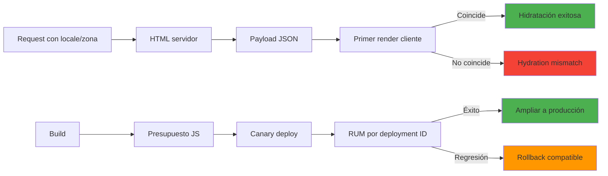
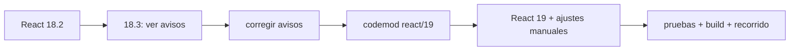

# Módulo 13: React en producción — resiliencia, accesibilidad y seguridad

Una SPA puede aprobar el flujo feliz y aun desaparecer ante un error de render, perder foco al navegar, ejecutar HTML hostil o hidratar con información distinta a la del servidor. Este módulo convierte el proyecto final en una interfaz que falla de forma contenida, recupera con intención y conserva sus garantías entre cliente y servidor.


## Aprende construyendo

**Servidor del módulo:** los temas 1 y 2 se ejecutan en `mi-react` (`npm run dev`, `http://localhost:5173`; `npm test` usa el Vitest configurado en el módulo 0). Los temas 3 y 4 necesitan servidor y se ejecutan en el proyecto Next.js `app` del módulo 10 (`http://localhost:3000`).


### Tema 1: Diseñar estados de carga, error y recuperación · Avanzado · 45 min

<details open>
<summary><strong>Capa 1 — Lectura</strong></summary>

#### ► DE QUÉ TRATA
Al finalizar vas a envolver DetalleEnvio en un ErrorBoundary + Suspense que distinga un fallo real de la carga normal, con un botón de recuperación que invalida la query en vez de repetir el mismo recurso rechazado. Prerrequisitos: Módulo 6 completo.

#### ► CÓMO FUNCIONA


</details>

<details>
<summary><strong>Capa 2 — Construcción</strong></summary>

#### Código y verificación

```tsx
<ErrorBoundary
  resetKeys={[taskId]}
  fallbackRender={({ resetErrorBoundary }) => (
    <section role="alert">
      <h2>No pudimos mostrar la tarea</h2>
      <button onClick={resetErrorBoundary}>Intentar de nuevo</button>
    </section>
  )}
  onError={(error, info) => reportError(error, info.componentStack)}
>
  <Suspense fallback={<TaskSkeleton />}>
    <TaskDetails id={taskId} />
  </Suspense>
</ErrorBoundary>
```

```text
render puro -> suspende -> Suspense fallback -> recurso resuelve -> UI
           `-> error -> boundary más cercano -> fallback + reporte
evento async -> catch explícito -> estado recuperable
reset -> nuevo recurso/precondición, no repetir objeto rechazado
```

```jsx
import { Suspense, use, useState } from 'react';
import { ErrorBoundary } from 'react-error-boundary';

// API simulada: RF-0000 siempre falla para poder ver el boundary.
const cache = new Map();
function obtenerEnvio(id) {
  if (!cache.has(id)) {
    cache.set(id, new Promise((resolve, reject) => setTimeout(() => {
      if (id === 'RF-0000') reject(new Error(`La API no encontró ${id}`));
      else resolve({ id, estado: 'en ruta' });
    }, 800)));
  }
  return cache.get(id);
}

function reportError(error, componentStack) {
  console.error('Reportado al servicio de errores:', error.message, componentStack);
}

function EnvioSkeleton() {
  return <p role="status">Cargando envío…</p>;
}

function DetalleEnvio({ id }) {
  const envio = use(obtenerEnvio(id)); // suspende mientras carga, lanza si la promesa falla
  return <p>{envio.id}: {envio.estado}</p>;
}

export default function App() {
  const [envioId, setEnvioId] = useState('RF-4471');
  return (
    <main>
      <nav>
        <button onClick={() => setEnvioId('RF-4471')}>RF-4471</button>
        <button onClick={() => setEnvioId('RF-0000')}>RF-0000 (falla)</button>
      </nav>
      <ErrorBoundary
        resetKeys={[envioId]}
        fallbackRender={({ resetErrorBoundary }) => (
          <section role="alert">
            <h2>No pudimos mostrar este envío</h2>
            <button onClick={resetErrorBoundary}>Intentar de nuevo</button>
          </section>
        )}
        onError={(error, info) => reportError(error, info.componentStack)}
      >
        <Suspense fallback={<EnvioSkeleton />}>
          <DetalleEnvio id={envioId} />
        </Suspense>
      </ErrorBoundary>
    </main>
  );
}
```

```bash
npm install react-error-boundary
npm run dev
```

</details>

### Tema 2: La composición visual debe conservar semántica y foco · Avanzado · 45 min

<details open>
<summary><strong>Capa 1 — Lectura</strong></summary>

#### ► DE QUÉ TRATA
Al finalizar vas a corregir el campo de PIN de confirmación de entrega para que un error de validación mueva el foco al campo inválido y lo anuncie mediante aria-describedby, en vez de solo cambiar un color. Prerrequisitos: Tema 1 de este módulo.

</details>

<details>
<summary><strong>Capa 2 — Construcción</strong></summary>

#### Código y verificación
```tsx
function Field({ id, label, error, ...props }: FieldProps) {
  const errorId = `${id}-error`;
  return (
    <div>
      <label htmlFor={id}>{label}</label>
      <input
        id={id}
        aria-invalid={Boolean(error)}
        aria-describedby={error ? errorId : undefined}
        {...props}
      />
      {error && <p id={errorId}>{error}</p>}
    </div>
  );
}
```

```text
componente -> elemento nativo -> nombre + rol + estado
acción teclado -> foco predecible -> feedback asociado
Testing Library/axe -> regresión automática
teclado + lector -> flujo completo comprensible
```

```jsx
import { useState } from 'react';

function CampoPin({ id, label, error, ...props }) {
  const errorId = `${id}-error`;
  return (
    <div>
      <label htmlFor={id}>{label}</label>
      <input id={id} aria-invalid={Boolean(error)} aria-describedby={error ? errorId : undefined} {...props} />
      {error && <p id={errorId} role="alert">{error}</p>}
    </div>
  );
}

export default function App() {
  const [error, setError] = useState('');
  function enviar(evento) {
    evento.preventDefault();
    const pin = new FormData(evento.currentTarget).get('pin');
    setError(pin === '837201' ? '' : 'El PIN no coincide con el de la guía.');
  }
  return (
    <form onSubmit={enviar}>
      <CampoPin id="pin" name="pin" label="PIN de entrega" inputMode="numeric" error={error} />
      <button type="submit">Confirmar</button>
    </form>
  );
}
```

```bash
npm run dev
```

</details>

### Tema 3: Cliente y servidor forman una sola frontera de seguridad · Avanzado · 45 min

<details open>
<summary><strong>Capa 1 — Lectura</strong></summary>

#### ► DE QUÉ TRATA
Al finalizar vas a auditar la Server Action confirmarEntregaAction (Módulo 10) para confirmar que autentica y autoriza dentro de la propia función, no solo ocultando el botón en el cliente. Prerrequisitos: Tema 2 de este módulo.

#### ► LA ANALOGÍA
Una Server Action es un endpoint invocable, no una función privada por estar junto al componente — una puerta tras el mostrador, no una habitación secreta; debe autenticar y autorizar dentro de la propia acción.
**Conceptos clave:** XSS, escape, dangerouslySetInnerHTML, sanitización contextual, URL, CSP, nonce, Server Component, Client Component, serialización, secreto, Server Action, autenticación, autorización, CSRF y cache.

React escapa texto interpolado. `dangerouslySetInnerHTML` omite esa protección porque declara HTML intencional. Solo recibe contenido sanitizado por una política mantenida y apropiada al contexto; no una regex. Valida protocolos de URLs y evita `javascript:`. Librerías que tocan DOM pueden crear sinks fuera de JSX.

```tsx
function RichDescription({ sanitizedHtml }: { sanitizedHtml: SanitizedHtml }) {
  return <section dangerouslySetInnerHTML={{ __html: sanitizedHtml.value }} />;
}
```

El tipo de marca ayuda a que solo el sanitizador cree `SanitizedHtml`, pero no demuestra que la implementación sea segura: prueba payloads y revisa configuración. CSP con nonce/hashes y Trusted Types agrega defensa. Evita permitir `unsafe-inline` global para hacer desaparecer errores.

Server Components no envían su código al cliente, pero los valores que pasan a Client Components se serializan y llegan al navegador. Nunca pases secreto, credencial o objeto con campos privados. Minimiza DTO en la frontera `use client`.

Server Actions son endpoints invocables, no funciones privadas por estar junto al componente. Autentica y autoriza dentro de cada acción, valida `FormData`, protege invariantes y considera CSRF/origen según cookies e infraestructura. Ocultar botón no impide llamar la acción.

La cache del servidor debe incluir identidad, permisos, locale y demás dimensiones que cambian resultado, o evitar cache compartida para datos privados. Tras una mutación, invalida datos correctos sin mostrar a otro usuario una respuesta reutilizada.

```ts
export async function deleteTask(formData: FormData) {
  'use server';
  const session = await requireSession();
  const taskId = TaskId.parse(formData.get('taskId'));
  await authorize(session.userId, 'delete', taskId);
  await tasks.delete(taskId);
}
```

**Analogía:** un Server Action es una puerta tras el mostrador, no una habitación secreta. Aunque el cliente normal llegue mediante un botón, cualquiera puede intentar la dirección y la puerta debe verificar identidad y permiso.

**Casos de uso reales:** CMS, markdown, avatar URL, acción admin, cookie de sesión, RSC con objeto usuario, cache de dashboard y error serializado.

**Diagrama:**

```text
DB/secreto -> Server Component -> DTO mínimo serializable -> Client Component
form/browser -> Server Action -> autenticar -> autorizar -> validar -> mutar
texto -> escape React; HTML permitido -> sanitizador -> sink auditado
CSP/Trusted Types cubren DOM completo
```


**Límites y decisión de uso:** Renderizar en servidor no vuelve confiables entradas ni oculta automáticamente secretos. Revalida sesión y autorización en cada operación y limita los datos enviados al cliente; un control de navegación no sustituye ese límite.

**¿Por qué es importante?** Mezclar render de servidor/cliente mueve datos y acciones a través de fronteras invisibles en JSX; un supuesto equivocado sobre quién verifica qué filtra datos o autoriza por interfaz en vez de por permiso real.

</details>

<details>
<summary><strong>Capa 2 — Construcción</strong></summary>

#### Objetivo observable
Al finalizar vas a auditar la Server Action `confirmarEntregaAction` (Módulo 10) para confirmar que autentica y autoriza dentro de la propia función, no solo ocultando el botón en el cliente. Prerrequisitos: Tema 2 de este módulo.

</details>

### Tema 4: Hidratación determinista, idioma y releases medibles · Experto · 45 min

<details open>
<summary><strong>Capa 1 — Lectura</strong></summary>

#### ► DE QUÉ TRATA
Al finalizar vas a eliminar un mismatch de hidratación en DetalleEnvio causado por formatear la fecha estimada con la zona horaria del navegador del cliente, distinta de la usada en el servidor. Prerrequisitos: Tema 3 de este módulo.

#### ► LA ANALOGÍA
La hidratación une listeners al HTML del servidor asumiendo que el primer render del cliente coincide exactamente; una zona horaria implícita (o `Date.now()`, `Math.random()`) produce un mismatch.
**Conceptos clave:** SSR, hydration, mismatch, determinismo, identifierPrefix, suppressHydrationWarning, locale, timezone, RTL, streaming, bundle budget, Core Web Vitals, RUM, deployment ID y rollback.

Hydration une listeners al HTML del servidor suponiendo que el primer render cliente coincide. `Date.now()`, `Math.random()`, lectura directa de `window`, locale distinta o datos que cambian entre respuestas producen mismatch. Pasa snapshot serializable, usa IDs estables (`useId` cuando corresponde) y difiere contenido exclusivamente cliente después del montaje si no puede renderizarse igual.

`suppressHydrationWarning` silencia una diferencia inevitable en un nivel; no corrige datos ni debe cubrir árboles completos. Investiga primero: una divergencia puede asociar handlers con DOM equivocado o forzar render cliente.

El locale decidido en servidor debe llegar al cliente y a la ruta. Formatea números, moneda y fecha con locale y zona explícitos. Traduce contenido, labels, errores, metadatos y fallbacks de Suspense. Soporta plural completo y RTL mediante propiedades CSS lógicas (lo practicas con mensajes ICU y `next-intl` en el Módulo 14, Tema 4). Prueba textos largos y mezcla bidireccional.

```tsx
const price = new Intl.NumberFormat(locale, {
  style: 'currency',
  currency: task.currency,
}).format(task.amount);

const due = new Intl.DateTimeFormat(locale, {
  dateStyle: 'long',
  timeZone: userTimeZone,
}).format(new Date(task.dueAt));
```

Define presupuesto de JS inicial y por ruta, pero mide experiencia: LCP, INP y CLS en dispositivos reales, segmentados por versión y ruta. Server Components pueden reducir JS, pero queries secuenciales crean waterfalls. Streaming mejora contenido temprano si boundaries siguen la jerarquía visual.

Cada release incluye deployment ID en telemetría, source maps privados, canary y rollback. Cliente y servidor pueden coexistir durante despliegue; cambios de contrato deben ser compatibles. Un chunk viejo solicitado después de limpiar assets produce fallo: conserva assets por ventana o maneja actualización con recarga segura que no pierda formulario.

**Analogía:** hidratar es superponer un plano interactivo sobre un edificio ya construido. Si puerta y ventana aparecen en posiciones distintas, ocultar la advertencia no alinea el edificio.

**¿Por qué es importante?** porque SSR solo aporta valor si el cliente conserva el resultado, y una app global debe producir el mismo significado entre servidor, navegador y release.

**Casos de uso reales:** hora local distinta, ID aleatorio, tema desde localStorage, locale por header, RTL, chunk desaparecido, despliegue canary y rollback compatible.

**Diagrama:**



* Ejecutar: `npm run build && npm start` en el proyecto Next.js `app` del módulo 10

#### ► CÓMO FUNCIONA


</details>

<details>
<summary><strong>Capa 2 — Construcción</strong></summary>

#### Código y verificación
```tsx
const price = new Intl.NumberFormat(locale, {
  style: 'currency',
  currency: task.currency,
}).format(task.amount);

const due = new Intl.DateTimeFormat(locale, {
  dateStyle: 'long',
  timeZone: userTimeZone,
}).format(new Date(task.dueAt));
```


```tsx
'use client';

export default function FechaEntrega({ fechaEstimada, locale, userTimeZone }: {
  fechaEstimada: string; locale: string; userTimeZone: string;
}) {
  const due = new Intl.DateTimeFormat(locale, {
    dateStyle: 'long',
    timeZone: userTimeZone, // la misma zona decidida en el servidor, no la del navegador
  }).format(new Date(fechaEstimada));
  return <p>Entrega estimada: {due}</p>;
}
```

```tsx
import FechaEntrega from './FechaEntrega';

export default function PaginaFecha() {
  // Se decide una sola vez (aquí fijo; en una app real, desde la sesión del usuario).
  const locale = 'es-CO';
  const userTimeZone = 'America/Bogota';
  return <FechaEntrega fechaEstimada="2026-11-20T03:30:00Z" locale={locale} userTimeZone={userTimeZone} />;
}
```

```bash
npm run dev
```

</details>

### Tema 5: Migrar a React 19: codemods, cambios que rompen y verificación · Experto · 45 min

<details open>
<summary><strong>Capa 1 — Lectura</strong></summary>

#### ► DE QUÉ TRATA
Necesitas un proyecto con React 18, Git limpio y pruebas que pasen. Crea una rama migracion-react-19. Los codemods se ejecutan con npx codemod.

#### ► CÓMO FUNCIONA


</details>

<details>
<summary><strong>Capa 2 — Construcción</strong></summary>

#### Código y verificación


```jsx
// ANTES (React 18 y anteriores):
// import ReactDOM from 'react-dom';
// ReactDOM.render(<App />, document.getElementById('root'));

// DESPUÉS (lo que deja el codemod):
import { createRoot } from 'react-dom/client';
import App from './App';

createRoot(document.getElementById('root')).render(<App />);
```

```jsx
// ANTES: forwardRef y defaultProps.
// const Campo = forwardRef(function Campo({ etiqueta }, ref) { ... });
// Campo.defaultProps = { etiqueta: 'Código' };

// DESPUÉS: ref es una prop y el valor por defecto va en la firma.
export default function Campo({ etiqueta = 'Código', ref }) {
  return (
    <label>
      {etiqueta}
      <input ref={ref} />
    </label>
  );
}
```

```bash
git switch -c migracion-react-19
npm install react@18.3 react-dom@18.3 && npm test   # el portal necesita un script test, como el del módulo 0
npx codemod@latest react/19/migration-recipe
npm install react@19 react-dom@19
npm test && npm run build
```

```text
Con React 18.3, la consola muestra avisos «will be removed in React 19» para cada patrón obsoleto.
Después del codemod y de React 19: npm test pasa y npm run build termina sin errores.
```

</details>

### React 19.2, Compiler y seguridad de Server Components

<details open>
<summary><strong>Capa 1 — Lectura</strong></summary>

</details>

<details>
<summary><strong>Capa 2 — Construcción</strong></summary>

#### Nota de construcción
Este tema es principalmente conceptual en esta versión. La verificación se realiza con las preguntas de comprensión y el criterio de cuándo NO usar react 19.2, compiler y seguridad de server components.

</details>

### Proyecto: auditoría resiliente de la SPA y su versión Next.js

<details open>
<summary><strong>Capa 1 — Lectura</strong></summary>

</details>

<details>
<summary><strong>Capa 2 — Construcción</strong></summary>

#### Nota de construcción
Este tema es principalmente conceptual en esta versión. La verificación se realiza con las preguntas de comprensión y el criterio de cuándo NO usar proyecto: auditoría resiliente de la spa y su versión next.js.

</details>

### Método de estudio y proyecto de ampliación

<details open>
<summary><strong>Capa 1 — Lectura</strong></summary>

</details>

<details>
<summary><strong>Capa 2 — Construcción</strong></summary>

#### Nota de construcción
Este tema es principalmente conceptual en esta versión. La verificación se realiza con las preguntas de comprensión y el criterio de cuándo NO usar método de estudio y proyecto de ampliación.

</details>
