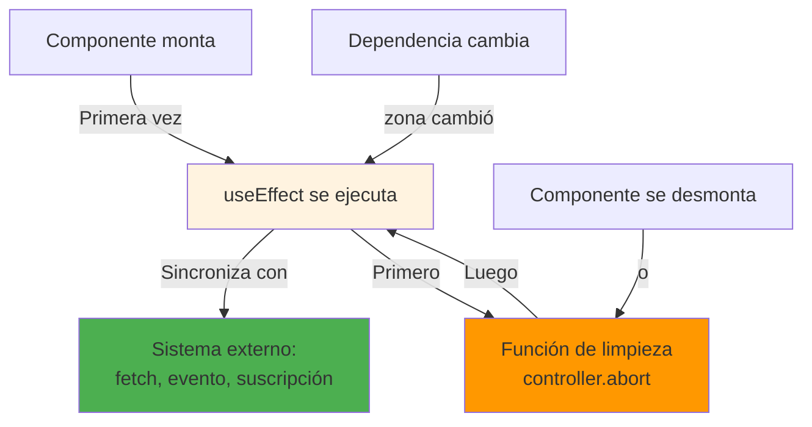
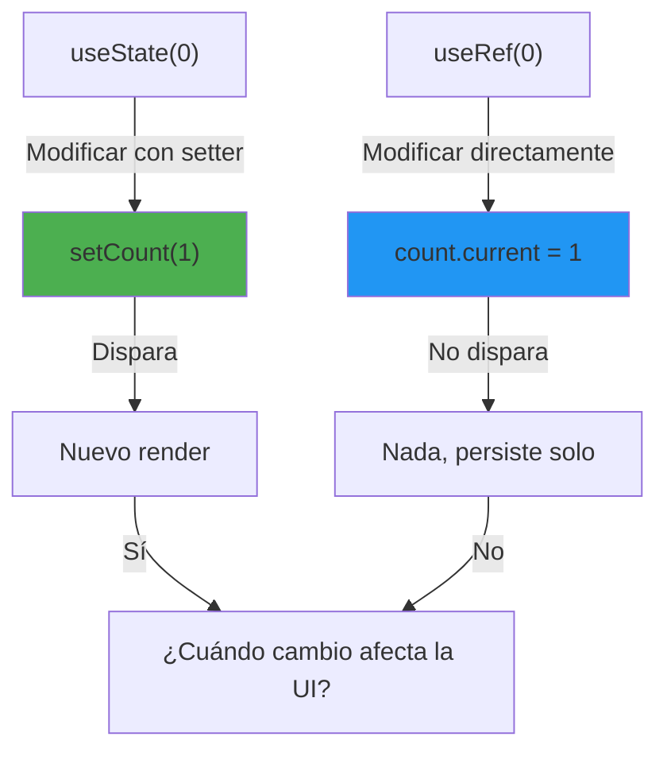
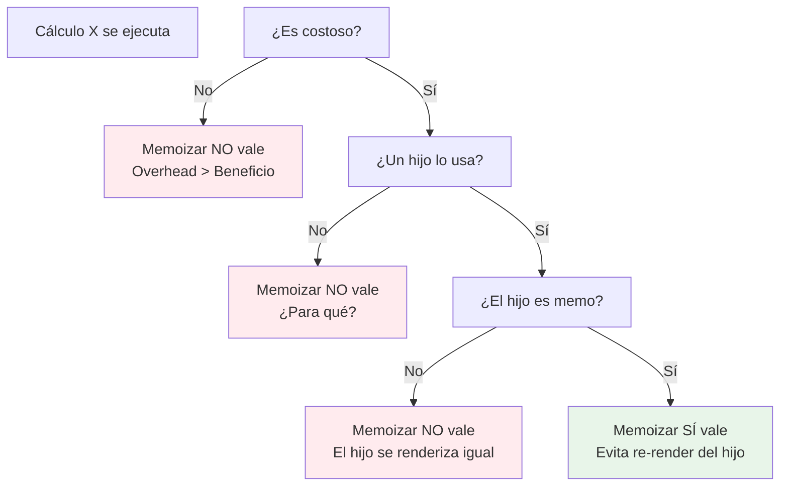
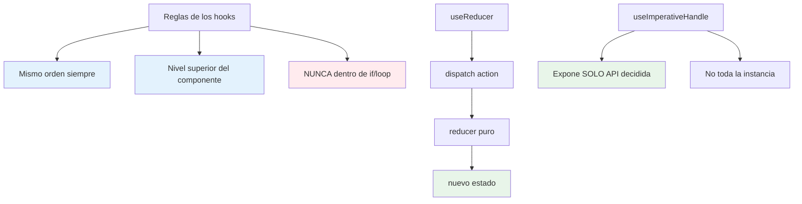
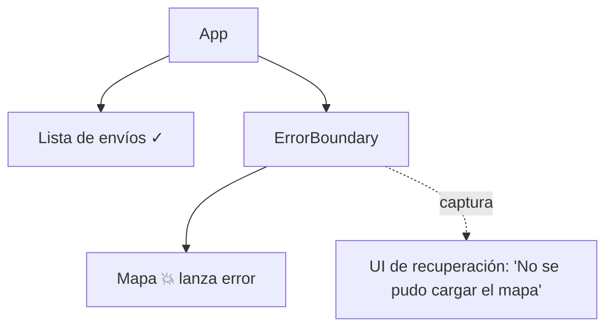
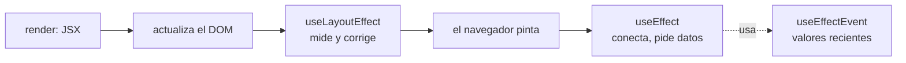

# Módulo 2: Hooks esenciales


## Aprende construyendo

**Servidor del módulo:** cada ejemplo se sirve con `npm run dev` dentro del proyecto `mi-react` del módulo 0; abre `http://localhost:5173` para ver el resultado y ejecuta `npm test` para las pruebas (Vitest, configurado una sola vez en «Prepara las pruebas» del módulo 0). Si el puerto cambia, usa el que imprima la terminal.

### Tema 1: useEffect — dependencias y limpieza · Intermedio · 45 min

#### Paso 1 · Objetivo y preparación
Al finalizar vas a hacer que `PanelEnvios` consulte la API de RutaFlow dentro de un `useEffect`, cancelando la petición con `AbortController` cuando el componente se desmonte o cambie el filtro. Prerrequisitos: Módulo 1 completo.

#### Paso 2 · Contexto y caso real
Si el operador cambia de pantalla antes de que la respuesta de envíos llegue, una petición sin cancelar puede intentar actualizar el estado de un componente que ya no existe, o mezclar su respuesta con la de una pantalla distinta.

#### Paso 3 · Teoría, modelo mental y analogía
`useEffect` sincroniza con sistemas externos; su función de limpieza cancela lo que el efecto empezó antes de volver a ejecutarse o de que el componente se desmonte — una suscripción que se abre, se usa y se cancela con el mismo identificador.

**Diagrama: useEffect y su ciclo de vida**



**Conceptos clave:** sincronización con sistemas externos, array de dependencias, función de limpieza.

`useEffect` es el mecanismo de React para sincronizar un componente con un sistema externo al propio modelo de React: suscribirse a un evento del navegador (`window.addEventListener('resize', handler)`), establecer una conexión (un WebSocket, un temporizador), o cualquier operación que necesite ejecutarse como reacción a que el componente se montó o a que cierto valor cambió, en vez de como parte directa del cálculo de qué renderizar (que pertenece al cuerpo de la función componente en sí, no a un efecto).

El array de dependencias, segundo argumento de `useEffect`, controla exactamente cuándo el efecto se vuelve a ejecutar: sin ningún array (`useEffect(() => {...})`), el efecto se ejecuta después de cada render, sin excepción; con un array vacío (`useEffect(() => {...}, [])`), se ejecuta una única vez, inmediatamente después del primer montaje del componente; con un array que contiene valores específicos (`useEffect(() => {...}, [valor])`), se ejecuta después del montaje inicial y de nuevo cada vez que cualquiera de esos valores listados cambia entre un render y el siguiente, comparando cada valor mediante igualdad referencial (`Object.is`).

La función que un efecto puede devolver opcionalmente es su función de limpieza, ejecutada por React inmediatamente antes de que el efecto se vuelva a ejecutar (si sus dependencias cambiaron) y también cuando el componente se desmonta definitivamente (`return () => window.removeEventListener('resize', handler)`), garantizando que cualquier suscripción, temporizador o conexión establecida por el efecto se libere correctamente antes de establecer una nueva, o antes de que el componente deje de existir, evitando fugas de memoria: suscripciones o temporizadores que siguen vivos aunque ya nadie los necesite.

**Analogía:** un efecto sin limpieza es como suscribirse a una lista de correo sin nunca darse de baja, incluso después de mudarse de dirección; la función de limpieza es el mecanismo explícito de darse de baja correctamente antes de suscribirse a una nueva lista o de abandonar definitivamente esa dirección.

**¿Por qué es importante?** El array de dependencias controla con precisión cuándo un efecto se re-ejecuta; la función de limpieza evita fugas de recursos externos (suscripciones, temporizadores, conexiones) que sobrevivirían innecesariamente al componente o a un cambio de dependencias.

**Código del ejemplo:**

```jsx
useEffect(() => {
  const handler = () => console.log(window.innerWidth);
  window.addEventListener('resize', handler);
  return () => window.removeEventListener('resize', handler); // limpieza al desmontar
}, []); // array vacío: solo se ejecuta al montar
```


#### Paso 4 · Demostración guiada desde cero
```jsx
import { useEffect, useState } from 'react';

function PanelEnvios({ zona }) {
  const [envios, setEnvios] = useState([]);

  useEffect(() => {
    const controller = new AbortController();
    fetch(`/api/envios-${zona}.json`, { signal: controller.signal })
      .then(res => res.json())
      .then(setEnvios)
      .catch(error => {
        if (error.name !== 'AbortError') console.error(error); // la cancelación no es un fallo
      });
    return () => controller.abort();
  }, [zona]);

  return (
    <ul>
      {envios.map(envio => <li key={envio.id}>{envio.id} — {envio.direccion}</li>)}
    </ul>
  );
}

export default function App() {
  const [zona, setZona] = useState('norte');
  const [visible, setVisible] = useState(true);
  return (
    <main>
      <select value={zona} onChange={e => setZona(e.target.value)} aria-label="Zona">
        <option value="norte">Norte</option>
        <option value="sur">Sur</option>
      </select>
      <button onClick={() => setVisible(v => !v)}>{visible ? 'Desmontar' : 'Montar'} panel</button>
      {visible && <PanelEnvios zona={zona} />}
    </main>
  );
}
```

**Ejecuta el ejemplo** en tu proyecto `mi-react` (lo creaste y preparaste para pruebas al inicio del módulo 0): reemplaza todo el contenido de `src/App.jsx` por el bloque anterior. Antes, crea los datos que servirá Vite como archivos estáticos (todo lo que está en `public/` se sirve tal cual): `public/api/envios-norte.json` con

```json
[
  { "id": "RF-4471", "direccion": "Calle 170 # 8-20" },
  { "id": "RF-4472", "direccion": "Carrera 15 # 127-40" }
]
```

y `public/api/envios-sur.json` con

```json
[
  { "id": "RF-5101", "direccion": "Avenida 1 de Mayo # 30-12" }
]
```

Después reemplaza `src/App.jsx` y arráncalo:

```bash
npm run dev
```

Resultado esperado: cambiar `zona` cancela la petición anterior (todavía en vuelo) antes de disparar la nueva, y desmontar `PanelEnvios` cancela cualquier petición pendiente — nunca llega una respuesta vieja a actualizar `envios` después de que la zona o el componente ya cambiaron. Con archivos locales la respuesta llega casi al instante; para ver la cancelación, activa en la pestaña Network de DevTools la limitación «Slow 4G» y cambia de zona dos veces seguidas: la primera petición aparece como `(canceled)`. Ejecuta `npm test` para confirmar que las pruebas anteriores siguen en verde.

#### Paso 5 · Práctica guiada
Pista: quita el `return () => controller.abort()` del efecto — ese es el fallo deliberado: cambia `zona` rápidamente dos veces seguidas y, si la primera respuesta llega después de la segunda, `envios` termina mostrando los envíos de la zona vieja, sobrescribiendo silenciosamente los de la zona actual.

#### Paso 6 · Práctica independiente
Corrige el Paso 5 restaurando la cancelación, y agrega un segundo `useEffect` separado que sincronice el título del documento (`document.title`) con la cantidad de envíos pendientes, confirmando que cada efecto tiene su propio array de dependencias independiente. En el proyecto integrador RutaFlow, limpia la suscripción de seguimiento al desmontar y confirma que no quedan listeners.

#### Paso 7 · Cierre
Entrega el efecto con cancelación del Paso 4, la respuesta obsoleta provocada en el Paso 5, y el segundo efecto del Paso 6; explica por qué un efecto que hace fetch sin cancelar puede mostrar datos de una petición vieja, aunque esa petición ya no le interese a nadie. Siguiente paso: el Tema 2 enseña a reconocer los efectos que sobran. Errores comunes: un array de dependencias incompleto que omite `zona`, usar un efecto para calcular un dato derivado que podría calcularse directamente en el render, y olvidar la función de limpieza en cualquier efecto que se suscribe a algo. Fuentes oficiales: https://react.dev/reference/react/useEffect y https://react.dev/learn/synchronizing-with-effects.
**Implicación práctica:** Los efectos son la frontera donde React toca red, DOM y recursos externos; sin limpieza, una respuesta obsoleta puede sobrescribir silenciosamente el estado actual.

### Tema 2: Cuándo NO usar un Effect: estado derivado, eventos y reinicio con `key` · Intermedio · 40 min

**Duración estimada:** 40 min (4 subtemas de 10 min).

**Al finalizar podrás:** reconocer los tres usos de `useEffect` que sobran (calcular un dato derivado, reaccionar a un clic a través del estado y reiniciar un estado cuando cambia una prop), reemplazarlos por cálculo en el render, código en el manejador del evento o una `key`, y medir con `<Profiler>` y pruebas que el reemplazo elimina renders y acciones repetidas.

**¿Por qué es importante?** En el Tema 1 viste que un efecto sincroniza un componente con algo **externo** (red, DOM, suscripciones). Usarlo para cosas internas es el error más común de React: agrega un render extra con datos viejos, ejecuta acciones dos veces o en el momento equivocado y vuelve el código difícil de seguir. Quitar un efecto innecesario suele hacer el componente más corto, más rápido y más fácil de probar.

**Prerrequisitos:** Tema 1 de este módulo (`useEffect`) y Módulo 1, Tema 6 (estado levantado y datos derivados). Trabajas en `mi-react`.

Crea `src/SinEfectos.jsx` con todo el código del tema; cada subtema explica una parte:

```jsx
import { useEffect, useState } from 'react';

const filtrar = (envios, zona) =>
  zona === 'todas' ? envios : envios.filter((envio) => envio.zona === zona);

// ❌ Antipatrón: copia un dato derivado en estado y lo sincroniza con un efecto.
export function ListaConEfecto({ envios, zona }) {
  const [visibles, setVisibles] = useState([]);
  useEffect(() => {
    setVisibles(filtrar(envios, zona));
  }, [envios, zona]);
  return <ul>{visibles.map((envio) => <li key={envio.id}>{envio.id}</li>)}</ul>;
}

// ✅ Se calcula durante el render: un dato, una fuente.
export function ListaDerivada({ envios, zona }) {
  const visibles = filtrar(envios, zona);
  return <ul>{visibles.map((envio) => <li key={envio.id}>{envio.id}</li>)}</ul>;
}

// ❌ Antipatrón: reacciona a un estado para hacer algo que causó un clic.
export function ConfirmarConEfecto({ guia, confirmadaInicial = false, notificar }) {
  const [confirmada, setConfirmada] = useState(confirmadaInicial);
  useEffect(() => {
    if (confirmada) notificar(guia);
  }, [confirmada, guia, notificar]);
  return (
    <button onClick={() => setConfirmada(true)} disabled={confirmada}>
      Confirmar {guia}
    </button>
  );
}

// ✅ La acción vive en el manejador del evento que la provoca.
export function ConfirmarEnEvento({ guia, confirmadaInicial = false, notificar }) {
  const [confirmada, setConfirmada] = useState(confirmadaInicial);
  function confirmar() {
    setConfirmada(true);
    notificar(guia);
  }
  return (
    <button onClick={confirmar} disabled={confirmada}>
      Confirmar {guia}
    </button>
  );
}

export function NotaEntrega({ guia }) {
  const [nota, setNota] = useState('');
  return (
    <label>
      Nota para {guia}{' '}
      <input value={nota} onChange={(evento) => setNota(evento.target.value)} />
    </label>
  );
}
```

#### Subtema 2.1: Calcula los datos derivados durante el render · 10 min

**1. Contexto**
`ListaConEfecto` guarda `visibles` en estado y lo actualiza con un efecto cada vez que cambian `envios` o `zona`. Funciona en pantalla, pero cada cambio de zona pinta primero la lista vieja y después la nueva.

**2. Hazlo tú**
Crea `src/SinEfectos.test.jsx` con esta primera prueba. `<Profiler>` llama a `onRender` una vez por cada *commit* (cada vez que React aplica cambios al DOM):

```jsx
import { Profiler, StrictMode } from 'react';
import { render, screen } from '@testing-library/react';
import userEvent from '@testing-library/user-event';
import { describe, expect, it, vi } from 'vitest';
import {
  ConfirmarConEfecto, ConfirmarEnEvento, ListaConEfecto, ListaDerivada, NotaEntrega,
} from './SinEfectos.jsx';

const ENVIOS = [
  { id: 'RF-4471', zona: 'norte' },
  { id: 'RF-5101', zona: 'sur' },
];

function contarCommits(Lista) {
  const commits = [];
  const ui = (zona) => (
    <Profiler id="lista" onRender={(id, fase) => commits.push(fase)}>
      <Lista envios={ENVIOS} zona={zona} />
    </Profiler>
  );
  const { rerender } = render(ui('todas'));
  commits.length = 0; // solo interesa el cambio de zona
  rerender(ui('sur'));
  return commits.length;
}

describe('estado derivado', () => {
  it('con efecto, cambiar la zona cuesta dos commits; derivado, uno', () => {
    expect(contarCommits(ListaConEfecto)).toBe(2);
    expect(contarCommits(ListaDerivada)).toBe(1);
  });
});
```

```bash
npm test
```

**Resultado esperado:** la prueba pasa: la versión con efecto hace **dos** commits por cada cambio de zona y la derivada, **uno**.

**Fallo deliberado:** en `ListaConEfecto`, quita `zona` del array de dependencias (`[envios]`). **Error esperado:** la prueba sigue contando un solo commit para `ListaConEfecto` (el efecto ya no corre) y falla con `expected 1 to be 2`; en pantalla, cambiar la zona no filtra nada. **Diagnóstico:** copiar un dato derivado en estado te obliga a mantener a mano su sincronización, y una dependencia olvidada la rompe en silencio. La versión derivada no tiene array que olvidar. Restaura `[envios, zona]`.

**3. Entiende**
**Explicación paso a paso:** con el efecto, React renderiza con la zona nueva y el `visibles` viejo, hace commit (la lista vieja llega al DOM), ejecuta el efecto, `setVisibles` pide otro render y hay un segundo commit con la lista correcta. Calculando `visibles` en el cuerpo del componente, el primer render ya trae el valor correcto. Si el cálculo fuera costoso de verdad (lo mides en el Tema 4), la herramienta es `useMemo`, no un efecto.

**Analogía:** el efecto es pedir a un mensajero que lleve una copia de la planilla al segundo piso cada vez que cambia el original; calcular en el render es que el segundo piso lea el original directamente.

**4. Cierra**
Guarda la prueba en verde. Regla: si un valor se puede calcular a partir de props o estado, no es estado.

#### Subtema 2.2: La lógica de un evento va en su manejador · 10 min

**1. Contexto**
Confirmar una entrega debe notificar al cliente **porque el conductor pulsó el botón**, no porque el estado `confirmada` resulte ser `true`. `ConfirmarConEfecto` mezcla las dos cosas.

**2. Hazlo tú**
Agrega estas pruebas a `src/SinEfectos.test.jsx` y ejecuta `npm test`:

```jsx
describe('lógica de eventos', () => {
  it('el efecto notifica al montar con un estado ya confirmado, sin clic', () => {
    const notificar = vi.fn();
    render(<ConfirmarConEfecto guia="RF-4471" confirmadaInicial notificar={notificar} />);
    expect(notificar).toHaveBeenCalledTimes(1);
  });

  it('el manejador notifica una vez por clic, también en StrictMode', async () => {
    const notificar = vi.fn();
    render(<StrictMode><ConfirmarEnEvento guia="RF-4471" notificar={notificar} /></StrictMode>);
    expect(notificar).not.toHaveBeenCalled();
    await userEvent.click(screen.getByRole('button', { name: 'Confirmar RF-4471' }));
    expect(notificar).toHaveBeenCalledTimes(1);
    expect(notificar).toHaveBeenCalledWith('RF-4471');
  });
});
```

**Resultado esperado:** las dos pruebas pasan. La primera documenta el error: la versión con efecto envía una notificación **sin que nadie haga clic**, solo porque el componente se montó con una entrega ya confirmada (por ejemplo, al volver a la pantalla).

**Fallo deliberado:** en la primera prueba, envuelve el componente en `<StrictMode>`. **Error esperado:** `expected "vi.fn()" to be called 1 times, but got 2 times`. **Diagnóstico:** en desarrollo, `StrictMode` monta, desmonta y vuelve a montar cada componente para destapar efectos que no son idempotentes; el cliente recibiría dos mensajes. La versión con la notificación en el manejador no depende de cuántas veces se monte. Quita el `<StrictMode>` de esa prueba.

**3. Entiende**
Pregúntate **por qué** debe ejecutarse el código. Si la respuesta es «porque el usuario hizo algo» (clic, envío de formulario), va en el manejador de ese evento. Si es «porque el componente está en pantalla y debe estar sincronizado con algo externo» (una conexión, una suscripción, el título del documento), va en un efecto con su limpieza. **Límite:** a veces hace falta una petición al montar, por ejemplo para cargar datos; eso sí es sincronización y la verás con cancelación en el Tema 7; con TanStack Query se trata en el curso más adelante.

**4. Cierra**
Guarda las pruebas. Anota en un comentario de `ConfirmarConEfecto` por qué es un antipatrón.

#### Subtema 2.3: Reinicia el estado con `key`, no con un efecto · 10 min

**1. Contexto**
La ficha de una entrega tiene un campo de nota. Al pasar de la guía `RF-4471` a `RF-5101`, la nota escrita para la primera aparece en la segunda: React conserva el estado porque el componente sigue en la misma posición del árbol.

**2. Hazlo tú**
Agrega estas pruebas y ejecuta `npm test`:

```jsx
describe('reiniciar con key', () => {
  it('sin key, la nota de una guía aparece en la siguiente', async () => {
    const { rerender } = render(<NotaEntrega guia="RF-4471" />);
    await userEvent.type(screen.getByRole('textbox'), 'portería');
    rerender(<NotaEntrega guia="RF-5101" />);
    expect(screen.getByRole('textbox')).toHaveValue('portería');
  });

  it('con key={guia}, cada guía empieza con la nota vacía', async () => {
    const { rerender } = render(<NotaEntrega key="RF-4471" guia="RF-4471" />);
    await userEvent.type(screen.getByRole('textbox'), 'portería');
    rerender(<NotaEntrega key="RF-5101" guia="RF-5101" />);
    expect(screen.getByRole('textbox')).toHaveValue('');
  });
});
```

En tu app, úsalo así: `<NotaEntrega key={guiaActual} guia={guiaActual} />`.

**Resultado esperado:** las dos pruebas pasan; la primera muestra el problema y la segunda, la solución.

**Fallo deliberado:** quita la `key` de la segunda prueba e intenta arreglarlo dentro de `NotaEntrega` con `useEffect(() => setNota(''), [guia])`. **Resultado:** la prueba pasa, pero ahora hay un commit con la nota vieja visible antes de borrarla (compruébalo con `contarCommits` como en el Subtema 2.1) y cualquier otro estado del componente necesita su propio efecto. **Diagnóstico:** el efecto «limpia después»; la `key` le dice a React que es **otro** componente, así que crea su estado desde cero. Vuelve a la versión con `key`.

**3. Entiende**
React asocia el estado a la posición del componente en el árbol y a su `key`. Cambiar la `key` desmonta la instancia anterior y monta una nueva con estado inicial: es la misma regla que ya usas en las listas. **Límite:** `key` reinicia **todo** el estado del componente y de sus hijos; si solo quieres reiniciar una parte, calcula esa parte durante el render o guarda el id que la identifica, como en el ejercicio del Módulo 1, Tema 6.

**4. Cierra**
Busca en tu proyecto efectos cuyo único trabajo sea llamar a `setAlgo` con un valor inicial cuando cambia una prop, y reemplázalos por una `key`.

#### Subtema 2.4: Una lista de preguntas antes de escribir un efecto · 10 min

**1. Contexto**
Los tres subtemas anteriores eliminan efectos. Aún quedan los legítimos: los que conectan el componente con algo fuera de React.

**2. Hazlo tú**
Abre el componente del Tema 1 (`PanelEnvios`, con `fetch` y `AbortController`) y tu `ConfirmarConEfecto`. Para cada efecto, responde por escrito las cuatro preguntas de la tabla.

| Pregunta | Si la respuesta es sí… |
|---|---|
| ¿Calcula algo a partir de props o estado? | Calcúlalo en el render (y `useMemo` solo si mediste que es caro). |
| ¿Responde a un evento concreto del usuario? | Muévelo al manejador de ese evento. |
| ¿Solo reinicia estado cuando cambia una prop? | Usa una `key` en el componente. |
| ¿Sincroniza con algo externo mientras el componente está visible? | Es un efecto legítimo: escríbelo con su limpieza. |

**Resultado esperado:** el efecto de `PanelEnvios` queda como legítimo (sincroniza con la red y cancela con `AbortController`); el de `ConfirmarConEfecto`, como movible al manejador.

**Fallo deliberado:** en el efecto de `PanelEnvios`, borra la función de limpieza y ejecuta `npm test`. **Diagnóstico:** la prueba puede seguir en verde, porque la respuesta obsoleta depende del orden en que llegan las peticiones; por eso el Tema 7 la prueba con respuestas controladas. Un efecto legítimo sin limpieza sigue siendo un error. Restaura el `return () => controller.abort()`.

**3. Entiende**
Un efecto es una salida de emergencia de React hacia el mundo exterior. Cuantos menos tenga un componente, más fácil es predecir qué muestra. El compilador de React (Módulo 9, Tema 7) y la regla `react-hooks` de ESLint te avisan de varios de estos patrones, pero la decisión de diseño sigue siendo tuya.

**4. Cierra**
Guarda la tabla respondida junto a tu código. El siguiente tema estudia `useRef`, otra forma de guardar valores sin provocar renders.

**Hito del tema:**

- [ ] `npm test` muestra en verde las cinco pruebas de `SinEfectos.test.jsx`.
- [ ] Mide con `<Profiler>` que el estado derivado con efecto cuesta dos commits y el calculado, uno.
- [ ] Reproduje la notificación doble con `StrictMode` y expliqué por qué el manejador no la sufre.
- [ ] Clasifiqué cada efecto de mi proyecto con la tabla de cuatro preguntas.

**Resumen:** los datos derivados se calculan en el render; la lógica de un evento va en su manejador; para empezar de cero cuando cambia una identidad se usa `key`; y `useEffect` se reserva para sincronizar con sistemas externos, siempre con limpieza.

**Errores comunes:** guardar en estado algo que se puede calcular, encadenar efectos que se disparan unos a otros, enviar peticiones o notificaciones desde un efecto que observa un estado cambiado por un clic, y desactivar `StrictMode` para que «no se repita».

**Transferencia al proyecto integrador «RutaFlow»:** revisa los efectos del panel de envíos y elimina los que solo derivan datos o reaccionan a clics; deja una prueba que lo demuestre.

**Ejercicio:** este componente calcula el total de kilos con un efecto y además registra en consola «filtro aplicado» cada vez que el usuario pulsa «Solo pendientes». Reescríbelo sin ningún `useEffect` y conserva el comportamiento. Antes de abrir la solución, predice cuántos commits hace la versión original al pulsar el botón.

```jsx
import { useEffect, useState } from 'react';

export function TotalKilos({ envios }) {
  const [soloPendientes, setSoloPendientes] = useState(false);
  const [total, setTotal] = useState(0);

  useEffect(() => {
    const lista = soloPendientes ? envios.filter((e) => e.estado === 'pendiente') : envios;
    setTotal(lista.reduce((suma, e) => suma + e.kilos, 0));
  }, [envios, soloPendientes]);

  useEffect(() => {
    if (soloPendientes) console.log('filtro aplicado');
  }, [soloPendientes]);

  return (
    <>
      <button onClick={() => setSoloPendientes(true)}>Solo pendientes</button>
      <p>Total: {total} kg</p>
    </>
  );
}
```

<details>
<summary>Solución — ábrela después de intentarlo</summary>

La versión original hace **dos** commits por clic: uno con el total viejo y otro tras `setTotal`. Además, el registro se repite si el componente se vuelve a montar con el filtro ya activo.

```jsx
import { useState } from 'react';

export function TotalKilos({ envios }) {
  const [soloPendientes, setSoloPendientes] = useState(false);
  const lista = soloPendientes ? envios.filter((e) => e.estado === 'pendiente') : envios;
  const total = lista.reduce((suma, e) => suma + e.kilos, 0); // derivado

  function aplicarFiltro() {
    setSoloPendientes(true);
    console.log('filtro aplicado'); // la causa es el clic
  }

  return (
    <>
      <button onClick={aplicarFiltro}>Solo pendientes</button>
      <p>Total: {total} kg</p>
    </>
  );
}
```

Compruébalo con `contarCommits` adaptado o con el Profiler de React DevTools: un commit por clic. Si tu versión guardaba `total` en estado y lo actualizaba dentro de `aplicarFiltro`, funciona, pero tendrías dos fuentes de verdad para el mismo dato.

</details>

**Fuentes oficiales:** [React — You Might Not Need an Effect](https://react.dev/learn/you-might-not-need-an-effect), [React — Preserving and Resetting State](https://react.dev/learn/preserving-and-resetting-state) y [React — `<Profiler>`](https://react.dev/reference/react/Profiler).

### Tema 3: useRef — valores mutables sin re-render · Intermedio · 35 min

#### Paso 1 · Objetivo y preparación
Al finalizar vas a contar, con `useRef`, cuántas veces se renderizó `PanelEnvios` sin que ese contador dispare ningún render adicional por sí mismo. Prerrequisitos: Tema 1 de este módulo.

#### Paso 2 · Contexto y caso real
Quieres depurar cuántas veces se re-renderiza `PanelEnvios` mientras el operador escribe en el filtro de zona, pero contar eso con `useState` agregaría un render extra por cada medición, contaminando la medición misma.

#### Paso 3 · Teoría, modelo mental y analogía
`useRef` crea un objeto mutable que persiste entre renders sin disparar ninguno nuevo al modificar `.current` — una libreta personal que el componente puede modificar sin anunciarlo públicamente.

**Diagrama: useState vs useRef**



**¿Por qué es importante?** `useRef` permite mantener valores mutables persistentes entre renders sin el costo ni la semántica de disparar un nuevo render cada vez que cambian.
**Conceptos clave:** persistencia entre renders sin disparar actualización, acceso a nodos del DOM.

`useRef` crea un objeto mutable (`{ current: valorInicial }`) que persiste con la misma identidad a través de renders sucesivos del componente, con una diferencia crucial respecto a `useState`: modificar `.current` (`renderCount.current++`) no dispara un nuevo render del componente, a diferencia de llamar a un setter de `useState`, que sí lo hace siempre. Esto hace a `useRef` apropiado específicamente para valores que el componente necesita recordar entre renders pero que no deben influir en lo que se renderiza visualmente (un contador interno de cuántas veces se renderizó el componente con fines de depuración, el valor anterior de una prop para compararlo con el actual, o un identificador de un temporizador activo que debe poder cancelarse después).

Otro uso extremadamente común de `useRef` es obtener una referencia directa a un nodo del DOM real renderizado por el componente (`<input ref={inputRef} />`, permitiendo después llamar `inputRef.current.focus()` imperativamente), un escape hatch deliberado hacia manipulación imperativa del DOM para casos donde el modelo declarativo de React no ofrece una forma directa de expresar la operación deseada (poner foco en un campo, medir sus dimensiones reales, iniciar una animación imperativa con una librería externa).

**Analogía:** `useRef` es como una libreta personal que el componente puede modificar libremente sin tener que anunciar públicamente cada cambio (sin disparar un re-render); `useState`, en cambio, es como un anuncio público formal que notifica a todos los interesados (incluyendo al propio proceso de renderizado) cada vez que cambia.

**Implicación práctica:** `useRef` permite mantener valores mutables persistentes entre renders (o acceder directamente a nodos del DOM) sin el costo ni la semántica de disparar un nuevo render cada vez que cambian.

**Código del ejemplo:**

```jsx
const renderCount = useRef(0);
renderCount.current++; // no causa re-render, a diferencia de useState
```

#### Paso 4 · Demostración guiada desde cero
```jsx
import { useRef, useState } from 'react';

function PanelEnvios() {
  const [zona, setZona] = useState('');
  const renderCount = useRef(0);
  renderCount.current++; // mutar una ref no provoca un render nuevo
  console.log(`PanelEnvios se renderizó ${renderCount.current} veces`);

  return (
    <label>
      Filtrar por zona{' '}
      <input value={zona} onChange={e => setZona(e.target.value)} />
    </label>
  );
}

export default function App() {
  return <PanelEnvios />;
}
```

**Ejecuta el ejemplo** en tu proyecto `mi-react` (lo creaste y preparaste para pruebas al inicio del módulo 0): reemplaza todo el contenido de `src/App.jsx` por el bloque anterior, abre la consola del navegador y arráncalo:

```bash
npm run dev
```

Resultado esperado: cada letra que el operador escribe en el filtro de zona incrementa `renderCount.current` y lo imprime, pero ese incremento por sí mismo nunca provoca un render adicional — el contador solo avanza como consecuencia de renders que ya ocurrían por otra razón (el cambio de `zona`). En desarrollo, `StrictMode` ejecuta cada render dos veces, así que el número avanza de dos en dos y cada mensaje puede aparecer duplicado. Ejecuta `npm test` para confirmar que las pruebas anteriores siguen en verde.

#### Paso 5 · Práctica guiada
Pista: cambia `useRef(0)` por `useState(0)` y `renderCount.current++` por `setRenderCount(c => c + 1)` directamente en el cuerpo del componente, sin ningún `useEffect` — ese es el fallo deliberado: llamar al setter dentro del cuerpo del componente dispara un nuevo render, que vuelve a ejecutar esa misma línea, que vuelve a llamar al setter: un loop infinito que cuelga la pestaña del navegador.

#### Paso 6 · Práctica independiente
Corrige el Paso 5 devolviendo `useRef`, y agrega una segunda referencia que guarde la última `zona` consultada, comparándola contra la `zona` actual dentro de un efecto para loguear solo cuándo realmente cambió, no en cada render. En el proyecto integrador RutaFlow, usa una ref para la última zona consultada y evita repetir la petición cuando no cambió.

#### Paso 7 · Cierre
Entrega el contador con `useRef` del Paso 4, el loop infinito provocado en el Paso 5, y la comparación de zona anterior del Paso 6; explica por qué `useState` dentro del cuerpo del componente (sin pasar por un evento o efecto) es peligroso para un contador de renders, mientras que `useRef` no lo es. Siguiente paso: estudia cuándo `useMemo`/`useCallback` valen la pena. Errores comunes: llamar a un setter de `useState` directamente en el cuerpo del componente fuera de un evento o efecto, usar `useRef` para datos que sí deberían reflejarse visualmente, y leer `.current` esperando que esté sincronizado inmediatamente con el render visual actual. Fuentes oficiales: https://react.dev/reference/react/useRef y https://react.dev/learn/referencing-values-with-refs.

### Tema 4: useMemo y useCallback con criterio · Intermedio · 40 min

#### Paso 1 · Objetivo y preparación
Al finalizar vas a medir (antes de "optimizar a ciegas") si ordenar la lista de envíos por fecha estimada es realmente costoso, y a decidir si `useMemo` vale la pena para ese cálculo. Prerrequisitos: Tema 3 de este módulo.

#### Paso 2 · Contexto y caso real
Alguien en el equipo propuso envolver TODOS los cálculos de `PanelEnvios` en `useMemo` "por si acaso son lentos", sin medir ninguno todavía.

#### Paso 3 · Teoría, modelo mental y analogía
`useMemo`/`useCallback` solo valen la pena cuando el cálculo es realmente costoso o cuando previenen un re-render mensurable de un hijo memoizado — guardar en el refrigerador solo la comida que realmente sobra, no cada resto trivial.

**Diagrama: Optimización con useMemo/useCallback**



**Conceptos clave:** memoización de valores frente a memoización de funciones, costo real frente a beneficio real.

`useMemo(() => calculoCostoso(datos), [datos])` memoiza el resultado (el valor) de un cálculo, recalculándolo únicamente cuando alguna de las dependencias listadas cambia, en vez de recalcularlo en cada render del componente sin importar si sus entradas relevantes efectivamente cambiaron; `useCallback(() => hacer(id), [id])` es conceptualmente equivalente pero memoiza específicamente una función (una referencia estable a esa función) en vez de un valor arbitrario, siendo `useCallback(fn, deps)` sintácticamente equivalente a `useMemo(() => fn, deps)`.

Ambos hooks solo valen genuinamente la pena en dos escenarios concretos: cuando el cálculo memoizado es realista y mensurablemente costoso en tiempo de ejecución (no una suma trivial de dos números, donde recalcular es más barato que el propio overhead de comparar dependencias), o cuando memoizar una función previene el re-render innecesario de un componente hijo envuelto en `React.memo` (Módulo 9) que de otro modo recibiría una nueva referencia de función distinta en cada render del padre (dado que una función definida dentro del cuerpo del componente se recrea en cada ejecución, con una nueva identidad referencial cada vez, incluso si su lógica interna es idéntica), rompiendo la comparación superficial de props que `React.memo` realiza para decidir si evitar un re-render.

Usar `useMemo`/`useCallback` indiscriminadamente en todo el código, sin evidencia real de que resuelven un problema mensurable de rendimiento (idealmente confirmado con el Profiler, Módulo 9), agrega complejidad de lectura del código y un pequeño overhead de comparación de dependencias en cada render, sin ningún beneficio real a cambio — un antipatrón de optimización prematura que conviene evitar hasta tener evidencia concreta de que el problema que se busca resolver efectivamente existe.

**Analogía:** `useMemo`/`useCallback` son como guardar en el refrigerador solo la comida que realmente sobra y vale la pena conservar, en vez de intentar guardar cada pequeño resto de comida, gastando más esfuerzo en organizar el refrigerador que el que se ahorraría no volviendo a cocinar esos restos triviales.

**Código del ejemplo:**

```jsx
const resultado = useMemo(() => calculoCostoso(datos), [datos]); // memoiza un VALOR
const manejarClick = useCallback(() => hacer(id), [id]);          // memoiza una FUNCIÓN
```

**¿Por qué es importante?** `useMemo`/`useCallback` solo aportan beneficio real cuando el cálculo es genuinamente costoso o cuando previenen un re-render mensurable de un hijo memoizado; usarlos sin esa justificación agrega complejidad sin beneficio.

#### Paso 4 · Demostración guiada desde cero
```jsx
import { useState } from 'react';

const envios = Array.from({ length: 100 }, (_, i) => ({
  id: `RF-${4400 + i}`,
  fechaEstimada: Date.UTC(2026, 10, 1 + (i * 7) % 28),
}));

function ListaOrdenada({ envios }) {
  console.time('ordenar');
  const ordenados = [...envios].sort((a, b) => a.fechaEstimada - b.fechaEstimada);
  console.timeEnd('ordenar');
  return (
    <ol>
      {ordenados.map(envio => <li key={envio.id}>{envio.id}</li>)}
    </ol>
  );
}

export default function App() {
  const [oscuro, setOscuro] = useState(false); // estado no relacionado con la lista
  return (
    <main style={{ background: oscuro ? '#222' : '#fff', color: oscuro ? '#eee' : '#111' }}>
      <button onClick={() => setOscuro(o => !o)}>Cambiar tema</button>
      <ListaOrdenada envios={envios} />
    </main>
  );
}
```

**Ejecuta el ejemplo** en tu proyecto `mi-react` (lo creaste y preparaste para pruebas al inicio del módulo 0): reemplaza todo el contenido de `src/App.jsx` por el bloque anterior, abre la consola del navegador y arráncalo:

```bash
npm run dev
```

Resultado esperado: con una lista realista de RutaFlow (decenas de envíos, no miles), `console.timeEnd` reporta una fracción de milisegundo — un costo insignificante que no justifica envolver ese `sort` en `useMemo`, dado que el propio overhead de comparar dependencias en cada render sería comparable o mayor al costo del cálculo real. Ejecuta `npm test` para confirmar que las pruebas anteriores siguen en verde.

**Demo con React DevTools Profiler + console.time:**
1. Usa el `ListaOrdenada` del ejemplo, que ordena 100 envíos en cada render (sin useMemo)
2. Abre DevTools → Profiler tab → grabar
3. Cambia un estado no relacionado con el botón «Cambiar tema»
4. Mira la consola: `console.timeEnd` reporta 0.5-1ms (trivial)
5. Ahora envuelve el sort en `useMemo`
6. Repite: grabar cambio de tema
7. Mira la consola: el tiempo es idéntico o muy similar (porque el cálculo es insignificante)
8. En el Profiler: ambas versiones tienen rendimiento casi idéntico
9. Resultado esperado: entender que sin un cálculo realmente costoso (p. ej., 100,000 items), memoizar no tiene impacto visible, pero SÍ agrega complejidad al código.

#### Paso 5 · Práctica guiada
Pista: envuelve ese `sort` trivial en `useMemo` igual, "para estar seguros", y mide el tiempo total de un render completo antes y después — ese es el fallo deliberado: el tiempo total no mejora de forma perceptible, pero el código ahora es más difícil de leer, con una dependencia adicional (`[envios]`) que hay que mantener sincronizada correctamente.

#### Paso 6 · Práctica independiente
Corrige el Paso 5 quitando el `useMemo` innecesario sobre el `sort`, y en su lugar mide con el Profiler de React (Módulo 9) si memoizar el callback `onSeleccionarEnvio` pasado a una lista larga de `EnvioCard` envueltos en `React.memo` sí previene re-renders mensurables — un caso donde memoizar sí puede justificarse. Mide en el proyecto integrador RutaFlow si memoizar `onSeleccionarEnvio` reduce renders de la lista antes de conservar la optimización.

#### Paso 7 · Cierre
Entrega la medición del Paso 4, el `useMemo` innecesario descartado en el Paso 5, y la medición con el Profiler del Paso 6; explica la diferencia entre memoizar "por si acaso" y memoizar con evidencia concreta de que el problema de rendimiento existe. Siguiente paso: estudia las reglas de los hooks y `useReducer`. Errores comunes: envolver cálculos triviales en `useMemo` sin medir, memoizar una función sin que ningún hijo memoizado la use, y confundir "se ve más rápido" con una medición real del Profiler. Fuentes oficiales: https://react.dev/reference/react/useMemo y https://react.dev/reference/react/useCallback.

### Tema 5: Reglas de los hooks, useReducer y useImperativeHandle · Intermedio · 45 min

#### Paso 1 · Objetivo y preparación
Al finalizar vas a modelar con `useReducer` las transiciones de estado de `PanelEnvios` (cargando/éxito/error), en vez de varios `useState` independientes que podrían quedar en combinaciones inconsistentes. Prerrequisitos: Tema 4 de este módulo.

#### Paso 2 · Contexto y caso real
Con `useState` separados para `cargando`, `envios` y `error`, nada impide que el código deje `cargando=true` y `error="algo falló"` activos al mismo tiempo, un estado que no debería ser posible pero que ningún tipo lo prohíbe.

#### Paso 3 · Teoría, modelo mental y analogía
`useReducer` modela transiciones de estado mediante una función pura que recibe el estado actual y una acción, devolviendo un nuevo estado completo y consistente — las reglas de los hooks exigen el mismo orden de llamada siempre, porque React asocia cada hook por posición, no por nombre.
**Conceptos clave:** orden consistente de llamadas, reducers para estado complejo, exponer una API imperativa controlada.

Las reglas de los hooks establecen que los hooks deben llamarse siempre en el mismo orden, en el nivel superior de la función componente, nunca dentro de un `if`, un bucle, o una función anidada condicional: React asocia internamente cada hook con su estado correspondiente basándose estrictamente en el orden en que fueron llamados durante el render (no en un nombre o identificador explícito), por lo que llamar un hook condicionalmente (a veces sí, a veces no, según una rama de código) rompería esa asociación posicional, causando que React confunda el estado de un hook con el de otro en renders sucesivos, un error que React detecta y reporta explícitamente en desarrollo cuando ocurre.

`useReducer` modela transiciones de estado más complejas que un simple `useState` mediante el patrón reducer: una función reducer pura que recibe el estado actual y una "action" describiendo qué ocurrió, devolviendo el nuevo estado sin mutar el original, invocada mediante `dispatch(action)` en vez de un setter directo, apropiado cuando las transiciones de estado de un componente son numerosas o interdependientes de forma no trivial (por ejemplo, un formulario multi-paso con reglas de transición complejas entre pasos).

`useImperativeHandle` permite a un componente (que en React 19 recibe `ref` como una prop más; `forwardRef` ya no es necesario, según [react.dev](https://react.dev/reference/react/forwardRef))  controlar exactamente qué API imperativa expone hacia un componente padre que sostiene una referencia (`ref`) hacia él, en vez de exponer automáticamente el nodo DOM completo o la instancia interna completa del componente, un mecanismo deliberadamente restrictivo que preserva la encapsulación del componente hijo, exponiendo únicamente los métodos imperativos específicos que el diseño del componente decide hacer públicos (por ejemplo, un método `focus()` personalizado, sin exponer el resto de la implementación interna del componente).

**Analogía:** las reglas de los hooks son como una lista de tareas diarias que deben ejecutarse siempre en el mismo orden estricto, porque un sistema externo lleva la cuenta de cada tarea únicamente por su posición en la secuencia, no por su nombre; `useImperativeHandle` es como una recepción que solo permite a los visitantes acceder a ciertos servicios específicos autorizados del edificio, sin darles acceso irrestricto a todas las instalaciones internas.

**¿Por qué es importante?** Respetar las reglas de los hooks garantiza que React asocie correctamente cada hook con su estado interno entre renders; `useImperativeHandle` preserva la encapsulación de un componente incluso cuando expone cierta API imperativa controlada hacia su padre.

**Diagrama:**




---

#### Paso 4 · Demostración guiada desde cero
```jsx
import { useReducer } from 'react';

const estadoInicial = { estado: 'cargando', envios: [], error: null };

function reducer(estado, accion) {
  switch (accion.type) {
    case 'cargando': return { estado: 'cargando', envios: [], error: null };
    case 'exito': return { estado: 'listo', envios: accion.envios, error: null };
    case 'error': return { estado: 'error', envios: [], error: accion.error };
    default: throw new Error(`Acción desconocida: ${accion.type}`);
  }
}

function PanelEnvios() {
  // useReducer, como todo Hook, se llama en el nivel superior de un componente.
  const [estado, dispatch] = useReducer(reducer, estadoInicial);

  return (
    <section>
      <p>Estado: {estado.estado}{estado.error && ` — ${estado.error}`}</p>
      <p>Envíos: {estado.envios.join(', ') || 'ninguno'}</p>
      <button onClick={() => dispatch({ type: 'cargando' })}>Cargar</button>
      <button onClick={() => dispatch({ type: 'exito', envios: ['RF-4471', 'RF-4472'] })}>Simular éxito</button>
      <button onClick={() => dispatch({ type: 'error', error: 'Sin conexión' })}>Simular error</button>
    </section>
  );
}

export default function App() {
  return <PanelEnvios />;
}
```

**Ejecuta el ejemplo** en tu proyecto `mi-react` (lo creaste y preparaste para pruebas al inicio del módulo 0): reemplaza todo el contenido de `src/App.jsx` por el bloque anterior y arráncalo:

```bash
npm run dev
```

Resultado esperado: en cualquier momento, `estado.estado` es exactamente uno de `'cargando'`, `'listo'` o `'error'` — nunca una combinación ambigua de "cargando con error" al mismo tiempo, porque cada `case` del reducer devuelve un objeto completo y consistente, no un parche parcial sobre el estado anterior; una acción desconocida lanza un error en vez de devolver `undefined`.

Exporta `reducer` (`export function reducer…`) y escribe `src/reducer.test.jsx` con el patrón de `DeliveryCard.test.jsx`: comprueba que `reducer(estadoInicial, { type: 'error', error: 'x' })` devuelve `estado: 'error'` y `envios: []`. Después ejecuta `npm test`.

#### Paso 5 · Práctica guiada
Pista: haz que `PanelEnvios` reciba una prop `zona` (en `App`, guárdala con `useState('norte')` y agrega un botón que la alterne entre `'norte'` y `'sur'`) y, dentro de un `if (zona === 'norte')`, agrega una llamada a un nuevo `useState` adicional "solo para esa zona" — ese es el fallo deliberado: el linter (`npm run lint`) ya lo marca, y en ejecución React lanza un error explícito en cuanto cambia la cantidad de Hooks entre renders. Al pasar de `'norte'` a `'sur'` se llaman menos Hooks y el mensaje es «Rendered fewer hooks than expected. This may be caused by an accidental early return statement.»; si empiezas en `'sur'` y pasas a `'norte'`, el mensaje es «Rendered more hooks than during the previous render.».

#### Paso 6 · Práctica independiente
Corrige el Paso 5 moviendo ese `useState` al nivel superior del componente (sin ningún `if` alrededor), usando la condición solo para decidir qué hacer con el valor, no para decidir si llamar al hook; agrega además un `useImperativeHandle` en `PanelEnvios` que exponga únicamente un método `refrescar()` hacia un componente padre con `ref`, sin exponer el nodo DOM completo (en React 19, `PanelEnvios` recibe `ref` como prop: `function PanelEnvios({ ref })`, sin `forwardRef`). Lleva el reducer de envíos al proyecto integrador RutaFlow y comprueba que las reglas de hooks siguen pasando el linter.

#### Paso 7 · Cierre
Entrega el reducer sin estados inconsistentes del Paso 4, el error de hooks provocado en el Paso 5, y el `useImperativeHandle` del Paso 6; explica por qué React asocia cada hook por su posición de llamada y no por un nombre, y qué rompe exactamente llamar un hook dentro de una condición. Siguiente paso: estudia Context y cuándo usarlo. Errores comunes: llamar un hook dentro de un `if`, un bucle o una función anidada condicional, modelar estados mutuamente excluyentes con varios `useState` independientes en vez de un reducer, y exponer el nodo DOM completo con `ref` en vez de una API imperativa acotada. Fuentes oficiales: https://react.dev/reference/rules/rules-of-hooks y https://react.dev/reference/react/useReducer.
**Implicación práctica:** Respetar las reglas de los hooks garantiza que React asocie correctamente cada hook con su estado interno entre renders; un reducer evita estados mutuamente excluyentes que coexistan por error.

### Tema 6: Error Boundaries — contener errores de render sin romper toda la app · Avanzado · 40 min

#### Paso 1 · Objetivo y preparación
Al finalizar podrás envolver una parte de la UI en un Error Boundary que atrape un error de render y muestre una interfaz de recuperación, en vez de que toda la app quede en blanco. Prerrequisitos: Módulo 1 (componentes y estado).

#### Paso 2 · Contexto y caso real
En RutaFlow, si el widget del mapa lanza un error al renderizar (por ejemplo, coordenadas corruptas de un envío), sin protección **toda la pantalla del operador queda en blanco** y pierde también la lista de envíos, que funcionaba bien. Un Error Boundary aísla el fallo: el mapa muestra "No se pudo cargar el mapa", y el resto de la pantalla sigue operativo.

#### Paso 3 · Teoría, modelo mental y analogía
Un **Error Boundary** es un componente (hoy en día, de clase, porque usa `componentDidCatch`/`getDerivedStateFromError`, o el envoltorio `react-error-boundary`) que captura errores lanzados durante el render de sus hijos y renderiza una UI alternativa. No captura errores de eventos ni de código async — solo errores de renderizado.

**Analogía:** es como los compartimentos estancos de un barco: si uno se inunda (un componente falla), el mamparo contiene el agua en esa sección y el barco sigue a flote, en vez de hundirse entero.

**Diagrama:**



**Conceptos clave:** error de render vs error async, `getDerivedStateFromError`, UI de recuperación, aislamiento de fallos.
**Cuándo no usarlo:** no sirven para errores de manejadores de eventos (un `onClick`) ni de código async (un `fetch`): esos se atrapan con `try/catch` normal. El boundary es solo para errores que ocurren durante el renderizado.

**Transferencia al proyecto integrador «RutaFlow»:** envuelve el widget del mapa y el panel de notificaciones en boundaries separados, y demuestra que un fallo en uno no derriba al otro ni a la lista de envíos.

---
Como **siguiente** paso, lleva lo aprendido al próximo tema y conéctalo con el proyecto integrador del track.
**Errores comunes:** esperar que un Error Boundary atrape errores de un manejador de eventos o de un `fetch` asíncrono, cuando solo captura errores lanzados durante el render; envolver toda la app en un único boundary en vez de uno por sección, perdiendo el aislamiento que evita que un widget derribe a los demás.
**Fuente oficial:** [documentación de React](https://react.dev/reference/react).

#### Paso 4 · Demostración guiada desde cero

```jsx
import { Component } from "react";

class ErrorBoundary extends Component {
  state = { haFallado: false };

  static getDerivedStateFromError() {
    return { haFallado: true };   // al fallar un hijo, cambia el estado
  }

  componentDidCatch(error, info) {
    console.error("Error capturado por el boundary:", error, info);
  }

  render() {
    if (this.state.haFallado) {
      return <p>No se pudo cargar el mapa. La lista de envíos sigue disponible.</p>;
    }
    return this.props.children;
  }
}

function Mapa({ coordenadas }) {
  // Error deliberado si las coordenadas son inválidas:
  return <div>Lat: {coordenadas.lat.toFixed(4)}</div>;
}

export default function App() {
  return (
    <>
      <h1>Panel de envíos</h1>
      <p>RF-4471 · en ruta</p>              {/* sigue visible aunque el mapa falle */}
      <ErrorBoundary>
        <Mapa coordenadas={null} />          {/* null -> lanza al leer .lat */}
      </ErrorBoundary>
    </>
  );
}
```

**Ejecuta el ejemplo** en tu proyecto `mi-react` (lo creaste y preparaste para pruebas al inicio del módulo 0): reemplaza todo el contenido de `src/App.jsx` por el bloque anterior y arráncalo:

```bash
npm run dev
```

**Resultado esperado:** la página muestra "Panel de envíos", "RF-4471 · en ruta" y, en lugar del mapa (que falló al leer `.lat` de `null`), el mensaje de recuperación. Lo clave: **el resto de la app sigue renderizado**. **Fallo deliberado:** quita el `<ErrorBoundary>` y deja `<Mapa coordenadas={null} />` directo; ahora React propaga el error hasta la raíz y toda la pantalla queda en blanco (en desarrollo, con el overlay de error). Diagnostica por qué sin boundary un error de un componente pequeño derriba la app entera.

#### Paso 5 · Práctica guiada
Añade un botón "Reintentar" a la UI de recuperación que reinicie `haFallado` a `false`. Pista: necesitas un método que haga `this.setState({ haFallado: false })` y pasarlo al botón.

#### Paso 6 · Práctica independiente
Reemplaza tu boundary de clase por la librería `react-error-boundary` (`npm install react-error-boundary`) usando `<ErrorBoundary FallbackComponent={...} onReset={...}>`. Entrega ambas versiones y explica qué aporta la librería (reset, aislamiento por boundary, integración con hooks).

#### Paso 7 · Cierre
Entrega la app con el mapa contenido, el reintento y la versión con `react-error-boundary`. **¿Por qué es importante?** Sin Error Boundaries, un solo componente con un bug deja al usuario ante una pantalla en blanco sin explicación — la peor experiencia posible. En producción, los boundaries son los que convierten "la app se cayó" en "esta sección no cargó, el resto funciona", y suelen conectarse a un servicio de reporte de errores (Sentry) en `componentDidCatch`. Fuentes: [React — Error Boundaries](https://react.dev/reference/react/Component#catching-rendering-errors-with-an-error-boundary).

## Laboratorio práctico

**Objetivo del laboratorio:** construir un componente con un efecto de suscripción externa correctamente limpiado, y aplicar memoización con criterio.

**Requisitos previos:** Módulo 1 completado.

| Paso | Acción | Código | Explicación |
|---|---|---|---|
| 1 | Suscribirse al evento `resize` de `window` | Ver Tema 1 | Verifica que se limpia al desmontar |
| 2 | Reemplazar un efecto que deriva datos por un cálculo en el render | Ver Tema 2 | `<Profiler>` cuenta un commit en vez de dos |
| 3 | Guardar el valor anterior de una prop con `useRef` | Ver Tema 3 | Sin causar un re-render adicional |
| 4 | Medir con `console.log` los recálculos sin `useMemo` | Ver Tema 4 | Luego confirma que `useMemo` evita recálculos |
| 5 | Envolver un callback con `useCallback` para un hijo memoizado | Ver Tema 4 | Verifica que evita el re-render del hijo |
| 6 | Provocar una violación de las reglas de los hooks | Ver Tema 5 | Lee el error que React reporta |

**Verificación:** el laboratorio se considera exitoso si el efecto de suscripción se limpia correctamente al desmontar (verificable sin advertencias de memory leak en consola), y si puedes demostrar con mediciones concretas que `useMemo`/`useCallback` efectivamente evitan trabajo redundante en el caso implementado.

**Errores comunes y soluciones**

- **Olvidar la función de limpieza en un efecto con suscripción.** Siempre que un efecto se suscribe a algo, debe devolver una función que se desuscriba.
- **Llamar un hook dentro de un `if`.** Mueve la condición dentro del hook, no alrededor de él.
- **Usar `useMemo`/`useCallback` en todo sin medir.** Verifica primero con el Profiler (Módulo 9) que el problema de rendimiento existe realmente.

---


## Laboratorio de transferencia

### Tema 7: Efectos cancelables: impedir que una respuesta antigua sobrescriba la selección actual · Avanzado · 30 min

#### Paso 1 · Objetivo y preparación
Al finalizar reproducirás una carrera entre dos solicitudes y evitarás mostrar datos de una selección anterior. **Prerrequisitos:** props, estado, efectos, promesas y cleanup. Node y npm compatibles con Vite 8. Ejemplo independiente desde carpeta vacía.

#### Paso 2 · Contexto y caso real
En el proyecto integrador, el operador cambia de norte a sur antes de que termine la primera consulta. Si la respuesta de norte llega después, puede pisar los datos de sur. **¿Por qué es importante?** El orden de inicio no garantiza el orden de llegada.

#### Paso 3 · Teoría, modelo mental y analogía
Cada efecto captura la selección de su render. Su cleanup debe retirar el trabajo anterior cuando cambia esa selección. `AbortController` comunica cancelación; la función llamada debe cooperar. **Analogía:** al cambiar un pedido, cancelas el anterior para no servirlo en la mesa equivocada. El límite es que cancelar en el cliente no revierte necesariamente una operación ya realizada por un servidor.

#### Paso 4 · Demostración guiada desde cero
```bash
npm create vite@8 carrera-react -- --template react
cd carrera-react
npm install
```
Reemplaza `src/App.jsx` por:
```jsx
import { useEffect, useState } from 'react';

function consultar(zona, signal) {
  return new Promise((resolve, reject) => {
    const timer = setTimeout(() => resolve(`Envíos de ${zona}`), zona === 'norte' ? 900 : 100);
    signal.addEventListener('abort', () => {
      clearTimeout(timer);
      reject(new DOMException('Cancelado', 'AbortError'));
    }, { once: true });
  });
}
export default function App() {
  const [zona, setZona] = useState('norte');
  const [estado, setEstado] = useState('Cargando');
  useEffect(() => {
    const controller = new AbortController();
    setEstado('Cargando');
    consultar(zona, controller.signal).then(setEstado).catch(error => {
      if (error.name !== 'AbortError') setEstado('No se pudo cargar');
    });
    return () => controller.abort(); // Retira el trabajo del render anterior.
  }, [zona]);
  return <main><h1>Consulta por zona</h1>
    <label htmlFor="zona">Zona</label>
    <select id="zona" value={zona} onChange={e => setZona(e.target.value)}>
      <option value="norte">Norte</option><option value="sur">Sur</option>
    </select><p role="status">{estado}</p></main>;
}
```
```bash
npm run dev
```
Abre la URL que imprime Vite, normalmente `http://localhost:5173`. **Resultado esperado:** cambia inmediatamente a sur; aparece `Envíos de sur` y sigue siendo sur después de un segundo. Explica cada bloque: demora local controlada, selección, inicio del efecto y cancelación. No hay API oculta: el temporizador simula latencia para reproducir la carrera.

#### Paso 5 · Práctica guiada
**Fallo deliberado:** retira la función de cleanup. Recarga, cambia a sur rápidamente y espera: norte puede sobrescribir el resultado. **Pista:** añadir más estado no ordena respuestas; retira el trabajo de la selección obsoleta. Restaura cleanup.

#### Paso 6 · Práctica independiente
Añade una zona que rechace con un error distinto de `AbortError`. Comprueba que el fallo real se muestra y que la cancelación normal no se presenta como error. Anota por qué no debes esconder indiscriminadamente todas las excepciones.

#### Paso 7 · Cierre
El siguiente paso es aplicar la señal a `fetch` y luego comparar con una librería de estado remoto. **Errores comunes:** ignorar dependencias, tratar toda cancelación como fallo y asumir que detener una UI revierte una escritura. **Límites y decisión de uso:** el ejemplo no implementa caché ni deduplicación; esas responsabilidades se estudian en el módulo de datos remotos.

**Fuentes oficiales:** [React useEffect](https://react.dev/reference/react/useEffect) y [MDN AbortController](https://developer.mozilla.org/en-US/docs/Web/API/AbortController).

### Tema 8: useLayoutEffect y useEffectEvent: medir antes de pintar y leer valores sin reconectar · Avanzado · 45 min

**Prerrequisito:** tema «useEffect — dependencias y limpieza» de este módulo.

**Al finalizar podrás:** medir un elemento y ajustar la posición de un tooltip antes de que el usuario vea un parpadeo con `useLayoutEffect`, y leer el valor más reciente de una prop dentro de un efecto sin reiniciarlo con `useEffectEvent`.

**¿Por qué es importante?** `useEffect` corre después de pintar, así que una medición puede causar un salto visible. Y meter cada valor en las dependencias de un efecto lo reinicia cuando no debería, por ejemplo reconectando un socket cada vez que cambia el tema visual.

#### Paso 1 · Objetivo y preparación

Usa React 19.2 o superior (ahí `useEffectEvent` es estable). Parte del proyecto de Vite del módulo y trabaja en `src/Tooltip.jsx` y `src/Seguimiento.jsx`.

#### Paso 2 · Contexto y caso real

El panel de RutaFlow tiene un tooltip junto a cada parada. Cerca del borde, aparecía cortado un instante y luego saltaba a su lugar. En otra pantalla, la conexión en vivo con un envío se cerraba y abría cada vez que el operador cambiaba entre tema claro y oscuro.

#### Paso 3 · Teoría, modelo mental y analogía

**Conceptos clave:** fase de layout, pintado, `useLayoutEffect`, `getBoundingClientRect`, evento de efecto, `useEffectEvent`, dependencias.

**Orden de un render:** React calcula el JSX, actualiza el DOM, ejecuta `useLayoutEffect`, el navegador **pinta** y después corre `useEffect`.

- Usa `useLayoutEffect` solo cuando necesitas **leer el DOM y corregir algo antes del pintado** (medidas, posiciones). Bloquea el pintado, así que debe ser rápido.
- Usa `useEffect` para todo lo demás: peticiones, suscripciones, registros.

**`useEffectEvent`** crea una función que siempre ve las props y el estado más recientes, pero **no es una dependencia** del efecto. Sirve para la parte de un efecto que es «reacción a un evento» y no debe reiniciarlo. Solo se llama desde dentro de efectos.

| Situación | Herramienta |
|---|---|
| medir y reposicionar sin parpadeo | `useLayoutEffect` |
| conectar a algo que depende de `codigo` | `useEffect` con `[codigo]` |
| leer `tema` al llegar un mensaje, sin reconectar | `useEffectEvent` |

**Analogía:** `useLayoutEffect` es acomodar los muebles con la puerta cerrada, antes de que entren los invitados. `useEffectEvent` es mirar el reloj de la pared cuando suena el timbre: no cambias de casa cada vez que el reloj avanza. La analogía falla en que acomodar muebles con la puerta cerrada hace esperar a los invitados: un `useLayoutEffect` lento congela la pantalla.

**Límite de uso:** no uses `useLayoutEffect` para peticiones ni trabajo pesado: retrasa el pintado. En SSR no corre en el servidor. No uses `useEffectEvent` para esconder dependencias que sí deberían reiniciar el efecto.



#### Paso 4 · Demostración guiada desde cero

Archivo `academia-react/src/Tooltip.jsx`:

```jsx
import { useLayoutEffect, useRef, useState } from 'react';

export default function Tooltip({ texto, x }) {
  const ref = useRef(null);
  const [izquierda, setIzquierda] = useState(x);

  useLayoutEffect(() => {
    const { width } = ref.current.getBoundingClientRect();
    // Si se sale por la derecha, lo corre antes de que el usuario lo vea.
    const maximo = window.innerWidth - width - 8;
    setIzquierda(Math.min(x, maximo));
  }, [x, texto]);

  return <div ref={ref} className="tooltip" style={{ position: 'fixed', left: izquierda, top: 40 }}>{texto}</div>;
}
```

Archivo `academia-react/src/Seguimiento.jsx`:

```jsx
import { useEffect, useEffectEvent, useState } from 'react';

function conectar(codigo, alMensaje) {
  console.log(`conecta a ${codigo}`);
  const id = setInterval(() => alMensaje(`posición de ${codigo}`), 2000);
  return () => { clearInterval(id); console.log(`desconecta de ${codigo}`); };
}

export default function Seguimiento({ codigo, tema }) {
  const [ultimo, setUltimo] = useState('');

  // Lee el tema más reciente, pero NO hace que el efecto se reinicie.
  const alMensaje = useEffectEvent((mensaje) => {
    setUltimo(`${mensaje} (tema ${tema})`);
  });

  useEffect(() => conectar(codigo, alMensaje), [codigo]); // solo depende del envío

  return <p>{ultimo || 'esperando posición…'}</p>;
}
```

Ejecútalo:

```bash
cd academia-react
npm install react@latest react-dom@latest
npm run dev
```

**Explicación por bloques:** En `Tooltip`, `useLayoutEffect` mide el ancho real con `getBoundingClientRect` y corrige `left` antes del pintado, así el usuario nunca ve la versión cortada. En `Seguimiento`, el efecto depende solo de `codigo`: conecta al envío y devuelve la función de limpieza. El mensaje se procesa en `alMensaje`, creado con `useEffectEvent`, que siempre lee el `tema` actual sin estar en las dependencias. Cambiar el tema actualiza el texto del siguiente mensaje pero no reconecta.

**Resultado esperado:**

```text
Un tooltip con x cerca del borde derecho aparece directamente dentro de la pantalla, sin salto visible.
La consola muestra «conecta a ENV-42» una sola vez; al cambiar el tema no aparece «desconecta de ENV-42».
Al cambiar de envío aparece «desconecta de ENV-42» y luego «conecta a ENV-43».
```

**Fallo deliberado:** quita `useEffectEvent` y escribe el `setUltimo` directamente en el efecto, agregando `tema` a las dependencias para calmar al linter. **Error esperado:** cada cambio de tema imprime «desconecta» y «conecta». **Diagnóstico:** `tema` no debería reiniciar la conexión; la lectura del tema es parte del evento «llegó un mensaje». Vuelve a `useEffectEvent`.

#### Paso 5 · Práctica guiada

1. **Reproducción:** coloca el tooltip con `x={window.innerWidth - 20}` y compara `useLayoutEffect` contra `useEffect` con la CPU ralentizada x6 en DevTools.
2. **Variación:** agrega un botón que cambie el tema y verifica que no reconecta.
3. **Diagnóstico:** reproduce el fallo deliberado y cuenta cuántas reconexiones hay al cambiar el tema tres veces.
4. **Integración:** cambia el `codigo` y confirma que el efecto sí se reinicia, como debe.
5. **Diseño:** revisa los efectos de un proyecto tuyo y marca qué dependencias son «reactivas» y cuáles son lecturas de evento.

**Pista:** pregunta: si este valor cambia, ¿debe reiniciarse la conexión? Si la respuesta es no, va en un evento de efecto.

#### Paso 6 · Práctica independiente

Crea un componente `Chat` que se conecte a una sala (`sala` como prop) y muestre una notificación con el sonido elegido por el usuario (`sonido` como prop) sin reconectar cuando cambia el sonido.

#### Paso 7 · Cierre

- [ ] Explicas el orden render → DOM → layout → pintado → efecto.
- [ ] El tooltip no parpadea cerca del borde.
- [ ] Cambiar el tema no reconecta.
- [ ] Sabes cuándo no usar `useLayoutEffect`.

Si fallas dos o más, vuelve al Paso 3. **Errores comunes:** usar `useLayoutEffect` para peticiones, quitar dependencias reales del efecto para evitar reconexiones y llamar a un evento de efecto desde el render. **Siguiente paso:** el tema «useMemo y useCallback con criterio» vuelve a las dependencias, ahora para memoizar cálculos.

**Transferencia al proyecto integrador «RutaFlow»:** en el panel de RutaFlow, corrige el tooltip de paradas con `useLayoutEffect` y evita que la conexión en vivo se reinicie al cambiar preferencias visuales con `useEffectEvent`.

**Fuente oficial:** [React — useLayoutEffect](https://react.dev/reference/react/useLayoutEffect) y [React — useEffectEvent](https://react.dev/reference/react/useEffectEvent).

