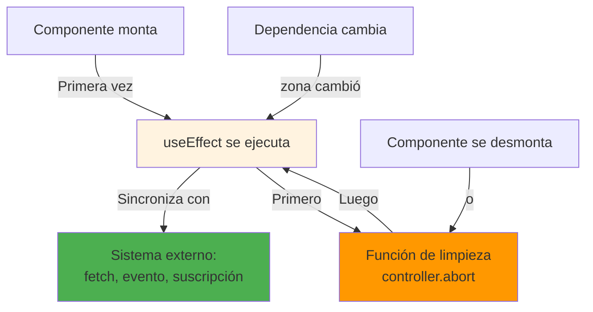
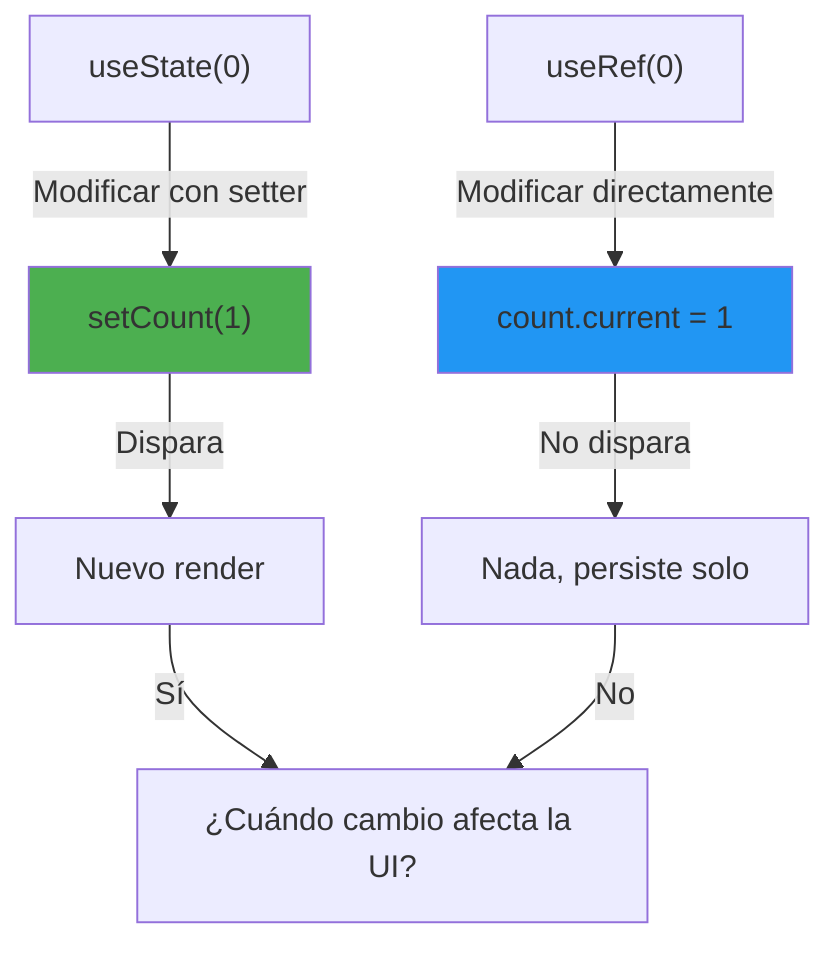
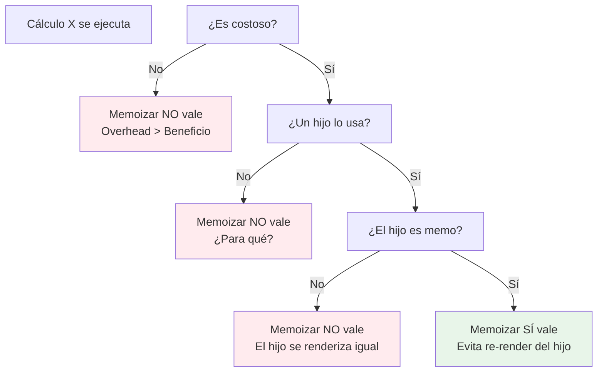
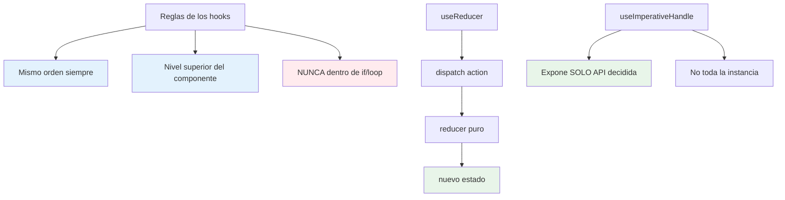
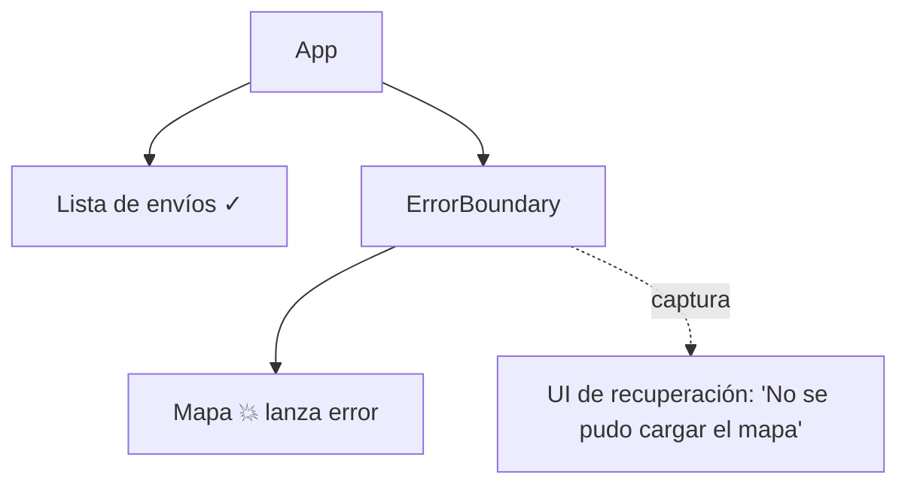
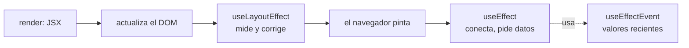

# Módulo 2: Hooks esenciales


## Aprende construyendo

**Servidor del módulo:** cada ejemplo se sirve con `npm run dev` dentro del proyecto `mi-react` del módulo 0; abre `http://localhost:5173` para ver el resultado y ejecuta `npm test` para las pruebas (Vitest, configurado una sola vez en «Prepara las pruebas» del módulo 0). Si el puerto cambia, usa el que imprima la terminal.


### Tema 1: useEffect — dependencias y limpieza · Intermedio · 45 min

<details open>
<summary><strong>Capa 1 — Lectura</strong></summary>

#### ► DE QUÉ TRATA
Al finalizar vas a hacer que PanelEnvios consulte la API de RutaFlow dentro de un useEffect, cancelando la petición con AbortController cuando el componente se desmonte o cambie el filtro. Prerrequisitos: Módulo 1 completo.

#### ► CÓMO FUNCIONA


</details>

<details>
<summary><strong>Capa 2 — Construcción</strong></summary>

#### Código y verificación

```jsx
useEffect(() => {
  const handler = () => console.log(window.innerWidth);
  window.addEventListener('resize', handler);
  return () => window.removeEventListener('resize', handler); // limpieza al desmontar
}, []); // array vacío: solo se ejecuta al montar
```

```jsx
import { useEffect, useState } from 'react';

function PanelEnvios({ zona }) {
  const [envios, setEnvios] = useState([]);

  useEffect(() => {
    const controller = new AbortController();
    fetch(`/api/envios-${zona}.json`, { signal: controller.signal })
      .then(res => res.json())
      .then(setEnvios)
      .catch(error => {
        if (error.name !== 'AbortError') console.error(error); // la cancelación no es un fallo
      });
    return () => controller.abort();
  }, [zona]);

  return (
    <ul>
      {envios.map(envio => <li key={envio.id}>{envio.id} — {envio.direccion}</li>)}
    </ul>
  );
}

export default function App() {
  const [zona, setZona] = useState('norte');
  const [visible, setVisible] = useState(true);
  return (
    <main>
      <select value={zona} onChange={e => setZona(e.target.value)} aria-label="Zona">
        <option value="norte">Norte</option>
        <option value="sur">Sur</option>
      </select>
      <button onClick={() => setVisible(v => !v)}>{visible ? 'Desmontar' : 'Montar'} panel</button>
      {visible && <PanelEnvios zona={zona} />}
    </main>
  );
}
```

```json
[
  { "id": "RF-4471", "direccion": "Calle 170 # 8-20" },
  { "id": "RF-4472", "direccion": "Carrera 15 # 127-40" }
]
```

```json
[
  { "id": "RF-5101", "direccion": "Avenida 1 de Mayo # 30-12" }
]
```

```bash
npm run dev
```

</details>

### Tema 2: Cuándo NO usar un Effect: estado derivado, eventos y reinicio con `key` · Intermedio · 40 min

<details open>
<summary><strong>Capa 1 — Lectura</strong></summary>

</details>

<details>
<summary><strong>Capa 2 — Construcción</strong></summary>

#### Código y verificación
```jsx
import { useEffect, useState } from 'react';

const filtrar = (envios, zona) =>
  zona === 'todas' ? envios : envios.filter((envio) => envio.zona === zona);

// ❌ Antipatrón: copia un dato derivado en estado y lo sincroniza con un efecto.
export function ListaConEfecto({ envios, zona }) {
  const [visibles, setVisibles] = useState([]);
  useEffect(() => {
    setVisibles(filtrar(envios, zona));
  }, [envios, zona]);
  return <ul>{visibles.map((envio) => <li key={envio.id}>{envio.id}</li>)}</ul>;
}

// ✅ Se calcula durante el render: un dato, una fuente.
export function ListaDerivada({ envios, zona }) {
  const visibles = filtrar(envios, zona);
  return <ul>{visibles.map((envio) => <li key={envio.id}>{envio.id}</li>)}</ul>;
}

// ❌ Antipatrón: reacciona a un estado para hacer algo que causó un clic.
export function ConfirmarConEfecto({ guia, confirmadaInicial = false, notificar }) {
  const [confirmada, setConfirmada] = useState(confirmadaInicial);
  useEffect(() => {
    if (confirmada) notificar(guia);
  }, [confirmada, guia, notificar]);
  return (
    <button onClick={() => setConfirmada(true)} disabled={confirmada}>
      Confirmar {guia}
    </button>
  );
}

// ✅ La acción vive en el manejador del evento que la provoca.
export function ConfirmarEnEvento({ guia, confirmadaInicial = false, notificar }) {
  const [confirmada, setConfirmada] = useState(confirmadaInicial);
  function confirmar() {
    setConfirmada(true);
    notificar(guia);
  }
  return (
    <button onClick={confirmar} disabled={confirmada}>
      Confirmar {guia}
    </button>
  );
}

export function NotaEntrega({ guia }) {
  const [nota, setNota] = useState('');
  return (
    <label>
      Nota para {guia}{' '}
      <input value={nota} onChange={(evento) => setNota(evento.target.value)} />
    </label>
  );
}
```

```jsx
import { Profiler, StrictMode } from 'react';
import { render, screen } from '@testing-library/react';
import userEvent from '@testing-library/user-event';
import { describe, expect, it, vi } from 'vitest';
import {
  ConfirmarConEfecto, ConfirmarEnEvento, ListaConEfecto, ListaDerivada, NotaEntrega,
} from './SinEfectos.jsx';

const ENVIOS = [
  { id: 'RF-4471', zona: 'norte' },
  { id: 'RF-5101', zona: 'sur' },
];

function contarCommits(Lista) {
  const commits = [];
  const ui = (zona) => (
    <Profiler id="lista" onRender={(id, fase) => commits.push(fase)}>
      <Lista envios={ENVIOS} zona={zona} />
    </Profiler>
  );
  const { rerender } = render(ui('todas'));
  commits.length = 0; // solo interesa el cambio de zona
  rerender(ui('sur'));
  return commits.length;
}

describe('estado derivado', () => {
  it('con efecto, cambiar la zona cuesta dos commits; derivado, uno', () => {
    expect(contarCommits(ListaConEfecto)).toBe(2);
    expect(contarCommits(ListaDerivada)).toBe(1);
  });
});
```

```bash
npm test
```

```jsx
describe('lógica de eventos', () => {
  it('el efecto notifica al montar con un estado ya confirmado, sin clic', () => {
    const notificar = vi.fn();
    render(<ConfirmarConEfecto guia="RF-4471" confirmadaInicial notificar={notificar} />);
    expect(notificar).toHaveBeenCalledTimes(1);
  });

  it('el manejador notifica una vez por clic, también en StrictMode', async () => {
    const notificar = vi.fn();
    render(<StrictMode><ConfirmarEnEvento guia="RF-4471" notificar={notificar} /></StrictMode>);
    expect(notificar).not.toHaveBeenCalled();
    await userEvent.click(screen.getByRole('button', { name: 'Confirmar RF-4471' }));
    expect(notificar).toHaveBeenCalledTimes(1);
    expect(notificar).toHaveBeenCalledWith('RF-4471');
  });
});
```

```jsx
describe('reiniciar con key', () => {
  it('sin key, la nota de una guía aparece en la siguiente', async () => {
    const { rerender } = render(<NotaEntrega guia="RF-4471" />);
    await userEvent.type(screen.getByRole('textbox'), 'portería');
    rerender(<NotaEntrega guia="RF-5101" />);
    expect(screen.getByRole('textbox')).toHaveValue('portería');
  });

  it('con key={guia}, cada guía empieza con la nota vacía', async () => {
    const { rerender } = render(<NotaEntrega key="RF-4471" guia="RF-4471" />);
    await userEvent.type(screen.getByRole('textbox'), 'portería');
    rerender(<NotaEntrega key="RF-5101" guia="RF-5101" />);
    expect(screen.getByRole('textbox')).toHaveValue('');
  });
});
```

```jsx
import { useEffect, useState } from 'react';

export function TotalKilos({ envios }) {
  const [soloPendientes, setSoloPendientes] = useState(false);
  const [total, setTotal] = useState(0);

  useEffect(() => {
    const lista = soloPendientes ? envios.filter((e) => e.estado === 'pendiente') : envios;
    setTotal(lista.reduce((suma, e) => suma + e.kilos, 0));
  }, [envios, soloPendientes]);

  useEffect(() => {
    if (soloPendientes) console.log('filtro aplicado');
  }, [soloPendientes]);

  return (
    <>
      <button onClick={() => setSoloPendientes(true)}>Solo pendientes</button>
      <p>Total: {total} kg</p>
    </>
  );
}
```

</details>

### Tema 3: useRef — valores mutables sin re-render · Intermedio · 35 min

<details open>
<summary><strong>Capa 1 — Lectura</strong></summary>

#### ► DE QUÉ TRATA
Al finalizar vas a contar, con useRef, cuántas veces se renderizó PanelEnvios sin que ese contador dispare ningún render adicional por sí mismo. Prerrequisitos: Tema 1 de este módulo.

#### ► CÓMO FUNCIONA


</details>

<details>
<summary><strong>Capa 2 — Construcción</strong></summary>

#### Código y verificación


```jsx
const renderCount = useRef(0);
renderCount.current++; // no causa re-render, a diferencia de useState
```

```jsx
import { useRef, useState } from 'react';

function PanelEnvios() {
  const [zona, setZona] = useState('');
  const renderCount = useRef(0);
  renderCount.current++; // mutar una ref no provoca un render nuevo
  console.log(`PanelEnvios se renderizó ${renderCount.current} veces`);

  return (
    <label>
      Filtrar por zona{' '}
      <input value={zona} onChange={e => setZona(e.target.value)} />
    </label>
  );
}

export default function App() {
  return <PanelEnvios />;
}
```

```bash
npm run dev
```

</details>

### Tema 4: useMemo y useCallback con criterio · Intermedio · 40 min

<details open>
<summary><strong>Capa 1 — Lectura</strong></summary>

#### ► DE QUÉ TRATA
Al finalizar vas a medir (antes de "optimizar a ciegas") si ordenar la lista de envíos por fecha estimada es realmente costoso, y a decidir si useMemo vale la pena para ese cálculo. Prerrequisitos: Tema 3 de este módulo.

#### ► CÓMO FUNCIONA


</details>

<details>
<summary><strong>Capa 2 — Construcción</strong></summary>

#### Código y verificación


```jsx
const resultado = useMemo(() => calculoCostoso(datos), [datos]); // memoiza un VALOR
const manejarClick = useCallback(() => hacer(id), [id]);          // memoiza una FUNCIÓN
```

```jsx
import { useState } from 'react';

const envios = Array.from({ length: 100 }, (_, i) => ({
  id: `RF-${4400 + i}`,
  fechaEstimada: Date.UTC(2026, 10, 1 + (i * 7) % 28),
}));

function ListaOrdenada({ envios }) {
  console.time('ordenar');
  const ordenados = [...envios].sort((a, b) => a.fechaEstimada - b.fechaEstimada);
  console.timeEnd('ordenar');
  return (
    <ol>
      {ordenados.map(envio => <li key={envio.id}>{envio.id}</li>)}
    </ol>
  );
}

export default function App() {
  const [oscuro, setOscuro] = useState(false); // estado no relacionado con la lista
  return (
    <main style={{ background: oscuro ? '#222' : '#fff', color: oscuro ? '#eee' : '#111' }}>
      <button onClick={() => setOscuro(o => !o)}>Cambiar tema</button>
      <ListaOrdenada envios={envios} />
    </main>
  );
}
```

```bash
npm run dev
```

</details>

### Tema 5: Reglas de los hooks, useReducer y useImperativeHandle · Intermedio · 45 min

<details open>
<summary><strong>Capa 1 — Lectura</strong></summary>

#### ► DE QUÉ TRATA
Al finalizar vas a modelar con useReducer las transiciones de estado de PanelEnvios (cargando/éxito/error), en vez de varios useState independientes que podrían quedar en combinaciones inconsistentes. Prerrequisitos: Tema 4 de este módulo.

#### ► CÓMO FUNCIONA


</details>

<details>
<summary><strong>Capa 2 — Construcción</strong></summary>

#### Código y verificación


```jsx
import { useReducer } from 'react';

const estadoInicial = { estado: 'cargando', envios: [], error: null };

function reducer(estado, accion) {
  switch (accion.type) {
    case 'cargando': return { estado: 'cargando', envios: [], error: null };
    case 'exito': return { estado: 'listo', envios: accion.envios, error: null };
    case 'error': return { estado: 'error', envios: [], error: accion.error };
    default: throw new Error(`Acción desconocida: ${accion.type}`);
  }
}

function PanelEnvios() {
  // useReducer, como todo Hook, se llama en el nivel superior de un componente.
  const [estado, dispatch] = useReducer(reducer, estadoInicial);

  return (
    <section>
      <p>Estado: {estado.estado}{estado.error && ` — ${estado.error}`}</p>
      <p>Envíos: {estado.envios.join(', ') || 'ninguno'}</p>
      <button onClick={() => dispatch({ type: 'cargando' })}>Cargar</button>
      <button onClick={() => dispatch({ type: 'exito', envios: ['RF-4471', 'RF-4472'] })}>Simular éxito</button>
      <button onClick={() => dispatch({ type: 'error', error: 'Sin conexión' })}>Simular error</button>
    </section>
  );
}

export default function App() {
  return <PanelEnvios />;
}
```

```bash
npm run dev
```

</details>

### Tema 6: Error Boundaries — contener errores de render sin romper toda la app · Avanzado · 40 min

<details open>
<summary><strong>Capa 1 — Lectura</strong></summary>

#### ► DE QUÉ TRATA
Al finalizar podrás envolver una parte de la UI en un Error Boundary que atrape un error de render y muestre una interfaz de recuperación, en vez de que toda la app quede en blanco. Prerrequisitos: Módulo 1 (componentes y estado).

#### ► LA ANALOGÍA
Un **Error Boundary** es un componente (hoy en día, de clase, porque usa `componentDidCatch`/`getDerivedStateFromError`, o el envoltorio `react-error-boundary`) que captura errores lanzados durante el render de sus hijos y renderiza una UI alternativa. No captura errores de eventos ni de código async — solo errores de renderizado.

**Analogía:** es como los compartimentos estancos de un barco: si uno se inunda (un componente falla), el mamparo contiene el agua en esa sección y el barco sigue a flote, en vez de hundirse entero.

**Diagrama:**



**Conceptos clave:** error de render vs error async, `getDerivedStateFromError`, UI de recuperación, aislamiento de fallos.
**Cuándo no usarlo:** no sirven para errores de manejadores de eventos (un `onClick`) ni de código async (un `fetch`): esos se atrapan con `try/catch` normal. El boundary es solo para errores que ocurren durante el renderizado.

**Transferencia al proyecto integrador «RutaFlow»:** envuelve el widget del mapa y el panel de notificaciones en boundaries separados, y demuestra que un fallo en uno no derriba al otro ni a la lista de envíos.

---
Como **siguiente** paso, lleva lo aprendido al próximo tema y conéctalo con el proyecto integrador del track.
**Errores comunes:** esperar que un Error Boundary atrape errores de un manejador de eventos o de un `fetch` asíncrono, cuando solo captura errores lanzados durante el render; envolver toda la app en un único boundary en vez de uno por sección, perdiendo el aislamiento que evita que un widget derribe a los demás.
**Fuente oficial:** [documentación de React](https://react.dev/reference/react).

#### ► CÓMO FUNCIONA


</details>

<details>
<summary><strong>Capa 2 — Construcción</strong></summary>

#### Código y verificación


```jsx
import { Component } from "react";

class ErrorBoundary extends Component {
  state = { haFallado: false };

  static getDerivedStateFromError() {
    return { haFallado: true };   // al fallar un hijo, cambia el estado
  }

  componentDidCatch(error, info) {
    console.error("Error capturado por el boundary:", error, info);
  }

  render() {
    if (this.state.haFallado) {
      return <p>No se pudo cargar el mapa. La lista de envíos sigue disponible.</p>;
    }
    return this.props.children;
  }
}

function Mapa({ coordenadas }) {
  // Error deliberado si las coordenadas son inválidas:
  return <div>Lat: {coordenadas.lat.toFixed(4)}</div>;
}

export default function App() {
  return (
    <>
      <h1>Panel de envíos</h1>
      <p>RF-4471 · en ruta</p>              {/* sigue visible aunque el mapa falle */}
      <ErrorBoundary>
        <Mapa coordenadas={null} />          {/* null -> lanza al leer .lat */}
      </ErrorBoundary>
    </>
  );
}
```

```bash
npm run dev
```

</details>

### Tema 7: Efectos cancelables: impedir que una respuesta antigua sobrescriba la selección actual · Avanzado · 30 min

<details open>
<summary><strong>Capa 1 — Lectura</strong></summary>

#### ► DE QUÉ TRATA
Al finalizar reproducirás una carrera entre dos solicitudes y evitarás mostrar datos de una selección anterior. Prerrequisitos: props, estado, efectos, promesas y cleanup. Node y npm compatibles con Vite 8. Ejemplo independiente desde carpeta vacía.

</details>

<details>
<summary><strong>Capa 2 — Construcción</strong></summary>

#### Código y verificación
```bash
npm create vite@8 carrera-react -- --template react
cd carrera-react
npm install
```

```jsx
import { useEffect, useState } from 'react';

function consultar(zona, signal) {
  return new Promise((resolve, reject) => {
    const timer = setTimeout(() => resolve(`Envíos de ${zona}`), zona === 'norte' ? 900 : 100);
    signal.addEventListener('abort', () => {
      clearTimeout(timer);
      reject(new DOMException('Cancelado', 'AbortError'));
    }, { once: true });
  });
}
export default function App() {
  const [zona, setZona] = useState('norte');
  const [estado, setEstado] = useState('Cargando');
  useEffect(() => {
    const controller = new AbortController();
    setEstado('Cargando');
    consultar(zona, controller.signal).then(setEstado).catch(error => {
      if (error.name !== 'AbortError') setEstado('No se pudo cargar');
    });
    return () => controller.abort(); // Retira el trabajo del render anterior.
  }, [zona]);
  return <main><h1>Consulta por zona</h1>
    <label htmlFor="zona">Zona</label>
    <select id="zona" value={zona} onChange={e => setZona(e.target.value)}>
      <option value="norte">Norte</option><option value="sur">Sur</option>
    </select><p role="status">{estado}</p></main>;
}
```

```bash
npm run dev
```

</details>

### Tema 8: useLayoutEffect y useEffectEvent: medir antes de pintar y leer valores sin reconectar · Avanzado · 45 min

<details open>
<summary><strong>Capa 1 — Lectura</strong></summary>

#### ► DE QUÉ TRATA
Usa React 19.2 o superior (ahí useEffectEvent es estable). Parte del proyecto de Vite del módulo y trabaja en src/Tooltip.jsx y src/Seguimiento.jsx.

#### ► LA ANALOGÍA
**Conceptos clave:** fase de layout, pintado, `useLayoutEffect`, `getBoundingClientRect`, evento de efecto, `useEffectEvent`, dependencias.

**Orden de un render:** React calcula el JSX, actualiza el DOM, ejecuta `useLayoutEffect`, el navegador **pinta** y después corre `useEffect`.

- Usa `useLayoutEffect` solo cuando necesitas **leer el DOM y corregir algo antes del pintado** (medidas, posiciones). Bloquea el pintado, así que debe ser rápido.
- Usa `useEffect` para todo lo demás: peticiones, suscripciones, registros.

**`useEffectEvent`** crea una función que siempre ve las props y el estado más recientes, pero **no es una dependencia** del efecto. Sirve para la parte de un efecto que es «reacción a un evento» y no debe reiniciarlo. Solo se llama desde dentro de efectos.

| Situación | Herramienta |
|---|---|
| medir y reposicionar sin parpadeo | `useLayoutEffect` |
| conectar a algo que depende de `codigo` | `useEffect` con `[codigo]` |
| leer `tema` al llegar un mensaje, sin reconectar | `useEffectEvent` |

**Analogía:** `useLayoutEffect` es acomodar los muebles con la puerta cerrada, antes de que entren los invitados. `useEffectEvent` es mirar el reloj de la pared cuando suena el timbre: no cambias de casa cada vez que el reloj avanza. La analogía falla en que acomodar muebles con la puerta cerrada hace esperar a los invitados: un `useLayoutEffect` lento congela la pantalla.

**Límite de uso:** no uses `useLayoutEffect` para peticiones ni trabajo pesado: retrasa el pintado. En SSR no corre en el servidor. No uses `useEffectEvent` para esconder dependencias que sí deberían reiniciar el efecto.



#### ► CÓMO FUNCIONA


</details>

<details>
<summary><strong>Capa 2 — Construcción</strong></summary>

#### Código y verificación


```jsx
import { useLayoutEffect, useRef, useState } from 'react';

export default function Tooltip({ texto, x }) {
  const ref = useRef(null);
  const [izquierda, setIzquierda] = useState(x);

  useLayoutEffect(() => {
    const { width } = ref.current.getBoundingClientRect();
    // Si se sale por la derecha, lo corre antes de que el usuario lo vea.
    const maximo = window.innerWidth - width - 8;
    setIzquierda(Math.min(x, maximo));
  }, [x, texto]);

  return <div ref={ref} className="tooltip" style={{ position: 'fixed', left: izquierda, top: 40 }}>{texto}</div>;
}
```

```jsx
import { useEffect, useEffectEvent, useState } from 'react';

function conectar(codigo, alMensaje) {
  console.log(`conecta a ${codigo}`);
  const id = setInterval(() => alMensaje(`posición de ${codigo}`), 2000);
  return () => { clearInterval(id); console.log(`desconecta de ${codigo}`); };
}

export default function Seguimiento({ codigo, tema }) {
  const [ultimo, setUltimo] = useState('');

  // Lee el tema más reciente, pero NO hace que el efecto se reinicie.
  const alMensaje = useEffectEvent((mensaje) => {
    setUltimo(`${mensaje} (tema ${tema})`);
  });

  useEffect(() => conectar(codigo, alMensaje), [codigo]); // solo depende del envío

  return <p>{ultimo || 'esperando posición…'}</p>;
}
```

```bash
cd academia-react
npm install react@latest react-dom@latest
npm run dev
```

```text
Un tooltip con x cerca del borde derecho aparece directamente dentro de la pantalla, sin salto visible.
La consola muestra «conecta a ENV-42» una sola vez; al cambiar el tema no aparece «desconecta de ENV-42».
Al cambiar de envío aparece «desconecta de ENV-42» y luego «conecta a ENV-43».
```

</details>
