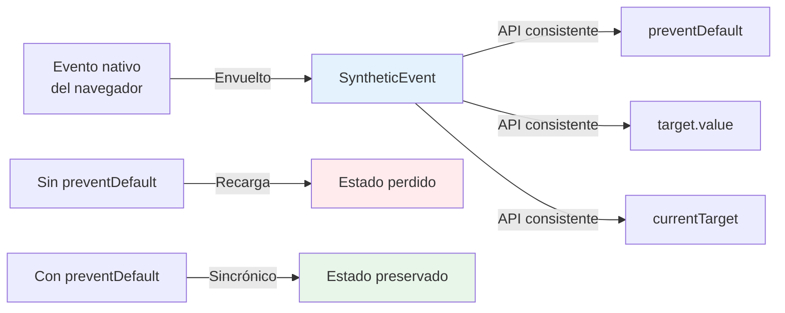
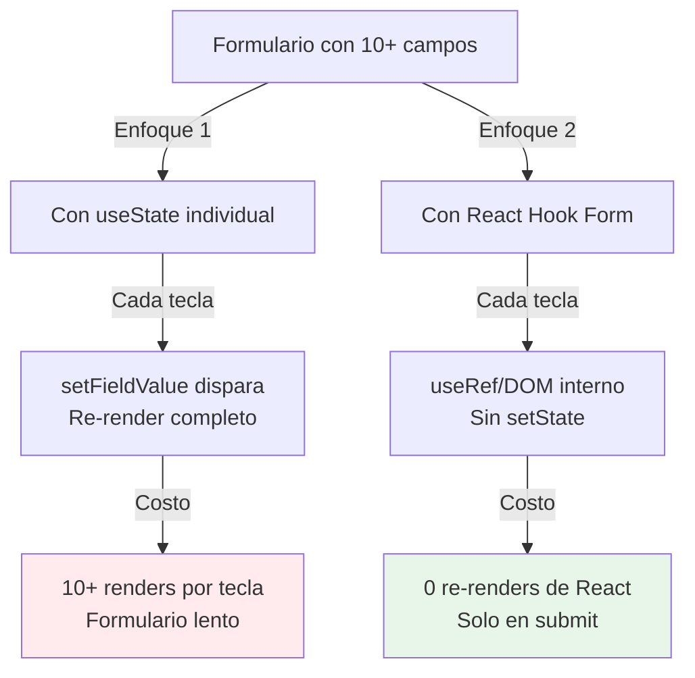
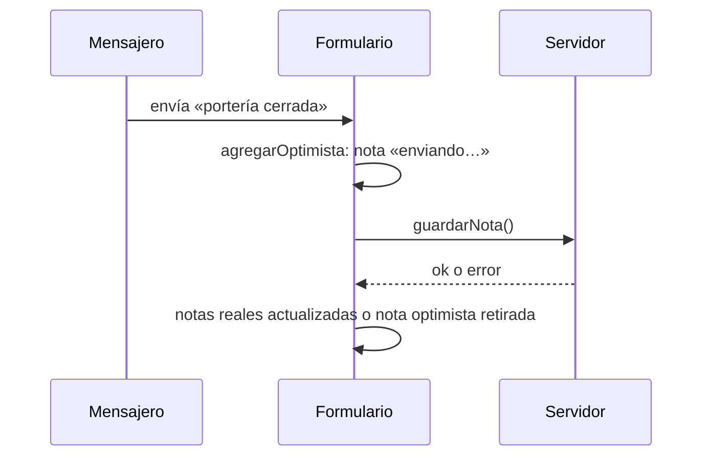

# Módulo 3: Formularios y eventos


## Aprende construyendo

**Servidor del módulo:** cada ejemplo se sirve con `npm run dev` dentro del proyecto `mi-react` del módulo 0; abre `http://localhost:5173` para ver el resultado y ejecuta `npm test` para las pruebas (Vitest, configurado una sola vez en «Prepara las pruebas» del módulo 0). Si el puerto cambia, usa el que imprima la terminal.


### Tema 1: Eventos sintéticos · Básico · 35 min

<details open>
<summary><strong>Capa 1 — Lectura</strong></summary>

#### ► DE QUÉ TRATA
Al finalizar vas a manejar el envío del formulario de registro de envíos con e.preventDefault(), confirmando que ese método funciona igual sin importar el navegador. Prerrequisitos: Módulo 2 completo.

#### ► CÓMO FUNCIONA


</details>

<details>
<summary><strong>Capa 2 — Construcción</strong></summary>

#### Código y verificación


```jsx
import { useState } from 'react';

export default function App() {
  const [registrados, setRegistrados] = useState([]);

  function manejarSubmit(e) {
    e.preventDefault(); // evita la recarga completa de la página
    const datos = new FormData(e.currentTarget);
    setRegistrados(prev => [...prev, datos.get('guia')]);
    e.currentTarget.reset();
  }

  return (
    <>
      <form onSubmit={manejarSubmit}>
        <label>Guía <input name="guia" required /></label>
        <button type="submit">Enviar</button>
      </form>
      <p>Registrados en esta sesión: {registrados.join(', ') || 'ninguno'}</p>
    </>
  );
}
```

```bash
npm run dev
```

</details>

### Tema 2: React Hook Form y el problema del re-render por tecla · Intermedio · 45 min

<details open>
<summary><strong>Capa 1 — Lectura</strong></summary>

#### ► DE QUÉ TRATA
Al finalizar vas a medir cuántas veces se re-renderiza un formulario de registro de envíos con useState por campo, y a migrarlo a React Hook Form para eliminar ese costo. Prerrequisitos: Módulo 2 completo.

#### ► CÓMO FUNCIONA


</details>

<details>
<summary><strong>Capa 2 — Construcción</strong></summary>

#### Código y verificación


```jsx
const { register, handleSubmit, formState: { errors } } = useForm();

<form onSubmit={handleSubmit(datos => crearUsuario(datos))}>
  <input {...register('email', { required: 'El email es obligatorio' })} />
  {errors.email && <span>{errors.email.message}</span>}
</form>
```

```jsx
import { useForm } from 'react-hook-form';

function registrarEnvio(datos) {
  console.log('Envío registrado:', datos);
}

function FormularioEnvio() {
  const { register, handleSubmit, formState: { errors } } = useForm();
  console.log('render');

  return (
    <form onSubmit={handleSubmit(datos => registrarEnvio(datos))}>
      <label>
        Destinatario{' '}
        <input {...register('destinatario', { required: 'El destinatario es obligatorio' })} />
      </label>
      {errors.destinatario && <span role="alert">{errors.destinatario.message}</span>}
      <button type="submit">Registrar</button>
    </form>
  );
}

export default function App() {
  return <FormularioEnvio />;
}
```

```bash
npm install react-hook-form
npm run dev
```

</details>

### Tema 3: Validación con zod y formularios multi-paso · Intermedio · 30 min

<details open>
<summary><strong>Capa 1 — Lectura</strong></summary>

#### ► DE QUÉ TRATA
Al finalizar vas a validar el formulario de registro de envíos con un schema de zod, y a dividirlo en dos pasos (datos del paquete, datos de entrega) sin perder información al retroceder. Prerrequisitos: Tema 2 de este módulo.

</details>

<details>
<summary><strong>Capa 2 — Construcción</strong></summary>

#### Código y verificación
```jsx
const schema = z.object({ email: z.email(), edad: z.number().min(18) });
useForm({ resolver: zodResolver(schema) });

const [paso, setPaso] = useState(1);
const [datos, setDatos] = useState({});
function siguientePaso(datosDelPaso) {
  setDatos(prev => ({ ...prev, ...datosDelPaso }));
  setPaso(p => p + 1);
}
```

```jsx
import { useState } from 'react';
import { useForm } from 'react-hook-form';
import { zodResolver } from '@hookform/resolvers/zod';
import { z } from 'zod';

const schemaPaquete = z.object({
  peso: z.number().positive('El peso debe ser mayor a 0'),
  direccion: z.string().min(1, 'La dirección es obligatoria'),
});

const schemaEntrega = z.object({
  destinatario: z.string().min(1, 'El destinatario es obligatorio'),
});

function PasoPaquete({ valores, alAvanzar }) {
  const { register, handleSubmit, formState: { errors } } = useForm({
    resolver: zodResolver(schemaPaquete),
    defaultValues: valores, // prellena lo escrito antes al volver a este paso
  });
  return (
    <form onSubmit={handleSubmit(alAvanzar)}>
      <label>Peso (kg) <input type="number" step="0.1" {...register('peso', { valueAsNumber: true })} /></label>
      {errors.peso && <span role="alert">{errors.peso.message}</span>}
      <label>Dirección <input {...register('direccion')} /></label>
      {errors.direccion && <span role="alert">{errors.direccion.message}</span>}
      <button type="submit">Siguiente</button>
    </form>
  );
}

function PasoEntrega({ valores, alVolver, alAvanzar }) {
  const { register, handleSubmit, formState: { errors } } = useForm({
    resolver: zodResolver(schemaEntrega),
    defaultValues: valores,
  });
  return (
    <form onSubmit={handleSubmit(alAvanzar)}>
      <label>Destinatario <input {...register('destinatario')} /></label>
      {errors.destinatario && <span role="alert">{errors.destinatario.message}</span>}
      <button type="button" onClick={alVolver}>Volver</button>
      <button type="submit">Registrar</button>
    </form>
  );
}

export default function App() {
  const [paso, setPaso] = useState(1);
  const [datos, setDatos] = useState({});

  function siguientePaso(datosDelPaso) {
    setDatos(prev => ({ ...prev, ...datosDelPaso }));
    setPaso(p => p + 1);
  }

  if (paso === 1) return <PasoPaquete valores={datos} alAvanzar={siguientePaso} />;
  if (paso === 2) {
    return <PasoEntrega valores={datos} alVolver={() => setPaso(1)} alAvanzar={siguientePaso} />;
  }
  return <pre>{JSON.stringify(datos, null, 2)}</pre>;
}
```

```bash
npm install react-hook-form zod@4 @hookform/resolvers
npm run dev
```

</details>

### Tema 4: Formularios con Actions: useActionState y useOptimistic · Avanzado · 45 min

<details open>
<summary><strong>Capa 1 — Lectura</strong></summary>

#### ► DE QUÉ TRATA
Usa React 19 o superior. Parte del proyecto de Vite del módulo y trabaja en src/Notas.jsx. El «servidor» se simula con una función que tarda un segundo.

#### ► CÓMO FUNCIONA


</details>

<details>
<summary><strong>Capa 2 — Construcción</strong></summary>

#### Código y verificación


```jsx
import { useActionState, useOptimistic, useState } from 'react';

async function guardarNota(texto) {
  await new Promise((listo) => setTimeout(listo, 1000)); // simula el servidor
  if (texto.includes('error')) throw new Error('El servidor rechazó la nota');
  return { id: crypto.randomUUID(), texto };
}

export default function Notas() {
  const [notas, setNotas] = useState([]);
  const [notasVisibles, agregarOptimista] = useOptimistic(
    notas,
    (actuales, texto) => [...actuales, { id: 'temporal', texto, enviando: true }],
  );

  const [error, enviar, enviando] = useActionState(async (_errorAnterior, formData) => {
    const texto = formData.get('texto').trim();
    if (!texto) return 'Escribe una nota';
    agregarOptimista(texto);
    try {
      const guardada = await guardarNota(texto);
      setNotas((actuales) => [...actuales, guardada]);
      return null;
    } catch (e) {
      return e.message; // la nota optimista desaparece sola
    }
  }, null);

  return (
    <form action={enviar}>
      <ul>
        {notasVisibles.map((n) => <li key={n.id}>{n.texto}{n.enviando && ' (enviando…)'}</li>)}
      </ul>
      <input name="texto" placeholder="Nota para el envío" />
      <button disabled={enviando}>{enviando ? 'Enviando…' : 'Agregar'}</button>
      {error && <p role="alert">{error}</p>}
    </form>
  );
}
```

```bash
cd academia-react
npm run dev
```

```text
Al enviar «portería cerrada»: la nota aparece al instante con «(enviando…)», el botón dice «Enviando…» y, un segundo después, la nota queda sin la marca.
Al enviar «error de prueba»: la nota aparece un segundo y desaparece, y se muestra «El servidor rechazó la nota».
```

</details>
