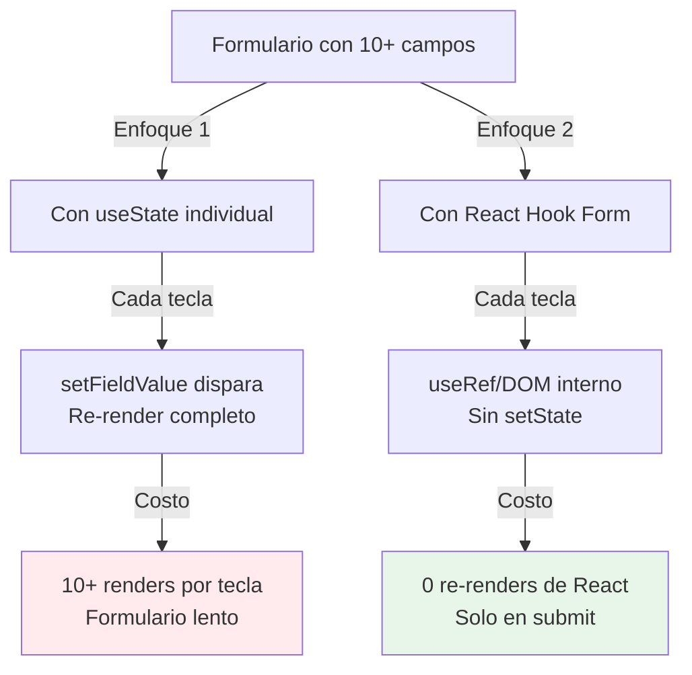
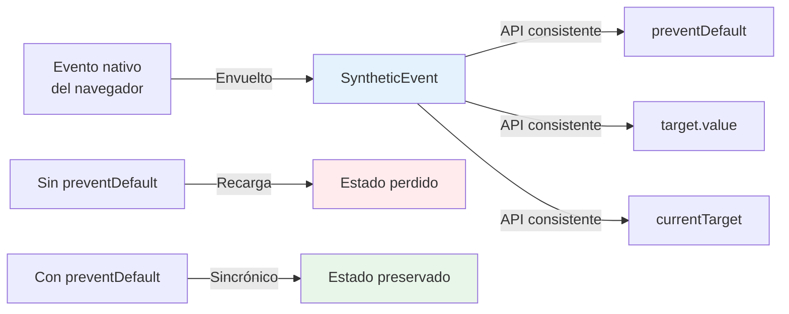
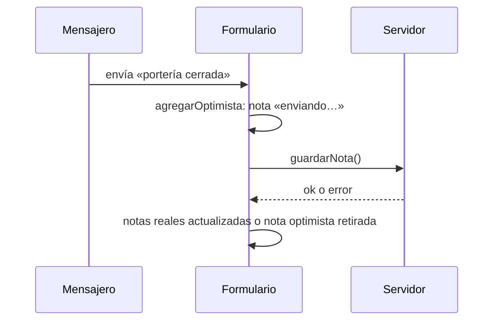

# Módulo 3: Formularios y eventos


## Aprende construyendo

**Servidor del módulo:** cada ejemplo se sirve con `npm run dev` dentro del proyecto `mi-react` del módulo 0; abre `http://localhost:5173` para ver el resultado y ejecuta `npm test` para las pruebas (Vitest, configurado una sola vez en «Prepara las pruebas» del módulo 0). Si el puerto cambia, usa el que imprima la terminal.

### Tema 1: React Hook Form y el problema del re-render por tecla

#### Paso 1 · Objetivo y preparación
Al finalizar vas a medir cuántas veces se re-renderiza un formulario de registro de envíos con `useState` por campo, y a migrarlo a React Hook Form para eliminar ese costo. Prerrequisitos: Módulo 2 completo.

#### Paso 2 · Contexto y caso real
El formulario de alta de un nuevo envío en RutaFlow tiene más de diez campos (remitente, destinatario, dirección, peso, dimensiones...); con `useState` individual por campo, cada tecla en cualquier campo re-renderiza el formulario completo.

#### Paso 3 · Teoría, modelo mental y analogía
React Hook Form registra cada input de forma no controlada por debajo (mediante referencias del DOM), evitando que cada tecla dispare un re-render de React — dejar que cada persona escriba en su propio papel privado en vez de anunciar en voz alta cada letra.

**Diagrama: useState vs React Hook Form en formularios**



**Conceptos clave:** registro no controlado por debajo, rendimiento en formularios grandes.

Manejar cada campo de un formulario con su propio `useState` individual (el enfoque controlado estudiado en el Módulo 1) funciona perfectamente bien para formularios pequeños, pero en formularios con muchos campos, cada tecla presionada en cualquier campo dispara un re-render de todo el componente formulario completo (dado que el estado vive en ese componente padre), un costo que se vuelve mensurable cuando el formulario tiene decenas de campos, cada uno re-renderizándose innecesariamente cada vez que cualquier otro campo cambia, no solo el que efectivamente recibió la tecla.

React Hook Form (`const { register, handleSubmit, formState: { errors } } = useForm();`) resuelve este problema registrando cada input de forma "no controlada" por debajo (similar en espíritu al enfoque no controlado mencionado en el Módulo 1, gestionado internamente mediante referencias del DOM en vez de estado de React sincronizado en cada tecla): `{...register('email', { required: 'El email es obligatorio' })}` conecta el input directamente al sistema interno de la librería sin que cada tecla dispare un re-render de React, permitiendo que formularios con muchos campos permanezcan responsivos incluso a gran escala, mientras React Hook Form gestiona la validación y el estado de errores internamente y de forma eficiente.

`handleSubmit(datos => crearUsuario(datos))` recolecta todos los valores actuales del formulario solo en el momento del envío (no en cada tecla), ejecutando primero cualquier validación configurada y solo invocando la función de envío proporcionada si esa validación pasa exitosamente, con `errors` reflejando de forma reactiva cualquier error de validación encontrado, disponible para mostrarse condicionalmente junto a cada campo correspondiente.

**Analogía:** manejar cada campo con `useState` individual es como anunciar en voz alta a toda la sala cada letra que alguien escribe en cualquier formulario de la sala; React Hook Form es como dejar que cada persona escriba en su propio papel privado, y solo recolectar y anunciar el contenido completo cuando alguien efectivamente entrega su formulario terminado.

**Código del ejemplo:**

```jsx
const { register, handleSubmit, formState: { errors } } = useForm();

<form onSubmit={handleSubmit(datos => crearUsuario(datos))}>
  <input {...register('email', { required: 'El email es obligatorio' })} />
  {errors.email && <span>{errors.email.message}</span>}
</form>
```


**Límites y decisión de uso:** Evitar renders por tecla no elimina validación costosa ni asegura buena interacción. Elige campos controlados cuando su comportamiento lo requiera y mide el formulario real antes de introducir complejidad solo para reducir un contador.

**¿Por qué es importante?** React Hook Form evita el costo de re-renderizar el formulario completo en cada tecla, un problema de rendimiento mensurable en formularios con muchos campos.

#### Paso 4 · Demostración guiada desde cero
```jsx
import { useForm } from 'react-hook-form';

function registrarEnvio(datos) {
  console.log('Envío registrado:', datos);
}

function FormularioEnvio() {
  const { register, handleSubmit, formState: { errors } } = useForm();
  console.log('render');

  return (
    <form onSubmit={handleSubmit(datos => registrarEnvio(datos))}>
      <label>
        Destinatario{' '}
        <input {...register('destinatario', { required: 'El destinatario es obligatorio' })} />
      </label>
      {errors.destinatario && <span role="alert">{errors.destinatario.message}</span>}
      <button type="submit">Registrar</button>
    </form>
  );
}

export default function App() {
  return <FormularioEnvio />;
}
```

**Ejecuta el ejemplo** en tu proyecto `mi-react` (lo creaste y preparaste para pruebas al inicio del módulo 0): reemplaza todo el contenido de `src/App.jsx` por el bloque anterior (instala antes la librería) y arráncalo:

```bash
npm install react-hook-form
npm run dev
```

Resultado esperado: con la consola del navegador abierta, escribir en el campo `destinatario` no imprime `render` en cada tecla — React Hook Form gestiona el valor internamente sin pasar por `setState` de React en cada cambio. Enviar el campo vacío muestra «El destinatario es obligatorio». Ejecuta `npm test` para confirmar que las pruebas anteriores siguen en verde.

#### Paso 5 · Práctica guiada
Pista: reemplaza el campo `destinatario` por una versión controlada con `useState` + `onChange` manual, dejando el resto del formulario con `register` "para comparar" — ese es el fallo deliberado: ahora ese campo específico sí re-renderiza el formulario completo en cada tecla (visible en el `console.log`), mientras los demás campos no lo hacen, mezclando dos modelos sin necesidad.

#### Paso 6 · Práctica independiente
Corrige el Paso 5 devolviendo `destinatario` a `register`, y agrega un campo nuevo (`peso`) también con `register`, confirmando que agregar campos a React Hook Form no incrementa el costo de render de los campos existentes. Traslada el formulario de entrega del proyecto integrador RutaFlow a React Hook Form y compara el número de renders por tecla.

#### Paso 7 · Cierre
Entrega el formulario sin re-renders por tecla del Paso 4, el campo controlado mezclado del Paso 5, y el campo adicional del Paso 6; explica por qué mezclar un campo controlado dentro de un formulario de React Hook Form reintroduce exactamente el costo que React Hook Form existe para evitar. Siguiente paso: estudia cómo validar ese formulario con un schema de zod. Errores comunes: mezclar campos controlados y no controlados en el mismo formulario sin necesidad, no medir realmente el costo de render antes de migrar a React Hook Form, y olvidar `{...register(...)}` en algún input dejándolo sin conectar. Fuentes oficiales: https://react-hook-form.com/get-started y https://react.dev/learn/sharing-state-between-components.

### Tema 2: Validación con zod y formularios multi-paso

#### Paso 1 · Objetivo y preparación
Al finalizar vas a validar el formulario de registro de envíos con un schema de zod, y a dividirlo en dos pasos (datos del paquete, datos de entrega) sin perder información al retroceder. Prerrequisitos: Tema 1 de este módulo.

#### Paso 2 · Contexto y caso real
El peso de un envío debe ser un número positivo y la dirección no puede estar vacía — validar esto manualmente campo por campo en el `onSubmit` sería repetitivo y difícil de mantener sincronizado con las reglas reales del backend.

#### Paso 3 · Teoría, modelo mental y analogía
Un schema de zod describe declarativamente qué forma y qué restricciones debe cumplir un objeto de datos válido, conectado a React Hook Form mediante `zodResolver` — una plantilla de aduana que especifica qué documentos son válidos para pasar.
**Conceptos clave:** schema declarativo, `zodResolver`, estado compartido entre pasos.

Un schema de zod (`z.object({ email: z.email(), edad: z.number().min(18) })`) describe declarativamente qué forma y qué restricciones debe cumplir un objeto de datos válido, expresado como un schema TypeScript-first reutilizable también para validar datos en otros contextos (por ejemplo, validar la misma forma de datos en el backend, Módulo 8 del track de Node.js, compartiendo literalmente el mismo schema entre cliente y servidor). Conectar ese schema a React Hook Form mediante `useForm({ resolver: zodResolver(schema) })` delega toda la lógica de validación a zod, poblando automáticamente `errors` con los mensajes correspondientes cuando el schema rechaza algún valor.

Un formulario multi-paso mantiene el estado combinado de todos los pasos en un componente padre compartido (`const [datos, setDatos] = useState({})`), donde cada paso individual es un sub-formulario independiente que, al completarse, fusiona sus propios datos con el estado acumulado existente (`setDatos(prev => ({ ...prev, ...datosDelPaso }))`) antes de avanzar al siguiente paso (`setPaso(p => p + 1)`); al retroceder a un paso anterior, ese estado combinado ya existente permite prellenar nuevamente los campos con los valores previamente ingresados, en vez de perderlos y forzar al usuario a reescribirlos desde cero.

**Analogía:** un schema de zod es como una plantilla de aduana que especifica exactamente qué documentos y en qué formato son válidos para pasar, rechazando automáticamente cualquier envío que no cumpla esos requisitos declarados; un formulario multi-paso es como llenar un formulario largo en varias hojas separadas que se van acumulando en la misma carpeta, permitiendo volver a una hoja anterior sin perder lo ya escrito en las demás.

**Código del ejemplo:**

```jsx
const schema = z.object({ email: z.email(), edad: z.number().min(18) });
useForm({ resolver: zodResolver(schema) });

const [paso, setPaso] = useState(1);
const [datos, setDatos] = useState({});
function siguientePaso(datosDelPaso) {
  setDatos(prev => ({ ...prev, ...datosDelPaso }));
  setPaso(p => p + 1);
}
```


**Límites y decisión de uso:** El esquema del cliente puede omitirse o quedar desactualizado; el servidor debe validar también. En pasos múltiples conserva datos válidos y errores por campo, sin perder el borrador ni enviar campos ocultos que ya no corresponden.

**¿Por qué es importante?** Un schema de zod centraliza y hace reutilizable la lógica de validación; conservar el estado combinado entre pasos evita que el usuario pierda datos ya ingresados al navegar entre pasos.

#### Paso 4 · Demostración guiada desde cero
```jsx
import { useState } from 'react';
import { useForm } from 'react-hook-form';
import { zodResolver } from '@hookform/resolvers/zod';
import { z } from 'zod';

const schemaPaquete = z.object({
  peso: z.number().positive('El peso debe ser mayor a 0'),
  direccion: z.string().min(1, 'La dirección es obligatoria'),
});

const schemaEntrega = z.object({
  destinatario: z.string().min(1, 'El destinatario es obligatorio'),
});

function PasoPaquete({ valores, alAvanzar }) {
  const { register, handleSubmit, formState: { errors } } = useForm({
    resolver: zodResolver(schemaPaquete),
    defaultValues: valores, // prellena lo escrito antes al volver a este paso
  });
  return (
    <form onSubmit={handleSubmit(alAvanzar)}>
      <label>Peso (kg) <input type="number" step="0.1" {...register('peso', { valueAsNumber: true })} /></label>
      {errors.peso && <span role="alert">{errors.peso.message}</span>}
      <label>Dirección <input {...register('direccion')} /></label>
      {errors.direccion && <span role="alert">{errors.direccion.message}</span>}
      <button type="submit">Siguiente</button>
    </form>
  );
}

function PasoEntrega({ valores, alVolver, alAvanzar }) {
  const { register, handleSubmit, formState: { errors } } = useForm({
    resolver: zodResolver(schemaEntrega),
    defaultValues: valores,
  });
  return (
    <form onSubmit={handleSubmit(alAvanzar)}>
      <label>Destinatario <input {...register('destinatario')} /></label>
      {errors.destinatario && <span role="alert">{errors.destinatario.message}</span>}
      <button type="button" onClick={alVolver}>Volver</button>
      <button type="submit">Registrar</button>
    </form>
  );
}

export default function App() {
  const [paso, setPaso] = useState(1);
  const [datos, setDatos] = useState({});

  function siguientePaso(datosDelPaso) {
    setDatos(prev => ({ ...prev, ...datosDelPaso }));
    setPaso(p => p + 1);
  }

  if (paso === 1) return <PasoPaquete valores={datos} alAvanzar={siguientePaso} />;
  if (paso === 2) {
    return <PasoEntrega valores={datos} alVolver={() => setPaso(1)} alAvanzar={siguientePaso} />;
  }
  return <pre>{JSON.stringify(datos, null, 2)}</pre>;
}
```

**Ejecuta el ejemplo** en tu proyecto `mi-react` (lo creaste y preparaste para pruebas al inicio del módulo 0): reemplaza todo el contenido de `src/App.jsx` por el bloque anterior (instala antes las librerías) y arráncalo:

```bash
npm install react-hook-form zod@4 @hookform/resolvers
npm run dev
```

Resultado esperado: intentar enviar el paso 1 con `peso: -5` o `direccion: ''` puebla automáticamente `errors.peso`/`errors.direccion` con el mensaje del schema («El peso debe ser mayor a 0», «La dirección es obligatoria»), sin que el componente escriba ninguna lógica de validación manual. `valueAsNumber: true` convierte el texto del input en número antes de validarlo. Con datos válidos avanzas al paso 2, y «Volver» muestra el paso 1 con lo que ya habías escrito. Ejecuta `npm test` para confirmar que las pruebas anteriores siguen en verde.

#### Paso 5 · Práctica guiada
**Fallo deliberado #1 (sobrescribir estado):**
Cambia `setDatos(prev => ({ ...prev, ...datosDelPaso }))` por `setDatos(datosDelPaso)` (sin el spread) — al registrar el paso 2, el resumen final solo contiene `destinatario`: los datos del paso 1 desaparecieron.

**Fallo deliberado #2 (schema incompleto):**
Quita la validación `.positive(...)` de `peso` en el schema (deja `z.number()`), dejando solo `direccion` — ahora puedes enviar un peso negativo (-10 kg) sin que zod lo rechace, porque nunca lo validó.

**Fallo deliberado #3 (duplicar validación):**
Mantén el schema de zod pero agrega además validación manual en el `onSubmit`: `if (peso < 0) setErrors(...)` — ahora tienes dos lugares donde validar la misma regla, fácil de desincronizar cuando una cambia.
**Pista:** revierte cada fallo antes de probar el siguiente — el Fallo #1 se nota de inmediato en el resumen final, pero el Fallo #2 (schema incompleto) solo se nota si intentas enviar explícitamente un valor que debería haber sido rechazado.
#### Paso 6 · Práctica independiente
Corrige el Paso 5 restaurando el spread, y convierte el resumen final en un tercer paso de confirmación que muestre de todos los datos acumulados de los pasos 1 y 2, confirmando que nada se perdió en el camino. Valida el formulario multipaso del proyecto integrador RutaFlow con zod y muestra el error del paso que falla.

#### Paso 7 · Cierre
Entrega el schema con validación del Paso 4, la pérdida de datos provocada en el Paso 5, y el paso de confirmación del Paso 6; explica por qué `setDatos(prev => ({ ...prev, ...datosDelPaso }))` es necesario, dado que cada paso solo conoce sus propios campos, no los de los demás pasos. Siguiente paso: estudia cómo React normaliza los eventos del formulario. Errores comunes: sobrescribir el estado acumulado en vez de fusionarlo al avanzar de paso, duplicar reglas de validación entre el schema y código manual adicional, y no validar un paso antes de permitir avanzar al siguiente. Fuentes oficiales: https://zod.dev/ y https://react-hook-form.com/docs/useform.

### Tema 3: Eventos sintéticos

#### Paso 1 · Objetivo y preparación
Al finalizar vas a manejar el envío del formulario de registro de envíos con `e.preventDefault()`, confirmando que ese método funciona igual sin importar el navegador. Prerrequisitos: Tema 2 de este módulo.

#### Paso 2 · Contexto y caso real
Sin llamar expresamente a `preventDefault()`, enviar el formulario de registro de envíos recarga la página completa (el comportamiento nativo por defecto de un `<form>`), perdiendo cualquier estado de React en el proceso.

#### Paso 3 · Teoría, modelo mental y analogía
React envuelve los eventos nativos del DOM en un `SyntheticEvent` con una API consistente entre navegadores — un traductor universal que normaliza mensajes de distintos "idiomas nativos" en uno común.

**Diagrama:**



* Cuándo: usar `preventDefault` siempre en formularios para evitar recarga del navegador; `SyntheticEvent` garantiza consistencia entre navegadores en vez de depender de APIs nativas inconsistentes.

**¿Por qué es importante?** El envoltorio de eventos sintéticos garantiza una API de eventos consistente entre navegadores, y sin `preventDefault` el comportamiento nativo del navegador destruye todo el estado de React acumulado.

#### Paso 4 · Demostración guiada desde cero
```jsx
import { useState } from 'react';

export default function App() {
  const [registrados, setRegistrados] = useState([]);

  function manejarSubmit(e) {
    e.preventDefault(); // evita la recarga completa de la página
    const datos = new FormData(e.currentTarget);
    setRegistrados(prev => [...prev, datos.get('guia')]);
    e.currentTarget.reset();
  }

  return (
    <>
      <form onSubmit={manejarSubmit}>
        <label>Guía <input name="guia" required /></label>
        <button type="submit">Enviar</button>
      </form>
      <p>Registrados en esta sesión: {registrados.join(', ') || 'ninguno'}</p>
    </>
  );
}
```

**Ejecuta el ejemplo** en tu proyecto `mi-react` (lo creaste y preparaste para pruebas al inicio del módulo 0): reemplaza todo el contenido de `src/App.jsx` por el bloque anterior y arráncalo:

```bash
npm run dev
```

Resultado esperado: al enviar el formulario, la página no se recarga (no aparece el parpadeo característico de una recarga completa), y el estado de React se conserva: la lista «Registrados en esta sesión» acumula cada guía enviada. Este ejemplo usa un formulario sin librerías a propósito: el `handleSubmit` de React Hook Form (Tema 1) ya llama a `preventDefault()` por ti.

Escribe `src/App.test.jsx` con el patrón de `DeliveryCard.test.jsx`: escribe `RF-4471` en el campo «Guía», pulsa «Enviar» con `userEvent` y comprueba que aparece «Registrados en esta sesión: RF-4471». Después ejecuta `npm test` (cuando reemplaces `App.jsx` en el próximo tema, borra esta prueba o muévela junto al componente).

#### Paso 5 · Práctica guiada
Pista: quita `e.preventDefault()` del manejador — ese es el fallo deliberado: al tocar "Enviar", el navegador recarga la página completa con su comportamiento nativo (verás `?guia=...` en la barra de direcciones), perdiendo instantáneamente todo el estado de React: la lista de registrados vuelve a «ninguno».

#### Paso 6 · Práctica independiente
Corrige el Paso 5 restaurando `e.preventDefault()`, y agrega un campo de peso con un manejador `onKeyDown` en el campo de peso que llame a `e.preventDefault()` específicamente cuando se presione una tecla que no sea un dígito, evitando escribir letras en un campo numérico. En el proyecto integrador RutaFlow, evita la recarga del formulario de entrega con `preventDefault` y prueba el envío con teclado.

#### Paso 7 · Cierre
Entrega el manejador con `preventDefault` del Paso 4, la recarga de página provocada en el Paso 5, y el bloqueo de teclas no numéricas del Paso 6; explica por qué `e.preventDefault()` dentro de un `SyntheticEvent` de React funciona de forma idéntica sin importar el navegador. Siguiente paso: estudia routing con React Router. Errores comunes: olvidar `preventDefault` en el submit de un formulario, confundir `e.target` con `e.currentTarget` en un evento con burbujeo, y depender de comportamiento específico de un navegador en vez de la API sintética unificada. Fuentes oficiales: https://react.dev/learn/responding-to-events y https://react.dev/reference/react-dom/components/common#react-event-object.

### Tema 4: Formularios con Actions: useActionState y useOptimistic · Avanzado · 45 min

**Prerrequisito:** temas «Validación con zod y formularios multi-paso» de este módulo y «Optimistic updates» (módulo 6).

**Al finalizar podrás:** enviar un formulario con una Action, mostrar el error y el estado de envío con `useActionState`, y mostrar el resultado de forma optimista con `useOptimistic` mientras el servidor responde.

**¿Por qué es importante?** Antes había que escribir a mano `isLoading`, `error`, `try/catch` y revertir la interfaz si fallaba. React 19 trae ese patrón: menos código propio y menos estados inconsistentes.

#### Paso 1 · Objetivo y preparación

Usa React 19 o superior. Parte del proyecto de Vite del módulo y trabaja en `src/Notas.jsx`. El «servidor» se simula con una función que tarda un segundo.

#### Paso 2 · Contexto y caso real

Los mensajeros de RutaFlow agregan notas a un envío («portería cerrada»). Con mala señal, la nota tardaba en aparecer y el mensajero la enviaba tres veces. Mostrar la nota al instante como «enviando…» y bloquear el botón resolvió los duplicados.

#### Paso 3 · Teoría, modelo mental y analogía

**Conceptos clave:** Action, `<form action>`, `useActionState`, estado anterior, `isPending`, `useOptimistic`, actualización optimista, reversión.

Una **Action** es una función (puede ser `async`) que React ejecuta dentro de una transición. Si la pasas a `<form action={...}>`, recibe los `FormData` y el formulario se reinicia al terminar.

`useActionState(accion, estadoInicial)` devuelve `[estado, accionDelFormulario, isPending]`:

- tu `accion` recibe `(estadoAnterior, formData)` y devuelve el nuevo estado (por ejemplo, un error);
- `isPending` es `true` mientras corre.

`useOptimistic(valorReal, combinar)` devuelve `[valorOptimista, agregarOptimista]`. Mientras la Action corre, la interfaz muestra el valor optimista; cuando termina, React vuelve al valor real. Si el servidor falló y no actualizaste el real, la nota optimista **desaparece sola**.

**Analogía:** la actualización optimista es anotar en la pizarra «pedido en camino» apenas el cliente paga, y borrarlo si el banco rechaza la tarjeta. La analogía falla en que React borra la nota automáticamente: tú solo decides qué es el valor real.

**Límite de uso:** no muestres de forma optimista operaciones que el usuario no debe creer completas (pagos, borrados definitivos). `agregarOptimista` solo funciona dentro de una Action o `startTransition`.



#### Paso 4 · Demostración guiada desde cero

Archivo `academia-react/src/Notas.jsx`:

```jsx
import { useActionState, useOptimistic, useState } from 'react';

async function guardarNota(texto) {
  await new Promise((listo) => setTimeout(listo, 1000)); // simula el servidor
  if (texto.includes('error')) throw new Error('El servidor rechazó la nota');
  return { id: crypto.randomUUID(), texto };
}

export default function Notas() {
  const [notas, setNotas] = useState([]);
  const [notasVisibles, agregarOptimista] = useOptimistic(
    notas,
    (actuales, texto) => [...actuales, { id: 'temporal', texto, enviando: true }],
  );

  const [error, enviar, enviando] = useActionState(async (_errorAnterior, formData) => {
    const texto = formData.get('texto').trim();
    if (!texto) return 'Escribe una nota';
    agregarOptimista(texto);
    try {
      const guardada = await guardarNota(texto);
      setNotas((actuales) => [...actuales, guardada]);
      return null;
    } catch (e) {
      return e.message; // la nota optimista desaparece sola
    }
  }, null);

  return (
    <form action={enviar}>
      <ul>
        {notasVisibles.map((n) => <li key={n.id}>{n.texto}{n.enviando && ' (enviando…)'}</li>)}
      </ul>
      <input name="texto" placeholder="Nota para el envío" />
      <button disabled={enviando}>{enviando ? 'Enviando…' : 'Agregar'}</button>
      {error && <p role="alert">{error}</p>}
    </form>
  );
}
```

Ejecútalo:

```bash
cd academia-react
npm run dev
```

**Explicación por bloques:** `guardarNota` simula un servidor lento que rechaza textos con «error». `useOptimistic` parte de `notas` (el valor real) y define cómo agregar una nota temporal marcada como `enviando`. La Action de `useActionState` valida, agrega la nota optimista, espera al servidor y, si todo sale bien, actualiza el valor real; si falla, devuelve el mensaje como nuevo estado. `enviando` desactiva el botón y `<form action>` limpia el campo al terminar.

**Resultado esperado:**

```text
Al enviar «portería cerrada»: la nota aparece al instante con «(enviando…)», el botón dice «Enviando…» y, un segundo después, la nota queda sin la marca.
Al enviar «error de prueba»: la nota aparece un segundo y desaparece, y se muestra «El servidor rechazó la nota».
```

**Fallo deliberado:** mueve `agregarOptimista(texto)` a un `onClick` del botón, fuera de la Action. **Error esperado:** la consola avisa que una actualización optimista ocurrió fuera de una transición o Action, y la nota no se muestra bien. **Diagnóstico:** `useOptimistic` necesita saber cuándo termina la operación; eso solo lo sabe dentro de una Action o de `startTransition`.

#### Paso 5 · Práctica guiada

1. **Reproducción:** envía dos notas válidas y observa la marca «(enviando…)».
2. **Variación:** envía una nota con «error» y explica por qué la nota optimista desaparece sin código de reversión.
3. **Diagnóstico:** reproduce el fallo deliberado y lee el aviso de la consola.
4. **Integración:** agrega una validación de máximo 140 caracteres que devuelva el error sin llamar al servidor.
5. **Diseño:** decide qué acciones de RutaFlow pueden ser optimistas (notas, confirmación de entrega, cancelación) y justifica.

**Pista:** el valor real (`notas`) solo cambia cuando el servidor confirma; todo lo demás es temporal.

#### Paso 6 · Práctica independiente

Crea un botón «Marcar como entregado» con `useOptimistic` que cambie el estado al instante y lo revierta si el servidor responde con error, usando `startTransition` en lugar de un formulario.

#### Paso 7 · Cierre

- [ ] Explicas qué devuelve `useActionState`.
- [ ] La nota aparece al instante y se confirma después.
- [ ] Una nota rechazada desaparece y muestra el error.
- [ ] Sabes qué operaciones no deben ser optimistas.

Si fallas dos o más, vuelve al Paso 3. **Errores comunes:** llamar a la actualización optimista fuera de una Action, mostrar como hechos los pagos pendientes y olvidar desactivar el botón mientras se envía. **Siguiente paso:** el módulo 10 ejecuta estas mismas Actions en el servidor con Server Functions.

**Transferencia al proyecto integrador «RutaFlow»:** en la app del mensajero de RutaFlow, implementa las notas del envío con `useActionState` y `useOptimistic` y bloquea los envíos duplicados.

**Fuente oficial:** [React — useActionState](https://react.dev/reference/react/useActionState) y [React — useOptimistic](https://react.dev/reference/react/useOptimistic).

## Laboratorio práctico

**Objetivo del laboratorio:** construir un formulario de registro multi-paso con React Hook Form y validación con zod.

**Requisitos previos:** Módulos 0-2 completados.

| Paso | Acción | Código | Explicación |
|---|---|---|---|
| 1 | Construir un formulario de registro con React Hook Form | Ver Tema 1 | `register`, `handleSubmit`, `errors` |
| 2 | Agregar validación con un schema de zod | Ver Tema 2 | `zodResolver(schema)` |
| 3 | Implementar el formulario multi-paso | Ver Tema 2 | Conserva datos al avanzar y retroceder |
| 4 | Manejar el evento de submit correctamente | Ver Tema 3 | `preventDefault` |

**Verificación:** el laboratorio se considera exitoso si el formulario valida correctamente según el schema de zod, y si los datos de un paso anterior permanecen visibles al retroceder y volver a avanzar.

**Errores comunes y soluciones**

- **Manejar cada campo con `useState` individual en un formulario grande.** Usa React Hook Form para evitar re-renders innecesarios en cada tecla.
- **Olvidar `preventDefault` en el submit.** Sin él, el navegador recarga la página por defecto.
- **Perder los datos de pasos anteriores al retroceder.** Fusiona siempre los datos del paso actual con el estado acumulado antes de avanzar.

---
