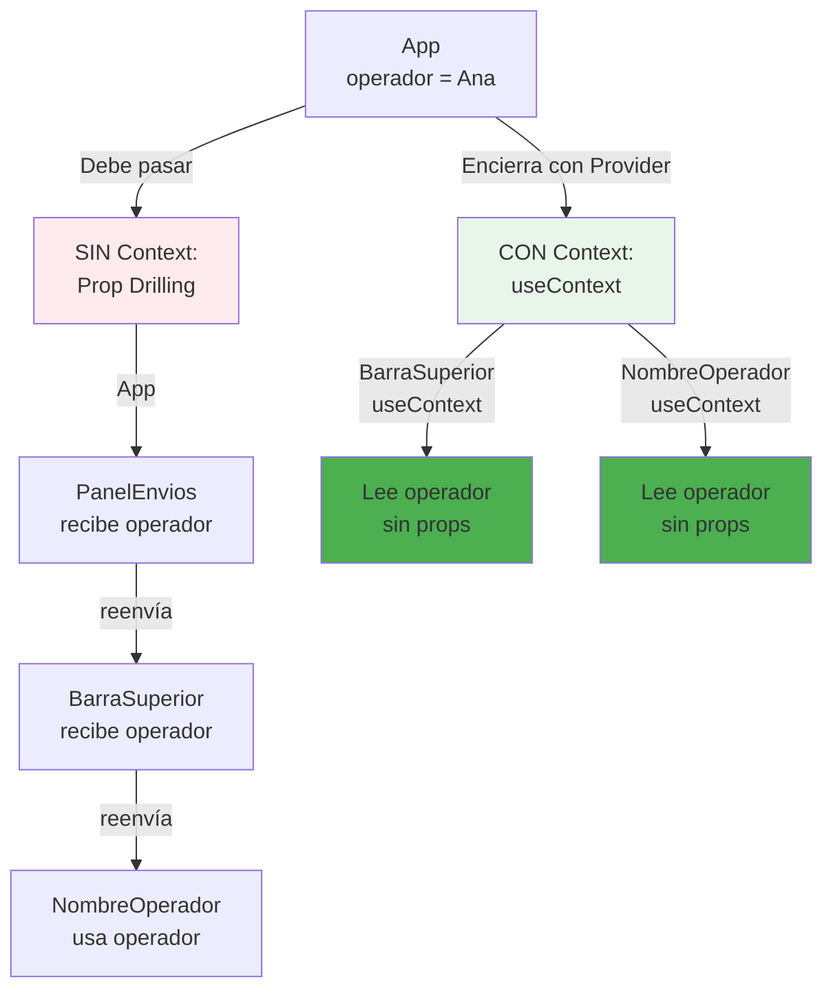
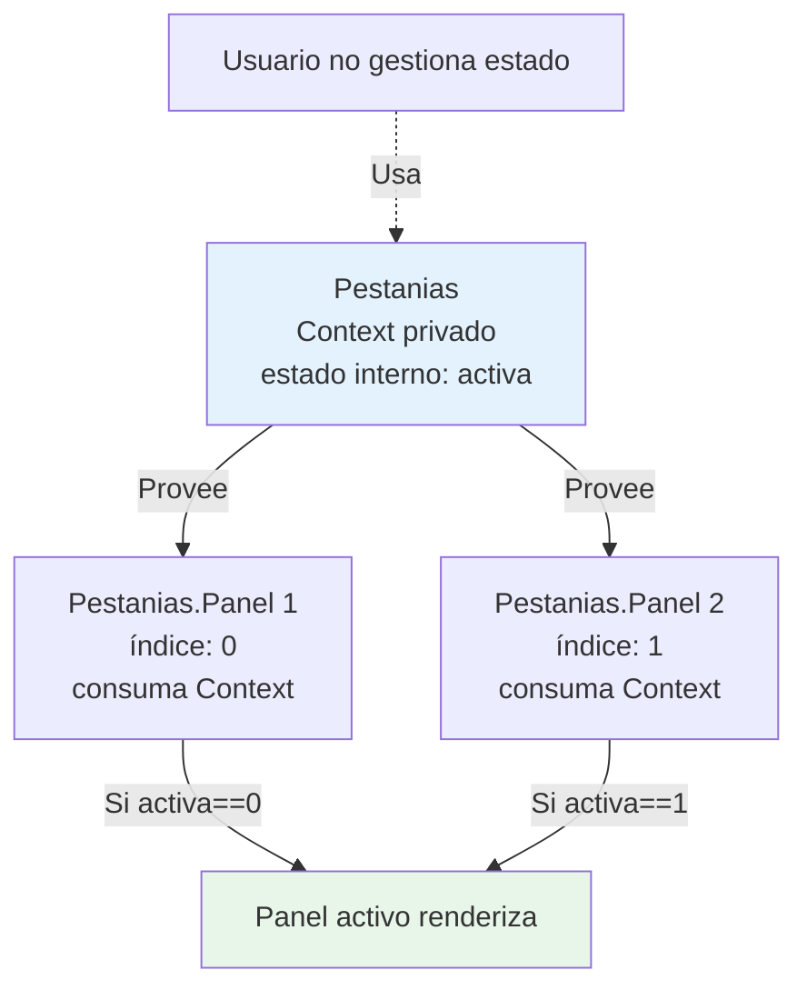

# Módulo 4: Context API y composición


## Aprende construyendo

**Servidor del módulo:** cada ejemplo se sirve con `npm run dev` dentro del proyecto `mi-react` del módulo 0; abre `http://localhost:5173` para ver el resultado y ejecuta `npm test` para las pruebas (Vitest, configurado una sola vez en «Prepara las pruebas» del módulo 0). Si el puerto cambia, usa el que imprima la terminal.


### Tema 1: createContext y useContext · Intermedio · 45 min

<details open>
<summary><strong>Capa 1 — Lectura</strong></summary>

#### ► DE QUÉ TRATA
Al finalizar vas a crear SesionContext para compartir el operador autenticado de RutaFlow con cualquier componente del árbol, sin pasarlo por props en cada nivel intermedio. Prerrequisitos: Módulo 3 completo.

#### ► CÓMO FUNCIONA


</details>

<details>
<summary><strong>Capa 2 — Construcción</strong></summary>

#### Código y verificación


```jsx
const ThemeContext = createContext({ tema: 'claro', setTema: () => {} });

function App() {
  const [tema, setTema] = useState('claro');
  return (
    <ThemeContext.Provider value={{ tema, setTema }}>
      <Pagina />
    </ThemeContext.Provider>
  );
}

function BotonToggle() {
  const { tema, setTema } = useContext(ThemeContext); // sin pasar props por cada nivel intermedio
  return <button onClick={() => setTema(t => t === 'claro' ? 'oscuro' : 'claro')}>{tema}</button>;
}
```

```jsx
import { createContext, useContext, useState } from 'react';

const SesionContext = createContext(null);

export default function App() {
  const [operador, setOperador] = useState({ nombre: 'Ana', zona: 'norte' });
  return (
    <SesionContext.Provider value={{ operador, setOperador }}>
      <PanelEnvios />
    </SesionContext.Provider>
  );
}

// Componente intermedio: no recibe ni reenvía `operador`.
function PanelEnvios() {
  return (
    <section>
      <BarraSuperior />
      <p>Lista de envíos…</p>
    </section>
  );
}

function BarraSuperior() {
  const { operador } = useContext(SesionContext); // sin pasar props por cada nivel intermedio
  return <span>Operador: {operador.nombre}</span>;
}
```

```bash
npm run dev
```

</details>

### Tema 2: Cuándo Context es suficiente y cuándo no · Intermedio · 45 min

<details open>
<summary><strong>Capa 1 — Lectura</strong></summary>

#### ► DE QUÉ TRATA
Al finalizar vas a medir cuántos componentes se re-renderizan cuando SesionContext cambia, y a decidir si ese costo es aceptable para el caso de RutaFlow. Prerrequisitos: Tema 1 de este módulo.

</details>

<details>
<summary><strong>Capa 2 — Construcción</strong></summary>

#### Código y verificación
```
Context apropiado: tema, idioma, usuario autenticado (cambia poco, se lee en muchos lugares)
Context problemático: valor de un input en cada tecla (cambia mucho, re-renderiza TODOS los consumidores)
```

```jsx
import { createContext, useContext, useState } from 'react';

const SesionContext = createContext(null);

export default function App() {
  const [operador] = useState({ nombre: 'Ana', zona: 'norte' });
  const [filtroBusqueda, setFiltroBusqueda] = useState('');
  // Mal: mezclar un valor de cambio frecuente dentro de un Context de cambio infrecuente
  return (
    <SesionContext.Provider value={{ operador, filtroBusqueda, setFiltroBusqueda }}>
      <BarraSuperior />
      <CampoBusqueda />
    </SesionContext.Provider>
  );
}

function BarraSuperior() {
  const { operador } = useContext(SesionContext);
  console.log('render de BarraSuperior');
  return <p>Operador: {operador.nombre}</p>;
}

function CampoBusqueda() {
  const { filtroBusqueda, setFiltroBusqueda } = useContext(SesionContext);
  return (
    <label>
      Buscar envío{' '}
      <input value={filtroBusqueda} onChange={e => setFiltroBusqueda(e.target.value)} />
    </label>
  );
}
```

```bash
npm run dev
```

</details>

### Tema 3: Componentes compuestos, render props y hooks personalizados · Avanzado · 45 min

<details open>
<summary><strong>Capa 1 — Lectura</strong></summary>

#### ► DE QUÉ TRATA
Al finalizar vas a construir Pestanias/Pestanias.Panel (un componente compuesto) para organizar el panel de operador en pestañas ("Envíos activos", "Historial"), coordinadas internamente sin que quien lo usa gestione ese estado. Prerrequisitos: Tema 2 de este módulo.

#### ► CÓMO FUNCIONA


</details>

<details>
<summary><strong>Capa 2 — Construcción</strong></summary>

#### Código y verificación


```jsx
import { createContext, useContext, useState } from 'react';

const PestaniasContext = createContext(null);

function Pestanias({ children }) {
  const [activa, setActiva] = useState(0);
  return <PestaniasContext.Provider value={{ activa, setActiva }}>{children}</PestaniasContext.Provider>;
}

Pestanias.Panel = function Panel({ indice, titulo, children }) {
  const { activa, setActiva } = useContext(PestaniasContext);
  return (
    <>
      <button onClick={() => setActiva(indice)}>{titulo}</button>
      {activa === indice && <div>{children}</div>}
    </>
  );
};

export default function App() {
  return (
    <Pestanias>
      <Pestanias.Panel indice={0} titulo="Envíos activos">RF-4471 · en ruta</Pestanias.Panel>
      <Pestanias.Panel indice={1} titulo="Historial">RF-4410 · entregado</Pestanias.Panel>
    </Pestanias>
  );
}
```

```bash
npm run dev
```

</details>
