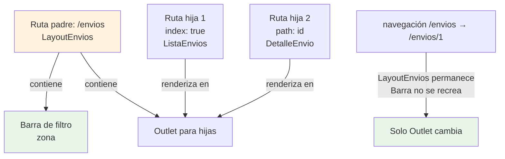
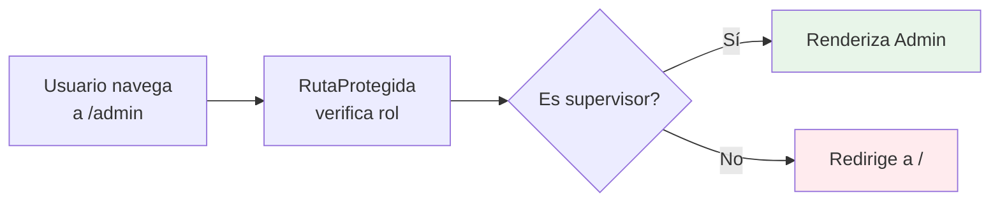

# Módulo 5: React Router — navegación


## Aprende construyendo

**Servidor del módulo:** cada ejemplo se sirve con `npm run dev` dentro del proyecto `mi-react` del módulo 0; abre `http://localhost:5173` para ver el resultado y ejecuta `npm test` para las pruebas (Vitest, configurado una sola vez en «Prepara las pruebas» del módulo 0). Si el puerto cambia, usa el que imprima la terminal.

### Tema 1: Rutas anidadas y layouts compartidos

#### Paso 1 · Objetivo y preparación
Al finalizar vas a anidar `/envios` y `/envios/:id` bajo un layout compartido (`LayoutEnvios`, con la barra de filtros de zona) sin duplicar esa barra en cada vista. Prerrequisitos: Módulo 4 completo.

#### Paso 2 · Contexto y caso real
Tanto la lista de envíos como el detalle de un envío puntual deberían mostrar la misma barra de filtro de zona en la parte superior; repetirla en cada componente de vista duplicaría ese marcado y su lógica.

#### Paso 3 · Teoría, modelo mental y analogía
Una ruta padre puede definir un `element` que actúa como layout compartido, dentro del cual se renderizan sus rutas hijas — un marco de fotos común que envuelve fotos intercambiables.

**Diagrama: Rutas anidadas y layouts**



**¿Por qué es importante?** Anidar rutas bajo un layout compartido centraliza ese layout en un único lugar y preserva su estado entre navegaciones, algo que rutas independientes duplicadas no logran.
**Conceptos clave:** `children`, layout compartido, composición de rutas.

React Router permite definir rutas anidadas mediante la propiedad `children` de una configuración de ruta: una ruta padre (`/tareas`) puede definir un `element` que actúa como layout compartido (por ejemplo, una barra de navegación común a todas las sub-rutas), dentro del cual se renderizan sus rutas hijas (`{ index: true, element: <ListaTareas /> }` para la ruta exacta `/tareas`, y `{ path: ':id', element: <DetalleTarea /> }` para `/tareas/:id`), evitando la necesidad de repetir manualmente ese layout compartido (la navbar, por ejemplo) en cada componente de vista individual.

Esta estructura anidada refleja directamente la jerarquía visual real de la aplicación: si todas las vistas bajo `/tareas/*` comparten la misma barra de navegación circundante, expresar esa relación mediante anidamiento de rutas evita duplicar ese layout en cada componente de vista, centralizándolo en un único lugar (el componente de la ruta padre).

**Analogía:** un layout compartido en rutas anidadas es como un marco de fotos común que envuelve distintas fotos intercambiables: el marco (la navbar) permanece igual, mientras que el contenido específico dentro de él (la vista actual) cambia según la ruta activa.

**Código del ejemplo:**

```jsx
const router = createBrowserRouter([
  {
    path: '/tareas',
    element: <LayoutTareas />, // navbar compartida
    children: [
      { index: true, element: <ListaTareas /> },
      { path: ':id', element: <DetalleTarea /> },
    ],
  },
]);
```


**Límites y decisión de uso:** Un layout compartido conserva componentes y posiblemente estado entre rutas. Define qué debe reiniciarse al cambiar de guía o identidad, y prueba entrada directa y regreso para evitar mostrar datos de un recurso anterior.

#### Paso 4 · Demostración guiada desde cero
```jsx
import { useState } from 'react';
import { createBrowserRouter, Link, Navigate, Outlet, RouterProvider, useParams } from 'react-router';

function LayoutEnvios() {
  const [zona, setZona] = useState('norte'); // estado del layout compartido
  return (
    <main>
      <label>
        Zona{' '}
        <select value={zona} onChange={e => setZona(e.target.value)}>
          <option value="norte">Norte</option>
          <option value="sur">Sur</option>
        </select>
      </label>
      <nav>
        <Link to="/envios">Lista</Link> · <Link to="/envios/RF-4471">RF-4471</Link>
      </nav>
      <Outlet /> {/* aquí se renderiza la ruta hija activa */}
    </main>
  );
}

function ListaEnvios() {
  return <p>Lista de envíos</p>;
}

function DetalleEnvio() {
  const { id } = useParams();
  return <p>Detalle del envío {id}</p>;
}

const router = createBrowserRouter([
  { path: '/', element: <Navigate to="/envios" replace /> },
  {
    path: '/envios',
    element: <LayoutEnvios />, // barra de filtro de zona compartida
    children: [
      { index: true, element: <ListaEnvios /> },
      { path: ':id', element: <DetalleEnvio /> },
    ],
  },
]);

export default function App() {
  return <RouterProvider router={router} />;
}
```

**Ejecuta el ejemplo** en tu proyecto `mi-react` (lo creaste y preparaste para pruebas al inicio del módulo 0): reemplaza todo el contenido de `src/App.jsx` por el bloque anterior (instala antes React Router) y arráncalo:

```bash
npm install react-router@8
npm run dev
```

Resultado esperado: navegar de `/envios` a `/envios/RF-4471` no remonta `LayoutEnvios` (la zona seleccionada en la barra de filtro se conserva) — solo el `<Outlet />` dentro de `LayoutEnvios` cambia entre `ListaEnvios` y `DetalleEnvio`. Elige «Sur», pulsa «RF-4471» y comprueba que el selector sigue en «Sur». Ejecuta `npm test` para confirmar que las pruebas anteriores siguen en verde.

#### Paso 5 · Práctica guiada
Pista: en vez de anidar, define `/envios` y `/envios/:id` como dos rutas completamente independientes al mismo nivel, cada una renderizando su propia copia de la barra de filtro — ese es el fallo deliberado: al navegar de la lista al detalle, la barra de filtro se desmonta y vuelve a montar desde cero, perdiendo la zona seleccionada aunque visualmente "se vea igual".

#### Paso 6 · Práctica independiente
Corrige el Paso 5 volviendo a anidar ambas rutas bajo `LayoutEnvios`, y agrega una tercera ruta hija (`path: ':id/historial'`) que también comparta el mismo layout, confirmando que la barra de filtro sigue sin remontarse al navegar entre las tres. Anida la ruta de historial del proyecto integrador RutaFlow bajo el mismo layout y comprueba que el filtro no se remonta.

#### Paso 7 · Cierre
Entrega la estructura anidada del Paso 4, la pérdida de estado provocada en el Paso 5, y la tercera ruta hija del Paso 6; explica por qué anidar rutas (en vez de duplicar el layout en rutas independientes) preserva el estado del layout compartido entre navegaciones. Siguiente paso: estudia loaders para evitar el parpadeo de carga. Errores comunes: duplicar el layout en rutas independientes en vez de anidarlas, olvidar el `<Outlet />` dentro del layout (las rutas hijas nunca se renderizarían), y anidar rutas que en realidad no comparten ningún layout real. Fuentes oficiales: https://reactrouter.com/start/data/route-object y https://reactrouter.com/start/framework/routing.

### Tema 2: Loaders — datos antes de renderizar

#### Paso 1 · Objetivo y preparación
Al finalizar vas a cargar los datos de `/envios/:id` con un loader de React Router, en vez de un `fetch` dentro de un `useEffect`, para eliminar el parpadeo de "cargando...". Prerrequisitos: Tema 1 de este módulo.

#### Paso 2 · Contexto y caso real
Hoy, `DetalleEnvio` se monta vacío, muestra "Cargando..." por un instante, y luego se actualiza con los datos reales del envío — un parpadeo visible cada vez que se navega al detalle.

#### Paso 3 · Teoría, modelo mental y analogía
Un loader es una función asociada a una ruta que React Router ejecuta y espera antes de renderizar el componente — esperar a que el plato esté listo en la cocina antes de servirlo, en vez de servir la mesa vacía primero.

**¿Por qué es importante?** Un loader evita el parpadeo de un estado intermedio "cargando" al asegurar que los datos ya están disponibles antes de que el componente de la ruta se renderice por primera vez.
**Conceptos clave:** carga de datos previa a la vista, `useLoaderData`, evitar el parpadeo de carga.

Un loader es una función asociada a una ruta específica que React Router ejecuta y espera a que complete antes de renderizar el componente de esa ruta: `loader: ({ params }) => fetch(`/api/tareas/${params.id}`)`, con el componente accediendo al resultado de esa carga mediante `useLoaderData()`, en vez de disparar la carga de datos dentro de un `useEffect` una vez que el componente ya se montó (el patrón tradicional de fetching dentro del propio componente).

Esta diferencia de timing es la ventaja concreta de un loader: con fetching dentro de un `useEffect`, el componente se monta primero (típicamente mostrando algún estado de "cargando..." mientras la petición está en curso), y solo después de que la petición completa se actualiza el estado con los datos reales, produciendo un parpadeo visual perceptible entre el estado vacío/cargando inicial y el contenido final; con un loader, React Router espera a que la carga de datos complete antes de montar el componente en absoluto, evitando ese parpadeo intermedio por completo, dado que el componente nunca se renderiza en un estado sin datos.

**Analogía:** un loader es como esperar a que el plato completo esté listo en la cocina antes de servirlo en la mesa; fetching dentro de un `useEffect` es como servir la mesa vacía primero y traer el plato después, dejando al comensal esperando frente a un plato vacío durante un momento perceptible antes de que llegue el contenido real.

**Código del ejemplo:**

```jsx
{
  path: '/tareas/:id',
  loader: ({ params }) => fetch(`/api/tareas/${params.id}`),
  element: <DetalleTarea />,
}
// dentro del componente:
const tarea = useLoaderData();
```

#### Paso 4 · Demostración guiada desde cero
```jsx
import { createBrowserRouter, Link, Outlet, RouterProvider, useLoaderData } from 'react-router';

async function cargarEnvio({ params }) {
  const respuesta = await fetch(`/api/envios/${params.id}.json`);
  const tipo = respuesta.headers.get('content-type') ?? '';
  // Vite responde index.html (HTML, no JSON) a un archivo que no existe en public/.
  if (!respuesta.ok || !tipo.includes('application/json')) {
    throw new Error(`No existe el envío ${params.id}`);
  }
  return respuesta.json();
}

function LayoutEnvios() {
  return (
    <main>
      <nav>
        <Link to="/envios">Lista</Link> · <Link to="/envios/RF-4471">RF-4471</Link>
      </nav>
      <Outlet />
    </main>
  );
}

function DetalleEnvio() {
  const envio = useLoaderData(); // ya está cargado cuando el componente se monta
  return <p>{envio.id}: {envio.estado}, destino {envio.direccion}</p>;
}

const router = createBrowserRouter([
  {
    path: '/envios',
    element: <LayoutEnvios />,
    children: [
      { index: true, element: <p>Elige un envío.</p> },
      { path: ':id', loader: cargarEnvio, element: <DetalleEnvio /> },
    ],
  },
  { path: '*', element: <Link to="/envios">Ir a envíos</Link> },
]);

export default function App() {
  return <RouterProvider router={router} />;
}
```

**Ejecuta el ejemplo** en tu proyecto `mi-react` (lo creaste y preparaste para pruebas al inicio del módulo 0): reemplaza todo el contenido de `src/App.jsx` por el bloque anterior. El proyecto Vite no tiene una API: sirve los datos como archivo estático creando `public/api/envios/RF-4471.json` con

```json
{ "id": "RF-4471", "estado": "en ruta", "direccion": "Calle 170 # 8-20" }
```

Después reemplaza `src/App.jsx` y arráncalo:

```bash
npm run dev
```

Resultado esperado: navegar a `/envios/RF-4471` espera a que la respuesta de la API llegue antes de montar `DetalleEnvio` — nunca se ve un estado intermedio vacío o "Cargando...", el componente aparece directamente con `envio` ya poblado. Ejecuta `npm test` para confirmar que las pruebas anteriores siguen en verde.

**Demo con React DevTools:**
1. Implementa la app con loader como arriba
2. Abre DevTools → pestaña Network → limitación "Slow 4G" para simular red lenta
3. Haz click en el enlace «RF-4471»
4. Observa en DevTools → pestaña Elements: `DetalleEnvio` **no se monta hasta que la respuesta llega** (no ves ningún marcado intermedio)
5. Compara: implementa la misma vista pero sin loader, manejando fetch en un `useEffect` del componente
6. Repite el click con throttle: ahora verás un marcado vacío primero, luego "Cargando...", luego los datos
7. Resultado esperado: ver en DevTools/Network que el loader espera a que el fetch complete antes de renderizar el componente.

#### Paso 5 · Práctica guiada
Pista: apunta el loader a una URL inexistente (`/api/envios-typo/${params.id}.json`) — ese es el fallo deliberado: Vite responde HTML en vez de JSON, `cargarEnvio` lanza el error, React Router activa su mecanismo de error de ruta, y si no definiste un `errorElement`, el usuario ve una pantalla de error genérica de React Router en vez de un mensaje específico de RutaFlow explicando qué pasó.

#### Paso 6 · Práctica independiente
Corrige el Paso 5 devolviendo la URL correcta, y agrega un `errorElement` específico para esa ruta que muestre "No pudimos cargar este envío" con un botón de reintentar, en vez de la pantalla de error genérica. Carga los datos de la ruta del proyecto integrador RutaFlow en un loader y compara el primer render con y sin él.

#### Paso 7 · Cierre
Entrega el loader sin parpadeo del Paso 4, el error de ruta provocado en el Paso 5, y el `errorElement` específico del Paso 6; explica por qué un loader cambia cuándo se cargan los datos (antes de renderizar, no después de montar), y por qué eso elimina el parpadeo que un `useEffect` siempre tiene. Siguiente paso: estudia rutas protegidas. Errores comunes: no definir un `errorElement` para rutas con loader, loaders sin manejo del caso en que la petición falla, y mezclar fetching por loader y por `useEffect` para el mismo dato en la misma vista. Fuentes oficiales: https://reactrouter.com/start/framework/data-loading y https://reactrouter.com/how-to/error-boundary.

### Tema 3: Rutas protegidas

#### Paso 1 · Objetivo y preparación
Al finalizar vas a proteger la ruta `/admin` de RutaFlow (solo para supervisores) y a explicar por qué esa protección mejora la experiencia de usuario pero no reemplaza la autorización del servidor. Prerrequisitos: Tema 2 de este módulo.

#### Paso 2 · Contexto y caso real
La pantalla de administración de RutaFlow (gestión de conductores, reportes) solo la usan los supervisores. Un conductor que escribe `/admin` en la barra de direcciones no debería ver esa pantalla, y tampoco debería poder ejecutar sus acciones llamando a la API directamente.

#### Paso 3 · Teoría, modelo mental y analogía
Una ruta protegida es un componente que verifica una condición de acceso antes de mostrar a sus hijos; si no se cumple, redirige con `<Navigate>`. La analogía: un guardia en la puerta de una sala que revisa la credencial antes de dejarte pasar; el guardia evita que entres por error, pero los documentos importantes siguen en una caja fuerte con su propia llave (el servidor).

**Diagrama:**



* Cuándo: usar rutas protegidas para redirigir sin sesión o sin rol y no mostrar pantallas que el usuario no puede usar; no conviene confiar en ellas como control de seguridad.

**¿Por qué es importante?** Las rutas protegidas centralizan la lógica de redirección según autenticación, pero el código del cliente lo controla quien usa el navegador: la autorización real debe vivir en el servidor.

**Carga diferida:** la pantalla de administración también es una buena candidata para descargarse solo cuando un supervisor entra. Esa técnica (`React.lazy` + `<Suspense>`) tiene su tema propio en el Módulo 9, Tema 5, donde la aplicarás a esta misma ruta.

#### Paso 4 · Demostración guiada desde cero
Crea primero `src/Admin.jsx`:

```jsx
export default function Admin() {
  return <h1>Administración de conductores</h1>;
}
```

Y este `src/App.jsx`:

```jsx
import { createContext, useContext, useState } from 'react';
import { createBrowserRouter, Link, Navigate, Outlet, RouterProvider } from 'react-router';
import Admin from './Admin.jsx';

const SesionContext = createContext(null);

function RutaProtegida({ children }) {
  const { operador } = useContext(SesionContext);
  // Solo experiencia de usuario: el servidor debe repetir esta verificación.
  return operador.rol === 'supervisor' ? children : <Navigate to="/" replace />;
}

function Layout() {
  return (
    <main>
      <nav><Link to="/">Inicio</Link> · <Link to="/admin">Administración</Link></nav>
      <Outlet />
    </main>
  );
}

const router = createBrowserRouter([
  {
    path: '/',
    element: <Layout />,
    children: [
      { index: true, element: <p>Panel del operador</p> },
      {
        path: 'admin',
        element: (
          <RutaProtegida>
            <Admin />
          </RutaProtegida>
        ),
      },
    ],
  },
]);

export default function App() {
  // Cambia 'conductor' por 'supervisor' para probar los dos casos.
  const [operador] = useState({ nombre: 'Ana', rol: 'conductor' });
  return (
    <SesionContext value={{ operador }}>
      <RouterProvider router={router} />
    </SesionContext>
  );
}
```

**Ejecuta el ejemplo** en tu proyecto `mi-react` (lo creaste y preparaste para pruebas al inicio del módulo 0): reemplaza todo el contenido de `src/App.jsx` por el bloque anterior (si no lo instalaste en el Tema 1, instala React Router) y arráncalo:

```bash
npm install react-router@8
npm run dev
```

Resultado esperado: un conductor (rol distinto de `'supervisor'`) que navega a `/admin` es redirigido inmediatamente a `/`; al cambiar el rol a `'supervisor'`, la misma URL muestra «Administración de conductores». Ejecuta `npm test` para confirmar que las pruebas anteriores siguen en verde.

#### Paso 5 · Práctica guiada
Pista: quita `RutaProtegida` "para simplificar" — ese es el fallo deliberado: cualquier conductor que navegue manualmente a `/admin` ahora ve la pantalla de administración completa en el cliente, aunque no tenga el rol correspondiente. Y aun con `RutaProtegida`, el código de `Admin` viaja en el bundle: quien abra las DevTools puede leerlo. Es una verificación de experiencia de usuario, no un control de autorización.

#### Paso 6 · Práctica independiente
Corrige el Paso 5 restaurando `RutaProtegida`, y agrega un comentario explícito en el código recordando que el backend de RutaFlow debe repetir esta misma verificación de rol en cada endpoint que `Admin` consuma. Escribe una prueba con `createMemoryRouter` que confirme la redirección de un conductor a `/`. Protege la ruta de operador del proyecto integrador RutaFlow.

#### Paso 7 · Cierre
Entrega la ruta protegida del Paso 4, el acceso indebido provocado en el Paso 5 y la prueba del Paso 6; explica por qué una ruta protegida en el cliente mejora la experiencia pero nunca sustituye la verificación de permisos en el servidor. Siguiente paso: cierra el módulo integrando rutas, loaders y protección en el proyecto completo; en el Módulo 9, Tema 5 cargarás `Admin` solo cuando un supervisor entre. Errores comunes: confiar en una ruta protegida del cliente como única barrera de seguridad, verificar el rol en cada pantalla en vez de en un componente envolvente, y redirigir sin `replace`, dejando la ruta prohibida en el historial. Fuentes oficiales: https://reactrouter.com/start/framework/navigating y https://react.dev/learn/passing-data-deeply-with-context.

## Laboratorio práctico

**Objetivo del laboratorio:** construir una aplicación con rutas anidadas, un loader, una ruta protegida y carga perezosa.

**Requisitos previos:** Módulos 0-4 completados.

| Paso | Acción | Código | Explicación |
|---|---|---|---|
| 1 | Definir rutas anidadas con layout compartido | Ver Tema 1 | `/tareas` con hijas `index` y `:id` |
| 2 | Agregar un loader a la ruta de detalle | Ver Tema 2 | Verifica que evita el parpadeo de carga |
| 3 | Implementar la ruta protegida | Ver Tema 3 | Redirige a `/login` sin sesión |
| 4 | Probar la redirección con `createMemoryRouter` | Ver Tema 3 | Un conductor que entra a `/admin` termina en `/` |

**Verificación:** el laboratorio se considera exitoso si la navegación entre rutas anidadas mantiene el layout compartido sin remontarlo, si la ruta con loader no muestra ningún parpadeo de carga, y si la ruta protegida redirige a quien no tiene el rol (la carga diferida de esa ruta se hace en el Módulo 9, Tema 5).

**Errores comunes y soluciones**

- **Duplicar el layout en cada componente de vista en vez de anidar rutas.** Usa una ruta padre con `children` para compartir el layout.
- **Hacer fetching dentro de un `useEffect` cuando un loader evitaría el parpadeo.** Prefiere un loader para datos necesarios antes de mostrar la vista.
- **Tratar la ruta protegida como seguridad.** Repite la verificación de rol en cada endpoint del servidor.

---
