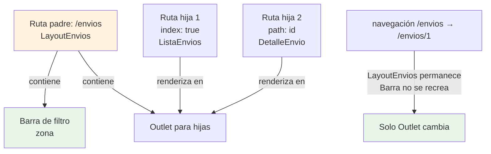
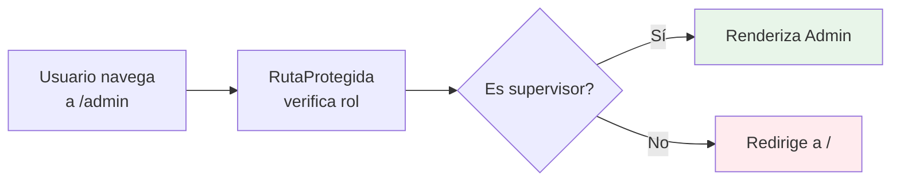

# Módulo 5: React Router — navegación


## Aprende construyendo

**Servidor del módulo:** cada ejemplo se sirve con `npm run dev` dentro del proyecto `mi-react` del módulo 0; abre `http://localhost:5173` para ver el resultado y ejecuta `npm test` para las pruebas (Vitest, configurado una sola vez en «Prepara las pruebas» del módulo 0). Si el puerto cambia, usa el que imprima la terminal.


### Tema 1: Rutas anidadas y layouts compartidos · Intermedio · 45 min

<details open>
<summary><strong>Capa 1 — Lectura</strong></summary>

#### ► DE QUÉ TRATA
Al finalizar vas a anidar /envios y /envios/:id bajo un layout compartido (LayoutEnvios, con la barra de filtros de zona) sin duplicar esa barra en cada vista. Prerrequisitos: Módulo 4 completo.

#### ► LA IDEA EN UNA FRASE
**Al finalizar vas a anidar /envios y /envios/:id bajo un layout compartido (LayoutEnvios, con la barra de filtros de zona) sin duplicar esa barra en cada vista.**

#### ► POR QUÉ EXISTE ESTO
Resuelve un problema real de diseño o implementación y evita decisiones a ciegas.

#### ► LA ANALOGÍA
Piensa en rutas anidadas y layouts compartidos como una herramienta de taller: útil cuando conoces su propósito y sus límites.
**Dónde se rompe la analogía:** en software, los efectos dependen del contexto, la escala y los trade-offs.

#### ► CÓMO FUNCIONA


#### ► LO QUE PUEDE SALIR MAL
| Síntoma | Causa probable | Arreglo |
|---|---|---|
| Rutas anidadas y layouts compartidos se aplica pero el resultado no mejora | Se usó sin medir el problema real | Mide antes y compara contra la alternativa simple |
| Aparece complejidad inesperada | Se adoptó la técnica sin comprender sus trade-offs | Vuelve a la sección de trade-offs y reduce el alcance |
| Falla en un caso límite | Se asumió un contexto que no se cumple | Prueba el caso límite y documenta cuándo NO usarlo |

#### ► TRADE-OFFS
| Opción | Cuándo usarla | Cuándo NO usarla |
|---|---|---|
| Usar Rutas anidadas y layouts compartidos | Cuando el problema coincide con su propósito y el beneficio es observable | Cuando agrega complejidad sin resolver un problema real |
| Alternativa más simple | Cuando el contexto es pequeño, estable o fácil de razonar | Cuando ya demostró no escalar o no cumplir el requisito |
| Postergar la decisión | Cuando falta evidencia del problema | Cuando el costo de esperar es mayor que el costo de probar |

#### ► CUÁNDO NO USAR ESTO
No uses rutas anidadas y layouts compartidos por defecto. Aplícalo cuando el problema lo justifique y puedas verificar el beneficio; si una alternativa más simple resuelve igual, prefiérela.

#### ► DE VUELTA A LA ANALOGÍA
Volviendo a la analogía: rutas anidadas y layouts compartidos funciona como el modelo inicial, pero recuerda dónde se rompe: en producción importan la evidencia, la escala y el costo de equivocarte.

#### ► LO QUE DEBES RECORDAR
- Rutas anidadas y layouts compartidos existe para resolver un problema específico.
- Mide antes de adoptar complejidad.
- Conoce el caso donde NO usarlo.
- Verifica con evidencia observable.

#### ► PREGUNTAS PARA PENSAR
1. ¿Qué problema concreto resuelve rutas anidadas y layouts compartidos en tu contexto?
2. ¿Cómo sabrías que rutas anidadas y layouts compartidos no está funcionando bien?
3. ¿Qué alternativa más simple considerarías antes de usar rutas anidadas y layouts compartidos?

</details>

<details>
<summary><strong>Capa 2 — Construcción</strong></summary>

#### Código y verificación


```jsx
const router = createBrowserRouter([
  {
    path: '/tareas',
    element: <LayoutTareas />, // navbar compartida
    children: [
      { index: true, element: <ListaTareas /> },
      { path: ':id', element: <DetalleTarea /> },
    ],
  },
]);
```

```jsx
import { useState } from 'react';
import { createBrowserRouter, Link, Navigate, Outlet, RouterProvider, useParams } from 'react-router';

function LayoutEnvios() {
  const [zona, setZona] = useState('norte'); // estado del layout compartido
  return (
    <main>
      <label>
        Zona{' '}
        <select value={zona} onChange={e => setZona(e.target.value)}>
          <option value="norte">Norte</option>
          <option value="sur">Sur</option>
        </select>
      </label>
      <nav>
        <Link to="/envios">Lista</Link> · <Link to="/envios/RF-4471">RF-4471</Link>
      </nav>
      <Outlet /> {/* aquí se renderiza la ruta hija activa */}
    </main>
  );
}

function ListaEnvios() {
  return <p>Lista de envíos</p>;
}

function DetalleEnvio() {
  const { id } = useParams();
  return <p>Detalle del envío {id}</p>;
}

const router = createBrowserRouter([
  { path: '/', element: <Navigate to="/envios" replace /> },
  {
    path: '/envios',
    element: <LayoutEnvios />, // barra de filtro de zona compartida
    children: [
      { index: true, element: <ListaEnvios /> },
      { path: ':id', element: <DetalleEnvio /> },
    ],
  },
]);

export default function App() {
  return <RouterProvider router={router} />;
}
```

```bash
npm install react-router@8
npm run dev
```

</details>

### Tema 2: Loaders — datos antes de renderizar · Intermedio · 45 min

<details open>
<summary><strong>Capa 1 — Lectura</strong></summary>

#### ► DE QUÉ TRATA
Al finalizar vas a cargar los datos de /envios/:id con un loader de React Router, en vez de un fetch dentro de un useEffect, para eliminar el parpadeo de "cargando...". Prerrequisitos: Tema 1 de este módulo.

#### ► LA IDEA EN UNA FRASE
**Al finalizar vas a cargar los datos de /envios/:id con un loader de React Router, en vez de un fetch dentro de un useEffect, para eliminar el parpadeo de "cargando...".**

#### ► POR QUÉ EXISTE ESTO
Resuelve un problema real de diseño o implementación y evita decisiones a ciegas.

#### ► LA ANALOGÍA
Piensa en loaders — datos antes de renderizar como una herramienta de taller: útil cuando conoces su propósito y sus límites.
**Dónde se rompe la analogía:** en software, los efectos dependen del contexto, la escala y los trade-offs.

#### ► CÓMO FUNCIONA
1. Identifica el problema que loaders — datos antes de renderizar resuelve.
2. Observa sus componentes y relaciones.
3. Aplica la opción más simple que funcione.
4. Verifica el resultado y los límites.

#### ► LO QUE PUEDE SALIR MAL
| Síntoma | Causa probable | Arreglo |
|---|---|---|
| Loaders — datos antes de renderizar se aplica pero el resultado no mejora | Se usó sin medir el problema real | Mide antes y compara contra la alternativa simple |
| Aparece complejidad inesperada | Se adoptó la técnica sin comprender sus trade-offs | Vuelve a la sección de trade-offs y reduce el alcance |
| Falla en un caso límite | Se asumió un contexto que no se cumple | Prueba el caso límite y documenta cuándo NO usarlo |

#### ► TRADE-OFFS
| Opción | Cuándo usarla | Cuándo NO usarla |
|---|---|---|
| Usar Loaders — datos antes de renderizar | Cuando el problema coincide con su propósito y el beneficio es observable | Cuando agrega complejidad sin resolver un problema real |
| Alternativa más simple | Cuando el contexto es pequeño, estable o fácil de razonar | Cuando ya demostró no escalar o no cumplir el requisito |
| Postergar la decisión | Cuando falta evidencia del problema | Cuando el costo de esperar es mayor que el costo de probar |

#### ► CUÁNDO NO USAR ESTO
No uses loaders — datos antes de renderizar por defecto. Aplícalo cuando el problema lo justifique y puedas verificar el beneficio; si una alternativa más simple resuelve igual, prefiérela.

#### ► DE VUELTA A LA ANALOGÍA
Volviendo a la analogía: loaders — datos antes de renderizar funciona como el modelo inicial, pero recuerda dónde se rompe: en producción importan la evidencia, la escala y el costo de equivocarte.

#### ► LO QUE DEBES RECORDAR
- Loaders — datos antes de renderizar existe para resolver un problema específico.
- Mide antes de adoptar complejidad.
- Conoce el caso donde NO usarlo.
- Verifica con evidencia observable.

#### ► PREGUNTAS PARA PENSAR
1. ¿Qué problema concreto resuelve loaders — datos antes de renderizar en tu contexto?
2. ¿Cómo sabrías que loaders — datos antes de renderizar no está funcionando bien?
3. ¿Qué alternativa más simple considerarías antes de usar loaders — datos antes de renderizar?

</details>

<details>
<summary><strong>Capa 2 — Construcción</strong></summary>

#### Código y verificación
```jsx
{
  path: '/tareas/:id',
  loader: ({ params }) => fetch(`/api/tareas/${params.id}`),
  element: <DetalleTarea />,
}
// dentro del componente:
const tarea = useLoaderData();
```

```jsx
import { createBrowserRouter, Link, Outlet, RouterProvider, useLoaderData } from 'react-router';

async function cargarEnvio({ params }) {
  const respuesta = await fetch(`/api/envios/${params.id}.json`);
  const tipo = respuesta.headers.get('content-type') ?? '';
  // Vite responde index.html (HTML, no JSON) a un archivo que no existe en public/.
  if (!respuesta.ok || !tipo.includes('application/json')) {
    throw new Error(`No existe el envío ${params.id}`);
  }
  return respuesta.json();
}

function LayoutEnvios() {
  return (
    <main>
      <nav>
        <Link to="/envios">Lista</Link> · <Link to="/envios/RF-4471">RF-4471</Link>
      </nav>
      <Outlet />
    </main>
  );
}

function DetalleEnvio() {
  const envio = useLoaderData(); // ya está cargado cuando el componente se monta
  return <p>{envio.id}: {envio.estado}, destino {envio.direccion}</p>;
}

const router = createBrowserRouter([
  {
    path: '/envios',
    element: <LayoutEnvios />,
    children: [
      { index: true, element: <p>Elige un envío.</p> },
      { path: ':id', loader: cargarEnvio, element: <DetalleEnvio /> },
    ],
  },
  { path: '*', element: <Link to="/envios">Ir a envíos</Link> },
]);

export default function App() {
  return <RouterProvider router={router} />;
}
```

```json
{ "id": "RF-4471", "estado": "en ruta", "direccion": "Calle 170 # 8-20" }
```

```bash
npm run dev
```

</details>

### Tema 3: Rutas protegidas · Intermedio · 45 min

<details open>
<summary><strong>Capa 1 — Lectura</strong></summary>

#### ► DE QUÉ TRATA
Al finalizar vas a proteger la ruta /admin de RutaFlow (solo para supervisores) y a explicar por qué esa protección mejora la experiencia de usuario pero no reemplaza la autorización del servidor. Prerrequisitos: Tema 2 de este módulo.

#### ► LA IDEA EN UNA FRASE
**Al finalizar vas a proteger la ruta /admin de RutaFlow (solo para supervisores) y a explicar por qué esa protección mejora la experiencia de usuario pero no reemplaza la autorización del servidor.**

#### ► POR QUÉ EXISTE ESTO
Resuelve un problema real de diseño o implementación y evita decisiones a ciegas.

#### ► LA ANALOGÍA
Piensa en rutas protegidas como una herramienta de taller: útil cuando conoces su propósito y sus límites.
**Dónde se rompe la analogía:** en software, los efectos dependen del contexto, la escala y los trade-offs.

#### ► CÓMO FUNCIONA


#### ► LO QUE PUEDE SALIR MAL
| Síntoma | Causa probable | Arreglo |
|---|---|---|
| Rutas protegidas se aplica pero el resultado no mejora | Se usó sin medir el problema real | Mide antes y compara contra la alternativa simple |
| Aparece complejidad inesperada | Se adoptó la técnica sin comprender sus trade-offs | Vuelve a la sección de trade-offs y reduce el alcance |
| Falla en un caso límite | Se asumió un contexto que no se cumple | Prueba el caso límite y documenta cuándo NO usarlo |

#### ► TRADE-OFFS
| Opción | Cuándo usarla | Cuándo NO usarla |
|---|---|---|
| Usar Rutas protegidas | Cuando el problema coincide con su propósito y el beneficio es observable | Cuando agrega complejidad sin resolver un problema real |
| Alternativa más simple | Cuando el contexto es pequeño, estable o fácil de razonar | Cuando ya demostró no escalar o no cumplir el requisito |
| Postergar la decisión | Cuando falta evidencia del problema | Cuando el costo de esperar es mayor que el costo de probar |

#### ► CUÁNDO NO USAR ESTO
No uses rutas protegidas por defecto. Aplícalo cuando el problema lo justifique y puedas verificar el beneficio; si una alternativa más simple resuelve igual, prefiérela.

#### ► DE VUELTA A LA ANALOGÍA
Volviendo a la analogía: rutas protegidas funciona como el modelo inicial, pero recuerda dónde se rompe: en producción importan la evidencia, la escala y el costo de equivocarte.

#### ► LO QUE DEBES RECORDAR
- Rutas protegidas existe para resolver un problema específico.
- Mide antes de adoptar complejidad.
- Conoce el caso donde NO usarlo.
- Verifica con evidencia observable.

#### ► PREGUNTAS PARA PENSAR
1. ¿Qué problema concreto resuelve rutas protegidas en tu contexto?
2. ¿Cómo sabrías que rutas protegidas no está funcionando bien?
3. ¿Qué alternativa más simple considerarías antes de usar rutas protegidas?

</details>

<details>
<summary><strong>Capa 2 — Construcción</strong></summary>

#### Código y verificación


```jsx
export default function Admin() {
  return <h1>Administración de conductores</h1>;
}
```

```jsx
import { createContext, useContext, useState } from 'react';
import { createBrowserRouter, Link, Navigate, Outlet, RouterProvider } from 'react-router';
import Admin from './Admin.jsx';

const SesionContext = createContext(null);

function RutaProtegida({ children }) {
  const { operador } = useContext(SesionContext);
  // Solo experiencia de usuario: el servidor debe repetir esta verificación.
  return operador.rol === 'supervisor' ? children : <Navigate to="/" replace />;
}

function Layout() {
  return (
    <main>
      <nav><Link to="/">Inicio</Link> · <Link to="/admin">Administración</Link></nav>
      <Outlet />
    </main>
  );
}

const router = createBrowserRouter([
  {
    path: '/',
    element: <Layout />,
    children: [
      { index: true, element: <p>Panel del operador</p> },
      {
        path: 'admin',
        element: (
          <RutaProtegida>
            <Admin />
          </RutaProtegida>
        ),
      },
    ],
  },
]);

export default function App() {
  // Cambia 'conductor' por 'supervisor' para probar los dos casos.
  const [operador] = useState({ nombre: 'Ana', rol: 'conductor' });
  return (
    <SesionContext value={{ operador }}>
      <RouterProvider router={router} />
    </SesionContext>
  );
}
```

```bash
npm install react-router@8
npm run dev
```

</details>
