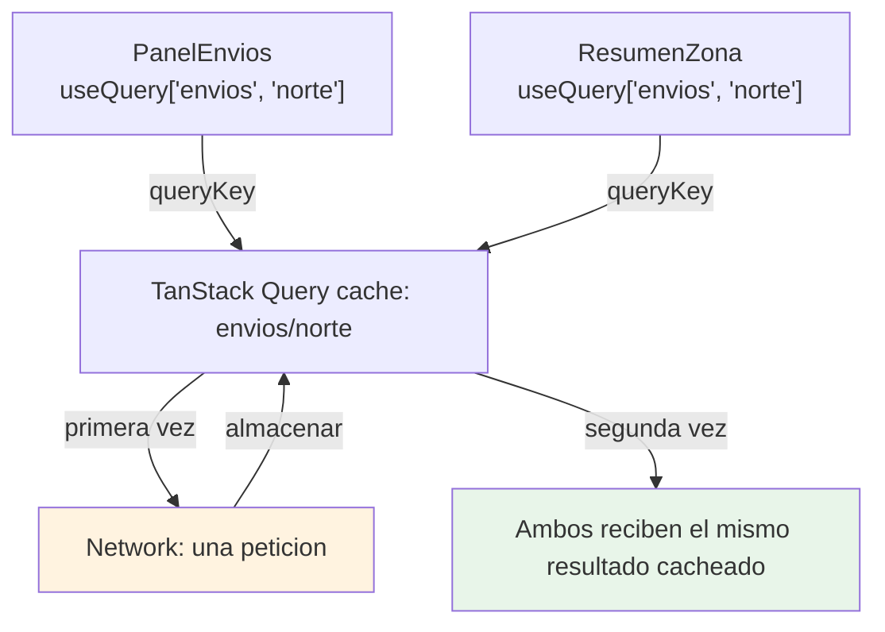
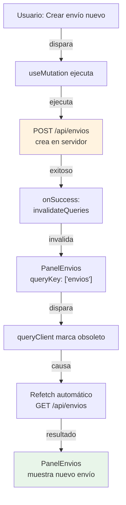
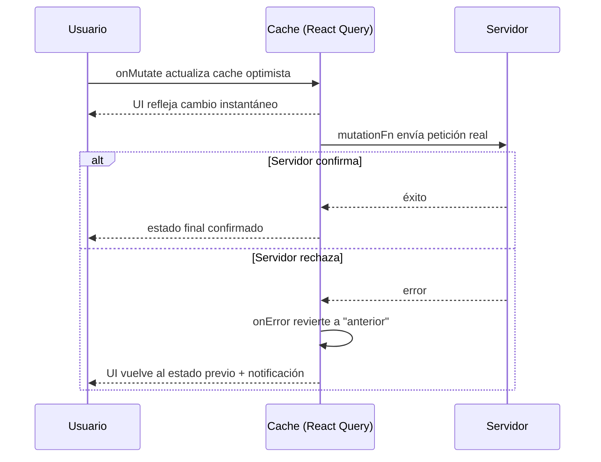

# Módulo 6: Data fetching moderno


## Aprende construyendo

**Servidor del módulo:** cada ejemplo se sirve con `npm run dev`; abre `http://localhost:5173` para ver el resultado y ejecuta `npm test` para las pruebas (Vitest, configurado una sola vez en «Prepara las pruebas» del módulo 0 dentro de `mi-react`). Si el puerto cambia, usa el que imprima la terminal.


### Tema 1: useQuery y el problema que resuelve · Intermedio · 45 min

<details open>
<summary><strong>Capa 1 — Lectura</strong></summary>

#### ► DE QUÉ TRATA
Al finalizar vas a reemplazar el useState+useEffect de PanelEnvios (Módulo 2) por useQuery, eliminando el manejo manual de loading/error/cache. Prerrequisitos: Módulo 5 completo.

#### ► CÓMO FUNCIONA


</details>

<details>
<summary><strong>Capa 2 — Construcción</strong></summary>

#### Código y verificación


```jsx
const { data, isLoading, error } = useQuery({
  queryKey: ['tareas'],
  queryFn: () => fetch('/api/tareas').then(r => r.json()),
});
```

```bash
npm create vite@8 consulta-envios -- --template react
cd consulta-envios
npm install
npm install @tanstack/react-query@5
```

```jsx
import { useState } from 'react';
import { QueryClient, QueryClientProvider, useQuery } from '@tanstack/react-query';

const client = new QueryClient(); // Una caché compartida, fuera del render.
function Panel({ zona, titulo }) {
  const query = useQuery({
    queryKey: ['envios', zona],
    staleTime: 60_000,
    retry: false,
    queryFn: async () => {
      const response = await fetch(`/envios-${zona}.json`);
      if (!response.ok) throw new Error(`HTTP ${response.status}`);
      return response.json();
    },
  });
  if (query.isPending) return <p role="status">Cargando {titulo}</p>;
  if (query.isError) return <p role="alert">{query.error.message}</p>;
  return <section><h2>{titulo}</h2>
    <ul>{query.data.map(envio => <li key={envio.id}>{envio.id}</li>)}</ul>
  </section>;
}
export default function App() {
  const [zona, setZona] = useState('norte');
  return <QueryClientProvider client={client}><main>
    <h1>Envíos por zona</h1><label htmlFor="zona">Zona</label>
    <select id="zona" value={zona} onChange={e => setZona(e.target.value)}>
      <option value="norte">Norte</option><option value="sur">Sur</option>
    </select>
    <Panel zona={zona} titulo="Panel de envíos" />
    <Panel zona={zona} titulo="Resumen de zona" />
  </main></QueryClientProvider>;
}
```

```bash
npm run dev
```

</details>

### Tema 2: Mutations e invalidación · Avanzado · 45 min

<details open>
<summary><strong>Capa 1 — Lectura</strong></summary>

#### ► DE QUÉ TRATA
Al finalizar vas a crear una mutación que registre un nuevo envío y, al completarse, invalide la query de la lista para que PanelEnvios la muestre sin recargar la página. Prerrequisitos: Tema 1 de este módulo.

#### ► CÓMO FUNCIONA


</details>

<details>
<summary><strong>Capa 2 — Construcción</strong></summary>

#### Código y verificación


```jsx
const queryClient = useQueryClient();
const crear = useMutation({
  mutationFn: (tarea) => fetch('/api/tareas', { method: 'POST', body: JSON.stringify(tarea) }),
  onSuccess: () => queryClient.invalidateQueries({ queryKey: ['tareas'] }), // refetch automático
});
```

```jsx
import { QueryClient, QueryClientProvider, useMutation, useQuery, useQueryClient } from '@tanstack/react-query';

// «Servidor» simulado en memoria: el proyecto Vite no tiene API propia.
const baseDeDatos = [
  { id: 'RF-4471', zona: 'norte' },
  { id: 'RF-5101', zona: 'sur' },
];
const esperar = (ms) => new Promise(resolve => setTimeout(resolve, ms));

async function obtenerEnvios(zona) {
  await esperar(300);
  return baseDeDatos.filter(envio => envio.zona === zona);
}

async function crearEnvio(envio) {
  await esperar(300);
  baseDeDatos.push(envio);
  return envio;
}

const client = new QueryClient();

function PanelEnvios({ zona }) {
  const { data, isPending } = useQuery({ queryKey: ['envios', zona], queryFn: () => obtenerEnvios(zona) });
  if (isPending) return <p role="status">Cargando {zona}…</p>;
  return (
    <section>
      <h2>Zona {zona}</h2>
      <ul>{data.map(envio => <li key={envio.id}>{envio.id}</li>)}</ul>
    </section>
  );
}

function BotonRegistrar() {
  const queryClient = useQueryClient();
  const registrar = useMutation({
    mutationFn: crearEnvio,
    onSuccess: () => queryClient.invalidateQueries({ queryKey: ['envios'] }),
  });
  const nuevoEnvio = { id: `RF-${4500 + baseDeDatos.length}`, zona: 'norte' };
  return (
    <button onClick={() => registrar.mutate(nuevoEnvio)} disabled={registrar.isPending}>
      Registrar envío en norte
    </button>
  );
}

export default function App() {
  return (
    <QueryClientProvider client={client}>
      <BotonRegistrar />
      <PanelEnvios zona="norte" />
      <PanelEnvios zona="sur" />
    </QueryClientProvider>
  );
}
```

```bash
npm install @tanstack/react-query@5
npm run dev
```

</details>

### Tema 3: Optimistic updates · Avanzado · 45 min

<details open>
<summary><strong>Capa 1 — Lectura</strong></summary>

#### ► DE QUÉ TRATA
Al finalizar vas a hacer que marcar un envío como "entregado" se refleje instantáneamente en PanelEnvios, antes de que el servidor confirme, revirtiendo si la confirmación falla. Prerrequisitos: Tema 2 de este módulo.

#### ► CÓMO FUNCIONA


</details>

<details>
<summary><strong>Capa 2 — Construcción</strong></summary>

#### Código y verificación
```jsx
useMutation({
  mutationFn: actualizarTarea,
  onMutate: async (nuevaTarea) => {
    await queryClient.cancelQueries({ queryKey: ['tareas'] });
    const anterior = queryClient.getQueryData(['tareas']);
    queryClient.setQueryData(['tareas'], (old) => actualizarEnLista(old, nuevaTarea)); // UI optimista
    return { anterior };
  },
  onError: (err, vars, contexto) => queryClient.setQueryData(['tareas'], contexto.anterior), // revierte si falla
});
```


```bash
npm test -- useMarcarEntregado
```

```jsx
import { QueryClient, QueryClientProvider, useMutation, useQuery, useQueryClient } from '@tanstack/react-query';

// «Servidor» simulado en memoria: RF-4472 ya lo entregó otro operador.
const baseDeDatos = [
  { id: 'RF-4471', estado: 'en ruta' },
  { id: 'RF-4472', estado: 'en ruta' },
];
const esperar = (ms) => new Promise(resolve => setTimeout(resolve, ms));

async function obtenerEnvios() {
  await esperar(300);
  return baseDeDatos.map(envio => ({ ...envio }));
}

async function marcarEntregado(envioId) {
  await esperar(1500); // latencia visible para apreciar el cambio optimista
  if (envioId === 'RF-4472') throw new Error('Otro operador ya entregó RF-4472');
  baseDeDatos.find(envio => envio.id === envioId).estado = 'entregado';
}

const client = new QueryClient();

function PanelEnvios() {
  const queryClient = useQueryClient();
  const { data, isPending } = useQuery({ queryKey: ['envios'], queryFn: obtenerEnvios });
  const marcar = useMutation({
    mutationFn: marcarEntregado,
    onMutate: async (envioId) => {
      await queryClient.cancelQueries({ queryKey: ['envios'] });
      const anterior = queryClient.getQueryData(['envios']);
      queryClient.setQueryData(['envios'], old => old.map(e => e.id === envioId ? { ...e, estado: 'entregado' } : e));
      return { anterior };
    },
    onError: (err, envioId, contexto) => queryClient.setQueryData(['envios'], contexto.anterior),
    onSettled: () => queryClient.invalidateQueries({ queryKey: ['envios'] }),
  });

  if (isPending) return <p role="status">Cargando…</p>;
  return (
    <ul>
      {data.map(envio => (
        <li key={envio.id}>
          {envio.id}: {envio.estado}{' '}
          <button onClick={() => marcar.mutate(envio.id)} disabled={envio.estado === 'entregado'}>
            Marcar entregado
          </button>
        </li>
      ))}
    </ul>
  );
}

export default function App() {
  return (
    <QueryClientProvider client={client}>
      <PanelEnvios />
    </QueryClientProvider>
  );
}
```

```bash
npm install @tanstack/react-query@5
npm run dev
```

</details>
