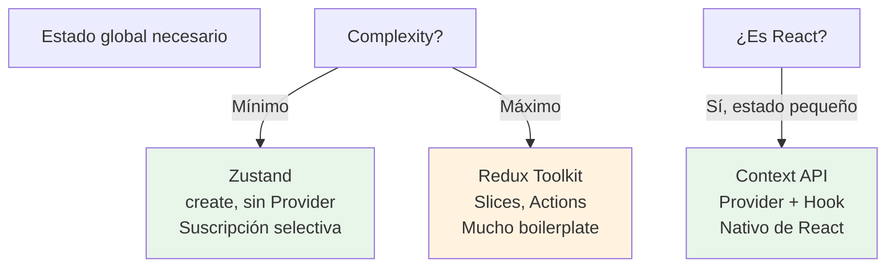
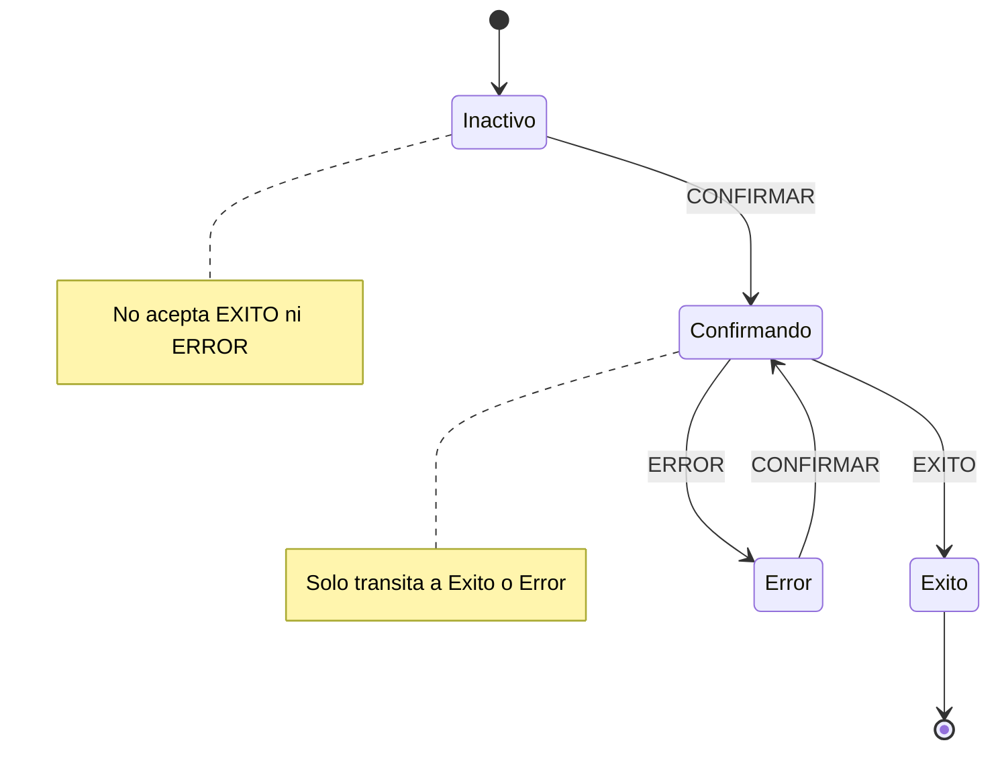

# Módulo 7: Gestión de estado global


## Aprende construyendo

**Servidor del módulo:** cada ejemplo se sirve con `npm run dev` dentro del proyecto `mi-react` del módulo 0; abre `http://localhost:5173` para ver el resultado y ejecuta `npm test` para las pruebas (Vitest, configurado una sola vez en «Prepara las pruebas» del módulo 0). Si el puerto cambia, usa el que imprima la terminal.


### Tema 1: Zustand — stores mínimos sin boilerplate · Intermedio · 40 min

<details open>
<summary><strong>Capa 1 — Lectura</strong></summary>

#### ► DE QUÉ TRATA
Al finalizar vas a crear un store de Zustand para el filtro de zona de RutaFlow (useFiltroStore), compartido entre BarraFiltro y PanelEnvios sin ningún Provider. Prerrequisitos: Módulo 6 completo.

#### ► CÓMO FUNCIONA


</details>

<details>
<summary><strong>Capa 2 — Construcción</strong></summary>

#### Código y verificación


```jsx
const useCarrito = create((set, get) => ({
  items: [],
  agregar: (item) => set(state => ({ items: [...state.items, item] })),
  total: () => get().items.reduce((s, i) => s + i.precio, 0),
}));

function Carrito() {
  const items = useCarrito(state => state.items); // solo re-renderiza si `items` cambia
  return <ul>{items.map(i => <li key={i.id}>{i.nombre}</li>)}</ul>;
}
```

```jsx
import { create } from 'zustand';

const useFiltroStore = create((set) => ({
  zona: 'todas',
  setZona: (zona) => set({ zona }),
}));

function BarraFiltro() {
  const zona = useFiltroStore(state => state.zona); // solo re-renderiza si `zona` cambia
  const setZona = useFiltroStore(state => state.setZona);
  return (
    <select value={zona} onChange={e => setZona(e.target.value)} aria-label="Zona">
      <option value="todas">Todas</option>
      <option value="norte">Norte</option>
      <option value="sur">Sur</option>
    </select>
  );
}

function PanelEnvios() {
  const zona = useFiltroStore(state => state.zona);
  return <p>Mostrando envíos de: {zona}</p>;
}

export default function App() {
  // Sin Provider: los dos componentes leen el mismo store.
  return (
    <main>
      <BarraFiltro />
      <PanelEnvios />
    </main>
  );
}
```

```bash
npm install zustand
npm run dev
```

</details>

### Tema 2: Redux Toolkit — slices y ceremonia · Intermedio · 45 min

<details open>
<summary><strong>Capa 1 — Lectura</strong></summary>

#### ► DE QUÉ TRATA
Al finalizar vas a reimplementar el store de filtro de zona del Tema 1 con Redux Toolkit, para comparar directamente la cantidad de código y ceremonia frente a Zustand. Prerrequisitos: Tema 1 de este módulo.

</details>

<details>
<summary><strong>Capa 2 — Construcción</strong></summary>

#### Código y verificación
```jsx
const carritoSlice = createSlice({
  name: 'carrito',
  initialState: { items: [] },
  reducers: {
    agregar: (state, action) => { state.items.push(action.payload); }, // Immer permite "mutar" de forma segura
  },
});
```

```jsx
import { configureStore, createSlice } from '@reduxjs/toolkit';
import { Provider, useDispatch, useSelector } from 'react-redux';

const filtroSlice = createSlice({
  name: 'filtro',
  initialState: { zona: 'todas' },
  reducers: {
    setZona: (state, action) => { state.zona = action.payload; }, // Immer permite "mutar" de forma segura
  },
});
const { setZona } = filtroSlice.actions;
const store = configureStore({ reducer: { filtro: filtroSlice.reducer } });

function BarraFiltro() {
  const zona = useSelector(state => state.filtro.zona);
  const dispatch = useDispatch();
  return (
    <select value={zona} onChange={e => dispatch(setZona(e.target.value))} aria-label="Zona">
      <option value="todas">Todas</option>
      <option value="norte">Norte</option>
      <option value="sur">Sur</option>
    </select>
  );
}

function PanelEnvios() {
  const zona = useSelector(state => state.filtro.zona);
  return <p>Mostrando envíos de: {zona}</p>;
}

export default function App() {
  return (
    <Provider store={store}>
      <BarraFiltro />
      <PanelEnvios />
    </Provider>
  );
}
```

```bash
npm install @reduxjs/toolkit react-redux
npm run dev
```

</details>

### Tema 3: Estado de servidor vs estado de cliente, y cuándo no necesitas nada de esto · Avanzado · 45 min

<details open>
<summary><strong>Capa 1 — Lectura</strong></summary>

#### ► DE QUÉ TRATA
Al finalizar vas a clasificar cada pieza de estado del panel de RutaFlow (lista de envíos, filtro de zona, modal de confirmación abierto) según si pertenece a TanStack Query, a Zustand, o a un simple useState local. Prerrequisitos: Tema 2 de este módulo.

#### ► REGLA PRÁCTICA
Si el dato vive en un servidor remoto y necesita cache/revalidación (la lista de envíos), usa TanStack Query; si es estado de UI compartido entre componentes lejanos sin servidor detrás (un filtro global), usa Zustand; si solo un componente lo necesita (un modal abierto), usa `useState` local.

</details>

<details>
<summary><strong>Capa 2 — Construcción</strong></summary>

#### Código y verificación
```
Estado de servidor (API, cache, expiración) → TanStack Query
Estado de cliente puro (modal abierto, tema) → Zustand / Context / useState local
Estado usado en un único componente → useState local, sin ninguna librería global
```

```jsx
import { create } from 'zustand';

// Mal: mezclar estado de servidor dentro del store de cliente
const useFiltroStore = create((set) => ({
  zona: 'todas',
  envios: [], // esto no debería vivir aquí
  setEnvios: (envios) => set({ envios }),
}));

export default function App() {
  const envios = useFiltroStore(state => state.envios);
  const setEnvios = useFiltroStore(state => state.setEnvios);
  return (
    <main>
      <button onClick={() => setEnvios([{ id: 'RF-4471' }])}>Cargar una vez</button>
      <ul>{envios.map(envio => <li key={envio.id}>{envio.id}</li>)}</ul>
      <p>Nadie vuelve a pedir esta lista: no hay caché por zona, ni revalidación, ni invalidación.</p>
    </main>
  );
}
```

```bash
npm install zustand
npm run dev
```

</details>

### Tema 4: Jotai y XState como alternativas · Avanzado · 40 min

<details open>
<summary><strong>Capa 1 — Lectura</strong></summary>

#### ► DE QUÉ TRATA
Al finalizar vas a modelar con XState el ciclo de vida de una confirmación de entrega (inactivo → confirmando → éxito/error), rechazando explícitamente transiciones inválidas que un useReducer simple no impediría. Prerrequisitos: Tema 3 de este módulo.

#### ► LA ANALOGÍA
XState modela estado como una máquina de estados finitos con transiciones explícitamente definidas; un estado solo puede alcanzarse desde las transiciones que la máquina efectivamente declara, rechazando cualquier otra.
**Conceptos clave:** modelo atómico frente a store centralizado, máquinas de estado explícitas.

Jotai modela el estado global como átomos independientes y pequeños (`const contadorAtom = atom(0)`) en vez de un único store centralizado grande, permitiendo componer átomos derivados a partir de otros átomos como valores calculados a partir de otros, con una granularidad de suscripción naturalmente fina dado que cada átomo es independiente por diseño. Quizá encuentres Recoil en proyectos antiguos, con un modelo parecido de "atoms" y "selectors": no lo uses en código nuevo, porque ya no se mantiene (su última versión en npm es de febrero de 2024 y un mantenedor lo confirmó en [el issue #2288](https://github.com/facebookexperimental/Recoil/issues/2288)); Jotai cubre el mismo modelo atómico.

XState modela estado como una máquina de estados finitos explícita, con estados nombrados y transiciones explícitamente definidas entre ellos (por ejemplo, un estado "inactivo" que solo puede transicionar a "cargando" ante cierto evento, que a su vez solo puede transicionar a "éxito" o "error"), apropiado específicamente para flujos con reglas de transición complejas y estrictas donde ciertos estados simplemente no deberían ser alcanzables desde ciertos otros estados, una garantía estructural que un simple `useState`/`useReducer` no impone por sí solo (nada impide, en un reducer simple, escribir una transición de estado lógicamente inválida por error, mientras que una máquina de estados de XState rechaza explícitamente transiciones no definidas).

**Analogía:** Jotai es como gestionar el inventario mediante etiquetas individuales pequeñas e independientes en cada producto, en vez de un único gran libro de inventario centralizado; XState es como un diagrama de flujo estricto de un proceso de fábrica, donde cada estación solo puede recibir el producto desde ciertas estaciones anteriores específicas, rechazando explícitamente cualquier secuencia de transición no contemplada en el diagrama.

**¿Por qué es importante?** Jotai ofrece un modelo atómico con granularidad fina por diseño; XState aporta garantías estructurales sobre qué transiciones de estado son válidas, apropiado para flujos con reglas de transición complejas y estrictas.

**Diagrama:**




---

#### ► CÓMO FUNCIONA


</details>

<details>
<summary><strong>Capa 2 — Construcción</strong></summary>

#### Código y verificación


```jsx
import { createMachine } from 'xstate';
import { useMachine } from '@xstate/react';

const maquinaConfirmacion = createMachine({
  initial: 'inactivo',
  states: {
    inactivo: { on: { CONFIRMAR: 'confirmando' } },
    confirmando: { on: { EXITO: 'exito', ERROR: 'error' } },
    exito: {},
    error: { on: { CONFIRMAR: 'confirmando' } },
  },
});

export default function App() {
  const [estado, enviar] = useMachine(maquinaConfirmacion);
  return (
    <main>
      <p>Estado actual: {String(estado.value)}</p>
      <button onClick={() => enviar({ type: 'CONFIRMAR' })}>CONFIRMAR</button>
      <button onClick={() => enviar({ type: 'EXITO' })}>EXITO</button>
      <button onClick={() => enviar({ type: 'ERROR' })}>ERROR</button>
    </main>
  );
}
```

```bash
npm install xstate @xstate/react
npm run dev
```

```jsx
import { atom, useAtom, useAtomValue } from 'jotai';

const zonaAtom = atom('norte');
const etiquetaAtom = atom(get => `Zona seleccionada: ${get(zonaAtom).toUpperCase()}`); // átomo derivado

function SelectorZona() {
  const [zona, setZona] = useAtom(zonaAtom);
  return (
    <select value={zona} onChange={e => setZona(e.target.value)} aria-label="Zona">
      <option value="norte">Norte</option>
      <option value="sur">Sur</option>
    </select>
  );
}

function Etiqueta() {
  return <p>{useAtomValue(etiquetaAtom)}</p>;
}

export default function App() {
  // Sin Provider explícito, Jotai usa un almacén por defecto.
  return (
    <main>
      <SelectorZona />
      <Etiqueta />
    </main>
  );
}
```

</details>
