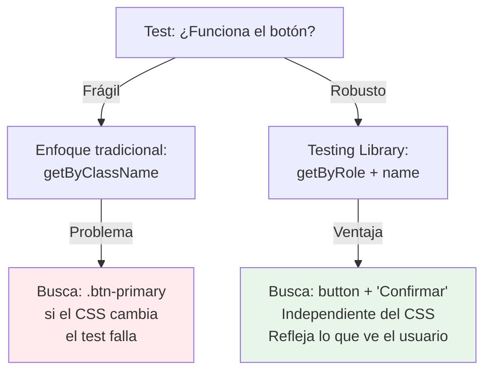
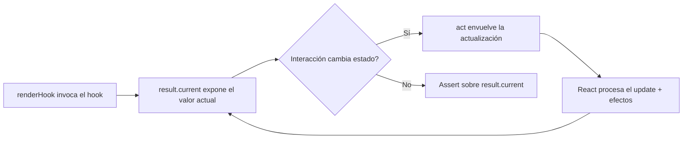

# Módulo 8: Testing en React


## Aprende construyendo

**Servidor del módulo:** en este módulo trabajas sobre todo con `npm test`, dentro del proyecto `mi-react` del módulo 0, que ya tiene Vitest, Testing Library, `user-event`, jsdom y `toBeInTheDocument` configurados («Prepara las pruebas» del módulo 0). Cada tema te da el componente y su prueba completos.


### Tema 1: Queries por rol, no por clase CSS · Intermedio · 40 min

<details open>
<summary><strong>Capa 1 — Lectura</strong></summary>

#### ► DE QUÉ TRATA
Al finalizar vas a testear el botón "Confirmar entrega" de RutaFlow consultándolo por su rol accesible, en vez de por una clase CSS. Prerrequisitos: Módulo 3 completo.

#### ► CÓMO FUNCIONA


</details>

<details>
<summary><strong>Capa 2 — Construcción</strong></summary>

#### Código y verificación


```jsx
render(<Formulario />);
const boton = screen.getByRole('button', { name: /enviar/i }); // como lo "vería" un usuario/lector de pantalla
await userEvent.click(boton);
expect(screen.getByText(/enviado con éxito/i)).toBeInTheDocument();
```

```jsx
import { useState } from 'react';

export default function DetalleEnvio({ envio }) {
  const [confirmada, setConfirmada] = useState(false);
  return (
    <section>
      <h2>Envío {envio.id}</h2>
      <button className="btn-primary" onClick={() => setConfirmada(true)}>Confirmar entrega</button>
      {confirmada && <p>Entrega confirmada</p>}
    </section>
  );
}
```

```jsx
import { render, screen } from '@testing-library/react'
import userEvent from '@testing-library/user-event'
import { expect, it } from 'vitest'
import DetalleEnvio from './DetalleEnvio.jsx'

const envioDePrueba = { id: 'RF-4471' }

it('confirma la entrega buscando el botón por su rol', async () => {
  render(<DetalleEnvio envio={envioDePrueba} />)
  const boton = screen.getByRole('button', { name: /confirmar entrega/i })
  await userEvent.click(boton)
  expect(screen.getByText(/entrega confirmada/i)).toBeInTheDocument()
})
```

```bash
npm test
```

</details>

### Tema 2: Mock Service Worker (MSW) · Intermedio · 45 min

<details open>
<summary><strong>Capa 1 — Lectura</strong></summary>

#### ► DE QUÉ TRATA
Al finalizar vas a interceptar con MSW la llamada real que confirmarEntrega hace a /api/envios/:id/confirmar, para testear el flujo completo sin un backend real corriendo. Prerrequisitos: Tema 1 de este módulo.

</details>

<details>
<summary><strong>Capa 2 — Construcción</strong></summary>

#### Código y verificación
```js
const server = setupServer(
  http.get('/api/usuarios', () => HttpResponse.json([{ id: 1, nombre: 'Ana' }]))
);

beforeAll(() => server.listen());
afterEach(() => server.resetHandlers());
afterAll(() => server.close());
```

```bash
npm install -D msw@3
```

```jsx
import { useState } from 'react';

export default function DetalleEnvio({ envio }) {
  const [mensaje, setMensaje] = useState('');

  async function confirmarEntrega() {
    try {
      const respuesta = await fetch(`/api/envios/${envio.id}/confirmar`, { method: 'POST' });
      if (!respuesta.ok) throw new Error(`HTTP ${respuesta.status}`);
      const { estado } = await respuesta.json();
      setMensaje(`Entrega confirmada: ${estado}`);
    } catch {
      setMensaje('No pudimos confirmar la entrega. Intenta de nuevo.');
    }
  }

  return (
    <section>
      <h2>Envío {envio.id}</h2>
      <button onClick={confirmarEntrega}>Confirmar entrega</button>
      {mensaje && <p role="status">{mensaje}</p>}
    </section>
  );
}
```

```jsx
import { render, screen } from '@testing-library/react'
import userEvent from '@testing-library/user-event'
import { http, HttpResponse } from 'msw'
import { setupServer } from 'msw/node'
import { afterAll, afterEach, beforeAll, expect, it } from 'vitest'
import DetalleEnvio from './DetalleEnvio.jsx'

const server = setupServer(
  http.post('/api/envios/:id/confirmar', () => HttpResponse.json({ estado: 'entregado' }))
)
beforeAll(() => server.listen({ onUnhandledFrame: 'error' }))
afterEach(() => server.resetHandlers())
afterAll(() => server.close())

it('muestra la confirmación que responde el servidor', async () => {
  render(<DetalleEnvio envio={{ id: 'RF-4471' }} />)
  await userEvent.click(screen.getByRole('button', { name: /confirmar entrega/i }))
  expect(await screen.findByText('Entrega confirmada: entregado')).toBeInTheDocument()
})
```

```bash
npm test
```

</details>

### Tema 3: Testing de hooks personalizados · Avanzado · 45 min

<details open>
<summary><strong>Capa 1 — Lectura</strong></summary>

#### ► DE QUÉ TRATA
Al finalizar vas a testear useFiltroZona (un hook personalizado que envuelve el store de Zustand del Módulo 7) con renderHook, sin necesidad de un componente visual. Prerrequisitos: Tema 2 de este módulo.

#### ► CÓMO FUNCIONA


</details>

<details>
<summary><strong>Capa 2 — Construcción</strong></summary>

#### Código y verificación
```jsx
const { result } = renderHook(() => useContador());
act(() => result.current.incrementar());
expect(result.current.valor).toBe(1);
```


```bash
npm test -- useFiltroZona
```

```js
import { create } from 'zustand';

const useFiltroStore = create((set) => ({
  zona: 'todas',
  setZona: (zona) => set({ zona }),
}));

export function useFiltroZona() {
  const zona = useFiltroStore(state => state.zona);
  const guardarZona = useFiltroStore(state => state.setZona);
  // Lógica propia del hook: normaliza antes de guardar.
  const setZona = (nuevaZona) => guardarZona(nuevaZona.trim().toLowerCase());
  return { zona, setZona };
}
```

```jsx
import { act, renderHook } from '@testing-library/react'
import { expect, it } from 'vitest'
import { useFiltroZona } from './useFiltroZona.js'

it('normaliza la zona a minúsculas', () => {
  const { result } = renderHook(() => useFiltroZona())
  act(() => result.current.setZona('NORTE'))
  expect(result.current.zona).toBe('norte')
})
```

```bash
npm test
```

</details>
