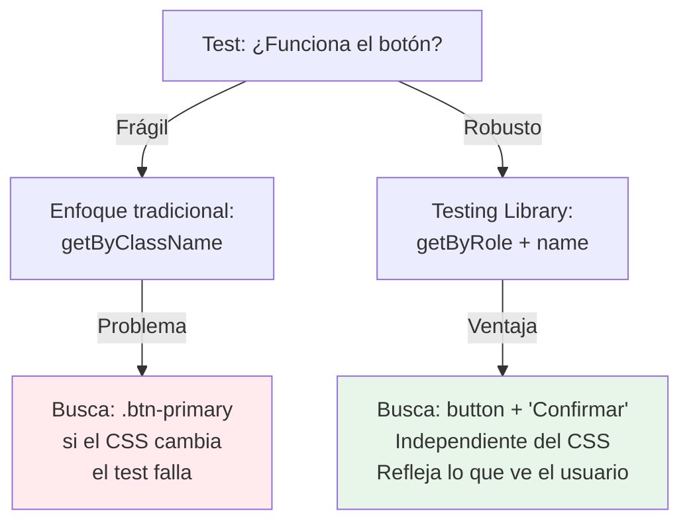
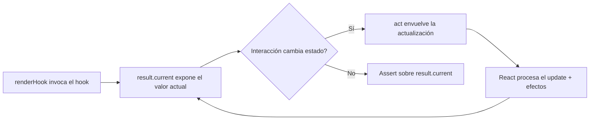

# Módulo 8: Testing en React


## Aprende construyendo

**Servidor del módulo:** en este módulo trabajas sobre todo con `npm test`, dentro del proyecto `mi-react` del módulo 0, que ya tiene Vitest, Testing Library, `user-event`, jsdom y `toBeInTheDocument` configurados («Prepara las pruebas» del módulo 0). Cada tema te da el componente y su prueba completos.


### Tema 1: Queries por rol, no por clase CSS · Intermedio · 40 min

<details open>
<summary><strong>Capa 1 — Lectura</strong></summary>

#### ► DE QUÉ TRATA
Al finalizar vas a testear el botón "Confirmar entrega" de RutaFlow consultándolo por su rol accesible, en vez de por una clase CSS. Prerrequisitos: Módulo 3 completo.

#### ► LA IDEA EN UNA FRASE
**Al finalizar vas a testear el botón "Confirmar entrega" de RutaFlow consultándolo por su rol accesible, en vez de por una clase CSS.**

#### ► POR QUÉ EXISTE ESTO
Resuelve un problema real de diseño o implementación y evita decisiones a ciegas.

#### ► LA ANALOGÍA
Piensa en queries por rol, no por clase css como una herramienta de taller: útil cuando conoces su propósito y sus límites.
**Dónde se rompe la analogía:** en software, los efectos dependen del contexto, la escala y los trade-offs.

#### ► CÓMO FUNCIONA


#### ► LO QUE PUEDE SALIR MAL
| Síntoma | Causa probable | Arreglo |
|---|---|---|
| Queries por rol, no por clase CSS se aplica pero el resultado no mejora | Se usó sin medir el problema real | Mide antes y compara contra la alternativa simple |
| Aparece complejidad inesperada | Se adoptó la técnica sin comprender sus trade-offs | Vuelve a la sección de trade-offs y reduce el alcance |
| Falla en un caso límite | Se asumió un contexto que no se cumple | Prueba el caso límite y documenta cuándo NO usarlo |

#### ► TRADE-OFFS
| Opción | Cuándo usarla | Cuándo NO usarla |
|---|---|---|
| Usar Queries por rol, no por clase CSS | Cuando el problema coincide con su propósito y el beneficio es observable | Cuando agrega complejidad sin resolver un problema real |
| Alternativa más simple | Cuando el contexto es pequeño, estable o fácil de razonar | Cuando ya demostró no escalar o no cumplir el requisito |
| Postergar la decisión | Cuando falta evidencia del problema | Cuando el costo de esperar es mayor que el costo de probar |

#### ► CUÁNDO NO USAR ESTO
No uses queries por rol, no por clase css por defecto. Aplícalo cuando el problema lo justifique y puedas verificar el beneficio; si una alternativa más simple resuelve igual, prefiérela.

#### ► DE VUELTA A LA ANALOGÍA
Volviendo a la analogía: queries por rol, no por clase css funciona como el modelo inicial, pero recuerda dónde se rompe: en producción importan la evidencia, la escala y el costo de equivocarte.

#### ► LO QUE DEBES RECORDAR
- Queries por rol, no por clase CSS existe para resolver un problema específico.
- Mide antes de adoptar complejidad.
- Conoce el caso donde NO usarlo.
- Verifica con evidencia observable.

#### ► PREGUNTAS PARA PENSAR
1. ¿Qué problema concreto resuelve queries por rol, no por clase css en tu contexto?
2. ¿Cómo sabrías que queries por rol, no por clase css no está funcionando bien?
3. ¿Qué alternativa más simple considerarías antes de usar queries por rol, no por clase css?

</details>

<details>
<summary><strong>Capa 2 — Construcción</strong></summary>

#### Código y verificación


```jsx
render(<Formulario />);
const boton = screen.getByRole('button', { name: /enviar/i }); // como lo "vería" un usuario/lector de pantalla
await userEvent.click(boton);
expect(screen.getByText(/enviado con éxito/i)).toBeInTheDocument();
```

```jsx
import { useState } from 'react';

export default function DetalleEnvio({ envio }) {
  const [confirmada, setConfirmada] = useState(false);
  return (
    <section>
      <h2>Envío {envio.id}</h2>
      <button className="btn-primary" onClick={() => setConfirmada(true)}>Confirmar entrega</button>
      {confirmada && <p>Entrega confirmada</p>}
    </section>
  );
}
```

```jsx
import { render, screen } from '@testing-library/react'
import userEvent from '@testing-library/user-event'
import { expect, it } from 'vitest'
import DetalleEnvio from './DetalleEnvio.jsx'

const envioDePrueba = { id: 'RF-4471' }

it('confirma la entrega buscando el botón por su rol', async () => {
  render(<DetalleEnvio envio={envioDePrueba} />)
  const boton = screen.getByRole('button', { name: /confirmar entrega/i })
  await userEvent.click(boton)
  expect(screen.getByText(/entrega confirmada/i)).toBeInTheDocument()
})
```

```bash
npm test
```

</details>

### Tema 2: Mock Service Worker (MSW) · Intermedio · 45 min

<details open>
<summary><strong>Capa 1 — Lectura</strong></summary>

#### ► DE QUÉ TRATA
Al finalizar vas a interceptar con MSW la llamada real que confirmarEntrega hace a /api/envios/:id/confirmar, para testear el flujo completo sin un backend real corriendo. Prerrequisitos: Tema 1 de este módulo.

#### ► LA IDEA EN UNA FRASE
**Al finalizar vas a interceptar con MSW la llamada real que confirmarEntrega hace a /api/envios/:id/confirmar, para testear el flujo completo sin un backend real corriendo.**

#### ► POR QUÉ EXISTE ESTO
Resuelve un problema real de diseño o implementación y evita decisiones a ciegas.

#### ► LA ANALOGÍA
Piensa en mock service worker (msw) como una herramienta de taller: útil cuando conoces su propósito y sus límites.
**Dónde se rompe la analogía:** en software, los efectos dependen del contexto, la escala y los trade-offs.

#### ► CÓMO FUNCIONA
1. Identifica el problema que mock service worker (msw) resuelve.
2. Observa sus componentes y relaciones.
3. Aplica la opción más simple que funcione.
4. Verifica el resultado y los límites.

#### ► LO QUE PUEDE SALIR MAL
| Síntoma | Causa probable | Arreglo |
|---|---|---|
| Mock Service Worker (MSW) se aplica pero el resultado no mejora | Se usó sin medir el problema real | Mide antes y compara contra la alternativa simple |
| Aparece complejidad inesperada | Se adoptó la técnica sin comprender sus trade-offs | Vuelve a la sección de trade-offs y reduce el alcance |
| Falla en un caso límite | Se asumió un contexto que no se cumple | Prueba el caso límite y documenta cuándo NO usarlo |

#### ► TRADE-OFFS
| Opción | Cuándo usarla | Cuándo NO usarla |
|---|---|---|
| Usar Mock Service Worker (MSW) | Cuando el problema coincide con su propósito y el beneficio es observable | Cuando agrega complejidad sin resolver un problema real |
| Alternativa más simple | Cuando el contexto es pequeño, estable o fácil de razonar | Cuando ya demostró no escalar o no cumplir el requisito |
| Postergar la decisión | Cuando falta evidencia del problema | Cuando el costo de esperar es mayor que el costo de probar |

#### ► CUÁNDO NO USAR ESTO
No uses mock service worker (msw) por defecto. Aplícalo cuando el problema lo justifique y puedas verificar el beneficio; si una alternativa más simple resuelve igual, prefiérela.

#### ► DE VUELTA A LA ANALOGÍA
Volviendo a la analogía: mock service worker (msw) funciona como el modelo inicial, pero recuerda dónde se rompe: en producción importan la evidencia, la escala y el costo de equivocarte.

#### ► LO QUE DEBES RECORDAR
- Mock Service Worker (MSW) existe para resolver un problema específico.
- Mide antes de adoptar complejidad.
- Conoce el caso donde NO usarlo.
- Verifica con evidencia observable.

#### ► PREGUNTAS PARA PENSAR
1. ¿Qué problema concreto resuelve mock service worker (msw) en tu contexto?
2. ¿Cómo sabrías que mock service worker (msw) no está funcionando bien?
3. ¿Qué alternativa más simple considerarías antes de usar mock service worker (msw)?

</details>

<details>
<summary><strong>Capa 2 — Construcción</strong></summary>

#### Código y verificación
```js
const server = setupServer(
  http.get('/api/usuarios', () => HttpResponse.json([{ id: 1, nombre: 'Ana' }]))
);

beforeAll(() => server.listen());
afterEach(() => server.resetHandlers());
afterAll(() => server.close());
```

```bash
npm install -D msw@3
```

```jsx
import { useState } from 'react';

export default function DetalleEnvio({ envio }) {
  const [mensaje, setMensaje] = useState('');

  async function confirmarEntrega() {
    try {
      const respuesta = await fetch(`/api/envios/${envio.id}/confirmar`, { method: 'POST' });
      if (!respuesta.ok) throw new Error(`HTTP ${respuesta.status}`);
      const { estado } = await respuesta.json();
      setMensaje(`Entrega confirmada: ${estado}`);
    } catch {
      setMensaje('No pudimos confirmar la entrega. Intenta de nuevo.');
    }
  }

  return (
    <section>
      <h2>Envío {envio.id}</h2>
      <button onClick={confirmarEntrega}>Confirmar entrega</button>
      {mensaje && <p role="status">{mensaje}</p>}
    </section>
  );
}
```

```jsx
import { render, screen } from '@testing-library/react'
import userEvent from '@testing-library/user-event'
import { http, HttpResponse } from 'msw'
import { setupServer } from 'msw/node'
import { afterAll, afterEach, beforeAll, expect, it } from 'vitest'
import DetalleEnvio from './DetalleEnvio.jsx'

const server = setupServer(
  http.post('/api/envios/:id/confirmar', () => HttpResponse.json({ estado: 'entregado' }))
)
beforeAll(() => server.listen({ onUnhandledFrame: 'error' }))
afterEach(() => server.resetHandlers())
afterAll(() => server.close())

it('muestra la confirmación que responde el servidor', async () => {
  render(<DetalleEnvio envio={{ id: 'RF-4471' }} />)
  await userEvent.click(screen.getByRole('button', { name: /confirmar entrega/i }))
  expect(await screen.findByText('Entrega confirmada: entregado')).toBeInTheDocument()
})
```

```bash
npm test
```

</details>

### Tema 3: Testing de hooks personalizados · Avanzado · 45 min

<details open>
<summary><strong>Capa 1 — Lectura</strong></summary>

#### ► DE QUÉ TRATA
Al finalizar vas a testear useFiltroZona (un hook personalizado que envuelve el store de Zustand del Módulo 7) con renderHook, sin necesidad de un componente visual. Prerrequisitos: Tema 2 de este módulo.

#### ► LA IDEA EN UNA FRASE
**Al finalizar vas a testear useFiltroZona (un hook personalizado que envuelve el store de Zustand del Módulo 7) con renderHook, sin necesidad de un componente visual.**

#### ► POR QUÉ EXISTE ESTO
Resuelve un problema real de diseño o implementación y evita decisiones a ciegas.

#### ► LA ANALOGÍA
Piensa en testing de hooks personalizados como una herramienta de taller: útil cuando conoces su propósito y sus límites.
**Dónde se rompe la analogía:** en software, los efectos dependen del contexto, la escala y los trade-offs.

#### ► CÓMO FUNCIONA


#### ► LO QUE PUEDE SALIR MAL
| Síntoma | Causa probable | Arreglo |
|---|---|---|
| Testing de hooks personalizados se aplica pero el resultado no mejora | Se usó sin medir el problema real | Mide antes y compara contra la alternativa simple |
| Aparece complejidad inesperada | Se adoptó la técnica sin comprender sus trade-offs | Vuelve a la sección de trade-offs y reduce el alcance |
| Falla en un caso límite | Se asumió un contexto que no se cumple | Prueba el caso límite y documenta cuándo NO usarlo |

#### ► TRADE-OFFS
| Opción | Cuándo usarla | Cuándo NO usarla |
|---|---|---|
| Usar Testing de hooks personalizados | Cuando el problema coincide con su propósito y el beneficio es observable | Cuando agrega complejidad sin resolver un problema real |
| Alternativa más simple | Cuando el contexto es pequeño, estable o fácil de razonar | Cuando ya demostró no escalar o no cumplir el requisito |
| Postergar la decisión | Cuando falta evidencia del problema | Cuando el costo de esperar es mayor que el costo de probar |

#### ► CUÁNDO NO USAR ESTO
No uses testing de hooks personalizados por defecto. Aplícalo cuando el problema lo justifique y puedas verificar el beneficio; si una alternativa más simple resuelve igual, prefiérela.

#### ► DE VUELTA A LA ANALOGÍA
Volviendo a la analogía: testing de hooks personalizados funciona como el modelo inicial, pero recuerda dónde se rompe: en producción importan la evidencia, la escala y el costo de equivocarte.

#### ► LO QUE DEBES RECORDAR
- Testing de hooks personalizados existe para resolver un problema específico.
- Mide antes de adoptar complejidad.
- Conoce el caso donde NO usarlo.
- Verifica con evidencia observable.

#### ► PREGUNTAS PARA PENSAR
1. ¿Qué problema concreto resuelve testing de hooks personalizados en tu contexto?
2. ¿Cómo sabrías que testing de hooks personalizados no está funcionando bien?
3. ¿Qué alternativa más simple considerarías antes de usar testing de hooks personalizados?

</details>

<details>
<summary><strong>Capa 2 — Construcción</strong></summary>

#### Código y verificación
```jsx
const { result } = renderHook(() => useContador());
act(() => result.current.incrementar());
expect(result.current.valor).toBe(1);
```


```bash
npm test -- useFiltroZona
```

```js
import { create } from 'zustand';

const useFiltroStore = create((set) => ({
  zona: 'todas',
  setZona: (zona) => set({ zona }),
}));

export function useFiltroZona() {
  const zona = useFiltroStore(state => state.zona);
  const guardarZona = useFiltroStore(state => state.setZona);
  // Lógica propia del hook: normaliza antes de guardar.
  const setZona = (nuevaZona) => guardarZona(nuevaZona.trim().toLowerCase());
  return { zona, setZona };
}
```

```jsx
import { act, renderHook } from '@testing-library/react'
import { expect, it } from 'vitest'
import { useFiltroZona } from './useFiltroZona.js'

it('normaliza la zona a minúsculas', () => {
  const { result } = renderHook(() => useFiltroZona())
  act(() => result.current.setZona('NORTE'))
  expect(result.current.zona).toBe('norte')
})
```

```bash
npm test
```

</details>
