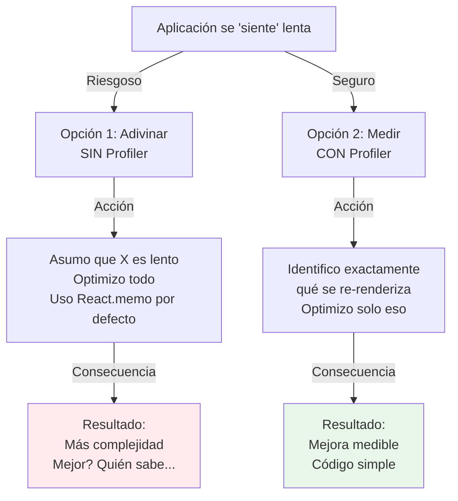
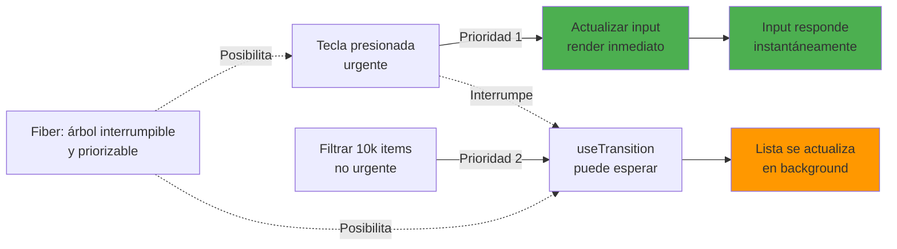
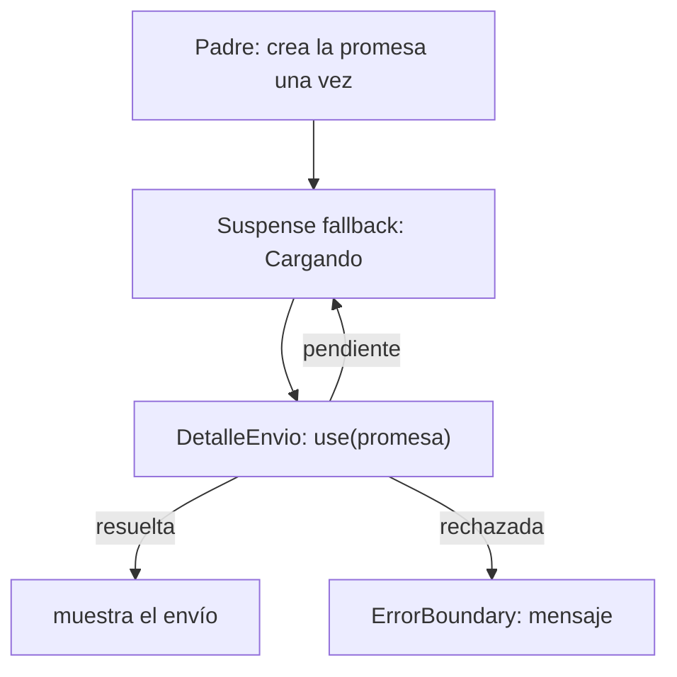
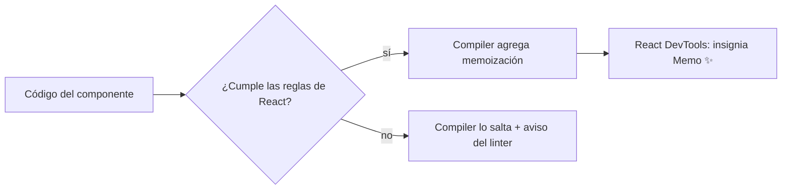

# Módulo 9: Performance en React


## Aprende construyendo

**Servidor del módulo:** cada ejemplo se sirve con `npm run dev` dentro del proyecto `mi-react` del módulo 0; abre `http://localhost:5173` para ver el resultado y ejecuta `npm test` para las pruebas (Vitest, configurado una sola vez en «Prepara las pruebas» del módulo 0). Si el puerto cambia, usa el que imprima la terminal.

### Tema 1: Medir antes de optimizar

#### Paso 1 · Objetivo y preparación
Al finalizar vas a grabar con React DevTools Profiler una interacción real de `ListaEnvios` (escribir en el filtro) para identificar qué componente específico se re-renderiza innecesariamente, antes de optimizar nada. Prerrequisitos: Módulo 8 completo.

#### Paso 2 · Contexto y caso real
Alguien en el equipo "intuye" que `EnvioCard` es lento y propone envolverlo en `React.memo` preventivamente, sin haber grabado ninguna interacción real todavía.

#### Paso 3 · Teoría, modelo mental y analogía
El Profiler graba una interacción y muestra exactamente qué componentes se re-renderizaron y por qué — un diagnóstico real, en vez de adivinar qué pieza "suena mal".

**Diagrama: Optimización sin medición**



**¿Por qué es importante?** El Profiler proporciona evidencia concreta de qué componentes se re-renderizan innecesariamente y por qué, evitando esfuerzo de optimización desperdiciado en suposiciones incorrectas.
**Conceptos clave:** React DevTools Profiler, evidencia antes que intuición.

React DevTools Profiler graba una interacción específica de la aplicación (un clic, escribir en un input, navegar entre vistas) y muestra exactamente qué componentes se re-renderizaron durante esa interacción y por qué (props que cambiaron, estado que cambió, o simplemente que su componente padre se re-renderizó, arrastrando consigo un re-render del hijo aunque sus props sean idénticas), información concreta y medible que reemplaza la intuición o suposición sobre qué parte del código podría estar causando lentitud.

Optimizar código sin esta información concreta es, en la inmensa mayoría de los casos, esfuerzo desperdiciado en el lugar equivocado: es común intuir que cierto componente "parece pesado" y envolverlo preventivamente en `React.memo` (Tema 2), cuando en realidad el componente que efectivamente causa el problema de rendimiento percibido es otro completamente distinto, identificable únicamente inspeccionando el Profiler durante la interacción real que el usuario reporta como lenta, en vez de adivinar basándose en una impresión general del código.

**Analogía:** optimizar sin el Profiler es como intentar reparar un motor de auto basándose únicamente en la intuición de qué pieza "suena mal", en vez de conectar un diagnóstico real que muestre exactamente qué componente específico está fallando y por qué.

**Diagrama:**

```
Profiler graba una interacción → muestra QUÉ componentes se re-renderizaron y POR QUÉ
(props cambiadas / estado cambiado / re-render heredado del padre)
```


**Límites y decisión de uso:** Una medición aislada mezcla variabilidad, herramientas y trabajo de desarrollo. Repite el mismo recorrido con datos y build comparables; optimiza el cuello observado y verifica que la mejora no cambia el resultado funcional.

#### Paso 4 · Demostración guiada desde cero
```jsx
import { useState } from 'react';

function EncabezadoPanel({ titulo }) {
  return <h1>{titulo}</h1>; // no lee el filtro
}

function ListaEnvios({ zona }) {
  return <p>Envíos de la zona «{zona || 'todas'}»</p>;
}

export default function App() {
  const [zona, setZona] = useState('');
  return (
    <main>
      <EncabezadoPanel titulo="Panel de envíos" />
      <label>
        Filtro de zona{' '}
        <input value={zona} onChange={e => setZona(e.target.value)} />
      </label>
      <ListaEnvios zona={zona} />
    </main>
  );
}
```

Con la aplicación abierta:

```text
1. Abre React DevTools > pestaña Profiler
2. Haz click en grabar (●)
3. Escribe una letra en el campo de filtro de zona
4. Detén la grabación
5. Inspecciona qué componentes aparecen resaltados y por qué
```

**Ejecuta el ejemplo** en tu proyecto `mi-react` (lo creaste y preparaste para pruebas al inicio del módulo 0): reemplaza todo el contenido de `src/App.jsx` por el bloque anterior y arráncalo:

```bash
npm run dev
```

Resultado esperado: el Profiler muestra que `EncabezadoPanel` (que ni siquiera lee el filtro) se re-renderizó igual, simplemente porque es hijo del mismo padre que cambió de estado — no porque `EncabezadoPanel` en sí sea lento, sino porque heredó un render de su padre. Ejecuta `npm test` para confirmar que las pruebas anteriores siguen en verde.

#### Paso 5 · Práctica guiada
Pista: envolvé `EnvioCard` en `React.memo` basándote solo en la intuición inicial ("parece pesado"), sin confirmar con el Profiler que ese es el componente real del problema — ese es el fallo deliberado: volvé a grabar la interacción, y confirmá que `EnvioCard` nunca estuvo en la lista de componentes re-renderizados innecesariamente; el tiempo invertido en memoizarlo no resolvió nada, porque el problema real estaba en otro componente.

#### Paso 6 · Práctica independiente
Corregí el Paso 5 identificando con el Profiler cuál es el componente que sí se re-renderiza innecesariamente (`EncabezadoPanel`, según el Paso 4), y aplicá ahí la optimización que estudiarás en el Tema 2, confirmando con una nueva grabación que ese render innecesario desaparece. Graba el panel de envíos del proyecto integrador RutaFlow con el Profiler y anota el componente que se re-renderiza de más.

#### Paso 7 · Cierre
Entregá la grabación del Paso 4 señalando el componente real afectado, la optimización desperdiciada del Paso 5, y la corrección dirigida del Paso 6; explicá por qué memoizar basándose en intuición en vez de en evidencia del Profiler puede hacer que el esfuerzo de optimización se invierta en el componente equivocado. Siguiente paso: estudia React.memo con criterio. Errores comunes: optimizar sin medir primero, confiar en percepción subjetiva de qué componente "parece lento", y asumir que el componente visualmente más grande es automáticamente el más costoso de renderizar. Fuentes oficiales: https://react.dev/learn/render-and-commit y https://react.dev/reference/react/Profiler.

### Tema 2: React.memo con criterio

#### Paso 1 · Objetivo y preparación
Al finalizar vas a envolver `EncabezadoPanel` (identificado en el Tema 1 con el Profiler) en `React.memo`, confirmando que el render heredado innecesario desaparece. Prerrequisitos: Tema 1 de este módulo.

#### Paso 2 · Contexto y caso real
`EncabezadoPanel` recibe siempre las mismas props (`titulo="Panel de envíos"`) pero se re-renderiza cada vez que el padre cambia de estado por el filtro, aunque sus props nunca cambian entre esos renders.

#### Paso 3 · Teoría, modelo mental y analogía
`React.memo` compara superficialmente las props entre renders; si son referencialmente iguales, React se salta la re-ejecución — un guardia que compara la lista de invitados antes de repetir el mismo trabajo.
**Conceptos clave:** comparación superficial de props, overhead de comparación, cuándo realmente ayuda.

`React.memo(function Fila({ item }) { return <li>{item.nombre}</li>; })` envuelve un componente para que React realice una comparación superficial de sus props entre el render anterior y el actual antes de volver a ejecutar la función del componente: si todas las props son referencialmente iguales al render anterior, React se salta completamente la re-ejecución de ese componente y reutiliza el resultado anterior, en vez de volver a calcular un árbol de elementos idéntico innecesariamente.

`React.memo` solo aporta un beneficio real cuando el componente efectivamente recibe las mismas props en renders sucesivos con una frecuencia significativa (por ejemplo, una fila de una lista larga que se re-renderiza cada vez que el componente padre se actualiza por una razón no relacionada con esa fila específica): envolver absolutamente todos los componentes de la aplicación con `React.memo` de forma indiscriminada agrega el overhead de esa comparación superficial de props en cada render, sin ningún beneficio real en componentes que de todas formas reciben props distintas en la mayoría de sus renders (donde la comparación superficial siempre determinaría que sí hay que re-renderizar, agregando el costo de la comparación sin evitar ningún trabajo real).

**Analogía:** `React.memo` es como un guardia que compara una lista de invitados exacta antes de dejar pasar a un evento que ya ocurrió con la misma lista, ahorrando repetir el mismo trabajo; pedirle a ese guardia que revise la lista incluso cuando la lista prácticamente siempre cambia agrega el costo de la revisión sin ahorrar ningún trabajo real, dado que casi siempre habrá que dejar pasar de todas formas.

**¿Por qué es importante?** `React.memo` solo ayuda cuando un componente recibe las mismas props con frecuencia significativa; aplicarlo indiscriminadamente agrega overhead de comparación sin beneficio real en componentes que de todas formas cambian de props frecuentemente.

**Código del ejemplo:**

```jsx
const Fila = React.memo(function Fila({ item }) {
  return <li>{item.nombre}</li>;
}); // solo se re-renderiza si `item` cambia (comparación superficial)
```


#### Paso 4 · Demostración guiada desde cero
```jsx
import { memo, useState } from 'react';

const EncabezadoPanel = memo(function EncabezadoPanel({ titulo }) {
  return <h1>{titulo}</h1>; // se salta el render si `titulo` no cambia
});

function ListaEnvios({ zona }) {
  return <p>Envíos de la zona «{zona || 'todas'}»</p>;
}

export default function App() {
  const [zona, setZona] = useState('');
  return (
    <main>
      <EncabezadoPanel titulo="Panel de envíos" />
      <label>
        Filtro de zona{' '}
        <input value={zona} onChange={e => setZona(e.target.value)} />
      </label>
      <ListaEnvios zona={zona} />
    </main>
  );
}
```

**Ejecuta el ejemplo** en tu proyecto `mi-react` (lo creaste y preparaste para pruebas al inicio del módulo 0): reemplaza todo el contenido de `src/App.jsx` por el bloque anterior y arráncalo:

```bash
npm run dev
```

Resultado esperado: grabando de nuevo con el Profiler mientras se escribe en el filtro de zona, `EncabezadoPanel` ya no aparece en la lista de componentes re-renderizados — React detecta que `titulo` sigue siendo exactamente el mismo string y se salta la re-ejecución completamente. Ejecuta `npm test` para confirmar que las pruebas anteriores siguen en verde.

**Demo con React DevTools Profiler:**
1. Abre la app sin `React.memo` en `EncabezadoPanel`
2. DevTools → Profiler tab → grabar (●)
3. Tipea una letra en el filtro de zona
4. Detén la grabación
5. Observa: `EncabezadoPanel` aparece resaltada en rojo/amarillo con un tiempo de render X ms
6. Ahora envuelve `EncabezadoPanel` en `React.memo`
7. Repite: grabar, tipear, detener
8. Resultado esperado: `EncabezadoPanel` YA NO aparece en el chart del Profiler (no se re-renderizó en absoluto)
9. Conclusión: las mismas props (`titulo="Panel de envíos"`) no cambiaron, así que `React.memo` bloqueó el render innecesario.

#### Paso 5 · Práctica guiada
Pista: envolvé también `BotonFiltro` (que sí recibe una prop nueva en cada tecla, el texto del filtro actual) en `React.memo` "ya que estamos memoizando todo" — ese es el fallo deliberado: medí con el Profiler el costo de la comparación superficial en `BotonFiltro`; como sus props cambian en cada render, la comparación siempre determina que hay que re-renderizar igual, agregando el costo de comparar sin evitar ningún trabajo real.

#### Paso 6 · Práctica independiente
Corregí el Paso 5 quitando `React.memo` de `BotonFiltro` (que no lo necesita, porque sus props cambian casi siempre), dejándolo únicamente en `EncabezadoPanel`, y confirmá con el Profiler que esa es la única memoización que efectivamente ahorra trabajo real. Conserva `React.memo` solo donde el Profiler del proyecto integrador RutaFlow demuestre ahorro y documenta el descarte.

#### Paso 7 · Cierre
Entregá `EncabezadoPanel` memoizado del Paso 4, el memo desperdiciado en `BotonFiltro` del Paso 5, y la limpieza del Paso 6; explicá por qué `React.memo` solo aporta beneficio cuando las props de un componente son estables con frecuencia significativa, no en cualquier componente "por si acaso". Siguiente paso: estudia virtualización para listas largas. Errores comunes: envolver indiscriminadamente todos los componentes en `React.memo`, memoizar un componente cuyas props cambian en casi todos los renders, y no confirmar con el Profiler que la memoización efectivamente eliminó un render real. Fuentes oficiales: https://react.dev/reference/react/memo y https://react.dev/reference/react/memo#minimizing-props-changes.
**Implicación práctica:** `React.memo` solo ayuda cuando un componente recibe las mismas props con frecuencia significativa; aplicarlo indiscriminadamente agrega overhead de comparación sin beneficio real.

### Tema 3: Virtualización y code-splitting

#### Paso 1 · Objetivo y preparación
Al finalizar vas a virtualizar `ListaEnvios` cuando RutaFlow acumula miles de envíos históricos, renderizando en el DOM solo los que están visibles en pantalla. Prerrequisitos: Tema 2 de este módulo.

#### Paso 2 · Contexto y caso real
La pantalla de historial de RutaFlow puede mostrar más de 10,000 envíos acumulados — renderizar los 10,000 `<li>` completos en el DOM de una sola vez, aunque solo una docena sea visible, es trabajo desperdiciado.

#### Paso 3 · Teoría, modelo mental y analogía
La virtualización renderiza únicamente los elementos visibles en el viewport (más un pequeño margen), reciclando los mismos nodos DOM al hacer scroll — un teatro que solo construye los asientos de la sección visible, no el estadio completo.
**Conceptos clave:** renderizar solo lo visible, dividir el bundle en chunks.

Renderizar una lista de 10,000 elementos completos en el DOM, incluso si la mayoría no son visibles en la pantalla en un momento dado, es costoso tanto en tiempo de renderizado inicial como en memoria consumida por nodos DOM que el usuario nunca ve directamente; la virtualización (`<FixedSizeList height={600} itemCount={10000} itemSize={40}>{({ index, style }) => <div style={style}>{datos[index].nombre}</div>}</FixedSizeList>` con `react-window`) renderiza únicamente los elementos actualmente visibles en el viewport (más un pequeño margen para un scroll suave), reciclando los mismos nodos DOM a medida que el usuario hace scroll, en vez de mantener los 10,000 nodos completos existiendo simultáneamente en el DOM real.

`React.lazy(() => import('./Reportes'))` combinado con `Suspense` (estudiado en profundidad en el Módulo 5 para code-splitting por ruta) divide el bundle de JavaScript en chunks separados descargados bajo demanda, reduciendo el tamaño del bundle inicial que la aplicación necesita descargar y ejecutar antes de volverse interactiva, una técnica de reducción de trabajo inicial complementaria (pero distinta) a la virtualización, que reduce el trabajo de renderizado continuo de listas largas ya cargadas.

**Analogía:** la virtualización es como un teatro que solo construye físicamente los asientos de la sección actualmente visible desde donde alguien mira, en vez de construir las 10,000 butacas completas de un estadio entero de una sola vez; el code-splitting es como entregar solo el capítulo del manual que el usuario necesita en este momento, en vez del libro completo de antemano.

**¿Por qué es importante?** La virtualización reduce drásticamente el costo de renderizar listas largas al mantener en el DOM solo los elementos visibles; el code-splitting reduce el bundle inicial descargado, mejorando el tiempo hasta que la aplicación se vuelve interactiva.

**Código del ejemplo:**

```jsx
import { List } from 'react-window'; // react-window 2: `List` reemplaza a `FixedSizeList`
<List rowComponent={Fila} rowCount={10000} rowHeight={40} rowProps={{ datos }} style={{ height: 600 }} />

const Reportes = lazy(() => import('./Reportes'));
<Suspense fallback={<Spinner />}><Reportes /></Suspense>
```


#### Paso 4 · Demostración guiada desde cero
```jsx
import { List } from 'react-window';

const envios = Array.from({ length: 10_000 }, (_, i) => ({ guia: `RF-${String(i).padStart(5, '0')}` }));

function FilaEnvio({ index, style, envios }) {
  // `style` posiciona la fila; react-window solo monta las filas visibles.
  return <div style={style}>{envios[index].guia}</div>;
}

export default function App() {
  return (
    <List
      rowComponent={FilaEnvio}
      rowCount={envios.length}
      rowHeight={48}
      rowProps={{ envios }}
      style={{ height: 600 }}
    />
  );
}
```

**Ejecuta el ejemplo** en tu proyecto `mi-react` (lo creaste y preparaste para pruebas al inicio del módulo 0): reemplaza todo el contenido de `src/App.jsx` por el bloque anterior (instala antes react-window; la versión 2 usa `List` y `rowComponent` en lugar del antiguo `FixedSizeList`) y arráncalo:

```bash
npm install react-window
npm run dev
```

Resultado esperado: inspeccionando el DOM real en las herramientas de desarrollador mientras se hace scroll sobre los 10,000 envíos, nunca existen más de unas pocas decenas de nodos `<div>` simultáneamente — solo se montan las filas visibles y las que entran al hacer scroll reemplazan a las que salen. Ejecuta `npm test` para confirmar que las pruebas anteriores siguen en verde.

#### Paso 5 · Práctica guiada
Pista: reemplaza `List` por un `.map()` directo sobre los 10,000 `envios` "para simplificar" — ese es el fallo deliberado: medí con el Profiler el tiempo de renderizado inicial antes y después de este cambio; sin virtualizar, el render inicial tarda notablemente más, y el scroll se siente perceptiblemente menos fluido, porque ahora existen 10,000 nodos DOM reales simultáneamente.

#### Paso 6 · Práctica independiente
Corrige el Paso 5 restaurando `List`, y agrega `React.lazy` para la pantalla de "Reportes" de RutaFlow (usada por pocos operadores), confirmando en la pestaña Network que su chunk se descarga solo al navegar ahí, no en la carga inicial. Carga diferida la pantalla de reportes del proyecto integrador RutaFlow y comprueba en Network que el chunk llega al navegar.

#### Paso 7 · Cierre
Entregá la lista virtualizada del Paso 4, la medición del render completo sin virtualizar del Paso 5, y el code-splitting de Reportes del Paso 6; explicá la diferencia entre lo que resuelve la virtualización (renderizado continuo de una lista ya cargada) y lo que resuelve el code-splitting (descarga inicial del bundle). Siguiente paso: estudia useTransition para mantener la interfaz responsiva durante cálculos costosos. Errores comunes: virtualizar una lista pequeña que no lo necesita, usar un índice de array en vez de un id estable como key dentro de la lista virtualizada, y confundir virtualización con code-splitting. Fuentes oficiales: https://github.com/bvaughn/react-window y https://react.dev/reference/react/lazy.
**Implicación práctica:** La virtualización reduce drásticamente el costo de renderizar listas largas; el code-splitting reduce el bundle inicial descargado — dos optimizaciones distintas para dos problemas distintos.

### Tema 4: useTransition, useDeferredValue y Fiber

#### Paso 1 · Objetivo y preparación
Al finalizar vas a usar `useTransition` para que escribir en el filtro de zona de RutaFlow siga respondiendo instantáneamente, aunque filtrar 10,000 envíos sea un cálculo costoso en segundo plano. Prerrequisitos: Tema 3 de este módulo.

#### Paso 2 · Contexto y caso real
Filtrar la lista completa de 10,000 envíos cada vez que el operador escribe una letra bloquea momentáneamente la interfaz — el input se siente "trabado" porque React trata esa actualización con la misma prioridad urgente que la propia tecla.

#### Paso 3 · Teoría, modelo mental y analogía
`useTransition` marca una actualización como no urgente, permitiendo que React la posponga en favor de actualizaciones más urgentes — gracias a Fiber, que hace que el trabajo de renderizado sea interrumpible y priorizable.
**Conceptos clave:** actualizaciones no urgentes, arquitectura de trabajo interrumpible.

`useTransition` permite marcar ciertas actualizaciones de estado como "de transición" (no urgentes), indicándole a React que puede posponer o interrumpir ese trabajo de renderizado específico en favor de actualizaciones más urgentes que ocurran mientras tanto (como seguir respondiendo instantáneamente a la escritura del usuario en un input, mientras una lista de resultados derivados de ese input, potencialmente costosa de recalcular, se actualiza en segundo plano con menor prioridad); `useDeferredValue` ofrece un mecanismo relacionado, proporcionando una versión "retrasada" de un valor que se actualiza con menor prioridad que el valor original, útil para mantener la interfaz responsiva mientras un cálculo derivado costoso se pone al día en segundo plano.

Estas APIs son posibles gracias a Fiber, la arquitectura interna de React (introducida como reescritura completa del motor de reconciliación) que representa el árbol de trabajo de renderizado como una estructura de datos que puede pausarse, reanudarse y priorizarse de forma incremental, en vez del algoritmo de reconciliación anterior (previo a Fiber), que ejecutaba el trabajo de renderizado de forma síncrona e ininterrumpible de principio a fin una vez iniciado. Reconciliation es el proceso mediante el cual React compara el árbol de elementos anterior con el nuevo (Módulo 1, Tema 2) para determinar el conjunto mínimo de cambios reales que aplicar al DOM, y Fiber es la arquitectura que permite que ese proceso de comparación se ejecute de forma interrumpible y priorizable, en vez de bloquear el hilo principal del navegador de forma ininterrumpida durante actualizaciones costosas.

**Analogía:** `useTransition` es como decirle a un asistente "esto puede esperar, atiende primero cualquier solicitud urgente que llegue mientras tanto"; Fiber es como reorganizar el flujo de trabajo de ese asistente para que pueda pausar una tarea larga en curso, atender algo urgente que acaba de llegar, y luego retomar exactamente donde la había dejado, en vez de tener que completar obligatoriamente la tarea larga en curso antes de poder atender cualquier otra cosa.

**¿Por qué es importante?** `useTransition`/`useDeferredValue` mantienen la interfaz responsiva ante actualizaciones costosas al priorizar el trabajo urgente sobre el no urgente, una capacidad habilitada estructuralmente por la arquitectura Fiber, que hace que el trabajo de renderizado sea interrumpible y priorizable.

**Diagrama:**




---

#### Paso 4 · Demostración guiada desde cero
```jsx
import { useState, useTransition } from 'react';

const envios = Array.from({ length: 20_000 }, (_, i) => `RF-${String(i).padStart(5, '0')} zona-${i % 2 ? 'norte' : 'sur'}`);

function filtrarEnvios(lista, texto) {
  return lista.filter(envio => envio.includes(texto)).slice(0, 200);
}

export default function App() {
  const [textoInput, setTextoInput] = useState('');
  const [enviosFiltrados, setEnviosFiltrados] = useState(() => filtrarEnvios(envios, ''));
  const [isPending, startTransition] = useTransition();

  function manejarCambioFiltro(texto) {
    setTextoInput(texto); // urgente: el input responde de inmediato
    startTransition(() => {
      setEnviosFiltrados(filtrarEnvios(envios, texto)); // no urgente: puede esperar
    });
  }

  return (
    <main>
      <input value={textoInput} onChange={e => manejarCambioFiltro(e.target.value)} aria-label="Filtro" />
      {isPending && <span> Actualizando…</span>}
      <ul style={{ opacity: isPending ? 0.6 : 1 }}>
        {enviosFiltrados.map(envio => <li key={envio}>{envio}</li>)}
      </ul>
    </main>
  );
}
```

**Ejecuta el ejemplo** en tu proyecto `mi-react` (lo creaste y preparaste para pruebas al inicio del módulo 0): reemplaza todo el contenido de `src/App.jsx` por el bloque anterior y arráncalo:

```bash
npm run dev
```

Resultado esperado: el input de filtro muestra cada letra tecleada instantáneamente (porque `setTextoInput` no está dentro de la transición), mientras la lista filtrada se actualiza con una prioridad menor, sin bloquear la respuesta del input; `isPending` permite mostrar un indicador sutil mientras esa actualización no urgente está en curso.

Escribe `src/App.test.jsx` con el patrón de `DeliveryCard.test.jsx`: escribe `00042` en el filtro con `userEvent` y comprueba que el input muestra `00042` y que la lista contiene «RF-00042 zona-sur». Después ejecuta `npm test` (borra o adapta esta prueba cuando reemplaces `App.jsx` en otro tema).

#### Paso 5 · Práctica guiada
Pista: mete ambos `setTextoInput` y `setEnviosFiltrados` dentro de `startTransition` — ese es el fallo deliberado: ahora el propio texto visible del input también se trata como no urgente, y al escribir rápido, las letras tardan en aparecer en el campo.

#### Paso 6 · Práctica independiente
Corregí el Paso 5 devolviendo `setTextoInput` fuera de la transición (urgente) y dejando solo `setEnviosFiltrados` dentro de `startTransition` (no urgente), y agregá un indicador visual sutil basado en `isPending` mientras la lista filtrada todavía se está recalculando. Filtra una lista grande del proyecto integrador RutaFlow con `useDeferredValue` y mide si la entrada sigue respondiendo.

#### Paso 7 · Cierre
Entregá la transición correctamente dividida del Paso 4, el bloqueo del input provocado en el Paso 5, y el indicador de `isPending` del Paso 6; explicá por qué solo el cálculo derivado costoso (no la actualización del propio input) debería marcarse como no urgente, y cómo Fiber hace posible que React interrumpa ese trabajo para atender la tecla siguiente. Siguiente paso: cerrá el módulo integrando Profiler, memo, virtualización y transitions en el panel completo de RutaFlow. Errores comunes: marcar como no urgente la actualización que debería sentirse instantánea, no usar `isPending` para comunicar que hay trabajo en curso, y aplicar `useTransition` a actualizaciones que ya son baratas y no lo necesitan. Fuentes oficiales: https://react.dev/reference/react/useTransition y https://react.dev/reference/react/useDeferredValue.
**Implicación práctica:** `useTransition`/`useDeferredValue` mantienen la interfaz responsiva ante actualizaciones costosas al priorizar el trabajo urgente sobre el no urgente, gracias a la arquitectura Fiber.

### Tema 5: Suspense y React.lazy — carga diferida del lado cliente

#### Paso 1 · Objetivo y preparación
Al finalizar podrás dividir el bundle con `React.lazy` para que un componente pesado se descargue solo cuando se necesita, mostrando un `fallback` con `<Suspense>` mientras llega. Prerrequisitos: Tema 3 de este módulo (code-splitting).

#### Paso 2 · Contexto y caso real
En RutaFlow, el panel de analítica (gráficos pesados, con una librería grande) solo lo abre el administrador de vez en cuando. Si se incluye en el bundle inicial, TODOS los usuarios descargan ese peso al entrar, aunque nunca abran analítica. Con `React.lazy`, ese código se descarga solo cuando el admin abre el panel — el resto de usuarios arranca más rápido.

#### Paso 3 · Teoría, modelo mental y analogía
`React.lazy(() => import("./Componente"))` convierte un import normal en uno **diferido**: el bundler (Vite) separa ese componente en un *chunk* aparte que se descarga bajo demanda. Mientras el chunk viaja por la red, `<Suspense fallback={...}>` muestra un indicador de carga. Es el mismo Suspense del servidor (M10), pero aquí aplicado a carga de código en el cliente.

**Analogía:** es como un menú de restaurante donde los platos no se cocinan todos al abrir: cada uno se prepara cuando alguien lo pide. `Suspense` es el "su pedido está en preparación" mientras llega.

**Conceptos clave:** import diferido, chunk/bundle, `fallback`, carga bajo demanda, impacto en el bundle inicial.
**Cuándo no usarlo:** no difieras componentes pequeños o que se ven de inmediato: el costo de una petición de red extra supera el ahorro. `lazy` brilla con componentes pesados o pantallas poco frecuentes.

**Transferencia al proyecto integrador «RutaFlow»:** carga de forma diferida el panel de analítica y el mapa, y demuestra con `npm run build` que el bundle inicial del operador baja de tamaño frente a importarlos directamente.

---
Como **siguiente** paso, lleva lo aprendido al próximo tema y conéctalo con el proyecto integrador del track.
**Errores comunes:** usar `lazy()` sobre un componente que se muestra de inmediato al cargar la página, agregando una espera de red donde antes no había ninguna; no envolver el `<Suspense>` en un Error Boundary, dejando que un chunk que falla al descargarse rompa toda la pantalla en vez de mostrar un mensaje de recuperación.
**Fuente oficial:** [documentación de React](https://react.dev/reference/react).

#### Paso 4 · Demostración guiada desde cero

```jsx
import { lazy, Suspense, useState } from "react";

// El panel de analítica se separa en su propio chunk y se descarga bajo demanda:
const PanelAnalitica = lazy(() => import("./PanelAnalitica.jsx"));

export default function App() {
  const [verAnalitica, setVerAnalitica] = useState(false);
  return (
    <>
      <h1>Panel de envíos</h1>
      <button onClick={() => setVerAnalitica(true)}>Abrir analítica</button>
      {verAnalitica && (
        <Suspense fallback={<p>Cargando analítica…</p>}>
          <PanelAnalitica />
        </Suspense>
      )}
    </>
  );
}
```

Crea también `src/PanelAnalitica.jsx` con `export default function PanelAnalitica() { return <div>Gráficos pesados aquí</div>; }`.

**Ejecuta el ejemplo** en tu proyecto `mi-react` (lo creaste y preparaste para pruebas al inicio del módulo 0): reemplaza todo el contenido de `src/App.jsx` por el bloque anterior, crea `src/PanelAnalitica.jsx` como se indica arriba y arráncalo:

```bash
npm run dev
```

**Resultado esperado:** al cargar la página, abre las DevTools (pestaña Network) y verás que el chunk de `PanelAnalitica` NO se descarga. Solo al pulsar "Abrir analítica" se descarga ese chunk (aparece en Network) y, mientras llega, se muestra "Cargando analítica…". **Fallo deliberado:** cambia `const PanelAnalitica = lazy(...)` por un import normal `import PanelAnalitica from "./PanelAnalitica.jsx"`; ahora el chunk se incluye en el bundle inicial y se descarga al entrar, aunque nadie abra analítica. Compara el tamaño del bundle inicial con `npm run build` en ambos casos: con `lazy` es menor.

#### Paso 5 · Práctica guiada
Envuelve el `<Suspense>` en un Error Boundary (Módulo 2, Tema 5) para manejar el caso en que el chunk falle al descargarse (red caída). Pista: `lazy` puede rechazar la promesa de import; el boundary captura ese error.

#### Paso 6 · Práctica independiente
Divide por ruta: carga de forma diferida un componente de página completa en una ruta poco visitada (usa el code-splitting por ruta del Tema 3 de este módulo y del Módulo 5). Entrega la comparación de tamaño del bundle inicial antes y después con `npm run build`.

#### Paso 7 · Cierre
Entrega la analítica diferida, la comparación de bundles y el boundary sobre el Suspense. **¿Por qué es importante?** El tamaño del bundle inicial es uno de los factores que más afecta el tiempo de carga (y las Core Web Vitals, Tema 1). `React.lazy` + `Suspense` es la herramienta estándar para que el usuario descargue solo lo que usa, clave en apps grandes donde el 80% del código corresponde a pantallas que la mayoría nunca visita. Fuentes: [React — lazy](https://react.dev/reference/react/lazy) y [React — Suspense](https://react.dev/reference/react/Suspense).

### Tema 6: El hook use: leer una promesa con Suspense y un contexto de forma condicional · Avanzado · 40 min

**Prerrequisito:** tema «Suspense y React.lazy — carga diferida del lado del cliente» de este módulo.

**Al finalizar podrás:** leer el resultado de una promesa con `use` dentro de un límite de `Suspense` y un límite de errores, y leer un contexto dentro de un `if`.

**¿Por qué es importante?** `use` permite escribir componentes que leen datos asíncronos como si fueran síncronos, mientras `Suspense` muestra la espera. También es la única forma de leer un contexto después de un `return` temprano o dentro de una condición.

#### Paso 1 · Objetivo y preparación

Usa React 19 o superior. Parte del proyecto de Vite del módulo y trabaja en `src/DetalleEnvio.jsx`.

#### Paso 2 · Contexto y caso real

El detalle de un envío en RutaFlow necesita datos del servidor. Antes, cada componente tenía su `useEffect`, su `useState` de carga y su `useState` de error. Con `use` y `Suspense`, la espera y el error se manejan en un solo lugar para toda la sección.

#### Paso 3 · Teoría, modelo mental y analogía

**Conceptos clave:** `use`, promesa estable, `Suspense`, límite de errores (*Error Boundary*), contexto condicional.

`use(promesa)` **suspende** el componente mientras la promesa está pendiente: React muestra el `fallback` del `Suspense` más cercano. Cuando se resuelve, vuelve a renderizar con el valor. Si se rechaza, el error sube al límite de errores más cercano.

La regla clave: **la promesa no se crea durante el render** del componente que la lee. Si la creas ahí, cada render crea una promesa nueva y el componente suspende para siempre. Créala en un componente padre, en un cargador de ruta o guárdala en una caché.

`use(Contexto)` lee un contexto como `useContext`, pero **puede ir dentro de condiciones y bucles**. Las demás reglas de los hooks siguen igual para el resto.

**Analogía:** `use` es pedir un plato y quedarte en la mesa: el mesero (`Suspense`) muestra el letrero «en preparación» hasta que llega. La analogía falla en que, si pides el plato de nuevo cada vez que miras la mesa, la cocina nunca termina: por eso la promesa se crea una sola vez.

**Límite de uso:** no reemplaza a una librería de datos con caché, reintentos e invalidación (TanStack Query). No llames `use` en un `try/catch`: el error debe llegar al límite de errores.



#### Paso 4 · Demostración guiada desde cero

Archivo `academia-react/src/DetalleEnvio.jsx`:

```jsx
import { createContext, Suspense, use, useState } from 'react';
import { ErrorBoundary } from 'react-error-boundary';

const PreferenciasContext = createContext({ mostrarRuta: false });

function pedirEnvio(codigo) {
  return new Promise((resolver, rechazar) => setTimeout(() => {
    if (codigo === 'ENV-404') rechazar(new Error('Envío no encontrado'));
    else resolver({ codigo, estado: 'EN_RUTA', ruta: ['Bodega', 'Calle 26'] });
  }, 800));
}

function Detalle({ promesaEnvio }) {
  const envio = use(promesaEnvio); // suspende hasta que llega
  if (envio.estado !== 'EN_RUTA') return <p>{envio.codigo}: {envio.estado}</p>;
  const { mostrarRuta } = use(PreferenciasContext); // contexto después de un return
  return <p>{envio.codigo} · {mostrarRuta ? envio.ruta.join(' → ') : 'en ruta'}</p>;
}

export default function DetalleEnvio() {
  // La promesa se crea en un evento del padre, no en el render del hijo.
  const [promesa, setPromesa] = useState(() => pedirEnvio('ENV-42'));
  return (
    <PreferenciasContext value={{ mostrarRuta: true }}>
      <button onClick={() => setPromesa(pedirEnvio('ENV-404'))}>Pedir envío inexistente</button>
      <ErrorBoundary fallback={<p role="alert">No se pudo cargar el envío</p>} resetKeys={[promesa]}>
        <Suspense fallback={<p>Cargando envío…</p>}>
          <Detalle promesaEnvio={promesa} />
        </Suspense>
      </ErrorBoundary>
    </PreferenciasContext>
  );
}
```

Ejecútalo:

```bash
cd academia-react
npm install react-error-boundary
npm run dev
```

**Explicación por bloques:** `pedirEnvio` simula el servidor y rechaza el código `ENV-404`. El padre crea la promesa una sola vez con el inicializador de `useState` y crea otra solo cuando el usuario pulsa el botón. `Detalle` lee la promesa con `use`: mientras espera, se ve el `fallback` de `Suspense`; si falla, el `ErrorBoundary` muestra el mensaje. Después de un `return` temprano, `use(PreferenciasContext)` lee el contexto, algo prohibido para `useContext`. En React 19, `<PreferenciasContext value>` funciona como proveedor.

**Resultado esperado:**

```text
Al cargar: «Cargando envío…» durante unos 800 ms y luego «ENV-42 · Bodega → Calle 26».
Al pulsar «Pedir envío inexistente»: «Cargando envío…» y luego «No se pudo cargar el envío».
```

**Fallo deliberado:** mueve `pedirEnvio('ENV-42')` dentro de `Detalle` y llama `use(pedirEnvio('ENV-42'))`. **Error esperado:** la pantalla queda en «Cargando envío…» para siempre y la consola avisa de una promesa no cacheada creada durante el render. **Diagnóstico:** cada render crea una promesa nueva, que nunca está resuelta. Crea la promesa fuera del render del componente que la lee.

#### Paso 5 · Práctica guiada

1. **Reproducción:** carga la página y mide cuánto dura el estado de carga.
2. **Variación:** cambia `mostrarRuta` a `false` y comprueba el texto.
3. **Diagnóstico:** reproduce el fallo deliberado y explica el bucle de suspensiones.
4. **Integración:** mueve el `Suspense` para que envuelva dos detalles y observa que esperan juntos.
5. **Diseño:** decide qué pantallas de RutaFlow usarían `use` y cuáles TanStack Query, y justifica.

**Pista:** si algo queda cargando para siempre, busca dónde se crea la promesa.

#### Paso 6 · Práctica independiente

Crea una pequeña caché `const cache = new Map()` con una función `obtenerEnvio(codigo)` que devuelve la misma promesa para el mismo código, y úsala para que dos componentes lean el mismo envío con una sola petición.

#### Paso 7 · Cierre

- [ ] Explicas qué hace `use` con una promesa pendiente, resuelta y rechazada.
- [ ] La pantalla muestra carga, datos y error en los casos esperados.
- [ ] Reprodujiste la promesa creada en el render.
- [ ] Lees un contexto después de un `return` temprano.

Si fallas dos o más, vuelve al Paso 3. **Errores comunes:** crear la promesa en el render, envolver `use` en `try/catch` y olvidar el límite de errores. **Siguiente paso:** el tema siguiente, React Compiler, memoiza automáticamente lo que antes hacías con `useMemo`.

**Transferencia al proyecto integrador «RutaFlow»:** en el detalle de envío de RutaFlow, carga los datos con una promesa creada en el cargador de la ruta y léela con `use` dentro de `Suspense` y un límite de errores.

**Fuente oficial:** [React — use](https://react.dev/reference/react/use) y [React — Suspense](https://react.dev/reference/react/Suspense).

### Tema 7: React Compiler y las reglas de React: memoización automática · Avanzado · 45 min

**Prerrequisito:** temas «Medir antes de optimizar» y «React.memo con criterio» de este módulo.

**Al finalizar podrás:** activar React Compiler en un proyecto de Vite, comprobar con React DevTools qué componentes memoizó, y corregir con el linter el código que rompe las reglas de React.

**¿Por qué es importante?** Escribir `useMemo`, `useCallback` y `memo` a mano es fácil de olvidar y fácil de equivocar. El compilador lo hace automáticamente, pero solo si el código respeta las reglas de React. Por eso el compilador y su linter van juntos.

#### Paso 1 · Objetivo y preparación

Usa React 19 y un proyecto de Vite 8 (con `@vitejs/plugin-react` 6, el que instala hoy `npm create vite@latest`). Instalarás `babel-plugin-react-compiler`, `@rolldown/plugin-babel`, `@babel/core`, ESLint y `eslint-plugin-react-hooks` 7 o superior. Necesitas la extensión React DevTools en el navegador.

#### Paso 2 · Contexto y caso real

La lista de envíos de RutaFlow tenía `useMemo` en algunos lugares y en otros no; nadie sabía cuáles eran necesarios. Con el compilador activo, el equipo borró la mayoría y el linter encontró dos componentes que mutaban props, que eran la causa real de renders de más.

#### Paso 3 · Teoría, modelo mental y analogía

**Conceptos clave:** memoización, React Compiler, reglas de React (pureza, inmutabilidad, reglas de los hooks), `eslint-plugin-react-hooks`, directiva `"use no memo"`.

**React Compiler** analiza tus componentes al compilar y agrega memoización donde sirve: si las entradas de un cálculo o de un elemento JSX no cambiaron, reutiliza el resultado anterior. Funciona con componentes y hooks.

Para hacerlo de forma segura, supone que el código cumple las **reglas de React**:

1. Componentes y hooks son **puros** e idempotentes durante el render.
2. Props y estado son **inmutables**: no se modifican, se reemplazan.
3. Los hooks se llaman siempre en el mismo orden, en el nivel superior.

Si un componente rompe una regla, el compilador **lo salta** (no lo optimiza) y el linter `eslint-plugin-react-hooks` lo marca. La directiva `"use no memo"` excluye un componente a propósito mientras lo corriges.

**Analogía:** el compilador es un asistente que guarda copias de lo que ya calculaste para no repetirlo. Solo puede hacerlo si tus recetas no cambian los ingredientes a escondidas. La analogía falla en que el asistente no te avisa en voz alta: el aviso lo da el linter.

**Límite de uso:** no compensa algoritmos lentos ni listas enormes sin virtualizar: memoizar no reduce el trabajo de un cálculo que sí cambió. No borres `useMemo` que se usan para mantener una referencia estable en dependencias de efectos sin probar antes.



#### Paso 4 · Demostración guiada desde cero

Archivo `academia-react/vite.config.js`:

```js
import babel from '@rolldown/plugin-babel';
import react, { reactCompilerPreset } from '@vitejs/plugin-react';
import { defineConfig } from 'vite';

export default defineConfig({
  // Con @vitejs/plugin-react 6 la antigua opción `react({ babel: { plugins: [...] } })`
  // se ignora sin aviso: el compilador se conecta con @rolldown/plugin-babel.
  plugins: [react(), babel({ presets: [reactCompilerPreset()] })],
});
```

Archivo `academia-react/eslint.config.js`:

```js
import reactHooks from 'eslint-plugin-react-hooks';

export default [
  {
    files: ['src/**/*.{js,jsx}'],
    ...reactHooks.configs.flat.recommended, // incluye las reglas que usa el compilador
    languageOptions: { parserOptions: { ecmaFeatures: { jsx: true } } },
  },
];
```

Archivo `academia-react/src/ListaEnvios.jsx`:

```jsx
export default function ListaEnvios({ envios, filtro }) {
  // ❌ Rompe la inmutabilidad: reemplaza un elemento del array que llegó por props.
  // envios[0] = { ...envios[0], codigo: envios[0].codigo.toUpperCase() };

  // ✅ Crea una copia. El compilador memoiza este cálculo sin useMemo.
  const visibles = envios
    .filter((e) => e.codigo.includes(filtro))
    .toSorted((a, b) => a.codigo.localeCompare(b.codigo));

  return <ul>{visibles.map((e) => <li key={e.codigo}>{e.codigo}</li>)}</ul>;
}
```

Ejecútalo:

```bash
cd academia-react
npm install -D @rolldown/plugin-babel @babel/core babel-plugin-react-compiler eslint eslint-plugin-react-hooks@latest
npx eslint src
npm run dev
```

**Explicación por bloques:** En `vite.config.js`, `reactCompilerPreset()` (exportado por `@vitejs/plugin-react`) ejecuta el compilador mediante `@rolldown/plugin-babel`, como indica la sección «React Compiler» del README del plugin. `eslint.config.js` activa las reglas recomendadas de hooks, que incluyen las validaciones del compilador, para los archivos `.js` y `.jsx` de `src`. En `ListaEnvios`, la línea comentada modifica el array de props y rompe la inmutabilidad; la versión correcta usa `filter` y `toSorted`, que crean copias. Sin escribir `useMemo`, el compilador memoiza `visibles` y el JSX mientras `envios` y `filtro` no cambien.

**Resultado esperado:**

```text
npx eslint src termina sin errores.
En React DevTools > Components, ListaEnvios muestra la insignia «Memo ✨».
Al escribir en un campo que no afecta a la lista, el Profiler muestra que ListaEnvios no se volvió a renderizar.
```

**Fallo deliberado:** descomenta `envios[0] = ...`. **Error esperado:** `npx eslint src` reporta `Error: This value cannot be modified` con la explicación «Modifying component props or hook arguments is not allowed», y DevTools ya no muestra la insignia del compilador en ese componente. **Diagnóstico:** el compilador saltó el componente porque rompe la regla de inmutabilidad. Usa una copia. Ojo: el linter no detecta todas las mutaciones; por ejemplo, `envios.sort(...)` sobre una prop no se reporta en `eslint-plugin-react-hooks` 7.1, así que prefiere siempre `toSorted`.

#### Paso 5 · Práctica guiada

1. **Reproducción:** activa el compilador y busca la insignia en React DevTools.
2. **Variación:** graba el Profiler escribiendo en un campo ajeno a la lista, con y sin compilador.
3. **Diagnóstico:** reproduce el fallo deliberado y lee el mensaje de ESLint.
4. **Integración:** agrega `"use no memo"` como primera línea del componente y confirma que la insignia desaparece.
5. **Diseño:** busca en un proyecto tuyo tres `useMemo` y decide cuáles puede reemplazar el compilador.

**Pista:** si un componente no muestra la insignia, corre el linter: casi siempre explica qué regla rompe.

#### Paso 6 · Práctica independiente

Activa el compilador solo para la carpeta `src/envios` ajustando el filtro del preset (`const preset = reactCompilerPreset();` y su propiedad `rolldown.filter`, como muestra el README de `@vitejs/plugin-react`), corrige lo que marque el linter ahí y documenta el plan para el resto del proyecto.

#### Paso 7 · Cierre

- [ ] Nombras las tres reglas de React que el compilador supone.
- [ ] ListaEnvios aparece memoizado en DevTools.
- [ ] Reprodujiste el aviso del linter por mutar props.
- [ ] Sabes para qué sirve `"use no memo"`.

Si fallas dos o más, vuelve al Paso 3. **Errores comunes:** activar el compilador sin el linter, mutar props o estado y borrar memoizaciones sin medir antes y después. **Siguiente paso:** el tema «Virtualización y code-splitting» ataca lo que la memoización no puede: listas muy largas.

**Transferencia al proyecto integrador «RutaFlow»:** activa React Compiler en el panel de RutaFlow, corrige todos los avisos del linter y adjunta al pull request una grabación del Profiler antes y después.

**Fuente oficial:** [React — React Compiler](https://react.dev/learn/react-compiler) y [React — Rules of React](https://react.dev/reference/rules).

## Laboratorio práctico

**Objetivo del laboratorio:** medir con el Profiler, aplicar `React.memo` con criterio, y virtualizar una lista larga.

**Requisitos previos:** Módulos 0-8 completados.

| Paso | Acción | Código | Explicación |
|---|---|---|---|
| 1 | Grabar una interacción con el Profiler | — | Encuentra un componente que se re-renderiza sin necesidad |
| 2 | Envolver ese componente con `React.memo` | Ver Tema 2 | Confirma con el Profiler que el render innecesario desaparece |
| 3 | Virtualizar una lista de 10,000 elementos | Ver Tema 3 | Compara el rendimiento de scroll antes/después |
| 4 | Dividir un bundle grande con `React.lazy` | Ver Tema 3 | Verifica la mejora en el tiempo de carga inicial |

**Verificación:** el laboratorio se considera exitoso si puedes mostrar una comparación concreta antes/después con el Profiler del componente optimizado, y si la lista virtualizada mantiene un scroll fluido con 10,000 elementos donde la versión sin virtualizar no lo hacía.

**Errores comunes y soluciones**

- **Optimizar sin medir primero con el Profiler.** Identifica el componente problemático real antes de aplicar cualquier optimización.
- **Envolver todo con `React.memo` sin criterio.** Solo aplícalo donde el componente recibe las mismas props con frecuencia significativa.
- **Renderizar listas largas sin virtualizar.** Usa `react-window` (versión 2: `List`) u otra librería de virtualización para listas de miles de elementos.

---
