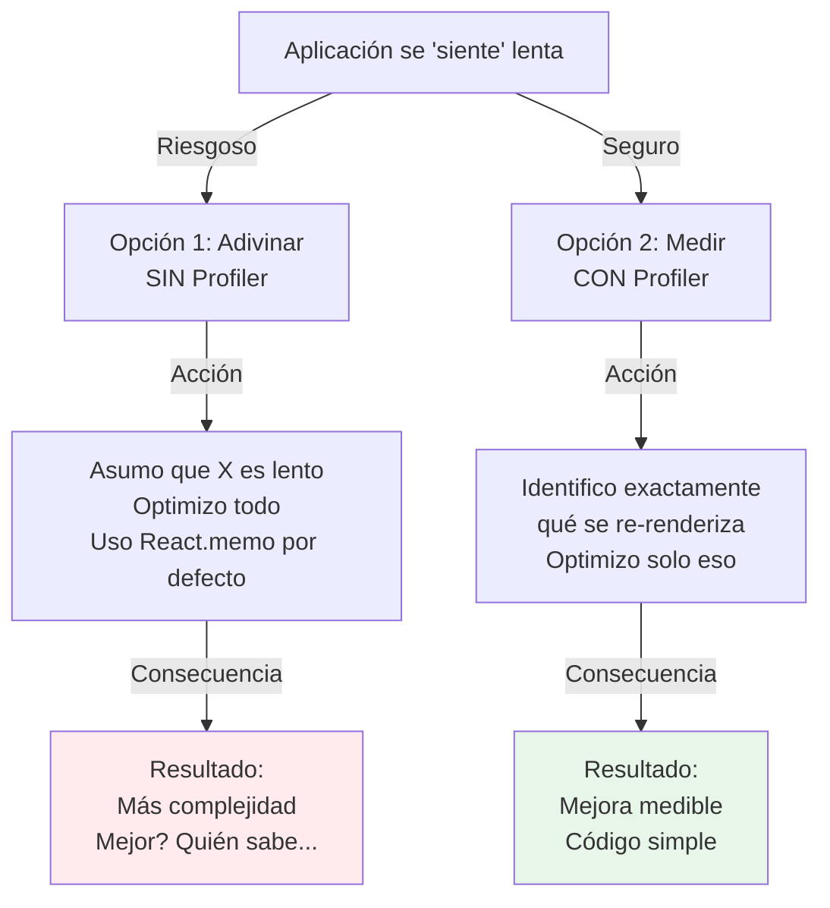
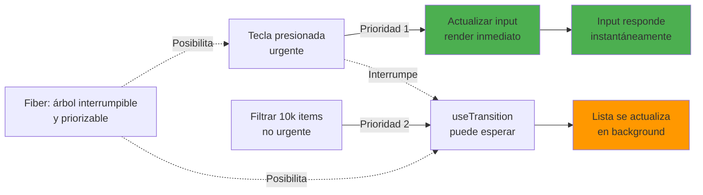
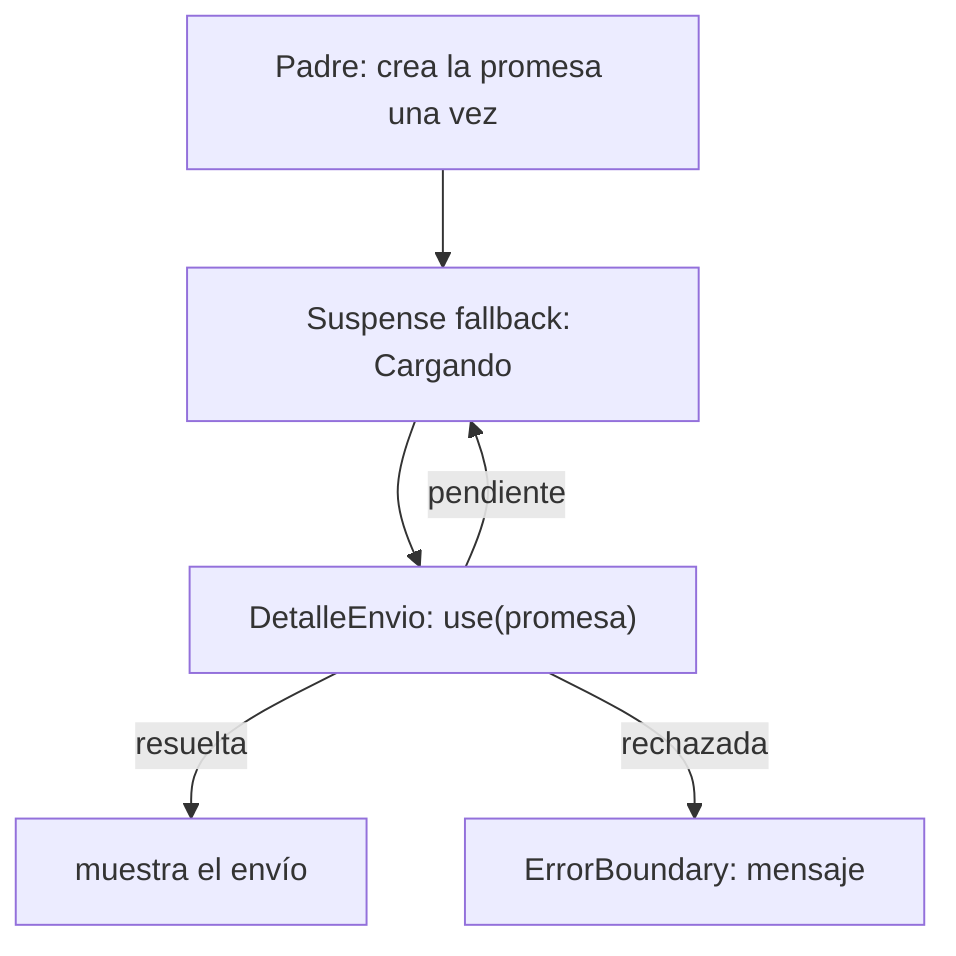
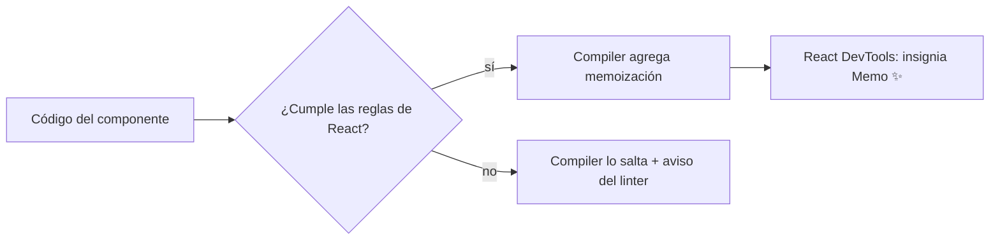

# Módulo 9: Performance en React


## Aprende construyendo

**Servidor del módulo:** cada ejemplo se sirve con `npm run dev` dentro del proyecto `mi-react` del módulo 0; abre `http://localhost:5173` para ver el resultado y ejecuta `npm test` para las pruebas (Vitest, configurado una sola vez en «Prepara las pruebas» del módulo 0). Si el puerto cambia, usa el que imprima la terminal.


### Tema 1: Medir antes de optimizar · Intermedio · 40 min

<details open>
<summary><strong>Capa 1 — Lectura</strong></summary>

#### ► DE QUÉ TRATA
Al finalizar vas a grabar con React DevTools Profiler una interacción real de ListaEnvios (escribir en el filtro) para identificar qué componente específico se re-renderiza innecesariamente, antes de optimizar nada. Prerrequisitos: Módulo 8 completo.

#### ► CÓMO FUNCIONA


</details>

<details>
<summary><strong>Capa 2 — Construcción</strong></summary>

#### Código y verificación

```
Profiler graba una interacción → muestra QUÉ componentes se re-renderizaron y POR QUÉ
(props cambiadas / estado cambiado / re-render heredado del padre)
```

```jsx
import { useState } from 'react';

function EncabezadoPanel({ titulo }) {
  return <h1>{titulo}</h1>; // no lee el filtro
}

function ListaEnvios({ zona }) {
  return <p>Envíos de la zona «{zona || 'todas'}»</p>;
}

export default function App() {
  const [zona, setZona] = useState('');
  return (
    <main>
      <EncabezadoPanel titulo="Panel de envíos" />
      <label>
        Filtro de zona{' '}
        <input value={zona} onChange={e => setZona(e.target.value)} />
      </label>
      <ListaEnvios zona={zona} />
    </main>
  );
}
```

```text
1. Abre React DevTools > pestaña Profiler
2. Haz click en grabar (●)
3. Escribe una letra en el campo de filtro de zona
4. Detén la grabación
5. Inspecciona qué componentes aparecen resaltados y por qué
```

```bash
npm run dev
```

</details>

### Tema 2: React.memo con criterio · Intermedio · 40 min

<details open>
<summary><strong>Capa 1 — Lectura</strong></summary>

#### ► DE QUÉ TRATA
Al finalizar vas a envolver EncabezadoPanel (identificado en el Tema 1 con el Profiler) en React.memo, confirmando que el render heredado innecesario desaparece. Prerrequisitos: Tema 1 de este módulo.

</details>

<details>
<summary><strong>Capa 2 — Construcción</strong></summary>

#### Código y verificación
```jsx
const Fila = React.memo(function Fila({ item }) {
  return <li>{item.nombre}</li>;
}); // solo se re-renderiza si `item` cambia (comparación superficial)
```

```jsx
import { memo, useState } from 'react';

const EncabezadoPanel = memo(function EncabezadoPanel({ titulo }) {
  return <h1>{titulo}</h1>; // se salta el render si `titulo` no cambia
});

function ListaEnvios({ zona }) {
  return <p>Envíos de la zona «{zona || 'todas'}»</p>;
}

export default function App() {
  const [zona, setZona] = useState('');
  return (
    <main>
      <EncabezadoPanel titulo="Panel de envíos" />
      <label>
        Filtro de zona{' '}
        <input value={zona} onChange={e => setZona(e.target.value)} />
      </label>
      <ListaEnvios zona={zona} />
    </main>
  );
}
```

```bash
npm run dev
```

</details>

### Tema 3: Virtualización de listas largas · Avanzado · 20 min

<details open>
<summary><strong>Capa 1 — Lectura</strong></summary>

#### ► DE QUÉ TRATA
Al finalizar vas a virtualizar ListaEnvios cuando RutaFlow acumula miles de envíos históricos, renderizando en el DOM solo los que están visibles en pantalla. Prerrequisitos: Tema 2 de este módulo.

</details>

<details>
<summary><strong>Capa 2 — Construcción</strong></summary>

#### Código y verificación
```jsx
import { List } from 'react-window'; // react-window 2: `List` reemplaza a `FixedSizeList`
<List rowComponent={Fila} rowCount={10000} rowHeight={40} rowProps={{ datos }} style={{ height: 600 }} />
```

```jsx
import { List } from 'react-window';

const envios = Array.from({ length: 10_000 }, (_, i) => ({ guia: `RF-${String(i).padStart(5, '0')}` }));

function FilaEnvio({ index, style, envios }) {
  // `style` posiciona la fila; react-window solo monta las filas visibles.
  return <div style={style}>{envios[index].guia}</div>;
}

export default function App() {
  return (
    <List
      rowComponent={FilaEnvio}
      rowCount={envios.length}
      rowHeight={48}
      rowProps={{ envios }}
      style={{ height: 600 }}
    />
  );
}
```

```bash
npm install react-window
npm run dev
```

</details>

### Tema 4: useTransition, useDeferredValue y Fiber · Avanzado · 45 min

<details open>
<summary><strong>Capa 1 — Lectura</strong></summary>

#### ► DE QUÉ TRATA
Al finalizar vas a usar useTransition para que escribir en el filtro de zona de RutaFlow siga respondiendo instantáneamente, aunque filtrar 10,000 envíos sea un cálculo costoso en segundo plano. Prerrequisitos: Tema 3 de este módulo.

#### ► CÓMO FUNCIONA


</details>

<details>
<summary><strong>Capa 2 — Construcción</strong></summary>

#### Código y verificación


```jsx
import { useState, useTransition } from 'react';

const envios = Array.from({ length: 20_000 }, (_, i) => `RF-${String(i).padStart(5, '0')} zona-${i % 2 ? 'norte' : 'sur'}`);

function filtrarEnvios(lista, texto) {
  return lista.filter(envio => envio.includes(texto)).slice(0, 200);
}

export default function App() {
  const [textoInput, setTextoInput] = useState('');
  const [enviosFiltrados, setEnviosFiltrados] = useState(() => filtrarEnvios(envios, ''));
  const [isPending, startTransition] = useTransition();

  function manejarCambioFiltro(texto) {
    setTextoInput(texto); // urgente: el input responde de inmediato
    startTransition(() => {
      setEnviosFiltrados(filtrarEnvios(envios, texto)); // no urgente: puede esperar
    });
  }

  return (
    <main>
      <input value={textoInput} onChange={e => manejarCambioFiltro(e.target.value)} aria-label="Filtro" />
      {isPending && <span> Actualizando…</span>}
      <ul style={{ opacity: isPending ? 0.6 : 1 }}>
        {enviosFiltrados.map(envio => <li key={envio}>{envio}</li>)}
      </ul>
    </main>
  );
}
```

```bash
npm run dev
```

</details>

### Tema 5: Suspense y React.lazy: carga diferida de componentes y rutas · Avanzado · 40 min

<details open>
<summary><strong>Capa 1 — Lectura</strong></summary>

</details>

<details>
<summary><strong>Capa 2 — Construcción</strong></summary>

#### Código y verificación
```jsx
export default function PanelAnalitica() {
  return <div>Gráficos pesados aquí</div>;
}
```

```jsx
import { Component } from 'react';

export default class ErrorBoundary extends Component {
  state = { haFallado: false };

  static getDerivedStateFromError() {
    return { haFallado: true };
  }

  render() {
    return this.state.haFallado ? this.props.fallback : this.props.children;
  }
}
```

```jsx
import { lazy, Suspense, useState } from 'react';
import ErrorBoundary from './ErrorBoundary.jsx';

// El panel de analítica se separa en su propio chunk y se descarga bajo demanda.
const PanelAnalitica = lazy(() => import('./PanelAnalitica.jsx'));

export default function Analitica() {
  const [verAnalitica, setVerAnalitica] = useState(false);
  return (
    <>
      <h1>Panel de envíos</h1>
      <button onClick={() => setVerAnalitica(true)}>Abrir analítica</button>
      {verAnalitica && (
        <ErrorBoundary fallback={<p role="alert">No se pudo cargar la analítica. Recarga la página.</p>}>
          <Suspense fallback={<p role="status">Cargando analítica…</p>}>
            <PanelAnalitica />
          </Suspense>
        </ErrorBoundary>
      )}
    </>
  );
}
```

```jsx
import { render, screen } from '@testing-library/react';
import userEvent from '@testing-library/user-event';
import { expect, it } from 'vitest';
import Analitica from './Analitica.jsx';

it('descarga el panel solo al pulsar el botón', async () => {
  render(<Analitica />);
  expect(screen.queryByText('Gráficos pesados aquí')).not.toBeInTheDocument();
  await userEvent.click(screen.getByRole('button', { name: 'Abrir analítica' }));
  expect(await screen.findByText('Gráficos pesados aquí')).toBeInTheDocument();
});
```

```bash
npm test
npm run build
```

```text
dist/assets/PanelAnalitica-Dnrl6zdc.js    0.14 kB │ gzip:  0.15 kB
dist/assets/index-C1lJPiOr.js           221.53 kB │ gzip: 69.39 kB
```

</details>

### Tema 6: El hook use: leer una promesa con Suspense y un contexto de forma condicional · Avanzado · 40 min

<details open>
<summary><strong>Capa 1 — Lectura</strong></summary>

#### ► DE QUÉ TRATA
Usa React 19 o superior. Parte del proyecto de Vite del módulo y trabaja en src/DetalleEnvio.jsx.

#### ► CÓMO FUNCIONA


</details>

<details>
<summary><strong>Capa 2 — Construcción</strong></summary>

#### Código y verificación


```jsx
import { createContext, Suspense, use, useState } from 'react';
import { ErrorBoundary } from 'react-error-boundary';

const PreferenciasContext = createContext({ mostrarRuta: false });

function pedirEnvio(codigo) {
  return new Promise((resolver, rechazar) => setTimeout(() => {
    if (codigo === 'ENV-404') rechazar(new Error('Envío no encontrado'));
    else resolver({ codigo, estado: 'EN_RUTA', ruta: ['Bodega', 'Calle 26'] });
  }, 800));
}

function Detalle({ promesaEnvio }) {
  const envio = use(promesaEnvio); // suspende hasta que llega
  if (envio.estado !== 'EN_RUTA') return <p>{envio.codigo}: {envio.estado}</p>;
  const { mostrarRuta } = use(PreferenciasContext); // contexto después de un return
  return <p>{envio.codigo} · {mostrarRuta ? envio.ruta.join(' → ') : 'en ruta'}</p>;
}

export default function DetalleEnvio() {
  // La promesa se crea en un evento del padre, no en el render del hijo.
  const [promesa, setPromesa] = useState(() => pedirEnvio('ENV-42'));
  return (
    <PreferenciasContext value={{ mostrarRuta: true }}>
      <button onClick={() => setPromesa(pedirEnvio('ENV-404'))}>Pedir envío inexistente</button>
      <ErrorBoundary fallback={<p role="alert">No se pudo cargar el envío</p>} resetKeys={[promesa]}>
        <Suspense fallback={<p>Cargando envío…</p>}>
          <Detalle promesaEnvio={promesa} />
        </Suspense>
      </ErrorBoundary>
    </PreferenciasContext>
  );
}
```

```bash
cd academia-react
npm install react-error-boundary
npm run dev
```

```text
Al cargar: «Cargando envío…» durante unos 800 ms y luego «ENV-42 · Bodega → Calle 26».
Al pulsar «Pedir envío inexistente»: «Cargando envío…» y luego «No se pudo cargar el envío».
```

</details>

### Tema 7: React Compiler y las reglas de React: memoización automática · Avanzado · 45 min

<details open>
<summary><strong>Capa 1 — Lectura</strong></summary>

#### ► DE QUÉ TRATA
Usa React 19 y un proyecto de Vite 8 (con @vitejs/plugin-react 6, el que instala hoy npm create vite@latest). Instalarás babel-plugin-react-compiler, @rolldown/plugin-babel, @babel/core, ESLint y eslint-plugin-react-hooks 7 o superior. Necesitas la extensión React DevTools en el…

#### ► CÓMO FUNCIONA


</details>

<details>
<summary><strong>Capa 2 — Construcción</strong></summary>

#### Código y verificación


```js
import babel from '@rolldown/plugin-babel';
import react, { reactCompilerPreset } from '@vitejs/plugin-react';
import { defineConfig } from 'vite';

export default defineConfig({
  // Con @vitejs/plugin-react 6 la antigua opción `react({ babel: { plugins: [...] } })`
  // se ignora sin aviso: el compilador se conecta con @rolldown/plugin-babel.
  plugins: [react(), babel({ presets: [reactCompilerPreset()] })],
});
```

```js
import reactHooks from 'eslint-plugin-react-hooks';

export default [
  {
    files: ['src/**/*.{js,jsx}'],
    ...reactHooks.configs.flat.recommended, // incluye las reglas que usa el compilador
    languageOptions: { parserOptions: { ecmaFeatures: { jsx: true } } },
  },
];
```

```jsx
export default function ListaEnvios({ envios, filtro }) {
  // ❌ Rompe la inmutabilidad: reemplaza un elemento del array que llegó por props.
  // envios[0] = { ...envios[0], codigo: envios[0].codigo.toUpperCase() };

  // ✅ Crea una copia. El compilador memoiza este cálculo sin useMemo.
  const visibles = envios
    .filter((e) => e.codigo.includes(filtro))
    .toSorted((a, b) => a.codigo.localeCompare(b.codigo));

  return <ul>{visibles.map((e) => <li key={e.codigo}>{e.codigo}</li>)}</ul>;
}
```

```bash
cd academia-react
npm install -D @rolldown/plugin-babel @babel/core babel-plugin-react-compiler eslint eslint-plugin-react-hooks@latest
npx eslint src
npm run dev
```

```text
npx eslint src termina sin errores.
En React DevTools > Components, ListaEnvios muestra la insignia «Memo ✨».
Al escribir en un campo que no afecta a la lista, el Profiler muestra que ListaEnvios no se volvió a renderizar.
```

</details>
