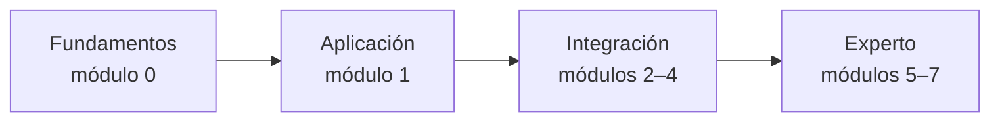
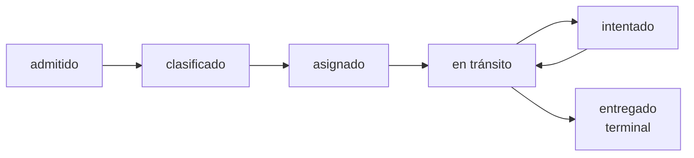
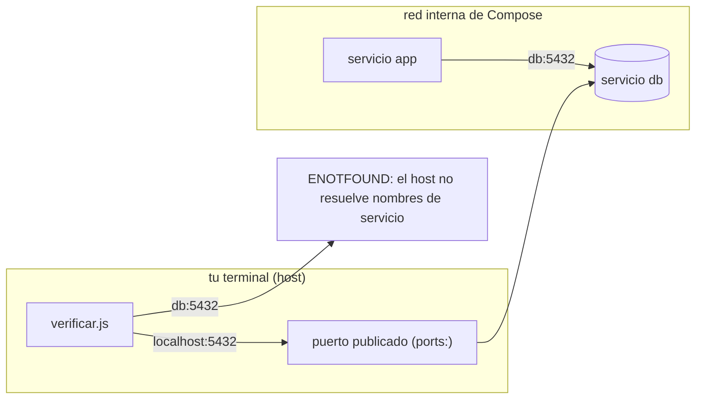
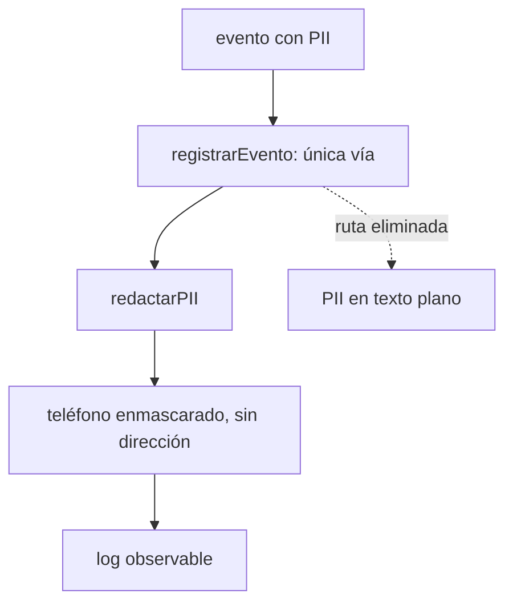

# Módulo 0: RutaFlow desde cero: producto, entorno y dominio


## Antes de comenzar: instala y comprueba el entorno

Necesitas Git, un editor, Docker Desktop o Docker Engine, Node.js LTS, Python 3.12+, Java 27, Flutter estable y `make` opcional. En **Windows**, instala WSL 2 con Ubuntu, activa virtualización y ejecuta el repositorio dentro del sistema de archivos de WSL. En **macOS**, instala Xcode Command Line Tools; Homebrew facilita herramientas pero no es obligatorio. En **Linux**, instala Git y Docker desde la documentación de tu distribución y agrega tu usuario al grupo de Docker solo si comprendes su alcance de privilegios. Flutter exige Android Studio y Android SDK para Android; Xcode solo está disponible en macOS para iOS.

Valida una herramienta a la vez: `git --version`, `docker version`, `node --version`, `python3 --version`, `java --version` y `flutter doctor -v`. No continúes ante una marca roja relacionada con la plataforma que usarás. Después crea una carpeta vacía, inicializa Git, copia `.env.example` a `.env` sin secretos reales y levanta PostgreSQL con Compose. El primer criterio de éxito no es «instalé algo», sino que una prueba pueda conectarse, crear un envío y eliminar los datos de prueba de manera repetible.


### Si la instalación falla, no continúes a ciegas

<details open>
<summary><strong>Capa 1 — Lectura</strong></summary>

#### ► CÓMO FUNCIONA


</details>

<details>
<summary><strong>Capa 2 — Construcción</strong></summary>

#### Código y verificación


</details>

### Tema 1: El proceso logístico como sistema · Básico · 45 min

<details open>
<summary><strong>Capa 1 — Lectura</strong></summary>

#### ► DE QUÉ TRATA
Al finalizar podrás construir y verificar Tema 1: El proceso logístico como sistema dentro de RutaFlow, empezando desde una carpeta vacía y explicando qué decisión técnica resuelve. Conocimiento previo: terminal, Git y JavaScript con Node.js (track Node).

#### ► CÓMO FUNCIONA


</details>

<details>
<summary><strong>Capa 2 — Construcción</strong></summary>

#### Código y verificación


```bash
mkdir -p rutaflow-labs/tema-1-proceso-logistico/src
cd rutaflow-labs/tema-1-proceso-logistico
```

```javascript
// Tabla explícita de transiciones válidas: "entregado" no tiene salidas, es terminal.
const TRANSICIONES_VALIDAS = {
  admitido: ['clasificado'],
  clasificado: ['asignado'],
  asignado: ['en_transito'],
  en_transito: ['intentado', 'entregado'],
  intentado: ['en_transito', 'entregado'],
  entregado: [],
};

function transicionar(envio, nuevoEstado) {
  const permitidas = TRANSICIONES_VALIDAS[envio.estado] ?? [];
  if (!permitidas.includes(nuevoEstado)) {
    throw new Error(`Transición inválida: ${envio.estado} -> ${nuevoEstado}`);
  }
  return { ...envio, estado: nuevoEstado, eventos: [...envio.eventos, { tipo: nuevoEstado, en: new Date().toISOString() }] };
}

module.exports = { transicionar };
```

```bash
node -e "
const { transicionar } = require('./src/envio-estado.js');
let envio = { id: 'RF-4471', estado: 'admitido', eventos: [] };
envio = transicionar(envio, 'clasificado');
envio = transicionar(envio, 'asignado');
envio = transicionar(envio, 'en_transito');
envio = transicionar(envio, 'entregado');
console.log('OK', envio.estado, envio.eventos.length, 'eventos');
"
```

</details>

### Tema 2: Entorno reproducible en Windows, macOS y Linux · Básico · 45 min

<details open>
<summary><strong>Capa 1 — Lectura</strong></summary>

#### ► DE QUÉ TRATA
Al finalizar podrás construir y verificar Tema 2: Entorno reproducible en Windows, macOS y Linux dentro de RutaFlow, empezando desde una carpeta vacía y explicando qué decisión técnica resuelve. Conocimiento previo: terminal, Git, JavaScript con Node.js (track Node) y Docker (tra…

#### ► CÓMO FUNCIONA


</details>

<details>
<summary><strong>Capa 2 — Construcción</strong></summary>

#### Código y verificación


```bash
mkdir -p rutaflow-labs/tema-2-entorno-reproducible
cd rutaflow-labs/tema-2-entorno-reproducible
```

```yaml
services:
  db:
    image: postgres:16-alpine
    environment:
      POSTGRES_PASSWORD: rutaflow
      POSTGRES_DB: rutaflow
    ports:
      - "5432:5432"
```

```bash
docker compose up -d
docker compose ps
```

```javascript
const net = require('net');
const socket = net.createConnection({ host: 'localhost', port: 5432 }, () => {
  console.log('OK: localhost:5432 alcanzable desde el host');
  socket.end();
});
socket.on('error', (e) => { console.error('FALLÓ:', e.message); process.exit(1); });
```

```bash
node verificar.js
```

</details>

### Tema 3: Arquitectura, privacidad y amenazas · Básico · 45 min

<details open>
<summary><strong>Capa 1 — Lectura</strong></summary>

#### ► DE QUÉ TRATA
Al finalizar podrás construir y verificar Tema 3: Arquitectura, privacidad y amenazas dentro de RutaFlow, empezando desde una carpeta vacía y explicando qué decisión técnica resuelve. Conocimiento previo: terminal, Git y JavaScript con Node.js (track Node).

#### ► CÓMO FUNCIONA


</details>

<details>
<summary><strong>Capa 2 — Construcción</strong></summary>

#### Código y verificación


```bash
mkdir -p rutaflow-labs/tema-3-privacidad-y-amenazas/src
cd rutaflow-labs/tema-3-privacidad-y-amenazas
```

```javascript
function redactarPII(envio) {
  const { telefono, direccionCompleta, ...resto } = envio;
  return {
    ...resto,
    telefono: telefono ? telefono.replace(/\d(?=\d{2})/g, '*') : undefined,
  };
}

function registrarEvento(envio) {
  console.log('evento:', JSON.stringify(redactarPII(envio)));
}

module.exports = { redactarPII, registrarEvento };
```

```bash
node -e "
const { registrarEvento } = require('./src/registrar-evento.js');
registrarEvento({ id: 'RF-4471', estado: 'entregado', telefono: '3001234567', direccionCompleta: 'Calle 10 # 5-20' });
"
```

</details>
