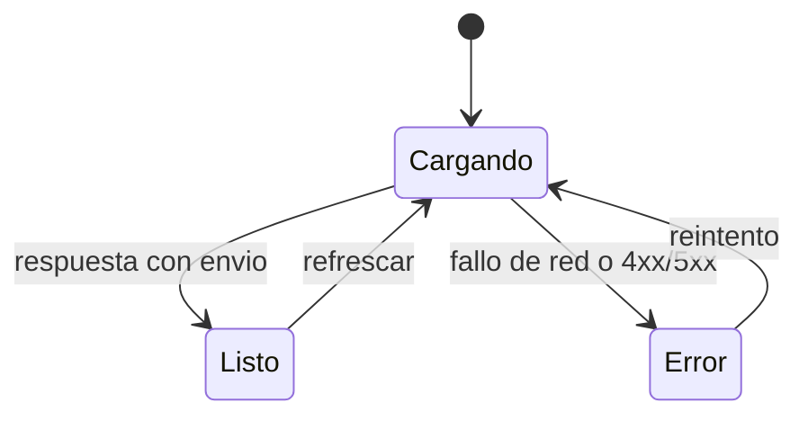
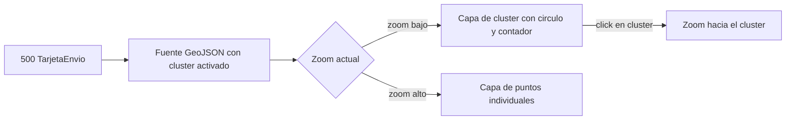
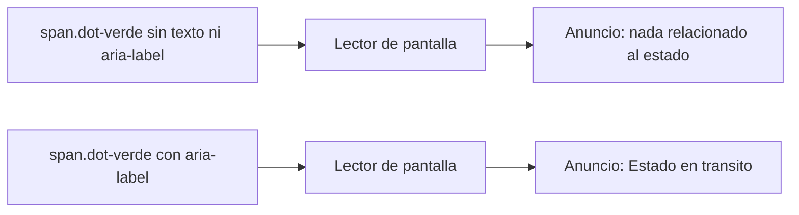

# Módulo 3: Frontend web: cliente y centro de operaciones


## Aprende construyendo


### Tema 1: Estados explícitos y arquitectura de interfaz · Avanzado · 45 min

<details open>
<summary><strong>Capa 1 — Lectura</strong></summary>

#### ► DE QUÉ TRATA
Al finalizar vas a tener un tipo de estado explícito (unión discriminada) para la vista de seguimiento de un envío, en vez de banderas sueltas (isLoading, hasError, envio) que pueden contradecirse entre sí. Vas a construirlo desde una carpeta vacía y vas a poder explicar por qué…

#### ► LA IDEA EN UNA FRASE
**Al finalizar vas a tener un tipo de estado explícito (unión discriminada) para la vista de seguimiento de un envío, en vez de banderas sueltas (isLoading, hasError, envio) que pueden contradecirse entre sí.**

#### ► POR QUÉ EXISTE ESTO
Resuelve un problema real de diseño o implementación y evita decisiones a ciegas.

#### ► LA ANALOGÍA
Piensa en estados explícitos y arquitectura de interfaz como una herramienta de taller: útil cuando conoces su propósito y sus límites.
**Dónde se rompe la analogía:** en software, los efectos dependen del contexto, la escala y los trade-offs.

#### ► CÓMO FUNCIONA


#### ► LO QUE PUEDE SALIR MAL
| Síntoma | Causa probable | Arreglo |
|---|---|---|
| Estados explícitos y arquitectura de interfaz se aplica pero el resultado no mejora | Se usó sin medir el problema real | Mide antes y compara contra la alternativa simple |
| Aparece complejidad inesperada | Se adoptó la técnica sin comprender sus trade-offs | Vuelve a la sección de trade-offs y reduce el alcance |
| Falla en un caso límite | Se asumió un contexto que no se cumple | Prueba el caso límite y documenta cuándo NO usarlo |

#### ► TRADE-OFFS
| Opción | Cuándo usarla | Cuándo NO usarla |
|---|---|---|
| Usar Estados explícitos y arquitectura de interfaz | Cuando el problema coincide con su propósito y el beneficio es observable | Cuando agrega complejidad sin resolver un problema real |
| Alternativa más simple | Cuando el contexto es pequeño, estable o fácil de razonar | Cuando ya demostró no escalar o no cumplir el requisito |
| Postergar la decisión | Cuando falta evidencia del problema | Cuando el costo de esperar es mayor que el costo de probar |

#### ► CUÁNDO NO USAR ESTO
No uses estados explícitos y arquitectura de interfaz por defecto. Aplícalo cuando el problema lo justifique y puedas verificar el beneficio; si una alternativa más simple resuelve igual, prefiérela.

#### ► DE VUELTA A LA ANALOGÍA
Volviendo a la analogía: estados explícitos y arquitectura de interfaz funciona como el modelo inicial, pero recuerda dónde se rompe: en producción importan la evidencia, la escala y el costo de equivocarte.

#### ► LO QUE DEBES RECORDAR
- Estados explícitos y arquitectura de interfaz existe para resolver un problema específico.
- Mide antes de adoptar complejidad.
- Conoce el caso donde NO usarlo.
- Verifica con evidencia observable.

#### ► PREGUNTAS PARA PENSAR
1. ¿Qué problema concreto resuelve estados explícitos y arquitectura de interfaz en tu contexto?
2. ¿Cómo sabrías que estados explícitos y arquitectura de interfaz no está funcionando bien?
3. ¿Qué alternativa más simple considerarías antes de usar estados explícitos y arquitectura de interfaz?

</details>

<details>
<summary><strong>Capa 2 — Construcción</strong></summary>

#### Código y verificación


```bash
mkdir -p rutaflow-labs/tema-1-estado-vista/src
cd rutaflow-labs/tema-1-estado-vista
```

```javascript
// src/estado-vista.js
// Union discriminada: el campo "tipo" es la unica fuente de verdad del estado.
function estadoCargando() {
  return { tipo: 'cargando' };
}
function estadoListo(envio) {
  return { tipo: 'listo', envio };
}
function estadoError(mensaje) {
  return { tipo: 'error', mensaje };
}

function renderizar(estado) {
  switch (estado.tipo) {
    case 'cargando':
      return 'Cargando envio...';
    case 'listo':
      return `Envio ${estado.envio.codigo}: ${estado.envio.estado}`;
    case 'error':
      return `No se pudo cargar: ${estado.mensaje}`;
    default:
      throw new Error('Estado no manejado: ' + JSON.stringify(estado));
  }
}

const envio = { codigo: 'RF-4471', estado: 'en_transito' };
console.log(renderizar(estadoCargando()));
console.log(renderizar(estadoListo(envio)));
console.log(renderizar(estadoError('timeout de red')));
```

```bash
node src/estado-vista.js
```

```
Cargando envio...
Envio RF-4471: en_transito
No se pudo cargar: timeout de red
```

```javascript
// src/estado-vista-roto.js
// Version con banderas sueltas: nada impide una combinacion imposible.
function renderizarBooleans({ isLoading, hasError, envio }) {
  if (isLoading) return 'Cargando envio...';
  if (hasError) return 'No se pudo cargar: error desconocido';
  return `Envio ${envio.codigo}: ${envio.estado}`;
}

const estadoImposible = {
  isLoading: true,
  hasError: true,
  envio: { codigo: 'RF-4471', estado: 'en_transito' },
};

console.log(renderizarBooleans(estadoImposible));
```

</details>

### Tema 2: Mapas operativos · Avanzado · 45 min

<details open>
<summary><strong>Capa 1 — Lectura</strong></summary>

#### ► DE QUÉ TRATA
Al finalizar vas a poder agrupar (clusterizar) 500 TarjetaEnvio en el mapa operativo usando una fuente GeoJSON de MapLibre con cluster: true, en vez de renderizar 500 marcadores individuales. Vas a medir primero el problema real que resuelve el clustering. Conocimiento previo: te…

#### ► LA IDEA EN UNA FRASE
**Al finalizar vas a poder agrupar (clusterizar) 500 TarjetaEnvio en el mapa operativo usando una fuente GeoJSON de MapLibre con cluster: true, en vez de renderizar 500 marcadores individuales.**

#### ► POR QUÉ EXISTE ESTO
Resuelve un problema real de diseño o implementación y evita decisiones a ciegas.

#### ► LA ANALOGÍA
Piensa en mapas operativos como una herramienta de taller: útil cuando conoces su propósito y sus límites.
**Dónde se rompe la analogía:** en software, los efectos dependen del contexto, la escala y los trade-offs.

#### ► CÓMO FUNCIONA


#### ► LO QUE PUEDE SALIR MAL
| Síntoma | Causa probable | Arreglo |
|---|---|---|
| Mapas operativos se aplica pero el resultado no mejora | Se usó sin medir el problema real | Mide antes y compara contra la alternativa simple |
| Aparece complejidad inesperada | Se adoptó la técnica sin comprender sus trade-offs | Vuelve a la sección de trade-offs y reduce el alcance |
| Falla en un caso límite | Se asumió un contexto que no se cumple | Prueba el caso límite y documenta cuándo NO usarlo |

#### ► TRADE-OFFS
| Opción | Cuándo usarla | Cuándo NO usarla |
|---|---|---|
| Usar Mapas operativos | Cuando el problema coincide con su propósito y el beneficio es observable | Cuando agrega complejidad sin resolver un problema real |
| Alternativa más simple | Cuando el contexto es pequeño, estable o fácil de razonar | Cuando ya demostró no escalar o no cumplir el requisito |
| Postergar la decisión | Cuando falta evidencia del problema | Cuando el costo de esperar es mayor que el costo de probar |

#### ► CUÁNDO NO USAR ESTO
No uses mapas operativos por defecto. Aplícalo cuando el problema lo justifique y puedas verificar el beneficio; si una alternativa más simple resuelve igual, prefiérela.

#### ► DE VUELTA A LA ANALOGÍA
Volviendo a la analogía: mapas operativos funciona como el modelo inicial, pero recuerda dónde se rompe: en producción importan la evidencia, la escala y el costo de equivocarte.

#### ► LO QUE DEBES RECORDAR
- Mapas operativos existe para resolver un problema específico.
- Mide antes de adoptar complejidad.
- Conoce el caso donde NO usarlo.
- Verifica con evidencia observable.

#### ► PREGUNTAS PARA PENSAR
1. ¿Qué problema concreto resuelve mapas operativos en tu contexto?
2. ¿Cómo sabrías que mapas operativos no está funcionando bien?
3. ¿Qué alternativa más simple considerarías antes de usar mapas operativos?

</details>

<details>
<summary><strong>Capa 2 — Construcción</strong></summary>

#### Código y verificación


```bash
mkdir -p rutaflow-labs/tema-2-clustering/src
cd rutaflow-labs/tema-2-clustering
```

```javascript
// src/clustering.js
// PRNG determinista: el mismo resultado siempre que corras el script.
function crearGenerador(semilla) {
  let estado = semilla;
  return function siguiente() {
    estado = (estado * 1103515245 + 12345) & 0x7fffffff;
    return estado / 0x7fffffff;
  };
}

function generarEnvios(cantidad, centro, semilla) {
  const azar = crearGenerador(semilla);
  const envios = [];
  for (let i = 0; i < cantidad; i++) {
    const offsetLat = (azar() - 0.5) * 0.08;
    const offsetLon = (azar() - 0.5) * 0.08;
    envios.push({ codigo: `RF-${1000 + i}`, lon: centro.lon + offsetLon, lat: centro.lat + offsetLat });
  }
  return envios;
}

function proyectarAPixeles(envio, centro, zoom) {
  const escala = (256 * Math.pow(2, zoom)) / 360;
  return { x: (envio.lon - centro.lon) * escala, y: (centro.lat - envio.lat) * escala };
}

// Agrupa puntos que caen en la misma celda de tamaño clusterRadius: la misma idea
// que usa una fuente GeoJSON de MapLibre con cluster: true / clusterRadius.
function agruparEnClusters(puntosPx, clusterRadius) {
  const celdas = new Map();
  for (const p of puntosPx) {
    const clave = `${Math.floor(p.x / clusterRadius)}:${Math.floor(p.y / clusterRadius)}`;
    celdas.set(clave, (celdas.get(clave) || 0) + 1);
  }
  return celdas;
}

function contarSuperpuestos(puntosPx, radioMarcadorPx) {
  let superpuestos = 0;
  for (let i = 0; i < puntosPx.length; i++) {
    const tieneVecino = puntosPx.some((q, j) => {
      if (j === i) return false;
      const dx = puntosPx[i].x - q.x;
      const dy = puntosPx[i].y - q.y;
      return Math.sqrt(dx * dx + dy * dy) < radioMarcadorPx;
    });
    if (tieneVecino) superpuestos++;
  }
  return superpuestos;
}

const bogota = { lat: 4.711, lon: -74.0721 };
const envios = generarEnvios(500, bogota, 42);
const zoom = 12; // vista de ciudad completa en el centro de operaciones
const puntosPx = envios.map((e) => proyectarAPixeles(e, bogota, zoom));

// Config real de fuente MapLibre con clustering activado.
const fuenteCluster = { type: 'geojson', cluster: true, clusterMaxZoom: 14, clusterRadius: 50 };
const clusters = agruparEnClusters(puntosPx, fuenteCluster.clusterRadius);

console.log('Envios totales:', envios.length);
console.log('Grupos visibles CON clustering (clusterRadius 50px):', clusters.size);

// --- Fallo deliberado: descomentar para medir sin agrupar ---
// const superpuestos = contarSuperpuestos(puntosPx, 24);
// console.log('Marcadores superpuestos SIN agrupar (radio 24px):', superpuestos, 'de', envios.length);
```

```bash
node src/clustering.js
```

```
Envios totales: 500
Grupos visibles CON clustering (clusterRadius 50px): 36
```

</details>

### Tema 3: Accesibilidad, seguridad y rendimiento · Avanzado · 45 min

<details open>
<summary><strong>Capa 1 — Lectura</strong></summary>

#### ► DE QUÉ TRATA
Al finalizar vas a poder diagnosticar y corregir una insignia de estado que comunica información solo por color, dejándola invisible para un lector de pantalla y para un operador con daltonismo. Vas a construir el diagnóstico desde cero antes de tocar la consola real. Conocimient…

#### ► LA IDEA EN UNA FRASE
**Al finalizar vas a poder diagnosticar y corregir una insignia de estado que comunica información solo por color, dejándola invisible para un lector de pantalla y para un operador con daltonismo.**

#### ► POR QUÉ EXISTE ESTO
Resuelve un problema real de diseño o implementación y evita decisiones a ciegas.

#### ► LA ANALOGÍA
Piensa en accesibilidad, seguridad y rendimiento como una herramienta de taller: útil cuando conoces su propósito y sus límites.
**Dónde se rompe la analogía:** en software, los efectos dependen del contexto, la escala y los trade-offs.

#### ► CÓMO FUNCIONA


#### ► LO QUE PUEDE SALIR MAL
| Síntoma | Causa probable | Arreglo |
|---|---|---|
| Accesibilidad, seguridad y rendimiento se aplica pero el resultado no mejora | Se usó sin medir el problema real | Mide antes y compara contra la alternativa simple |
| Aparece complejidad inesperada | Se adoptó la técnica sin comprender sus trade-offs | Vuelve a la sección de trade-offs y reduce el alcance |
| Falla en un caso límite | Se asumió un contexto que no se cumple | Prueba el caso límite y documenta cuándo NO usarlo |

#### ► TRADE-OFFS
| Opción | Cuándo usarla | Cuándo NO usarla |
|---|---|---|
| Usar Accesibilidad, seguridad y rendimiento | Cuando el problema coincide con su propósito y el beneficio es observable | Cuando agrega complejidad sin resolver un problema real |
| Alternativa más simple | Cuando el contexto es pequeño, estable o fácil de razonar | Cuando ya demostró no escalar o no cumplir el requisito |
| Postergar la decisión | Cuando falta evidencia del problema | Cuando el costo de esperar es mayor que el costo de probar |

#### ► CUÁNDO NO USAR ESTO
No uses accesibilidad, seguridad y rendimiento por defecto. Aplícalo cuando el problema lo justifique y puedas verificar el beneficio; si una alternativa más simple resuelve igual, prefiérela.

#### ► DE VUELTA A LA ANALOGÍA
Volviendo a la analogía: accesibilidad, seguridad y rendimiento funciona como el modelo inicial, pero recuerda dónde se rompe: en producción importan la evidencia, la escala y el costo de equivocarte.

#### ► LO QUE DEBES RECORDAR
- Accesibilidad, seguridad y rendimiento existe para resolver un problema específico.
- Mide antes de adoptar complejidad.
- Conoce el caso donde NO usarlo.
- Verifica con evidencia observable.

#### ► PREGUNTAS PARA PENSAR
1. ¿Qué problema concreto resuelve accesibilidad, seguridad y rendimiento en tu contexto?
2. ¿Cómo sabrías que accesibilidad, seguridad y rendimiento no está funcionando bien?
3. ¿Qué alternativa más simple considerarías antes de usar accesibilidad, seguridad y rendimiento?

</details>

<details>
<summary><strong>Capa 2 — Construcción</strong></summary>

#### Código y verificación


```bash
mkdir -p rutaflow-labs/tema-3-accesibilidad/src
cd rutaflow-labs/tema-3-accesibilidad
```

```javascript
// src/nombre-accesible.js
// Simula el orden real del calculo de "accessible name": aria-label > texto visible > title.
function nombreAccesible(nodo) {
  if (nodo.ariaLabel && nodo.ariaLabel.trim()) return nodo.ariaLabel.trim();
  if (nodo.textoVisible && nodo.textoVisible.trim()) return nodo.textoVisible.trim();
  if (nodo.title && nodo.title.trim()) return nodo.title.trim();
  return '';
}

// <span class="dot-verde"></span>  (sin texto, sin aria-label: la insignia rota)
const insigniaRota = { clase: 'dot-verde', textoVisible: '', ariaLabel: null, title: null };

// <span class="dot-verde" aria-label="Estado: en transito"></span>  (corregida)
const insigniaCorregida = { clase: 'dot-verde', textoVisible: '', ariaLabel: 'Estado: en transito', title: null };

console.log('Lector de pantalla anuncia (rota):', JSON.stringify(nombreAccesible(insigniaRota)));
console.log('Lector de pantalla anuncia (corregida):', JSON.stringify(nombreAccesible(insigniaCorregida)));
```

```bash
node src/nombre-accesible.js
```

```
Lector de pantalla anuncia (rota): ""
Lector de pantalla anuncia (corregida): "Estado: en transito"
```

```javascript
if (nombreAccesible(insigniaRota) !== '') {
  throw new Error('se esperaba que la insignia sin aria-label no tuviera nombre accesible');
}
console.log('Confirmado: el span sin texto ni aria-label es invisible para un lector de pantalla.');
```

</details>
