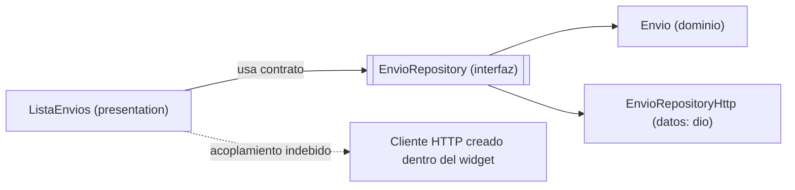
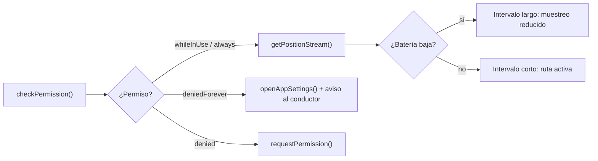
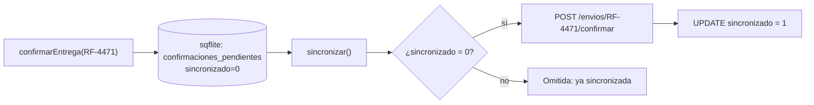

# Módulo 4: Aplicación Flutter del conductor: GPS, batería y offline


## Aprende construyendo


### Tema 1: Arquitectura Flutter por capacidades · Avanzado · 45 min

<details open>
<summary><strong>Capa 1 — Lectura</strong></summary>

#### ► DE QUÉ TRATA
Al finalizar podrás construir y verificar Tema 1: Arquitectura Flutter por capacidades dentro de RutaFlow, empezando desde una carpeta vacía y explicando qué decisión técnica resuelve. Conocimiento previo: terminal, Git y Dart y Flutter (track Flutter).

#### ► CÓMO FUNCIONA


</details>

<details>
<summary><strong>Capa 2 — Construcción</strong></summary>

#### Código y verificación


```bash
mkdir -p rutaflow-labs && cd rutaflow-labs
flutter create --empty tema_1_arquitectura
cd tema_1_arquitectura
mkdir -p lib/features/entrega/domain lib/features/entrega/data lib/features/entrega/presentation
```

```dart
// lib/features/entrega/domain/envio.dart
class Envio {
  final String guia;
  final String estado;
  const Envio({required this.guia, required this.estado});
}

// lib/features/entrega/domain/envio_repository.dart
import 'envio.dart';

abstract class EnvioRepository {
  Future<List<Envio>> obtenerPendientes();
}
```

```dart
// lib/features/entrega/data/envio_repository_http.dart
import '../domain/envio.dart';
import '../domain/envio_repository.dart';

class EnvioRepositoryHttp implements EnvioRepository {
  final Future<List<Map<String, dynamic>>> Function() _get;
  EnvioRepositoryHttp(this._get);

  @override
  Future<List<Envio>> obtenerPendientes() async {
    final filas = await _get();
    return filas.map((f) => Envio(guia: f['guia'] as String, estado: f['estado'] as String)).toList();
  }
}

// lib/features/entrega/presentation/lista_envios.dart
import '../domain/envio_repository.dart';

class ListaEnvios {
  final EnvioRepository repositorio;
  ListaEnvios(this.repositorio);

  Future<int> contarPendientes() async {
    final envios = await repositorio.obtenerPendientes();
    return envios.length;
  }
}
```

Crea el archivo `verificar.dart`:

```dart
import 'lib/features/entrega/domain/envio_repository.dart';
import 'lib/features/entrega/data/envio_repository_http.dart';
import 'lib/features/entrega/presentation/lista_envios.dart';

Future<void> main() async {
  final EnvioRepository repo = EnvioRepositoryHttp(() async => [
        {'guia': 'RF-4471', 'estado': 'en_transito'},
        {'guia': 'RF-5002', 'estado': 'asignado'},
      ]);
  final pantalla = ListaEnvios(repo);
  final total = await pantalla.contarPendientes();
  print('OK pendientes=$total');
}
```

```bash
dart run verificar.dart
```

```dart
// lib/features/entrega/presentation/lista_envios.dart (versión acoplada)
import '../data/envio_repository_http.dart';

class ListaEnvios {
  Future<int> contarPendientes() async {
    // Salta el dominio y la interfaz: la pantalla ahora conoce HTTP directamente.
    final filas = await EnvioRepositoryHttp(() async => [
      {'guia': 'RF-4471', 'estado': 'en_transito'},
    ]).obtenerPendientes();
    return filas.length;
  }
}
```

</details>

### Tema 2: GPS, permisos y batería · Avanzado · 45 min

<details open>
<summary><strong>Capa 1 — Lectura</strong></summary>

#### ► DE QUÉ TRATA
Al finalizar podrás construir y verificar Tema 2: GPS, permisos y batería dentro de RutaFlow, empezando desde una carpeta vacía y explicando qué decisión técnica resuelve. Conocimiento previo: terminal, Git y Dart y Flutter (track Flutter).

#### ► CÓMO FUNCIONA


</details>

<details>
<summary><strong>Capa 2 — Construcción</strong></summary>

#### Código y verificación


```bash
mkdir -p rutaflow-labs && cd rutaflow-labs
flutter create tema_2_gps
cd tema_2_gps
mkdir -p lib/features/entrega/data
flutter pub add geolocator geolocator_android battery_plus
```

```dart
// lib/features/entrega/data/politica_ubicacion.dart
import 'package:geolocator/geolocator.dart';
import 'package:geolocator_android/geolocator_android.dart';
import 'package:battery_plus/battery_plus.dart';

class PermisoUbicacionDenegadoPermanente implements Exception {
  @override
  String toString() => 'Permiso de ubicación denegado permanentemente: abrí Ajustes para habilitarlo.';
}

class PoliticaUbicacion {
  final Battery _battery;
  PoliticaUbicacion(this._battery);

  /// Pide el permiso mínimo necesario y maneja explícitamente deniedForever.
  Future<LocationPermission> asegurarPermiso() async {
    var permiso = await Geolocator.checkPermission();
    if (permiso == LocationPermission.denied) {
      permiso = await Geolocator.requestPermission();
    }
    if (permiso == LocationPermission.deniedForever) {
      // No hay diálogo posible: el sistema ya decidió. Hay que guiar al conductor a Ajustes.
      throw PermisoUbicacionDenegadoPermanente();
    }
    return permiso;
  }

  /// Ajusta el intervalo de muestreo según la carga de batería.
  /// En Android el intervalo se pide con intervalDuration; timeLimit NO sirve:
  /// es un tiempo máximo de espera y lanza TimeoutException si no llega una posición.
  Future<AndroidSettings> configurarMuestreo() async {
    final nivel = await _battery.batteryLevel;
    final intervalo = nivel < 20 ? const Duration(seconds: 30) : const Duration(seconds: 5);
    return AndroidSettings(accuracy: LocationAccuracy.high, intervalDuration: intervalo);
  }
}
```

```dart
// lib/main.dart
import 'package:battery_plus/battery_plus.dart';
import 'package:flutter/material.dart';
import 'package:geolocator/geolocator.dart';

import 'features/entrega/data/politica_ubicacion.dart';

void main() => runApp(const MaterialApp(home: PantallaUbicacion()));

class PantallaUbicacion extends StatefulWidget {
  const PantallaUbicacion({super.key});

  @override
  State<PantallaUbicacion> createState() => _PantallaUbicacionState();
}

class _PantallaUbicacionState extends State<PantallaUbicacion> {
  final _politica = PoliticaUbicacion(Battery());
  String _estado = 'Toca el botón para iniciar la jornada';

  Future<void> _iniciar() async {
    try {
      final permiso = await _politica.asegurarPermiso();
      final ajustes = await _politica.configurarMuestreo();
      debugPrint('permiso=$permiso intervalo=${ajustes.intervalDuration}');
      Geolocator.getPositionStream(locationSettings: ajustes).listen((posicion) {
        setState(() => _estado = 'Posición ${posicion.latitude}, ${posicion.longitude}');
      });
    } on PermisoUbicacionDenegadoPermanente catch (error) {
      setState(() => _estado = error.toString());
    }
  }

  @override
  Widget build(BuildContext context) => Scaffold(
        body: Center(child: Text(_estado)),
        floatingActionButton: FloatingActionButton(onPressed: _iniciar, child: const Icon(Icons.play_arrow)),
      );
}
```

```bash
flutter run -d <tu-dispositivo-o-emulador>
```

```dart
Future<void> asegurarPermisoIngenuo() async {
  await Geolocator.requestPermission(); // nunca revisa qué devolvió
}
```

</details>

### Tema 3: Offline-first y prueba de entrega · Avanzado · 45 min

<details open>
<summary><strong>Capa 1 — Lectura</strong></summary>

#### ► DE QUÉ TRATA
Al finalizar podrás construir y verificar Tema 3: Offline-first y prueba de entrega dentro de RutaFlow, empezando desde una carpeta vacía y explicando qué decisión técnica resuelve. Conocimiento previo: terminal, Git y Dart y Flutter (track Flutter).

#### ► CÓMO FUNCIONA


</details>

<details>
<summary><strong>Capa 2 — Construcción</strong></summary>

#### Código y verificación


```bash
mkdir -p rutaflow-labs && cd rutaflow-labs
flutter create --empty tema_3_offline
cd tema_3_offline
mkdir -p lib/features/entrega/data test
flutter pub add sqflite
flutter pub add sqflite_common_ffi --dev
```

```dart
// lib/features/entrega/data/outbox_entregas.dart
import 'package:sqflite/sqflite.dart';

class OutboxEntregas {
  final Database db;
  OutboxEntregas(this.db);

  static Future<void> crearTabla(Database db) async {
    await db.execute('''
      CREATE TABLE confirmaciones_pendientes (
        id TEXT PRIMARY KEY,
        guia TEXT NOT NULL,
        creado_en TEXT NOT NULL,
        sincronizado INTEGER NOT NULL DEFAULT 0
      )
    ''');
  }

  Future<void> confirmarEntrega(String idConfirmacion, String guia) async {
    await db.insert('confirmaciones_pendientes', {
      'id': idConfirmacion,
      'guia': guia,
      'creado_en': DateTime.now().toIso8601String(),
      'sincronizado': 0,
    });
  }

  /// Solo reenvía las filas que todavía no se confirmaron con el servidor.
  Future<void> sincronizar(Future<void> Function(String guia) enviarAlServidor) async {
    final pendientes = await db.query('confirmaciones_pendientes', where: 'sincronizado = 0');
    for (final fila in pendientes) {
      await enviarAlServidor(fila['guia'] as String);
      await db.update(
        'confirmaciones_pendientes',
        {'sincronizado': 1},
        where: 'id = ?',
        whereArgs: [fila['id']],
      );
    }
  }
}
```

```dart
// test/outbox_entregas_test.dart
import 'package:flutter_test/flutter_test.dart';
import 'package:sqflite_common_ffi/sqflite_ffi.dart';
import 'package:tema_3_offline/features/entrega/data/outbox_entregas.dart';

void main() {
  test('una reconexión no reenvía una confirmación ya sincronizada', () async {
    sqfliteFfiInit();
    final db = await databaseFactoryFfi.openDatabase(inMemoryDatabasePath);
    await OutboxEntregas.crearTabla(db);
    final outbox = OutboxEntregas(db);

    await outbox.confirmarEntrega('c-1', 'RF-4471');

    var llamadas = 0;
    Future<void> enviar(String guia) async {
      llamadas++;
      print('POST confirmar $guia');
    }

    await outbox.sincronizar(enviar);
    await outbox.sincronizar(enviar); // reconexión que dispara sincronizar() de nuevo

    print('OK llamadas=$llamadas');
    expect(llamadas, 1);
    await db.close();
  });
}
```

```bash
flutter test test/outbox_entregas_test.dart
```

```dart
Future<void> sincronizar(Future<void> Function(String guia) enviarAlServidor) async {
  final todas = await db.query('confirmaciones_pendientes'); // sin filtro: reenvía todo
  for (final fila in todas) {
    await enviarAlServidor(fila['guia'] as String);
    await db.update('confirmaciones_pendientes', {'sincronizado': 1}, where: 'id = ?', whereArgs: [fila['id']]);
  }
}
```

</details>
