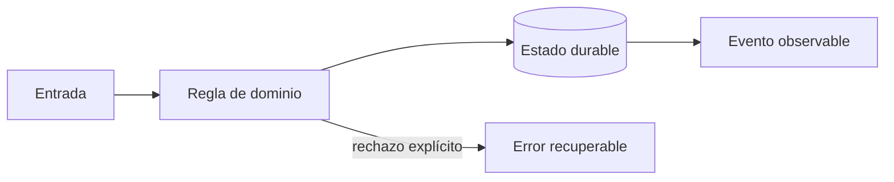
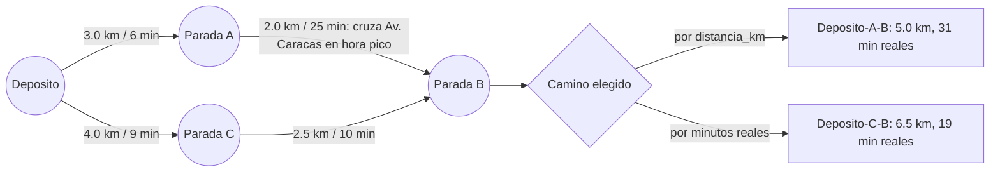
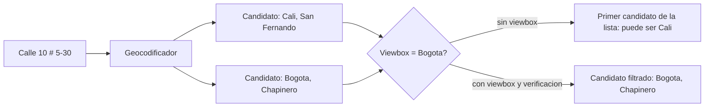
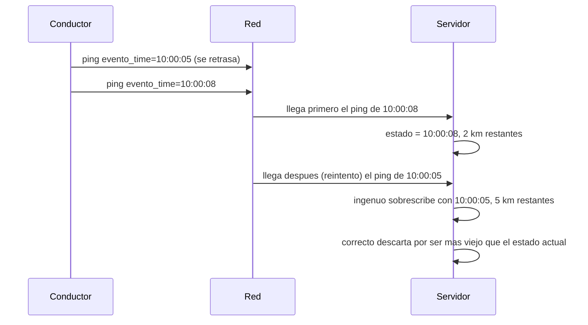

# Módulo 5: Rutas, mapas y seguimiento en tiempo real


## Aprende construyendo

### Tema 1: Grafos y problema de rutas

**Conceptos clave:** matriz de coste, VRP, capacidad, ventanas, heurísticas y restricciones.

La ruta más corta puede incumplir capacidad, prioridad o horario. El problema real minimiza coste sujeto a restricciones y cambios. Se parte de nearest-neighbor, se mejora con 2-opt y se compara con una solución de referencia. Toda heurística registra semilla, tiempo y brecha. El criterio no es memorizar la herramienta, sino poder predecir qué sucede ante duplicados, datos incompletos, concurrencia, pérdida de red o permisos insuficientes. Documenta supuestos y mide antes de optimizar.

**Analogía:** Es como organizar citas médicas: cercanía importa, pero también horario, urgencia y duración.

**¿Por qué es importante?** Porque permite explicar por qué una ruta es viable aunque no sea geométricamente mínima. En RutaFlow la decisión se valida con una prueba automatizada y una observación operativa, no solo con una captura de pantalla.

**Casos de uso reales:** estudia el flujo normal, un reintento, un dato tardío y un acceso sin permiso. Dibuja primero el flujo y marca dónde puede fallar.

**Diagrama:**



#### Paso 1 · Objetivo y preparación

Al finalizar podrás construir y verificar **Tema 1: Grafos y problema de rutas** dentro de RutaFlow, empezando desde una carpeta vacía y explicando qué decisión técnica resuelve. **Conocimiento previo:** terminal, Git y lectura de JSON.

#### Paso 2 · Contexto y caso real

**¿Por qué es importante?** Minimizar la distancia total de una ruta no es lo mismo que minimizar el tiempo real que tarda un conductor en completarla: un tramo más corto en kilómetros puede cruzar una avenida saturada en hora pico y terminar siendo más lento que una alternativa más larga pero fluida. Si RutaFlow asigna rutas solo por distancia, un conductor queda atrapado en tráfico previsible mientras el sistema reporta que eligió la "mejor" ruta.

**Caso real:** un conductor debe ir del depósito a una parada final (`parada_b`) pasando por una intermedia. Dos caminos existen: uno más corto en kilómetros que cruza una avenida con congestión conocida en ese horario, y otro ligeramente más largo que la evita. El sistema debe comparar ambos por tiempo real de viaje, no solo por distancia, antes de asignar la ruta al conductor.

#### Paso 3 · Teoría, conceptos y analogía

**Conceptos clave:** grafo dirigido, nodo (parada), arista con peso (distancia y tiempo), algoritmo de camino mínimo (Dijkstra), y la diferencia entre optimizar por una métrica u otra.

Modelá la red de paradas como un grafo: cada parada es un nodo y cada tramo transitable es una arista con dos pesos distintos — la distancia en kilómetros y el tiempo real de viaje en minutos (que ya incluye congestión conocida). El algoritmo de camino mínimo no sabe nada de tráfico por sí mismo: encuentra el camino de menor peso según la métrica que vos le indiques. Si le pedís el camino de menor `km`, te va a devolver el más corto en el mapa, aunque cruce la avenida más congestionada de la ciudad a las 6pm.

**Analogía:** es como elegir un vuelo solo por la distancia en línea recta entre ciudades: ignora que una ruta con escala puede llegar antes que un vuelo directo si el directo sale más tarde o enfrenta más demora.



#### Paso 4 · Demostración guiada desde cero

Crea una carpeta independiente y, dentro, `rutas.py`:

```bash
mkdir -p rutaflow-labs/tema-1-grafos-y-problema-de-rutas
cd rutaflow-labs/tema-1-grafos-y-problema-de-rutas
```

**Ejecuta el ejemplo** (según la capa: backend con `./mvnw test`, app con `flutter run`):

```bash
./mvnw test
```
Confirma el resultado contra el criterio del paso.


```python
import heapq

# Grafo dirigido de paradas: cada arista tiene distancia (km) y tiempo real (min),
# que ya incluye congestion conocida en ese tramo y horario.
grafo = {
    "deposito": {"parada_a": {"km": 3.0, "min": 6}, "parada_c": {"km": 4.0, "min": 9}},
    "parada_a": {"parada_b": {"km": 2.0, "min": 25}},  # cruza la Av. Caracas en hora pico
    "parada_c": {"parada_b": {"km": 2.5, "min": 10}},
    "parada_b": {},
}


def camino_minimo(grafo, origen, destino, peso):
    """Dijkstra generico: `peso` decide si se optimiza por 'km' o por 'min'."""
    distancias = {nodo: float("inf") for nodo in grafo}
    distancias[origen] = 0
    previos = {}
    cola = [(0, origen)]
    while cola:
        actual_dist, actual = heapq.heappop(cola)
        if actual == destino:
            break
        for vecino, pesos in grafo[actual].items():
            nueva_dist = actual_dist + pesos[peso]
            if nueva_dist < distancias[vecino]:
                distancias[vecino] = nueva_dist
                previos[vecino] = actual
                heapq.heappush(cola, (nueva_dist, vecino))
    ruta = [destino]
    while ruta[-1] != origen:
        ruta.append(previos[ruta[-1]])
    return list(reversed(ruta))


def minutos_reales(ruta):
    return sum(grafo[a][b]["min"] for a, b in zip(ruta, ruta[1:]))


ruta_por_distancia = camino_minimo(grafo, "deposito", "parada_b", peso="km")
ruta_por_tiempo = camino_minimo(grafo, "deposito", "parada_b", peso="min")

print("Ruta por distancia:", ruta_por_distancia, "->", minutos_reales(ruta_por_distancia), "min reales")
print("Ruta por tiempo real:", ruta_por_tiempo, "->", minutos_reales(ruta_por_tiempo), "min reales")
```

Ejecuta `python3 rutas.py` desde `rutaflow-labs/tema-1-grafos-y-problema-de-rutas/`.

**Resultado esperado:** `Ruta por distancia: ['deposito', 'parada_a', 'parada_b'] -> 31 min reales` y `Ruta por tiempo real: ['deposito', 'parada_c', 'parada_b'] -> 19 min reales`. La ruta "más corta" en kilómetros (5.0 km) tarda 31 minutos reales porque cruza la Av. Caracas en hora pico; la ruta por `parada_c` mide 6.5 km pero tarda solo 19 minutos.

**Fallo deliberado:** si el sistema de asignación llama `camino_minimo(grafo, "deposito", "parada_b", peso="km")` para decidir qué ruta darle al conductor — como hace cualquier optimizador que solo conoce distancias — va a asignar la ruta por `parada_a`, que en el mapa se ve más corta pero cruza la avenida congestionada y tarda 31 minutos reales, 12 minutos más que la alternativa. El conductor cumple la ruta "óptima" del sistema y llega tarde igual. Diagnosticá comparando `minutos_reales(ruta_por_distancia)` contra `minutos_reales(ruta_por_tiempo)` — la diferencia (12 minutos) es el costo de optimizar por la métrica equivocada — y corregí el criterio de asignación para que use siempre `peso="min"` como fuente de verdad operativa, reservando `km` solo para reportes de combustible.

#### Paso 5 · Práctica guiada

1. Agregá una arista `parada_b -> deposito` y comprobá que `camino_minimo` no la usa para ir de `deposito` a `parada_b` (el grafo es dirigido: una arista de regreso no habilita el camino inverso).
2. Agregá una regla: si la diferencia entre `ruta_por_distancia` y `ruta_por_tiempo` supera el 20% en minutos, el sistema debe registrar una advertencia de "ruta mal priorizada" antes de asignarla.
3. Pista: si pedís un camino entre nodos sin conexión, el código actual lanza `KeyError` al reconstruir la ruta porque `previos` nunca tiene esa clave; decidí cómo manejar ese caso explícitamente en vez de dejar que explote con un error genérico.

#### Paso 6 · Práctica independiente

Implementa una función `mejor_ruta(grafo, origen, destino)` que calcule ambos caminos (por `km` y por `min`), devuelva el de menor tiempo real por defecto, y además reporte cuántos minutos se habrían perdido si el sistema hubiera elegido por distancia. No copies la solución del paso anterior; escribe primero el contrato y después el código.

#### Paso 7 · Cierre, evidencia y proyecto

Entrega el archivo `rutas.py`, la salida de ambas rutas y una breve explicación de por qué la ruta más corta en kilómetros no siempre es la mejor asignación. El siguiente tema toma las coordenadas de estas paradas y resuelve de dónde salen: **Tema 2: Geocoding y map matching** convierte una dirección de texto en las coordenadas que este grafo necesita como nodos. **Fuente oficial:** [Python docs — heapq (cola de prioridad usada en Dijkstra)](https://docs.python.org/3/library/heapq.html).

**Errores comunes:** optimizar únicamente por distancia; ignorar que el grafo es dirigido y asumir que toda arista tiene su inversa; no actualizar los pesos de tiempo cuando cambia el tráfico conocido; mezclar unidades (minutos y kilómetros) en la misma comparación; asumir que el camino más corto siempre existe sin manejar el caso sin conexión.

**Transferencia al proyecto integrador «RutaFlow»:** Construye una ruta pequeña con restricciones de capacidad y tiempo conocidas. Verifica cada parada y compara con una solución manual, diferenciando una solución válida de una supuesta óptima.

### Tema 2: Geocoding y map matching

**Conceptos clave:** calidad de dirección, candidatos, snapping, error y fallback humano.

Geocodificar produce candidatos con confianza, no verdad. Se normaliza sin destruir información y se permite corrección humana. Map matching usa secuencia, red vial y velocidad para evitar saltar a una vía paralela. El sistema conserva entrada original y procedencia. El criterio no es memorizar la herramienta, sino poder predecir qué sucede ante duplicados, datos incompletos, concurrencia, pérdida de red o permisos insuficientes. Documenta supuestos y mide antes de optimizar.

**Analogía:** Es como reconocer una canción con ruido: el mejor resultado necesita un nivel de confianza.

**¿Por qué es importante?** Porque evita despachos a coordenadas plausibles pero incorrectas. En RutaFlow la decisión se valida con una prueba automatizada y una observación operativa, no solo con una captura de pantalla.

**Casos de uso reales:** estudia el flujo normal, un reintento, un dato tardío y un acceso sin permiso. Dibuja primero el flujo y marca dónde puede fallar.

**Diagrama:**


#### Paso 1 · Objetivo y preparación

Al finalizar podrás construir y verificar **Tema 2: Geocoding y map matching** dentro de RutaFlow, empezando desde una carpeta vacía y explicando qué decisión técnica resuelve. **Conocimiento previo:** terminal, Git y lectura de JSON.

#### Paso 2 · Contexto y caso real

**¿Por qué es importante?** Un geocodificador que recibe "Calle 10 # 5-30" sin saber en qué ciudad buscar puede devolver, con total confianza numérica, coordenadas de una calle con el mismo nombre en otra ciudad del país. La app del conductor no tiene forma de saber que está mal: el servicio respondió con un punto válido en el mapa, solo que en el lugar equivocado. Sin acotar la búsqueda a una región esperada, un error de geocoding es silencioso y termina en una entrega despachada a la ciudad que no es.

**Caso real:** un cliente registra un envío a "Calle 10 # 5-30" en Bogotá. Esa misma combinación de calle y carrera también existe en Cali. Si el geocodificador no recibe una pista de región, puede devolver el candidato de Cali (el primero de su lista interna) y el sistema le asigna al conductor una parada a cientos de kilómetros de donde debía entregar.

#### Paso 3 · Teoría, conceptos y analogía

**Conceptos clave:** geocoding, candidatos con score de confianza, ambigüedad de direcciones, sesgo por región (`viewbox` / `bounded`), verificación de localidad esperada.

Un geocodificador real (como Nominatim sobre datos de OpenStreetMap, respaldado por PostGIS) no devuelve "la" coordenada de una dirección: devuelve una lista de candidatos, cada uno con su propia ciudad y nivel de confianza. Cuando el texto de la dirección es ambiguo (existe en más de una ciudad), el primer candidato de esa lista no necesariamente es el correcto para tu caso de uso. La forma de resolverlo no es "confiar en el primero", sino acotar la búsqueda con una pista de región y, después, verificar que la ciudad del candidato devuelto coincide con la que esperabas.

**Analogía:** es como preguntar "¿dónde queda la Calle 10?" en una ciudad que no mencionaste: te van a contestar con la primera Calle 10 que se les ocurra, no necesariamente la tuya.



#### Paso 4 · Demostración guiada desde cero

Crea una carpeta independiente y, dentro, `geocoding.py`:

```bash
mkdir -p rutaflow-labs/tema-2-geocoding-y-map-matching
cd rutaflow-labs/tema-2-geocoding-y-map-matching
```

**Ejecuta el ejemplo** (según la capa: backend con `./mvnw test`, app con `flutter run`):

```bash
./mvnw test
```
Confirma el resultado contra el criterio del paso.


```python
# Simula el indice de un geocodificador real (p. ej. Nominatim sobre PostGIS):
# la misma combinacion de calle y carrera existe en mas de una ciudad.
INDICE = {
    "calle 10 # 5-30": [
        {"ciudad": "Cali", "localidad": "San Fernando", "lat": 3.4372, "lon": -76.5225},
        {"ciudad": "Bogota", "localidad": "Chapinero", "lat": 4.6126, "lon": -74.0705},
    ],
}


def geocodificar(direccion, ciudad_esperada=None):
    """Sin ciudad_esperada, devuelve el primer candidato tal cual el indice lo ordena
    (igual que un geocodificador real sin viewbox ni sesgo de region)."""
    candidatos = INDICE[direccion.strip().lower()]
    if ciudad_esperada is None:
        return candidatos[0]
    filtrados = [c for c in candidatos if c["ciudad"] == ciudad_esperada]
    if not filtrados:
        raise ValueError(f"sin candidatos para {direccion!r} en {ciudad_esperada!r}")
    return filtrados[0]


resultado = geocodificar("Calle 10 # 5-30", ciudad_esperada="Bogota")
print(resultado)
```

Ejecuta `python3 geocoding.py` desde `rutaflow-labs/tema-2-geocoding-y-map-matching/`.

**Resultado esperado:** `{'ciudad': 'Bogota', 'localidad': 'Chapinero', 'lat': 4.6126, 'lon': -74.0705}` — el candidato correcto, porque la búsqueda está acotada a la ciudad esperada.

**Fallo deliberado:** quitá el parámetro `ciudad_esperada` y llamá a la misma dirección como lo haría un servicio que confía en el primer resultado:

```python
resultado_ambiguo = geocodificar("Calle 10 # 5-30")
print(resultado_ambiguo)
```

Esto imprime `{'ciudad': 'Cali', 'localidad': 'San Fernando', 'lat': 3.4372, 'lon': -76.5225}` — coordenadas válidas, con formato correcto, pero a más de 400 km de donde el envío debía entregarse, y sin ningún error que lo señale: el programa termina sin excepciones. Diagnosticá comparando `resultado["ciudad"]` contra la ciudad real del pedido en tu sistema (nunca asumas que coincide), y corregí siempre pasando `ciudad_esperada` y verificando `resultado["ciudad"] == ciudad_esperada` antes de aceptar el candidato como válido.

#### Paso 5 · Práctica guiada

1. Agregá un tercer candidato para "Calle 10 # 5-30" en Medellín y comprobá que `ciudad_esperada="Medellin"` lo selecciona sin afectar los otros dos casos.
2. Hacé que `geocodificar` lance un error explícito (no devuelva `None` silenciosamente) cuando `ciudad_esperada` no tiene ningún candidato.
3. Pista: nunca aceptes un candidato sin registrar en la evidencia qué otros candidatos existían y por qué se descartaron; un operador humano debe poder revisar esa decisión.

#### Paso 6 · Práctica independiente

Implementa una función `geocodificar_verificado(direccion, ciudad_esperada)` que, además de filtrar por ciudad, rechace el resultado si la localidad devuelta no está en una lista de localidades válidas conocidas para esa ciudad, y registre cuántos candidatos alternativos existían. No copies la solución del paso anterior; escribe primero el contrato y después el código.

#### Paso 7 · Cierre, evidencia y proyecto

Entrega `geocoding.py`, la salida correcta, la salida del fallo deliberado (coordenadas en la ciudad equivocada) y una breve explicación de por qué una respuesta válida no garantiza la ciudad correcta. El siguiente tema toma estas coordenadas ya verificadas y las sigue en movimiento: **Tema 3: Streaming y ETA con incertidumbre** usa la posición geocodificada como punto de partida de cada actualización GPS. **Fuente oficial:** [Nominatim — Search API (parámetros viewbox y bounded)](https://nominatim.org/release-docs/latest/api/Search/).

**Errores comunes:** confiar en el primer candidato sin verificar la ciudad; no acotar la búsqueda con una región esperada; tratar una respuesta con coordenadas como sinónimo de "dirección correcta"; descartar el score de confianza del geocodificador; no conservar el texto original de la dirección junto con el resultado.

**Transferencia al proyecto integrador «RutaFlow»:** Geocodifica direcciones sintéticas y revisa candidatos ambiguos antes de asignar coordenadas. Compara map matching con puntos originales y conserva la incertidumbre cuando varias calles son plausibles.

**Límites y decisión de uso:** Una coincidencia de geocoding puede corresponder a otra calle con el mismo nombre. Usa contexto y confirmación cuando haya ambigüedad; map matching ajusta una trayectoria probable, no demuestra que el vehículo recorrió esa calle.

### Tema 3: Streaming y ETA con incertidumbre

**Conceptos clave:** orden, partición, backpressure, datos tardíos, percentiles e intervalos.

El stream particiona por conductor, usa sequence_number y tolera eventos tardíos. El cliente recibe actualizaciones limitadas, no cada punto bruto. ETA combina distancia, tráfico histórico y operación; se evalúa con MAE y percentiles y se comunica como intervalo cuando la incertidumbre es alta. El criterio no es memorizar la herramienta, sino poder predecir qué sucede ante duplicados, datos incompletos, concurrencia, pérdida de red o permisos insuficientes. Documenta supuestos y mide antes de optimizar.

**Analogía:** Es como un pronóstico del tiempo: una franja honesta es más útil que un minuto falso.

**¿Por qué es importante?** Porque protege infraestructura y confianza del usuario. En RutaFlow la decisión se valida con una prueba automatizada y una observación operativa, no solo con una captura de pantalla.

**Casos de uso reales:** estudia el flujo normal, un reintento, un dato tardío y un acceso sin permiso. Dibuja primero el flujo y marca dónde puede fallar.

**Diagrama:**


#### Paso 1 · Objetivo y preparación

Al finalizar podrás construir y verificar **Tema 3: Streaming y ETA con incertidumbre** dentro de RutaFlow, empezando desde una carpeta vacía y explicando qué decisión técnica resuelve. **Conocimiento previo:** terminal, Git y lectura de JSON.

#### Paso 2 · Contexto y caso real

**¿Por qué es importante?** Los pings GPS de un conductor viajan por una red que puede reordenarlos: un reintento de red puede hacer que un dato más viejo llegue después de uno más nuevo. Si el sistema de ETA actualiza la posición del envío con "el último dato que llegó" en vez de "el dato con el timestamp más reciente", la llegada tardía de un ping viejo puede pisar una posición más actualizada e inflar el ETA mostrado al cliente, aunque el conductor ya haya avanzado.

**Caso real:** un conductor envía un ping a las `10:00:08` que llega a tiempo. Un ping anterior, de las `10:00:05`, se había perdido en la red y llega recién después, por un reintento automático del dispositivo. Si el servidor procesa "el último mensaje recibido" como la posición vigente, reemplaza la posición de las `10:00:08` (más cercana al destino) por la de las `10:00:05` (más lejana), y el ETA mostrado empeora aunque el conductor ya avanzó.

#### Paso 3 · Teoría, conceptos y analogía

**Conceptos clave:** tiempo de evento vs. tiempo de llegada, datos tardíos (*late data*), orden por `evento_time`, estado por envío, ETA como función de la posición más reciente por timestamp, no por orden de arribo.

La trampa más común en streaming es confundir "el mensaje que acabo de recibir" con "el dato más nuevo". Un stream de posiciones GPS no garantiza orden de entrega: la red puede repetir, retrasar o reordenar paquetes. La única fuente de verdad sobre qué tan reciente es un dato es su `evento_time` (cuándo ocurrió en el dispositivo), nunca el momento en que el servidor lo procesó. Mantener el estado correcto significa comparar el `evento_time` del evento entrante contra el `evento_time` ya guardado, y descartar cualquier evento más viejo que el estado actual.

**Analogía:** es como leer un grupo de postales que llegan desordenadas por correo: si las archivás en el orden en que las recibiste en vez de mirar la fecha escrita en cada una, terminás creyendo que el remitente retrocedió en el tiempo.



#### Paso 4 · Demostración guiada desde cero

Crea una carpeta independiente y, dentro, `eta.py`:

```bash
mkdir -p rutaflow-labs/tema-3-streaming-y-eta-con-incertidumbre
cd rutaflow-labs/tema-3-streaming-y-eta-con-incertidumbre
```

**Ejecuta el ejemplo** (según la capa: backend con `./mvnw test`, app con `flutter run`):

```bash
./mvnw test
```
Confirma el resultado contra el criterio del paso.


```python
from datetime import datetime


def ts(hhmmss):
    return datetime.strptime(hhmmss, "%H:%M:%S")


# Eventos tal como LLEGAN al servidor (orden de arribo), no el orden en que ocurrieron:
# el ping de las 10:00:05 se retraso en la red y llega despues del de 10:00:08.
eventos_en_orden_de_llegada = [
    {"envio_id": "RF-4471", "evento_time": ts("10:00:08"), "km_restantes": 2.0},
    {"envio_id": "RF-4471", "evento_time": ts("10:00:05"), "km_restantes": 5.0},  # llega tarde por reintento
]

VELOCIDAD_KM_MIN = 0.5  # supuesto simplificado para calcular ETA


def eta_minutos(km_restantes):
    return round(km_restantes / VELOCIDAD_KM_MIN, 1)


def procesar_por_event_time(eventos):
    """Correcto: solo actualiza el estado si el evento es mas nuevo que el guardado."""
    estado = {}
    for evento in eventos:
        actual = estado.get(evento["envio_id"])
        if actual is None or evento["evento_time"] > actual["evento_time"]:
            estado[evento["envio_id"]] = evento
    return estado


estado_correcto = procesar_por_event_time(eventos_en_orden_de_llegada)
posicion = estado_correcto["RF-4471"]
print("ETA correcto:", eta_minutos(posicion["km_restantes"]), "min, basado en evento de", posicion["evento_time"].time())
```

Ejecuta `python3 eta.py` desde `rutaflow-labs/tema-3-streaming-y-eta-con-incertidumbre/`.

**Resultado esperado:** `ETA correcto: 4.0 min, basado en evento de 10:00:08` — el servidor conserva la posición más nueva por timestamp (2.0 km restantes) aunque no haya sido la última en llegar.

**Fallo deliberado:** agregá esta función ingenua, que procesa los eventos en el orden en que llegaron y deja que el último sobrescriba siempre al anterior sin comparar `evento_time`:

```python
def procesar_por_orden_de_llegada(eventos):
    """Ingenuo: el ultimo evento recibido siempre pisa el estado anterior."""
    estado = {}
    for evento in eventos:
        estado[evento["envio_id"]] = evento  # no compara evento_time, solo sobrescribe
    return estado


estado_ingenuo = procesar_por_orden_de_llegada(eventos_en_orden_de_llegada)
posicion = estado_ingenuo["RF-4471"]
print("ETA ingenuo:", eta_minutos(posicion["km_restantes"]), "min, basado en evento de", posicion["evento_time"].time())
```

Esto imprime `ETA ingenuo: 10.0 min, basado en evento de 10:00:05` — el ping tardío de las `10:00:05` pisó el estado más nuevo de las `10:00:08` solo porque llegó después por la red, y el ETA empeora (de 4 a 10 minutos) aunque el conductor en realidad está más cerca. Diagnosticá comparando los dos `evento_time` impresos — el ingenuo termina con el timestamp más viejo, no el más nuevo — y corregí reemplazando la sobrescritura incondicional por la comparación `evento["evento_time"] > actual["evento_time"]` de `procesar_por_event_time`.

#### Paso 5 · Práctica guiada

1. Agregá un tercer ping con `evento_time=10:00:03` que llegue último de todos y comprobá que `procesar_por_event_time` lo descarta sin tocar el estado de las `10:00:08`.
2. Calculá, además del ETA, cuántos minutos de diferencia hubo entre el estado ingenuo y el correcto, y registralo como métrica de "corrección por evento tardío".
3. Pista: comparar timestamps con `>` no alcanza si dos eventos llegan con el mismo `evento_time` exacto; definí qué hacer en ese empate (por ejemplo, conservar el de menor `km_restantes`).

#### Paso 6 · Práctica independiente

Implementa una función `actualizar_posicion(estado, evento)` que aplique la regla de "solo el más nuevo por `evento_time` gana", devuelva un nuevo estado sin mutar el anterior, y pueda recibir los eventos en cualquier orden de llegada sin cambiar el resultado final. No copies la solución del paso anterior; escribe primero el contrato y después el código.

#### Paso 7 · Cierre, evidencia y proyecto

Entrega `eta.py`, las dos salidas (ETA correcto y el ingenuo) con la diferencia entre ambas, y una breve explicación de por qué el orden de llegada nunca debe ser la fuente de verdad del tiempo. Con esto cierra el recorrido del Módulo 5: desde el grafo de rutas (Tema 1), pasando por coordenadas verificadas por ciudad (Tema 2), hasta un ETA que resiste datos tardíos (Tema 3). El Módulo 6 retoma estas rutas, posiciones y ETAs ya confiables como entrada para facturación, recaudo y liquidaciones. **Fuente oficial:** [RFC 6455 — The WebSocket Protocol](https://www.rfc-editor.org/rfc/rfc6455) (la especificación solo garantiza orden de entrega dentro de una misma conexión; una reconexión por reintento abre una conexión nueva y no hereda esa garantía, por eso el `evento_time` del mensaje — no el orden de llegada — debe ser la fuente de verdad).

**Errores comunes:** usar el orden de llegada como si fuera el orden de ocurrencia; sobrescribir estado sin comparar `evento_time`; ignorar reintentos de red como fuente de eventos tardíos o duplicados; calcular el ETA sin registrar de qué evento salió; no definir una regla explícita para eventos con el mismo timestamp.

**Transferencia al proyecto integrador «RutaFlow»:** Calcula ETA con datos de antigüedad conocida y comunica un rango. Simula una interrupción de posiciones y verifica que el rango o advertencia cambia sin presentar certeza falsa.
Como **siguiente** paso, lleva lo aprendido al próximo tema y conéctalo con el proyecto integrador del track.


## Aplicación del material de referencia

### Tema 4: Socket.IO extremo a extremo: un gateway compatible con el cliente móvil

#### Paso 1 · Objetivo y preparación
Al finalizar conectarás un cliente Socket.IO a un servidor compatible y comprobarás recepción, secuencia y rechazo de credenciales inválidas. **Prerrequisitos:** HTTP, JSON, eventos y Node 24 con npm. Para el cliente Dart, SDK Dart 3. El ejemplo es independiente desde una carpeta vacía; no necesitas Kafka ni una cuenta cloud.

#### Paso 2 · Contexto y caso real
El temario de RutaFlow pide Socket.IO en app y backend. El laboratorio Spring 14 enseña STOMP, que es otro protocolo. **¿Por qué es importante?** Compartir el transporte WebSocket no hace que esos clientes y servidores se entiendan. Aquí la variante elegida es Socket.IO 4 en ambos extremos. El backend Spring puede publicar por HTTP hacia este gateway después de confirmar su transacción; su laboratorio STOMP sigue siendo una variante separada.

#### Paso 3 · Teoría, modelo mental y analogía
Socket.IO añade handshake, eventos, acknowledgements y salas sobre sus transportes. Una sala agrupa conexiones; no acredita propiedad de un envío. La identidad autenticada debe autorizar cada suscripción en el servidor. En este laboratorio solo existe ENV-42 y una credencial de prueba; no fingimos que equivale a OAuth2/JWT ni a autorización multiusuario.

**Analogía:** dos radios necesitan el mismo protocolo de conversación, no solo una antena. El límite es que reconectar la radio no reproduce mensajes perdidos. El número de secuencia evita aplicar un dato anterior; un producto también necesita snapshot o replay, persistencia, backpressure y límites por identidad.

#### Paso 4 · Demostración guiada desde cero
Desde una copia del repositorio prepara una carpeta propia:
```bash
cp -R examples/rutaflow-material/socketio ejemplo-socketio
cd ejemplo-socketio
npm ci
npm test
```
Si trabajas sin una copia del repo, crea una carpeta `ejemplo-socketio`, guarda los archivos siguientes retirando el prefijo `socketio/` de cada ruta y ejecuta `npm install` en lugar de `npm ci` para crear el lockfile. No mezcles las versiones del protocolo con las de una librería STOMP.

Crea `socketio/package.json` con este contenido completo:
```json
{"name":"rutaflow-socketio-lab","private":true,"type":"module","scripts":{"test":"node --test gateway.test.mjs"},"dependencies":{"express":"^5.1.0","socket.io":"^4.8.1","socket.io-client":"^4.8.1"}}
```

Crea `socketio/gateway.mjs` con este contenido completo:
```javascript
import express from 'express';
import { createServer } from 'node:http';
import { Server } from 'socket.io';

// Laboratorio de un solo envío: no es un sistema de identidad de producción.
export async function startGateway({ port = 0, token = 'solo-laboratorio' } = {}) {
  const app = express();
  app.use(express.json({ limit: '8kb' }));
  const http = createServer(app);
  const io = new Server(http, { transports: ['websocket'] });
  let lastSequence = 0;
  io.use((socket, next) => next(socket.handshake.auth.token === token
    ? undefined : new Error('No autorizado')));
  io.on('connection', socket => {
    socket.on('seguir-envio', async (id, ack) => {
      if (id !== 'ENV-42') return ack({ ok: false });
      await socket.join(id);
      ack({ ok: true });
    });
  });
  app.post('/posiciones/ENV-42', (req, res) => {
    if (req.headers.authorization !== `Bearer ${token}`) return res.sendStatus(401);
    const { sequence, latitude, longitude } = req.body ?? {};
    if (!Number.isSafeInteger(sequence) || sequence < 1 ||
        !Number.isFinite(latitude) || Math.abs(latitude) > 90 ||
        !Number.isFinite(longitude) || Math.abs(longitude) > 180) return res.sendStatus(400);
    if (sequence <= lastSequence) return res.sendStatus(409);
    lastSequence = sequence;
    io.to('ENV-42').emit('posicion', { shipmentId: 'ENV-42', schemaVersion: 1,
      sequence, latitude, longitude });
    res.sendStatus(202);
  });
  await new Promise(resolve => http.listen(port, '127.0.0.1', resolve));
  return { url: `http://127.0.0.1:${http.address().port}`,
    close: () => new Promise(resolve => io.close(resolve)) };
}
```

Crea `socketio/gateway.test.mjs` con este contenido completo:
```javascript
import test from 'node:test';
import assert from 'node:assert/strict';
import { io } from 'socket.io-client';
import { startGateway } from './gateway.mjs';

test('HTTP publica y un cliente Socket.IO compatible recibe; rechaza duplicado y token', { timeout: 5000 }, async t => {
  const gateway = await startGateway();
  const socket = io(gateway.url, { transports: ['websocket'], auth: { token: 'solo-laboratorio' } });
  t.after(async () => { socket.disconnect(); await gateway.close(); });
  await new Promise((resolve, reject) => {
    socket.once('connect', resolve); socket.once('connect_error', reject);
  });
  assert.deepEqual(await socket.timeout(1000).emitWithAck('seguir-envio', 'ENV-ajeno'), { ok: false });
  assert.deepEqual(await socket.timeout(1000).emitWithAck('seguir-envio', 'ENV-42'), { ok: true });
  const received = new Promise(resolve => socket.once('posicion', resolve));
  const send = auth => fetch(`${gateway.url}/posiciones/ENV-42`, { method: 'POST',
    headers: { 'Content-Type': 'application/json', Authorization: auth },
    body: JSON.stringify({ sequence: 1, latitude: 4.65, longitude: -74.08 }) });
  assert.equal((await send('Bearer solo-laboratorio')).status, 202);
  assert.deepEqual(await received, { shipmentId: 'ENV-42', schemaVersion: 1,
    sequence: 1, latitude: 4.65, longitude: -74.08 });
  assert.equal((await send('Bearer solo-laboratorio')).status, 409);
  assert.equal((await send('Bearer incorrecto')).status, 401);
});
```

Crea `socketio/serve.mjs` con este contenido completo:
```javascript
import { startGateway } from './gateway.mjs';
const gateway = await startGateway({ port: 3100 });
console.log(gateway.url);
process.once('SIGINT', async () => { await gateway.close(); });
```

Crea `socketio/cliente.dart` con este contenido completo:
```dart
import 'package:socket_io_client/socket_io_client.dart' as io;

void main() {
  final socket = io.io('http://127.0.0.1:3100', io.OptionBuilder()
      .setTransports(['websocket']).disableAutoConnect()
      .setAuth({'token': 'solo-laboratorio'}).build());
  socket.onConnect((_) {
    socket.emitWithAck('seguir-envio', 'ENV-42', ack: (data) => print(data));
  });
  socket.on('posicion', (data) { print(data); socket.dispose(); });
  socket.onConnectError((error) { print(error); socket.dispose(); });
  socket.connect();
}
```

**Resultado esperado:** la prueba de Node pasa; una petición HTTP produce un evento `posicion` real en el socket suscrito. La prueba también comprueba un ID ajeno rechazado, duplicado 409 y credencial inválida 401. Explica cada bloque: middleware limita tamaño de JSON, handshake verifica la credencial de laboratorio, la sala restringe el único envío de prueba y la secuencia impide publicar una versión anterior.

Para probar el cliente Dart manualmente, ejecuta `node socketio/serve.mjs` si creaste las rutas mostradas, o `node serve.mjs` dentro de la copia del ejemplo. En otra carpeta crea un proyecto con `dart create -t console cliente_posiciones`, ejecuta `dart pub add socket_io_client:^3.1.6`, guarda el contenido de `cliente.dart` en `bin/cliente_posiciones.dart` y ejecuta `dart run`. Publica en otra terminal:
```bash
curl -i -X POST http://127.0.0.1:3100/posiciones/ENV-42 -H 'Content-Type: application/json' -H 'Authorization: Bearer solo-laboratorio' -d '{"sequence":1,"latitude":4.65,"longitude":-74.08}'
```
Debes ver 202 en HTTP y el evento en Dart. El servidor solo escucha loopback: el cliente mostrado corre en el mismo computador. Un teléfono físico requiere una dirección y una configuración de red explícitas; no uses localhost del teléfono para referirte a tu computador.

#### Paso 5 · Práctica guiada
**Fallo deliberado:** cambia la credencial del cliente por `incorrecta`. Se recibe `connect_error` y no hay suscripción. **Pista:** primero comprueba protocolo, dirección y handshake; cambiar Flutter por un cliente STOMP no arregla credenciales ni protocolo. Restáuralas y repite.

#### Paso 6 · Práctica independiente
Añade un segundo envío con un mapa de permisos por identidad de prueba, y demuestra que una identidad de A no se puede unir a B aunque conozca su ID. Añade una consulta de snapshot para recuperar la secuencia actual al reconectar. No deduzcas que «se conectó» significa «no perdió datos».

#### Paso 7 · Cierre y evidencia
**Evidencia de aprendizaje:** salida de prueba, 202/401/409, suscripción rechazada y evento recibido. El siguiente tema conecta las posiciones con una ruta calculada. **Errores comunes:** conectar socket_io_client al endpoint STOMP, confiar en IDs del cliente y registrar tokens completos. **Límites y decisión de uso:** el gateway usa memoria y credencial fija solo para aislar compatibilidad; no es una implementación lista para Internet ni una garantía de entrega durable.

**Fuentes oficiales:** [Socket.IO](https://socket.io/docs/v4/) y [compatibilidad Dart/servidor](https://pub.dev/packages/socket_io_client).


## Aplicación del material de referencia

### Tema 5: OSRM: del contrato de coordenadas a una respuesta de ruta verificable

#### Paso 1 · Objetivo y preparación
Al finalizar construirás una petición OSRM y validarás unidades, geometría y ausencia de ruta. **Prerrequisitos:** coordenadas, HTTP, JSON y Python 3. Ejemplo independiente desde carpeta vacía; la primera fase usa una respuesta sintética declarada para aislar el contrato sin descargar mapas ni depender de Internet.

#### Paso 2 · Contexto y caso real
El proyecto integrador necesita una ruta por calles, no una línea recta entre dos puntos GPS. **¿Por qué es importante?** Un buen algoritmo sobre una matriz incorrecta sigue produciendo una planificación inútil. OSRM calcula sobre una red preparada con un perfil de circulación, no sobre distancia euclídea.

#### Paso 3 · Teoría, modelo mental y analogía
La API usa `longitud,latitud` y devuelve distancia en metros y duración en segundos. Route calcula un recorrido; Table calcula matrices de tiempos/distancias; Match ajusta trazas y Trip propone un recorrido bajo sus supuestos. No son llamadas intercambiables. **Analogía:** tener un mapa de carreteras permite encontrar caminos, pero no conocer tráfico actual si el perfil no lo incluye. El límite es que la duración estimada no promete hora de llegada ni incluye todas las restricciones operativas de una entrega.

#### Paso 4 · Demostración guiada desde cero
```bash
cp -R examples/rutaflow-material/osrm ejemplo-osrm
cd ejemplo-osrm
python3 ruta.py --fixture respuesta.json
python3 -m unittest test_ruta.py
```
Si creas los archivos manualmente, colócalos juntos en `ejemplo-osrm`, retirando el prefijo `osrm/` de las rutas mostradas:

Crea `osrm/ruta.py` con este contenido completo:
```python
import argparse
import json
import math
from pathlib import Path
from urllib.request import urlopen


def ruta_url(base, puntos):
    if len(puntos) < 2:
        raise ValueError('Se necesitan al menos dos puntos')
    for lon, lat in puntos:
        if not math.isfinite(lon) or not math.isfinite(lat) or not -180 <= lon <= 180 or not -90 <= lat <= 90:
            raise ValueError('Coordenada inválida')
    coordenadas = ';'.join(f'{lon},{lat}' for lon, lat in puntos)
    return f'{base.rstrip("/")}/route/v1/driving/{coordenadas}?overview=full&geometries=geojson'


def interpretar(payload):
    if payload.get('code') != 'Ok' or not payload.get('routes'):
        raise ValueError('No hay una ruta utilizable')
    ruta = payload['routes'][0]
    for key in ('distance', 'duration'):
        if not isinstance(ruta.get(key), (int, float)) or not math.isfinite(ruta[key]) or ruta[key] < 0:
            raise ValueError('Métrica inválida')
    geometry = ruta.get('geometry', {})
    if geometry.get('type') != 'LineString' or len(geometry.get('coordinates', [])) < 2:
        raise ValueError('Geometría inválida')
    return ruta['distance'], ruta['duration']


if __name__ == '__main__':
    parser = argparse.ArgumentParser()
    parser.add_argument('--base-url')
    parser.add_argument('--fixture', default='respuesta.json')
    args = parser.parse_args()
    if args.base_url:
        url = ruta_url(args.base_url, [(13.38886, 52.517037), (13.397634, 52.529407)])
        with urlopen(url, timeout=5) as response:
            payload = json.load(response)
    else:
        payload = json.loads(Path(args.fixture).read_text())
    metros, segundos = interpretar(payload)
    print(f'{metros:g} metros; {segundos:g} segundos')
```

Crea `osrm/respuesta.json` con este contenido completo:
```json
{"code":"Ok","routes":[{"distance":1500,"duration":300,"geometry":{"type":"LineString","coordinates":[[13.38886,52.517037],[13.397634,52.529407]]}}]}
```

Crea `osrm/test_ruta.py` con este contenido completo:
```python
import unittest
from ruta import ruta_url, interpretar

class RutaTest(unittest.TestCase):
    def test_orden_longitud_latitud_y_unidades(self):
        self.assertIn('13.0,52.0;14.0,53.0', ruta_url('http://localhost:5000', [(13.0,52.0),(14.0,53.0)]))
        payload={'code':'Ok','routes':[{'distance':1500,'duration':300,
            'geometry':{'type':'LineString','coordinates':[[13,52],[14,53]]}}]}
        self.assertEqual((1500,300), interpretar(payload))
    def test_sin_ruta_no_es_distancia_cero(self):
        with self.assertRaises(ValueError): interpretar({'code':'NoRoute','routes':[]})
        with self.assertRaises(ValueError): ruta_url('http://localhost:5000',[(0,91),(0,0)])

if __name__=='__main__':unittest.main()
```

**Resultado esperado:** la fixture muestra `1500 metros; 300 segundos` y dos pruebas correctas. Explica cada bloque: validación de coordenadas, construcción de URL, verificación de `code` y comprobación de geometría/métricas. La línea de dos puntos de la fixture es sintética; no es una ruta real ni evidencia de un motor OSRM ejecutado.

Para probar el motor real, prepara un dataset y un perfil siguiendo el README oficial: descarga un extracto OSM autorizado, ejecuta `osrm-extract`, después `osrm-partition` y `osrm-customize` para MLD, y levanta `osrm-routed --algorithm mld`. Con el servicio accesible en el puerto 5000 ejecuta `python3 ruta.py --base-url http://localhost:5000`. Usa coordenadas dentro del extracto; las de ejemplo son de Berlín. Registra versión/digest de la imagen, fecha del mapa, perfil y comando. No publiques un servidor de laboratorio ni atribuyas tráfico en tiempo real a un perfil estático.

#### Paso 5 · Práctica guiada
**Fallo deliberado:** cambia `code` por `NoRoute` y vacía routes en una copia de la fixture. El programa debe rechazarla, no mostrar distancia cero. **Pista:** sin ruta no significa que origen y destino coincidan; maneja ese estado antes de calcular una tarifa.

#### Paso 6 · Práctica independiente
Añade un rechazo de métricas NaN y una prueba de coordenadas fuera de rango. Diseña cómo conservarías el último resultado si el proveedor falla, indicando antigüedad al usuario. Decide cuándo usar Table para construir una matriz y por qué eso todavía no resuelve ventanas horarias ni capacidad del vehículo.

#### Paso 7 · Cierre y evidencia
**Evidencia de aprendizaje:** entrega la URL construida, la salida de las pruebas del contrato y el rechazo de `NoRoute` con su diagnóstico. El siguiente paso es registrar una respuesta obtenida de un dataset real. **Errores comunes:** invertir coordenadas, convertir segundos dos veces y confundir ajuste GPS con optimización de flota. **Límites y decisión de uso:** el laboratorio de contrato no acredita despliegue Docker ni calidad de los mapas; esas dos pruebas quedan separadas.

**Fuentes oficiales:** [OSRM API](https://project-osrm.org/docs/v5.24.0/api/) y [preparación del motor](https://github.com/Project-OSRM/osrm-backend).
