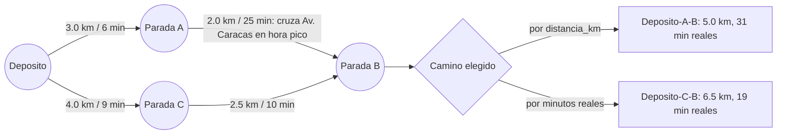
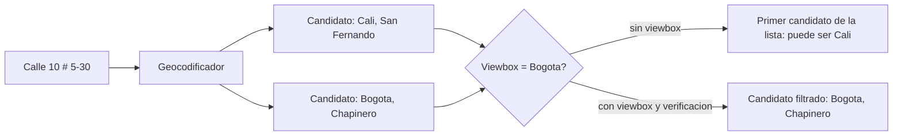
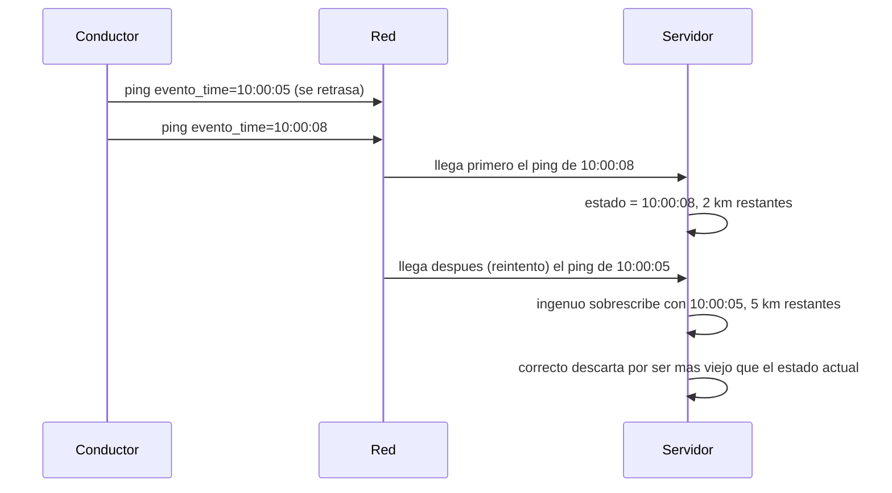
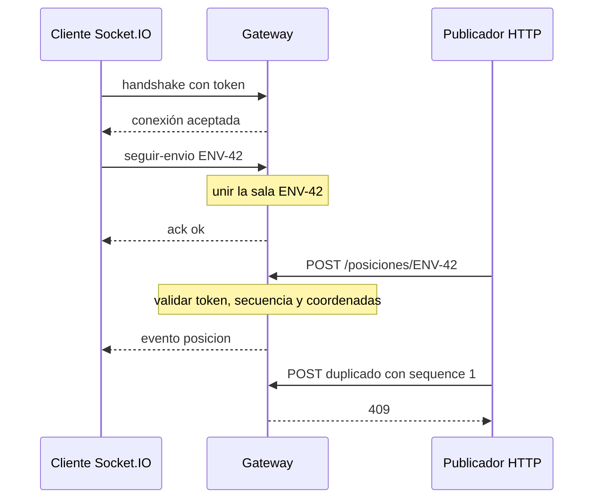

# Módulo 5: Rutas, mapas y seguimiento en tiempo real


## Aprende construyendo


### Tema 1: Grafos y problema de rutas · Avanzado · 45 min

<details open>
<summary><strong>Capa 1 — Lectura</strong></summary>

#### ► DE QUÉ TRATA
Al finalizar podrás construir y verificar Tema 1: Grafos y problema de rutas dentro de RutaFlow, empezando desde una carpeta vacía y explicando qué decisión técnica resuelve. Conocimiento previo: terminal, Git y Python 3 básico: funciones, listas y diccionarios (este repositorio…

#### ► CÓMO FUNCIONA


</details>

<details>
<summary><strong>Capa 2 — Construcción</strong></summary>

#### Código y verificación

```bash
mkdir -p rutaflow-labs/tema-1-grafos-y-problema-de-rutas
cd rutaflow-labs/tema-1-grafos-y-problema-de-rutas
```

```python
import heapq

# Grafo dirigido de paradas: cada arista tiene distancia (km) y tiempo real (min),
# que ya incluye congestion conocida en ese tramo y horario.
grafo = {
    "deposito": {"parada_a": {"km": 3.0, "min": 6}, "parada_c": {"km": 4.0, "min": 9}},
    "parada_a": {"parada_b": {"km": 2.0, "min": 25}},  # cruza la Av. Caracas en hora pico
    "parada_c": {"parada_b": {"km": 2.5, "min": 10}},
    "parada_b": {},
}


def camino_minimo(grafo, origen, destino, peso):
    """Dijkstra generico: `peso` decide si se optimiza por 'km' o por 'min'."""
    distancias = {nodo: float("inf") for nodo in grafo}
    distancias[origen] = 0
    previos = {}
    cola = [(0, origen)]
    while cola:
        actual_dist, actual = heapq.heappop(cola)
        if actual == destino:
            break
        for vecino, pesos in grafo[actual].items():
            nueva_dist = actual_dist + pesos[peso]
            if nueva_dist < distancias[vecino]:
                distancias[vecino] = nueva_dist
                previos[vecino] = actual
                heapq.heappush(cola, (nueva_dist, vecino))
    ruta = [destino]
    while ruta[-1] != origen:
        ruta.append(previos[ruta[-1]])
    return list(reversed(ruta))


def minutos_reales(ruta):
    return sum(grafo[a][b]["min"] for a, b in zip(ruta, ruta[1:]))


ruta_por_distancia = camino_minimo(grafo, "deposito", "parada_b", peso="km")
ruta_por_tiempo = camino_minimo(grafo, "deposito", "parada_b", peso="min")

print("Ruta por distancia:", ruta_por_distancia, "->", minutos_reales(ruta_por_distancia), "min reales")
print("Ruta por tiempo real:", ruta_por_tiempo, "->", minutos_reales(ruta_por_tiempo), "min reales")
```

</details>

### Tema 2: Geocoding y map matching · Avanzado · 45 min

<details open>
<summary><strong>Capa 1 — Lectura</strong></summary>

#### ► DE QUÉ TRATA
Al finalizar podrás construir y verificar Tema 2: Geocoding y map matching dentro de RutaFlow, empezando desde una carpeta vacía y explicando qué decisión técnica resuelve. Conocimiento previo: terminal, Git y Python 3 básico: funciones, listas y diccionarios (este repositorio no…

#### ► CÓMO FUNCIONA


</details>

<details>
<summary><strong>Capa 2 — Construcción</strong></summary>

#### Código y verificación


```bash
mkdir -p rutaflow-labs/tema-2-geocoding-y-map-matching
cd rutaflow-labs/tema-2-geocoding-y-map-matching
```

```python
# Simula el indice de un geocodificador real (p. ej. Nominatim sobre PostGIS):
# la misma combinacion de calle y carrera existe en mas de una ciudad.
INDICE = {
    "calle 10 # 5-30": [
        {"ciudad": "Cali", "localidad": "San Fernando", "lat": 3.4372, "lon": -76.5225},
        {"ciudad": "Bogota", "localidad": "Chapinero", "lat": 4.6126, "lon": -74.0705},
    ],
}


def geocodificar(direccion, ciudad_esperada=None):
    """Sin ciudad_esperada, devuelve el primer candidato tal cual el indice lo ordena
    (igual que un geocodificador real sin viewbox ni sesgo de region)."""
    candidatos = INDICE[direccion.strip().lower()]
    if ciudad_esperada is None:
        return candidatos[0]
    filtrados = [c for c in candidatos if c["ciudad"] == ciudad_esperada]
    if not filtrados:
        raise ValueError(f"sin candidatos para {direccion!r} en {ciudad_esperada!r}")
    return filtrados[0]


resultado = geocodificar("Calle 10 # 5-30", ciudad_esperada="Bogota")
print(resultado)
```

```python
resultado_ambiguo = geocodificar("Calle 10 # 5-30")
print(resultado_ambiguo)
```

</details>

### Tema 3: Streaming y ETA con incertidumbre · Avanzado · 45 min

<details open>
<summary><strong>Capa 1 — Lectura</strong></summary>

#### ► DE QUÉ TRATA
Al finalizar podrás construir y verificar Tema 3: Streaming y ETA con incertidumbre dentro de RutaFlow, empezando desde una carpeta vacía y explicando qué decisión técnica resuelve. Conocimiento previo: terminal, Git y Python 3 básico: funciones, listas y diccionarios (este repos…

#### ► CÓMO FUNCIONA


</details>

<details>
<summary><strong>Capa 2 — Construcción</strong></summary>

#### Código y verificación


```bash
mkdir -p rutaflow-labs/tema-3-streaming-y-eta-con-incertidumbre
cd rutaflow-labs/tema-3-streaming-y-eta-con-incertidumbre
```

```python
from datetime import datetime


def ts(hhmmss):
    return datetime.strptime(hhmmss, "%H:%M:%S")


# Eventos tal como LLEGAN al servidor (orden de arribo), no el orden en que ocurrieron:
# el ping de las 10:00:05 se retraso en la red y llega despues del de 10:00:08.
eventos_en_orden_de_llegada = [
    {"envio_id": "RF-4471", "evento_time": ts("10:00:08"), "km_restantes": 2.0},
    {"envio_id": "RF-4471", "evento_time": ts("10:00:05"), "km_restantes": 5.0},  # llega tarde por reintento
]

VELOCIDAD_KM_MIN = 0.5  # supuesto simplificado para calcular ETA


def eta_minutos(km_restantes):
    return round(km_restantes / VELOCIDAD_KM_MIN, 1)


def procesar_por_event_time(eventos):
    """Correcto: solo actualiza el estado si el evento es mas nuevo que el guardado."""
    estado = {}
    for evento in eventos:
        actual = estado.get(evento["envio_id"])
        if actual is None or evento["evento_time"] > actual["evento_time"]:
            estado[evento["envio_id"]] = evento
    return estado


estado_correcto = procesar_por_event_time(eventos_en_orden_de_llegada)
posicion = estado_correcto["RF-4471"]
print("ETA correcto:", eta_minutos(posicion["km_restantes"]), "min, basado en evento de", posicion["evento_time"].time())
```

```python
def procesar_por_orden_de_llegada(eventos):
    """Ingenuo: el ultimo evento recibido siempre pisa el estado anterior."""
    estado = {}
    for evento in eventos:
        estado[evento["envio_id"]] = evento  # no compara evento_time, solo sobrescribe
    return estado


estado_ingenuo = procesar_por_orden_de_llegada(eventos_en_orden_de_llegada)
posicion = estado_ingenuo["RF-4471"]
print("ETA ingenuo:", eta_minutos(posicion["km_restantes"]), "min, basado en evento de", posicion["evento_time"].time())
```

</details>

### Tema 4: Socket.IO extremo a extremo: un gateway compatible con el cliente móvil · Avanzado · 45 min

<details open>
<summary><strong>Capa 1 — Lectura</strong></summary>

#### ► DE QUÉ TRATA
Al finalizar conectarás un cliente Socket.IO a un servidor compatible y comprobarás recepción, secuencia y rechazo de credenciales inválidas. Prerrequisitos: HTTP, JSON, eventos y Node 24 con npm. Para el cliente Dart, SDK Dart 3. El ejemplo es independiente desde una carpeta vac…

#### ► CÓMO FUNCIONA


</details>

<details>
<summary><strong>Capa 2 — Construcción</strong></summary>

#### Código y verificación


```bash
mkdir ejemplo-socketio && cd ejemplo-socketio
npm install
npm test
```

```json
{"name":"rutaflow-socketio-lab","private":true,"type":"module","scripts":{"test":"node --test gateway.test.mjs"},"dependencies":{"express":"^5.1.0","socket.io":"^4.8.1","socket.io-client":"^4.8.1"}}
```

```javascript
import express from 'express';
import { createServer } from 'node:http';
import { Server } from 'socket.io';

// Laboratorio de un solo envío: no es un sistema de identidad de producción.
export async function startGateway({ port = 0, token = 'solo-laboratorio' } = {}) {
  const app = express();
  app.use(express.json({ limit: '8kb' }));
  const http = createServer(app);
  const io = new Server(http, { transports: ['websocket'] });
  let lastSequence = 0;
  io.use((socket, next) => next(socket.handshake.auth.token === token
    ? undefined : new Error('No autorizado')));
  io.on('connection', socket => {
    socket.on('seguir-envio', async (id, ack) => {
      if (id !== 'ENV-42') return ack({ ok: false });
      await socket.join(id);
      ack({ ok: true });
    });
  });
  app.post('/posiciones/ENV-42', (req, res) => {
    if (req.headers.authorization !== `Bearer ${token}`) return res.sendStatus(401);
    const { sequence, latitude, longitude } = req.body ?? {};
    if (!Number.isSafeInteger(sequence) || sequence < 1 ||
        !Number.isFinite(latitude) || Math.abs(latitude) > 90 ||
        !Number.isFinite(longitude) || Math.abs(longitude) > 180) return res.sendStatus(400);
    if (sequence <= lastSequence) return res.sendStatus(409);
    lastSequence = sequence;
    io.to('ENV-42').emit('posicion', { shipmentId: 'ENV-42', schemaVersion: 1,
      sequence, latitude, longitude });
    res.sendStatus(202);
  });
  await new Promise(resolve => http.listen(port, '127.0.0.1', resolve));
  return { url: `http://127.0.0.1:${http.address().port}`,
    close: () => new Promise(resolve => io.close(resolve)) };
}
```

```javascript
import test from 'node:test';
import assert from 'node:assert/strict';
import { io } from 'socket.io-client';
import { startGateway } from './gateway.mjs';

test('HTTP publica y un cliente Socket.IO compatible recibe; rechaza duplicado y token', { timeout: 5000 }, async t => {
  const gateway = await startGateway();
  const socket = io(gateway.url, { transports: ['websocket'], auth: { token: 'solo-laboratorio' } });
  t.after(async () => { socket.disconnect(); await gateway.close(); });
  await new Promise((resolve, reject) => {
    socket.once('connect', resolve); socket.once('connect_error', reject);
  });
  assert.deepEqual(await socket.timeout(1000).emitWithAck('seguir-envio', 'ENV-ajeno'), { ok: false });
  assert.deepEqual(await socket.timeout(1000).emitWithAck('seguir-envio', 'ENV-42'), { ok: true });
  const received = new Promise(resolve => socket.once('posicion', resolve));
  const send = auth => fetch(`${gateway.url}/posiciones/ENV-42`, { method: 'POST',
    headers: { 'Content-Type': 'application/json', Authorization: auth },
    body: JSON.stringify({ sequence: 1, latitude: 4.65, longitude: -74.08 }) });
  assert.equal((await send('Bearer solo-laboratorio')).status, 202);
  assert.deepEqual(await received, { shipmentId: 'ENV-42', schemaVersion: 1,
    sequence: 1, latitude: 4.65, longitude: -74.08 });
  assert.equal((await send('Bearer solo-laboratorio')).status, 409);
  assert.equal((await send('Bearer incorrecto')).status, 401);
});
```

```javascript
import { startGateway } from './gateway.mjs';
const gateway = await startGateway({ port: 3100 });
console.log(gateway.url);
process.once('SIGINT', async () => { await gateway.close(); });
```

</details>

### Tema 5: OSRM: del contrato de coordenadas a una respuesta de ruta verificable · Avanzado · 45 min

<details open>
<summary><strong>Capa 1 — Lectura</strong></summary>

#### ► DE QUÉ TRATA
Al finalizar construirás una petición OSRM y validarás unidades, geometría y ausencia de ruta. Prerrequisitos: coordenadas, HTTP, JSON y Python 3. Ejemplo independiente desde carpeta vacía; la primera fase usa una respuesta sintética declarada para aislar el contrato sin descarga…

</details>

<details>
<summary><strong>Capa 2 — Construcción</strong></summary>

#### Código y verificación
```bash
mkdir ejemplo-osrm && cd ejemplo-osrm
python3 ruta.py --fixture respuesta.json
python3 -m unittest test_ruta.py
```

```python
import argparse
import json
import math
from pathlib import Path
from urllib.request import urlopen


def ruta_url(base, puntos):
    if len(puntos) < 2:
        raise ValueError('Se necesitan al menos dos puntos')
    for lon, lat in puntos:
        if not math.isfinite(lon) or not math.isfinite(lat) or not -180 <= lon <= 180 or not -90 <= lat <= 90:
            raise ValueError('Coordenada inválida')
    coordenadas = ';'.join(f'{lon},{lat}' for lon, lat in puntos)
    return f'{base.rstrip("/")}/route/v1/driving/{coordenadas}?overview=full&geometries=geojson'


def interpretar(payload):
    if payload.get('code') != 'Ok' or not payload.get('routes'):
        raise ValueError('No hay una ruta utilizable')
    ruta = payload['routes'][0]
    for key in ('distance', 'duration'):
        if not isinstance(ruta.get(key), (int, float)) or not math.isfinite(ruta[key]) or ruta[key] < 0:
            raise ValueError('Métrica inválida')
    geometry = ruta.get('geometry', {})
    if geometry.get('type') != 'LineString' or len(geometry.get('coordinates', [])) < 2:
        raise ValueError('Geometría inválida')
    return ruta['distance'], ruta['duration']


if __name__ == '__main__':
    parser = argparse.ArgumentParser()
    parser.add_argument('--base-url')
    parser.add_argument('--fixture', default='respuesta.json')
    args = parser.parse_args()
    if args.base_url:
        url = ruta_url(args.base_url, [(13.38886, 52.517037), (13.397634, 52.529407)])
        with urlopen(url, timeout=5) as response:
            payload = json.load(response)
    else:
        payload = json.loads(Path(args.fixture).read_text())
    metros, segundos = interpretar(payload)
    print(f'{metros:g} metros; {segundos:g} segundos')
```

```json
{"code":"Ok","routes":[{"distance":1500,"duration":300,"geometry":{"type":"LineString","coordinates":[[13.38886,52.517037],[13.397634,52.529407]]}}]}
```

```python
import unittest
from ruta import ruta_url, interpretar

class RutaTest(unittest.TestCase):
    def test_orden_longitud_latitud_y_unidades(self):
        self.assertIn('13.0,52.0;14.0,53.0', ruta_url('http://localhost:5000', [(13.0,52.0),(14.0,53.0)]))
        payload={'code':'Ok','routes':[{'distance':1500,'duration':300,
            'geometry':{'type':'LineString','coordinates':[[13,52],[14,53]]}}]}
        self.assertEqual((1500,300), interpretar(payload))
    def test_sin_ruta_no_es_distancia_cero(self):
        with self.assertRaises(ValueError): interpretar({'code':'NoRoute','routes':[]})
        with self.assertRaises(ValueError): ruta_url('http://localhost:5000',[(0,91),(0,0)])

if __name__=='__main__':unittest.main()
```

</details>
