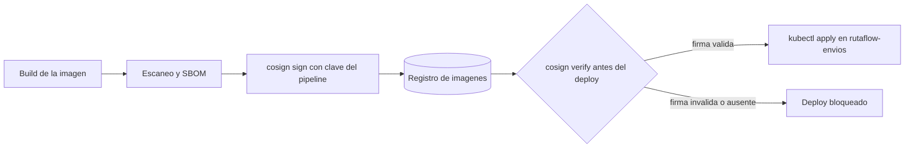
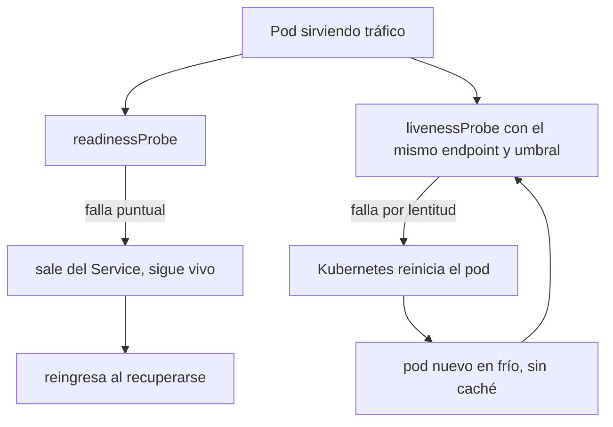
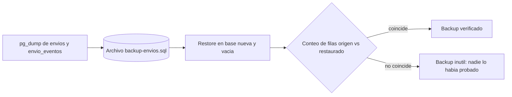

# Módulo 7: Producción: cloud, DevOps, seguridad y operación


## Aprende construyendo

### Tema 1: Infraestructura y entrega segura

**Conceptos clave:** Terraform, Kubernetes, CI/CD, artefactos, secretos, SBOM y firma.

Terraform crea redes, datos e identidades con estado protegido; Kubernetes ejecuta workloads con requests, limits y probes. La pipeline prueba, escanea, genera SBOM, firma una imagen inmutable y promueve el mismo digest. Floci visualiza pipelines; StackPort puede ofrecer el entorno reproducible de práctica. El criterio no es memorizar la herramienta, sino poder predecir qué sucede ante duplicados, datos incompletos, concurrencia, pérdida de red o permisos insuficientes. Documenta supuestos y mide antes de optimizar.

**Analogía:** Es como una cadena de custodia: cada relevo conserva identidad y evidencia.

**¿Por qué es importante?** Porque reduce configuraciones manuales y permite saber exactamente qué se desplegó. En RutaFlow la decisión se valida con una prueba automatizada y una observación operativa, no solo con una captura de pantalla.

**Casos de uso reales:** un despliegue manual que nadie puede reproducir; una imagen promovida sin SBOM ni firma; un digest distinto entre staging y producción. Promueve el mismo artefacto y conserva la cadena de custodia.

#### Paso 1 · Objetivo y preparación

Al finalizar podrás construir y verificar **Tema 1: Infraestructura y entrega segura** dentro de RutaFlow, provisionando un namespace de Kubernetes con Terraform y bloqueando el despliegue de imágenes sin firma verificada. **Conocimiento previo:** terminal, Git, nociones básicas de Terraform/HCL y de `kubectl`.

#### Paso 2 · Contexto y caso real

**Caso real:** un registro de contenedores mal asegurado permite retaguear una imagen (`docker tag otra-imagen:latest registry.rutaflow.dev/api-envios:1.4.2` y `docker push`) sin tocar el repositorio de código. Si el `kubectl set image` del deploy no verifica la firma, Kubernetes despliega esa imagen igual que si fuera legítima.

#### Paso 3 · Teoría, conceptos y analogía



#### Paso 4 · Demostración guiada desde cero

Crea una carpeta independiente para practicar Terraform y la firma de imágenes antes de tocar el monorepo:

```bash
mkdir -p rutaflow-labs/tema-1-infraestructura-y-entrega-segura
cd rutaflow-labs/tema-1-infraestructura-y-entrega-segura
```

**Ejecuta el ejemplo** (según la capa: backend con `./mvnw test`, app con `flutter run`):

```bash
./mvnw test
```
Confirma el resultado contra el criterio del paso.


`main.tf` — un namespace y un deployment mínimos para `api-envios`:

```hcl
# main.tf — infraestructura mínima de api-envios en Kubernetes
resource "kubernetes_namespace" "rutaflow" {
  metadata {
    name = "rutaflow-envios"
  }
}

resource "kubernetes_deployment" "api_envios" {
  metadata {
    name      = "api-envios"
    namespace = kubernetes_namespace.rutaflow.metadata[0].name
  }

  spec {
    replicas = 2

    selector {
      match_labels = { app = "api-envios" }
    }

    template {
      metadata {
        labels = { app = "api-envios" }
      }
      spec {
        container {
          name  = "api-envios"
          image = "registry.rutaflow.dev/api-envios:1.4.2"
        }
      }
    }
  }
}
```

```bash
terraform init
terraform plan -out=plan.tfplan
```

`deploy.sh` — la versión CON el bug: construye, firma y despliega, pero nunca verifica la firma antes de desplegar:

```bash
#!/usr/bin/env bash
set -euo pipefail
IMAGE="registry.rutaflow.dev/api-envios:1.4.2"

cosign sign --key cosign.key "$IMAGE"            # firma la imagen legítima
kubectl set image deployment/api-envios \
  api-envios="$IMAGE" -n rutaflow-envios          # BUG: despliega sin verificar nada
echo "Desplegado $IMAGE"
```

**Resultado esperado:** `terraform plan` muestra el namespace y el deployment a crear; `cosign sign` genera la firma en el registro.

**Fallo deliberado:** alguien retaguea una imagen distinta (sin firmar, o firmada con otra clave) sobre el mismo tag `registry.rutaflow.dev/api-envios:1.4.2` y vuelve a correr `deploy.sh`. El script completa sin ningún error e imprime `Desplegado registry.rutaflow.dev/api-envios:1.4.2`, porque nada en el script comprueba la firma: la imagen correcta y una imagen manipulada se despliegan exactamente igual. La firma generada antes existe, pero no protege nada si nadie la revisa en el camino. Corrección: agregá el gate de verificación antes de `kubectl set image`:

```bash
cosign verify --key cosign.pub "$IMAGE" \
  || { echo "Firma inválida: aborto el despliegue de $IMAGE"; exit 1; }
kubectl set image deployment/api-envios api-envios="$IMAGE" -n rutaflow-envios
```

Con el gate agregado, repetir el despliegue de la imagen retagueada falla con «Firma inválida: aborto el despliegue» antes de tocar Kubernetes; el despliegue de la imagen legítima y correctamente firmada sigue pasando.

#### Paso 5 · Práctica guiada

1. Agregá `resource_requests`/`limits` de CPU y memoria al contenedor en `main.tf` y corré `terraform plan` para confirmar que Terraform los incorpora sin recrear el deployment.
2. Extendé `deploy.sh` para que, si `cosign verify` falla, deje un registro (`echo` a un archivo `deploy.log`) con la imagen rechazada y la fecha, en vez de solo abortar en silencio.
3. Pista: nunca hagas `cosign verify` después de `kubectl set image` — el gate solo sirve si bloquea el despliegue antes de que Kubernetes reciba la imagen.

#### Paso 6 · Práctica independiente

Escribí un script `desplegar_verificado.sh` que reciba una imagen como argumento, la verifique con `cosign verify` contra la clave pública del equipo, y solo si la verificación pasa ejecute `kubectl set image`. Si la verificación falla, el script debe terminar con código de salida distinto de cero y sin tocar el deployment. No reuses el `deploy.sh` con bug del paso anterior como base; escribí primero el contrato (qué entra, qué puede fallar, qué sale) y después el script.

#### Paso 7 · Cierre y proyecto

Entregá `main.tf`, el `plan.tfplan`, `deploy.sh` con el gate de verificación agregado, y la evidencia de ambas corridas: la que bloquea la imagen retagueada y la que despliega la imagen legítima. El siguiente tema de este módulo toma esta misma infraestructura en producción y le agrega SLO y probes de Kubernetes para decidir cuándo un pod está realmente caído. **Fuente oficial:** [https://docs.sigstore.dev/](https://docs.sigstore.dev/) (documentación de cosign/sigstore sobre firma y verificación de imágenes).

**Errores comunes:** firmar la imagen y nunca verificarla antes del deploy; verificar la firma después de que Kubernetes ya la desplegó; guardar la clave privada de firma en el mismo repositorio que el código; asumir que una imagen firmada está libre de vulnerabilidades; reusar el mismo tag (`:1.4.2`) para builds distintos en vez de desplegar por digest.

**Transferencia al proyecto integrador «RutaFlow»:** Despliega un artefacto identificado, verifica salud y practica rollback con datos compatibles. Conserva el plan, la versión y el resultado de la prueba para reconstruir qué se ejecutó.

### Tema 2: SLO y respuesta a incidentes

**Conceptos clave:** SLI, presupuesto de error, alertas por burn rate, trazas, runbooks y postmortem.

Disponibilidad útil mide confirmaciones válidas, no procesos vivos. Un SLO fija objetivo y ventana; el presupuesto equilibra velocidad y confiabilidad. Alertas actúan sobre síntomas y burn rate. El runbook orienta diagnóstico; el postmortem sin culpa identifica condiciones y acciones con responsable. El criterio no es memorizar la herramienta, sino poder predecir qué sucede ante duplicados, datos incompletos, concurrencia, pérdida de red o permisos insuficientes. Documenta supuestos y mide antes de optimizar.

**Analogía:** Es como un tablero de salud mide funciones vitales, no cuántas luces están encendidas.

**¿Por qué es importante?** Porque conecta decisiones técnicas con impacto en entregas. En RutaFlow la decisión se valida con una prueba automatizada y una observación operativa, no solo con una captura de pantalla.

**Casos de uso reales:** un SLO de confirmaciones válidas que cae mientras los procesos siguen vivos; una alerta que despierta al equipo por un síntoma menor; un postmortem que culpa a una persona. Alerta por burn rate y registra acciones con responsable.

#### Paso 1 · Objetivo y preparación

Al finalizar podrás construir y verificar **Tema 2: SLO y respuesta a incidentes** dentro de RutaFlow, definiendo un SLO concreto para `/envios/:id` y configurando `readinessProbe`/`livenessProbe` con semántica distinta. **Conocimiento previo:** terminal, Git, YAML de Kubernetes y lectura de métricas básicas.

#### Paso 2 · Contexto y caso real

**Caso real:** un repunte de pedidos satura temporalmente las consultas a la base de datos detrás de `/envios/:id`. El servicio sigue vivo y procesando, solo tarda más en responder. Si el `livenessProbe` usa el mismo endpoint y el mismo umbral que el `readinessProbe`, Kubernetes interpreta la lentitud como una muerte del proceso y lo reinicia — perdiendo las conexiones en curso y empeorando la carga sobre las réplicas restantes.

#### Paso 3 · Teoría, conceptos y analogía



#### Paso 4 · Demostración guiada desde cero

Definí el SLO y las probes en una carpeta de práctica:

```bash
mkdir -p rutaflow-labs/tema-2-slo-y-respuesta-a-incidentes
cd rutaflow-labs/tema-2-slo-y-respuesta-a-incidentes
```

**Ejecuta el ejemplo** (según la capa: backend con `./mvnw test`, app con `flutter run`):

```bash
./mvnw test
```
Confirma el resultado contra el criterio del paso.


`slo.md` — el SLO concreto del servicio:

```text
SLO: 99.9% de las peticiones a GET /envios/:id responden en menos de 300 ms,
medido sobre una ventana móvil de 30 días.
Presupuesto de error: 0.1% de peticiones pueden exceder 300 ms o fallar
antes de que se dispare una alerta de burn rate acelerado.
```

`deployment.yaml` — la versión CON el bug: liveness y readiness idénticas:

```yaml
apiVersion: apps/v1
kind: Deployment
metadata:
  name: api-envios
  namespace: rutaflow-envios
spec:
  template:
    spec:
      containers:
        - name: api-envios
          image: registry.rutaflow.dev/api-envios:1.4.2
          readinessProbe:
            httpGet: { path: /envios/health, port: 8080 }
            periodSeconds: 5
            timeoutSeconds: 1
            failureThreshold: 2
          livenessProbe:               # BUG: idéntica a la readiness
            httpGet: { path: /envios/health, port: 8080 }
            periodSeconds: 5
            timeoutSeconds: 1
            failureThreshold: 2
```

**Resultado esperado:** bajo carga normal, ambas probes pasan; el pod sirve tráfico sin interrupciones.

**Fallo deliberado:** simulá un pico de carga que hace que `/envios/health` (que internamente consulta la base) tarde 2 segundos en vez de los habituales 200 ms. El `readinessProbe` falla dos veces seguidas (correcto: el pod sale del Service hasta que se recupera), pero el `livenessProbe`, con el mismo umbral de 1 segundo, **también** falla dos veces seguidas — y Kubernetes mata y reinicia el pod. El pod nuevo arranca sin caché ni conexiones de base calientes, tarda todavía más en responder, vuelve a fallar el liveness, se reinicia otra vez: un `CrashLoopBackOff` disparado por carga, no por un proceso realmente muerto. Corrección: separar la semántica de cada probe:

```yaml
          readinessProbe:
            httpGet: { path: /envios/health, port: 8080 }
            periodSeconds: 5
            timeoutSeconds: 1
            failureThreshold: 2
          livenessProbe:               # FIX: solo pregunta "¿el proceso sigue vivo?"
            httpGet: { path: /envios/vivo, port: 8080 }   # no toca la base de datos
            periodSeconds: 10
            timeoutSeconds: 3
            failureThreshold: 5
```

Con `/envios/vivo` respondiendo sin depender de la base, el mismo pico de carga vuelve a sacar al pod del Service (readiness) pero ya no dispara reinicios en cascada (liveness).

#### Paso 5 · Práctica guiada

1. Agregá al `slo.md` una regla de burn rate: si se consume el 10% del presupuesto de error en una hora, dispará una alerta de severidad alta.
2. Ajustá `failureThreshold` y `periodSeconds` del `readinessProbe` para que tolere un pico de 10 segundos sin sacar el pod del Service, y documentá por qué elegiste esos valores.
3. Pista: el `livenessProbe` nunca debería depender de un recurso externo (base de datos, otro servicio); si depende, cualquier falla de ese recurso se convierte en un reinicio del pod que no lo soluciona.

#### Paso 6 · Práctica independiente

Escribí el runbook del incidente: dado un burn rate acelerado en `/envios/:id`, documentá los tres primeros comandos que correrías para diagnosticar (por ejemplo, `kubectl describe pod`, revisar logs de la base, comparar latencia de readiness vs liveness) y el criterio para decidir si el problema es de carga (no reiniciar, escalar réplicas) o de proceso realmente colgado (reiniciar). No copies el fallo del paso anterior tal cual; razoná el runbook desde el SLO definido en el paso 4.

#### Paso 7 · Cierre y proyecto

Entregá `slo.md`, el `deployment.yaml` con el bug y el corregido, y la evidencia escrita de cómo el pico de carga provoca el reinicio en cascada con probes idénticas y deja de provocarlo con probes separadas. El siguiente tema de este módulo cierra el track completo de RutaFlow con continuidad, backups probados y el proyecto final. **Fuente oficial:** [https://kubernetes.io/docs/tasks/configure-pod-container/configure-liveness-readiness-startup-probes/](https://kubernetes.io/docs/tasks/configure-pod-container/configure-liveness-readiness-startup-probes/).

**Errores comunes:** usar el mismo endpoint y umbral para `livenessProbe` y `readinessProbe`; que el `livenessProbe` dependa de una base de datos o servicio externo; fijar un SLO sin definir la ventana de medición; confundir «el pod está lento» con «el pod está muerto»; no tener un runbook escrito antes de que ocurra el incidente.

**Límites y decisión de uso:** Un SLO resume un objetivo, no garantiza cada petición ni reemplaza respuesta a incidentes. Define qué usuarios y operaciones cuenta y prueba ventanas sin tráfico; una métrica incompleta puede ocultar impacto real.

### Tema 3: Pruebas end-to-end del sistema completo (app ↔ backend)

#### Paso 1 · Objetivo y preparación
Al finalizar podrás escribir una prueba end-to-end que ejercite el flujo real cruzando la app (Flutter) y el backend (Spring Boot): login → crear entrega → asignar repartidor → confirmar, contra servicios reales levantados con Docker. Prerrequisitos: Temas 1-2 de este módulo; testing de cada lado en sus tracks (Flutter M9, Spring Boot M6).

#### Paso 2 · Contexto y caso real
Cada track prueba su mitad: Flutter prueba widgets, Spring prueba endpoints. Pero nadie prueba que **las dos mitades encajen**: que el JSON que envía la app sea el que el backend espera, que el token del login sirva en la siguiente llamada, que el contrato HTTP real funcione de punta a punta. Esa es la prueba que atrapa los bugs de integración que ninguna prueba unitaria ve.

#### Paso 3 · Teoría, modelo mental y analogía
Una prueba **E2E de sistema** levanta el backend real (con su base de datos real vía Docker/Testcontainers) y ejercita su API tal como lo haría la app, verificando el flujo de negocio completo. No mockea la frontera: usa el contrato HTTP de verdad. Es la cúspide de la pirámide de pruebas: pocas, lentas, pero las únicas que validan el sistema integrado.

**Analogía:** las pruebas unitarias comprueban que cada pieza del coche funciona en el banco; la prueba E2E es la vuelta de prueba con el coche armado en la pista. Solo ahí descubres que el pedal encaja con el motor.

#### Paso 4 · Demostración guiada desde cero
**Crea** el archivo `src/test/java/io/rutaflow/FlujoEntregaE2ETest.java` con la clase que ves más abajo, y guárdalo antes de ejecutarlo con `./mvnw test -Dtest=FlujoEntregaE2ETest`.

Levanta el backend real con Docker Compose y ejecuta una prueba que recorra el flujo contra él:

```bash
# 1. Levanta backend + base de datos reales
docker compose up -d
# 2. Ejecuta la prueba E2E (recorre login -> crear -> asignar -> confirmar por HTTP real)
./mvnw test -Dtest=FlujoEntregaE2ETest
```

La prueba vive en `src/test/java/io/rutaflow/FlujoEntregaE2ETest.java` y ejercita el contrato que la app consume:

```java
@SpringBootTest(webEnvironment = SpringBootTest.WebEnvironment.RANDOM_PORT)
@Testcontainers
class FlujoEntregaE2ETest {
    @Container static PostgreSQLContainer<?> db = new PostgreSQLContainer<>("postgres:16");
    @Autowired TestRestTemplate http;

    @Test
    void flujoCompletoDeEntrega() {
        // 1. Login: obtiene el token (igual que haría la app Flutter)
        var login = http.postForEntity("/api/auth/login",
            Map.of("email", "ana@rutaflow.dev", "password", "clave-larga-segura"), Map.class);
        String token = (String) login.getBody().get("token");

        // 2. Crear entrega con el token (contrato real que consume la app)
        var headers = new HttpHeaders();
        headers.setBearerAuth(token);
        var crear = http.exchange("/api/entregas", HttpMethod.POST,
            new HttpEntity<>(Map.of("guia", "RF-9001"), headers), Map.class);
        assertThat(crear.getStatusCode()).isEqualTo(HttpStatus.CREATED);

        // 3. Confirmar entrega y verificar el estado final
        var confirmar = http.exchange("/api/entregas/RF-9001/confirmar", HttpMethod.POST,
            new HttpEntity<>(headers), Map.class);
        assertThat(confirmar.getBody().get("estado")).isEqualTo("ENTREGADA");
    }
}
```

**Resultado esperado:** `BUILD SUCCESS`: el flujo login → crear → confirmar funciona contra un PostgreSQL real, usando el mismo contrato HTTP que la app Flutter consume con Dio (Flutter M5). **Fallo deliberado:** cambia en la prueba el campo `"guia"` por `"tracking"` (un nombre que el backend no espera); la creación responde `400`, revelando justo el tipo de desajuste de contrato app↔backend que una prueba de un solo lado jamás detectaría. Diagnostica por qué la E2E es la única que protege la frontera entre los dos equipos.

#### Paso 5 · Práctica guiada
Añade al flujo el paso de "asignar repartidor" entre crear y confirmar, y verifica que confirmar sin asignar primero responde un error de negocio. Pista: el orden de los pasos es parte del contrato.

#### Paso 6 · Práctica independiente
Desde el lado Flutter, escribe una prueba de integración (`integration_test`) que apunte al backend levantado con Docker y recorra el mismo flujo desde la UI. Entrega ambas pruebas (backend y app) y explica qué bug atraparía cada una.

#### Paso 7 · Cierre
Entrega la prueba E2E en verde, el fallo por contrato roto y la prueba desde Flutter. **¿Por qué es importante?** En un sistema de dos partes (app + backend) desarrolladas a menudo por equipos distintos, los bugs más caros viven en la frontera: un campo renombrado, un token mal propagado, un código de estado inesperado. La prueba E2E de sistema es la red de seguridad que atrapa esos fallos antes de producción. Fuentes: [Testcontainers](https://testcontainers.com/) y [Flutter integration testing](https://docs.flutter.dev/testing/integration-tests).
**Conceptos clave:** prueba de sistema, contrato HTTP real, Testcontainers, frontera app↔backend, cúspide de la pirámide de pruebas.
**Cuándo no usarlo:** no uses E2E para lo que una prueba unitaria o de componente cubre mejor (lógica interna): son lentas y frágiles. Resérvalas para los flujos de negocio críticos que cruzan el sistema completo.

**Transferencia al proyecto integrador «RutaFlow»:** automatiza la prueba E2E del flujo "entrega asignada y confirmada" en el pipeline de CI, levantando backend y base de datos con Docker antes de ejecutarla.
**Errores comunes:** renombrar un campo del payload en la prueba (como `guia` por `tracking`) y, al ver que el backend responde `400`, asumir que el test en sí está mal escrito en vez de leer el cuerpo de la respuesta — ese `400` es la prueba E2E funcionando correctamente: detectó un desajuste de contrato que ninguna prueba de un solo lado vería.
**Fuente oficial:** [documentación de RutaFlow](https://docs.flutter.dev/).
### Tema 4: Continuidad, costes y proyecto final

**Conceptos clave:** backup, restore, RPO, RTO, game day, DR y coste por entrega.

Un backup no está probado hasta restaurarlo y verificar integridad. RPO limita pérdida tolerable; RTO, tiempo de recuperación. Un game day simula caída de base, cola saturada y proveedor de mapas lento. FinOps atribuye coste por servicio y entrega sin sacrificar seguridad. El criterio no es memorizar la herramienta, sino poder predecir qué sucede ante duplicados, datos incompletos, concurrencia, pérdida de red o permisos insuficientes. Documenta supuestos y mide antes de optimizar.

**Analogía:** Es como un simulacro de evacuación revela puertas bloqueadas antes del incendio.

**¿Por qué es importante?** Porque convierte documentación optimista en capacidad operacional demostrada. En RutaFlow la decisión se valida con una prueba automatizada y una observación operativa, no solo con una captura de pantalla.

**Casos de uso reales:** restaurar un backup y descubrir que no abre; una caída del proveedor de mapas que detiene el despacho; un coste cloud que crece sin dueño. Simula la caída, mide RPO/RTO y atribuye coste por servicio.

#### Paso 1 · Objetivo y preparación

Al finalizar podrás construir y verificar **Tema 3: Continuidad, costes y proyecto final** dentro de RutaFlow, probando un backup real de las tablas de envíos mediante una restauración completa en una base vacía. **Conocimiento previo:** terminal, Git, `psql`/`pg_dump` básico.

#### Paso 2 · Contexto y caso real

**Caso real:** antes de este tema, RutaFlow documentaba un RPO y un RTO en un README, pero nadie había restaurado un backup real en meses. Este tema cierra esa brecha: la prueba de continuidad no es «el script de backup no tiró error», es «restauré el dump en una base nueva y los conteos de filas coinciden con el origen».

#### Paso 3 · Teoría, conceptos y analogía



#### Paso 4 · Demostración guiada desde cero
**Desde cero:** parte de una carpeta vacía, ejecuta el comando que aparece debajo y escribe `src/ejemplo.dart` con el contenido de este tema.
```bash
mkdir ejemplo && cd ejemplo
```

Trabaja en una base local de laboratorio con las tablas `envios` y `envio_eventos` del módulo 1 y al menos un envío. Detén las escrituras durante la comparación; en un sistema activo necesitas coordinar una instantánea consistente. Instala los clientes PostgreSQL y configura `DATABASE_URL` para el origen y `PGHOST`, `PGPORT`, `PGUSER` para el servidor local de restauración, donde necesitas permiso para crear bases.

Desde la raíz del repositorio ejecuta el ejemplo independiente `examples/rutaflow/database/backup_verified.sh`:

```bash
# Usa autenticación local configurada; no guardes contraseñas en Git.
export PGHOST=localhost PGPORT=5432 PGUSER=postgres
export DATABASE_URL=postgresql://postgres@localhost:5432/rutaflow_lab
bash examples/rutaflow/database/backup_verified.sh backup-envios.dump
```

El script guarda una referencia ordenada de ambas tablas, respalda la base completa para incluir funciones y secuencias, crea **una sola identidad de base temporal**, restaura con parada ante errores y compara el contenido. Su `trap` elimina únicamente la base que creó, tanto si la prueba pasa como si falla. Los prefijos temporales permiten identificar una limpieza fallida sin confundirla con una base del usuario.

**Resultado esperado:** `OK: envios y envio_eventos restaurados y comparados` y el archivo `backup-envios.dump`. Un archivo destino existente se rechaza para conservar el respaldo anterior. La igualdad de estas tablas es una comprobación del laboratorio, no certifica por sí sola todos los requisitos de recuperación.

**Fallo deliberado:** una base equivocada **con el mismo esquema pero sin filas** puede producir un dump válido. Una base sin las tablas solicitadas hace fallar `pg_dump --table`; no son el mismo escenario. En el mismo servidor de laboratorio y sin escrituras concurrentes, reproduce el primer caso desde Bash:

```bash
set -euo pipefail
lab_dir=$(mktemp -d)
empty_db="rutaflow_empty_$(date +%s)_$$"
empty_created=false
cleanup_empty() {
  if [ "$empty_created" = true ]; then dropdb "$empty_db"; fi
  rm -rf "$lab_dir"
}
trap cleanup_empty EXIT
pg_dump --schema-only --no-owner --no-privileges "$DATABASE_URL" > "$lab_dir/schema.sql"
createdb --template=template0 "$empty_db"
empty_created=true
psql -X -v ON_ERROR_STOP=1 "$empty_db" -f "$lab_dir/schema.sql"
pg_dump --format=custom "$empty_db" > "$lab_dir/wrong-origin.dump"
original_count=$(psql -X -At -v ON_ERROR_STOP=1 "$DATABASE_URL" -c 'SELECT count(*) FROM envios')
empty_count=$(psql -X -At -v ON_ERROR_STOP=1 "$empty_db" -c 'SELECT count(*) FROM envios')
if [ "$original_count" -gt 0 ] && [ "$empty_count" -eq 0 ]; then
  echo 'FALLO REPRODUCIDO: dump válido del origen equivocado'
else
  echo 'Revisa los datos de preparación: el origen debe contener envíos' >&2
  exit 1
fi
```

La restauración correcta de una base vacía tampoco permite descubrir por sí sola que elegiste el origen incorrecto: añade comprobaciones de identidad del entorno y de registros de referencia conocidos. Si el usuario de backup carece de permisos, trata el error de `pg_dump` como fallo; PostgreSQL no promete omitir silenciosamente tablas inaccesibles. Consulta la [referencia de pg_dump](https://www.postgresql.org/docs/current/app-pgdump.html).

#### Paso 5 · Práctica guiada

1. Modifica un campo en la copia restaurada antes de compararla: los conteos seguirán iguales, pero el script debe detectar la diferencia de contenido.
2. Agendá la verificación de restore (no solo el `pg_dump`) como un paso recurrente, y documentá qué RPO/RTO reales confirma esa prueba.
3. Pista: verificar solo el tamaño del archivo de backup no alcanza — un archivo con el esquema completo y cero filas también «pesa» algo.

#### Paso 6 · Práctica independiente

Escribí un script `backup_verificado.sh` que haga `pg_dump`, restaure en una base temporal descartable, compare conteos de `envios` y `envio_eventos` contra el origen, y termine con código de salida distinto de cero si cualquiera de los dos conteos no coincide — sin dejar la base temporal de verificación abandonada al terminar. No copies el script de ejemplo tal cual; decidí primero qué constituye «backup verificado» para RutaFlow y después escribí el código.

#### Paso 7 · Cierre y proyecto

Entregá `backup-envios.dump`, las salidas de comparación, y la evidencia de haber reproducido el backup vacío silencioso y luego corregido el proceso para que la verificación de restore sea parte del backup mismo, no un paso opcional posterior.

Este es el último tema del último módulo de RutaFlow. Los ocho módulos recorrieron el camino completo de un sistema de entregas real: desde modelar el dominio de un envío y su ciclo de estados, pasando por persistencia, concurrencia, integraciones externas y observabilidad, hasta esta infraestructura de producción con despliegues firmados y verificados, probes que distinguen lentitud de muerte, y backups que se prueban restaurándolos de verdad. No hay un tema siguiente: lo que sigue es aplicar este mismo criterio — predecir el fallo antes de que ocurra, y comprobarlo en vez de asumirlo — al resto de RutaFlow y a cualquier sistema en producción que construyas de acá en más. **Fuente oficial:** [https://www.postgresql.org/docs/current/backup-dump.html](https://www.postgresql.org/docs/current/backup-dump.html).

**Errores comunes:** confiar en el código de salida de `pg_dump` como prueba de que el backup sirve; nunca restaurar un backup hasta el día del incidente real; backupear la base equivocada por una variable de entorno mal apuntada; verificar solo el tamaño del archivo en vez del contenido; no limpiar las bases temporales de verificación y dejar residuos en el servidor de pruebas.

**Límites y decisión de uso:** Un backup con código de salida cero no demuestra recuperación. Restaura en una base aislada y verifica esquema y datos; el tiempo medido incluye preparación y validación, y los objetivos dependen del volumen y de la infraestructura real.
