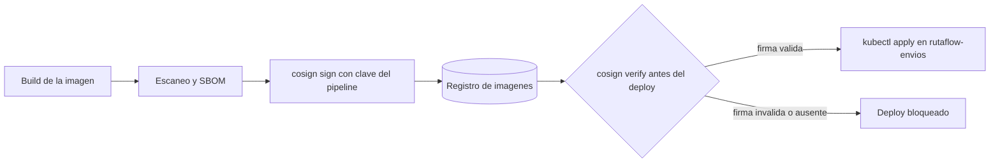
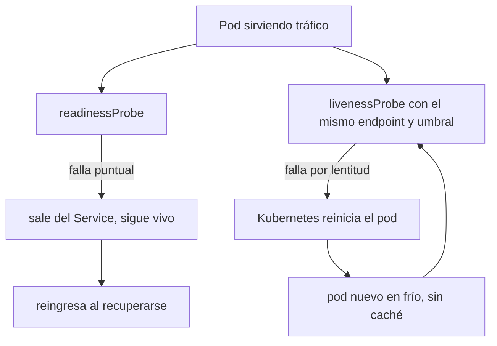
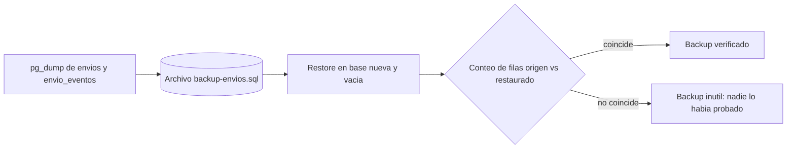

# Módulo 7: Producción: cloud, DevOps, seguridad y operación

## Aprende construyendo


### Tema 1: Infraestructura y entrega segura · Avanzado · 45 min

<details open>
<summary><strong>Capa 1 — Lectura</strong></summary>

#### ► DE QUÉ TRATA
Al finalizar podrás construir y verificar Tema 1: Infraestructura y entrega segura dentro de RutaFlow, provisionando un namespace de Kubernetes con Terraform y bloqueando el despliegue de imágenes sin firma verificada. Conocimiento previo: terminal, Git, nociones básicas de Terra…

#### ► CÓMO FUNCIONA


</details>

<details>
<summary><strong>Capa 2 — Construcción</strong></summary>

#### Código y verificación

```bash
kind create cluster --name rutaflow   # crea el contexto kubectl kind-rutaflow
mkdir -p rutaflow-labs/tema-1-infraestructura-y-entrega-segura
cd rutaflow-labs/tema-1-infraestructura-y-entrega-segura
```

```hcl
# main.tf — infraestructura mínima de api-envios en Kubernetes
terraform {
  required_providers {
    kubernetes = {
      source = "hashicorp/kubernetes"
    }
  }
}

provider "kubernetes" {
  config_path    = "~/.kube/config"
  config_context = "kind-rutaflow"
}

resource "kubernetes_namespace" "rutaflow" {
  metadata {
    name = "rutaflow-envios"
  }
}

resource "kubernetes_deployment" "api_envios" {
  metadata {
    name      = "api-envios"
    namespace = kubernetes_namespace.rutaflow.metadata[0].name
  }

  spec {
    replicas = 2

    selector {
      match_labels = { app = "api-envios" }
    }

    template {
      metadata {
        labels = { app = "api-envios" }
      }
      spec {
        container {
          name  = "api-envios"
          image = "registry.rutaflow.dev/api-envios:1.4.2"
        }
      }
    }
  }
}
```

```bash
terraform init
terraform plan -out=plan.tfplan
```

```bash
# ci-firmar.sh — corre en CI, no en el despliegue
set -euo pipefail
docker build -t registry.rutaflow.dev/api-envios:1.4.2 .
docker push registry.rutaflow.dev/api-envios:1.4.2
IMAGE=$(docker inspect --format '{{index .RepoDigests 0}}' registry.rutaflow.dev/api-envios:1.4.2)
cosign sign --key cosign.key "$IMAGE"   # firma registry.rutaflow.dev/api-envios@sha256:...
echo "$IMAGE" > imagen-firmada.txt      # el despliegue recibe este valor
```

```bash
#!/usr/bin/env bash
set -euo pipefail
IMAGE="registry.rutaflow.dev/api-envios:1.4.2"
kubectl set image deployment/api-envios \
  api-envios="$IMAGE" -n rutaflow-envios          # BUG: tag mutable y sin verificar la firma
echo "Desplegado $IMAGE"
```

</details>

### Tema 2: SLO y respuesta a incidentes · Avanzado · 45 min

<details open>
<summary><strong>Capa 1 — Lectura</strong></summary>

#### ► DE QUÉ TRATA
Al finalizar podrás construir y verificar Tema 2: SLO y respuesta a incidentes dentro de RutaFlow, definiendo un SLO concreto para /envios/:id y configurando readinessProbe/livenessProbe con semántica distinta. Conocimiento previo: terminal, Git, YAML de Kubernetes y lectura de m…

#### ► CÓMO FUNCIONA


</details>

<details>
<summary><strong>Capa 2 — Construcción</strong></summary>

#### Código y verificación


```bash
mkdir -p rutaflow-labs/tema-2-slo-y-respuesta-a-incidentes
cd rutaflow-labs/tema-2-slo-y-respuesta-a-incidentes
```

```text
SLO: 99.9% de las peticiones a GET /envios/:id responden en menos de 300 ms,
medido sobre una ventana móvil de 30 días.
Presupuesto de error: 0.1% de peticiones pueden exceder 300 ms o fallar
antes de que se dispare una alerta de burn rate acelerado.
```

```yaml
apiVersion: apps/v1
kind: Deployment
metadata:
  name: api-envios
  namespace: rutaflow-envios
spec:
  template:
    spec:
      containers:
        - name: api-envios
          image: registry.rutaflow.dev/api-envios:1.4.2
          readinessProbe:
            httpGet: { path: /envios/health, port: 8080 }
            periodSeconds: 5
            timeoutSeconds: 1
            failureThreshold: 2
          livenessProbe:               # BUG: idéntica a la readiness
            httpGet: { path: /envios/health, port: 8080 }
            periodSeconds: 5
            timeoutSeconds: 1
            failureThreshold: 2
```

```yaml
          readinessProbe:
            httpGet: { path: /envios/health, port: 8080 }
            periodSeconds: 5
            timeoutSeconds: 1
            failureThreshold: 2
          livenessProbe:               # FIX: solo pregunta "¿el proceso sigue vivo?"
            httpGet: { path: /envios/vivo, port: 8080 }   # no toca la base de datos
            periodSeconds: 10
            timeoutSeconds: 3
            failureThreshold: 5
```

</details>

### Tema 3: Pruebas end-to-end del sistema completo (app ↔ backend) · Avanzado · 45 min

<details open>
<summary><strong>Capa 1 — Lectura</strong></summary>

#### ► DE QUÉ TRATA
Al finalizar podrás escribir una prueba end-to-end que ejercite el flujo real cruzando la app (Flutter) y el backend (Spring Boot): login → crear entrega → asignar repartidor → confirmar, contra servicios reales levantados con Docker. Prerrequisitos: Temas 1-2 de este módulo; tes…

</details>

<details>
<summary><strong>Capa 2 — Construcción</strong></summary>

#### Código y verificación
```bash
# Recorre login -> crear -> confirmar por HTTP real contra un PostgreSQL efímero
./mvnw test -Dtest=FlujoEntregaE2ETest
```

```java
@SpringBootTest(webEnvironment = SpringBootTest.WebEnvironment.RANDOM_PORT)
@AutoConfigureTestRestTemplate
@Testcontainers
class FlujoEntregaE2ETest {
    @Container @ServiceConnection static PostgreSQLContainer<?> db = new PostgreSQLContainer<>("postgres:16");
    @Autowired TestRestTemplate http;

    @Test
    void flujoCompletoDeEntrega() {
        // 1. Login: obtiene el token (igual que haría la app Flutter)
        var login = http.postForEntity("/api/auth/login",
            Map.of("email", "ana@rutaflow.dev", "password", "clave-larga-segura"), Map.class);
        String token = (String) login.getBody().get("token");

        // 2. Crear entrega con el token (contrato real que consume la app)
        var headers = new HttpHeaders();
        headers.setBearerAuth(token);
        var crear = http.exchange("/api/entregas", HttpMethod.POST,
            new HttpEntity<>(Map.of("guia", "RF-9001"), headers), Map.class);
        assertThat(crear.getStatusCode()).isEqualTo(HttpStatus.CREATED);

        // 3. Confirmar entrega y verificar el estado final
        var confirmar = http.exchange("/api/entregas/RF-9001/confirmar", HttpMethod.POST,
            new HttpEntity<>(headers), Map.class);
        assertThat(confirmar.getBody().get("estado")).isEqualTo("ENTREGADA");
    }
}
```

</details>

### Tema 4: Continuidad, costes y proyecto final · Avanzado · 45 min

<details open>
<summary><strong>Capa 1 — Lectura</strong></summary>

#### ► DE QUÉ TRATA
Al finalizar podrás construir y verificar Tema 3: Continuidad, costes y proyecto final dentro de RutaFlow, probando un backup real de las tablas de envíos mediante una restauración completa en una base vacía. Conocimiento previo: terminal, Git, psql/pg_dump básico.

#### ► CÓMO FUNCIONA


</details>

<details>
<summary><strong>Capa 2 — Construcción</strong></summary>

#### Código y verificación


```bash
mkdir ejemplo && cd ejemplo
```

```bash
#!/usr/bin/env bash
set -euo pipefail
umask 077

archivo=${1:?"Uso: bash backup_verified.sh backup-envios.dump"}
[[ -n "${DATABASE_URL:-}" ]] || { echo 'Define DATABASE_URL' >&2; exit 2; }
[[ ! -e "$archivo" ]] || { echo "No se sobrescribe $archivo" >&2; exit 2; }

lab_dir=$(mktemp -d)
restore_db="rutaflow_restore_$(date +%s)_$$"
restore_created=false
cleanup() {
  if [[ "$restore_created" == true ]]; then dropdb "$restore_db"; fi
  rm -rf "$lab_dir"
}
trap cleanup EXIT

for tabla in envios envio_eventos; do
  psql -X -At -v ON_ERROR_STOP=1 "$DATABASE_URL" \
    -c "SELECT * FROM $tabla ORDER BY 1" > "$lab_dir/$tabla.origen"
done
pg_dump --format=custom "$DATABASE_URL" > "$archivo"
createdb --template=template0 "$restore_db"
restore_created=true
pg_restore --exit-on-error --no-owner --no-privileges \
  --dbname="$restore_db" "$archivo"
for tabla in envios envio_eventos; do
  psql -X -At -v ON_ERROR_STOP=1 "$restore_db" \
    -c "SELECT * FROM $tabla ORDER BY 1" > "$lab_dir/$tabla.restaurada"
  diff -u "$lab_dir/$tabla.origen" "$lab_dir/$tabla.restaurada"
done
printf '%s\n' 'OK: envios y envio_eventos restaurados y comparados'
```

```bash
# Usa autenticación local configurada; no guardes contraseñas en Git.
export PGHOST=localhost PGPORT=5432 PGUSER=postgres
export DATABASE_URL=postgresql://postgres@localhost:5432/rutaflow_lab
bash backup_verified.sh backup-envios.dump
```

```bash
set -euo pipefail
lab_dir=$(mktemp -d)
empty_db="rutaflow_empty_$(date +%s)_$$"
empty_created=false
cleanup_empty() {
  if [ "$empty_created" = true ]; then dropdb "$empty_db"; fi
  rm -rf "$lab_dir"
}
trap cleanup_empty EXIT
pg_dump --schema-only --no-owner --no-privileges "$DATABASE_URL" > "$lab_dir/schema.sql"
createdb --template=template0 "$empty_db"
empty_created=true
psql -X -v ON_ERROR_STOP=1 "$empty_db" -f "$lab_dir/schema.sql"
pg_dump --format=custom "$empty_db" > "$lab_dir/wrong-origin.dump"
original_count=$(psql -X -At -v ON_ERROR_STOP=1 "$DATABASE_URL" -c 'SELECT count(*) FROM envios')
empty_count=$(psql -X -At -v ON_ERROR_STOP=1 "$empty_db" -c 'SELECT count(*) FROM envios')
if [ "$original_count" -gt 0 ] && [ "$empty_count" -eq 0 ]; then
  echo 'FALLO REPRODUCIDO: dump válido del origen equivocado'
else
  echo 'Revisa los datos de preparación: el origen debe contener envíos' >&2
  exit 1
fi
```

</details>
