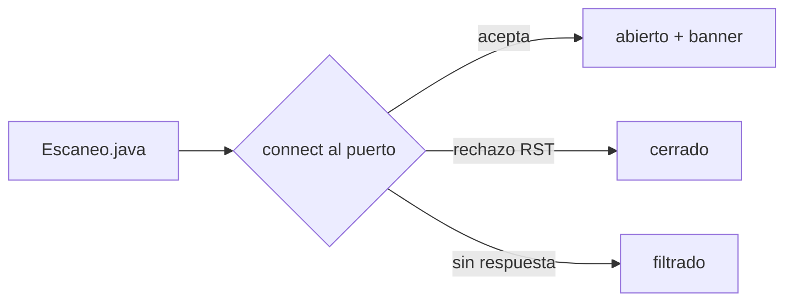

# Módulo 1: Seguridad DevSecOps


## Aprende construyendo


### Tema 1: Escaneo de imágenes y dependencias (Trivy, Snyk) · Avanzado · 20 min

<details open>
<summary><strong>Capa 1 — Lectura</strong></summary>

#### ► DE QUÉ TRATA
Al finalizar podrás escanear una imagen Docker propia con Trivy, leer su reporte de CVEs por severidad, y decidir con criterio cuáles atender primero.

</details>

<details>
<summary><strong>Capa 2 — Construcción</strong></summary>

#### Código y verificación
```
┌──────────────────────────┐
│ docker build → mi-api:1.0   │
└──────────┬───────────────┘
           │
┌──────────▼───────────────┐
│ trivy image mi-api:1.0        │
│ compara paquetes vs CVEs      │
└──────────┬───────────────┘
           │
   ┌───────┴────────┐
   ▼                 ▼
┌─────────┐    ┌──────────────────┐
│ Sin críticas │    │ Vulnerabilidades  │
└─────────┘    │ (por severidad)      │
                 └──────────────────┘
```

```bash
mkdir -p academia-devops/src/modulo11/escaneo-imagen
cd academia-devops/src/modulo11/escaneo-imagen
```

Crea el archivo `Dockerfile`:

```dockerfile
FROM node:18.19.0-alpine3.18
WORKDIR /app
COPY package.json .
RUN npm install --omit=dev
CMD ["node", "-e", "console.log('mi-api activa')"]
```

Crea el archivo `package.json`:

```json
{ "name": "mi-api", "version": "1.0.0", "dependencies": { "lodash": "4.17.15" } }
```

```bash
docker build -t mi-api:1.0 .
docker run --rm aquasec/trivy:0.55.0 --version
```

```bash
docker run --rm -v /var/run/docker.sock:/var/run/docker.sock \
  aquasec/trivy:0.55.0 image --severity CRITICAL,HIGH --format table mi-api:1.0
```

</details>

### Tema 2: Integración en el pipeline · Avanzado · 20 min

<details open>
<summary><strong>Capa 1 — Lectura</strong></summary>

#### ► DE QUÉ TRATA
Al finalizar podrás integrar Trivy como un gate obligatorio del pipeline de CI que bloquea el pipeline ante vulnerabilidades críticas.

</details>

<details>
<summary><strong>Capa 2 — Construcción</strong></summary>

#### Código y verificación
```
┌──────────────────────────────────┐
│ Pipeline CI                          │
│  ├── job "test" (lint, tests)          │
│  ├── job "build" (construye imagen)     │
│  └── job "escaneo-seguridad"              │
│        trivy --exit-code 1 --severity CRITICAL │
└──────────┬───────────────────────┘
           │ ¿crítica encontrada?
      ┌────┴────┐
      ▼           ▼
    Sí          No
 job falla    continúa hacia despliegue
 PR bloqueado
```

```bash
mkdir -p academia-devops/src/modulo11/gate-pipeline/.github/workflows
cd academia-devops/src/modulo11/gate-pipeline
```

Crea el archivo `.github/workflows/seguridad.yml`:

```yaml
name: Seguridad
on: [pull_request]
jobs:
  escaneo-seguridad:
    runs-on: ubuntu-latest
    steps:
      - uses: actions/checkout@3d3c42e5aac5ba805825da76410c181273ba90b1 # v7.0.1
      - name: Construir imagen
        run: docker build -t mi-api:${{ github.sha }} .
      - name: Escanear con Trivy (gate obligatorio)
        run: |
          docker run --rm -v /var/run/docker.sock:/var/run/docker.sock \
            aquasec/trivy:0.55.0 image --exit-code 1 --severity CRITICAL mi-api:${{ github.sha }}
```

```text
$ grep -A1 '^jobs:' .github/workflows/seguridad.yml
jobs:
  escaneo-seguridad:
```

```bash
cd ../escaneo-imagen
docker run --rm -v /var/run/docker.sock:/var/run/docker.sock \
  aquasec/trivy:0.55.0 image --exit-code 1 --severity CRITICAL mi-api:1.0
echo "código de salida: $?"
```

</details>

### Tema 3: Gestión de secretos (Vault, SOPS) · Avanzado · 20 min

<details open>
<summary><strong>Capa 1 — Lectura</strong></summary>

#### ► DE QUÉ TRATA
Al finalizar podrás explicar por qué hardcodear un secreto es un antipatrón y cómo Vault y SOPS resuelven la inyección segura de secretos en runtime.

</details>

<details>
<summary><strong>Capa 2 — Construcción</strong></summary>

#### Código y verificación
```
┌── NUNCA ──────────────────────┐   ┌── SIEMPRE ──────────────────────┐
│ const apiKey = "sk-abc123";        │   │ const apiKey = process.env.API_KEY; │
│ hardcodeado, expuesto en Git para siempre │   │ inyectado en runtime desde Vault/SOPS,  │
│                                              │   │ con cifrado y auditoría de acceso        │
└─────────────────────────┘   └─────────────────────────┘
```

```bash
mkdir -p academia-devops/src/modulo11/gestion-secretos
cd academia-devops/src/modulo11/gestion-secretos
docker run -d --name vault-dev --cap-add=IPC_LOCK \
  -e 'VAULT_DEV_ROOT_TOKEN_ID=token-academia' -p 8200:8200 hashicorp/vault:1.17
sleep 5
export VAULT_ADDR='http://127.0.0.1:8200'
export VAULT_TOKEN='token-academia'
docker exec -e VAULT_ADDR -e VAULT_TOKEN vault-dev \
  vault kv put secret/mi-api api_key="sk-real-gestionado-por-vault"
```

```bash
docker exec -e VAULT_ADDR -e VAULT_TOKEN vault-dev vault kv get -field=api_key secret/mi-api
grep -r "sk-real-gestionado-por-vault" . 2>/dev/null || echo "no encontrado en ningún archivo versionado"
```

</details>

### Tema 4: Menor privilegio en CI/CD · Avanzado · 20 min

<details open>
<summary><strong>Capa 1 — Lectura</strong></summary>

#### ► DE QUÉ TRATA
Al finalizar podrás acotar los permisos de un token de pipeline al mínimo necesario para su tarea específica, y explicar por qué esto limita el daño ante una filtración.

</details>

<details>
<summary><strong>Capa 2 — Construcción</strong></summary>

#### Código y verificación
```
┌── Token con permisos amplios ────┐   ┌── Token con mínimo privilegio ──────┐
│ Administrador de TODA la infra      │   │ Solo: actualizar Deployment "mi-api" │
│ Si se filtra: daño MÁXIMO             │   │ en namespace "produccion"                │
└─────────────────────────┘   │ Si se filtra: daño ACOTADO                  │
                                        └─────────────────────────────┘
```

```bash
mkdir -p academia-devops/src/modulo11/minimo-privilegio
cd academia-devops/src/modulo11/minimo-privilegio
```

Crea el archivo `pipeline-amplio.yaml`:

```yaml
apiVersion: rbac.authorization.k8s.io/v1
kind: ClusterRoleBinding
metadata:
  name: pipeline-cluster-admin
subjects:
  - kind: ServiceAccount
    name: pipeline-ci
    namespace: default
roleRef:
  kind: ClusterRole
  name: cluster-admin
  apiGroup: rbac.authorization.k8s.io
```

Crea el archivo `pipeline-acotado.yaml`:

```yaml
apiVersion: rbac.authorization.k8s.io/v1
kind: Role
metadata:
  name: pipeline-desplegar-mi-api
  namespace: produccion
rules:
  - apiGroups: ["apps"]
    resources: ["deployments"]
    resourceNames: ["mi-api"]
    verbs: ["get", "update", "patch"]
---
apiVersion: rbac.authorization.k8s.io/v1
kind: RoleBinding
metadata:
  name: pipeline-desplegar-mi-api-binding
  namespace: produccion
subjects:
  - kind: ServiceAccount
    name: pipeline-ci
    namespace: default
roleRef:
  kind: Role
  name: pipeline-desplegar-mi-api
  apiGroup: rbac.authorization.k8s.io
```

```text
$ grep -A2 'roleRef' pipeline-amplio.yaml
roleRef:
  kind: ClusterRole
  name: cluster-admin
$ grep -E 'resourceNames|verbs' pipeline-acotado.yaml
    resourceNames: ["mi-api"]
    verbs: ["get", "update", "patch"]
```

```bash
echo "kubectl auth can-i delete namespaces --as=system:serviceaccount:default:pipeline-ci"
echo "-> con pipeline-amplio.yaml: yes (cluster-admin permite todo)"
echo "-> con pipeline-acotado.yaml: no (el Role solo permite deployments específicos)"
```

</details>

### Tema 5: SBOM y supply chain security · Avanzado · 20 min

<details open>
<summary><strong>Capa 1 — Lectura</strong></summary>

#### ► DE QUÉ TRATA
Al finalizar podrás generar un SBOM de una imagen propia y explicar cómo acelera la respuesta ante una vulnerabilidad reportada en el ecosistema.

</details>

<details>
<summary><strong>Capa 2 — Construcción</strong></summary>

#### Código y verificación
```
┌── SBOM generado en cada build ─────────┐
│ mi-api v1.2.3                              │
│  ├── express@4.18.2                          │
│  └── lodash@4.17.15 (versión con CVE)          │
└──────────┬──────────────────────────┘
           │ se reporta CVE crítica en lodash@4.17.15
           ▼
   Consulta rápida a SBOMs almacenados
           │
   ──▶ "mi-api v1.2.3 usa esa versión exacta" (minutos)
```

```bash
mkdir -p academia-devops/src/modulo11/sbom-demo
cd academia-devops/src/modulo11/sbom-demo
docker run --rm -v /var/run/docker.sock:/var/run/docker.sock -v "$(pwd)":/salida \
  aquasec/trivy:0.55.0 image --format cyclonedx --output /salida/sbom.json mi-api:1.0
jq '.components | length' sbom.json                                   # total de componentes
jq '[.components[].name] | any(contains("lodash"))' sbom.json        # ¿está lodash?
```

```bash
# componentes afectados por una CVE reportada en lodash, con su versión ("?" si el SBOM no la trae)
jq -r '.components[] | select(.name | contains("lodash")) | "\(.name)@\(.version // "?")"' sbom.json
```

`jq` es la herramienta estándar de línea de órdenes para consultar JSON; en Ubuntu se instala con
`sudo apt install jq`. Con un SBOM que contenga `lodash` 4.17.15, la última orden imprime `lodash@4.17.15`.

</details>

### Tema 6: SAST, DAST y SCA — diferencias y herramientas · Avanzado · 20 min

<details open>
<summary><strong>Capa 1 — Lectura</strong></summary>

#### ► DE QUÉ TRATA
Al finalizar podrás distinguir qué detecta cada una de SAST, DAST y SCA, y en qué punto del ciclo de desarrollo integrar cada una.

</details>

<details>
<summary><strong>Capa 2 — Construcción</strong></summary>

#### Código y verificación
```
┌── SAST ──────────┐  ┌── DAST ──────────────┐  ┌── SCA ────────────┐
│ código propio,       │  │ aplicación en ejecución, │  │ dependencias de      │
│ sin ejecutar, en CI     │  │ probada como atacante real │  │ terceros, versiones   │
└────────┬─────────┘  └────────┬─────────────┘  └────────┬──────────┘
         ▼                        ▼                          ▼
  código inseguro       comportamiento vulnerable      CVEs conocidas
```

```bash
mkdir -p academia-devops/src/modulo11/sast-dast-sca
cd academia-devops/src/modulo11/sast-dast-sca
```

Crea el archivo `app.js`:

```js
const http = require('node:http');
http.createServer((req, res) => {
  const url = new URL(req.url, 'http://localhost');
  const nombre = url.searchParams.get('nombre') ?? 'invitado';
  res.end(`<h1>Hola, ${nombre}</h1>`); // vulnerable a XSS: sin escapar la entrada
}).listen(3000);
```

```bash
grep -n 'res.end(\`.*\${' app.js
```

```bash
docker run -d --name app-vulnerable -p 3040:3000 -v "$(pwd)":/app -w /app node:22-alpine node app.js
sleep 1
curl -s "http://localhost:3040/?nombre=<script>alert(1)</script>" | grep -o '<script>alert(1)</script>'
docker run --rm --network host zaproxy/zap-stable zap-baseline.py -t http://localhost:3040/ 2>&1 | tail -5
```

</details>

### Tema 7: Reconocimiento de tu propio laboratorio: escaneo de puertos y banners · Avanzado · 20 min

<details open>
<summary><strong>Capa 1 — Lectura</strong></summary>

#### ► DE QUÉ TRATA
Al finalizar podrás explicar cómo un escáner descubre puertos abiertos, cerrados y filtrados, implementar uno mínimo con sockets, leer los banners de los servicios y comparar el resultado con nmap, siempre sobre equipos propios y con autorización. Prerrequisitos: Tema 7 del Módul…

#### ► LA ANALOGÍA
Un escaneo **TCP connect** intenta abrir una conexión completa en cada puerto: si el sistema acepta, el puerto está **abierto**; si responde con rechazo (RST), está **cerrado**; si no responde dentro del tiempo límite, está **filtrado** (un firewall descarta los paquetes). Muchos servicios envían un **banner** al conectar, que revela producto y versión. `nmap` hace lo mismo y mucho más (escaneo SYN, detección de versiones con `-sV`, scripts). **Escanear sistemas ajenos sin permiso es ilegal** en muchos países; en una empresa, solo con un alcance escrito.

**Analogía:** es recorrer el edificio propio probando cada puerta: abierta, cerrada con llave o con un guardia que no responde.

**Diagrama:**



**¿Por qué es importante?** porque conocer tu superficie de ataque antes que un atacante es la base de DevSecOps.
**Fuente oficial:** [Nmap Reference Guide](https://nmap.org/book/man.html), [java.net.Socket (docs.oracle.com)](https://docs.oracle.com/en/java/javase/25/docs/api/java.base/java/net/Socket.html), [OWASP Web Security Testing Guide: Information Gathering](https://owasp.org/www-project-web-security-testing-guide/).
**Conceptos clave:** reconocimiento, escaneo TCP connect, abierto, cerrado y filtrado, banner, `nmap -sV`, alcance y autorización.
**Cuándo no usarlo:** nunca contra redes, IPs o dominios que no te pertenecen o sin autorización escrita. En la nube, revisa también las políticas del proveedor sobre pruebas de penetración.

**Transferencia al proyecto integrador «Plataforma de entrega continua»:** agrega al pipeline un escaneo de los puertos que expone el entorno de pruebas y falla si aparece uno no declarado.
Como **siguiente** paso, aplica lo aprendido en el proyecto integrador del track y compara el resultado con lo que esperabas.
**Errores comunes:** confundir un puerto "cerrado" con uno "filtrado" porque ninguno devuelve banner — el cerrado responde casi al instante con `ConnectException` (RST), mientras que el filtrado tarda hasta agotar el timeout de `connect` y termina en `SocketTimeoutException`; medí cuánto demora cada resultado antes de concluir si hay un firewall descartando los paquetes en silencio.

#### ► CÓMO FUNCIONA


</details>

<details>
<summary><strong>Capa 2 — Construcción</strong></summary>

#### Código y verificación

```bash
mkdir escaneo-laboratorio && cd escaneo-laboratorio
```

```java
// Escaneo.java — escaneo de puertos SOLO contra tu propio equipo o laboratorio, con autorización escrita
import java.net.ConnectException;
import java.net.InetSocketAddress;
import java.net.ServerSocket;
import java.net.Socket;
import java.net.SocketTimeoutException;
import java.util.concurrent.ExecutorService;
import java.util.concurrent.Executors;
import java.util.concurrent.Future;

record Resultado(int puerto, String estado, String banner) {
}

// Laboratorio: levantamos dos servicios locales para tener algo que descubrir
void servicio(int puerto, String banner) throws IOException {
    ServerSocket escucha = new ServerSocket();
    escucha.setReuseAddress(true);
    escucha.bind(new InetSocketAddress("127.0.0.1", puerto));
    Thread.ofPlatform().daemon().start(() -> {
        while (true) {
            try (Socket conexion = escucha.accept()) {
                conexion.getOutputStream().write(banner.getBytes(StandardCharsets.UTF_8));
            } catch (IOException ignorada) {
                // el cliente cerró antes de leer
            }
        }
    });
}

Resultado probar(String host, int puerto, int esperaMs) {
    try (Socket conexion = new Socket()) {
        conexion.connect(new InetSocketAddress(host, puerto), esperaMs);   // conexión TCP completa
        conexion.setSoTimeout(esperaMs);
        String banner;
        try {
            byte[] leidos = conexion.getInputStream().readNBytes(64);
            banner = new String(leidos, StandardCharsets.UTF_8).lines().findFirst().orElse("");
        } catch (SocketTimeoutException sinBanner) {
            banner = "";
        }
        return new Resultado(puerto, "abierto", banner);
    } catch (ConnectException rechazada) {
        return new Resultado(puerto, "cerrado", "");
    } catch (SocketTimeoutException sinRespuesta) {
        return new Resultado(puerto, "filtrado", "");
    } catch (IOException otro) {
        return new Resultado(puerto, "error: " + otro.getMessage(), "");
    }
}

void main() throws Exception {
    servicio(18022, "SSH-2.0-OpenSSH_9.6 laboratorio\r\n");
    servicio(18080, "HTTP/1.1 200 OK\r\nServer: rutaflow-dev\r\n\r\n");

    String objetivo = "127.0.0.1";
    List<Resultado> resultados = new ArrayList<>();
    try (ExecutorService ejecutor = Executors.newFixedThreadPool(50)) {
        List<Future<Resultado>> futuros = new ArrayList<>();
        for (int puerto = 18000; puerto < 18100; puerto++) {
            int p = puerto;
            futuros.add(ejecutor.submit(() -> probar(objetivo, p, 300)));
        }
        for (Future<Resultado> futuro : futuros) {
            resultados.add(futuro.get());
        }
    }
    List<Resultado> abiertos = resultados.stream().filter(r -> r.estado().equals("abierto")).toList();
    IO.println("Escaneados " + resultados.size() + " puertos de " + objetivo + ": " + abiertos.size() + " abiertos");
    abiertos.forEach(r -> IO.println("  %d/tcp %-8s %s".formatted(r.puerto(), r.estado(), r.banner())));
}
```

```bash
java Escaneo.java
nmap -sV -p 18000-18100 127.0.0.1   # opcional, con nmap instalado y otro programa que mantenga los servicios abiertos
```

```text
Escaneados 100 puertos de 127.0.0.1: 2 abiertos
  18022/tcp abierto  SSH-2.0-OpenSSH_9.6 laboratorio
  18080/tcp abierto  HTTP/1.1 200 OK
```

</details>
