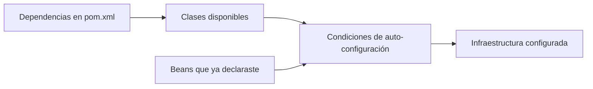

# Módulo 0: Fundamentos de Spring — IoC y DI

Cada tema se practica por separado con su propia repetición progresiva y su propio reto de memoria. El mecanismo de inyección de dependencias se documenta con comandos reales de Maven/Spring Boot y con el comportamiento exacto y verificable que produce cada anotación, sin sustituir el código Java por ningún otro lenguaje.


## Antes de comenzar: del equipo vacío a Spring Boot

Completa primero los fundamentos del track Java o asegúrate de entender clases, interfaces, excepciones y colecciones. Instala **JDK 25**, Git y un editor: IntelliJ IDEA Community es la opción más sencilla para Spring; VS Code con Extension Pack for Java y Spring Boot Extension Pack también funciona.

- **Windows:** instala Eclipse Temurin JDK 25, Git e IntelliJ; verifica `java --version` y `javac --version` en PowerShell.
- **macOS:** instala específicamente Temurin **25** desde [Adoptium](https://adoptium.net/installation/); un paquete sin versión puede instalar otro JDK. Usa `brew install git` para Git.
- **Ubuntu/Debian:** instala JDK **25** con las [instrucciones de Adoptium para Linux](https://adoptium.net/installation/linux/); la disponibilidad de `openjdk-25-jdk` depende de la distribución y sus repositorios. Instala Git con `sudo apt install git`.

No necesitas instalar Maven si el proyecto incluye `mvnw`/`mvnw.cmd`: ese *wrapper* descarga la versión correcta. En [start.spring.io](https://start.spring.io/) elige Java, Maven, **Spring Boot 4.1.2**, JDK 25 y la dependencia **Spring Web**. Usa artifact `academia-spring` y establece explícitamente el paquete **`com.example.demo`**, que usan los archivos de estas lecciones. Descarga, descomprime y ejecuta:

```bash
# macOS/Linux
./mvnw spring-boot:run

# Windows PowerShell
.\mvnw.cmd spring-boot:run
```

Visita `http://localhost:8080`. Un 404 significa que el servidor sí arrancó pero aún no existe una ruta; "connection refused" significa que no arrancó. Lee siempre desde la primera línea `Caused by:` del error, no solo la última.


**Herramienta y continuidad:** la ruta ejecutable de este curso utiliza **Maven**, no Gradle. `pom.xml` define el build y `mvnw` lo ejecuta. Conserva `academia-spring` de M0 a M7. En M1 la generación de un proyecto es un experimento separado; aplica después la configuración a tu proyecto base. Desde M8 hay laboratorios aislados con infraestructura propia; cada tema identifica su carpeta, y M12 integra una selección de esas piezas. No copies todas sus configuraciones sobre una sola aplicación.

**Regla de ejecución:** ejecuta los comandos desde la carpeta que contiene el `pom.xml` del proyecto indicado. Antes de cambiar de laboratorio, detén el servidor con Ctrl+C para liberar su puerto. Tras cambiar Java o recursos, reinicia `spring-boot:run` salvo que hayas configurado recarga explícitamente. Una práctica independiente puede cambiar el estado esperado: restaura la base indicada antes de continuar.

Gradle también está soportado por Spring Boot, pero estos laboratorios no incluyen `build.gradle(.kts)` ni `gradlew`. Para ejecutar Gradle sobre JDK 25 necesitas Gradle **9.1 o posterior**; el mínimo general 8.14 de Boot no basta para esa JVM. Consulta [requisitos Boot](https://docs.spring.io/spring-boot/system-requirements.html) y [compatibilidad Gradle/Java](https://docs.gradle.org/current/userguide/compatibility.html). Cambiar solo `mvnw` por `gradlew` no migra BOM, procesadores ni plugins.

**Referencia al cerrar M0–M1:** `examples/spring-fundamentos-rutaflow/README.md` reúne las clases finales y cinco pruebas. Úsala para comparar después de escribir tus archivos; no equivale a haber ejecutado cada cambio y fallo del recorrido.

## Aprende construyendo

### Tema 1: Inversión de control y el contenedor de Spring

Una API de envíos necesita separar la regla de negocio de la fuente de datos. Primero conectaremos un repositorio en memoria y un servicio; después una ruta HTTP permitirá observar el resultado. Necesitas clases, interfaces y constructores de Java.

**¿Por qué es importante?** Si el servicio crea su propio repositorio, cambiarlo para usar una base de datos o un reemplazo de prueba obliga a editar el servicio. Spring puede crear esos objetos y conectarlos en el punto donde se declara la dependencia.

**Diagrama interactivo:** [Spring crea y conecta los beans](/visuals/temas/spring-boot/modulo-0-tema-1-ioc.html).

#### Subtema 1.1: Declara el contrato y la primera implementación · 10 min

**1. Contexto**

Un servicio debe pedir el estado de un envío sin decidir dónde se guarda. La interfaz declara qué dato necesita; la clase concreta sabe responder por ahora desde memoria.

**2. Hazlo tú**

En el proyecto creado desde [Spring Initializr](https://start.spring.io/) (Java, Maven, dependencia Spring Web), conserva la clase principal que generó el sitio. Dentro de su mismo paquete `com.example.demo`, crea `src/main/java/com/example/demo/RepositorioEnvios.java`:

```java
package com.example.demo;

public interface RepositorioEnvios {
    String buscarEstado(String codigo);
}
```

Ahora crea `src/main/java/com/example/demo/RepositorioMemoriaEnvios.java`:

```java
package com.example.demo;

import org.springframework.stereotype.Repository;

@Repository
public class RepositorioMemoriaEnvios implements RepositorioEnvios {
    @Override
    public String buscarEstado(String codigo) {
        return "En ruta: " + codigo;
    }
}
```

Desde la carpeta raíz del proyecto, ejecuta:

```bash
./mvnw test
```

En Windows PowerShell, usa `./mvnw.cmd test`.

**Resultado esperado:** Maven termina con `BUILD SUCCESS`; Spring todavía no tiene ningún servicio que solicite este repositorio.

**Fallo deliberado:** cambia `implements RepositorioEnvios` por `implements RepositorioEnviosX`. **Diagnóstico:** el compilador indica que no encuentra ese tipo; revisa el nombre de la interfaz y restáuralo.

**3. Entiende**

`RepositorioEnvios` es el contrato. `RepositorioMemoriaEnvios` es una clase que lo cumple. `@Repository` permite que el escaneo de componentes de Spring la registre como un objeto administrado, llamado *bean*.

**4. Cierra**

Conserva ambos archivos y anota qué método ofrece el contrato. El siguiente paso hará que un servicio solicite esa interfaz.

#### Subtema 1.2: Deja que Spring conecte el servicio · 10 min

**1. Contexto**

El servicio usa el contrato, no crea la implementación. Spring encontrará un bean compatible y lo pasará al constructor.

**2. Hazlo tú**

Crea `src/main/java/com/example/demo/ServicioEnvios.java`:

```java
package com.example.demo;

import org.springframework.stereotype.Service;

@Service
public class ServicioEnvios {
    private final RepositorioEnvios repositorio;

    public ServicioEnvios(RepositorioEnvios repositorio) {
        this.repositorio = repositorio;
    }

    public String consultar(String codigo) {
        return repositorio.buscarEstado(codigo);
    }
}
```

Ejecuta desde la raíz del proyecto:

```bash
./mvnw spring-boot:run
```

En PowerShell, usa `./mvnw.cmd spring-boot:run`.

**Resultado esperado:** la aplicación termina de arrancar. El servicio recibe el repositorio sin escribir `new RepositorioMemoriaEnvios()`.

**Fallo deliberado:** quita `@Repository` y reinicia. **Diagnóstico:** el contenedor no encuentra un bean para `RepositorioEnvios`; la causa aparece como `NoSuchBeanDefinitionException` dentro del error de creación del servicio. Restaura la anotación.

**3. Entiende**

`@Service` registra el servicio; el constructor declara lo que necesita. `@SpringBootApplication` activa el escaneo desde el paquete de la clase principal hacia sus subpaquetes. Por eso mantuvimos las tres clases dentro de `com.example.demo`.

**4. Cierra**

Guarda el error observado y confirma que el servicio depende de la interfaz. En el siguiente paso permitirás llamar al servicio desde HTTP.

#### Subtema 1.3: Observa el cableado con una petición HTTP · 10 min

**1. Contexto**

Una ruta permite comprobar el recorrido completo: navegador o cliente HTTP → controlador → servicio → repositorio.

**2. Hazlo tú**

Crea `src/main/java/com/example/demo/EnviosController.java`:

```java
package com.example.demo;

import org.springframework.web.bind.annotation.GetMapping;
import org.springframework.web.bind.annotation.PathVariable;
import org.springframework.web.bind.annotation.RestController;

@RestController
public class EnviosController {
    private final ServicioEnvios servicio;

    public EnviosController(ServicioEnvios servicio) {
        this.servicio = servicio;
    }

    @GetMapping("/envios/{codigo}")
    public String consultar(@PathVariable String codigo) {
        return servicio.consultar(codigo);
    }
}
```

Detén el proceso anterior con Ctrl+C y vuelve a ejecutar `./mvnw spring-boot:run` para cargar el controlador nuevo. Con la aplicación activa, abre otra terminal y ejecuta:

```bash
curl http://localhost:8080/envios/RF-42
```

**Resultado esperado:** aparece `En ruta: RF-42`. Sigue el recorrido y señala en qué constructor Spring pasó cada dependencia.

**Fallo deliberado:** quita `@RestController` y repite la petición. **Diagnóstico:** el servidor responde 404 porque esa clase dejó de registrarse como controlador; el servicio sigue existiendo, pero la ruta no. Restaura la anotación.

**3. Entiende**

Spring Boot registra `@Repository`, `@Service` y `@RestController` como beans y conecta sus constructores. La inversión de control describe quién administra la creación; la inyección describe cómo llega una dependencia. Para una aplicación pequeña de una sola función, crear un contenedor completo puede ser innecesario.

**Límite y decisión:** este repositorio guarda el resultado en el código y pierde cualquier cambio al reiniciar. Sirve para observar el cableado, no para guardar envíos reales; una base de datos será necesaria cuando el dato deba sobrevivir al cierre.

**Práctica independiente:** modifica `RepositorioMemoriaEnvios.buscarEstado` para devolver `Entregado: <codigo>` y repite la petición con otro código. El servicio y el controlador no deberían cambiar. Al terminar, restaura `En ruta: <codigo>`: los tests del siguiente tema parten de ese valor.

**4. Cierra**

Guarda la respuesta de `curl` y los dos fallos diagnosticados. Explica con tus palabras por qué `ServicioEnvios` conoce el contrato, pero no la clase concreta.

**Fuente primaria:** [Spring Boot: Beans e inyección de dependencias](https://docs.spring.io/spring-boot/reference/using/spring-beans-and-dependency-injection.html); [requisitos de Spring Boot](https://docs.spring.io/spring-boot/system-requirements.html).

Este mismo mecanismo se usará en el proyecto integrador: el servicio de envíos declarará por constructor un repositorio y un cliente de notificaciones, sin decidir qué implementación recibe cada entorno.

### Tema 2: Inyección por constructor vs por campo

En el tema anterior, `ServicioEnvios` recibió el repositorio por su constructor. Aquí compararás esa forma con un campo `@Autowired` y comprobarás qué aprende cada tipo de prueba. Necesitas el proyecto y los archivos del Tema 1.

**¿Por qué es importante?** Una dependencia obligatoria debe estar lista al crear el servicio. La forma de recibirla afecta qué puede garantizar Java y qué tiene que preparar cada prueba.

#### Subtema 2.1: Prueba la regla sin iniciar Spring · 10 min

**1. Contexto**

Si solo quieres comprobar qué devuelve el servicio, puedes pasarle una implementación falsa del repositorio. No necesitas arrancar el contenedor.

**2. Hazlo tú**

Crea `src/test/java/com/example/demo/ServicioEnviosTest.java`:

```java
package com.example.demo;

import org.junit.jupiter.api.Test;
import static org.junit.jupiter.api.Assertions.assertEquals;

class ServicioEnviosTest {
    @Test
    void consultaElEstadoDelRepositorio() {
        RepositorioEnvios falso = codigo -> "Preparando: " + codigo;
        ServicioEnvios servicio = new ServicioEnvios(falso);

        assertEquals("Preparando: RF-42", servicio.consultar("RF-42"));
    }
}
```

Desde la raíz del proyecto, ejecuta:

```bash
./mvnw -Dtest=ServicioEnviosTest test
```

En PowerShell, usa `./mvnw.cmd -Dtest=ServicioEnviosTest test`.

**Resultado esperado:** Maven termina en `BUILD SUCCESS` y el test queda en verde.

**Fallo deliberado:** cambia el esperado a `Entregado: RF-42`. **Diagnóstico:** el test informa que recibió `Preparando: RF-42`; el servicio está usando el resultado del repositorio falso. Restaura el valor esperado.

**3. Entiende**

El constructor obliga a entregar `RepositorioEnvios` cuando se crea `ServicioEnvios`. El test usa `new` porque está probando esa clase directamente; no necesita que Spring cree el servicio.

**4. Cierra**

Guarda el test y explica qué resultado controla el repositorio falso. El siguiente subtema usará Spring para crear una variante con inyección por campo.

#### Subtema 2.2: Observa la inyección de campo con el contexto · 10 min

**1. Contexto**

Un campo `@Autowired` se completa cuando Spring crea el bean. Para comprobar esa conexión, la prueba sí debe iniciar el contexto de la aplicación.

**2. Hazlo tú**

Crea `src/main/java/com/example/demo/ServicioEnviosCampo.java`:

```java
package com.example.demo;

import org.springframework.beans.factory.annotation.Autowired;
import org.springframework.stereotype.Service;

@Service
public class ServicioEnviosCampo {
    @Autowired
    private RepositorioEnvios repositorio;

    public String consultar(String codigo) {
        return repositorio.buscarEstado(codigo);
    }
}
```

Crea `src/test/java/com/example/demo/ServicioEnviosCampoTest.java`:

```java
package com.example.demo;

import org.junit.jupiter.api.Test;
import org.springframework.beans.factory.annotation.Autowired;
import org.springframework.boot.test.context.SpringBootTest;
import static org.junit.jupiter.api.Assertions.assertEquals;

@SpringBootTest
class ServicioEnviosCampoTest {
    @Autowired
    private ServicioEnviosCampo servicio;

    @Test
    void springConectaElRepositorioAlServicio() {
        assertEquals("En ruta: RF-42", servicio.consultar("RF-42"));
    }
}
```

Ejecuta:

```bash
./mvnw -Dtest=ServicioEnviosCampoTest test
```

**Resultado esperado:** el test pasa. A diferencia del test anterior, `@SpringBootTest` inicia Spring para crear el servicio y asignar el repositorio.

**Fallo deliberado:** quita `@Autowired` del campo y ejecuta el test. **Diagnóstico:** al llamar `consultar`, el campo sigue `null` y aparece `NullPointerException`; restáuralo para que Spring lo asigne.

**3. Entiende**

La inyección por campo funciona, pero Java no obliga a asignar el campo y no puede ser `final`. También oculta una dependencia obligatoria. Puedes probarla sin contexto usando otras técnicas, pero este ejemplo usa el contexto porque quiere verificar que Spring conecte los beans.

**4. Cierra**

Anota cuál de los dos tests arranca el contexto y qué comportamiento verifica. El último paso te ayudará a elegir la prueba según la pregunta.

#### Subtema 2.3: Elige la prueba que responde tu pregunta · 10 min

**1. Contexto**

Un test puede comprobar una regla de una clase o comprobar además que Spring detecta y conecta los beans. Son preguntas diferentes.

**2. Hazlo tú**

Ejecuta por separado `src/test/java/com/example/demo/ServicioEnviosTest.java` y `src/test/java/com/example/demo/ServicioEnviosCampoTest.java` desde la raíz del proyecto:

```bash
./mvnw -Dtest=ServicioEnviosTest test
./mvnw -Dtest=ServicioEnviosCampoTest test
```

**Resultado esperado:** ambos terminan en `BUILD SUCCESS`; el primero crea su servicio directamente y el segundo carga el contexto Spring.

**Fallo deliberado:** quita `@Service` de `ServicioEnviosCampo` y ejecuta el segundo test. **Diagnóstico:** Spring no puede inyectar ese bean en la prueba; restaura `@Service`. El test unitario de constructor debe seguir pasando, porque no depende del registro del bean.

**3. Entiende**

Para una regla de negocio simple, el constructor facilita un test rápido con una dependencia falsa. Usa `@SpringBootTest` cuando la pregunta incluya configuración, escaneo o conexión entre beans. Los campos se pueden probar sin contexto mediante Mockito, setters o reflexión; por eso no es correcto decir que la inyección por campo vuelve imposible el test unitario. El equipo de Spring recomienda constructor para dependencias requeridas: permite campos `final` y evita que el objeto se cree incompleto.

```text
┌── Test unitario ──────────┐   ┌── Test de contexto ──────┐
│ test → servicio → falso   │   │ test → Spring → servicio │
│ sin crear el contenedor   │   │        → repositorio     │
└───────────────────────────┘   └─────────────────────────┘
```

**4. Cierra**

**Práctica independiente:** modifica la respuesta del repositorio falso y actualiza el test unitario. Después registra cuál de las dos pruebas ejecutaste y qué demuestra cada una. En el proyecto integrador, usa pruebas unitarias para reglas del servicio y una prueba con contexto cuando necesites verificar el cableado. El siguiente tema separa los estereotipos de Spring y las funciones que trae cada starter.

**Fuentes primarias:** [inyección de dependencias en Spring Boot](https://docs.spring.io/spring-boot/reference/using/spring-beans-and-dependency-injection.html), [pruebas de aplicaciones Spring Boot](https://docs.spring.io/spring-boot/reference/testing/spring-boot-applications.html), [inyección de dependencias en Spring Framework](https://docs.spring.io/spring-framework/reference/core/beans/dependencies/factory-collaborators.html).

**Decisión práctica:** prefiere constructor para dependencias obligatorias. La inyección por campo no es imposible ni está prohibida; el constructor hace visibles los requisitos y deja que el compilador proteja la referencia con `final`.

### Tema 3: Estereotipos, autoconfiguración y scopes

En los temas anteriores Spring encontró beans por sus anotaciones y conectó sus constructores. Ahora revisarás qué significan esas anotaciones, qué prepara Spring Boot al detectar dependencias y cómo cambia el ciclo de vida de un bean.

**¿Por qué es importante?** Un starter puede configurar partes de la aplicación automáticamente y un bean compartido puede atender muchas operaciones. Entender esas reglas evita depender de magia o compartir estado por accidente.

**Conocimiento previo:** Temas 1 y 2 de este módulo.

#### Subtema 3.1: Asigna a cada estereotipo un papel claro · 10 min

**1. Contexto**

Spring reconoce `@Component`, `@Service`, `@Repository` y `@Controller` como componentes gestionados. Las anotaciones específicas dejan claro qué papel cumple cada clase.

**2. Hazlo tú**

En `src/main/java/com/example/demo/ServicioEnvios.java`, cambia temporalmente `@Service` por la anotación genérica `@Component` y arranca la aplicación:

```java
import org.springframework.stereotype.Component;

@Component
public class ServicioEnvios {
    // Conserva el constructor y los métodos que ya escribiste.
}
```

Ejecuta `./mvnw spring-boot:run` y, desde otra terminal, consulta `curl http://localhost:8080/envios/RF-42`.

**Resultado esperado:** la ruta aún responde `En ruta: RF-42`; ambas anotaciones registran la clase como componente.

**Fallo deliberado:** elimina `@Component` y vuelve a arrancar. **Diagnóstico:** `EnviosController` requiere `ServicioEnvios`, pero el escaneo ya no lo registró; restaura `@Service`.

**3. Entiende**

`@Service` comunica que la clase contiene lógica de aplicación; `@Repository` señala acceso a datos y participa en la traducción de excepciones de persistencia cuando esa infraestructura está configurada; `@Controller` o `@RestController` atiende la capa web. `@Component` es la opción general.

**4. Cierra**

Guarda la anotación específica y explica por qué hace más claro el papel de la clase aunque varias sean reconocidas por el escaneo.

**Práctica independiente:** elige `@Service`, `@Repository` o `@Component` para una clase de validación de direcciones y explica qué información comunica esa elección al equipo.

#### Subtema 3.2: Inspecciona lo que aporta una dependencia · 10 min

**1. Contexto**

Spring Boot puede configurar infraestructura cuando las bibliotecas necesarias están en el proyecto y no has reemplazado ya esa configuración. El starter agrupa dependencias comunes; no configura todas las aplicaciones de manera idéntica.

**2. Hazlo tú**

Abre `pom.xml` y localiza la dependencia Spring Web agregada por Spring Initializr. Con Spring Boot 4 el artefacto del starter MVC es `spring-boot-starter-webmvc`; los proyectos de otras versiones pueden tener otro nombre. Usa el que aparece en tu archivo. Desde la raíz del proyecto, imprime el árbol que Maven resolvió:

```bash
./mvnw dependency:tree
```

Busca los módulos relacionados con Spring MVC y el servidor embebido. Los nombres concretos pueden variar según la versión de Spring Boot y el starter generado.

**Resultado esperado:** el árbol muestra el starter directo y las bibliotecas transitivas que hacen posible el endpoint HTTP.

**Fallo deliberado:** quita del `pom.xml` la dependencia web y ejecuta `./mvnw test`. **Diagnóstico:** el proyecto ya no encuentra las clases web importadas por `EnviosController`; restaura la dependencia y sincroniza Maven.

**3. Entiende**

`@SpringBootApplication` combina configuración, escaneo de componentes y auto-configuración. Boot usa dependencias, clases y beans existentes para decidir qué configuración condicional aplica. El starter reúne dependencias típicas; la referencia de la versión del proyecto explica qué módulos activa.

**4. Cierra**

Guarda una captura o copia del fragmento de árbol que explica cómo llega el soporte web al proyecto. El siguiente subtema cambia el tiempo de vida de un objeto.



#### Subtema 3.3: Pide un bean nuevo cuando de verdad lo necesitas · 15 min

**1. Contexto**

`singleton` es el scope predeterminado: una instancia por definición de bean y contenedor. `prototype` crea una instancia nueva cuando el contenedor recibe cada solicitud de ese bean. Si un bean singleton recibe un prototype por constructor, recibe solo una instancia al crearse; la anotación no la renueva en cada petición HTTP.

**2. Hazlo tú**

Crea `src/main/java/com/example/demo/GeneradorReporte.java`:

```java
package com.example.demo;

import org.springframework.context.annotation.Scope;
import org.springframework.stereotype.Component;

@Component
@Scope("prototype")
public class GeneradorReporte {
    private final String id = java.util.UUID.randomUUID().toString();

    public String id() {
        return id;
    }
}
```

Crea `src/main/java/com/example/demo/ServicioReportes.java`:

```java
package com.example.demo;

import org.springframework.beans.factory.ObjectProvider;
import org.springframework.stereotype.Service;

@Service
public class ServicioReportes {
    private final GeneradorReporte recibidoAlCrear;
    private final ObjectProvider<GeneradorReporte> generadores;

    public ServicioReportes(
            GeneradorReporte recibidoAlCrear,
            ObjectProvider<GeneradorReporte> generadores) {
        this.recibidoAlCrear = recibidoAlCrear;
        this.generadores = generadores;
    }

    public String comparar() {
        return "directo=" + recibidoAlCrear.id()
                + "; nuevos=" + generadores.getObject().id()
                + "," + generadores.getObject().id();
    }
}
```

Crea `src/main/java/com/example/demo/ReporteController.java`:

```java
package com.example.demo;

import org.springframework.web.bind.annotation.GetMapping;
import org.springframework.web.bind.annotation.RestController;

@RestController
public class ReporteController {
    private final ServicioReportes servicio;

    public ReporteController(ServicioReportes servicio) {
        this.servicio = servicio;
    }

    @GetMapping("/reporte/comparar")
    public String comparar() {
        return servicio.comparar();
    }
}
```

Arranca la aplicación con `./mvnw spring-boot:run` y consulta dos veces desde otra terminal:

```bash
curl http://localhost:8080/reporte/comparar
```

**Resultado esperado:** en cada respuesta, `directo` conserva el mismo ID. Los dos IDs bajo `nuevos` son distintos, y cambian al repetir la petición porque `ObjectProvider.getObject()` pide otra instancia al contenedor.

**Fallo deliberado:** cambia `@Scope("prototype")` por `@Scope("singleton")` y repite la petición. **Diagnóstico:** los IDs generados por el provider pasan a ser iguales; el scope vuelve a compartir esa instancia.

**3. Entiende**

`ObjectProvider` permite pedir otra instancia cuando el método se ejecuta. El campo `recibidoAlCrear` muestra la diferencia: Spring inyectó un prototype una vez al crear el servicio singleton. `prototype` tampoco significa “uno por petición”; Spring tiene un scope `request` separado para ese ciclo de vida. Un singleton mutable compartido necesita protección frente a concurrencia.

**4. Cierra**

Guarda dos respuestas y marca cuáles IDs se repiten. Elige `singleton` para objetos sin estado por operación y considera `prototype` si el contenedor debe crear otro objeto cada vez que se lo solicitas; para estado HTTP, estudia el scope `request`. Quien recibe un bean `prototype` debe liberar los recursos que retenga cuando termina de usarlo.

**Práctica independiente:** cambia el texto que devuelve `ServicioReportes`, vuelve a consultar el endpoint y explica qué ID permanece fijo y cuáles se crean de nuevo.

**Fuentes primarias:** [estereotipos y escaneo de componentes](https://docs.spring.io/spring-framework/reference/core/beans/classpath-scanning.html), [scopes y dependencias prototype](https://docs.spring.io/spring-framework/reference/core/beans/factory-scopes.html), [auto-configuración condicional](https://docs.spring.io/spring-boot/reference/using/auto-configuration.html), [aplicaciones web y Spring MVC](https://docs.spring.io/spring-boot/reference/web/servlet.html).

---

Los estereotipos (`@Service`, `@Repository`, `@Controller`) que uses aquí son los que organizan las clases del proyecto integrador de este track (microservicio productivo, Módulo 12).

## Ruta de proyecto progresivo desde carpeta vacía

No crees un proyecto desechable por módulo. Conserva un único repositorio que evoluciona durante todo el track y etiqueta cada hito (`git tag modulo-N`). Empieza generando `academia-spring` en `start.spring.io`, descomprímelo en una carpeta vacía y ejecuta `git init`. Ejecuta el comando paso a paso, inspecciona los archivos generados y registra versiones y precondiciones en el README.

| Hito | Evolución acumulativa | Evidencia antes de avanzar |
|---|---|---|
| Base | API y configuración. | Arranque reproducible, commit limpio y prueba mínima. |
| Aplicación | datos, seguridad y mensajería. | Casos normales, límite y error automatizados. |
| Integración | Conecta capas y reemplaza dobles por infraestructura controlada. | Diagrama, contratos y prueba de integración. |
| Experto | contratos, observabilidad y resiliencia. | Perfil o threat model, telemetría y runbook de recuperación. |

Al iniciar cada laboratorio crea una rama `modulo-N`, implementa el incremento, verifica el criterio de éxito y fusiona solo con pruebas verdes. Si un módulo necesita un experimento aislado, colócalo en `experiments/modulo-N/`; el producto acumulativo permanece ejecutable. Al terminar, otra persona debe poder clonar el repositorio y reproducir el último hito siguiendo únicamente el README.


## Laboratorio práctico

**Objetivo del laboratorio:** construir una aplicación Spring Boot mínima con beans inyectados por constructor y scopes correctos.

**Requisitos previos:** conocimientos de Java (track de Java) recomendados.

| Paso | Acción | Código | Explicación |
|---|---|---|---|
| 1 | Crear un proyecto con start.spring.io y arrancarlo | `./mvnw spring-boot:run` | Verifica el arranque |
| 2 | Definir `@Service` y `@Repository` con inyección por constructor | Ver Tema 1 | Verifica la conexión automática |
| 3 | Escribir un test unitario sin levantar el contenedor | Ver Tema 2 | `new ServicioEnvios(falso)` directo |
| 4 | Declarar un bean `prototype` y confirmar instancias distintas | Ver Tema 3 | Compara contra el default `singleton` |
| 5 | Investigar qué autoconfigura el starter web generado para el proyecto | Ver Tema 3 | Documenta las dependencias que trae |

**Verificación:** el laboratorio se considera exitoso si el servicio y el repositorio se conectan correctamente por inyección de constructor, si el test unitario corre sin contenedor, y si el bean `prototype` produce una instancia distinta en cada resolución mientras el `singleton` reutiliza la misma.

**Errores comunes y soluciones**

- **Usar inyección por campo por costumbre.** Prefiere inyección por constructor para inmutabilidad y testabilidad sin contenedor.
- **Confundir `@Service` con una anotación funcionalmente distinta de `@Component`.** `@Repository` identifica persistencia y se usa para traducción de excepciones cuando esa infraestructura está activa.
- **Asumir que `prototype` significa una instancia por petición HTTP.** Se crea una instancia nueva por solicitud al contenedor; el scope web `request` tiene el ciclo de vida HTTP.

---
