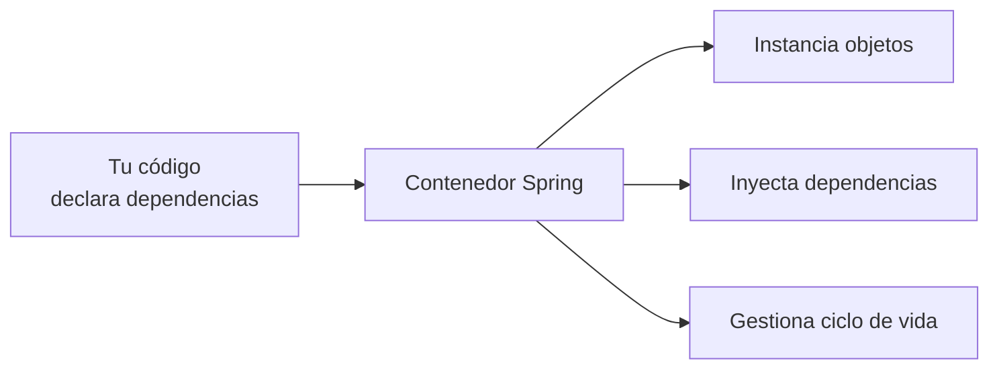
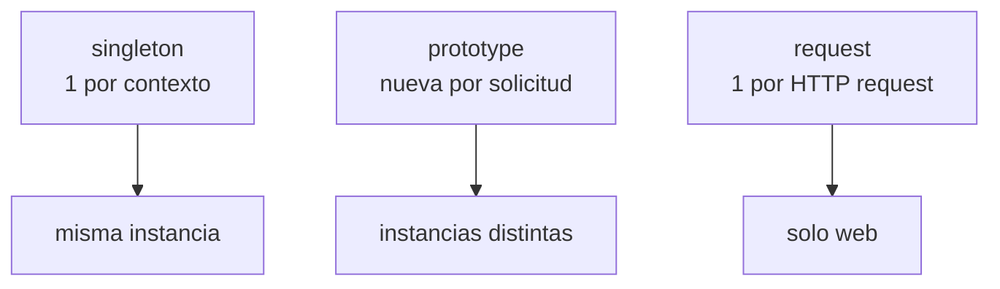
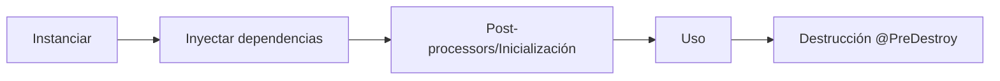
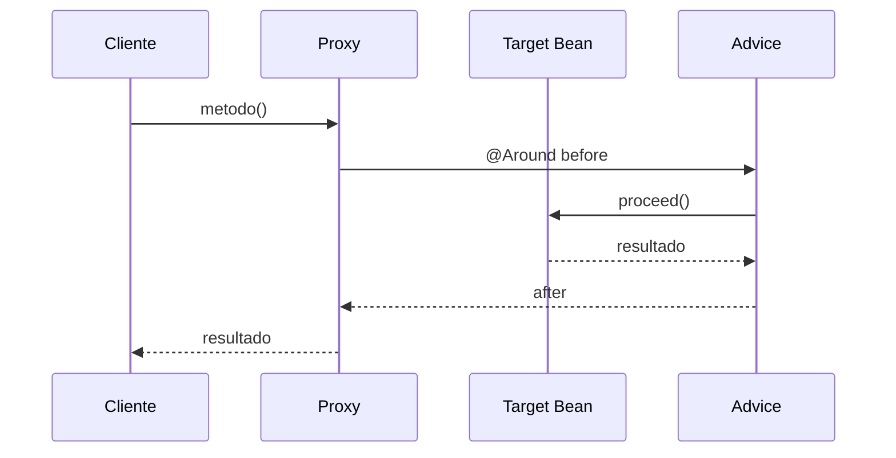

# Módulo 0: Fundamentos de Spring: IoC, DI y AOP

Antes de Spring Boot, hay Spring Framework: un contenedor que crea objetos, conecta dependencias y aplica comportamientos transversales mediante proxies. Spring Boot acelera la configuración, pero el modelo mental correcto empieza aquí. Si entiendes IoC, DI, ciclo de vida, proxies y AOP, puedes diagnosticar por qué un bean no se inyecta, por qué una transacción no aplica o por qué una anotación parece “ignorada”.

**Entorno de referencia verificado (2026-05-22):** JDK 27.0.1.0.2; smoke tests Spring Boot 3.5.0 con `spring-boot-starter` y `spring-boot-starter-test` mediante Maven 3.10.0. Ejemplos mínimos de concepto se muestran como Java puro cuando la idea es independiente del contenedor; ejemplos Spring se presentan con código que el estudiante escribe y comandos Maven/Java claros.

## Aprende construyendo

### Tema 1: Inversión de control y el contenedor de Spring · Básico · 30 min

Caso guía: `ServicioEnvios` necesita consultar un repositorio. Si hace `new RepoMem()`, queda acoplado a una implementación y no se puede sustituir fácilmente en tests.

#### Inversión de control (IoC)

**Definición formal.** IoC es un principio donde la creación, composición y ciclo de vida de objetos son controlados por un contenedor/framework en lugar del código de negocio.

**Cómo funciona por dentro.** Tu código declara qué necesita (dependencias, configuración, callbacks). El contenedor decide cuándo instanciar, cómo inyectar y cuándo destruir. La inversión está en el control del flujo de construcción.



**Cuándo usar / cuándo no.** Úsalo cuando hay múltiples componentes y dependencias. No uses contenedor para scripts minúsculos sin composición; la complejidad debe justificarse.

**Ejemplo mínimo enfocado (Java puro, ejecutable).**

```bash
mkdir -p java-sb0-ioc
cd java-sb0-ioc
```

Crea el archivo `DemoIoc.java`:

```java
interface Repo { String estado(String codigo); }
class RepoMem implements Repo { public String estado(String codigo) { return "ok:" + codigo; } }
class Servicio {
  private final Repo repo;
  Servicio(Repo repo) { this.repo = repo; }
  String consultar(String codigo) { return repo.estado(codigo); }
}
public class DemoIoc {
  public static void main(String[] args) {
    Servicio s = new Servicio(new RepoMem());
    System.out.println(s.consultar("A1"));
  }
}
```

```bash
javac DemoIoc.java
java DemoIoc
```

**Error común.** Hacer `new` dentro de la clase de negocio. Síntoma: tests difíciles y acoplamiento. Corrección: depender de abstracción e inyectar.

**Verificación (JDK 27, 2026-05-22).** `ok:A1`.

#### `ApplicationContext` y beans

**Definición formal.** `ApplicationContext` es el contenedor de Spring que administra beans. Un bean es un objeto administrado por ese contenedor.

**Contrato.** El contenedor crea beans, resuelve dependencias, aplica post-processors/proxies y expone beans por tipo/nombre. Si no puede resolver una dependencia, falla al arrancar (fail-fast).

**Ejemplo mínimo Spring Boot (ejecutable).**

```bash
mkdir -p sb0-ctx/src/main/java/com/academia
cd sb0-ctx
```

Crea el archivo `pom.xml`:

```xml
<project xmlns="http://maven.apache.org/POM/4.0.0" xmlns:xsi="http://www.w3.org/2001/XMLSchema-instance"
 xsi:schemaLocation="http://maven.apache.org/POM/4.0.0 https://maven.apache.org/xsd/maven-4.0.0.xsd">
  <modelVersion>4.0.0</modelVersion>
  <parent><groupId>org.springframework.boot</groupId><artifactId>spring-boot-starter-parent</artifactId><version>3.5.0</version><relativePath/></parent>
  <groupId>com.academia</groupId><artifactId>sb0-ctx</artifactId><version>0.0.1</version>
  <properties><java.version>21</java.version></properties>
  <dependencies>
    <dependency><groupId>org.springframework.boot</groupId><artifactId>spring-boot-starter</artifactId></dependency>
  </dependencies>
  <build><plugins><plugin><groupId>org.springframework.boot</groupId><artifactId>spring-boot-maven-plugin</artifactId></plugin></plugins></build>
</project>
```

Crea el archivo `src/main/java/com/academia/Demo.java`:

```java
package com.academia;

import org.springframework.boot.SpringApplication;
import org.springframework.boot.autoconfigure.SpringBootApplication;
import org.springframework.stereotype.Component;
import org.springframework.stereotype.Service;

interface Repo { String estado(String c); }

@Component
class RepoMem implements Repo {
  public String estado(String c) { return "ok:" + c; }
}

@Service
class ServicioEnvios {
  private final Repo repo;
  ServicioEnvios(Repo repo) { this.repo = repo; }
  String consultar(String c) { return repo.estado(c); }
}

@SpringBootApplication
public class Demo {
  public static void main(String[] args) {
    var ctx = SpringApplication.run(Demo.class, args);
    System.out.println(ctx.getBean(ServicioEnvios.class).consultar("A1"));
    ctx.close();
  }
}
```

```bash
mvn -q -DskipTests package
java -jar target/sb0-ctx-0.0.1.jar
```

**Error común.** Bean fuera de component scan. Síntoma: `NoSuchBeanDefinitionException`. Corrección: paquete bajo `@SpringBootApplication` o `@ComponentScan`.

**Verificación (Spring Boot 3.5.0, JDK 27, Maven 3.10.0, 2026-05-22).** Salida observada incluye `ok:A1` al final del arranque.

### Tema 2: Inyección por constructor vs por campo · Intermedio · 30 min

Caso guía: necesitas test unitario sin contexto Spring.

#### Inyección por constructor

**Definición formal.** Las dependencias se reciben como parámetros del constructor y se asignan a campos, normalmente `final`.

**Por qué es preferible.** Hace dependencias explícitas, permite inmutabilidad, falla temprano si falta algo y simplifica tests.

**Ejemplo mínimo enfocado (ejecutable).**

```bash
mkdir -p java-sb0-ctor
cd java-sb0-ctor
```

Crea el archivo `DemoCtor.java`:

```java
interface Repo { String get(); }
class Servicio {
  private final Repo repo;
  Servicio(Repo repo) { this.repo = repo; }
  String run() { return repo.get(); }
}
public class DemoCtor {
  public static void main(String[] args) {
    System.out.println(new Servicio(() -> "mock").run());
  }
}
```

```bash
javac DemoCtor.java
java DemoCtor
```

**Error común.** Field injection (`@Autowired` en campo) impide construir el objeto en test puro sin reflexión. Corrección: constructor injection.

**Verificación (JDK 27, 2026-05-22).** `mock`.

### Tema 3: Estereotipos, autoconfiguración y scopes · Intermedio · 35 min

Caso guía: clasificar componentes y entender cuándo Spring crea una o varias instancias.

#### Estereotipos

**Definición formal.** `@Component`, `@Service`, `@Repository`, `@Controller/@RestController` son estereotipos. Técnicamente varios son componentes; semánticamente comunican rol.

**Ejemplo mínimo.** En el ejemplo de Tema 1, `RepoMem` es `@Component` y `ServicioEnvios` es `@Service`.

**Error común.** Usar `@Service` para todo. Corrección: usar el estereotipo que comunica intención y aprovecha semántica (p.ej. `@Repository` traduce excepciones de persistencia).

#### Autoconfiguración

**Definición formal.** Spring Boot autoconfigura beans según el classpath, propiedades y condiciones (`@Conditional*`).

**Cómo funciona por dentro.** Boot inspecciona starters/dependencias y activa configuraciones condicionales. Puedes ver el reporte con `--debug` o Actuator conditions.

**Nota de verificación.** La autoconfiguración completa se observa al arrancar una app Boot; el smoke de Módulo 0 confirma arranque con starter.

#### Scopes

**Definición formal.** Scope define cuántas instancias y vida útil tiene un bean: `singleton` (default), `prototype`, `request`, `session`, etc.



**Ejemplo mínimo enfocado (Java puro conceptual).**

```bash
mkdir -p java-sb0-scope
cd java-sb0-scope
```

Crea el archivo `DemoScope.java`:

```java
import java.util.function.Supplier;
public class DemoScope {
  public static void main(String[] args) {
    Object singleton = new Object();
    Supplier<Object> prototype = Object::new;
    System.out.println(singleton == singleton);
    System.out.println(prototype.get() == prototype.get());
  }
}
```

```bash
javac DemoScope.java
java DemoScope
```

**Error común.** Guardar estado mutable en singleton sin control. Síntoma: data races/fugas entre requests. Corrección: stateless singleton o scope adecuado.

**Verificación (JDK 27, 2026-05-22).** `true`, `false`.

### Tema 4: Ciclo de vida de los beans y apagado ordenado · Intermedio · 45 min

Caso guía: abrir y cerrar un pool/cliente al iniciar y detener la app.

#### Ciclo de vida

**Definición formal.** El contenedor instancia, inyecta dependencias, ejecuta callbacks de inicialización (`@PostConstruct`, `InitializingBean`, `initMethod`), usa el bean y ejecuta callbacks de destrucción (`@PreDestroy`, `DisposableBean`).



**Ejemplo mínimo (Java puro simulando hook).**

```bash
mkdir -p java-sb0-life
cd java-sb0-life
```

Crea el archivo `DemoLife.java`:

```java
class Recurso implements AutoCloseable {
  Recurso(){ System.out.println("init"); }
  public void close(){ System.out.println("close"); }
}
public class DemoLife {
  public static void main(String[] args) {
    try (Recurso r = new Recurso()) {
      System.out.println("uso");
    }
  }
}
```

```bash
javac DemoLife.java
java DemoLife
```

**Error común.** Abrir recursos en constructor y no cerrarlos al apagar. Corrección: hooks de ciclo de vida o `AutoCloseable`/`DisposableBean`.

**Verificación (JDK 27, 2026-05-22).** `init`, `uso`, `close`.

### Tema 5: Proxies y AOP: `@Aspect`, `@Around` y `BeanPostProcessor` · Intermedio · 45 min

Caso guía: medir tiempo de ejecución sin ensuciar cada método.

#### AOP y proxies

**Definición formal.** AOP (Aspect-Oriented Programming) separa concerns transversales (logging, seguridad, transacciones). Spring AOP usa proxies en runtime (JDK dynamic proxy o CGLIB).

**Cómo funciona por dentro.** El contenedor envuelve el bean en un proxy. Las llamadas que pasan por el proxy pueden ejecutar advice antes/después/alrededor. Llamadas internas `this.metodo()` pueden saltarse el proxy.



**Ejemplo mínimo (concepto con proxy JDK, ejecutable).**

```bash
mkdir -p java-sb0-proxy
cd java-sb0-proxy
```

Crea el archivo `DemoProxy.java`:

```java
import java.lang.reflect.*;
interface Svc { String run(); }
class Real implements Svc { public String run(){ return "ok"; } }
public class DemoProxy {
  public static void main(String[] args) {
    Svc real = new Real();
    Svc proxied = (Svc) Proxy.newProxyInstance(Svc.class.getClassLoader(), new Class[]{Svc.class},
      (p,m,a) -> { System.out.println("before"); Object r = m.invoke(real,a); System.out.println("after"); return r; });
    System.out.println(proxied.run());
  }
}
```

```bash
javac DemoProxy.java
java DemoProxy
```

**Error común.** Llamada self-invocation y esperar que AOP aplique. Corrección: pasar por el proxy, separar bean, o usar AspectJ weaving según caso.

**Verificación (JDK 27, 2026-05-22).** `before`, `after`, `ok`.

### Tema 6: Varias implementaciones (`@Primary`, `@Qualifier`) y expresiones SpEL · Intermedio · 40 min

Caso guía: dos implementaciones de `Repo` y una propiedad calculada por SpEL.

#### `@Primary` y `@Qualifier`

**Definición formal.** Cuando hay múltiples candidatos, `@Primary` define el preferido por defecto; `@Qualifier` selecciona uno específico por nombre/calificador.

**Ejemplo mínimo (ejecutable, Java puro simulando selección).**

```bash
mkdir -p java-sb0-qual
cd java-sb0-qual
```

Crea el archivo `DemoQual.java`:

```java
import java.util.*;
interface Repo { String name(); }
class A implements Repo { public String name(){ return "A"; } }
class B implements Repo { public String name(){ return "B"; } }
public class DemoQual {
  public static void main(String[] args) {
    Map<String, Repo> beans = Map.of("a", new A(), "b", new B());
    Repo primary = beans.get("a");
    Repo qualified = beans.get("b");
    System.out.println(primary.name());
    System.out.println(qualified.name());
  }
}
```

```bash
javac DemoQual.java
java DemoQual
```

**Error común.** Dos beans del mismo tipo sin `@Primary` ni `@Qualifier`. Síntoma: `NoUniqueBeanDefinitionException`. Corrección: desambiguar.

**Verificación (JDK 27, 2026-05-22).** `A`, `B`.

#### SpEL

**Definición formal.** Spring Expression Language permite evaluar expresiones en anotaciones/configuración (`@Value("#{...}")`).

**Error común.** Meter lógica de negocio compleja en SpEL. Corrección: SpEL para configuración simple; lógica real en código testeable.

### Tema 7: Java moderno para Spring Boot: virtual threads, scoped values, pattern matching y AOT/arranque · Intermedio · 60 min

Caso guía: un endpoint Spring Boot hace I/O bloqueante a base de datos y a un servicio externo; necesitas decidir qué mejora de Java moderno ayuda sin reescribir todo a reactivo.

#### Virtual threads

**Definición formal.** Un virtual thread (Java 21+, JEP 444) es un hilo ligero gestionado por la JVM que se monta/desmonta de un carrier thread al bloquearse en I/O.

**Contrato.** Útil para alta concurrencia I/O con modelo thread-per-request. No acelera CPU-bound. Limita recursos downstream (DB, pools, APIs) con semáforos/bulkheads/timeouts.

```java
try (var exec = java.util.concurrent.Executors.newVirtualThreadPerTaskExecutor()) {
  exec.submit(() -> System.out.println(Thread.currentThread().isVirtual()));
}
```

**Cuándo usarlo / cuándo no.** Úsalo en MVC con I/O bloqueante. No lo uses sin límites de concurrencia sobre DB o servicios externos.

**Error común.** miles de virtual threads golpeando la DB. **Síntoma.** timeouts/saturación. **Causa.** cuello de botella downstream. **Corrección.** `Semaphore`/bulkhead/pool. **Señal observable.** conexiones DB al máximo.

#### Scoped values

**Definición formal.** Scoped values (Java 25, JEP 506, final) comparten datos inmutables en un scope de ejecución y con hilos hijos, con mejor modelo que `ThreadLocal` para muchos casos.

```java
static final ScopedValue<String> REQUEST_ID = ScopedValue.newInstance();
// ScopedValue.where(REQUEST_ID, "req-1").run(() -> ...);
```

**Cuándo usarlo / cuándo no.** Úsalo para contexto inmutable (request/trace/tenant). No lo uses para estado mutable por hilo.

**Nota de verificación.** JEP 506 es final en JDK 25 según OpenJDK. No ejecutado en este entorno con JDK 25 dedicado; el contrato esperado es binding acotado al scope y propagación controlada.

#### Pattern matching y Flexible Constructor Bodies

**Definición formal.** Pattern matching reduce casting/ramificación; Flexible Constructor Bodies (Java 25, JEP 513, final) permite validar/asignar campos antes de `super(...)`/`this(...)` sin tocar la instancia en construcción.

**Caso real.** DTOs/reglas de dominio con switches exhaustivos y constructores que fallan rápido antes de inicializar el padre.

#### AOT, Leyden y CRaC

**Definición formal.** AOT acelera arranque/warmup precalculando trabajo. JDK 25 incluye JEP 514 (AOT command-line ergonomics) y JEP 515 (AOT method profiling). Spring/CRaC y Native Image son opciones con restricciones.

**Cuándo usarlo / cuándo no.** Úsalo cuando cold start importa (autoscaling/K8s/serverless). No lo uses por defecto sin medir build, compatibilidad, observabilidad y memoria.

**Error común.** asumir que native/AOT es gratis. **Síntoma.** fallos por reflexión/configuración, builds lentos. **Corrección.** medir y mantener smoke tests. **Señal observable.** arranque mejora pero throughput o compatibilidad empeora.

**Verificación (JDK 27.0.1.0.2, 2026-05-22).**

Crea el archivo `DemoVt.java`:

```java
public class DemoVt {
  public static void main(String[] args) throws Exception {
    try (var exec = java.util.concurrent.Executors.newVirtualThreadPerTaskExecutor()) {
      var f = exec.submit(() -> Thread.currentThread().isVirtual());
      System.out.println(f.get());
    }
  }
}
```

```bash
javac DemoVt.java
java DemoVt
```

Salida esperada: `true`. **Nota de verificación:** JEP 506/513/514/515 no se ejecutaron en JDK 25 en esta sesión; se documentan como features finales/entregadas en JDK 25 según OpenJDK.

## Cierre

Spring es un contenedor de objetos con ciclo de vida, inyección y proxies. Dominar este modelo evita la mayoría de bugs “mágicos”. Java moderno agrega herramientas útiles, pero cada una exige medir límites y trade-offs.

## Checklist

- Entiendo IoC/DI y prefiero constructor injection.
- Sé qué es un bean, scope y ciclo de vida.
- Entiendo que AOP en Spring suele ser proxy y tiene límites (self-invocation).
- Sé desambiguar beans con `@Primary`/`@Qualifier`.
- Evalúo virtual threads/AOT/scoped values con evidencia y límites.
