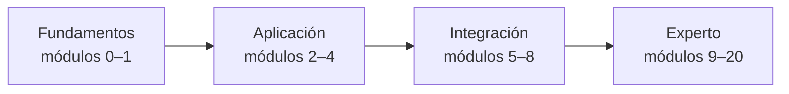
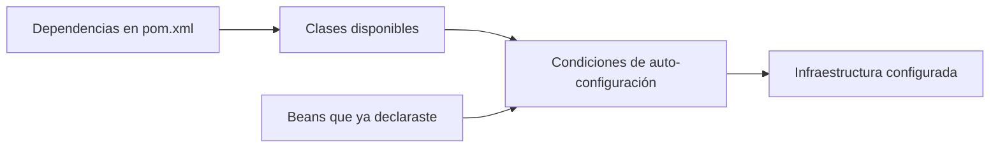
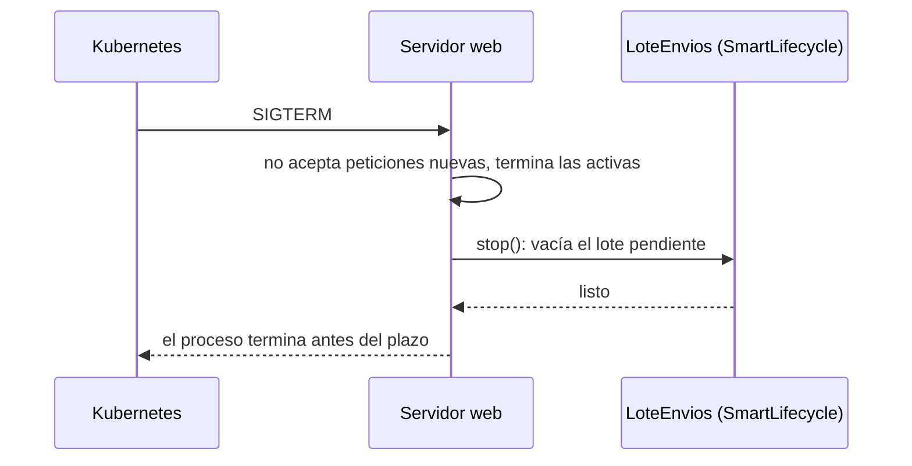
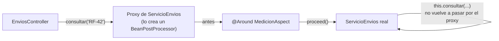

# Módulo 0: Fundamentos de Spring: IoC, DI y AOP

Cada tema se practica por separado con su propia repetición progresiva y su propio reto de memoria. El mecanismo de inyección de dependencias se documenta con comandos reales de Maven/Spring Boot y con el comportamiento exacto y verificable que produce cada anotación, sin sustituir el código Java por ningún otro lenguaje.


## Antes de comenzar: del equipo vacío a Spring Boot

Completa primero los fundamentos del track Java o asegúrate de entender clases, interfaces, excepciones y colecciones. Instala **JDK 25**, Git y un editor: IntelliJ IDEA Community es la opción más sencilla para Spring; VS Code con Extension Pack for Java y Spring Boot Extension Pack también funciona.

- **Windows:** instala Eclipse Temurin JDK 25, Git e IntelliJ; verifica `java --version` y `javac --version` en PowerShell.
- **macOS:** instala específicamente Temurin **25** desde [Adoptium](https://adoptium.net/installation/); un paquete sin versión puede instalar otro JDK. Usa `brew install git` para Git.
- **Ubuntu/Debian:** instala JDK **25** con las [instrucciones de Adoptium para Linux](https://adoptium.net/installation/linux/); la disponibilidad de `openjdk-25-jdk` depende de la distribución y sus repositorios. Instala Git con `sudo apt install git`.

No necesitas instalar Maven si el proyecto incluye `mvnw`/`mvnw.cmd`: ese *wrapper* descarga la versión correcta. En [start.spring.io](https://start.spring.io/) elige Java, Maven, **Spring Boot 4.1.2**, JDK 25 y la dependencia **Spring Web**. Usa artifact `academia-spring` y establece explícitamente el paquete **`com.example.demo`**, que usan los archivos de estas lecciones. Descarga, descomprime y ejecuta:

```bash
# macOS/Linux
./mvnw spring-boot:run

# Windows PowerShell
.\mvnw.cmd spring-boot:run
```

Visita `http://localhost:8080`. Un 404 significa que el servidor sí arrancó pero aún no existe una ruta; "connection refused" significa que no arrancó. Lee siempre desde la primera línea `Caused by:` del error, no solo la última.


**Herramienta y continuidad:** los comandos originales usan **Maven** (`pom.xml` y `mvnw`). Los laboratorios también incorporan una alternativa **Gradle 9.8.2** (`build.gradle` y `gradlew`) con las mismas fuentes. El M1 explica cómo elegir una herramienta y traducir los comandos. Conserva `academia-spring` de M0 a M7. En M1 la generación de un proyecto es un experimento separado; aplica después la configuración a tu proyecto base. Desde M10 hay laboratorios aislados con infraestructura propia; cada tema identifica su carpeta, y M20 integra una selección de esas piezas. No copies todas sus configuraciones sobre una sola aplicación.

**Regla de ejecución:** ejecuta los comandos desde la carpeta que contiene el `pom.xml` del proyecto indicado. Antes de cambiar de laboratorio, detén el servidor con Ctrl+C para liberar su puerto. Tras cambiar Java o recursos, reinicia `spring-boot:run` salvo que hayas configurado recarga explícitamente. Una práctica independiente puede cambiar el estado esperado: restaura la base indicada antes de continuar.

Cada laboratorio del inventario `docs/spring-gradle-labs.json` incorpora su build y Wrapper Gradle; copia la carpeta completa para conservarlos. Para ejecutar Gradle sobre JDK 25 necesitas Gradle **9.1 o posterior**; el mínimo general 8.14 de Boot no basta para esa JVM. Consulta [requisitos Boot](https://docs.spring.io/spring-boot/system-requirements.html) y [compatibilidad Gradle/Java](https://docs.gradle.org/current/userguide/compatibility.html). Cambiar solo `mvnw` por `gradlew` no migra BOM, procesadores ni plugins.

**Referencia al cerrar M0–M1:** `examples/spring-fundamentos-rutaflow/README.md` reúne las clases finales y cinco pruebas. Úsala para comparar después de escribir tus archivos; no equivale a haber ejecutado cada cambio y fallo del recorrido.

## Mapa de la ruta

«Spring Boot» tiene 21 módulos en 4 etapas. Cada etapa se apoya en la anterior; usa la tabla para saltar a un módulo concreto. El orden sigue las dependencias: primero el contenedor y la web, después datos, seguridad, pruebas y operación, y al final mensajería, arquitectura y sistemas distribuidos.



| Módulo | Etapa | Qué aprendes |
|---|---|---|
| 0 | Fundamentos | [Fundamentos de Spring: IoC, DI y AOP](/curso/spring-boot/0) |
| 1 | Fundamentos | [Spring Boot CLI y estructura de proyecto](/curso/spring-boot/1) |
| 2 | Aplicación | [REST APIs con Spring Web](/curso/spring-boot/2) |
| 3 | Aplicación | [JDBC, JdbcClient y transacciones en Spring Boot](/curso/spring-boot/3) |
| 4 | Aplicación | [Persistencia con Spring Data JPA](/curso/spring-boot/4) |
| 5 | Integración | [Spring Security I: cadena, JWT con resource server, CORS y SSRF](/curso/spring-boot/5) |
| 6 | Integración | [Testing en Spring Boot](/curso/spring-boot/6) |
| 7 | Integración | [Configuración, errores y observabilidad](/curso/spring-boot/7) |
| 8 | Integración | [Integraciones Spring: scheduling, eventos, correo, caché e IA](/curso/spring-boot/8) |
| 9 | Experto | [Concurrencia, @Async y resiliencia en el núcleo de Spring](/curso/spring-boot/9) |
| 10 | Experto | [Mensajería con Kafka: eventos, errores, outbox y contratos](/curso/spring-boot/10) |
| 11 | Experto | [RabbitMQ, JMS y Spring Cloud Stream](/curso/spring-boot/11) |
| 12 | Experto | [Spring Batch: jobs, chunks y procesamiento masivo](/curso/spring-boot/12) |
| 13 | Experto | [Programación reactiva con WebFlux](/curso/spring-boot/13) |
| 14 | Experto | [Spring GraphQL: contrato, datos anidados y cambios](/curso/spring-boot/14) |
| 15 | Experto | [Arquitectura: hexagonal, Clean, C4, ADR y Spring Modulith](/curso/spring-boot/15) |
| 16 | Experto | [Microservicios con Spring Cloud](/curso/spring-boot/16) |
| 17 | Experto | [Consistencia, contratos y operación distribuida](/curso/spring-boot/17) |
| 18 | Experto | [Spring Security II: OIDC, autorización por recurso y SAML](/curso/spring-boot/18) |
| 19 | Experto | [Empaquetado y despliegue](/curso/spring-boot/19) |
| 20 | Experto | [Proyecto integrador: backend de entregas productivo](/curso/spring-boot/20) |

## Aprende construyendo

### Tema 1: Inversión de control y el contenedor de Spring

Una API de envíos necesita separar la regla de negocio de la fuente de datos. Primero conectaremos un repositorio en memoria y un servicio; después una ruta HTTP permitirá observar el resultado. Necesitas clases, interfaces y constructores de Java.

**¿Por qué es importante?** Si el servicio crea su propio repositorio, cambiarlo para usar una base de datos o un reemplazo de prueba obliga a editar el servicio. Spring puede crear esos objetos y conectarlos en el punto donde se declara la dependencia.

**Diagrama interactivo:** [Spring crea y conecta los beans](/visuals/temas/spring-boot/modulo-0-tema-1-ioc.html).

#### Subtema 1.1: Declara el contrato y la primera implementación · 10 min

**1. Contexto**

Un servicio debe pedir el estado de un envío sin decidir dónde se guarda. La interfaz declara qué dato necesita; la clase concreta sabe responder por ahora desde memoria.

**2. Hazlo tú**

En el proyecto creado desde [Spring Initializr](https://start.spring.io/) (Java, Maven, dependencia Spring Web), conserva la clase principal que generó el sitio. Dentro de su mismo paquete `com.example.demo`, crea `src/main/java/com/example/demo/RepositorioEnvios.java`:

```java
package com.example.demo;

public interface RepositorioEnvios {
    String buscarEstado(String codigo);
}
```

Ahora crea `src/main/java/com/example/demo/RepositorioMemoriaEnvios.java`:

```java
package com.example.demo;

import org.springframework.stereotype.Repository;

@Repository
public class RepositorioMemoriaEnvios implements RepositorioEnvios {
    @Override
    public String buscarEstado(String codigo) {
        return "En ruta: " + codigo;
    }
}
```

Desde la carpeta raíz del proyecto, ejecuta:

```bash
./mvnw test
```

En Windows PowerShell, usa `./mvnw.cmd test`.

**Resultado esperado:** Maven termina con `BUILD SUCCESS`; Spring todavía no tiene ningún servicio que solicite este repositorio.

**Fallo deliberado:** cambia `implements RepositorioEnvios` por `implements RepositorioEnviosX`. **Diagnóstico:** el compilador indica que no encuentra ese tipo; revisa el nombre de la interfaz y restáuralo.

**3. Entiende**

`RepositorioEnvios` es el contrato. `RepositorioMemoriaEnvios` es una clase que lo cumple. `@Repository` permite que el escaneo de componentes de Spring la registre como un objeto administrado, llamado *bean*.

**4. Cierra**

Conserva ambos archivos y anota qué método ofrece el contrato. El siguiente paso hará que un servicio solicite esa interfaz.

#### Subtema 1.2: Deja que Spring conecte el servicio · 10 min

**1. Contexto**

El servicio usa el contrato, no crea la implementación. Spring encontrará un bean compatible y lo pasará al constructor.

**2. Hazlo tú**

Crea `src/main/java/com/example/demo/ServicioEnvios.java`:

```java
package com.example.demo;

import org.springframework.stereotype.Service;

@Service
public class ServicioEnvios {
    private final RepositorioEnvios repositorio;

    public ServicioEnvios(RepositorioEnvios repositorio) {
        this.repositorio = repositorio;
    }

    public String consultar(String codigo) {
        return repositorio.buscarEstado(codigo);
    }
}
```

Ejecuta desde la raíz del proyecto:

```bash
./mvnw spring-boot:run
```

En PowerShell, usa `./mvnw.cmd spring-boot:run`.

**Resultado esperado:** la aplicación termina de arrancar. El servicio recibe el repositorio sin escribir `new RepositorioMemoriaEnvios()`.

**Fallo deliberado:** quita `@Repository` y reinicia. **Diagnóstico:** el contenedor no encuentra un bean para `RepositorioEnvios`; la causa aparece como `NoSuchBeanDefinitionException` dentro del error de creación del servicio. Restaura la anotación.

**3. Entiende**

`@Service` registra el servicio; el constructor declara lo que necesita. `@SpringBootApplication` activa el escaneo desde el paquete de la clase principal hacia sus subpaquetes. Por eso mantuvimos las tres clases dentro de `com.example.demo`.

**4. Cierra**

Guarda el error observado y confirma que el servicio depende de la interfaz. En el siguiente paso permitirás llamar al servicio desde HTTP.

#### Subtema 1.3: Observa el cableado con una petición HTTP · 10 min

**1. Contexto**

Una ruta permite comprobar el recorrido completo: navegador o cliente HTTP → controlador → servicio → repositorio.

**2. Hazlo tú**

Crea `src/main/java/com/example/demo/EnviosController.java`:

```java
package com.example.demo;

import org.springframework.web.bind.annotation.GetMapping;
import org.springframework.web.bind.annotation.PathVariable;
import org.springframework.web.bind.annotation.RestController;

@RestController
public class EnviosController {
    private final ServicioEnvios servicio;

    public EnviosController(ServicioEnvios servicio) {
        this.servicio = servicio;
    }

    @GetMapping("/envios/{codigo}")
    public String consultar(@PathVariable String codigo) {
        return servicio.consultar(codigo);
    }
}
```

Detén el proceso anterior con Ctrl+C y vuelve a ejecutar `./mvnw spring-boot:run` para cargar el controlador nuevo. Con la aplicación activa, abre otra terminal y ejecuta:

```bash
curl http://localhost:8080/envios/RF-42
```

**Resultado esperado:** aparece `En ruta: RF-42`. Sigue el recorrido y señala en qué constructor Spring pasó cada dependencia.

**Fallo deliberado:** quita `@RestController` y repite la petición. **Diagnóstico:** el servidor responde 404 porque esa clase dejó de registrarse como controlador; el servicio sigue existiendo, pero la ruta no. Restaura la anotación.

**3. Entiende**

Spring Boot registra `@Repository`, `@Service` y `@RestController` como beans y conecta sus constructores. La inversión de control describe quién administra la creación; la inyección describe cómo llega una dependencia. Para una aplicación pequeña de una sola función, crear un contenedor completo puede ser innecesario.

**Límite y decisión:** este repositorio guarda el resultado en el código y pierde cualquier cambio al reiniciar. Sirve para observar el cableado, no para guardar envíos reales; una base de datos será necesaria cuando el dato deba sobrevivir al cierre.

**Práctica independiente:** modifica `RepositorioMemoriaEnvios.buscarEstado` para devolver `Entregado: <codigo>` y repite la petición con otro código. El servicio y el controlador no deberían cambiar. Al terminar, restaura `En ruta: <codigo>`: los tests del siguiente tema parten de ese valor.

**4. Cierra**

Guarda la respuesta de `curl` y los dos fallos diagnosticados. Explica con tus palabras por qué `ServicioEnvios` conoce el contrato, pero no la clase concreta.

**Fuente primaria:** [Spring Boot: Beans e inyección de dependencias](https://docs.spring.io/spring-boot/reference/using/spring-beans-and-dependency-injection.html); [requisitos de Spring Boot](https://docs.spring.io/spring-boot/system-requirements.html).

Este mismo mecanismo se usará en el proyecto integrador: el servicio de envíos declarará por constructor un repositorio y un cliente de notificaciones, sin decidir qué implementación recibe cada entorno.

### Tema 2: Inyección por constructor vs por campo

En el tema anterior, `ServicioEnvios` recibió el repositorio por su constructor. Aquí compararás esa forma con un campo `@Autowired` y comprobarás qué aprende cada tipo de prueba. Necesitas el proyecto y los archivos del Tema 1.

**¿Por qué es importante?** Una dependencia obligatoria debe estar lista al crear el servicio. La forma de recibirla afecta qué puede garantizar Java y qué tiene que preparar cada prueba.

#### Subtema 2.1: Prueba la regla sin iniciar Spring · 10 min

**1. Contexto**

Si solo quieres comprobar qué devuelve el servicio, puedes pasarle una implementación falsa del repositorio. No necesitas arrancar el contenedor.

**2. Hazlo tú**

Crea `src/test/java/com/example/demo/ServicioEnviosTest.java`:

```java
package com.example.demo;

import org.junit.jupiter.api.Test;
import static org.junit.jupiter.api.Assertions.assertEquals;

class ServicioEnviosTest {
    @Test
    void consultaElEstadoDelRepositorio() {
        RepositorioEnvios falso = codigo -> "Preparando: " + codigo;
        ServicioEnvios servicio = new ServicioEnvios(falso);

        assertEquals("Preparando: RF-42", servicio.consultar("RF-42"));
    }
}
```

Desde la raíz del proyecto, ejecuta:

```bash
./mvnw -Dtest=ServicioEnviosTest test
```

En PowerShell, usa `./mvnw.cmd -Dtest=ServicioEnviosTest test`.

**Resultado esperado:** Maven termina en `BUILD SUCCESS` y el test queda en verde.

**Fallo deliberado:** cambia el esperado a `Entregado: RF-42`. **Diagnóstico:** el test informa que recibió `Preparando: RF-42`; el servicio está usando el resultado del repositorio falso. Restaura el valor esperado.

**3. Entiende**

El constructor obliga a entregar `RepositorioEnvios` cuando se crea `ServicioEnvios`. El test usa `new` porque está probando esa clase directamente; no necesita que Spring cree el servicio.

**4. Cierra**

Guarda el test y explica qué resultado controla el repositorio falso. El siguiente subtema usará Spring para crear una variante con inyección por campo.

#### Subtema 2.2: Observa la inyección de campo con el contexto · 10 min

**1. Contexto**

Un campo `@Autowired` se completa cuando Spring crea el bean. Para comprobar esa conexión, la prueba sí debe iniciar el contexto de la aplicación.

**2. Hazlo tú**

Crea `src/main/java/com/example/demo/ServicioEnviosCampo.java`:

```java
package com.example.demo;

import org.springframework.beans.factory.annotation.Autowired;
import org.springframework.stereotype.Service;

@Service
public class ServicioEnviosCampo {
    @Autowired
    private RepositorioEnvios repositorio;

    public String consultar(String codigo) {
        return repositorio.buscarEstado(codigo);
    }
}
```

Crea `src/test/java/com/example/demo/ServicioEnviosCampoTest.java`:

```java
package com.example.demo;

import org.junit.jupiter.api.Test;
import org.springframework.beans.factory.annotation.Autowired;
import org.springframework.boot.test.context.SpringBootTest;
import static org.junit.jupiter.api.Assertions.assertEquals;

@SpringBootTest
class ServicioEnviosCampoTest {
    @Autowired
    private ServicioEnviosCampo servicio;

    @Test
    void springConectaElRepositorioAlServicio() {
        assertEquals("En ruta: RF-42", servicio.consultar("RF-42"));
    }
}
```

Ejecuta:

```bash
./mvnw -Dtest=ServicioEnviosCampoTest test
```

**Resultado esperado:** el test pasa. A diferencia del test anterior, `@SpringBootTest` inicia Spring para crear el servicio y asignar el repositorio.

**Fallo deliberado:** quita `@Autowired` del campo y ejecuta el test. **Diagnóstico:** al llamar `consultar`, el campo sigue `null` y aparece `NullPointerException`; restáuralo para que Spring lo asigne.

**3. Entiende**

La inyección por campo funciona, pero Java no obliga a asignar el campo y no puede ser `final`. También oculta una dependencia obligatoria. Puedes probarla sin contexto usando otras técnicas, pero este ejemplo usa el contexto porque quiere verificar que Spring conecte los beans.

**4. Cierra**

Anota cuál de los dos tests arranca el contexto y qué comportamiento verifica. El último paso te ayudará a elegir la prueba según la pregunta.

#### Subtema 2.3: Elige la prueba que responde tu pregunta · 10 min

**1. Contexto**

Un test puede comprobar una regla de una clase o comprobar además que Spring detecta y conecta los beans. Son preguntas diferentes.

**2. Hazlo tú**

Ejecuta por separado `src/test/java/com/example/demo/ServicioEnviosTest.java` y `src/test/java/com/example/demo/ServicioEnviosCampoTest.java` desde la raíz del proyecto:

```bash
./mvnw -Dtest=ServicioEnviosTest test
./mvnw -Dtest=ServicioEnviosCampoTest test
```

**Resultado esperado:** ambos terminan en `BUILD SUCCESS`; el primero crea su servicio directamente y el segundo carga el contexto Spring.

**Fallo deliberado:** quita `@Service` de `ServicioEnviosCampo` y ejecuta el segundo test. **Diagnóstico:** Spring no puede inyectar ese bean en la prueba; restaura `@Service`. El test unitario de constructor debe seguir pasando, porque no depende del registro del bean.

**3. Entiende**

Para una regla de negocio simple, el constructor facilita un test rápido con una dependencia falsa. Usa `@SpringBootTest` cuando la pregunta incluya configuración, escaneo o conexión entre beans. Los campos se pueden probar sin contexto mediante Mockito, setters o reflexión; por eso no es correcto decir que la inyección por campo vuelve imposible el test unitario. El equipo de Spring recomienda constructor para dependencias requeridas: permite campos `final` y evita que el objeto se cree incompleto.

```text
┌── Test unitario ──────────┐   ┌── Test de contexto ──────┐
│ test → servicio → falso   │   │ test → Spring → servicio │
│ sin crear el contenedor   │   │        → repositorio     │
└───────────────────────────┘   └─────────────────────────┘
```

**4. Cierra**

**Práctica independiente:** modifica la respuesta del repositorio falso y actualiza el test unitario. Después registra cuál de las dos pruebas ejecutaste y qué demuestra cada una. En el proyecto integrador, usa pruebas unitarias para reglas del servicio y una prueba con contexto cuando necesites verificar el cableado. El siguiente tema separa los estereotipos de Spring y las funciones que trae cada starter.

**Fuentes primarias:** [inyección de dependencias en Spring Boot](https://docs.spring.io/spring-boot/reference/using/spring-beans-and-dependency-injection.html), [pruebas de aplicaciones Spring Boot](https://docs.spring.io/spring-boot/reference/testing/spring-boot-applications.html), [inyección de dependencias en Spring Framework](https://docs.spring.io/spring-framework/reference/core/beans/dependencies/factory-collaborators.html).

**Decisión práctica:** prefiere constructor para dependencias obligatorias. La inyección por campo no es imposible ni está prohibida; el constructor hace visibles los requisitos y deja que el compilador proteja la referencia con `final`.

### Tema 3: Estereotipos, autoconfiguración y scopes

En los temas anteriores Spring encontró beans por sus anotaciones y conectó sus constructores. Ahora revisarás qué significan esas anotaciones, qué prepara Spring Boot al detectar dependencias y cómo cambia el ciclo de vida de un bean.

**¿Por qué es importante?** Un starter puede configurar partes de la aplicación automáticamente y un bean compartido puede atender muchas operaciones. Entender esas reglas evita depender de magia o compartir estado por accidente.

**Conocimiento previo:** Temas 1 y 2 de este módulo.

#### Subtema 3.1: Asigna a cada estereotipo un papel claro · 10 min

**1. Contexto**

Spring reconoce `@Component`, `@Service`, `@Repository` y `@Controller` como componentes gestionados. Las anotaciones específicas dejan claro qué papel cumple cada clase.

**2. Hazlo tú**

En `src/main/java/com/example/demo/ServicioEnvios.java`, cambia temporalmente `@Service` por la anotación genérica `@Component` y arranca la aplicación:

```java
import org.springframework.stereotype.Component;

@Component
public class ServicioEnvios {
    // Conserva el constructor y los métodos que ya escribiste.
}
```

Ejecuta `./mvnw spring-boot:run` y, desde otra terminal, consulta `curl http://localhost:8080/envios/RF-42`.

**Resultado esperado:** la ruta aún responde `En ruta: RF-42`; ambas anotaciones registran la clase como componente.

**Fallo deliberado:** elimina `@Component` y vuelve a arrancar. **Diagnóstico:** `EnviosController` requiere `ServicioEnvios`, pero el escaneo ya no lo registró; restaura `@Service`.

**3. Entiende**

`@Service` comunica que la clase contiene lógica de aplicación; `@Repository` señala acceso a datos y participa en la traducción de excepciones de persistencia cuando esa infraestructura está configurada; `@Controller` o `@RestController` atiende la capa web. `@Component` es la opción general.

**4. Cierra**

Guarda la anotación específica y explica por qué hace más claro el papel de la clase aunque varias sean reconocidas por el escaneo.

**Práctica independiente:** elige `@Service`, `@Repository` o `@Component` para una clase de validación de direcciones y explica qué información comunica esa elección al equipo.

#### Subtema 3.2: Inspecciona lo que aporta una dependencia · 10 min

**1. Contexto**

Spring Boot puede configurar infraestructura cuando las bibliotecas necesarias están en el proyecto y no has reemplazado ya esa configuración. El starter agrupa dependencias comunes; no configura todas las aplicaciones de manera idéntica.

**2. Hazlo tú**

Abre `pom.xml` y localiza la dependencia Spring Web agregada por Spring Initializr. Con Spring Boot 4 el artefacto del starter MVC es `spring-boot-starter-webmvc`; los proyectos de otras versiones pueden tener otro nombre. Usa el que aparece en tu archivo. Desde la raíz del proyecto, imprime el árbol que Maven resolvió:

```bash
./mvnw dependency:tree
```

Busca los módulos relacionados con Spring MVC y el servidor embebido. Los nombres concretos pueden variar según la versión de Spring Boot y el starter generado.

**Resultado esperado:** el árbol muestra el starter directo y las bibliotecas transitivas que hacen posible el endpoint HTTP.

**Fallo deliberado:** quita del `pom.xml` la dependencia web y ejecuta `./mvnw test`. **Diagnóstico:** el proyecto ya no encuentra las clases web importadas por `EnviosController`; restaura la dependencia y sincroniza Maven.

**3. Entiende**

`@SpringBootApplication` combina configuración, escaneo de componentes y auto-configuración. Boot usa dependencias, clases y beans existentes para decidir qué configuración condicional aplica. El starter reúne dependencias típicas; la referencia de la versión del proyecto explica qué módulos activa.

**4. Cierra**

Guarda una captura o copia del fragmento de árbol que explica cómo llega el soporte web al proyecto. El siguiente subtema cambia el tiempo de vida de un objeto.



#### Subtema 3.3: Pide un bean nuevo cuando de verdad lo necesitas · 15 min

**1. Contexto**

`singleton` es el scope predeterminado: una instancia por definición de bean y contenedor. `prototype` crea una instancia nueva cuando el contenedor recibe cada solicitud de ese bean. Si un bean singleton recibe un prototype por constructor, recibe solo una instancia al crearse; la anotación no la renueva en cada petición HTTP.

**2. Hazlo tú**

Crea `src/main/java/com/example/demo/GeneradorReporte.java`:

```java
package com.example.demo;

import org.springframework.context.annotation.Scope;
import org.springframework.stereotype.Component;

@Component
@Scope("prototype")
public class GeneradorReporte {
    private final String id = java.util.UUID.randomUUID().toString();

    public String id() {
        return id;
    }
}
```

Crea `src/main/java/com/example/demo/ServicioReportes.java`:

```java
package com.example.demo;

import org.springframework.beans.factory.ObjectProvider;
import org.springframework.stereotype.Service;

@Service
public class ServicioReportes {
    private final GeneradorReporte recibidoAlCrear;
    private final ObjectProvider<GeneradorReporte> generadores;

    public ServicioReportes(
            GeneradorReporte recibidoAlCrear,
            ObjectProvider<GeneradorReporte> generadores) {
        this.recibidoAlCrear = recibidoAlCrear;
        this.generadores = generadores;
    }

    public String comparar() {
        return "directo=" + recibidoAlCrear.id()
                + "; nuevos=" + generadores.getObject().id()
                + "," + generadores.getObject().id();
    }
}
```

Crea `src/main/java/com/example/demo/ReporteController.java`:

```java
package com.example.demo;

import org.springframework.web.bind.annotation.GetMapping;
import org.springframework.web.bind.annotation.RestController;

@RestController
public class ReporteController {
    private final ServicioReportes servicio;

    public ReporteController(ServicioReportes servicio) {
        this.servicio = servicio;
    }

    @GetMapping("/reporte/comparar")
    public String comparar() {
        return servicio.comparar();
    }
}
```

Arranca la aplicación con `./mvnw spring-boot:run` y consulta dos veces desde otra terminal:

```bash
curl http://localhost:8080/reporte/comparar
```

**Resultado esperado:** en cada respuesta, `directo` conserva el mismo ID. Los dos IDs bajo `nuevos` son distintos, y cambian al repetir la petición porque `ObjectProvider.getObject()` pide otra instancia al contenedor.

**Fallo deliberado:** cambia `@Scope("prototype")` por `@Scope("singleton")` y repite la petición. **Diagnóstico:** los IDs generados por el provider pasan a ser iguales; el scope vuelve a compartir esa instancia.

**3. Entiende**

`ObjectProvider` permite pedir otra instancia cuando el método se ejecuta. El campo `recibidoAlCrear` muestra la diferencia: Spring inyectó un prototype una vez al crear el servicio singleton. `prototype` tampoco significa “uno por petición”; Spring tiene un scope `request` separado para ese ciclo de vida. Un singleton mutable compartido necesita protección frente a concurrencia.

**4. Cierra**

Guarda dos respuestas y marca cuáles IDs se repiten. Elige `singleton` para objetos sin estado por operación y considera `prototype` si el contenedor debe crear otro objeto cada vez que se lo solicitas; para estado HTTP, estudia el scope `request`. Quien recibe un bean `prototype` debe liberar los recursos que retenga cuando termina de usarlo.

**Práctica independiente:** cambia el texto que devuelve `ServicioReportes`, vuelve a consultar el endpoint y explica qué ID permanece fijo y cuáles se crean de nuevo.

**Fuentes primarias:** [estereotipos y escaneo de componentes](https://docs.spring.io/spring-framework/reference/core/beans/classpath-scanning.html), [scopes y dependencias prototype](https://docs.spring.io/spring-framework/reference/core/beans/factory-scopes.html), [auto-configuración condicional](https://docs.spring.io/spring-boot/reference/using/auto-configuration.html), [aplicaciones web y Spring MVC](https://docs.spring.io/spring-boot/reference/web/servlet.html).

---

Los estereotipos (`@Service`, `@Repository`, `@Controller`) que uses aquí son los que organizan las clases del proyecto integrador de este track (microservicio productivo, Módulo 20).

### Tema 4: Ciclo de vida de los beans y apagado ordenado · Intermedio · 45 min

**Prerrequisito:** temas «Inversión de control y el contenedor de Spring» y «Estereotipos, autoconfiguración y scopes» de este módulo.

**Al finalizar podrás:** ejecutar código al iniciar y al detener un bean con `@PostConstruct`, `@PreDestroy` y `SmartLifecycle`, y apagar el servidor web sin cortar las peticiones en curso.

**¿Por qué es importante?** Cuando Kubernetes reinicia un pod, Spring recibe una señal de apagado. Si el servidor se cierra de golpe, las peticiones a medio camino fallan y los mensajes pendientes se pierden. Conocer el ciclo de vida permite terminar el trabajo antes de salir.

#### Paso 1 · Objetivo y preparación

Usa Spring Boot 4.1.2 con JDK 25 y la dependencia Spring Web. Continúa el proyecto `academia-spring` de los temas anteriores (paquete `com.example.demo`) o créalo en start.spring.io como indica «Antes de comenzar».

#### Paso 2 · Contexto y caso real

El servicio de asignación de RutaFlow guarda en memoria un lote de envíos y lo envía a la base cada 10 segundos. En cada despliegue se perdían algunos envíos: el proceso se cerraba antes de vaciar el lote.

#### Paso 3 · Teoría, modelo mental y analogía

**Conceptos clave:** ciclo de vida de un bean, `@PostConstruct`, `@PreDestroy`, `SmartLifecycle`, fase, `server.shutdown=graceful`, `spring.lifecycle.timeout-per-shutdown-phase`.

Spring crea cada bean, le inyecta sus dependencias y entonces llama a `@PostConstruct`. Al cerrar el contexto, llama a `@PreDestroy` en orden inverso de creación.

`SmartLifecycle` sirve para componentes que **arrancan y se detienen** (un consumidor, un planificador): Spring llama `start()` cuando el contexto está listo y `stop()` al apagar. El número de **fase** decide el orden: fases más altas arrancan después y se detienen antes. La fase por defecto es `Integer.MAX_VALUE`, la más alta posible, y el apagado ordenado del servidor web corre en `WebServerApplicationContext.GRACEFUL_SHUTDOWN_PHASE` (`Integer.MAX_VALUE - 1024`). Por eso un `SmartLifecycle` sin `getPhase()` se detendría **antes** de que el servidor termine las peticiones en curso.

Con `server.shutdown=graceful` (activo por defecto desde Spring Boot 3.4), al recibir `SIGTERM` el servidor deja de aceptar peticiones nuevas y espera a las que están en curso, hasta el tiempo de `spring.lifecycle.timeout-per-shutdown-phase` (30 s por defecto).

| Momento | Úsalo para |
|---|---|
| `@PostConstruct` | validar configuración, preparar cachés pequeñas |
| `SmartLifecycle.start()` | arrancar consumidores o tareas de fondo |
| `SmartLifecycle.stop()` | dejar de tomar trabajo nuevo y vaciar lo pendiente |
| `@PreDestroy` | liberar recursos propios |

**Analogía:** el apagado ordenado es el cierre de un restaurante: se cierra la puerta a clientes nuevos, se terminan los platos que ya están en la cocina y al final se apagan los fogones. La analogía falla en que, si el cierre tarda más del tiempo permitido, Kubernetes apaga las luces igual (`SIGKILL`).

**Límite de uso:** no hagas trabajo largo en `@PostConstruct`: retrasa el arranque y la readiness. El tiempo de apagado debe ser menor que `terminationGracePeriodSeconds` del pod, o Kubernetes matará el proceso a la mitad.



#### Paso 4 · Demostración guiada desde cero

Archivo `academia-spring/src/main/java/com/example/demo/asignacion/LoteEnvios.java` (dentro de `com.example.demo` para que el escaneo lo encuentre):

```java
package com.example.demo.asignacion;

import jakarta.annotation.PostConstruct;
import jakarta.annotation.PreDestroy;
import java.util.ArrayList;
import java.util.List;
import org.slf4j.Logger;
import org.slf4j.LoggerFactory;
import org.springframework.boot.web.server.context.WebServerApplicationContext;
import org.springframework.context.SmartLifecycle;
import org.springframework.stereotype.Component;

@Component
public class LoteEnvios implements SmartLifecycle {
    private static final Logger log = LoggerFactory.getLogger(LoteEnvios.class);
    private final List<String> pendientes = new ArrayList<>();
    private volatile boolean corriendo;

    @PostConstruct
    void validar() { log.info("1. bean creado y dependencias inyectadas"); }

    @Override public void start() { corriendo = true; log.info("2. empieza a aceptar envíos"); }

    public synchronized void agregar(String codigo) {
        if (!corriendo) throw new IllegalStateException("apagando: no se aceptan envíos");
        pendientes.add(codigo);
    }

    @Override public synchronized void stop() {
        corriendo = false;
        log.info("3. vacía {} envíos pendientes antes de salir", pendientes.size());
        pendientes.clear(); // aquí iría el guardado en la base
    }

    @Override public boolean isRunning() { return corriendo; }

    // Fase menor que la del apagado ordenado: se detiene cuando el servidor ya terminó las peticiones activas.
    @Override public int getPhase() { return WebServerApplicationContext.GRACEFUL_SHUTDOWN_PHASE - 1; }

    @PreDestroy
    void liberar() { log.info("4. libera recursos propios"); }
}
```

Archivo `academia-spring/src/main/resources/application.properties`:

```properties
server.shutdown=graceful
spring.lifecycle.timeout-per-shutdown-phase=20s
```

Ejecútalo:

```bash
cd academia-spring
./mvnw spring-boot:run
# en otra terminal, cuando arranque:
kill -TERM $(pgrep -f academia-spring)
```

**Explicación por bloques:** `LoteEnvios` registra cada etapa con un número. `@PostConstruct` corre apenas el bean existe. `start()` lo llama Spring cuando el contexto está listo; desde ahí acepta envíos. Al recibir `SIGTERM`, Spring detiene los componentes de fase más alta a más baja: primero el servidor web hace su apagado ordenado y, como `getPhase()` devuelve una fase menor, después llama `stop()`, que deja de aceptar trabajo y vacía lo pendiente. Al final, `@PreDestroy` libera recursos. Las dos propiedades activan el apagado ordenado y fijan el tiempo máximo por fase.

**Resultado esperado:**

```text
... LoteEnvios : 1. bean creado y dependencias inyectadas
... LoteEnvios : 2. empieza a aceptar envíos
... Commencing graceful shutdown. Waiting for active requests to complete
... Graceful shutdown complete
... LoteEnvios : 3. vacía 0 envíos pendientes antes de salir
... LoteEnvios : 4. libera recursos propios
```

**Fallo deliberado:** detén la aplicación con `kill -9` en lugar de `kill -TERM`. **Error esperado:** no aparece ninguna de las líneas 3 y 4. **Diagnóstico:** `SIGKILL` no se puede capturar: el proceso muere sin ejecutar nada. Kubernetes lo envía si el apagado supera `terminationGracePeriodSeconds`; mantén el tiempo de Spring por debajo.

#### Paso 5 · Práctica guiada

1. **Reproducción:** arranca y detén la aplicación y relaciona cada línea con su método.
2. **Variación:** agrega un endpoint que llame `agregar` y otro que tarde 10 segundos; detén la app durante la petición lenta y comprueba que termina.
3. **Diagnóstico:** reproduce el fallo deliberado con `kill -9`.
4. **Integración:** borra temporalmente `getPhase()` (vuelve la fase por defecto, `Integer.MAX_VALUE`) y detén la app: la línea «3.» aparece antes de «Commencing graceful shutdown». Explica por qué una petición en curso que llame a `agregar` recibiría entonces `IllegalStateException` y restaura el método.
5. **Diseño:** calcula el `terminationGracePeriodSeconds` del pod de RutaFlow a partir del tiempo de apagado de Spring.

**Pista:** si no ves las líneas de apagado, revisa con qué señal se detuvo el proceso.

#### Paso 6 · Práctica independiente

Convierte un consumidor que lea de una cola en `SmartLifecycle`: en `stop()` debe dejar de pedir mensajes nuevos y esperar a que termine el que está procesando.

#### Paso 7 · Cierre

- [ ] Ordenas `@PostConstruct`, `start`, `stop` y `@PreDestroy`.
- [ ] El registro muestra las cuatro etapas y el apagado ordenado.
- [ ] Reprodujiste el apagado sin limpieza con `kill -9`.
- [ ] Alineaste el tiempo de Spring con el de Kubernetes.

Si fallas dos o más, vuelve al Paso 3. **Errores comunes:** hacer trabajo pesado en `@PostConstruct`, olvidar `isRunning()` y dar a Spring más tiempo de apagado que el que da Kubernetes. **Siguiente paso:** el tema «Inyección por constructor vs por campo» explica el paso anterior a `@PostConstruct`: cómo llegan las dependencias.

**Transferencia al proyecto integrador «RutaFlow»:** en el servicio de asignación de RutaFlow, convierte el lote en `SmartLifecycle`, activa el apagado ordenado y ajusta `terminationGracePeriodSeconds` en el despliegue.

**Fuente oficial:** [Spring Boot — Graceful Shutdown](https://docs.spring.io/spring-boot/reference/web/graceful-shutdown.html) y [Spring Framework — Lifecycle Callbacks](https://docs.spring.io/spring-framework/reference/core/beans/factory-nature.html).

### Tema 5: Proxies y AOP: `@Aspect`, `@Around` y `BeanPostProcessor` · Intermedio · 45 min

Al terminar, podrás explicar qué objeto recibes cuando Spring te inyecta un bean con `@Transactional`, `@Async`, `@Cacheable` o `@PreAuthorize`, escribir un aspecto `@Around` que mida un servicio y diagnosticar por qué una llamada interna con `this` no pasa por él.

**¿Por qué es importante?** Muchas anotaciones de Spring no cambian tu clase: el contenedor la envuelve en un **proxy** que hace trabajo antes y después de llamarla. Si no ves ese envoltorio, los fallos parecen magia: una transacción que no se abre, un método `@Async` que corre en el mismo hilo o una regla de seguridad que no se aplica. La certificación Spring Professional (2V0-72.22) evalúa AOP, proxies y `BeanPostProcessor` en su sección de Core.

**Prerrequisitos:** Temas 1–4 de este módulo (`ServicioEnvios`, `RepositorioEnvios` y el controlador `/envios/{codigo}`) e interfaces de Java. Usa JDK 25 y Spring Boot 4.1.2.



#### Subtema X.1 · Construye un proxy a mano con `java.lang.reflect.Proxy` · 10 min

**Contexto:** antes de usar la versión de Spring, conviene ver el mecanismo sin framework. Un proxy es un objeto que implementa la misma interfaz que el real y decide qué hacer en cada llamada.

**Hazlo tú:** en una carpeta aparte, `experimentos/aop/`, crea `ProxyAMano.java`:

```java
import java.lang.reflect.InvocationHandler;
import java.lang.reflect.Proxy;

interface Envios {
    String consultar(String codigo);
    String consultarDos(String a, String b);
}

final class EnviosReales implements Envios {
    @Override
    public String consultar(String codigo) {
        return "En ruta: " + codigo;
    }

    @Override
    public String consultarDos(String a, String b) {
        return consultar(a) + " | " + consultar(b);
    }
}

public class ProxyAMano {
    public static void main(String[] args) {
        Envios real = new EnviosReales();
        InvocationHandler registro = (proxy, metodo, argumentos) -> {
            System.out.println("[proxy] entra a " + metodo.getName());
            Object resultado = metodo.invoke(real, argumentos);
            System.out.println("[proxy] sale de " + metodo.getName());
            return resultado;
        };
        Envios envios = (Envios) Proxy.newProxyInstance(
                Envios.class.getClassLoader(), new Class<?>[] {Envios.class}, registro);

        System.out.println(envios.consultar("RF-42"));
        System.out.println(envios.consultarDos("RF-1", "RF-2"));
        System.out.println("Es un proxy: " + Proxy.isProxyClass(envios.getClass()));
    }
}
```

Ejecuta con JDK 25 desde `experimentos/aop/`:

```bash
java ProxyAMano.java
```

**Resultado esperado:**

```text
[proxy] entra a consultar
[proxy] sale de consultar
En ruta: RF-42
[proxy] entra a consultarDos
[proxy] sale de consultarDos
En ruta: RF-1 | En ruta: RF-2
Es un proxy: true
```

**Fallo deliberado:** cambia la variable a la clase concreta: `EnviosReales envios = (EnviosReales) Proxy.newProxyInstance(...)`. **Error esperado:** `java.lang.ClassCastException: class $Proxy0 cannot be cast to class EnviosReales`. **Diagnóstico:** un proxy de JDK implementa interfaces; no es una subclase de la clase real. Restaura el tipo `Envios`.

**Entiende:** fíjate en la segunda llamada. `consultarDos` pasó por el proxy, pero las dos llamadas internas a `consultar` **no** imprimieron nada: dentro de `EnviosReales`, `consultar(a)` es `this.consultar(a)`, y `this` es el objeto real, no el proxy. Esa es la causa de la **autoinvocación**, el error más común con `@Transactional` y `@Async`.

**Cierra:** guarda la salida y marca la línea que demuestra que la llamada interna no fue interceptada.

#### Subtema X.2 · Mide el servicio con `@Aspect` y `@Around` · 10 min

**Contexto:** escribir un `InvocationHandler` por cada preocupación transversal (tiempos, auditoría, reintentos) no escala. Spring AOP te deja declarar **dónde** actuar (pointcut) y **qué** hacer (advice), y él crea el proxy.

**Hazlo tú:** en `academia-spring`, añade el starter de AspectJ a `pom.xml`. En Spring Boot 4 se llama `spring-boot-starter-aspectj` (antes `spring-boot-starter-aop`); no lleva versión:

```xml
<dependency>
    <groupId>org.springframework.boot</groupId>
    <artifactId>spring-boot-starter-aspectj</artifactId>
</dependency>
```

Crea `src/main/java/com/example/demo/MedicionAspect.java`:

```java
package com.example.demo;

import org.aspectj.lang.ProceedingJoinPoint;
import org.aspectj.lang.annotation.Around;
import org.aspectj.lang.annotation.Aspect;
import org.slf4j.Logger;
import org.slf4j.LoggerFactory;
import org.springframework.stereotype.Component;

@Aspect
@Component
public class MedicionAspect {
    private static final Logger log = LoggerFactory.getLogger(MedicionAspect.class);

    @Around("execution(* com.example.demo.ServicioEnvios.*(..))")
    public Object medir(ProceedingJoinPoint punto) throws Throwable {
        long inicio = System.nanoTime();
        try {
            return punto.proceed();
        } finally {
            long micros = (System.nanoTime() - inicio) / 1_000;
            log.info("medido {} en {} us", punto.getSignature().toShortString(), micros);
        }
    }
}
```

Crea `src/test/java/com/example/demo/MedicionAspectTest.java`:

```java
package com.example.demo;

import static org.junit.jupiter.api.Assertions.assertEquals;
import static org.junit.jupiter.api.Assertions.assertTrue;

import org.junit.jupiter.api.Test;
import org.junit.jupiter.api.extension.ExtendWith;
import org.springframework.aop.support.AopUtils;
import org.springframework.beans.factory.annotation.Autowired;
import org.springframework.boot.test.context.SpringBootTest;
import org.springframework.boot.test.system.CapturedOutput;
import org.springframework.boot.test.system.OutputCaptureExtension;

@SpringBootTest
@ExtendWith(OutputCaptureExtension.class)
class MedicionAspectTest {
    @Autowired ServicioEnvios servicio;

    @Test
    void elAspectoEnvuelveElServicio(CapturedOutput salida) {
        assertEquals("En ruta: RF-42", servicio.consultar("RF-42"));
        assertTrue(AopUtils.isAopProxy(servicio), "Spring debió inyectar un proxy");
        assertTrue(salida.getOut().contains("medido ServicioEnvios.consultar(..)"));
    }
}
```

Ejecuta `./mvnw -q -Dtest=MedicionAspectTest test`.

**Resultado esperado:** verde; el log contiene `medido ServicioEnvios.consultar(..) en N us`.

**Fallo deliberado:** cambia el pointcut a `execution(* com.example.demos.ServicioEnvios.*(..))` (paquete mal escrito) y repite. **Error esperado:** falla la aserción `Spring debió inyectar un proxy`. **Diagnóstico:** ningún bean coincide con el pointcut, así que Spring no crea proxy y no hay advice que ejecutar. Restaura `com.example.demo`.

**Entiende:** un **aspecto** agrupa advices; un **pointcut** (`execution(...)`) elige los métodos; `@Around` recibe un `ProceedingJoinPoint` y decide si llama `proceed()`, con qué argumentos y qué hace con el resultado o la excepción. Si olvidas `proceed()`, el método real nunca se ejecuta. Existen también `@Before`, `@AfterReturning`, `@AfterThrowing` y `@After`, más limitados que `@Around`. **Límite:** Spring AOP solo intercepta métodos públicos de beans llamados desde fuera del objeto; no modifica `new ServicioEnvios(...)` ni campos.

**Cierra:** conserva el test verde y la línea de log como evidencia.

#### Subtema X.3 · Observa quién crea el proxy: `BeanPostProcessor` · 10 min

**Contexto:** el proxy no aparece por magia: un `BeanPostProcessor` (BPP) recibe cada bean recién inicializado y puede devolver otro objeto en su lugar. El creador de proxies de AOP es un BPP; tú puedes escribir otro para observar el resultado.

**Hazlo tú:** crea `src/main/java/com/example/demo/InspectorDeBeans.java`:

```java
package com.example.demo;

import org.springframework.beans.factory.config.BeanPostProcessor;
import org.springframework.stereotype.Component;

@Component
public class InspectorDeBeans implements BeanPostProcessor {
    @Override
    public Object postProcessAfterInitialization(Object bean, String nombre) {
        if (bean instanceof ServicioEnvios) {
            System.out.println("[BPP] " + nombre + " -> " + bean.getClass().getName());
        }
        return bean;
    }
}
```

Arranca con `./mvnw spring-boot:run` y busca la línea `[BPP]` en el arranque.

**Resultado esperado:** `[BPP] servicioEnvios -> com.example.demo.ServicioEnvios$$SpringCGLIB$$0` (el número final puede variar). El nombre contiene `$$SpringCGLIB$$`: es una **subclase** generada, no la clase que escribiste.

**Fallo deliberado:** en `InspectorDeBeans`, devuelve `null` en lugar de `bean` cuando el bean es `ServicioEnvios`. **Error esperado:** el contexto no arranca; el controlador no encuentra un `ServicioEnvios` para inyectar. **Diagnóstico:** lo que devuelve un BPP **reemplaza** al bean. Restaura `return bean;`.

**Entiende:** Spring Boot crea proxies CGLIB (subclases) por defecto (`spring.aop.proxy-target-class=true`), por eso aquí sí puedes inyectar la clase concreta, a diferencia del proxy de JDK del Subtema X.1. Un BPP actúa sobre beans ya creados; un `BeanFactoryPostProcessor` actúa antes, sobre las *definiciones* (así se resuelven los `${...}` de `@Value`). **Límite:** un BPP que inyecta otros beans en su constructor los fuerza a crearse antes que el resto, y Spring avisa con `is not eligible for getting processed by all BeanPostProcessors`; mantén los BPP sin dependencias.

**Cierra:** borra `InspectorDeBeans` cuando termines; era un instrumento de observación, no lógica de la aplicación.

#### Subtema X.4 · Reproduce la autoinvocación en Spring · 8 min

**Contexto:** el Subtema X.1 mostró que `this` salta el proxy. Comprueba que en Spring ocurre lo mismo, porque es la causa de que `@Transactional` o `@Async` "no hagan nada" (Módulos 3 y 9).

**Hazlo tú:** añade a `ServicioEnvios`:

```java
public String consultarVarios(String a, String b) {
    return consultar(a) + " | " + consultar(b);
}
```

Añade al test:

```java
@Test
void laLlamadaInternaNoPasaPorElAspecto(CapturedOutput salida) {
    servicio.consultarVarios("RF-1", "RF-2");
    long medidas = salida.getOut().lines().filter(l -> l.contains("medido ServicioEnvios")).count();
    assertEquals(1, medidas);
}
```

Ejecuta `./mvnw -q -Dtest=MedicionAspectTest test`.

**Resultado esperado:** verde con **una** medición (`consultarVarios`), no tres.

**Fallo deliberado:** cambia la expectativa a `3` y ejecuta. **Error esperado:** `expected: <3> but was: <1>`. **Diagnóstico:** las dos llamadas a `consultar` ocurren dentro del objeto real. Restaura `1`.

**Entiende:** la solución habitual es mover el método llamado a **otro bean** e inyectarlo; así la llamada vuelve a cruzar un proxy. Inyectarse a sí mismo o usar `AopContext.currentProxy()` funciona, pero esconde el diseño.

**Cierra:** escribe en una línea por qué `consultarVarios` se midió y `consultar` no.

**Ejercicio:** limita la medición a los métodos marcados con una anotación propia `@Medido`, en lugar de a todos los de `ServicioEnvios`. Antes de abrir la solución, escribe el pointcut que crees correcto.

<details>
<summary>Solución</summary>

```java
package com.example.demo;

import java.lang.annotation.ElementType;
import java.lang.annotation.Retention;
import java.lang.annotation.RetentionPolicy;
import java.lang.annotation.Target;

@Target(ElementType.METHOD)
@Retention(RetentionPolicy.RUNTIME)
public @interface Medido { }
```

En `MedicionAspect`, cambia el pointcut:

```java
@Around("@annotation(com.example.demo.Medido)")
```

Marca `consultar` con `@Medido`. La retención `RUNTIME` es obligatoria: con la retención por defecto (`CLASS`) la anotación no existe en tiempo de ejecución y el pointcut no coincide con nada.

</details>

**Hito del tema:**

- [ ] Ejecuté un proxy de JDK y vi que la llamada interna no fue interceptada.
- [ ] Medí `ServicioEnvios` con `@Around` y comprobé con `AopUtils.isAopProxy` que recibí un proxy.
- [ ] Vi con un `BeanPostProcessor` la clase `$$SpringCGLIB$$` y provoqué el fallo de devolver `null`.
- [ ] Expliqué la autoinvocación y su corrección con otro bean.

**Fuentes oficiales:** [Spring Framework — AOP con @AspectJ](https://docs.spring.io/spring-framework/reference/core/aop/ataspectj.html), [Spring Framework — Proxying mechanisms](https://docs.spring.io/spring-framework/reference/core/aop/proxying.html), [Spring Framework — Customizing beans with a BeanPostProcessor](https://docs.spring.io/spring-framework/reference/core/beans/factory-extension.html) y la [guía del examen 2V0-72.22](https://docs.broadcom.com/doc/vmw-spring-professional-develop-exam-guide).

**Proyecto integrador:** en RutaFlow, mide solo los casos de uso marcados con `@Medido` y registra el tiempo con el nombre del método. **Límite:** para métricas reales usarás Micrometer en el Módulo 7; este aspecto es para entender el mecanismo.

### Tema 6: Varias implementaciones (`@Primary`, `@Qualifier`) y expresiones SpEL · Intermedio · 40 min

Al terminar, podrás resolver la ambigüedad cuando dos beans implementan la misma interfaz, inyectar todas las implementaciones a la vez y calcular valores de configuración con Spring Expression Language (SpEL).

**¿Por qué es importante?** En cuanto RutaFlow tenga una tarifa urbana y una express, el contenedor ya no sabe cuál inyectar y la aplicación no arranca. Elegir con `@Primary`, `@Qualifier` o una lista es una decisión de diseño, no un truco para silenciar el error. SpEL aparece en `@Value`, `@PreAuthorize`, `@Cacheable` y `@Retryable`; confundir `${...}` con `#{...}` es un fallo frecuente. Ambos temas están en la sección Core del examen 2V0-72.22.

**Prerrequisitos:** Temas 1–3 de este módulo (inyección por constructor y estereotipos). Usa JDK 25 y Spring Boot 4.1.2.

#### Subtema X.1 · Provoca la ambigüedad y elige un bean por defecto con `@Primary` · 10 min

**Contexto:** el cotizador de envíos depende de una interfaz `Tarifador`. Mientras solo exista una implementación, la inyección por constructor funciona sin anotaciones.

**Hazlo tú:** en `academia-spring`, paquete `com.example.demo`, crea tres archivos:

```java
// src/main/java/com/example/demo/Tarifador.java
package com.example.demo;

public interface Tarifador {
    long tarifa(int kilometros);
}
```

```java
// src/main/java/com/example/demo/TarifaUrbana.java
package com.example.demo;

import org.springframework.stereotype.Component;

@Component("tarifaUrbana")
public class TarifaUrbana implements Tarifador {
    @Override
    public long tarifa(int kilometros) { return 3_500 + 1_000L * kilometros; }
}
```

```java
// src/main/java/com/example/demo/CotizadorService.java
package com.example.demo;

import org.springframework.stereotype.Service;

@Service
public class CotizadorService {
    private final Tarifador tarifador;

    public CotizadorService(Tarifador tarifador) { this.tarifador = tarifador; }

    public long cotizar(int kilometros) { return tarifador.tarifa(kilometros); }
}
```

Arranca con `./mvnw spring-boot:run`: funciona. Ahora crea la segunda implementación:

```java
// src/main/java/com/example/demo/TarifaExpress.java
package com.example.demo;

import org.springframework.stereotype.Component;

@Component("tarifaExpress")
public class TarifaExpress implements Tarifador {
    @Override
    public long tarifa(int kilometros) { return 9_000 + 1_500L * kilometros; }
}
```

**Fallo deliberado:** vuelve a arrancar. **Error esperado:** `APPLICATION FAILED TO START` con `Parameter 0 of constructor in com.example.demo.CotizadorService required a single bean, but 2 were found:` y la lista `tarifaExpress`, `tarifaUrbana`. **Diagnóstico:** hay dos candidatos del tipo pedido y ninguno está marcado como preferido.

Marca la urbana como opción por defecto: añade `@Primary` (de `org.springframework.context.annotation.Primary`) encima de `@Component("tarifaUrbana")` y arranca de nuevo.

**Resultado esperado:** la aplicación arranca y `cotizar(10)` devuelve `13500`.

**Entiende:** `@Primary` resuelve el empate **para todos los puntos de inyección** que pidan un único `Tarifador`. Es adecuado cuando hay una implementación normal y otras especiales. Spring también desempata si el nombre del parámetro coincide con el nombre de un bean (por eso aquí se llama `tarifador`, que no coincide con ninguno); no dependas de eso, porque un renombre lo rompe en silencio.

**Cierra:** guarda el mensaje de error completo: el `FailureAnalyzer` de Boot ya te dice qué tipos compiten y qué hacer.

#### Subtema X.2 · Pide una implementación concreta con `@Qualifier` · 8 min

**Contexto:** el endpoint de envíos express debe usar siempre la tarifa express, aunque la urbana sea la principal.

**Hazlo tú:** crea `src/main/java/com/example/demo/CotizadorExpress.java`:

```java
package com.example.demo;

import org.springframework.beans.factory.annotation.Qualifier;
import org.springframework.stereotype.Service;

@Service
public class CotizadorExpress {
    private final Tarifador tarifador;

    public CotizadorExpress(@Qualifier("tarifaExpress") Tarifador tarifador) {
        this.tarifador = tarifador;
    }

    public long cotizar(int kilometros) { return tarifador.tarifa(kilometros); }
}
```

Crea `src/test/java/com/example/demo/CotizadoresTest.java`:

```java
package com.example.demo;

import static org.junit.jupiter.api.Assertions.assertEquals;

import org.junit.jupiter.api.Test;
import org.springframework.beans.factory.annotation.Autowired;
import org.springframework.boot.test.context.SpringBootTest;

@SpringBootTest
class CotizadoresTest {
    @Autowired CotizadorService normal;
    @Autowired CotizadorExpress express;

    @Test
    void cadaCotizadorRecibeSuTarifa() {
        assertEquals(13_500, normal.cotizar(10));
        assertEquals(24_000, express.cotizar(10));
    }
}
```

Ejecuta `./mvnw -q -Dtest=CotizadoresTest test`.

**Resultado esperado:** verde.

**Fallo deliberado:** escribe `@Qualifier("tarifa-express")`. **Error esperado:** el contexto no arranca: `required a bean of type 'com.example.demo.Tarifador' that could not be found` con el calificador indicado. **Diagnóstico:** el calificador compara con el nombre del bean (`tarifaExpress`), letra por letra. Restaura el nombre.

**Entiende:** `@Qualifier` gana sobre `@Primary` en ese punto de inyección. Para evitar cadenas repetidas, puedes crear una anotación propia meta-anotada con `@Qualifier`; el principio es el mismo.

**Cierra:** anota qué clase usa cada estrategia y por qué.

#### Subtema X.3 · Inyecta todas las implementaciones como lista o mapa · 7 min

**Contexto:** la pantalla de comparación muestra todas las tarifas disponibles. No quieres editar el servicio cada vez que aparezca una nueva.

**Hazlo tú:** crea `src/main/java/com/example/demo/ComparadorTarifas.java`:

```java
package com.example.demo;

import java.util.Map;
import java.util.TreeMap;
import org.springframework.stereotype.Service;

@Service
public class ComparadorTarifas {
    private final Map<String, Tarifador> tarifadores;

    public ComparadorTarifas(Map<String, Tarifador> tarifadores) {
        this.tarifadores = tarifadores;
    }

    public Map<String, Long> comparar(int kilometros) {
        Map<String, Long> resultado = new TreeMap<>();
        tarifadores.forEach((nombre, t) -> resultado.put(nombre, t.tarifa(kilometros)));
        return resultado;
    }
}
```

Añade al test:

```java
@Autowired ComparadorTarifas comparador;

@Test
void elMapaContieneTodasLasTarifas() {
    assertEquals(java.util.Map.of("tarifaExpress", 24_000L, "tarifaUrbana", 13_500L),
        comparador.comparar(10));
}
```

**Resultado esperado:** verde; la clave de cada entrada es el nombre del bean.

**Fallo deliberado:** cambia el constructor a `ComparadorTarifas(Tarifador tarifadores)` con tipo singular. El test falla porque ahora recibes solo la `@Primary`. **Diagnóstico:** el tipo del parámetro decide si pides uno o todos. Restaura `Map<String, Tarifador>`.

**Entiende:** `List<Tarifador>` también funciona; su orden sigue `@Order` u `Ordered` si los declaras. Este patrón reemplaza un `switch` por estrategia sin tocar el servicio (principio abierto/cerrado).

**Cierra:** agrega mentalmente una `TarifaNocturna`: ¿qué archivo cambiarías? Solo el nuevo.

#### Subtema X.4 · Calcula valores con SpEL: `${...}` frente a `#{...}` · 10 min

**Contexto:** `${...}` es un *placeholder*: copia una propiedad tal cual. `#{...}` es una *expresión*: evalúa código pequeño (aritmética, llamadas a métodos, otros beans). La certificación pide distinguirlos.

**Hazlo tú:** en `src/main/resources/application.properties` añade:

```properties
rutaflow.tarifa-base=3500
rutaflow.zonas=norte,sur,centro
```

Crea `src/main/java/com/example/demo/ParametrosTarifa.java`:

```java
package com.example.demo;

import java.util.List;
import org.springframework.beans.factory.annotation.Value;
import org.springframework.stereotype.Component;

@Component
public class ParametrosTarifa {
    private final int base;
    private final int recargoNocturno;
    private final List<String> zonas;

    public ParametrosTarifa(
            @Value("${rutaflow.tarifa-base}") int base,
            @Value("#{${rutaflow.tarifa-base} * 2}") int recargoNocturno,
            @Value("#{'${rutaflow.zonas}'.split(',')}") List<String> zonas) {
        this.base = base;
        this.recargoNocturno = recargoNocturno;
        this.zonas = zonas;
    }

    public int base() { return base; }
    public int recargoNocturno() { return recargoNocturno; }
    public List<String> zonas() { return zonas; }
}
```

Crea `src/test/java/com/example/demo/SpelTest.java`, que además evalúa una expresión sin Spring Boot:

```java
package com.example.demo;

import static org.junit.jupiter.api.Assertions.assertEquals;

import java.util.List;
import org.junit.jupiter.api.Test;
import org.springframework.beans.factory.annotation.Autowired;
import org.springframework.boot.test.context.SpringBootTest;
import org.springframework.expression.spel.standard.SpelExpressionParser;
import org.springframework.expression.spel.support.StandardEvaluationContext;

@SpringBootTest
class SpelTest {
    @Autowired ParametrosTarifa parametros;

    @Test
    void placeholderYExpresion() {
        assertEquals(3500, parametros.base());
        assertEquals(7000, parametros.recargoNocturno());
        assertEquals(List.of("norte", "sur", "centro"), parametros.zonas());
    }

    @Test
    void expresionSueltaConVariable() {
        var contexto = new StandardEvaluationContext();
        contexto.setVariable("km", 12);
        Integer total = new SpelExpressionParser()
            .parseExpression("#km * 1000 + 3500")
            .getValue(contexto, Integer.class);
        assertEquals(15_500, total);
    }
}
```

Ejecuta `./mvnw -q -Dtest=SpelTest test`.

**Resultado esperado:** verde: `3500`, `7000` y la lista de tres zonas.

**Fallo deliberado:** cambia la segunda anotación a `@Value("${rutaflow.tarifa-base * 2}")`. **Error esperado:** el contexto no arranca con `Could not resolve placeholder 'rutaflow.tarifa-base * 2'`. **Diagnóstico:** dentro de `${...}` no hay aritmética; Spring buscó una propiedad con ese nombre literal. Restaura `#{${rutaflow.tarifa-base} * 2}`.

**Entiende:** primero se sustituyen los `${...}` y luego se evalúa el `#{...}` resultante (`#{3500 * 2}`). En una expresión, `#nombre` es una variable, `@nombre` es un bean y `T(java.lang.Math)` es un tipo. Verás la misma sintaxis en `@PreAuthorize("hasRole('ADMIN') and #codigo.startsWith('RF')")` (Módulo 5). **Límite:** no evalúes con `StandardEvaluationContext` texto que venga de usuarios: puede invocar métodos arbitrarios. Para datos no confiables usa `SimpleEvaluationContext`, que solo permite acceso a propiedades.

**Cierra:** escribe una regla de una línea para decidir entre `${...}` y `#{...}`.

**Ejercicio:** añade `rutaflow.km-gratis=2` y una propiedad calculada que valga la tarifa base más 1 000 por cada kilómetro **por encima** de los gratis, para 5 km, usando una sola expresión en `@Value`. Escribe tu expresión antes de abrir la solución.

<details>
<summary>Solución</summary>

```java
@Value("#{${rutaflow.tarifa-base} + 1000 * T(java.lang.Math).max(0, 5 - ${rutaflow.km-gratis})}")
int tarifaCincoKm;   // 3500 + 1000 * 3 = 6500
```

`T(java.lang.Math).max` evita un valor negativo cuando los kilómetros gratis superan la distancia. Si la regla crece, muévela a un método Java con prueba unitaria: SpEL sirve para configuración corta, no para lógica de negocio.

</details>

**Hito del tema:**

- [ ] Provoqué y leí el error de "2 beans encontrados" y lo resolví con `@Primary`.
- [ ] Inyecté una implementación concreta con `@Qualifier` y probé las dos tarifas.
- [ ] Recibí todas las implementaciones en un `Map<String, Tarifador>`.
- [ ] Distinguí `${...}` de `#{...}` con una prueba y con el fallo del placeholder aritmético.

**Fuentes oficiales:** [Spring Framework — Fine-tuning annotation-based autowiring with @Primary](https://docs.spring.io/spring-framework/reference/core/beans/annotation-config/autowired-primary.html), [con @Qualifier](https://docs.spring.io/spring-framework/reference/core/beans/annotation-config/autowired-qualifiers.html), [Spring Expression Language](https://docs.spring.io/spring-framework/reference/core/expressions.html) y la [guía del examen 2V0-72.22](https://docs.broadcom.com/doc/vmw-spring-professional-develop-exam-guide).

**Proyecto integrador:** en RutaFlow, expón `GET /tarifas?km=10` con `ComparadorTarifas`. **Límite:** las tarifas reales viven en la base de datos (Módulo 4); aquí solo cambia la estrategia de cálculo.

## Ruta de proyecto progresivo desde carpeta vacía

No crees un proyecto desechable por módulo. Conserva un único repositorio que evoluciona durante todo el track y etiqueta cada hito (`git tag modulo-N`). Empieza generando `academia-spring` en `start.spring.io`, descomprímelo en una carpeta vacía y ejecuta `git init`. Ejecuta el comando paso a paso, inspecciona los archivos generados y registra versiones y precondiciones en el README.

| Hito | Evolución acumulativa | Evidencia antes de avanzar |
|---|---|---|
| Base | API y configuración. | Arranque reproducible, commit limpio y prueba mínima. |
| Aplicación | datos, seguridad y mensajería. | Casos normales, límite y error automatizados. |
| Integración | Conecta capas y reemplaza dobles por infraestructura controlada. | Diagrama, contratos y prueba de integración. |
| Experto | contratos, observabilidad y resiliencia. | Perfil o threat model, telemetría y runbook de recuperación. |

Al iniciar cada laboratorio crea una rama `modulo-N`, implementa el incremento, verifica el criterio de éxito y fusiona solo con pruebas verdes. Si un módulo necesita un experimento aislado, colócalo en `experiments/modulo-N/`; el producto acumulativo permanece ejecutable. Al terminar, otra persona debe poder clonar el repositorio y reproducir el último hito siguiendo únicamente el README.

## Laboratorio práctico

**Objetivo del laboratorio:** construir una aplicación Spring Boot mínima con beans inyectados por constructor y scopes correctos.

**Requisitos previos:** conocimientos de Java (track de Java) recomendados.

| Paso | Acción | Código | Explicación |
|---|---|---|---|
| 1 | Crear un proyecto con start.spring.io y arrancarlo | `./mvnw spring-boot:run` | Verifica el arranque |
| 2 | Definir `@Service` y `@Repository` con inyección por constructor | Ver Tema 1 | Verifica la conexión automática |
| 3 | Escribir un test unitario sin levantar el contenedor | Ver Tema 2 | `new ServicioEnvios(falso)` directo |
| 4 | Declarar un bean `prototype` y confirmar instancias distintas | Ver Tema 3 | Compara contra el default `singleton` |
| 5 | Investigar qué autoconfigura el starter web generado para el proyecto | Ver Tema 3 | Documenta las dependencias que trae |

**Verificación:** el laboratorio se considera exitoso si el servicio y el repositorio se conectan correctamente por inyección de constructor, si el test unitario corre sin contenedor, y si el bean `prototype` produce una instancia distinta en cada resolución mientras el `singleton` reutiliza la misma.

**Errores comunes y soluciones**

- **Usar inyección por campo por costumbre.** Prefiere inyección por constructor para inmutabilidad y testabilidad sin contenedor.
- **Confundir `@Service` con una anotación funcionalmente distinta de `@Component`.** `@Repository` identifica persistencia y se usa para traducción de excepciones cuando esa infraestructura está activa.
- **Asumir que `prototype` significa una instancia por petición HTTP.** Se crea una instancia nueva por solicitud al contenedor; el scope web `request` tiene el ciclo de vida HTTP.

---
