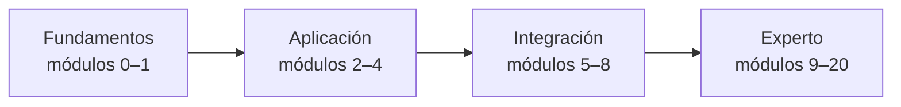
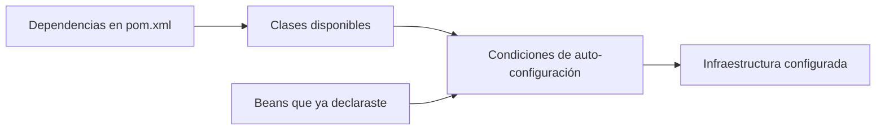
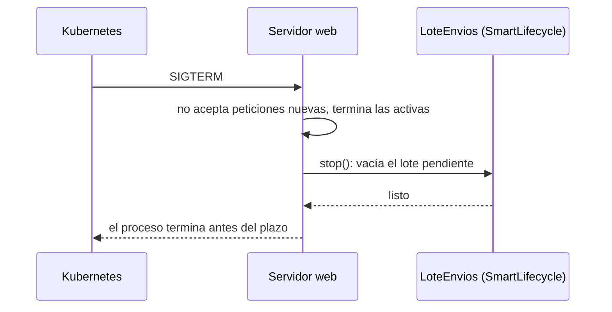
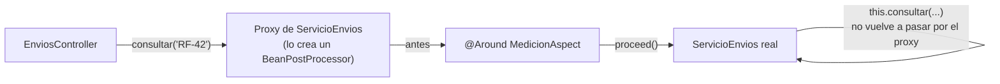

# Módulo 0: Fundamentos de Spring: IoC, DI y AOP

Cada tema se practica por separado con su propia repetición progresiva y su propio reto de memoria. El mecanismo de inyección de dependencias se documenta con comandos reales de Maven/Spring Boot y con el comportamiento exacto y verificable que produce cada anotación, sin sustituir el código Java por ningún otro lenguaje.

## Antes de comenzar: del equipo vacío a Spring Boot

Completa primero los fundamentos del track Java o asegúrate de entender clases, interfaces, excepciones y colecciones. Instala **JDK 25**, Git y un editor: IntelliJ IDEA Community es la opción más sencilla para Spring; VS Code con Extension Pack for Java y Spring Boot Extension Pack también funciona.

- **Windows:** instala Eclipse Temurin JDK 25, Git e IntelliJ; verifica `java --version` y `javac --version` en PowerShell.
- **macOS:** instala específicamente Temurin **25** desde [Adoptium](https://adoptium.net/installation/); un paquete sin versión puede instalar otro JDK. Usa `brew install git` para Git.
- **Ubuntu/Debian:** instala JDK **25** con las [instrucciones de Adoptium para Linux](https://adoptium.net/installation/linux/); la disponibilidad de `openjdk-25-jdk` depende de la distribución y sus repositorios. Instala Git con `sudo apt install git`.

No necesitas instalar Maven si el proyecto incluye `mvnw`/`mvnw.cmd`: ese *wrapper* descarga la versión correcta. En [start.spring.io](https://start.spring.io/) elige Java, Maven, **Spring Boot 4.1.2**, JDK 25 y la dependencia **Spring Web**. Usa artifact `academia-spring` y establece explícitamente el paquete **`com.example.demo`**, que usan los archivos de estas lecciones. Descarga, descomprime y ejecuta:

```bash
# macOS/Linux
./mvnw spring-boot:run

# Windows PowerShell
.\mvnw.cmd spring-boot:run
```

Visita `http://localhost:8080`. Un 404 significa que el servidor sí arrancó pero aún no existe una ruta; "connection refused" significa que no arrancó. Lee siempre desde la primera línea `Caused by:` del error, no solo la última.

**Herramienta y continuidad:** los comandos originales usan **Maven** (`pom.xml` y `mvnw`). Los laboratorios también incorporan una alternativa **Gradle 9.8.2** (`build.gradle` y `gradlew`) con las mismas fuentes. El M1 explica cómo elegir una herramienta y traducir los comandos. Conserva `academia-spring` de M0 a M7. En M1 la generación de un proyecto es un experimento separado; aplica después la configuración a tu proyecto base. Desde M10 hay laboratorios aislados con infraestructura propia; cada tema identifica su carpeta, y M20 integra una selección de esas piezas. No copies todas sus configuraciones sobre una sola aplicación.

**Regla de ejecución:** ejecuta los comandos desde la carpeta que contiene el `pom.xml` del proyecto indicado. Antes de cambiar de laboratorio, detén el servidor con Ctrl+C para liberar su puerto. Tras cambiar Java o recursos, reinicia `spring-boot:run` salvo que hayas configurado recarga explícitamente. Una práctica independiente puede cambiar el estado esperado: restaura la base indicada antes de continuar.

Cada laboratorio del inventario `docs/spring-gradle-labs.json` incorpora su build y Wrapper Gradle; copia la carpeta completa para conservarlos. Para ejecutar Gradle sobre JDK 25 necesitas Gradle **9.1 o posterior**; el mínimo general 8.14 de Boot no basta para esa JVM. Consulta [requisitos Boot](https://docs.spring.io/spring-boot/system-requirements.html) y [compatibilidad Gradle/Java](https://docs.gradle.org/current/userguide/compatibility.html). Cambiar solo `mvnw` por `gradlew` no migra BOM, procesadores ni plugins.

**Referencia al cerrar M0–M1:** `README.md` reúne las clases finales y cinco pruebas. Úsala para comparar después de escribir tus archivos; no equivale a haber ejecutado cada cambio y fallo del recorrido.

## Mapa de la ruta

«Spring Boot» tiene 21 módulos en 4 etapas. Cada etapa se apoya en la anterior; usa la tabla para saltar a un módulo concreto. El orden sigue las dependencias: primero el contenedor y la web, después datos, seguridad, pruebas y operación, y al final mensajería, arquitectura y sistemas distribuidos.



| Módulo | Etapa | Qué aprendes |
|---|---|---|
| 0 | Fundamentos | [Fundamentos de Spring: IoC, DI y AOP](/curso/spring-boot/0) |
| 1 | Fundamentos | [Spring Boot CLI y estructura de proyecto](/curso/spring-boot/1) |
| 2 | Aplicación | [REST APIs con Spring Web](/curso/spring-boot/2) |
| 3 | Aplicación | [JDBC, JdbcClient y transacciones en Spring Boot](/curso/spring-boot/3) |
| 4 | Aplicación | [Persistencia con Spring Data JPA](/curso/spring-boot/4) |
| 5 | Integración | [Spring Security I: cadena, JWT con resource server, CORS y SSRF](/curso/spring-boot/5) |
| 6 | Integración | [Testing en Spring Boot](/curso/spring-boot/6) |
| 7 | Integración | [Configuración, errores y observabilidad](/curso/spring-boot/7) |
| 8 | Integración | [Integraciones Spring: scheduling, eventos, correo, caché e IA](/curso/spring-boot/8) |
| 9 | Experto | [Concurrencia, @Async y resiliencia en el núcleo de Spring](/curso/spring-boot/9) |
| 10 | Experto | [Mensajería con Kafka: eventos, errores, outbox y contratos](/curso/spring-boot/10) |
| 11 | Experto | [RabbitMQ, JMS y Spring Cloud Stream](/curso/spring-boot/11) |
| 12 | Experto | [Spring Batch: jobs, chunks y procesamiento masivo](/curso/spring-boot/12) |
| 13 | Experto | [Programación reactiva con WebFlux](/curso/spring-boot/13) |
| 14 | Experto | [Spring GraphQL: contrato, datos anidados y cambios](/curso/spring-boot/14) |
| 15 | Experto | [Arquitectura: hexagonal, Clean, C4, ADR y Spring Modulith](/curso/spring-boot/15) |
| 16 | Experto | [Microservicios con Spring Cloud](/curso/spring-boot/16) |
| 17 | Experto | [Consistencia, contratos y operación distribuida](/curso/spring-boot/17) |
| 18 | Experto | [Spring Security II: OIDC, autorización por recurso y SAML](/curso/spring-boot/18) |
| 19 | Experto | [Empaquetado y despliegue](/curso/spring-boot/19) |
| 20 | Experto | [Proyecto integrador: backend de entregas productivo](/curso/spring-boot/20) |

## Aprende construyendo


### Tema 1: Inversión de control y el contenedor de Spring · Básico · 30 min

<details open>
<summary><strong>Capa 1 — Lectura</strong></summary>

#### ► DE QUÉ TRATA
Este tema te guía por inversión de control y el contenedor de spring con foco en comprensión antes de implementación.

#### ► LA IDEA EN UNA FRASE
**Entender inversión de control y el contenedor de spring te permite tomar mejores decisiones técnicas.**

#### ► POR QUÉ EXISTE ESTO
Resuelve un problema real de diseño o implementación y evita decisiones a ciegas.

#### ► LA ANALOGÍA
Piensa en inversión de control y el contenedor de spring como una herramienta de taller: útil cuando conoces su propósito y sus límites.
**Dónde se rompe la analogía:** en software, los efectos dependen del contexto, la escala y los trade-offs.

#### ► CÓMO FUNCIONA
1. Identifica el problema que inversión de control y el contenedor de spring resuelve.
2. Observa sus componentes y relaciones.
3. Aplica la opción más simple que funcione.
4. Verifica el resultado y los límites.

#### ► LO QUE PUEDE SALIR MAL
| Síntoma | Causa probable | Arreglo |
|---|---|---|
| Inversión de control y el contenedor de Spring se aplica pero el resultado no mejora | Se usó sin medir el problema real | Mide antes y compara contra la alternativa simple |
| Aparece complejidad inesperada | Se adoptó la técnica sin comprender sus trade-offs | Vuelve a la sección de trade-offs y reduce el alcance |
| Falla en un caso límite | Se asumió un contexto que no se cumple | Prueba el caso límite y documenta cuándo NO usarlo |

#### ► TRADE-OFFS
| Opción | Cuándo usarla | Cuándo NO usarla |
|---|---|---|
| Usar Inversión de control y el contenedor de Spring | Cuando el problema coincide con su propósito y el beneficio es observable | Cuando agrega complejidad sin resolver un problema real |
| Alternativa más simple | Cuando el contexto es pequeño, estable o fácil de razonar | Cuando ya demostró no escalar o no cumplir el requisito |
| Postergar la decisión | Cuando falta evidencia del problema | Cuando el costo de esperar es mayor que el costo de probar |

#### ► CUÁNDO NO USAR ESTO
No uses inversión de control y el contenedor de spring por defecto. Aplícalo cuando el problema lo justifique y puedas verificar el beneficio; si una alternativa más simple resuelve igual, prefiérela.

#### ► DE VUELTA A LA ANALOGÍA
Volviendo a la analogía: inversión de control y el contenedor de spring funciona como el modelo inicial, pero recuerda dónde se rompe: en producción importan la evidencia, la escala y el costo de equivocarte.

#### ► LO QUE DEBES RECORDAR
- Inversión de control y el contenedor de Spring existe para resolver un problema específico.
- Mide antes de adoptar complejidad.
- Conoce el caso donde NO usarlo.
- Verifica con evidencia observable.

#### ► PREGUNTAS PARA PENSAR
1. ¿Qué problema concreto resuelve inversión de control y el contenedor de spring en tu contexto?
2. ¿Cómo sabrías que inversión de control y el contenedor de spring no está funcionando bien?
3. ¿Qué alternativa más simple considerarías antes de usar inversión de control y el contenedor de spring?

</details>

<details>
<summary><strong>Capa 2 — Construcción</strong></summary>

#### Código y verificación
```java
package com.example.demo;

public interface RepositorioEnvios {
    String buscarEstado(String codigo);
}
```

```java
package com.example.demo;

import org.springframework.stereotype.Repository;

@Repository
public class RepositorioMemoriaEnvios implements RepositorioEnvios {
    @Override
    public String buscarEstado(String codigo) {
        return "En ruta: " + codigo;
    }
}
```

```bash
./mvnw test
```

```java
package com.example.demo;

import org.springframework.stereotype.Service;

@Service
public class ServicioEnvios {
    private final RepositorioEnvios repositorio;

    public ServicioEnvios(RepositorioEnvios repositorio) {
        this.repositorio = repositorio;
    }

    public String consultar(String codigo) {
        return repositorio.buscarEstado(codigo);
    }
}
```

```bash
./mvnw spring-boot:run
```

```java
package com.example.demo;

import org.springframework.web.bind.annotation.GetMapping;
import org.springframework.web.bind.annotation.PathVariable;
import org.springframework.web.bind.annotation.RestController;

@RestController
public class EnviosController {
    private final ServicioEnvios servicio;

    public EnviosController(ServicioEnvios servicio) {
        this.servicio = servicio;
    }

    @GetMapping("/envios/{codigo}")
    public String consultar(@PathVariable String codigo) {
        return servicio.consultar(codigo);
    }
}
```

</details>

### Tema 2: Inyección por constructor vs por campo · Intermedio · 30 min

<details open>
<summary><strong>Capa 1 — Lectura</strong></summary>

#### ► DE QUÉ TRATA
Este tema te guía por inyección por constructor vs por campo con foco en comprensión antes de implementación.

#### ► LA IDEA EN UNA FRASE
**Entender inyección por constructor vs por campo te permite tomar mejores decisiones técnicas.**

#### ► POR QUÉ EXISTE ESTO
Resuelve un problema real de diseño o implementación y evita decisiones a ciegas.

#### ► LA ANALOGÍA
Piensa en inyección por constructor vs por campo como una herramienta de taller: útil cuando conoces su propósito y sus límites.
**Dónde se rompe la analogía:** en software, los efectos dependen del contexto, la escala y los trade-offs.

#### ► CÓMO FUNCIONA
1. Identifica el problema que inyección por constructor vs por campo resuelve.
2. Observa sus componentes y relaciones.
3. Aplica la opción más simple que funcione.
4. Verifica el resultado y los límites.

#### ► LO QUE PUEDE SALIR MAL
| Síntoma | Causa probable | Arreglo |
|---|---|---|
| Inyección por constructor vs por campo se aplica pero el resultado no mejora | Se usó sin medir el problema real | Mide antes y compara contra la alternativa simple |
| Aparece complejidad inesperada | Se adoptó la técnica sin comprender sus trade-offs | Vuelve a la sección de trade-offs y reduce el alcance |
| Falla en un caso límite | Se asumió un contexto que no se cumple | Prueba el caso límite y documenta cuándo NO usarlo |

#### ► TRADE-OFFS
| Opción | Cuándo usarla | Cuándo NO usarla |
|---|---|---|
| Usar Inyección por constructor vs por campo | Cuando el problema coincide con su propósito y el beneficio es observable | Cuando agrega complejidad sin resolver un problema real |
| Alternativa más simple | Cuando el contexto es pequeño, estable o fácil de razonar | Cuando ya demostró no escalar o no cumplir el requisito |
| Postergar la decisión | Cuando falta evidencia del problema | Cuando el costo de esperar es mayor que el costo de probar |

#### ► CUÁNDO NO USAR ESTO
No uses inyección por constructor vs por campo por defecto. Aplícalo cuando el problema lo justifique y puedas verificar el beneficio; si una alternativa más simple resuelve igual, prefiérela.

#### ► DE VUELTA A LA ANALOGÍA
Volviendo a la analogía: inyección por constructor vs por campo funciona como el modelo inicial, pero recuerda dónde se rompe: en producción importan la evidencia, la escala y el costo de equivocarte.

#### ► LO QUE DEBES RECORDAR
- Inyección por constructor vs por campo existe para resolver un problema específico.
- Mide antes de adoptar complejidad.
- Conoce el caso donde NO usarlo.
- Verifica con evidencia observable.

#### ► PREGUNTAS PARA PENSAR
1. ¿Qué problema concreto resuelve inyección por constructor vs por campo en tu contexto?
2. ¿Cómo sabrías que inyección por constructor vs por campo no está funcionando bien?
3. ¿Qué alternativa más simple considerarías antes de usar inyección por constructor vs por campo?

</details>

<details>
<summary><strong>Capa 2 — Construcción</strong></summary>

#### Código y verificación
```java
package com.example.demo;

import org.junit.jupiter.api.Test;
import static org.junit.jupiter.api.Assertions.assertEquals;

class ServicioEnviosTest {
    @Test
    void consultaElEstadoDelRepositorio() {
        RepositorioEnvios falso = codigo -> "Preparando: " + codigo;
        ServicioEnvios servicio = new ServicioEnvios(falso);

        assertEquals("Preparando: RF-42", servicio.consultar("RF-42"));
    }
}
```

```bash
./mvnw -Dtest=ServicioEnviosTest test
```

```java
package com.example.demo;

import org.springframework.beans.factory.annotation.Autowired;
import org.springframework.stereotype.Service;

@Service
public class ServicioEnviosCampo {
    @Autowired
    private RepositorioEnvios repositorio;

    public String consultar(String codigo) {
        return repositorio.buscarEstado(codigo);
    }
}
```

```java
package com.example.demo;

import org.junit.jupiter.api.Test;
import org.springframework.beans.factory.annotation.Autowired;
import org.springframework.boot.test.context.SpringBootTest;
import static org.junit.jupiter.api.Assertions.assertEquals;

@SpringBootTest
class ServicioEnviosCampoTest {
    @Autowired
    private ServicioEnviosCampo servicio;

    @Test
    void springConectaElRepositorioAlServicio() {
        assertEquals("En ruta: RF-42", servicio.consultar("RF-42"));
    }
}
```

```bash
./mvnw -Dtest=ServicioEnviosCampoTest test
```

```bash
./mvnw -Dtest=ServicioEnviosTest test
./mvnw -Dtest=ServicioEnviosCampoTest test
```

</details>

### Tema 3: Estereotipos, autoconfiguración y scopes · Intermedio · 35 min

<details open>
<summary><strong>Capa 1 — Lectura</strong></summary>

#### ► DE QUÉ TRATA
Este tema te guía por estereotipos, autoconfiguración y scopes con foco en comprensión antes de implementación.

#### ► LA IDEA EN UNA FRASE
**Entender estereotipos, autoconfiguración y scopes te permite tomar mejores decisiones técnicas.**

#### ► POR QUÉ EXISTE ESTO
Resuelve un problema real de diseño o implementación y evita decisiones a ciegas.

#### ► LA ANALOGÍA
Piensa en estereotipos, autoconfiguración y scopes como una herramienta de taller: útil cuando conoces su propósito y sus límites.
**Dónde se rompe la analogía:** en software, los efectos dependen del contexto, la escala y los trade-offs.

#### ► CÓMO FUNCIONA


#### ► LO QUE PUEDE SALIR MAL
| Síntoma | Causa probable | Arreglo |
|---|---|---|
| Estereotipos, autoconfiguración y scopes se aplica pero el resultado no mejora | Se usó sin medir el problema real | Mide antes y compara contra la alternativa simple |
| Aparece complejidad inesperada | Se adoptó la técnica sin comprender sus trade-offs | Vuelve a la sección de trade-offs y reduce el alcance |
| Falla en un caso límite | Se asumió un contexto que no se cumple | Prueba el caso límite y documenta cuándo NO usarlo |

#### ► TRADE-OFFS
| Opción | Cuándo usarla | Cuándo NO usarla |
|---|---|---|
| Usar Estereotipos, autoconfiguración y scopes | Cuando el problema coincide con su propósito y el beneficio es observable | Cuando agrega complejidad sin resolver un problema real |
| Alternativa más simple | Cuando el contexto es pequeño, estable o fácil de razonar | Cuando ya demostró no escalar o no cumplir el requisito |
| Postergar la decisión | Cuando falta evidencia del problema | Cuando el costo de esperar es mayor que el costo de probar |

#### ► CUÁNDO NO USAR ESTO
No uses estereotipos, autoconfiguración y scopes por defecto. Aplícalo cuando el problema lo justifique y puedas verificar el beneficio; si una alternativa más simple resuelve igual, prefiérela.

#### ► DE VUELTA A LA ANALOGÍA
Volviendo a la analogía: estereotipos, autoconfiguración y scopes funciona como el modelo inicial, pero recuerda dónde se rompe: en producción importan la evidencia, la escala y el costo de equivocarte.

#### ► LO QUE DEBES RECORDAR
- Estereotipos, autoconfiguración y scopes existe para resolver un problema específico.
- Mide antes de adoptar complejidad.
- Conoce el caso donde NO usarlo.
- Verifica con evidencia observable.

#### ► PREGUNTAS PARA PENSAR
1. ¿Qué problema concreto resuelve estereotipos, autoconfiguración y scopes en tu contexto?
2. ¿Cómo sabrías que estereotipos, autoconfiguración y scopes no está funcionando bien?
3. ¿Qué alternativa más simple considerarías antes de usar estereotipos, autoconfiguración y scopes?

</details>

<details>
<summary><strong>Capa 2 — Construcción</strong></summary>

#### Código y verificación
```java
import org.springframework.stereotype.Component;

@Component
public class ServicioEnvios {
    // Conserva el constructor y los métodos que ya escribiste.
}
```

```bash
./mvnw dependency:tree
```


```java
package com.example.demo;

import org.springframework.context.annotation.Scope;
import org.springframework.stereotype.Component;

@Component
@Scope("prototype")
public class GeneradorReporte {
    private final String id = java.util.UUID.randomUUID().toString();

    public String id() {
        return id;
    }
}
```

```java
package com.example.demo;

import org.springframework.beans.factory.ObjectProvider;
import org.springframework.stereotype.Service;

@Service
public class ServicioReportes {
    private final GeneradorReporte recibidoAlCrear;
    private final ObjectProvider<GeneradorReporte> generadores;

    public ServicioReportes(
            GeneradorReporte recibidoAlCrear,
            ObjectProvider<GeneradorReporte> generadores) {
        this.recibidoAlCrear = recibidoAlCrear;
        this.generadores = generadores;
    }

    public String comparar() {
        return "directo=" + recibidoAlCrear.id()
                + "; nuevos=" + generadores.getObject().id()
                + "," + generadores.getObject().id();
    }
}
```

```java
package com.example.demo;

import org.springframework.web.bind.annotation.GetMapping;
import org.springframework.web.bind.annotation.RestController;

@RestController
public class ReporteController {
    private final ServicioReportes servicio;

    public ReporteController(ServicioReportes servicio) {
        this.servicio = servicio;
    }

    @GetMapping("/reporte/comparar")
    public String comparar() {
        return servicio.comparar();
    }
}
```

</details>

### Tema 4: Ciclo de vida de los beans y apagado ordenado · Intermedio · 45 min

<details open>
<summary><strong>Capa 1 — Lectura</strong></summary>

#### ► DE QUÉ TRATA
Usa Spring Boot 4.1.2 con JDK 25 y la dependencia Spring Web. Continúa el proyecto academia-spring de los temas anteriores (paquete com.example.demo) o créalo en start.spring.io como indica «Antes de comenzar».

#### ► LA IDEA EN UNA FRASE
**Usa Spring Boot 4.1.2 con JDK 25 y la dependencia Spring Web.**

#### ► POR QUÉ EXISTE ESTO
Resuelve un problema real de diseño o implementación y evita decisiones a ciegas.

#### ► LA ANALOGÍA
**Conceptos clave:** ciclo de vida de un bean, `@PostConstruct`, `@PreDestroy`, `SmartLifecycle`, fase, `server.shutdown=graceful`, `spring.lifecycle.timeout-per-shutdown-phase`.

Spring crea cada bean, le inyecta sus dependencias y entonces llama a `@PostConstruct`. Al cerrar el contexto, llama a `@PreDestroy` en orden inverso de creación.

`SmartLifecycle` sirve para componentes que **arrancan y se detienen** (un consumidor, un planificador): Spring llama `start()` cuando el contexto está listo y `stop()` al apagar. El número de **fase** decide el orden: fases más altas arrancan después y se detienen antes. La fase por defecto es `Integer.MAX_VALUE`, la más alta posible, y el apagado ordenado del servidor web corre en `WebServerApplicationContext.GRACEFUL_SHUTDOWN_PHASE` (`Integer.MAX_VALUE - 1024`). Por eso un `SmartLifecycle` sin `getPhase()` se detendría **antes** de que el servidor termine las peticiones en curso.

Con `server.shutdown=graceful` (activo por defecto desde Spring Boot 3.4), al recibir `SIGTERM` el servidor deja de aceptar peticiones nuevas y espera a las que están en curso, hasta el tiempo de `spring.lifecycle.timeout-per-shutdown-phase` (30 s por defecto).

| Momento | Úsalo para |
|---|---|
| `@PostConstruct` | validar configuración, preparar cachés pequeñas |
| `SmartLifecycle.start()` | arrancar consumidores o tareas de fondo |
| `SmartLifecycle.stop()` | dejar de tomar trabajo nuevo y vaciar lo pendiente |
| `@PreDestroy` | liberar recursos propios |

**Analogía:** el apagado ordenado es el cierre de un restaurante: se cierra la puerta a clientes nuevos, se terminan los platos que ya están en la cocina y al final se apagan los fogones. La analogía falla en que, si el cierre tarda más del tiempo permitido, Kubernetes apaga las luces igual (`SIGKILL`).

**Límite de uso:** no hagas trabajo largo en `@PostConstruct`: retrasa el arranque y la readiness. El tiempo de apagado debe ser menor que `terminationGracePeriodSeconds` del pod, o Kubernetes matará el proceso a la mitad.



**Dónde se rompe la analogía:** el modelo simplifica la realidad; en producción influyen escala, fallos, costo y contexto.

#### ► CÓMO FUNCIONA


#### ► LO QUE PUEDE SALIR MAL
| Síntoma | Causa probable | Arreglo |
|---|---|---|
| Ciclo de vida de los beans y apagado ordenado se aplica pero el resultado no mejora | Se usó sin medir el problema real | Mide antes y compara contra la alternativa simple |
| Aparece complejidad inesperada | Se adoptó la técnica sin comprender sus trade-offs | Vuelve a la sección de trade-offs y reduce el alcance |
| Falla en un caso límite | Se asumió un contexto que no se cumple | Prueba el caso límite y documenta cuándo NO usarlo |

#### ► TRADE-OFFS
| Opción | Cuándo usarla | Cuándo NO usarla |
|---|---|---|
| Usar Ciclo de vida de los beans y apagado ordenado | Cuando el problema coincide con su propósito y el beneficio es observable | Cuando agrega complejidad sin resolver un problema real |
| Alternativa más simple | Cuando el contexto es pequeño, estable o fácil de razonar | Cuando ya demostró no escalar o no cumplir el requisito |
| Postergar la decisión | Cuando falta evidencia del problema | Cuando el costo de esperar es mayor que el costo de probar |

#### ► CUÁNDO NO USAR ESTO
No uses ciclo de vida de los beans y apagado ordenado por defecto. Aplícalo cuando el problema lo justifique y puedas verificar el beneficio; si una alternativa más simple resuelve igual, prefiérela.

#### ► DE VUELTA A LA ANALOGÍA
Volviendo a la analogía: ciclo de vida de los beans y apagado ordenado funciona como el modelo inicial, pero recuerda dónde se rompe: en producción importan la evidencia, la escala y el costo de equivocarte.

#### ► LO QUE DEBES RECORDAR
- Ciclo de vida de los beans y apagado ordenado existe para resolver un problema específico.
- Mide antes de adoptar complejidad.
- Conoce el caso donde NO usarlo.
- Verifica con evidencia observable.

#### ► PREGUNTAS PARA PENSAR
1. ¿Qué problema concreto resuelve ciclo de vida de los beans y apagado ordenado en tu contexto?
2. ¿Cómo sabrías que ciclo de vida de los beans y apagado ordenado no está funcionando bien?
3. ¿Qué alternativa más simple considerarías antes de usar ciclo de vida de los beans y apagado ordenado?

</details>

<details>
<summary><strong>Capa 2 — Construcción</strong></summary>

#### Código y verificación


```java
package com.example.demo.asignacion;

import jakarta.annotation.PostConstruct;
import jakarta.annotation.PreDestroy;
import java.util.ArrayList;
import java.util.List;
import org.slf4j.Logger;
import org.slf4j.LoggerFactory;
import org.springframework.boot.web.server.context.WebServerApplicationContext;
import org.springframework.context.SmartLifecycle;
import org.springframework.stereotype.Component;

@Component
public class LoteEnvios implements SmartLifecycle {
    private static final Logger log = LoggerFactory.getLogger(LoteEnvios.class);
    private final List<String> pendientes = new ArrayList<>();
    private volatile boolean corriendo;

    @PostConstruct
    void validar() { log.info("1. bean creado y dependencias inyectadas"); }

    @Override public void start() { corriendo = true; log.info("2. empieza a aceptar envíos"); }

    public synchronized void agregar(String codigo) {
        if (!corriendo) throw new IllegalStateException("apagando: no se aceptan envíos");
        pendientes.add(codigo);
    }

    @Override public synchronized void stop() {
        corriendo = false;
        log.info("3. vacía {} envíos pendientes antes de salir", pendientes.size());
        pendientes.clear(); // aquí iría el guardado en la base
    }

    @Override public boolean isRunning() { return corriendo; }

    // Fase menor que la del apagado ordenado: se detiene cuando el servidor ya terminó las peticiones activas.
    @Override public int getPhase() { return WebServerApplicationContext.GRACEFUL_SHUTDOWN_PHASE - 1; }

    @PreDestroy
    void liberar() { log.info("4. libera recursos propios"); }
}
```

```properties
server.shutdown=graceful
spring.lifecycle.timeout-per-shutdown-phase=20s
```

```bash
cd academia-spring
./mvnw spring-boot:run
# en otra terminal, cuando arranque:
kill -TERM $(pgrep -f academia-spring)
```

```text
... LoteEnvios : 1. bean creado y dependencias inyectadas
... LoteEnvios : 2. empieza a aceptar envíos
... Commencing graceful shutdown. Waiting for active requests to complete
... Graceful shutdown complete
... LoteEnvios : 3. vacía 0 envíos pendientes antes de salir
... LoteEnvios : 4. libera recursos propios
```

</details>

### Tema 5: Proxies y AOP: `@Aspect`, `@Around` y `BeanPostProcessor` · Intermedio · 45 min

<details open>
<summary><strong>Capa 1 — Lectura</strong></summary>

#### ► DE QUÉ TRATA
Este tema te guía por proxies y aop: `@aspect`, `@around` y `beanpostprocessor` con foco en comprensión antes de implementación.

#### ► LA IDEA EN UNA FRASE
**Entender proxies y aop: `@aspect`, `@around` y `beanpostprocessor` te permite tomar mejores decisiones técnicas.**

#### ► POR QUÉ EXISTE ESTO
Resuelve un problema real de diseño o implementación y evita decisiones a ciegas.

#### ► LA ANALOGÍA
Piensa en proxies y aop: `@aspect`, `@around` y `beanpostprocessor` como una herramienta de taller: útil cuando conoces su propósito y sus límites.
**Dónde se rompe la analogía:** en software, los efectos dependen del contexto, la escala y los trade-offs.

#### ► CÓMO FUNCIONA


#### ► LO QUE PUEDE SALIR MAL
| Síntoma | Causa probable | Arreglo |
|---|---|---|
| Proxies y AOP: `@Aspect`, `@Around` y `BeanPostProcessor` se aplica pero el resultado no mejora | Se usó sin medir el problema real | Mide antes y compara contra la alternativa simple |
| Aparece complejidad inesperada | Se adoptó la técnica sin comprender sus trade-offs | Vuelve a la sección de trade-offs y reduce el alcance |
| Falla en un caso límite | Se asumió un contexto que no se cumple | Prueba el caso límite y documenta cuándo NO usarlo |

#### ► TRADE-OFFS
| Opción | Cuándo usarla | Cuándo NO usarla |
|---|---|---|
| Usar Proxies y AOP: `@Aspect`, `@Around` y `BeanPostProcessor` | Cuando el problema coincide con su propósito y el beneficio es observable | Cuando agrega complejidad sin resolver un problema real |
| Alternativa más simple | Cuando el contexto es pequeño, estable o fácil de razonar | Cuando ya demostró no escalar o no cumplir el requisito |
| Postergar la decisión | Cuando falta evidencia del problema | Cuando el costo de esperar es mayor que el costo de probar |

#### ► CUÁNDO NO USAR ESTO
No uses proxies y aop: `@aspect`, `@around` y `beanpostprocessor` por defecto. Aplícalo cuando el problema lo justifique y puedas verificar el beneficio; si una alternativa más simple resuelve igual, prefiérela.

#### ► DE VUELTA A LA ANALOGÍA
Volviendo a la analogía: proxies y aop: `@aspect`, `@around` y `beanpostprocessor` funciona como el modelo inicial, pero recuerda dónde se rompe: en producción importan la evidencia, la escala y el costo de equivocarte.

#### ► LO QUE DEBES RECORDAR
- Proxies y AOP: `@Aspect`, `@Around` y `BeanPostProcessor` existe para resolver un problema específico.
- Mide antes de adoptar complejidad.
- Conoce el caso donde NO usarlo.
- Verifica con evidencia observable.

#### ► PREGUNTAS PARA PENSAR
1. ¿Qué problema concreto resuelve proxies y aop: `@aspect`, `@around` y `beanpostprocessor` en tu contexto?
2. ¿Cómo sabrías que proxies y aop: `@aspect`, `@around` y `beanpostprocessor` no está funcionando bien?
3. ¿Qué alternativa más simple considerarías antes de usar proxies y aop: `@aspect`, `@around` y `beanpostprocessor`?

</details>

<details>
<summary><strong>Capa 2 — Construcción</strong></summary>

#### Código y verificación


```java
import java.lang.reflect.InvocationHandler;
import java.lang.reflect.Proxy;

interface Envios {
    String consultar(String codigo);
    String consultarDos(String a, String b);
}

final class EnviosReales implements Envios {
    @Override
    public String consultar(String codigo) {
        return "En ruta: " + codigo;
    }

    @Override
    public String consultarDos(String a, String b) {
        return consultar(a) + " | " + consultar(b);
    }
}

public class ProxyAMano {
    public static void main(String[] args) {
        Envios real = new EnviosReales();
        InvocationHandler registro = (proxy, metodo, argumentos) -> {
            System.out.println("[proxy] entra a " + metodo.getName());
            Object resultado = metodo.invoke(real, argumentos);
            System.out.println("[proxy] sale de " + metodo.getName());
            return resultado;
        };
        Envios envios = (Envios) Proxy.newProxyInstance(
                Envios.class.getClassLoader(), new Class<?>[] {Envios.class}, registro);

        System.out.println(envios.consultar("RF-42"));
        System.out.println(envios.consultarDos("RF-1", "RF-2"));
        System.out.println("Es un proxy: " + Proxy.isProxyClass(envios.getClass()));
    }
}
```

```bash
java ProxyAMano.java
```

```text
[proxy] entra a consultar
[proxy] sale de consultar
En ruta: RF-42
[proxy] entra a consultarDos
[proxy] sale de consultarDos
En ruta: RF-1 | En ruta: RF-2
Es un proxy: true
```

```xml
<dependency>
    <groupId>org.springframework.boot</groupId>
    <artifactId>spring-boot-starter-aspectj</artifactId>
</dependency>
```

```java
package com.example.demo;

import org.aspectj.lang.ProceedingJoinPoint;
import org.aspectj.lang.annotation.Around;
import org.aspectj.lang.annotation.Aspect;
import org.slf4j.Logger;
import org.slf4j.LoggerFactory;
import org.springframework.stereotype.Component;

@Aspect
@Component
public class MedicionAspect {
    private static final Logger log = LoggerFactory.getLogger(MedicionAspect.class);

    @Around("execution(* com.example.demo.ServicioEnvios.*(..))")
    public Object medir(ProceedingJoinPoint punto) throws Throwable {
        long inicio = System.nanoTime();
        try {
            return punto.proceed();
        } finally {
            long micros = (System.nanoTime() - inicio) / 1_000;
            log.info("medido {} en {} us", punto.getSignature().toShortString(), micros);
        }
    }
}
```

</details>

### Tema 6: Varias implementaciones (`@Primary`, `@Qualifier`) y expresiones SpEL · Intermedio · 40 min

<details open>
<summary><strong>Capa 1 — Lectura</strong></summary>

#### ► DE QUÉ TRATA
Este tema te guía por varias implementaciones (`@primary`, `@qualifier`) y expresiones spel con foco en comprensión antes de implementación.

#### ► LA IDEA EN UNA FRASE
**Entender varias implementaciones (`@primary`, `@qualifier`) y expresiones spel te permite tomar mejores decisiones técnicas.**

#### ► POR QUÉ EXISTE ESTO
Resuelve un problema real de diseño o implementación y evita decisiones a ciegas.

#### ► LA ANALOGÍA
Piensa en varias implementaciones (`@primary`, `@qualifier`) y expresiones spel como una herramienta de taller: útil cuando conoces su propósito y sus límites.
**Dónde se rompe la analogía:** en software, los efectos dependen del contexto, la escala y los trade-offs.

#### ► CÓMO FUNCIONA
1. Identifica el problema que varias implementaciones (`@primary`, `@qualifier`) y expresiones spel resuelve.
2. Observa sus componentes y relaciones.
3. Aplica la opción más simple que funcione.
4. Verifica el resultado y los límites.

#### ► LO QUE PUEDE SALIR MAL
| Síntoma | Causa probable | Arreglo |
|---|---|---|
| Varias implementaciones (`@Primary`, `@Qualifier`) y expresiones SpEL se aplica pero el resultado no mejora | Se usó sin medir el problema real | Mide antes y compara contra la alternativa simple |
| Aparece complejidad inesperada | Se adoptó la técnica sin comprender sus trade-offs | Vuelve a la sección de trade-offs y reduce el alcance |
| Falla en un caso límite | Se asumió un contexto que no se cumple | Prueba el caso límite y documenta cuándo NO usarlo |

#### ► TRADE-OFFS
| Opción | Cuándo usarla | Cuándo NO usarla |
|---|---|---|
| Usar Varias implementaciones (`@Primary`, `@Qualifier`) y expresiones SpEL | Cuando el problema coincide con su propósito y el beneficio es observable | Cuando agrega complejidad sin resolver un problema real |
| Alternativa más simple | Cuando el contexto es pequeño, estable o fácil de razonar | Cuando ya demostró no escalar o no cumplir el requisito |
| Postergar la decisión | Cuando falta evidencia del problema | Cuando el costo de esperar es mayor que el costo de probar |

#### ► CUÁNDO NO USAR ESTO
No uses varias implementaciones (`@primary`, `@qualifier`) y expresiones spel por defecto. Aplícalo cuando el problema lo justifique y puedas verificar el beneficio; si una alternativa más simple resuelve igual, prefiérela.

#### ► DE VUELTA A LA ANALOGÍA
Volviendo a la analogía: varias implementaciones (`@primary`, `@qualifier`) y expresiones spel funciona como el modelo inicial, pero recuerda dónde se rompe: en producción importan la evidencia, la escala y el costo de equivocarte.

#### ► LO QUE DEBES RECORDAR
- Varias implementaciones (`@Primary`, `@Qualifier`) y expresiones SpEL existe para resolver un problema específico.
- Mide antes de adoptar complejidad.
- Conoce el caso donde NO usarlo.
- Verifica con evidencia observable.

#### ► PREGUNTAS PARA PENSAR
1. ¿Qué problema concreto resuelve varias implementaciones (`@primary`, `@qualifier`) y expresiones spel en tu contexto?
2. ¿Cómo sabrías que varias implementaciones (`@primary`, `@qualifier`) y expresiones spel no está funcionando bien?
3. ¿Qué alternativa más simple considerarías antes de usar varias implementaciones (`@primary`, `@qualifier`) y expresiones spel?

</details>

<details>
<summary><strong>Capa 2 — Construcción</strong></summary>

#### Código y verificación
```java
// src/main/java/com/example/demo/Tarifador.java
package com.example.demo;

public interface Tarifador {
    long tarifa(int kilometros);
}
```

```java
// src/main/java/com/example/demo/TarifaUrbana.java
package com.example.demo;

import org.springframework.stereotype.Component;

@Component("tarifaUrbana")
public class TarifaUrbana implements Tarifador {
    @Override
    public long tarifa(int kilometros) { return 3_500 + 1_000L * kilometros; }
}
```

```java
// src/main/java/com/example/demo/CotizadorService.java
package com.example.demo;

import org.springframework.stereotype.Service;

@Service
public class CotizadorService {
    private final Tarifador tarifador;

    public CotizadorService(Tarifador tarifador) { this.tarifador = tarifador; }

    public long cotizar(int kilometros) { return tarifador.tarifa(kilometros); }
}
```

```java
// src/main/java/com/example/demo/TarifaExpress.java
package com.example.demo;

import org.springframework.stereotype.Component;

@Component("tarifaExpress")
public class TarifaExpress implements Tarifador {
    @Override
    public long tarifa(int kilometros) { return 9_000 + 1_500L * kilometros; }
}
```

```java
package com.example.demo;

import org.springframework.beans.factory.annotation.Qualifier;
import org.springframework.stereotype.Service;

@Service
public class CotizadorExpress {
    private final Tarifador tarifador;

    public CotizadorExpress(@Qualifier("tarifaExpress") Tarifador tarifador) {
        this.tarifador = tarifador;
    }

    public long cotizar(int kilometros) { return tarifador.tarifa(kilometros); }
}
```

```java
package com.example.demo;

import static org.junit.jupiter.api.Assertions.assertEquals;

import org.junit.jupiter.api.Test;
import org.springframework.beans.factory.annotation.Autowired;
import org.springframework.boot.test.context.SpringBootTest;

@SpringBootTest
class CotizadoresTest {
    @Autowired CotizadorService normal;
    @Autowired CotizadorExpress express;

    @Test
    void cadaCotizadorRecibeSuTarifa() {
        assertEquals(13_500, normal.cotizar(10));
        assertEquals(24_000, express.cotizar(10));
    }
}
```

</details>
