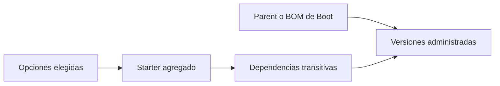
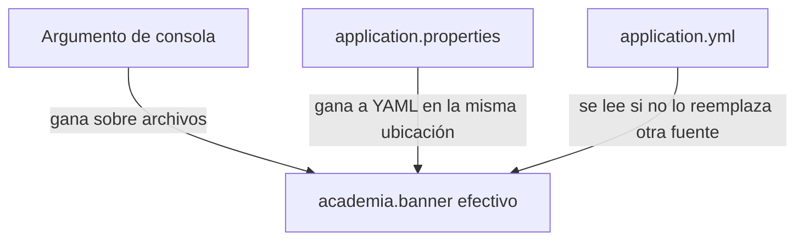
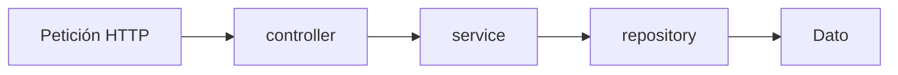

# Módulo 1: Spring Boot CLI y estructura de proyecto

Cada tema se practica por separado con su propia repetición progresiva y su propio reto de memoria. La fusión de configuración base + perfil se verifica con la aplicación Spring Boot real, arrancando con y sin el perfil activo y comparando los valores efectivos.

**Referencia al cerrar M0–M1:** `README.md` reúne las clases finales y cinco pruebas. Úsala para comparar después de escribir tus archivos; no equivale a haber ejecutado cada cambio y fallo del recorrido.

## Alternativa comprobable con Gradle

Elige Maven o Gradle para una misma sesión. Ambos ejecutan las mismas clases y
pruebas; sus archivos de build tienen sintaxis diferente. En las instrucciones
que siguen, `pom.xml` y `mvnw` son la ruta original Maven. Si eliges Gradle, abre
`build.gradle` del laboratorio y usa las equivalencias de esta sección.

Desde la raíz del repositorio:

```bash
./gradlew --version
./gradlew clean classes test
./gradlew bootRun --args='--spring.profiles.active=dev'
```

En Windows PowerShell usa `.\gradlew.bat`. Java debe ser 25; el Wrapper descarga
Gradle 9.8.2. El test genera su informe en `build/reports/tests/test/`. En otra
terminal consulta `curl http://localhost:8080/perfil`: debes recibir
`banner=Desarrollo; entorno=compartido`. Detén el proceso con Ctrl+C antes de
cambiar de práctica.

**Fallo y diagnóstico:** si escribes `--spring.profiles.active=deev`, aparece el
banner base: no existe `application-deev.yml`. Corrige a `dev` y repite la petición.
Conserva ambas respuestas y explica qué archivo cambió el valor.

| Cuando el tema indica Maven | En la alternativa Gradle |
|---|---|
| `./mvnw test` | `./gradlew test` |
| `./mvnw clean test` | `./gradlew clean classes test` |
| `./mvnw -Dtest=ServicioEnviosTest test` | `./gradlew test --tests '*ServicioEnviosTest'` |
| `./mvnw spring-boot:run` | `./gradlew bootRun` |
| argumento de perfil Maven | `./gradlew bootRun --args='--spring.profiles.active=dev'` |
| agregar una dependencia XML al POM | agregar sus coordenadas a `dependencies` en `build.gradle` |

`implementation` añade código principal; `testImplementation` añade bibliotecas
de tests. `platform(...)` importa versiones del BOM, no todas sus dependencias.
Lombok/MapStruct requieren además `annotationProcessor`. gRPC, contratos y AOT
necesitan tareas específicas ya declaradas en sus laboratorios: consulta
`docs/SPRING-BOOT-GRADLE.md`. No conviertas un plugin Maven en una dependencia
normal ni esperes archivos de Gradle dentro de `target/`.

**Fuentes:** [plugin Gradle de Boot](https://docs.spring.io/spring-boot/gradle-plugin/getting-started.html),
[compatibilidad Java/Gradle](https://docs.gradle.org/current/userguide/compatibility.html).

## Aprende construyendo


### Tema 1: Spring Initializr y starters · Básico · 30 min

<details open>
<summary><strong>Capa 1 — Lectura</strong></summary>

#### ► DE QUÉ TRATA
Este tema te guía por spring initializr y starters con foco en comprensión antes de implementación.

#### ► LA IDEA EN UNA FRASE
**Entender spring initializr y starters te permite tomar mejores decisiones técnicas.**

#### ► POR QUÉ EXISTE ESTO
Resuelve un problema real de diseño o implementación y evita decisiones a ciegas.

#### ► LA ANALOGÍA
Piensa en spring initializr y starters como una herramienta de taller: útil cuando conoces su propósito y sus límites.
**Dónde se rompe la analogía:** en software, los efectos dependen del contexto, la escala y los trade-offs.

#### ► CÓMO FUNCIONA


#### ► LO QUE PUEDE SALIR MAL
| Síntoma | Causa probable | Arreglo |
|---|---|---|
| Spring Initializr y starters se aplica pero el resultado no mejora | Se usó sin medir el problema real | Mide antes y compara contra la alternativa simple |
| Aparece complejidad inesperada | Se adoptó la técnica sin comprender sus trade-offs | Vuelve a la sección de trade-offs y reduce el alcance |
| Falla en un caso límite | Se asumió un contexto que no se cumple | Prueba el caso límite y documenta cuándo NO usarlo |

#### ► TRADE-OFFS
| Opción | Cuándo usarla | Cuándo NO usarla |
|---|---|---|
| Usar Spring Initializr y starters | Cuando el problema coincide con su propósito y el beneficio es observable | Cuando agrega complejidad sin resolver un problema real |
| Alternativa más simple | Cuando el contexto es pequeño, estable o fácil de razonar | Cuando ya demostró no escalar o no cumplir el requisito |
| Postergar la decisión | Cuando falta evidencia del problema | Cuando el costo de esperar es mayor que el costo de probar |

#### ► CUÁNDO NO USAR ESTO
No uses spring initializr y starters por defecto. Aplícalo cuando el problema lo justifique y puedas verificar el beneficio; si una alternativa más simple resuelve igual, prefiérela.

#### ► DE VUELTA A LA ANALOGÍA
Volviendo a la analogía: spring initializr y starters funciona como el modelo inicial, pero recuerda dónde se rompe: en producción importan la evidencia, la escala y el costo de equivocarte.

#### ► LO QUE DEBES RECORDAR
- Spring Initializr y starters existe para resolver un problema específico.
- Mide antes de adoptar complejidad.
- Conoce el caso donde NO usarlo.
- Verifica con evidencia observable.

#### ► PREGUNTAS PARA PENSAR
1. ¿Qué problema concreto resuelve spring initializr y starters en tu contexto?
2. ¿Cómo sabrías que spring initializr y starters no está funcionando bien?
3. ¿Qué alternativa más simple considerarías antes de usar spring initializr y starters?

</details>

<details>
<summary><strong>Capa 2 — Construcción</strong></summary>

#### Código y verificación
```bash
mkdir ejemplo-spring-m1
cd ejemplo-spring-m1
curl -fsSL -G 'https://start.spring.io/starter.zip' \
  -d type=maven-project \
  -d language=java \
  -d javaVersion=25 \
  -d bootVersion=4.1.2 \
  -d packageName=com.example.demo \
  -d dependencies=web \
  -o app.zip
unzip app.zip
./mvnw test
```

```java
package com.example.demo;

import org.springframework.web.bind.annotation.GetMapping;
import org.springframework.web.bind.annotation.RestController;

@RestController
public class SaludController {
    @GetMapping("/health")
    public String health() {
        return "OK";
    }
}
```

```bash
./mvnw spring-boot:run
```

```bash
curl -i http://localhost:8080/health
```

```bash
./mvnw dependency:tree
```


</details>

### Tema 2: application.yml vs application.properties · Básico · 30 min

<details open>
<summary><strong>Capa 1 — Lectura</strong></summary>

#### ► DE QUÉ TRATA
Este tema te guía por application.yml vs application.properties con foco en comprensión antes de implementación.

#### ► LA IDEA EN UNA FRASE
**Entender application.yml vs application.properties te permite tomar mejores decisiones técnicas.**

#### ► POR QUÉ EXISTE ESTO
Resuelve un problema real de diseño o implementación y evita decisiones a ciegas.

#### ► LA ANALOGÍA
Piensa en application.yml vs application.properties como una herramienta de taller: útil cuando conoces su propósito y sus límites.
**Dónde se rompe la analogía:** en software, los efectos dependen del contexto, la escala y los trade-offs.

#### ► CÓMO FUNCIONA


#### ► LO QUE PUEDE SALIR MAL
| Síntoma | Causa probable | Arreglo |
|---|---|---|
| application.yml vs application.properties se aplica pero el resultado no mejora | Se usó sin medir el problema real | Mide antes y compara contra la alternativa simple |
| Aparece complejidad inesperada | Se adoptó la técnica sin comprender sus trade-offs | Vuelve a la sección de trade-offs y reduce el alcance |
| Falla en un caso límite | Se asumió un contexto que no se cumple | Prueba el caso límite y documenta cuándo NO usarlo |

#### ► TRADE-OFFS
| Opción | Cuándo usarla | Cuándo NO usarla |
|---|---|---|
| Usar application.yml vs application.properties | Cuando el problema coincide con su propósito y el beneficio es observable | Cuando agrega complejidad sin resolver un problema real |
| Alternativa más simple | Cuando el contexto es pequeño, estable o fácil de razonar | Cuando ya demostró no escalar o no cumplir el requisito |
| Postergar la decisión | Cuando falta evidencia del problema | Cuando el costo de esperar es mayor que el costo de probar |

#### ► CUÁNDO NO USAR ESTO
No uses application.yml vs application.properties por defecto. Aplícalo cuando el problema lo justifique y puedas verificar el beneficio; si una alternativa más simple resuelve igual, prefiérela.

#### ► DE VUELTA A LA ANALOGÍA
Volviendo a la analogía: application.yml vs application.properties funciona como el modelo inicial, pero recuerda dónde se rompe: en producción importan la evidencia, la escala y el costo de equivocarte.

#### ► LO QUE DEBES RECORDAR
- application.yml vs application.properties existe para resolver un problema específico.
- Mide antes de adoptar complejidad.
- Conoce el caso donde NO usarlo.
- Verifica con evidencia observable.

#### ► PREGUNTAS PARA PENSAR
1. ¿Qué problema concreto resuelve application.yml vs application.properties en tu contexto?
2. ¿Cómo sabrías que application.yml vs application.properties no está funcionando bien?
3. ¿Qué alternativa más simple considerarías antes de usar application.yml vs application.properties?

</details>

<details>
<summary><strong>Capa 2 — Construcción</strong></summary>

#### Código y verificación
```yaml
academia:
  banner: "En camino"
server:
  port: 8080
```

```java
package com.example.demo;

import org.springframework.beans.factory.annotation.Value;
import org.springframework.web.bind.annotation.GetMapping;
import org.springframework.web.bind.annotation.RestController;

@RestController
public class ConfigController {
    private final String banner;

    public ConfigController(
            @Value("${academia.banner:sin-configurar}") String banner) {
        this.banner = banner;
    }

    @GetMapping("/banner")
    public String mostrar() {
        return banner;
    }
}
```

```bash
curl http://localhost:8080/banner
```

```properties
academia.banner=En camino
server.port=8080
```

```bash
./mvnw clean spring-boot:run -Dspring-boot.run.arguments=--academia.banner=Prueba
```


</details>

### Tema 3: Perfiles y estructura por capas · Intermedio · 35 min

<details open>
<summary><strong>Capa 1 — Lectura</strong></summary>

#### ► DE QUÉ TRATA
Este tema te guía por perfiles y estructura por capas con foco en comprensión antes de implementación.

#### ► LA IDEA EN UNA FRASE
**Entender perfiles y estructura por capas te permite tomar mejores decisiones técnicas.**

#### ► POR QUÉ EXISTE ESTO
Resuelve un problema real de diseño o implementación y evita decisiones a ciegas.

#### ► LA ANALOGÍA
Piensa en perfiles y estructura por capas como una herramienta de taller: útil cuando conoces su propósito y sus límites.
**Dónde se rompe la analogía:** en software, los efectos dependen del contexto, la escala y los trade-offs.

#### ► CÓMO FUNCIONA


#### ► LO QUE PUEDE SALIR MAL
| Síntoma | Causa probable | Arreglo |
|---|---|---|
| Perfiles y estructura por capas se aplica pero el resultado no mejora | Se usó sin medir el problema real | Mide antes y compara contra la alternativa simple |
| Aparece complejidad inesperada | Se adoptó la técnica sin comprender sus trade-offs | Vuelve a la sección de trade-offs y reduce el alcance |
| Falla en un caso límite | Se asumió un contexto que no se cumple | Prueba el caso límite y documenta cuándo NO usarlo |

#### ► TRADE-OFFS
| Opción | Cuándo usarla | Cuándo NO usarla |
|---|---|---|
| Usar Perfiles y estructura por capas | Cuando el problema coincide con su propósito y el beneficio es observable | Cuando agrega complejidad sin resolver un problema real |
| Alternativa más simple | Cuando el contexto es pequeño, estable o fácil de razonar | Cuando ya demostró no escalar o no cumplir el requisito |
| Postergar la decisión | Cuando falta evidencia del problema | Cuando el costo de esperar es mayor que el costo de probar |

#### ► CUÁNDO NO USAR ESTO
No uses perfiles y estructura por capas por defecto. Aplícalo cuando el problema lo justifique y puedas verificar el beneficio; si una alternativa más simple resuelve igual, prefiérela.

#### ► DE VUELTA A LA ANALOGÍA
Volviendo a la analogía: perfiles y estructura por capas funciona como el modelo inicial, pero recuerda dónde se rompe: en producción importan la evidencia, la escala y el costo de equivocarte.

#### ► LO QUE DEBES RECORDAR
- Perfiles y estructura por capas existe para resolver un problema específico.
- Mide antes de adoptar complejidad.
- Conoce el caso donde NO usarlo.
- Verifica con evidencia observable.

#### ► PREGUNTAS PARA PENSAR
1. ¿Qué problema concreto resuelve perfiles y estructura por capas en tu contexto?
2. ¿Cómo sabrías que perfiles y estructura por capas no está funcionando bien?
3. ¿Qué alternativa más simple considerarías antes de usar perfiles y estructura por capas?

</details>

<details>
<summary><strong>Capa 2 — Construcción</strong></summary>

#### Código y verificación
```yaml
academia:
  banner: "Base"
  entorno: "compartido"
server:
  port: 8080
```

```yaml
academia:
  banner: "Desarrollo"
```

```java
package com.example.demo;

import org.springframework.beans.factory.annotation.Value;
import org.springframework.web.bind.annotation.GetMapping;
import org.springframework.web.bind.annotation.RestController;

@RestController
public class PerfilController {
    private final String banner;
    private final String entorno;

    public PerfilController(
            @Value("${academia.banner:sin-configurar}") String banner,
            @Value("${academia.entorno:sin-configurar}") String entorno) {
        this.banner = banner;
        this.entorno = entorno;
    }

    @GetMapping("/perfil")
    public String mostrar() {
        return "banner=" + banner + "; entorno=" + entorno;
    }
}
```

```bash
./mvnw clean spring-boot:run -Dspring-boot.run.arguments=--spring.profiles.active=dev
```

```java
package com.example.demo.repository;

import org.springframework.stereotype.Repository;

@Repository
public class EstadoRepository {
    public String buscar(String codigo) {
        return "En ruta: " + codigo;
    }
}
```

```java
package com.example.demo.service;

import com.example.demo.repository.EstadoRepository;
import org.springframework.stereotype.Service;

@Service
public class EstadoService {
    private final EstadoRepository repository;

    public EstadoService(EstadoRepository repository) {
        this.repository = repository;
    }

    public String consultar(String codigo) {
        return repository.buscar(codigo);
    }
}
```

</details>
