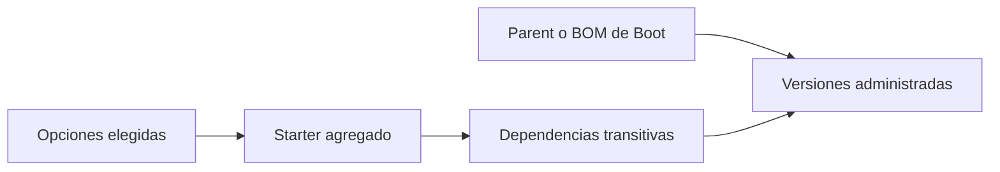
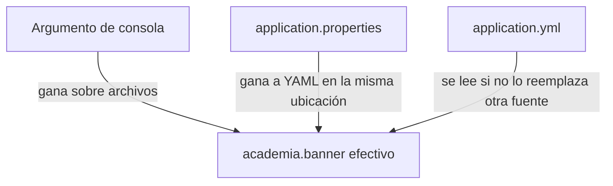

# Módulo 1: Spring Boot CLI y estructura de proyecto

Cada tema se practica por separado con su propia repetición progresiva y su propio reto de memoria. La fusión de configuración base + perfil se verifica con la aplicación Spring Boot real, arrancando con y sin el perfil activo y comparando los valores efectivos.


## Aprende construyendo

### Tema 1: Spring Initializr y starters

Una aplicación de entregas necesita HTTP y probablemente más adelante validación y persistencia. Spring Initializr genera el esqueleto; los starters agrupan bibliotecas y la gestión de dependencias de Boot aporta versiones recomendadas. Necesitas Java básico, terminal y el Módulo 0.

**¿Por qué es importante?** Elegir dependencias a mano puede juntar versiones que no se probaron entre sí. El proyecto generado reduce ese trabajo, pero una versión escrita explícitamente puede reemplazar la recomendación de Boot.

#### Subtema 1.1: Genera el proyecto y encuentra sus piezas · 10 min

**1. Contexto**

Empiezas un servicio nuevo. Generar un proyecto te entrega estructura, Maven Wrapper y una dependencia web inicial.

**2. Hazlo tú**

Crea una carpeta de trabajo y genera un proyecto Java 25 con Maven y la capacidad `web` de [Spring Initializr](https://start.spring.io/):

```bash
mkdir ejemplo-spring-m1
cd ejemplo-spring-m1
curl -fsSL -G 'https://start.spring.io/starter.zip' \
  -d type=maven-project \
  -d language=java \
  -d javaVersion=25 \
  -d dependencies=web \
  -o app.zip
unzip app.zip
./mvnw test
```

Abre el `pom.xml` que se creó y localiza el parent de Spring Boot, la dependencia web y la dependencia de pruebas.

**Resultado esperado:** Maven termina en `BUILD SUCCESS`; `pom.xml` registra las dependencias que pediste y el Wrapper permite compilar sin instalar Maven globalmente.

**Fallo deliberado:** vuelve a la carpeta padre y ejecuta `./mvnw test`. **Diagnóstico:** la terminal no encuentra el wrapper porque vive dentro de `ejemplo-spring-m1`; usa `pwd`, vuelve a esa carpeta y comprueba que allí existen `mvnw` y `pom.xml`.

**3. Entiende**

Initializr no crea tu producto completo: prepara una estructura inicial con opciones elegidas. El starter web agrega bibliotecas necesarias para HTTP; el código y las reglas de tu aplicación siguen siendo responsabilidad del equipo.

**4. Cierra**

Guarda el `pom.xml` y anota el valor del `<version>` de Spring Boot. El siguiente paso usará el controlador del proyecto para observar qué hizo disponible el starter.

#### Subtema 1.2: Conecta el starter web con una ruta · 10 min

**1. Contexto**

La dependencia web solo se vuelve visible cuando una clase del proyecto usa sus herramientas. Una ruta mínima permite comprobar que la aplicación puede recibir HTTP.

**2. Hazlo tú**

Crea `src/main/java/com/example/demo/SaludController.java` dentro del paquete de la aplicación:

```java
package com.example.demo;

import org.springframework.web.bind.annotation.GetMapping;
import org.springframework.web.bind.annotation.RestController;

@RestController
public class SaludController {
    @GetMapping("/health")
    public String health() {
        return "OK";
    }
}
```

Desde la raíz del proyecto, arranca la aplicación:

```bash
./mvnw spring-boot:run
```

En otra terminal, consulta:

```bash
curl -i http://localhost:8080/health
```

**Resultado esperado:** la respuesta comienza con `HTTP/1.1 200` y el cuerpo contiene `OK`.

**Fallo deliberado:** elimina la dependencia web del `pom.xml` y ejecuta `./mvnw test`. **Diagnóstico:** el compilador deja de encontrar `RestController` y `GetMapping`; restaura la dependencia para compilar el controlador.

**3. Entiende**

`@RestController` registra un manejador HTTP. `@GetMapping` conecta la ruta `GET /health` con el método. El starter pone las clases web y el servidor en el proyecto; Boot configura lo habitual si la clase principal tiene `@SpringBootApplication`.

**4. Cierra**

Conserva el controlador y guarda la respuesta HTTP. El siguiente paso mostrará las dependencias que llegaron y quién administra sus versiones.

#### Subtema 1.3: Revisa qué agrupa el starter y quién fija versiones · 10 min

**1. Contexto**

Un starter agrupa dependencias para una tarea. El BOM de Boot administra versiones de bibliotecas que conoce; son funciones relacionadas, pero no significan que cada dependencia quede instalada en cualquier versión.

**2. Hazlo tú**

Desde la carpeta del proyecto, imprime el árbol resuelto y busca el starter web y sus dependencias transitivas:

```bash
./mvnw dependency:tree
```

Luego abre `pom.xml` y localiza el parent `spring-boot-starter-parent` o el bloque `dependencyManagement` que importe el BOM. Los nombres de artefactos cambian entre versiones mayores; usa los que realmente generó Initializr. Por ejemplo, Spring Boot 4 genera el starter `spring-boot-starter-webmvc` para la capacidad web.

**Resultado esperado:** el árbol muestra el starter web junto con sus bibliotecas transitivas. El parent/BOM proporciona versiones administradas para dependencias compatibles con esa versión de Boot.

**Fallo deliberado:** cambia el nombre del starter en el `pom.xml` a `spring-boot-starter-webmx` y ejecuta `./mvnw test`. **Diagnóstico:** Maven no puede resolver ese artefacto; compara el nombre con el árbol y restaura el artefacto generado.

**3. Entiende**

El starter selecciona un conjunto útil de dependencias. El parent o BOM recomienda y administra versiones para bibliotecas incluidas en su catálogo; puedes sobrescribirlas, y una sobrescritura puede producir incompatibilidades. Revisa el árbol cuando agregues dependencias manuales.



**4. Cierra**

**Práctica independiente:** añade la capacidad `validation` desde Initializr o el mecanismo de dependencias de tu proyecto y compara los árboles antes y después. En el proyecto integrador, selecciona cada starter por una necesidad concreta y registra en README el nombre exacto que generó esa versión de Boot.

**Límite:** un starter no configura reglas de negocio, datos de conexión o autorización por ti. No agregues `data-jpa` solo por anticipar que quizá se usará; añade persistencia cuando el proyecto la necesite.

**Fuentes primarias:** [Spring Initializr](https://docs.spring.io/initializr/docs/current/reference/html/), [gestión de dependencias en Spring Boot](https://docs.spring.io/spring-boot/reference/using/build-systems.html), [módulos web de Spring Boot](https://docs.spring.io/spring-boot/reference/web/index.html).

### Tema 2: application.yml vs application.properties

Spring Boot puede leer configuración de archivos YAML o `.properties`. Aprenderás a representar el mismo valor, detectar qué archivo gana si ambos existen y comprobar una sobrescritura desde la terminal.

**¿Por qué es importante?** Una aplicación debe cambiar su configuración sin cambiar el código. Si dos archivos declaran valores distintos, saber la prioridad explica cuál recibe realmente la aplicación.

**Conocimiento previo:** Tema 1 de este módulo y una ruta `GET`.

#### Subtema 2.1: Lee una clave desde YAML · 10 min

**1. Contexto**

Un mensaje de estado puede cambiar entre entornos. Primero lo guardarás en un archivo y harás que una ruta lo muestre.

**2. Hazlo tú**

Crea `src/main/resources/application.yml`:

```yaml
academia:
  banner: "En camino"
server:
  port: 8080
```

Crea `src/main/java/com/example/demo/ConfigController.java`:

```java
package com.example.demo;

import org.springframework.beans.factory.annotation.Value;
import org.springframework.web.bind.annotation.GetMapping;
import org.springframework.web.bind.annotation.RestController;

@RestController
public class ConfigController {
    private final String banner;

    public ConfigController(
            @Value("${academia.banner:sin-configurar}") String banner) {
        this.banner = banner;
    }

    @GetMapping("/banner")
    public String mostrar() {
        return banner;
    }
}
```

Desde la raíz del proyecto, arranca con `./mvnw spring-boot:run`. En otra terminal, consulta:

```bash
curl http://localhost:8080/banner
```

**Resultado esperado:** aparece `En camino`.

**Fallo deliberado:** alinea `banner` con `academia:` en vez de indentarla bajo ese nodo. **Diagnóstico:** YAML todavía es válido, pero ahora el valor está en `banner`, no en `academia.banner`; la ruta muestra el valor por defecto `sin-configurar`. Indenta dos espacios y repite.

**3. Entiende**

La indentación representa niveles: `academia` contiene `banner`. `@Value` solicita esa clave a Spring; la aplicación no lee el archivo manualmente.

**4. Cierra**

Guarda la respuesta y copia la ruta de claves: `academia.banner`. En el siguiente subtema expresarás la misma clave de forma plana.

#### Subtema 2.2: Escribe la misma clave en Properties y observa prioridad · 10 min

**1. Contexto**

El formato cambia cómo se ve el archivo; la clave que recibe el programa debe conservar su nombre.

**2. Hazlo tú**

Detén la aplicación, elimina o renombra `src/main/resources/application.yml` y crea `src/main/resources/application.properties`:

```properties
academia.banner=En camino
server.port=8080
```

Arranca otra vez con `./mvnw spring-boot:run` y consulta `curl http://localhost:8080/banner`.

**Resultado esperado:** aparece el mismo texto, `En camino`.

**Fallo deliberado:** vuelve a poner ambos archivos en `src/main/resources`, pero asigna `Desde YAML` en el `.yml` y `Desde Properties` en el `.properties`. **Diagnóstico:** para esos archivos en la misma ubicación, `.properties` tiene prioridad; la ruta responde `Desde Properties`. Borra uno para evitar que el equipo tenga que recordar ese conflicto.

**3. Entiende**

Properties usa pares `clave=valor`; YAML agrupa claves con espacios. Spring puede leer ambos, pero no conviene duplicar claves entre los dos formatos: en la misma ubicación, `.properties` gana.

**4. Cierra**

Deja un solo archivo y registra cuál escogió el equipo. El último paso probará una configuración de mayor prioridad.

#### Subtema 2.3: Sobrescribe el archivo desde la terminal · 10 min

**1. Contexto**

Una opción de la línea de comandos puede sustituir un valor del archivo durante un arranque puntual, por ejemplo, para comparar configuraciones.

**2. Hazlo tú**

Con `src/main/resources/application.properties` y su valor `academia.banner=En camino`, arranca desde la raíz del proyecto:

```bash
./mvnw spring-boot:run -Dspring-boot.run.arguments=--academia.banner=Prueba
```

Consulta `curl http://localhost:8080/banner` mientras el servidor está activo.

**Resultado esperado:** aparece `Prueba`; el argumento de línea de comandos tiene prioridad sobre el valor del archivo.

**Fallo deliberado:** escribe `--academia.baner=Prueba` (falta una `n`) y repite. **Diagnóstico:** la clave errónea no sustituye `academia.banner`, así que aparece `En camino`; compara el argumento con la clave que lee el constructor.

**3. Entiende**

La precedencia no depende del aspecto YAML o Properties: depende de dónde viene el valor. En este ejemplo, argumento de consola gana sobre el archivo.



**4. Cierra**

**Práctica independiente:** cambia el banner del archivo y luego de la terminal, anota los dos resultados y explica cuál fuente prevalece. En el proyecto integrador, mantén valores base en un formato y cambia solo los necesarios por entorno; el próximo tema introduce perfiles.

**Límite:** usar dos formatos para declarar la misma propiedad dificulta saber qué valor se aplica. Spring permite leer ambos, pero recomienda mantener un solo formato por aplicación.

**Fuente primaria:** [configuración externa y precedencia de propiedades en Spring Boot](https://docs.spring.io/spring-boot/reference/features/external-config.html).

### Tema 3: Perfiles y estructura por capas

#### Paso 1 · Objetivo y preparación

Al finalizar podrás externalizar configuración por perfil y organizar el código en capas `controller`/`service`/`repository` con responsabilidades delimitadas.

**Conocimiento previo:** Tema 2 de este módulo.

#### Paso 2 · Contexto y caso real

**¿Por qué es importante?** Desplegar exactamente el mismo artefacto compilado en desarrollo y en producción, variando solo la URL de la base de datos y el nivel de logs entre ambos entornos, evita el riesgo de que el artefacto probado en un entorno sea sutilmente distinto al que efectivamente se despliega en producción.

#### Paso 3 · Teoría con analogía

**Conceptos clave:** perfil (`application-{perfil}.yml`), sobreescritura parcial, estructura por capas.

Un perfil (`application-dev.yml`, `application-prod.yml`) sobreescribe únicamente los valores específicos que declara explícitamente, manteniendo intacto el resto de la configuración base definida en `application.yml`; `java -jar app.jar --spring.profiles.active=dev` activa el perfil correspondiente al arrancar, sin necesidad de recompilar la aplicación para cada entorno. La estructura por capas (`controller/` traduciendo HTTP hacia/desde DTOs, `service/` con la lógica de negocio sin conocimiento de HTTP, `repository/` con el acceso a datos) establece responsabilidades delimitadas: el controller no debería contener lógica de negocio, y el service no debería conocer detalles HTTP como códigos de estado.

**Analogía:** los perfiles son distintos conjuntos de ajustes preconfigurados para el mismo dispositivo, seleccionables según el contexto de uso sin reconfigurar manualmente cada ajuste; la estructura por capas es una cadena de producción donde cada estación tiene una responsabilidad delimitada y no necesita conocer los detalles internos de las demás estaciones.

**Diagrama:**

```
┌── application.yml (base) ──────────────────┐
│  server.port: 8080                            │
│  spring.datasource.url: .../app               │
└──────────────┬─────────────────────────┘
               │ + application-dev.yml (perfil)
               ▼
┌── configuración final con perfil dev ──────┐
│  server.port: 8080 (heredado, sin cambios)    │
│  spring.datasource.url: .../app_dev (sobreescrito) │
└──────────────────────────────────────┘
```

#### Paso 4 · Demostración guiada desde cero

Desde una carpeta vacía (o continuando en `ejemplo-spring-m1`), crea `src/main/resources/application-dev.yml` con la configuración específica del entorno de desarrollo:

```yaml
spring:
  datasource:
    url: jdbc:postgresql://localhost:5432/app_dev
```

Arranca la aplicación activando explícitamente el perfil `dev`:

```bash
# empaqueta y ejecuta el jar Java con el perfil dev activado
cd ejemplo-spring-m1
./mvnw clean package -DskipTests
java -jar target/*.jar --spring.profiles.active=dev
```

**Explicación línea por línea:** `application-dev.yml` solo declara `spring.datasource.url`, sobreescribiendo ÚNICAMENTE esa clave; `server.port` (definido en `application.yml` base) permanece sin cambios porque el perfil no lo menciona; `--spring.profiles.active=dev` le indica a Spring Boot qué archivo de perfil cargar además del `application.yml` base.

**Resultado esperado:** los logs de arranque muestran `The following 1 profile is active: "dev"` y la aplicación se conecta a `app_dev` (no a `app`, el valor base) — confirmando que el perfil sobreescribió solo la clave que declaró explícitamente, dejando el resto de la configuración base intacta.

**Fallo deliberado:** arranca sin `--spring.profiles.active=dev` (sin activar ningún perfil). La aplicación usa `spring.datasource.url` del `application.yml` BASE (apuntando a `app`, no a `app_dev`) — diagnostica confirmando que un perfil nunca se activa automáticamente; olvidar la bandera en el comando de arranque es el error más común al desplegar en el entorno equivocado sin darse cuenta.

Para ver la configuración final ya fusionada (no solo inferirla), agrega el starter `actuator` al proyecto, expón el endpoint `env` en `application.yml` (`management.endpoints.web.exposure.include: env`), y consulta el entorno efectivo con la aplicación corriendo:

```bash
# consulta las propiedades efectivas después de fusionar base + perfil dev
curl -s http://localhost:8080/actuator/env/spring.datasource.url | grep -o '"value":"[^"]*"'
curl -s http://localhost:8080/actuator/env/server.port | grep -o '"value":[0-9]*'
```

**Resultado esperado:** `spring.datasource.url` reporta el valor del perfil (`.../app_dev`), mientras `server.port` reporta `8080`, el valor heredado de la base sin cambios — el endpoint `/actuator/env` expone exactamente la configuración fusionada que Spring Boot calculó, sin necesidad de inferirla manualmente.

#### Paso 5 · Práctica guiada — repetición progresiva

1. Agrega un tercer perfil `test` que sobreescriba únicamente el puerto, y confirma con `/actuator/env` qué claves cambian y cuáles no.
2. Declara la misma clave en `application.yml` base Y en el perfil, arranca con el perfil activo, y confirma con `/actuator/env` cuál de los dos valores gana.
3. Organiza un endpoint existente en las tres capas (`controller`/`service`/`repository`) y documenta qué responsabilidad tiene cada una.
4. Escribe de memoria (sin mirar) un `application-test.yml` que sobreescriba únicamente una clave del `application.yml` base.

**Pista:** antes de desplegar, siempre verifica explícitamente con qué perfil arrancó la aplicación (revisando el log `The following N profile(s) are active`) en vez de asumirlo.

#### Paso 6 · Práctica independiente

**Completa el código:** rellena el espacio para activar el perfil `dev` al arrancar:

```bash
java -jar app.jar --spring.____=dev
```

**Reto de memoria sin mirar:** cierra este documento y escribe, solo de memoria, una configuración base y un perfil que sobreescriba una sola clave, y traza a mano qué configuración final resultaría. Compara después contra el patrón del Paso 4.

#### Paso 7 · Cierre y evidencia

Ya externalizas configuración por perfil y organizas el código en capas con responsabilidades delimitadas, confirmando con `/actuator/env` que un perfil sobreescribe solo lo que declara explícitamente. Esto cierra la estructura básica de un proyecto Spring Boot; el siguiente módulo profundiza en la capa web y el manejo de peticiones HTTP. **Evidencia:** entrega el resultado de `/actuator/env` con la configuración final fusionada (puerto heredado, URL sobreescrita) y el comportamiento real al arrancar sin activar ningún perfil. Fuente oficial: [Spring Boot — Profiles](https://docs.spring.io/spring-boot/docs/current/reference/html/features.html#features.profiles).

**Errores comunes:** olvidar activar el perfil correcto al desplegar, terminando con la configuración base incorrecta para ese entorno; poner lógica de negocio en el controller, mezclando responsabilidades entre capas.

**Cuándo no usarlo:** para una aplicación que siempre corre en un único entorno fijo sin ninguna variación de configuración, mantener múltiples perfiles agrega complejidad sin beneficio real; un único `application.yml` basta.

---

La estructura por capas de este tema es la que organiza el proyecto integrador de este track (microservicio productivo, Módulo 12).

## Laboratorio práctico

**Objetivo del laboratorio:** generar un proyecto Spring Boot con perfiles dev/prod y estructura por capas.

**Requisitos previos:** Módulo 0 completado.

| Paso | Acción | Código | Explicación |
|---|---|---|---|
| 1 | Generar el proyecto con Spring Initializr | web, data-jpa, postgresql | Verifica las dependencias generadas |
| 2 | Convertir a `application.yml` | Ver Tema 2 | Compara la legibilidad |
| 3 | Crear `application-dev.yml`/`application-prod.yml` | Ver Tema 3 | Arranca con `--spring.profiles.active=dev` |
| 4 | Organizar en paquetes por capa | Ver Tema 3 | `controller/`, `service/`, `repository/`, `dto/` |
| 5 | Verificar el perfil activo | `/actuator/env` | Si está habilitado |

**Verificación:** el laboratorio se considera exitoso si el proyecto arranca correctamente con cada perfil aplicando su configuración específica, y si la estructura por capas separa claramente controller/service/repository sin lógica de negocio filtrada en el controller.

**Errores comunes y soluciones**

- **Hardcodear valores de configuración distintos por entorno en el código.** Usa perfiles para externalizar esa configuración.
- **Poner lógica de negocio en el controller.** El controller solo debe traducir HTTP hacia/desde DTOs, delegando la lógica al service.
- **Mezclar `.properties` y `.yml` sin necesidad.** Elige un formato y sé consistente en todo el proyecto.

---
