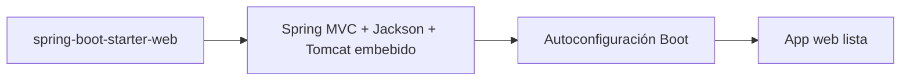
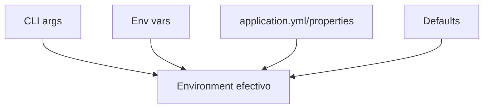
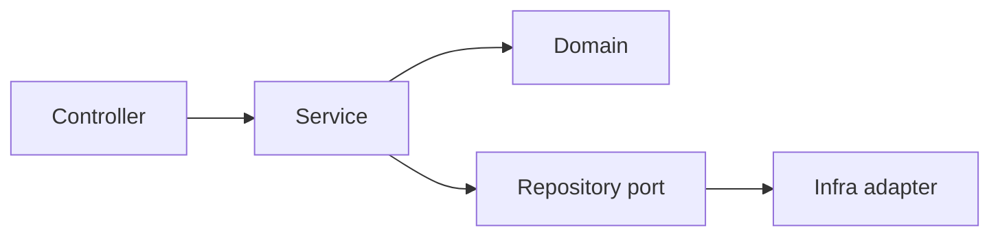

# Módulo 1: Spring Boot CLI y estructura de proyecto

Un proyecto Spring Boot sano no empieza por la lógica de negocio, sino por una base reproducible: versión de Boot, JDK, build tool, dependencias y estructura. Este módulo cubre Initializr/starters, configuración, perfiles y estructura por capas.

**Entorno de referencia verificado (2026-05-22):** JDK 27.0.1.0.2, Maven 3.10.0, Gradle 9.8.2. Spring Boot 3.5.0 verificado en smokes locales.

## Aprende construyendo

### Tema 1: Spring Initializr y starters · Básico · 30 min

Caso guía: crear un servicio web sin armar dependencias manualmente.

#### Spring Initializr

**Definición formal.** Initializr genera el esqueleto de un proyecto Spring Boot con metadata, build, wrapper y dependencias iniciales.

**Contrato.** Debes fijar group/artifact, versión de Boot, Java, build tool y starters. El resultado es un proyecto base, no una arquitectura completa.

**Ejemplo mínimo (ejecutable con red).**

```bash
curl -fsSL -G 'https://start.spring.io/starter.zip' \
  -d type=maven-project -d language=java -d javaVersion=21 -d bootVersion=3.5.0 \
  -d groupId=com.example -d artifactId=demo -d dependencies=web -o demo.zip
unzip -l demo.zip | head
```

**Error común.** Aceptar defaults sin revisar Java/Boot. Corrección: fijar versiones explícitas y versionar el proyecto generado.

**Nota de verificación.** Requiere acceso a `start.spring.io`. El ZIP y su listado son evidencia; en offline, usar plantilla interna o Initializr del IDE.

#### Starters

**Definición formal.** Un starter es una dependencia curada que trae un conjunto compatible de librerías para una capacidad.

**Cómo funciona por dentro.** El starter aporta dependencias transitivas; Boot autoconfigura según lo que encuentra en classpath.



**Ejemplo mínimo.** En un proyecto generado: `./mvnw dependency:tree | grep spring-boot-starter-web`.

**Error común.** Agregar librerías sueltas ignorando el starter. Corrección: empezar por starter y revisar árbol de dependencias.

### Tema 2: application.yml vs application.properties · Básico · 30 min

Caso guía: configurar puerto y una propiedad propia.

#### `application.properties`

**Definición formal.** Archivo plano key=value cargado por Spring Boot desde classpath o rutas configuradas.

**Ejemplo mínimo (ejecutable).**

```bash
mkdir -p java-sb1-props
cd java-sb1-props
```

Crea el archivo `application.properties`:

```properties
academia.banner=Hola
server.port=8080
```

```bash
grep academia.banner application.properties
```

**Error común.** Claves duplicadas o typos silenciosos. Corrección: `@ConfigurationProperties` tipado y tests de configuración.

**Verificación (2026-05-22).** `academia.banner=Hola`.

#### `application.yml`

**Definición formal.** Formato YAML jerárquico para configuración.

**Ejemplo mínimo (ejecutable con Python para validar parseo local).**

```bash
mkdir -p java-sb1-yml
cd java-sb1-yml
```

Crea el archivo `application.yml`:

```yaml
academia:
  banner: Hola
server:
  port: 8080
```

```bash
python3 -c "import yaml; print(yaml.safe_load(open('application.yml'))['academia']['banner'])"
```

**Error común.** Indentación con tabs o espacios inconsistentes. Síntoma: error al arrancar. Corrección: YAML válido y linter.

**Verificación (2026-05-22).** `Hola`.

#### Precedencia y configuración tipada

**Definición formal.** Spring Boot resuelve propiedades por orden de precedencia (args, env vars, config files, defaults). `@ConfigurationProperties` enlaza grupos de propiedades a objetos tipados.



**Ejemplo mínimo (ejecutable, simulación de precedencia).**

```bash
mkdir -p java-sb1-prev
cd java-sb1-prev
```

Crea el archivo `DemoPrev.java`:

```java
import java.util.*;
public class DemoPrev {
  public static void main(String[] args) {
    Properties base = new Properties();
    base.setProperty("banner", "Base");
    Properties override = new Properties(base);
    override.setProperty("banner", "Arg");
    System.out.println(override.getProperty("banner"));
  }
}
```

```bash
javac DemoPrev.java
java DemoPrev
```

**Error común.** No saber por qué un valor “no cambia”. Corrección: inspeccionar origen efectivo (`/actuator/env` en dev seguro).

**Verificación (JDK 27, 2026-05-22).** `Arg`.

### Tema 3: Perfiles y estructura por capas · Intermedio · 35 min

Caso guía: misma app, distinta config para `dev` y `prod`.

#### Profiles

**Definición formal.** Un profile es un nombre de entorno/variante que activa beans y configuraciones condicionadas (`application-dev.yml`, `@Profile`).

**Ejemplo mínimo.**

```yaml
# application-dev.yml
logging:
  level:
    root: DEBUG
```

```bash
java -jar app.jar --spring.profiles.active=dev
```

**Error común.** Lógica de negocio condicionada por profile dispersa. Corrección: aislar diferencias de infraestructura/configuración.

#### Estructura por capas

**Definición formal.** Organización por responsabilidad: controller/api, service/application, domain, repository/infra.



**Error común.** Controller accediendo directo a repositorio y metiendo lógica de negocio. Corrección: service/domain con límites claros.

## Cierre

La base de un proyecto Spring Boot define su costo futuro. Fija versiones, usa starters, configura con claridad y separa capas desde el día 1.

## Checklist

- Puedo generar un proyecto Boot reproducible.
- Entiendo starters y config yml/properties.
- Sé usar profiles y precedencia.
- Estructuro por capas con dependencias claras.
