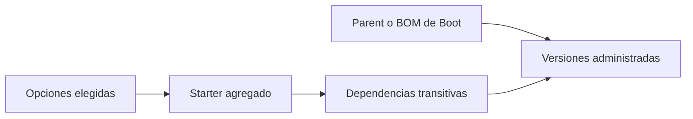
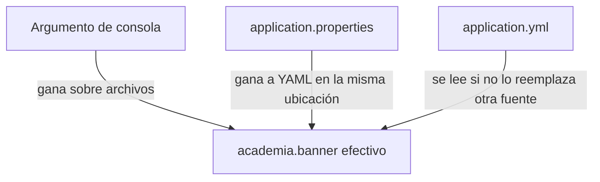
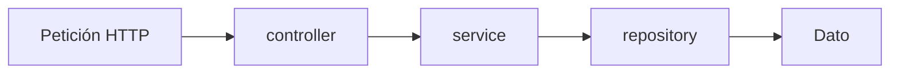

# Módulo 1: Spring Boot CLI y estructura de proyecto

Cada tema se practica por separado con su propia repetición progresiva y su propio reto de memoria. La fusión de configuración base + perfil se verifica con la aplicación Spring Boot real, arrancando con y sin el perfil activo y comparando los valores efectivos.


## Aprende construyendo

### Tema 1: Spring Initializr y starters

Una aplicación de entregas necesita HTTP y probablemente más adelante validación y persistencia. Spring Initializr genera el esqueleto; los starters agrupan bibliotecas y la gestión de dependencias de Boot aporta versiones recomendadas. Necesitas Java básico, terminal y el Módulo 0.

**¿Por qué es importante?** Elegir dependencias a mano puede juntar versiones que no se probaron entre sí. El proyecto generado reduce ese trabajo, pero una versión escrita explícitamente puede reemplazar la recomendación de Boot.

#### Subtema 1.1: Genera el proyecto y encuentra sus piezas · 10 min

**1. Contexto**

Empiezas un servicio nuevo. Generar un proyecto te entrega estructura, Maven Wrapper y una dependencia web inicial.

**2. Hazlo tú**

Para observar Initializr sin sobrescribir `academia-spring`, crea una carpeta experimental distinta y genera un proyecto Java 25 con Maven y la capacidad `web` de [Spring Initializr](https://start.spring.io/):

```bash
mkdir ejemplo-spring-m1
cd ejemplo-spring-m1
curl -fsSL -G 'https://start.spring.io/starter.zip' \
  -d type=maven-project \
  -d language=java \
  -d javaVersion=25 \
  -d bootVersion=4.1.2 \
  -d packageName=com.example.demo \
  -d dependencies=web \
  -o app.zip
unzip app.zip
./mvnw test
```

Abre el `pom.xml` que se creó y localiza el parent de Spring Boot, la dependencia web y la dependencia de pruebas.

**Resultado esperado:** Maven termina en `BUILD SUCCESS`; `pom.xml` registra las dependencias que pediste y el Wrapper permite compilar sin instalar Maven globalmente.

**Fallo deliberado:** vuelve a la carpeta padre y ejecuta `./mvnw test`. **Diagnóstico:** la terminal no encuentra el wrapper porque vive dentro de `ejemplo-spring-m1`; usa `pwd`, vuelve a esa carpeta y comprueba que allí existen `mvnw` y `pom.xml`.

**3. Entiende**

Initializr no crea tu producto completo: prepara una estructura inicial con opciones elegidas. El starter web agrega bibliotecas necesarias para HTTP; el código y las reglas de tu aplicación siguen siendo responsabilidad del equipo.

**4. Cierra**

Guarda el `pom.xml` y anota el valor del `<version>` de Spring Boot. Continúa los demás temas en `academia-spring`, que ya tiene el mismo paquete y starter web; la carpeta experimental solo conserva esta comparación. El siguiente paso usará el controlador del proyecto para observar qué hizo disponible el starter.

#### Subtema 1.2: Conecta el starter web con una ruta · 10 min

**1. Contexto**

La dependencia web solo se vuelve visible cuando una clase del proyecto usa sus herramientas. Una ruta mínima permite comprobar que la aplicación puede recibir HTTP.

**2. Hazlo tú**

Crea `src/main/java/com/example/demo/SaludController.java` dentro del paquete de la aplicación:

```java
package com.example.demo;

import org.springframework.web.bind.annotation.GetMapping;
import org.springframework.web.bind.annotation.RestController;

@RestController
public class SaludController {
    @GetMapping("/health")
    public String health() {
        return "OK";
    }
}
```

Desde la raíz del proyecto, arranca la aplicación:

```bash
./mvnw spring-boot:run
```

En otra terminal, consulta:

```bash
curl -i http://localhost:8080/health
```

**Resultado esperado:** la respuesta comienza con `HTTP/1.1 200` y el cuerpo contiene `OK`.

**Fallo deliberado:** elimina la dependencia web del `pom.xml` y ejecuta `./mvnw test`. **Diagnóstico:** el compilador deja de encontrar `RestController` y `GetMapping`; restaura la dependencia para compilar el controlador.

**3. Entiende**

`@RestController` registra un manejador HTTP. `@GetMapping` conecta la ruta `GET /health` con el método. El starter pone las clases web y el servidor en el proyecto; Boot configura lo habitual si la clase principal tiene `@SpringBootApplication`.

**4. Cierra**

Conserva el controlador y guarda la respuesta HTTP. El siguiente paso mostrará las dependencias que llegaron y quién administra sus versiones.

#### Subtema 1.3: Revisa qué agrupa el starter y quién fija versiones · 10 min

**1. Contexto**

Un starter agrupa dependencias para una tarea. El BOM de Boot administra versiones de bibliotecas que conoce; son funciones relacionadas, pero no significan que cada dependencia quede instalada en cualquier versión.

**2. Hazlo tú**

Desde la carpeta del proyecto, imprime el árbol resuelto y busca el starter web y sus dependencias transitivas:

```bash
./mvnw dependency:tree
```

Luego abre `pom.xml` y localiza el parent `spring-boot-starter-parent` o el bloque `dependencyManagement` que importe el BOM. Los nombres de artefactos cambian entre versiones mayores; usa los que realmente generó Initializr. Por ejemplo, Spring Boot 4 genera el starter `spring-boot-starter-webmvc` para la capacidad web.

**Resultado esperado:** el árbol muestra el starter web junto con sus bibliotecas transitivas. El parent/BOM proporciona versiones administradas para dependencias compatibles con esa versión de Boot.

**Fallo deliberado:** cambia el nombre del starter en el `pom.xml` a `spring-boot-starter-webmx` y ejecuta `./mvnw test`. **Diagnóstico:** Maven no puede resolver ese artefacto; compara el nombre con el árbol y restaura el artefacto generado.

**3. Entiende**

El starter selecciona un conjunto útil de dependencias. El parent o BOM recomienda y administra versiones para bibliotecas incluidas en su catálogo; puedes sobrescribirlas, y una sobrescritura puede producir incompatibilidades. Revisa el árbol cuando agregues dependencias manuales.



**4. Cierra**

**Práctica independiente:** añade la capacidad `validation` desde Initializr o el mecanismo de dependencias de tu proyecto y compara los árboles antes y después. En el proyecto integrador, selecciona cada starter por una necesidad concreta y registra en README el nombre exacto que generó esa versión de Boot.

**Límite:** un starter no configura reglas de negocio, datos de conexión o autorización por ti. No agregues `data-jpa` solo por anticipar que quizá se usará; añade persistencia cuando el proyecto la necesite.

**Fuentes primarias:** [Spring Initializr](https://docs.spring.io/initializr/docs/current/reference/html/), [gestión de dependencias en Spring Boot](https://docs.spring.io/spring-boot/reference/using/build-systems.html), [módulos web de Spring Boot](https://docs.spring.io/spring-boot/reference/web/index.html).

### Tema 2: application.yml vs application.properties

Spring Boot puede leer configuración de archivos YAML o `.properties`. Aprenderás a representar el mismo valor, detectar qué archivo gana si ambos existen y comprobar una sobrescritura desde la terminal.

**¿Por qué es importante?** Una aplicación debe cambiar su configuración sin cambiar el código. Si dos archivos declaran valores distintos, saber la prioridad explica cuál recibe realmente la aplicación.

**Conocimiento previo:** Tema 1 de este módulo y una ruta `GET`.

#### Subtema 2.1: Lee una clave desde YAML · 10 min

**1. Contexto**

Un mensaje de estado puede cambiar entre entornos. Primero lo guardarás en un archivo y harás que una ruta lo muestre.

**2. Hazlo tú**

Crea `src/main/resources/application.yml`:

```yaml
academia:
  banner: "En camino"
server:
  port: 8080
```

Crea `src/main/java/com/example/demo/ConfigController.java`:

```java
package com.example.demo;

import org.springframework.beans.factory.annotation.Value;
import org.springframework.web.bind.annotation.GetMapping;
import org.springframework.web.bind.annotation.RestController;

@RestController
public class ConfigController {
    private final String banner;

    public ConfigController(
            @Value("${academia.banner:sin-configurar}") String banner) {
        this.banner = banner;
    }

    @GetMapping("/banner")
    public String mostrar() {
        return banner;
    }
}
```

Desde la raíz del proyecto, arranca con `./mvnw spring-boot:run`. En otra terminal, consulta:

```bash
curl http://localhost:8080/banner
```

**Resultado esperado:** aparece `En camino`.

**Fallo deliberado:** alinea `banner` con `academia:` en vez de indentarla bajo ese nodo. **Diagnóstico:** YAML todavía es válido, pero ahora el valor está en `banner`, no en `academia.banner`; la ruta muestra el valor por defecto `sin-configurar`. Indenta dos espacios y repite.

**3. Entiende**

La indentación representa niveles: `academia` contiene `banner`. `@Value` solicita esa clave a Spring; la aplicación no lee el archivo manualmente.

**4. Cierra**

Guarda la respuesta y copia la ruta de claves: `academia.banner`. En el siguiente subtema expresarás la misma clave de forma plana.

#### Subtema 2.2: Escribe la misma clave en Properties y observa prioridad · 10 min

**1. Contexto**

El formato cambia cómo se ve el archivo; la clave que recibe el programa debe conservar su nombre.

**2. Hazlo tú**

Detén la aplicación, elimina o renombra `src/main/resources/application.yml` y crea `src/main/resources/application.properties`:

```properties
academia.banner=En camino
server.port=8080
```

Arranca otra vez con `./mvnw clean spring-boot:run` y consulta `curl http://localhost:8080/banner`. `clean` borra recursos compilados que pudieron quedar del archivo anterior.

**Resultado esperado:** aparece el mismo texto, `En camino`.

**Fallo deliberado:** vuelve a poner ambos archivos en `src/main/resources`, pero asigna `Desde YAML` en el `.yml` y `Desde Properties` en el `.properties`. **Diagnóstico:** para esos archivos en la misma ubicación, `.properties` tiene prioridad; la ruta responde `Desde Properties`. Borra uno para evitar que el equipo tenga que recordar ese conflicto.

**3. Entiende**

Properties usa pares `clave=valor`; YAML agrupa claves con espacios. Spring puede leer ambos, pero no conviene duplicar claves entre los dos formatos: en la misma ubicación, `.properties` gana.

**4. Cierra**

Deja un solo archivo y registra cuál escogió el equipo. El último paso probará una configuración de mayor prioridad.

#### Subtema 2.3: Sobrescribe el archivo desde la terminal · 10 min

**1. Contexto**

Una opción de la línea de comandos puede sustituir un valor del archivo durante un arranque puntual, por ejemplo, para comparar configuraciones.

**2. Hazlo tú**

Con `src/main/resources/application.properties` y su valor `academia.banner=En camino`, arranca desde la raíz del proyecto:

```bash
./mvnw clean spring-boot:run -Dspring-boot.run.arguments=--academia.banner=Prueba
```

Consulta `curl http://localhost:8080/banner` mientras el servidor está activo.

**Resultado esperado:** aparece `Prueba`; el argumento de línea de comandos tiene prioridad sobre el valor del archivo.

**Fallo deliberado:** escribe `--academia.baner=Prueba` (falta una `n`) y repite. **Diagnóstico:** la clave errónea no sustituye `academia.banner`, así que aparece `En camino`; compara el argumento con la clave que lee el constructor.

**3. Entiende**

La precedencia no depende del aspecto YAML o Properties: depende de dónde viene el valor. En este ejemplo, argumento de consola gana sobre el archivo.



**4. Cierra**

**Práctica independiente:** cambia el banner del archivo y luego de la terminal, anota los dos resultados y explica cuál fuente prevalece. En el proyecto integrador, mantén valores base en un formato y cambia solo los necesarios por entorno; el próximo tema introduce perfiles.

**Límite:** usar dos formatos para declarar la misma propiedad dificulta saber qué valor se aplica. Spring permite leer ambos, pero recomienda mantener un solo formato por aplicación.

**Fuente primaria:** [configuración externa y precedencia de propiedades en Spring Boot](https://docs.spring.io/spring-boot/reference/features/external-config.html).

### Tema 3: Perfiles y estructura por capas

Un mismo programa puede usar algunos valores distintos en desarrollo y producción. Un perfil selecciona una configuración; las capas separan quién atiende HTTP, quién aplica una regla y quién obtiene datos. Necesitas el proyecto de los temas anteriores.

**¿Por qué es importante?** Promover el mismo artefacto entre entornos reduce diferencias accidentales. Separar HTTP de las reglas y los datos permite cambiar una parte sin convertir el controlador en toda la aplicación.

#### Subtema 3.1: Combina una configuración base con un perfil · 10 min

**1. Contexto**

La configuración base sirve como valor común. Un perfil puede reemplazar una clave concreta y dejar las demás como están.

**2. Hazlo tú**

Retira `src/main/resources/application.properties` si la elegiste en el tema anterior. Conserva un solo formato. En `src/main/resources/application.yml`, guarda:

```yaml
academia:
  banner: "Base"
  entorno: "compartido"
server:
  port: 8080
```

En `src/main/resources/application-dev.yml`, guarda:

```yaml
academia:
  banner: "Desarrollo"
```

Crea `src/main/java/com/example/demo/PerfilController.java`:

```java
package com.example.demo;

import org.springframework.beans.factory.annotation.Value;
import org.springframework.web.bind.annotation.GetMapping;
import org.springframework.web.bind.annotation.RestController;

@RestController
public class PerfilController {
    private final String banner;
    private final String entorno;

    public PerfilController(
            @Value("${academia.banner:sin-configurar}") String banner,
            @Value("${academia.entorno:sin-configurar}") String entorno) {
        this.banner = banner;
        this.entorno = entorno;
    }

    @GetMapping("/perfil")
    public String mostrar() {
        return "banner=" + banner + "; entorno=" + entorno;
    }
}
```

Arranca sin activar un perfil usando `./mvnw clean spring-boot:run` y consulta `curl http://localhost:8080/perfil`.

**Resultado esperado:** aparece `banner=Base; entorno=compartido`.

**Fallo deliberado:** mueve `entorno: "compartido"` al nivel raíz, alineado con `academia:`. **Diagnóstico:** YAML sigue válido, pero la clave deja de ser `academia.entorno`; la ruta muestra `sin-configurar`. Coloca `entorno` dentro de `academia`.

**3. Entiende**

Spring Boot carga `application.yml` y aplica archivos específicos cuando el perfil correspondiente está activo. La configuración del perfil puede reemplazar una clave; aquí no reemplaza `academia.entorno` ni `server.port`.

**4. Cierra**

Guarda la respuesta base. El siguiente subtema activará `dev` y observará el cambio de una sola clave.

#### Subtema 3.2: Activa el perfil y comprueba el valor aplicado · 10 min

**1. Contexto**

Crear `application-dev.yml` no lo activa. El proceso necesita saber qué perfil usar.

**2. Hazlo tú**

Desde la raíz del proyecto, arranca con el perfil `dev`:

```bash
./mvnw clean spring-boot:run -Dspring-boot.run.arguments=--spring.profiles.active=dev
```

En otra terminal, consulta `curl http://localhost:8080/perfil`. Revisa también la línea de perfiles en los logs de inicio.

**Resultado esperado:** aparece `banner=Desarrollo; entorno=compartido`, y el log identifica `dev` como perfil activo.

**Fallo deliberado:** cambia el argumento a `--spring.profiles.active=deev`. **Diagnóstico:** aparece el valor base porque no existe `application-deev.yml`; los logs muestran el nombre mal escrito. Corrige a `dev`.

**3. Entiende**

El perfil específico reemplaza la clave que declara y conserva las claves base que no declara. Si no se activa ningún perfil, Spring usa el perfil predeterminado `default`; sin un archivo `application-default.yml`, el proyecto usa los valores base.

**4. Cierra**

Guarda las dos respuestas, con y sin `dev`, y anota qué propiedad cambió. El siguiente paso organiza las clases que reciben y procesan la petición.

#### Subtema 3.3: Separa HTTP, regla y acceso a datos · 15 min

**1. Contexto**

El controlador traduce una petición; el servicio decide qué operación ejecutar; el repositorio entrega los datos. Cada clase tiene una razón principal para cambiar.

**2. Hazlo tú**

Crea `src/main/java/com/example/demo/repository/EstadoRepository.java`:

```java
package com.example.demo.repository;

import org.springframework.stereotype.Repository;

@Repository
public class EstadoRepository {
    public String buscar(String codigo) {
        return "En ruta: " + codigo;
    }
}
```

Crea `src/main/java/com/example/demo/service/EstadoService.java`:

```java
package com.example.demo.service;

import com.example.demo.repository.EstadoRepository;
import org.springframework.stereotype.Service;

@Service
public class EstadoService {
    private final EstadoRepository repository;

    public EstadoService(EstadoRepository repository) {
        this.repository = repository;
    }

    public String consultar(String codigo) {
        return repository.buscar(codigo);
    }
}
```

Crea `src/main/java/com/example/demo/controller/EstadoController.java`:

```java
package com.example.demo.controller;

import com.example.demo.service.EstadoService;
import org.springframework.web.bind.annotation.GetMapping;
import org.springframework.web.bind.annotation.PathVariable;
import org.springframework.web.bind.annotation.RestController;

@RestController
public class EstadoController {
    private final EstadoService service;

    public EstadoController(EstadoService service) {
        this.service = service;
    }

    @GetMapping("/envios/{codigo}/estado")
    public String estado(@PathVariable String codigo) {
        return service.consultar(codigo);
    }
}
```

Ejecuta `./mvnw test` y luego `./mvnw spring-boot:run`. Consulta `curl http://localhost:8080/envios/RF-42/estado`.

**Resultado esperado:** aparece `En ruta: RF-42`; `EstadoController` llama al servicio, que obtiene el dato del repositorio.

**Fallo deliberado:** cambia el constructor de `EstadoController` para recibir `EstadoRepository` y devuelve `repository.buscar(codigo)` directamente. **Diagnóstico:** la ruta aún funciona, pero el controlador ahora conoce acceso a datos y omite `EstadoService`; restaura la dependencia al servicio.

**3. Entiende**

El controlador conoce HTTP y el servicio. El servicio conoce la operación y el repositorio. El repositorio conoce la fuente de datos. No hace falta una capa que no proteja una decisión o una frontera real.



**4. Cierra**

**Práctica independiente:** cambia el texto que devuelve `EstadoRepository.buscar` y consulta la ruta otra vez. Luego explica qué capa cambiarías para reemplazar esa respuesta simulada por una consulta real, sin alterar la ruta HTTP. En el proyecto integrador, mantén los valores por entorno separados y agrega capas cuando tengan una responsabilidad concreta.

**Límite:** `/actuator/env` puede mostrar valores de configuración sensibles enmascarados; no lo expongas para verificar secretos. En este ejemplo la ruta propia muestra solo valores ficticios y el perfil activo se comprueba en los logs.

**Fuentes primarias:** [perfiles de Spring Boot](https://docs.spring.io/spring-boot/reference/features/profiles.html), [configuración externa y precedencia](https://docs.spring.io/spring-boot/reference/features/external-config.html), [seguridad y valores del endpoint Actuator `env`](https://docs.spring.io/spring-boot/reference/actuator/endpoints.html).

---

La estructura por capas de este tema es la que organiza el proyecto integrador de este track (microservicio productivo, Módulo 12).

## Laboratorio práctico

**Objetivo del laboratorio:** generar un proyecto Spring Boot con perfiles dev/prod y estructura por capas.

**Requisitos previos:** Módulo 0 completado.

| Paso | Acción | Código | Explicación |
|---|---|---|---|
| 1 | Revisar el proyecto web generado con Spring Initializr | web | JPA y base de datos se agregan cuando se usan en M2–M3 |
| 2 | Convertir a `application.yml` | Ver Tema 2 | Compara la legibilidad |
| 3 | Crear `application-dev.yml`/`application-prod.yml` | Ver Tema 3 | Arranca con `--spring.profiles.active=dev` |
| 4 | Organizar en paquetes por capa | Ver Tema 3 | `controller/`, `service/`, `repository/`, `dto/` |
| 5 | Verificar valores y perfil activo | `/perfil` y logs de arranque | No expone propiedades sensibles |

**Verificación:** el laboratorio se considera exitoso si el proyecto arranca correctamente con cada perfil aplicando su configuración específica, y si la estructura por capas separa claramente controller/service/repository sin lógica de negocio filtrada en el controller.

**Errores comunes y soluciones**

- **Hardcodear valores de configuración distintos por entorno en el código.** Usa perfiles para externalizar esa configuración.
- **Poner lógica de negocio en el controller.** El controller solo debe traducir HTTP hacia/desde DTOs, delegando la lógica al service.
- **Mezclar `.properties` y `.yml` sin necesidad.** Elige un formato y sé consistente en todo el proyecto.

---
