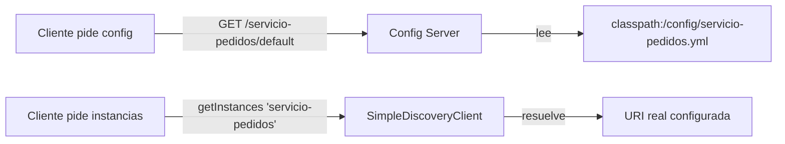
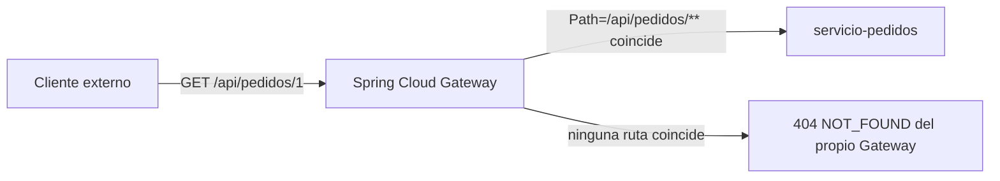
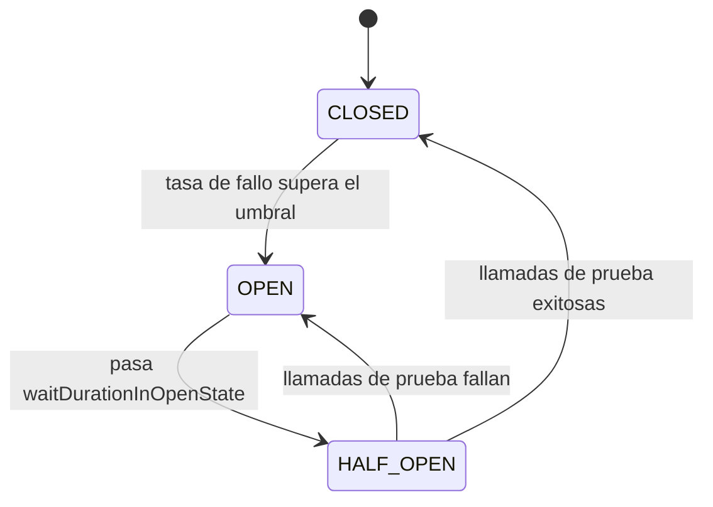
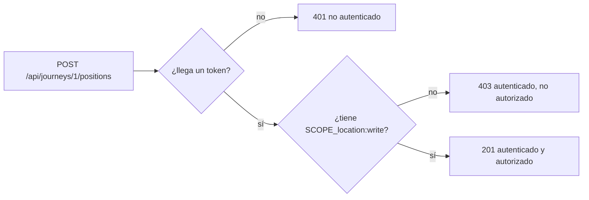
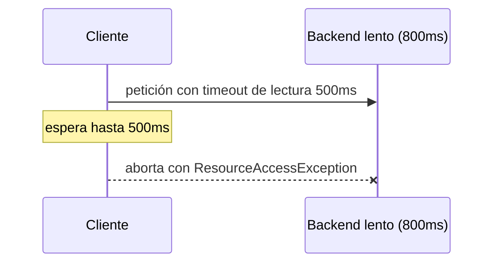
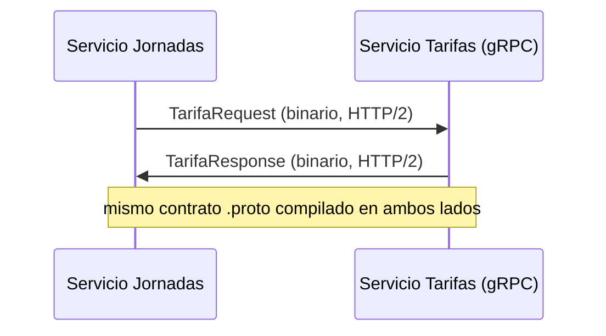
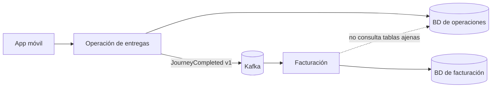
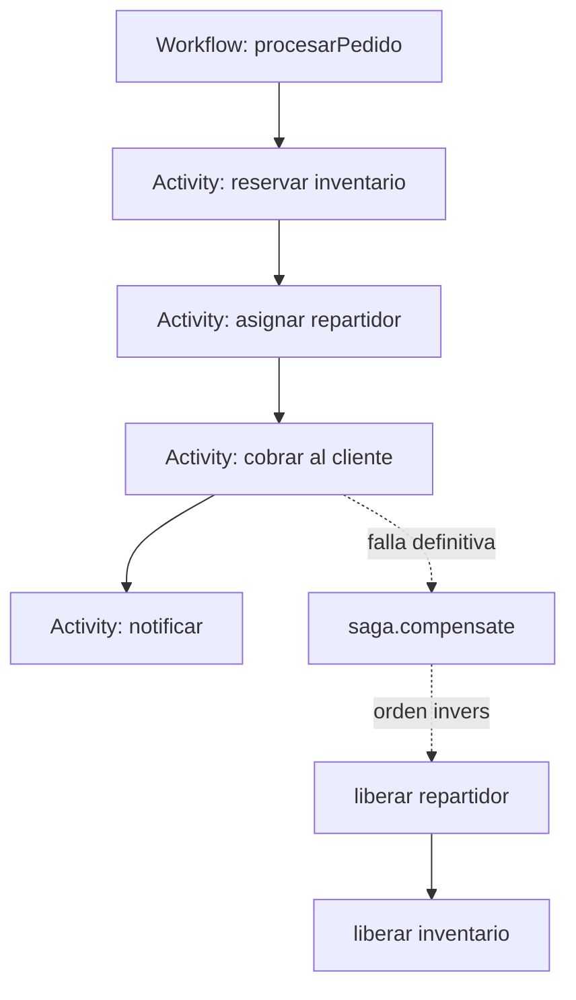

# Módulo 10: Microservicios con Spring Cloud

Cada tema demuestra un patrón de Spring Cloud con verificación real: Config Server nativo servido por HTTP, `SimpleDiscoveryClient` real de Spring Cloud Commons, Gateway enrutando de verdad contra un backend embebido, un `CircuitBreaker` de Resilience4j abriéndose por conteo real de fallos, seguridad de recurso probada con el post-processor oficial de `spring-security-test`, un deadline HTTP medido en milisegundos, un contrato gRPC compilado, una invariante de dominio sin infraestructura y una Saga de Temporal que compensa en orden inverso. Continúa sobre el proyecto `demo-cloud`.

## Aprende construyendo

### Tema 1: Config Server y service discovery · Intermedio · 45 min

**Prerrequisito:** Módulo 0 de este track (arranque de un proyecto Spring Boot).
**Al terminar podrás:** levantar un Config Server real (backend nativo basado en archivos, sin depender de un servidor Git externo) que sirve configuración por HTTP, y resolver un nombre lógico de servicio a una instancia real usando `SimpleDiscoveryClient`, la implementación oficial de Spring Cloud Commons pensada exactamente para este escenario sin Eureka.

#### Aprende

**¿Por qué es importante?** En un sistema con muchos microservicios, cada uno con su propio `application.yml` local, cambiar un valor compartido (una URL de un servicio externo común) exigiría modificar y redesplegar cada servicio individual. Un Config Server centraliza esa configuración en un único lugar; el service discovery permite que los servicios se llamen por nombre lógico en vez de por URL fija, tolerando cambios de ubicación o escalado sin tocar código cliente.

**Conceptos clave:** configuración centralizada servida por HTTP, resolución por nombre lógico en vez de URL fija.

Un Config Server expone la configuración de cada aplicación cliente vía un endpoint HTTP (`GET /{aplicacion}/{perfil}`); el backend nativo lee esos valores de archivos locales (`classpath:/config` o una carpeta), el mismo mecanismo que usaría un backend respaldado por Git, pero sin necesidad de un repositorio remoto para un ejemplo verificable. `SimpleDiscoveryClient` resuelve un nombre lógico como `servicio-pedidos` a una lista de instancias reales configuradas explícitamente, el mismo contrato (`DiscoveryClient.getInstances(nombre)`) que usaría Eureka en producción, sin requerir un servidor de registro corriendo para probar la resolución por nombre.

**Analogía:** un Config Server centralizado es un directorio maestro de políticas compartidas entre sucursales de una franquicia, actualizable en un único lugar; el service discovery es un directorio telefónico que traduce el nombre de una sucursal a su dirección física actual, sin que quien llama necesite memorizar esa dirección.

**Diagrama:**



#### Practica

**Demo paso a paso.** Continuando en `demo-cloud` (o, si prefieres un ejemplo independiente, parte de una carpeta vacía con `mkdir demo-config-server && cd demo-config-server && curl -fsSL https://start.spring.io/starter.zip -d dependencies=cloud-config-server,web -d javaVersion=25 -o app.zip && unzip app.zip`), crea `src/main/java/io/academia/config/ConfigServerApplication.java` y `src/main/resources/config/servicio-pedidos.yml`:

```bash
mkdir -p demo-cloud/config-server/src/main/resources/config
cd demo-cloud/config-server
```

```yaml
# src/main/resources/application.yml
server:
  port: 8888
spring:
  application:
    name: config-server
  cloud:
    config:
      server:
        native:
          search-locations: classpath:/config
  profiles:
    active: native
```

```yaml
# src/main/resources/config/servicio-pedidos.yml
pedidos:
  descuento-maximo: 15
```

```java
// src/main/java/io/academia/config/ConfigServerApplication.java
package io.academia.config;

import org.springframework.boot.SpringApplication;
import org.springframework.boot.autoconfigure.SpringBootApplication;
import org.springframework.cloud.config.server.EnableConfigServer;

@EnableConfigServer
@SpringBootApplication
public class ConfigServerApplication {
    public static void main(String[] args) {
        SpringApplication.run(ConfigServerApplication.class, args);
    }
}
```

Confirma con un test real que el Config Server efectivamente sirve ese valor por HTTP, y que `SimpleDiscoveryClient` efectivamente resuelve un nombre lógico:

```java
// src/test/java/io/academia/config/ConfigServerTest.java
package io.academia.config;

import org.junit.jupiter.api.Test;
import org.springframework.boot.test.context.SpringBootTest;
import org.springframework.boot.test.web.client.TestRestTemplate;
import org.springframework.boot.test.web.server.LocalServerPort;
import org.springframework.cloud.client.ServiceInstance;
import org.springframework.cloud.client.discovery.DiscoveryClient;
import org.springframework.beans.factory.annotation.Autowired;

import static org.assertj.core.api.Assertions.assertThat;

@SpringBootTest(
    webEnvironment = SpringBootTest.WebEnvironment.RANDOM_PORT,
    properties = "spring.cloud.discovery.client.simple.instances.servicio-pedidos[0].uri=http://localhost:8081"
)
class ConfigServerTest {

    @LocalServerPort
    private int puerto;

    @Autowired
    private TestRestTemplate restTemplate;

    @Autowired
    private DiscoveryClient discoveryClient;

    @Test
    void elConfigServerSirveElValorRealPorHttp() {
        String respuesta = restTemplate.getForObject(
            "http://localhost:" + puerto + "/servicio-pedidos/default", String.class);

        assertThat(respuesta).contains("descuento-maximo");
        assertThat(respuesta).contains("15");
    }

    @Test
    void simpleDiscoveryClientResuelveElNombreLogicoAUnaInstanciaReal() {
        java.util.List<ServiceInstance> instancias = discoveryClient.getInstances("servicio-pedidos");

        assertThat(instancias).hasSize(1);
        assertThat(instancias.get(0).getUri().toString()).isEqualTo("http://localhost:8081");
    }
}
```

```bash
./mvnw test -Dtest=ConfigServerTest
```

**Explicación línea por línea:** `@EnableConfigServer` activa el endpoint que sirve configuración; `profiles.active: native` selecciona el backend de archivos y `search-locations` indica qué carpeta leer; `@SpringBootTest(webEnvironment = RANDOM_PORT)` arranca un servidor real en un puerto libre y `TestRestTemplate` le hace una petición HTTP real (no simulada) a `/{aplicacion}/{perfil}`; la propiedad `spring.cloud.discovery.client.simple.instances...` registra la instancia que después devuelve `DiscoveryClient.getInstances(...)`, el mismo contrato que implementa Eureka en producción.

**Resultado esperado:** `BUILD SUCCESS` con ambos tests en verde: el primero confirma con una petición HTTP real (`TestRestTemplate`, no una llamada simulada) que el Config Server, arrancado de verdad en un puerto aleatorio, sirve el valor `descuento-maximo: 15` leído de `servicio-pedidos.yml`; el segundo confirma que `DiscoveryClient.getInstances("servicio-pedidos")` resuelve el nombre lógico a la URI real configurada, el mismo contrato que usaría Eureka en producción.

**Fallo deliberado:** cambia la URL solicitada en el primer test de `/servicio-pedidos/default` a `/servicio-inexistente/default` y ejecuta de nuevo. El Config Server responde `200 OK` pero con un cuerpo JSON cuyo `propertySources` está vacío (sin el valor `descuento-maximo`), haciendo que la aserción `.contains("15")` falle — diagnostica confirmando el comportamiento real del Config Server: responde `200` incluso para aplicaciones sin configuración específica (no `404`), devolviendo simplemente un conjunto vacío de propiedades, un detalle fácil de pasar por alto si no se prueba explícitamente. Revierte el cambio antes de continuar.

**Ejercicios.**

1. Agrega un perfil `produccion` a `servicio-pedidos.yml` (archivo `servicio-pedidos-produccion.yml`) con un valor de `descuento-maximo` distinto, y confirma con un test que pedir `/servicio-pedidos/produccion` devuelve el valor específico de ese perfil, no el de `default`.
2. Agrega una segunda instancia de `servicio-pedidos` a la propiedad `spring.cloud.discovery.client.simple.instances.servicio-pedidos[1].uri` y confirma con un test que `discoveryClient.getInstances(...)` ahora devuelve una lista de 2 elementos.
3. Escribe un test que confirme que pedir instancias de un nombre lógico nunca registrado (`discoveryClient.getInstances("servicio-inexistente")`) devuelve una lista vacía, no un error.
4. Escribe de memoria (sin mirar) un test `TestRestTemplate` contra un Config Server nativo y un test `DiscoveryClient` contra `SimpleDiscoveryClient`. Compara después contra el patrón del demo.

**Pista:** el backend `native` del Config Server lee archivos de `classpath:/config` en el momento de cada petición (no los cachea de forma permanente en desarrollo), así que agregar un nuevo archivo YAML en esa carpeta es suficiente para que el siguiente test lo detecte, sin reiniciar nada adicional.

**Completa el código:** rellena el espacio con el método real de `DiscoveryClient` que resuelve un nombre lógico a instancias:

```java
List<ServiceInstance> instancias = discoveryClient.____("servicio-pedidos");
```

**Reto de memoria:** cierra este documento y escribe, solo de memoria, un `application.yml` de Config Server con backend `native`, y un test que confirme por HTTP real que sirve un valor esperado. Compara después contra el patrón del demo.

#### Aplica

**Reto abierto.** Centraliza en `demo-cloud` la configuración compartida de dos servicios y demuestra con dos pruebas que (a) el valor llega por HTTP desde el archivo del servicio correcto y (b) el nombre lógico se resuelve a una instancia configurada. Después cambia la URI de esa instancia y confirma que ningún cliente tuvo que recompilarse para seguir resolviéndola.

**Checklist de salida.**

- [ ] El Config Server sirve el valor esperado con una petición HTTP real.
- [ ] Cada propiedad vive en el archivo del servicio que la usa, sin copias divergentes.
- [ ] `DiscoveryClient` resuelve el nombre lógico a la URI configurada.
- [ ] Un test cubre el caso de una aplicación o perfil sin configuración.
- [ ] Sabes explicar por qué un `200` con propiedades vacías no es lo mismo que un `404`.

**Si falla.** Si la petición HTTP devuelve `404`, revisa que `profiles.active` sea `native` y que `search-locations` apunte a la carpeta que realmente contiene el YAML; el nombre del archivo debe coincidir con la aplicación que se consulta (`{aplicacion}.yml`). Si `getInstances(...)` devuelve una lista vacía, compara el nombre pasado al método con la clave exacta bajo `spring.cloud.discovery.client.simple.instances`.

**Siguiente paso:** el siguiente tema centraliza el enrutamiento hacia esas instancias con Spring Cloud Gateway.

**Errores comunes:** codificar URLs fijas hacia otros microservicios en vez de resolver por nombre lógico; asumir que el Config Server devuelve `404` para una aplicación sin configuración, cuando en realidad devuelve `200` con propiedades vacías.

**Límites y decisión de uso:** para un sistema con un único servicio (sin microservicios que compartan configuración), un Config Server centralizado agrega una pieza de infraestructura adicional sin ningún beneficio real sobre un `application.yml` local.

**Fuente oficial:** [Spring Cloud Config](https://docs.spring.io/spring-cloud-config/reference/) y [Spring Cloud Commons — DiscoveryClient](https://docs.spring.io/spring-cloud-commons/reference/spring-cloud-commons/discovery-client.html).

**Transferencia al proyecto integrador:** Config Server y service discovery son los que coordinarán el microservicio productivo (Módulo 12) si se despliega junto a otros servicios.

### Tema 2: Spring Cloud Gateway · Intermedio · 40 min

**Prerrequisito:** Tema 1 de este módulo.
**Al terminar podrás:** configurar una ruta real de Spring Cloud Gateway y confirmar, con una petición HTTP real de extremo a extremo, que el gateway enruta correctamente según el patrón de la URL solicitada.

#### Aprende

**¿Por qué es importante?** Con varios microservicios independientes, exponer cada uno directamente al cliente externo multiplica la superficie de red y dificulta aplicar responsabilidades transversales (autenticación inicial, rate limiting, trazabilidad) de forma consistente. Un gateway centraliza el punto de entrada, enrutando cada petición hacia el microservicio correcto según su ruta.

**Conceptos clave:** punto de entrada único, enrutamiento centralizado por predicado de ruta.

`spring.cloud.gateway.routes` define una lista de rutas, cada una con un `predicate` (por ejemplo, `Path=/api/pedidos/**`) que decide qué peticiones entrantes redirige hacia qué `uri` de destino. Centralizar el enrutamiento en un gateway único es también un lugar natural para autenticación inicial y trazabilidad, pero verificar un token únicamente en el gateway crea una frontera peligrosa si un servicio puede alcanzarse por otra ruta: cada servicio que protege datos debe validar la credencial y autorizar el recurso que posee.

**Analogía:** un gateway es la recepción única de un complejo de oficinas con múltiples departamentos internos, donde los visitantes se registran una única vez y son dirigidos automáticamente al departamento correcto.

**Diagrama:**



#### Practica

**Demo paso a paso.** Continuando en `demo-cloud` (o, si prefieres un ejemplo independiente, parte de una carpeta vacía con `mkdir demo-gateway && cd demo-gateway && curl -fsSL https://start.spring.io/starter.zip -d dependencies=cloud-gateway -d javaVersion=25 -o app.zip && unzip app.zip`), crea `src/main/java/io/academia/gateway/GatewayConfig.java` con una ruta configurada programáticamente (para poder apuntarla al puerto real y dinámico de un backend de prueba):

```bash
mkdir -p demo-cloud/gateway/src/main/java/io/academia/gateway
cd demo-cloud/gateway
```

```java
// src/main/java/io/academia/gateway/GatewayConfig.java
package io.academia.gateway;

import org.springframework.beans.factory.annotation.Value;
import org.springframework.cloud.gateway.route.RouteLocator;
import org.springframework.cloud.gateway.route.builder.RouteLocatorBuilder;
import org.springframework.context.annotation.Bean;
import org.springframework.context.annotation.Configuration;

@Configuration
public class GatewayConfig {

    @Bean
    RouteLocator routes(RouteLocatorBuilder builder, @Value("${backendUri}") String backendUri) {
        return builder.routes()
            .route("pedidos", r -> r.path("/api/pedidos/**").uri(backendUri))
            .build();
    }
}
```

Confirma con `MockWebServer` (backend real) y `WebTestClient` (cliente reactivo real de Spring) que el gateway enruta de extremo a extremo. El backend se arranca antes del contexto y su URL se inyecta como propiedad, de modo que la ruta apunte al puerto real que eligió `MockWebServer`:

```java
// src/test/java/io/academia/gateway/GatewayRoutingTest.java
package io.academia.gateway;

import mockwebserver3.MockResponse;
import mockwebserver3.MockWebServer;
import org.junit.jupiter.api.AfterAll;
import org.junit.jupiter.api.Test;
import org.springframework.beans.factory.annotation.Autowired;
import org.springframework.boot.test.context.SpringBootTest;
import org.springframework.test.context.DynamicPropertyRegistry;
import org.springframework.test.context.DynamicPropertySource;
import org.springframework.test.web.reactive.server.WebTestClient;

import java.io.IOException;
import java.io.UncheckedIOException;

@SpringBootTest(webEnvironment = SpringBootTest.WebEnvironment.RANDOM_PORT)
class GatewayRoutingTest {

    static final MockWebServer BACKEND = new MockWebServer();

    static {
        try {
            BACKEND.start();
        } catch (IOException e) {
            throw new UncheckedIOException(e);
        }
    }

    @Autowired
    private WebTestClient webTestClient;

    @DynamicPropertySource
    static void backendUri(DynamicPropertyRegistry registry) {
        registry.add("backendUri", () -> BACKEND.url("/").toString());
    }

    @AfterAll
    static void detenerBackend() throws IOException {
        BACKEND.shutdown();
    }

    @Test
    void elGatewayEnrutaCorrectamenteHaciaElBackendSegunElPath() {
        BACKEND.enqueue(new MockResponse.Builder()
            .body("{\"id\":1,\"estado\":\"EN_RUTA\"}")
            .addHeader("Content-Type", "application/json")
            .build());

        webTestClient.get().uri("/api/pedidos/1")
            .exchange()
            .expectStatus().isOk()
            .expectBody().jsonPath("$.estado").isEqualTo("EN_RUTA");
    }

    @Test
    void elGatewayResponde404ParaUnaRutaSinPredicadoCoincidente() {
        webTestClient.get().uri("/api/inexistente/1")
            .exchange()
            .expectStatus().isNotFound(); // el propio Gateway responde, la petición nunca llega a ningún backend
    }
}
```

```bash
./mvnw test -Dtest=GatewayRoutingTest
```

**Explicación línea por línea:** `RouteLocator` declara las rutas como un bean; `r.path("/api/pedidos/**")` es el predicado que decide qué peticiones entran en la ruta y `.uri(backendUri)` es el destino; el bloque `static` arranca `MockWebServer` antes de que Spring construya el contexto, y `@DynamicPropertySource` publica su URL real (`http://localhost:{puerto}`) como la propiedad `backendUri` que consume el bean de la ruta; `WebTestClient` hace una petición HTTP real contra el Gateway en un puerto aleatorio, por lo que el `200` solo puede llegar si el Gateway reenvió la petición al backend y devolvió su cuerpo.

**Resultado esperado:** `BUILD SUCCESS` con ambos tests en verde: el primero confirma que una petición HTTP real a `/api/pedidos/1` es enrutada por el Gateway hacia `MockWebServer` (un backend real y desechable) y la respuesta de ese backend se devuelve sin alterar; el segundo confirma que una ruta sin predicado coincidente recibe `404` directamente del Gateway, sin siquiera intentar contactar ningún backend.

**Fallo deliberado:** cambia el predicado de la ruta de `/api/pedidos/**` a `/api/entregas/**` (sin actualizar el test) y ejecuta de nuevo `elGatewayEnrutaCorrectamenteHaciaElBackendSegunElPath`. La petición a `/api/pedidos/1` ahora recibe `404 NOT_FOUND` del propio Gateway en vez de la respuesta esperada del backend — diagnostica confirmando que el enrutamiento del Gateway depende estrictamente de que el predicado declarado coincida con la ruta solicitada; un desajuste silencioso entre el predicado y las rutas reales de los clientes es indistinguible, desde fuera, de que el backend esté completamente caído. Revierte el cambio antes de continuar.

**Ejercicios.**

1. Agrega un filtro `StripPrefix` a la ruta de pedidos y confirma con un test que la petición que llega al backend real (verificable inspeccionando `BACKEND.takeRequest().getPath()` en `MockWebServer`) ya no incluye el prefijo `/api`.
2. Agrega una segunda ruta con un predicado de método HTTP (`r.path(...).and().method(HttpMethod.POST)`) y confirma con un test que un `GET` a esa misma ruta NO coincide (recibe `404`), mientras que un `POST` sí.
3. Configura un timeout de respuesta en la ruta y confirma con `MockWebServer` (usando `.bodyDelay(...)`) que una respuesta demasiado lenta del backend produce un error de gateway, no una espera indefinida.
4. Escribe de memoria (sin mirar) una ruta de Gateway con un predicado de path, y un test `WebTestClient` + `MockWebServer` que confirme el enrutamiento real. Compara después contra el patrón del demo.

**Pista:** `BACKEND.takeRequest()` de `MockWebServer` devuelve la petición HTTP REAL que el Gateway efectivamente reenvió al backend — inspeccionar su path, headers o cuerpo es la forma más directa de confirmar exactamente qué transformó el Gateway antes de reenviar, sin adivinar.

**Completa el código:** rellena el espacio con el predicado que enruta según el patrón de la URL:

```java
builder.routes()
    .route("pedidos", r -> r.____("/api/pedidos/**").uri(backendUri))
    .build();
```

**Reto de memoria:** cierra este documento y escribe, solo de memoria, una configuración de ruta de Gateway y un test `WebTestClient` + `MockWebServer` que confirme el enrutamiento correcto y el `404` para una ruta sin predicado coincidente. Compara después contra el patrón del demo.

#### Aplica

**Reto abierto.** Expón dos capacidades de `demo-cloud` detrás de una única ruta pública (`/api/pedidos/**` y `/api/jornadas/**`), demuestra que una ruta no declarada no llega a ningún backend y añade un filtro `StripPrefix` verificando con `takeRequest()` qué path recibió realmente cada backend.

**Checklist de salida.**

- [ ] Cada ruta tiene un predicado explícito y un destino propio.
- [ ] Un test confirma la respuesta de un backend real a través del Gateway.
- [ ] Un test confirma `404` para una ruta sin predicado coincidente.
- [ ] `takeRequest()` demuestra qué path recibió el backend después de los filtros.
- [ ] Sabes explicar por qué un `404` del Gateway y un backend caído pueden verse igual desde fuera.

**Si falla.** Si el test de enrutamiento recibe `404`, imprime `BACKEND.getRequestCount()`: si es `0`, el predicado no coincide y nunca se reenvió nada; si es mayor que `0`, el problema está en la respuesta del backend o en el filtro. Si el contexto falla al arrancar porque `backendUri` no se resuelve, revisa que `@DynamicPropertySource` se ejecute antes de construir el bean de la ruta y que la URL termine en `/`.

**Siguiente paso:** el siguiente tema protege esas llamadas entre servicios contra fallos en cascada con un circuit breaker.

**Errores comunes:** confiar toda la seguridad al gateway sin que el servicio propietario también autorice el recurso; desalinear el predicado de una ruta respecto a las rutas realmente usadas por los clientes, produciendo `404` silenciosos indistinguibles de un backend caído.

**Límites y decisión de uso:** con un único servicio expuesto directamente al cliente, un gateway agrega un salto de red adicional sin ningún beneficio de enrutamiento real.

**Fuente oficial:** [Spring Cloud Gateway](https://docs.spring.io/spring-cloud-gateway/reference/).

**Transferencia al proyecto integrador:** Spring Cloud Gateway es el punto de entrada que expondrá el microservicio productivo (Módulo 12) al resto del sistema.

### Tema 3: Circuit breaker con Resilience4j · Avanzado · 45 min

**Prerrequisito:** Temas 1 y 2 de este módulo.
**Al terminar podrás:** configurar un `CircuitBreaker` real de Resilience4j y confirmar, contando invocaciones reales, que abre el circuito tras superar un umbral de fallos y deja de intentar la llamada real mientras está abierto.

#### Aprende

**¿Por qué es importante?** Sin un circuit breaker, un servicio caído puede arrastrar en cascada a todos los servicios que dependen de él: cada petición esperaría su timeout completo antes de fallar, acumulando peticiones en espera activa que agotan threads y conexiones del servicio dependiente.

**Conceptos clave:** abrir el circuito ante fallos repetidos, fallback inmediato sin intentar la llamada real.

Un `CircuitBreaker` observa la tasa de fallo de las últimas N llamadas (la "ventana deslizante"); si esa tasa supera un umbral configurable, el circuito pasa a estado `OPEN`: las siguientes llamadas NO intentan ejecutar la operación real, sino que fallan inmediatamente con `CallNotPermittedException` (o invocan un método de fallback), evitando que las peticiones se acumulen esperando indefinidamente una respuesta de un servicio que, con alta probabilidad, no va a responder exitosamente. `@Retry`, `@RateLimiter`, `@Bulkhead` y `@TimeLimiter` son primitivas complementarias de Resilience4j.

**Analogía:** un circuit breaker es un disyuntor eléctrico que corta automáticamente el circuito ante una sobrecarga detectada, evitando que el problema se propague, y permite reintentar conectar la corriente tras un tiempo prudencial.

**Diagrama:**



#### Practica

**Demo paso a paso.** Continuando en `demo-cloud` (o, si prefieres un ejemplo independiente, parte de una carpeta vacía con `mkdir demo-resilience && cd demo-resilience && curl -fsSL https://start.spring.io/starter.zip -d dependencies=web -d javaVersion=25 -o app.zip && unzip app.zip` y agrega `io.github.resilience4j:resilience4j-circuitbreaker` al `pom.xml`), crea `src/test/java/io/academia/resilience/CircuitBreakerRealTest.java`; este `CircuitBreaker` se prueba de forma completamente aislada, sin necesitar Spring ni un servidor real:

```bash
mkdir -p demo-cloud/resilience/src/test/java/io/academia/resilience
cd demo-cloud/resilience
```

```java
// src/test/java/io/academia/resilience/CircuitBreakerRealTest.java
package io.academia.resilience;

import io.github.resilience4j.circuitbreaker.CallNotPermittedException;
import io.github.resilience4j.circuitbreaker.CircuitBreaker;
import io.github.resilience4j.circuitbreaker.CircuitBreakerConfig;
import io.github.resilience4j.circuitbreaker.CircuitBreakerRegistry;
import org.junit.jupiter.api.Test;

import java.time.Duration;
import java.util.concurrent.atomic.AtomicInteger;
import java.util.function.Supplier;

import static org.assertj.core.api.Assertions.assertThat;
import static org.assertj.core.api.Assertions.assertThatThrownBy;

class CircuitBreakerRealTest {

    @Test
    void elCircuitoAbreTrasSuperarElUmbralYDejaDeIntentarLaLlamadaReal() {
        CircuitBreakerConfig config = CircuitBreakerConfig.custom()
            .failureRateThreshold(50)
            .slidingWindowSize(4)
            .minimumNumberOfCalls(4)
            .waitDurationInOpenState(Duration.ofSeconds(10))
            .build();
        CircuitBreaker circuitBreaker = CircuitBreakerRegistry.of(config).circuitBreaker("servicioPedidos");

        AtomicInteger llamadasRealesEjecutadas = new AtomicInteger(0);
        Supplier<String> llamadaProtegida = CircuitBreaker.decorateSupplier(circuitBreaker, () -> {
            llamadasRealesEjecutadas.incrementAndGet();
            throw new RuntimeException("servicio-pedidos caído");
        });

        // 4 llamadas reales, todas fallan (100% > 50% de umbral) -> el circuito abre
        for (int i = 0; i < 4; i++) {
            assertThatThrownBy(llamadaProtegida::get).isInstanceOf(RuntimeException.class);
        }

        assertThat(circuitBreaker.getState()).isEqualTo(CircuitBreaker.State.OPEN);
        assertThat(llamadasRealesEjecutadas.get()).isEqualTo(4);

        // con el circuito abierto, la QUINTA llamada NO ejecuta la lambda real
        assertThatThrownBy(llamadaProtegida::get).isInstanceOf(CallNotPermittedException.class);
        assertThat(llamadasRealesEjecutadas.get()).isEqualTo(4); // sigue en 4: no se ejecutó una quinta vez
    }
}
```

```bash
./mvnw test -Dtest=CircuitBreakerRealTest
```

**Explicación línea por línea:** `failureRateThreshold(50)` abre el circuito cuando la mitad o más de las llamadas de la ventana fallan; `slidingWindowSize(4)` fija cuántas llamadas se recuerdan y `minimumNumberOfCalls(4)` cuántas se necesitan antes de evaluar siquiera esa tasa; `CircuitBreaker.decorateSupplier(...)` envuelve la lambda sin ejecutarla todavía; el bucle provoca cuatro fallos reales, que incrementan el `AtomicInteger`; tras el cuarto, el estado es `OPEN` y la quinta invocación lanza `CallNotPermittedException` sin tocar la lambda, por lo que el contador sigue en cuatro.

**Resultado esperado:** `BUILD SUCCESS` con el test en verde: el `AtomicInteger` confirma con evidencia real (no una suposición) que las primeras 4 llamadas SÍ ejecutaron la lambda real (fallando cada vez), que el circuito efectivamente pasó a `OPEN` tras superar el umbral del 50% de fallo, y que la quinta llamada NO incrementó el contador — el circuito abierto evitó por completo la ejecución de la lambda real, lanzando `CallNotPermittedException` de inmediato.

**Fallo deliberado:** cambia `minimumNumberOfCalls(4)` por `minimumNumberOfCalls(10)` (sin cambiar el resto) y ejecuta de nuevo. El test FALLA en `assertThat(circuitBreaker.getState()).isEqualTo(CircuitBreaker.State.OPEN)`, porque con solo 4 llamadas realizadas el circuito nunca alcanza el mínimo de 10 llamadas necesarias para evaluar la tasa de fallo, permaneciendo en `CLOSED` — diagnostica confirmando que `minimumNumberOfCalls` es un umbral independiente de `slidingWindowSize`: el circuito no evalúa ninguna tasa de fallo hasta acumular ese mínimo de llamadas. Revierte el cambio antes de continuar.

**Ejercicios.**

1. Agrega un método de fallback (`CircuitBreaker.decorateSupplier` combinado con `.recover(throwable -> "valor por defecto")` de `io.vavr` o un `try/catch` manual) y confirma con un test que, con el circuito abierto, la llamada devuelve el valor por defecto en vez de lanzar una excepción.
2. Simula que el servicio se recupera: tras `waitDurationInOpenState`, usa `circuitBreaker.transitionToHalfOpenState()` manualmente en el test y confirma que llamadas exitosas en ese estado devuelven el circuito a `CLOSED`.
3. Configura `slidingWindowType(SlidingWindowType.TIME_BASED)` en vez de `COUNT_BASED` y confirma con un test que el comportamiento de apertura se basa en una ventana de tiempo en vez de un conteo fijo de llamadas.
4. Escribe de memoria (sin mirar) un `CircuitBreakerConfig` con umbral de fallo y ventana deslizante, y un test que confirme con un contador real que el circuito deja de ejecutar la llamada real una vez abierto. Compara después contra el patrón del demo.

**Pista:** `CircuitBreaker.decorateSupplier(...)` NO ejecuta la lambda al declararla — como con `Mono`/`Flux` del Módulo 9, solo se ejecuta cuando efectivamente invocas `.get()` sobre el `Supplier` decorado.

**Completa el código:** rellena el espacio con el estado que debe alcanzar el circuito tras superar el umbral de fallo:

```java
assertThat(circuitBreaker.getState()).isEqualTo(CircuitBreaker.State.____);
```

**Reto de memoria:** cierra este documento y escribe, solo de memoria, un `CircuitBreakerConfig` y un test con `AtomicInteger` que confirme que el circuito abierto deja de ejecutar la llamada real. Compara después contra el patrón del demo.

#### Aplica

**Reto abierto.** Define la política del circuit breaker de `demo-cloud` hacia el servicio de tarifas: elige umbral, tamaño de ventana y espera en abierto con un criterio explícito, y demuestra con pruebas el ciclo completo `CLOSED → OPEN → HALF_OPEN → CLOSED`.

**Checklist de salida.**

- [ ] El umbral y el tamaño de ventana están justificados, no copiados de un ejemplo.
- [ ] Un test demuestra que el circuito abre y deja de ejecutar la llamada real.
- [ ] Un test demuestra la transición de recuperación a `CLOSED`.
- [ ] Existe un fallback con un valor semánticamente correcto para quien llama.
- [ ] Sabes explicar la diferencia entre `minimumNumberOfCalls` y `slidingWindowSize`.

**Si falla.** Si el circuito nunca abre, cuenta las llamadas de prueba: debe alcanzarse `minimumNumberOfCalls` y superarse `failureRateThreshold` con fallos reales (una excepción que tú consideres fallo; las configuradas por defecto excluyen algunas). Si el estado queda en `HALF_OPEN`, faltan llamadas de prueba exitosas para volver a `CLOSED`.

**Siguiente paso:** el siguiente tema protege las fronteras de autorización entre servicios con OAuth2/OIDC.

**Errores comunes:** no configurar un circuit breaker para llamadas entre servicios, dejando que un servicio caído arrastre en cascada a sus dependientes; confundir `minimumNumberOfCalls` con `slidingWindowSize`, dos umbrales independientes.

**Límites y decisión de uso:** para llamadas locales en memoria sin ningún componente de red o servicio externo involucrado, un circuit breaker no protege contra ningún fallo real y solo agrega complejidad innecesaria.

**Fuente oficial:** [Resilience4j — CircuitBreaker](https://resilience4j.readme.io/docs/circuitbreaker).

**Transferencia al proyecto integrador:** el circuit breaker de Resilience4j es el que protegerá al microservicio productivo (Módulo 12) de fallos en cascada.

### Tema 4: OAuth2/OIDC, Keycloak y Token Relay sin perder la frontera de autorización · Avanzado · 50 min

**Prerrequisito:** Módulo 4 de este track (Spring Security).
**Al terminar podrás:** probar, con el post-processor oficial de `spring-security-test`, que un endpoint protegido como Resource Server distingue correctamente entre falta de token (401), scope insuficiente (403) y una petición autorizada (201), sin necesitar una instancia real de Keycloak corriendo para verificar la lógica de autorización.

#### Aprende

**¿Por qué es importante?** Firma válida responde «quién emitió esta credencial y si fue alterada»; audiencia, scope y propiedad responden preguntas adicionales. Confundirlas produce acceso horizontal entre usuarios o reutilización de tokens fuera de contexto.

**Conceptos clave:** Identity Provider, issuer, scopes, roles, Resource Server, JWKS.

Keycloak actúa como proveedor de identidad: autentica al usuario y emite un access token firmado. Cada API protegida se configura como **Resource Server** usando el `issuer-uri`; Spring Security obtiene las claves públicas vía JWKS y valida firma, emisor y expiración. `roles` y `scopes` expresan capacidades generales, pero no propiedad: `ROLE_DRIVER` permite entrar al conjunto de operaciones del conductor, pero el caso de uso todavía debe verificar que el recurso solicitado pertenece a ese usuario autenticado.

**Analogía:** el gateway es el control de entrada del edificio y el token es la credencial; cada archivo sensible conserva además su propia lista de personas autorizadas. Haber entrado al edificio no permite abrir cualquier expediente.

**Diagrama:**



#### Practica

**Demo paso a paso.** Continuando en `demo-cloud` (o, si prefieres un ejemplo independiente, parte de una carpeta vacía con `mkdir demo-security && cd demo-security && curl -fsSL https://start.spring.io/starter.zip -d dependencies=web,oauth2-resource-server -d javaVersion=25 -o app.zip && unzip app.zip`), crea `src/main/java/io/academia/security/SecurityConfig.java`:

```bash
mkdir -p demo-cloud/security/src/main/java/io/academia/security
cd demo-cloud/security
```

```yaml
# src/main/resources/application.yml
spring:
  security:
    oauth2:
      resourceserver:
        jwt:
          issuer-uri: http://keycloak:8080/realms/demo
```

```java
// src/main/java/io/academia/security/SecurityConfig.java
package io.academia.security;

import org.springframework.context.annotation.Bean;
import org.springframework.context.annotation.Configuration;
import org.springframework.http.HttpMethod;
import org.springframework.security.config.Customizer;
import org.springframework.security.config.annotation.web.builders.HttpSecurity;
import org.springframework.security.web.SecurityFilterChain;

@Configuration
public class SecurityConfig {
    @Bean
    SecurityFilterChain api(HttpSecurity http) throws Exception {
        return http
            .authorizeHttpRequests(auth -> auth
                .requestMatchers("/actuator/health").permitAll()
                .requestMatchers(HttpMethod.POST, "/api/journeys/*/positions")
                    .hasAuthority("SCOPE_location:write")
                .anyRequest().authenticated())
            .oauth2ResourceServer(oauth -> oauth.jwt(Customizer.withDefaults()))
            .build();
    }
}
```

Confirma con `MockMvc` y el post-processor oficial `SecurityMockMvcRequestPostProcessors.jwt()` (de `spring-security-test`, la forma recomendada por la documentación oficial de Spring Security para probar reglas de Resource Server sin un Identity Provider real corriendo) las tres respuestas reales. El test incluye un controlador mínimo para que la petición autorizada llegue a un endpoint real, y un `JwtDecoder` de prueba que evita que Spring Boot intente descubrir el issuer de Keycloak durante la prueba:

```java
// src/test/java/io/academia/security/ResourceServerTest.java
package io.academia.security;

import org.junit.jupiter.api.Test;
import org.springframework.beans.factory.annotation.Autowired;
import org.springframework.boot.test.autoconfigure.web.servlet.WebMvcTest;
import org.springframework.boot.test.context.TestConfiguration;
import org.springframework.context.annotation.Bean;
import org.springframework.context.annotation.Import;
import org.springframework.http.HttpStatus;
import org.springframework.security.core.authority.SimpleGrantedAuthority;
import org.springframework.security.oauth2.jwt.JwtDecoder;
import org.springframework.security.oauth2.jwt.JwtException;
import org.springframework.test.web.servlet.MockMvc;
import org.springframework.web.bind.annotation.PathVariable;
import org.springframework.web.bind.annotation.PostMapping;
import org.springframework.web.bind.annotation.ResponseStatus;
import org.springframework.web.bind.annotation.RestController;

import static org.springframework.security.test.web.servlet.request.SecurityMockMvcRequestPostProcessors.jwt;
import static org.springframework.test.web.servlet.request.MockMvcRequestBuilders.post;
import static org.springframework.test.web.servlet.result.MockMvcResultMatchers.status;

@WebMvcTest(JourneyController.class)
@Import(SecurityConfig.class)
class ResourceServerTest {

    @Autowired
    private MockMvc mockMvc;

    @RestController
    static class JourneyController {
        @PostMapping("/api/journeys/{id}/positions")
        @ResponseStatus(HttpStatus.CREATED)
        void registrar(@PathVariable String id) {
            // el handler real vive en demo-cloud; aquí solo da un destino a la petición autorizada
        }
    }

    @TestConfiguration
    static class SinIdentityProvider {
        @Bean
        JwtDecoder jwtDecoder() {
            // evita que Boot intente descubrir el issuer real de Keycloak al arrancar el contexto
            return token -> { throw new JwtException("el decoder no se usa: jwt() inyecta la autenticación"); };
        }
    }

    @Test
    void sinTokenElServidorResponde401() throws Exception {
        mockMvc.perform(post("/api/journeys/1/positions"))
            .andExpect(status().isUnauthorized());
    }

    @Test
    void conTokenValidoPeroSinElScopeRequeridoResponde403() throws Exception {
        mockMvc.perform(post("/api/journeys/1/positions")
                .with(jwt().jwt(builder -> builder.claim("scope", "otro:scope"))))
            .andExpect(status().isForbidden());
    }

    @Test
    void conTokenValidoYElScopeRequeridoResponde201() throws Exception {
        mockMvc.perform(post("/api/journeys/1/positions")
                .with(jwt().authorities(new SimpleGrantedAuthority("SCOPE_location:write"))))
            .andExpect(status().isCreated());
    }
}
```

```bash
./mvnw test -Dtest=ResourceServerTest
```

**Explicación línea por línea:** `@WebMvcTest(JourneyController.class)` levanta solo la capa web con ese controlador y `@Import(SecurityConfig.class)` incorpora la cadena de filtros que realmente quieres probar; `jwt()` coloca un `Authentication` ya construido en el `SecurityContext`, sustituyendo al decoder; `.jwt(builder -> ...)` define claims concretos y `.authorities(...)` fija las autoridades resultantes; las tres aserciones observan exactamente lo que decide el filtro: sin autenticación `401`, autenticado sin la autoridad `403`, y con la autoridad la petición atraviesa el filtro y el controlador responde `201`.

**Resultado esperado:** `BUILD SUCCESS` con los tres tests en verde: cada uno ejercita el filtro REAL de Spring Security configurado en `SecurityConfig` (no una simulación aparte), usando `jwt()` para inyectar un token de prueba con los claims exactos que cada caso necesita, confirmando que la regla `hasAuthority("SCOPE_location:write")` efectivamente distingue 401, 403 y autorización exitosa.

**Fallo deliberado:** en `SecurityConfig`, cambia `.hasAuthority("SCOPE_location:write")` por `.permitAll()` y ejecuta de nuevo `conTokenValidoPeroSinElScopeRequeridoResponde403`. El test FALLA porque el endpoint ahora responde `201` en vez de `403` — diagnostica confirmando que sin la regla de autorización explícita, CUALQUIER usuario autenticado (independientemente de su scope) puede ejecutar la operación protegida, exactamente el tipo de regresión silenciosa que este test está diseñado para atrapar. Revierte el cambio antes de continuar.

**Ejercicios.**

1. Agrega un test que confirme que un token con `issuer` distinto al configurado en `issuer-uri` es rechazado: usa un `NimbusJwtDecoder` real con clave de prueba y un `OAuth2TokenValidator` de emisor, no solo el post-processor (que no valida el token).
2. Agrega un test que confirme que un token expirado es rechazado probando el `JwtDecoder` real con un token cuyo `exp` esté en el pasado, y espera `JwtValidationException`. El post-processor `jwt()` no valida expiración: inyecta la autenticación directamente, así que este caso no puede probarse contra `MockMvc` con `jwt()`.
3. Agrega una regla de autorización que verifique la audiencia (`aud`) del token mediante un validador de audiencia en el decoder, y un test que confirme que un token con audiencia incorrecta es rechazado aunque su firma y scope sean válidos.
4. Escribe de memoria (sin mirar) tres tests `MockMvc` + `jwt()` que confirmen 401, 403 y 201 para un endpoint protegido. Compara después contra el patrón del demo.

**Pista:** `jwt().jwt(builder -> ...)` construye un token de prueba con los claims exactos que definas; `jwt().authorities(...)` es un atajo cuando solo te importan las autoridades resultantes, sin construir el token completo — usa el primero cuando necesites claims específicos como `sub` o `iss`, y recuerda que ninguno de los dos valida firma, emisor ni expiración: esa validación se prueba contra un `JwtDecoder` real con una clave de prueba.

**Completa el código:** rellena el espacio con el post-processor oficial que simula un token JWT válido en el request de prueba:

```java
mockMvc.perform(post("/api/journeys/1/positions")
    .with(____().authorities(new SimpleGrantedAuthority("SCOPE_location:write"))));
```

**Reto de memoria:** cierra este documento y escribe, solo de memoria, un `SecurityFilterChain` con una regla `hasAuthority` y tres tests `MockMvc` + `jwt()` que confirmen 401, 403 y 201. Compara después contra el patrón del demo.

#### Aplica

**Reto abierto.** Modela tres operaciones sobre jornadas (`GET /api/journeys/{id}`, `POST /api/journeys/{id}/positions`, `POST /api/journeys/{id}/close`) con scopes distintos, y demuestra con pruebas las tres respuestas de cada una, incluido el caso de un token con el scope correcto cuyo `sub` no es el dueño del recurso.

**Checklist de salida.**

- [ ] Cada operación tiene su regla explícita, no un `anyRequest().authenticated()` genérico.
- [ ] Un test por cada 401, 403 y 201 de la operación crítica.
- [ ] La regla distingue scope de propiedad del recurso (`sub` contra el dueño del dato).
- [ ] Un test demuestra que quitar la regla produce una regresión detectable.
- [ ] Ningún test depende de una instancia real de Keycloak.

**Si falla.** Si el contexto no arranca porque no encuentra `JwtDecoder`, el `issuer-uri` de producción está intentando descubrir un servidor que no existe en la prueba: define un `JwtDecoder` de prueba como en el demo. Si el caso `403` devuelve `201`, revisa que la autoridad inyectada no incluya el scope requerido por error y que el matcher use el método HTTP correcto.

**Siguiente paso:** el siguiente tema declara contratos HTTP explícitos con deadlines medibles.

**Errores comunes:** confiar toda la seguridad al gateway sin que cada servicio propietario también valide y autorice; verificar solo el scope sin verificar la propiedad real del recurso (`sub` contra el dueño del dato).

**Límites y decisión de uso:** para un endpoint interno accesible solo dentro de una red privada de confianza ya controlada por otros mecanismos, exigir OAuth2 completo puede ser una capa de complejidad desproporcionada frente al riesgo real.

**Fuente oficial:** [Spring Security — Testing OAuth2](https://docs.spring.io/spring-security/reference/servlet/test/mockmvc/oauth2.html).

**Transferencia al proyecto integrador:** OAuth2/OIDC con Keycloak es el esquema de autenticación que adoptará el microservicio productivo (Módulo 12) en un entorno multi-servicio.

### Tema 5: HTTP Interfaces, deadlines y descubrimiento según el entorno · Avanzado · 45 min

**Prerrequisito:** Módulo 9 de este track (WebClient).
**Al terminar podrás:** declarar un cliente HTTP con `@HttpExchange` y confirmar, midiendo tiempo real de ejecución contra un backend deliberadamente lento, que un deadline configurado corta la espera en vez de bloquear indefinidamente.

#### Aprende

**¿Por qué es importante?** Un cliente HTTP declarativo describe el contrato de la dependencia sin mezclarlo con la regla de negocio, pero no elimina fallos de red: sin un deadline explícito, una llamada hacia un servicio lento puede bloquear la petición completa mucho más allá de lo tolerable para el usuario final.

**Conceptos clave:** contrato cliente declarativo, timeout de lectura, deadline medible.

Una interfaz `@HttpExchange` describe el contrato de la dependencia; Spring genera un proxy cliente real sobre `RestClient`, reduciendo código repetitivo. Definir un timeout de lectura explícito (vía `ClientHttpRequestFactorySettings`) establece cuánto tiempo el cliente está dispuesto a esperar antes de abortar la llamada, en vez de depender del timeout por defecto del sistema operativo (a menudo minutos).

**Analogía:** un deadline HTTP es como decirle a un mensajero "si no vuelves en 5 minutos, considero que la entrega falló y actúo en consecuencia", en vez de esperar indefinidamente sin ningún límite.

**Diagrama:**



#### Practica

**Demo paso a paso.** Continuando en `demo-cloud` (o, si prefieres un ejemplo independiente, parte de una carpeta vacía con `mkdir demo-http-client && cd demo-http-client && curl -fsSL https://start.spring.io/starter.zip -d dependencies=web -d javaVersion=25 -o app.zip && unzip app.zip`), crea `src/main/java/io/academia/routes/RouteClient.java`:

```bash
mkdir -p demo-cloud/http-client/src/main/java/io/academia/routes
cd demo-cloud/http-client
```

```java
// src/main/java/io/academia/routes/RouteClient.java
package io.academia.routes;

import org.springframework.boot.http.client.ClientHttpRequestFactoryBuilder;
import org.springframework.boot.http.client.ClientHttpRequestFactorySettings;
import org.springframework.http.client.ClientHttpRequestFactory;
import org.springframework.web.bind.annotation.PathVariable;
import org.springframework.web.client.RestClient;
import org.springframework.web.client.support.RestClientAdapter;
import org.springframework.web.service.annotation.GetExchange;
import org.springframework.web.service.annotation.HttpExchange;
import org.springframework.web.service.invoker.HttpServiceProxyFactory;

import java.time.Duration;

public interface RouteClient {
    @GetExchange("/{journeyId}")
    String find(@PathVariable String journeyId);

    static RouteClient with(String baseUrl, Duration deadline) {
        ClientHttpRequestFactory factory = ClientHttpRequestFactoryBuilder.detect().build(
            ClientHttpRequestFactorySettings.defaults().withReadTimeout(deadline));
        RestClient restClient = RestClient.builder().baseUrl(baseUrl).requestFactory(factory).build();
        HttpServiceProxyFactory proxyFactory = HttpServiceProxyFactory
            .builderFor(RestClientAdapter.create(restClient)).build();
        return proxyFactory.createClient(RouteClient.class);
    }
}
```

Confirma con `MockWebServer` (backend real con retraso configurado) que el deadline efectivamente corta la espera, midiendo el tiempo real transcurrido:

```java
// src/test/java/io/academia/routes/RouteClientDeadlineTest.java
package io.academia.routes;

import mockwebserver3.MockResponse;
import mockwebserver3.MockWebServer;
import org.junit.jupiter.api.AfterEach;
import org.junit.jupiter.api.BeforeEach;
import org.junit.jupiter.api.Test;
import org.springframework.web.client.ResourceAccessException;

import java.io.IOException;
import java.time.Duration;
import java.util.concurrent.TimeUnit;

import static org.assertj.core.api.Assertions.assertThat;
import static org.assertj.core.api.Assertions.assertThatThrownBy;

class RouteClientDeadlineTest {

    private MockWebServer backend;

    @BeforeEach
    void iniciar() throws IOException {
        backend = new MockWebServer();
        backend.start();
    }

    @AfterEach
    void detener() throws IOException {
        backend.shutdown();
    }

    @Test
    void unDeadlineDe500msAbortaUnaRespuestaQueTarda800ms() {
        backend.enqueue(new MockResponse.Builder()
            .body("{\"ruta\":\"ok\"}")
            .bodyDelay(800, TimeUnit.MILLISECONDS)
            .build());

        RouteClient cliente = RouteClient.with(backend.url("/").toString(), Duration.ofMillis(500));

        long inicio = System.nanoTime();
        assertThatThrownBy(() -> cliente.find("RF-001")).isInstanceOf(ResourceAccessException.class);
        long transcurridoMs = (System.nanoTime() - inicio) / 1_000_000;

        assertThat(transcurridoMs).isLessThan(700); // abortó cerca de los 500ms, no esperó los 800ms completos
    }
}
```

```bash
./mvnw test -Dtest=RouteClientDeadlineTest
```

**Explicación línea por línea:** `@GetExchange("/{journeyId}")` declara el contrato sin implementación; `ClientHttpRequestFactoryBuilder.detect()` elige la fábrica disponible y `ClientHttpRequestFactorySettings.defaults().withReadTimeout(deadline)` fija cuánto se espera la respuesta una vez establecida la conexión; `RestClientAdapter` y `HttpServiceProxyFactory` convierten ese cliente en el proxy que implementa la interfaz; en el test, `bodyDelay(800, ...)` obliga al backend a tardar 800 ms y `System.nanoTime()` mide el tiempo real transcurrido, que debe quedar por debajo de los 700 ms para demostrar que el corte ocurrió en el deadline y no al terminar la respuesta.

**Resultado esperado:** `BUILD SUCCESS` con el test en verde: `System.nanoTime()` mide el tiempo REAL transcurrido, confirmando con evidencia cronométrica (no una suposición) que la llamada abortó cerca de los 500ms configurados y no esperó los 800ms completos que el backend real tardaba en responder.

**Fallo deliberado:** quita `.withReadTimeout(deadline)` de `RouteClient.with(...)` (usando el `ClientHttpRequestFactorySettings.defaults()` sin modificar) y ejecuta de nuevo el test. La llamada ahora SÍ espera los 800ms completos del backend (el timeout por defecto del sistema es mucho mayor), y la aserción `assertThatThrownBy` falla porque no se lanza ninguna excepción — diagnostica confirmando que sin un timeout de lectura explícito, el cliente espera indefinidamente (limitado solo por el timeout por defecto del sistema operativo, típicamente varios minutos), exactamente el riesgo que este Tema busca prevenir. Revierte el cambio antes de continuar.

**Ejercicios.**

1. Agrega un timeout de conexión (`withConnectTimeout(...)`) distinto al timeout de lectura, y documenta con un comentario en el test la diferencia entre ambos (tiempo para establecer la conexión TCP frente a tiempo esperando la respuesta tras la conexión ya establecida).
2. Confirma con un test que una respuesta que llega ANTES del deadline (por ejemplo, `bodyDelay(200, TimeUnit.MILLISECONDS)` con un deadline de 500ms) SÍ se recibe exitosamente, contrastando con el caso del demo.
3. Documenta en un comentario por qué agregar retries automáticos sobre una llamada con deadline, sin coordinarlos con el resto del sistema, puede multiplicar la latencia total percibida por el usuario final.
4. Escribe de memoria (sin mirar) un `RouteClient` con timeout de lectura configurado, y un test `MockWebServer` que mida el tiempo real transcurrido para confirmar que el deadline corta la espera. Compara después contra el patrón del demo.

**Pista:** `System.nanoTime()` (no `System.currentTimeMillis()`) es la forma correcta de medir duraciones en Java, porque no se ve afectado por ajustes del reloj del sistema durante la medición.

**Completa el código:** rellena el espacio con el método que configura el timeout de lectura sobre los settings del cliente HTTP:

```java
ClientHttpRequestFactorySettings.defaults().____(deadline);
```

**Reto de memoria:** cierra este documento y escribe, solo de memoria, un cliente HTTP con deadline configurado y un test que mida con `System.nanoTime()` que ese deadline efectivamente corta una respuesta lenta. Compara después contra el patrón del demo.

#### Aplica

**Reto abierto.** Define el presupuesto de latencia de una cascada de tres llamadas (gateway → jornadas → tarifas) de forma que la suma de los deadlines de los saltos internos quepa dentro del deadline total que percibe el cliente, y demuestra con mediciones que un backend lento en el último salto no excede ese presupuesto.

**Checklist de salida.**

- [ ] Cada cliente declara un deadline explícito y distinto de "sin límite".
- [ ] La suma de los saltos internos cabe dentro del deadline del cliente externo.
- [ ] Un test mide con `System.nanoTime()` que la espera se corta cerca del deadline.
- [ ] Un test confirma que una respuesta más rápida que el deadline se recibe con éxito.
- [ ] Sabes explicar qué amplificación produce reintentar en varias capas a la vez.

**Si falla.** Si la llamada no aborta, verifica que el `RestClient` realmente use la fábrica con el timeout aplicado: un `RestClient` construido con `RestClient.create()` ignora la configuración. Si el test tarda más de lo esperado incluso con el deadline, revisa que el backend esté retrasando la respuesta y no la conexión, y que el servidor de prueba no esté reutilizando una conexión con otra configuración.

**Siguiente paso:** el siguiente tema explora gRPC con Spring gRPC (Boot 4.1) como alternativa binaria para comunicación interna de alta frecuencia entre servicios.

**Errores comunes:** no configurar ningún timeout explícito, dependiendo del timeout por defecto del sistema (a menudo demasiado largo para ser útil); agregar retries en múltiples capas (móvil, gateway, cada servicio) sin coordinación, multiplicando la latencia real ante un fallo.

**Límites y decisión de uso:** para una llamada local sin ningún componente de red real, ni `@HttpExchange` ni un deadline aportan ningún valor.

**Fuente oficial:** [Spring Framework — HTTP Interface](https://docs.spring.io/spring-framework/reference/integration/rest-clients.html#rest-http-interface).

**Transferencia al proyecto integrador:** los deadlines HTTP de este tema son los que evitarán que una llamada lenta bloquee el microservicio productivo (Módulo 12).

### Tema 6: Spring gRPC para comunicación interna de alta frecuencia (Spring Boot 4.1) · Avanzado · 50 min

**Prerrequisito:** Tema 5 de este módulo.
**Al terminar podrás:** definir un contrato gRPC con `.proto`, generar el stub, y exponer/consumir un servicio interno con Spring gRPC (Spring Boot 4.1), confirmando con un cliente real que la comunicación binaria funciona entre dos servicios.

#### Aprende

**¿Por qué es importante?** La comunicación entre el servicio de Jornadas y el servicio de Tarifas ocurre decenas de veces por segundo en el camino crítico de cada entrega; serializar y parsear JSON sobre HTTP en cada llamada interna agrega una sobrecarga medible que gRPC (contrato binario tipado, HTTP/2 multiplexado) reduce sin cambiar la lógica de negocio.

**Conceptos clave:** contrato `.proto`, generación de stub, HTTP/2 multiplexado, Spring gRPC (Boot 4.1) frente a configuración manual de Netty.

```protobuf
// src/main/proto/tarifa.proto
syntax = "proto3";
service TarifaService {
  rpc Calcular (TarifaRequest) returns (TarifaResponse);
}
message TarifaRequest { double distanciaKm = 1; }
message TarifaResponse { double monto = 1; }
```

```java
@GrpcService
public class TarifaServiceImpl extends TarifaServiceGrpc.TarifaServiceImplBase {
    @Override
    public void calcular(TarifaRequest request, StreamObserver<TarifaResponse> responseObserver) {
        double monto = request.getDistanciaKm() * 1500;
        responseObserver.onNext(TarifaResponse.newBuilder().setMonto(monto).build());
        responseObserver.onCompleted();
    }
}
```

Spring gRPC (incorporado en Spring Boot 4.1) registra automáticamente el servidor gRPC y los clientes a partir de la configuración de `application.yml`, de la misma forma que Spring Boot ya autoconfigura un servidor HTTP embebido — sin la configuración manual de un `ServerBuilder` de Netty que gRPC puro requeriría; `@GrpcService` marca la implementación generada a partir del contrato `.proto` como un bean gestionado por Spring, con inyección de dependencias normal.

**Analogía:** gRPC con un contrato `.proto` es como un formulario preimpreso con casillas numeradas que ambos lados ya acordaron de antemano; JSON sobre HTTP es como una carta de texto libre que cada lado debe parsear e interpretar manualmente, más flexible pero con más trabajo de parseo repetido en cada intercambio.

**Diagrama:**



#### Practica

**Demo paso a paso.** El contrato es el del bloque de teoría. Genera el proyecto, deja el `.proto` en su ruta canónica y compila para que el plugin produzca el stub:

```bash
mkdir -p demo-cloud/tarifas/src/main/proto
cd demo-cloud/tarifas
curl -fsSL "https://start.spring.io/starter.zip?type=maven-project&dependencies=web&javaVersion=25&groupId=io.academia&artifactId=tarifas&packageName=io.academia.tarifas" -o app.zip
unzip -o app.zip
# copia el contrato de arriba a src/main/proto/tarifa.proto
```

Añade el starter de Spring gRPC y la configuración del plugin `protobuf-maven-plugin` siguiendo la referencia oficial (el plugin genera las clases `TarifaRequest`, `TarifaResponse`, `TarifaServiceGrpc` y la clase base `TarifaServiceImplBase`). Después compila y comprueba que las clases generadas existen:

```bash
./mvnw compile
find target/generated-sources -name 'TarifaServiceGrpc.java'
```

Declara el puerto del servidor y escribe `TarifaServiceImpl` en `src/main/java/io/academia/tarifas/` con el código del bloque de teoría (importa `io.grpc.stub.StreamObserver`, `org.springframework.grpc.server.service.GrpcService` y las clases generadas):

```yaml
# src/main/resources/application.yml
spring:
  grpc:
    server:
      port: 9090
```

Y un cliente de prueba que invoca el servicio ya arrancado:

```java
// src/test/java/io/academia/tarifas/TarifaGrpcTest.java
package io.academia.tarifas;

@SpringBootTest
class TarifaGrpcTest {
    @GrpcClient("tarifa-service")
    private TarifaServiceGrpc.TarifaServiceBlockingStub cliente;

    @Test
    void calculaTarifaPorDistancia() {
        TarifaResponse respuesta = cliente.calcular(
            TarifaRequest.newBuilder().setDistanciaKm(10).build());
        assertThat(respuesta.getMonto()).isEqualTo(15000);
    }
}
```

```bash
./mvnw test -Dtest=TarifaGrpcTest
```

**Explicación línea por línea:** el `.proto` define el contrato una sola vez y el plugin lo traduce a clases Java en ambos extremos, de modo que emisor y receptor comparten tipos exactos; `@GrpcService` registra la implementación en el servidor que Spring gRPC levanta en `spring.grpc.server.port`; `responseObserver.onNext(...)` emite la respuesta y `onCompleted()` cierra el RPC; en el test, `@GrpcClient("tarifa-service")` inyecta un stub bloqueante construido desde el canal configurado, y `calcular(...)` es una llamada binaria real que devuelve el mensaje generado.

**Resultado esperado:** el cliente gRPC invoca `TarifaServiceImpl` a través de HTTP/2 usando el stub generado del contrato `.proto`, recibiendo `TarifaResponse` con `monto=15000` para 10 km, sin ningún parseo manual de JSON en ninguno de los dos lados.

**Fallo deliberado:** en una nueva versión del `.proto`, quita el campo `distanciaKm = 1` y agrega un campo nuevo reusando el mismo número de campo (`double distanciaMillas = 1`) en vez de asignarle el siguiente número disponible. Diagnostica confirmando que un cliente viejo, compilado contra el contrato anterior, ahora interpreta el valor binario de `distanciaMillas` como si fuera `distanciaKm` (protobuf identifica campos por NÚMERO, no por nombre), produciendo un cálculo de tarifa silenciosamente incorrecto sin ningún error de compilación ni de red que lo señale.

**Ejercicios.**

1. Corrige el fallo del demo asignando `distanciaMillas = 2` (el siguiente número disponible) en vez de reusar `= 1`, y confirma que un cliente viejo que solo conoce `distanciaKm = 1` simplemente no ve el campo nuevo, sin corromper ningún valor existente.
2. Agrega un segundo método RPC (`rpc CalcularConRecargo`) al mismo servicio y regenera el stub, confirmando que el cliente existente sigue compilando sin cambios.
3. Documenta, basándote en el bloque de teoría, por qué marcar un número de campo como `reserved` en el `.proto` evita que alguien lo reuse accidentalmente en el futuro.
4. Escribe de memoria (sin mirar) un contrato `.proto` mínimo con un servicio de un método. Compara después contra el demo.

**Pista:** en protobuf, el NOMBRE de un campo es solo para legibilidad humana del código generado; el NÚMERO de campo es lo único que el protocolo binario transmite — renombrar un campo es seguro, reusar o reordenar su número no lo es.

**Completa el código:** rellena la anotación que registra una implementación de servicio gRPC como bean de Spring:

```java
@____
public class TarifaServiceImpl extends TarifaServiceGrpc.TarifaServiceImplBase { }
```

**Reto de memoria:** cierra este documento y escribe, solo de memoria, un contrato `.proto` con un mensaje y un servicio de un método, y la implementación `@GrpcService` correspondiente. Compara después contra el patrón del demo.

#### Aplica

**Reto abierto.** Define el contrato gRPC de la comunicación interna entre jornadas y tarifas, con al menos dos métodos y un campo que hayas retirado en una versión posterior marcado como `reserved`. Demuestra con un cliente real que la llamada binaria funciona y documenta qué garantiza el número de campo frente al nombre.

**Checklist de salida.**

- [ ] El contrato vive en `src/main/proto` y el stub se genera en cada compilación.
- [ ] El servidor expone el puerto configurado y un cliente real recibe la respuesta esperada.
- [ ] Los números de campo retirados están marcados `reserved`.
- [ ] Un cliente compilado contra la versión anterior sigue funcionando sin cambios.
- [ ] Sabes explicar por qué gRPC no sustituye la autenticación de las APIs expuestas.

**Si falla.** Si el stub no compila, revisa que el plugin `protobuf-maven-plugin` esté declarado y que el `.proto` esté bajo `src/main/proto`; si las clases generadas no aparecen, ejecuta `./mvnw clean compile`. Si el cliente no conecta, compara el puerto de `spring.grpc.server.port` con el canal configurado y confirma que el servidor esté arrancado durante la prueba.

**Siguiente paso:** el siguiente y último tema del bloque de Spring Cloud aborda cuándo estos límites de servicio deben trazarse con DDD, en vez de por conveniencia técnica.

**Errores comunes:** reusar el número de un campo eliminado en vez de marcarlo `reserved`; exponer gRPC hacia clientes externos no confiables sin la misma capa de autenticación que ya protege las APIs REST del Módulo 4.

**Límites y decisión de uso:** para comunicación con un cliente de navegador (gRPC-Web requiere un proxy adicional) o con un tercero externo que espera JSON/REST estándar, gRPC agrega fricción de integración sin beneficio frente a HTTP Interfaces (Tema 5).

**Fuente oficial:** [Spring gRPC Reference](https://docs.spring.io/spring-grpc/reference/) y [Protocol Buffers — Updating a Message Type](https://protobuf.dev/programming-guides/proto3/#updating).

**Transferencia al proyecto integrador:** el contrato gRPC de este tema es el que usará la comunicación interna de alta frecuencia del microservicio productivo (Módulo 12).

### Tema 7: DDD para decidir límites y propiedad de datos · Avanzado · 45 min

**Prerrequisito:** Módulo 3 de este track (JPA y entidades).
**Al terminar podrás:** formalizar en un test JUnit real una invariante de dominio (una jornada cerrada rechaza nuevas posiciones), demostrando que la propiedad de una regla de negocio vive en un agregado del contexto correcto, no dispersa entre servicios.

#### Aprende

**¿Por qué es importante?** Spring Cloud resuelve problemas de coordinación entre servicios; no corrige una separación de dominio equivocada. Distribuir primero y descubrir después los límites produce transacciones imposibles, llamadas circulares y cambios coordinados entre equipos.

**Conceptos clave:** contexto delimitado, agregado, invariante, propiedad de datos.

Un microservicio no es una capa técnica ni una tabla aislada. En un sistema de logística, `Journey` pertenece al contexto **Operación de entregas** porque allí viven reglas como «una jornada cerrada no acepta nuevas posiciones». Un **contexto delimitado** define dónde un término mantiene un significado coherente; dentro de él, un **agregado** protege sus invariantes en una única frontera transaccional. Una foreign key entre bases de servicios o una entidad JPA compartida rompen esa autonomía.

**Analogía:** cada contexto es un departamento con vocabulario, expedientes y autoridad propios. Puede enviar un documento firmado a otro departamento, pero no entrar a modificar directamente sus archivadores.

**Diagrama:**



#### Practica

**Demo paso a paso.** Continuando en `demo-cloud` (o, si prefieres un ejemplo independiente, parte de una carpeta vacía y genera un proyecto nuevo con Maven: `mkdir demo-domain && cd demo-domain && mvn archetype:generate -DgroupId=io.academia -DartifactId=demo-domain -DarchetypeArtifactId=maven-archetype-quickstart -DinteractiveMode=false`; o con Gradle: `mkdir demo-domain && cd demo-domain && gradle init --type java-library --dsl kotlin --project-name demo-domain --package io.academia`), crea el agregado `Journey`, su estado, la posición y la excepción de la invariante en `src/main/java/io/academia/operations/journey/`:

```bash
mkdir -p demo-cloud/domain/src/main/java/io/academia/operations/journey
cd demo-cloud/domain
```

```java
// src/main/java/io/academia/operations/journey/Journey.java
package io.academia.operations.journey;

import java.util.ArrayList;
import java.util.List;

public final class Journey {
    private JourneyStatus status = JourneyStatus.OPEN;
    private final List<Position> positions = new ArrayList<>();

    public void record(Position position) {
        if (status == JourneyStatus.CLOSED) {
            throw new JourneyAlreadyClosed();
        }
        positions.add(position);
    }

    public void close() {
        status = JourneyStatus.CLOSED;
    }

    public List<Position> positions() {
        return List.copyOf(positions);
    }
}
```

```java
// src/main/java/io/academia/operations/journey/JourneyStatus.java
package io.academia.operations.journey;

public enum JourneyStatus {
    OPEN, CLOSED
}
```

```java
// src/main/java/io/academia/operations/journey/Position.java
package io.academia.operations.journey;

public record Position(double latitud, double longitud) {}
```

```java
// src/main/java/io/academia/operations/journey/JourneyAlreadyClosed.java
package io.academia.operations.journey;

public class JourneyAlreadyClosed extends RuntimeException {
    public JourneyAlreadyClosed() {
        super("La jornada ya está cerrada y no acepta nuevas posiciones");
    }
}
```

Formaliza la invariante en un test real, sin necesitar Kafka ni PostgreSQL para probar la regla de dominio:

```java
// src/test/java/io/academia/operations/journey/JourneyTest.java
package io.academia.operations.journey;

import org.junit.jupiter.api.Test;

import static org.assertj.core.api.Assertions.assertThat;
import static org.assertj.core.api.Assertions.assertThatThrownBy;

class JourneyTest {

    @Test
    void unaJornadaCerradaRechazaNuevasPosiciones() {
        Journey journey = new Journey();
        journey.record(new Position(10.0, 20.0));
        journey.close();

        assertThatThrownBy(() -> journey.record(new Position(11.0, 21.0)))
            .isInstanceOf(JourneyAlreadyClosed.class);

        assertThat(journey.positions()).hasSize(1); // la posición posterior al cierre NUNCA se agregó
    }

    @Test
    void unaJornadaAbiertaAceptaPosicionesLibremente() {
        Journey journey = new Journey();
        journey.record(new Position(10.0, 20.0));
        journey.record(new Position(11.0, 21.0));

        assertThat(journey.positions()).hasSize(2);
    }
}
```

```bash
./mvnw test -Dtest=JourneyTest
```

**Explicación línea por línea:** `Journey` guarda el estado y la lista de posiciones como campos privados y expone solo operaciones de negocio (`record`, `close`); la comprobación dentro de `record` es la única puerta de entrada a la lista, de modo que ninguna otra clase pueda saltarse la regla; `positions()` devuelve `List.copyOf(...)` para impedir que un llamador modifique el estado interno; los dos tests cubren el mismo agregado en ambos estados, y el primero comprueba además que la posición rechazada no quedó registrada.

**Resultado esperado:** `BUILD SUCCESS` con ambos tests en verde: el primero confirma que la invariante «jornada cerrada rechaza posiciones» se cumple SIN ninguna infraestructura (sin Kafka, sin PostgreSQL, sin HTTP) — la regla vive completamente en el agregado `Journey`, verificable de forma aislada y rápida; el segundo confirma que una jornada abierta acepta posiciones libremente, contrastando el comportamiento correcto en ambos estados.

**Fallo deliberado:** en `Journey.record(...)`, quita la comprobación `if (status == JourneyStatus.CLOSED)` por completo y ejecuta de nuevo `unaJornadaCerradaRechazaNuevasPosiciones`. El test FALLA porque `journey.record(...)` ya no lanza `JourneyAlreadyClosed` — diagnostica confirmando en código, no solo en documentación de diseño, que la invariante depende enteramente de esa comprobación explícita dentro del agregado: sin ella, cualquier código que use `Journey` (desde cualquier servicio) podría registrar posiciones en una jornada ya cerrada sin ningún error. Revierte el cambio antes de continuar.

**Ejercicios.**

1. Agrega una segunda invariante (por ejemplo, «una jornada no puede cerrarse sin al menos una posición registrada») y un test que la confirme.
2. Escribe un test que confirme que `journey.positions()` devuelve una copia inmutable (`List.copyOf(...)`), no la lista interna mutable — intenta modificar la lista devuelta y confirma que lanza `UnsupportedOperationException`.
3. Documenta, en un comentario, por qué una foreign key directa desde la base de datos de Facturación hacia la tabla `journeys` de Operaciones rompería la propiedad de datos que este Tema defiende, incluso si técnicamente "funciona".
4. Escribe de memoria (sin mirar) el agregado `Journey` con su invariante de cierre, y un test `assertThatThrownBy` que la confirme. Compara después contra el patrón del demo.

**Pista:** una invariante de dominio verificada por un test unitario puro (sin Spring, sin base de datos) se ejecuta en milisegundos y no depende de ninguna infraestructura — si una regla de negocio solo puede probarse levantando Kafka o PostgreSQL, es una señal de que la regla no está realmente encapsulada en el agregado.

**Completa el código:** rellena el espacio con la excepción que la invariante debe lanzar al intentar registrar una posición en una jornada cerrada:

```java
if (status == JourneyStatus.CLOSED) {
    throw new ____();
}
```

**Reto de memoria:** cierra este documento y escribe, solo de memoria, el agregado `Journey` con la invariante de cierre y un test JUnit que la confirme sin ninguna infraestructura externa. Compara después contra el patrón del demo.

#### Aplica

**Reto abierto.** Traza el límite entre Operación de entregas y Facturación: decide qué datos posee cada contexto, qué evento cruza la frontera y qué consulta queda prohibida. Formaliza en el agregado `Journey` una tercera invariante y demuéstrala con un test que no levante ninguna infraestructura.

**Checklist de salida.**

- [ ] Cada dato tiene un único contexto propietario, escrito explícitamente.
- [ ] El contrato que cruza la frontera es un evento versionado, no una tabla compartida.
- [ ] La invariante está dentro del agregado y verificada por un test sin infraestructura.
- [ ] Existe una prueba de que la lista interna no se puede mutar desde fuera.
- [ ] Sabes explicar por qué una foreign key entre bases rompe la autonomía aunque compile.

**Si falla.** Si el test de la invariante necesita Spring o una base de datos para pasar, la regla no está encapsulada: muévela dentro del agregado y prueba ese objeto directamente. Si el test de inmutabilidad falla, revisa que `positions()` no devuelva la referencia interna y que la lista se copie en cada llamada.

**Siguiente paso:** el siguiente tema coordina transacciones que cruzan varios de estos contextos con un workflow duradero.

**Errores comunes:** dividir servicios por entidades técnicas en vez de por capacidades de negocio; compartir una entidad JPA o una foreign key entre bases de datos de servicios distintos, rompiendo la propiedad de datos.

**Límites y decisión de uso:** con límites de dominio todavía inciertos (un producto nuevo, sin historial de cambios), empezar con un monolito modular y paquetes explícitos es preferible a extraer microservicios sobre hipótesis de contexto delimitado aún no validadas.

**Fuente oficial:** [Domain-Driven Design — Eric Evans (resumen oficial de patrones)](https://martinfowler.com/bliki/DDD_Aggregate.html).

**Transferencia al proyecto integrador:** los límites de propiedad de datos que definas con DDD delimitarán el alcance del microservicio productivo (Módulo 12).

### Tema 8: Orquestación de microservicios con Temporal y Spring Boot · Experto · 60 min

**Prerrequisito:** Tema 3 de este módulo (circuit breaker con Resilience4j); el patrón Saga del track se introduce aquí de forma ejecutable. Nociones de microservicios que se comunican por red (Temas 1-7).
**Al terminar podrás:** orquestar una transacción distribuida que cruza varios microservicios (aceptar un pedido, asignar un repartidor, cobrar y notificar) con un **Workflow de Temporal**, de forma que el proceso sobreviva a caídas y reinicios, reintente automáticamente los pasos que fallan de forma transitoria, y **compense** (deshaga) los pasos ya completados si uno posterior falla de forma definitiva, todo confirmado con el servidor de pruebas embebido de Temporal.

#### Aprende

**¿Por qué es importante?** En RutaFlow, aceptar un pedido dispara una secuencia que toca varios servicios: reservar inventario, asignar un repartidor, cobrar al cliente y notificar. Si el cobro falla **después** de haber reservado inventario y asignado repartidor, no puedes dejar el sistema a medias: hay que deshacer lo hecho. Coordinar esto con llamadas HTTP y bases de datos sueltas lleva a estados inconsistentes cuando un servicio se cae a mitad del proceso. Temporal resuelve esto ejecutando la orquestación como un **workflow duradero**: si el proceso (o la máquina) se cae en el paso 3, al reiniciar Temporal lo retoma exactamente donde estaba, sin repetir los pasos ya completados.

**Conceptos clave:** Workflow (orquestador duradero), Activity (paso con efecto externo que puede fallar), reintentos automáticos, Saga y compensación.

Temporal separa dos cosas: el **Workflow** es código de orquestación determinista que decide el orden de los pasos y sobrevive a fallos porque Temporal registra cada decisión en un historial reproducible; las **Activities** son los pasos que tocan el mundo exterior (una API, una base de datos, un cobro) y que, por eso, pueden fallar. El Workflow invoca Activities a través de un *stub* con `RetryOptions`: Temporal reintenta automáticamente una Activity que falla de forma transitoria, sin que tú escribas el bucle de retry. Para deshacer efectos ya aplicados cuando un paso posterior falla, el Workflow usa la clase `Saga`: antes de ejecutar cada Activity, registra su **compensación**; si algo falla, llama a `saga.compensate()` y Temporal ejecuta las compensaciones en orden inverso.

**Analogía:** el Workflow es el director de orquesta que lleva la partitura y recuerda en qué compás va, aunque se apaguen las luces a mitad del concierto; las Activities son los músicos, que pueden equivocarse en una nota (y el director les hace repetir). La Saga es el plan de "si el final sale mal, deshacemos de atrás hacia adelante": primero devolvemos el cobro, luego liberamos el repartidor, luego liberamos el inventario — el orden inverso al que se reservaron.

**Diagrama:**



**Diagrama interactivo:** [Orquestación de pedido con Temporal y compensación Saga](/visuals/temas/spring-boot/modulo-10-tema-8-temporal-saga.html) — versión explorable con temas claro/oscuro y el camino de compensación resaltado.

#### Practica

**Demo paso a paso.** Genera un proyecto Spring Boot y añade el starter oficial de Temporal. La versión estable en Maven Central al momento de escribir es `1.39.x` (la documentación muestra ejemplos con `1.31.0`); fija la que confirmes vigente en [Maven Central](https://central.sonatype.com/artifact/io.temporal/temporal-spring-boot-starter).

```bash
mkdir demo-temporal && cd demo-temporal
# Maven (type=maven-project) o Gradle (type=gradle-project-kotlin)
curl -fsSL "https://start.spring.io/starter.zip?type=maven-project&dependencies=web&javaVersion=25&groupId=io.academia&artifactId=orquestador&packageName=io.academia.orquestador" -o app.zip
unzip -o app.zip
```

Añade la dependencia del starter de Temporal:

```xml
<!-- pom.xml (Maven) -->
<dependency>
  <groupId>io.temporal</groupId>
  <artifactId>temporal-spring-boot-starter</artifactId>
  <version>1.39.0</version>
</dependency>
```
```kotlin
// build.gradle.kts (Gradle, equivalente)
implementation("io.temporal:temporal-spring-boot-starter:1.39.0")
```

Define el **contrato de las Activities** (los pasos con efecto externo) y el **Workflow** (la orquestación):

```java
// src/main/java/io/academia/orquestador/PedidoActivities.java
package io.academia.orquestador;

import io.temporal.activity.ActivityInterface;

@ActivityInterface
public interface PedidoActivities {
    String reservarInventario(String pedidoId);
    void liberarInventario(String pedidoId);      // compensación
    String asignarRepartidor(String pedidoId);
    void liberarRepartidor(String repartidorId);  // compensación
    void cobrar(String pedidoId, long centavos);
    void notificar(String pedidoId, String mensaje);
}
```

```java
// src/main/java/io/academia/orquestador/PedidoWorkflow.java
package io.academia.orquestador;

import io.temporal.workflow.WorkflowInterface;
import io.temporal.workflow.WorkflowMethod;

@WorkflowInterface
public interface PedidoWorkflow {
    @WorkflowMethod
    String procesar(String pedidoId, long centavos);
}
```

```java
// src/main/java/io/academia/orquestador/PedidoWorkflowImpl.java
package io.academia.orquestador;

import io.temporal.activity.ActivityOptions;
import io.temporal.common.RetryOptions;
import io.temporal.spring.boot.WorkflowImpl;
import io.temporal.workflow.Saga;
import io.temporal.workflow.Workflow;

import java.time.Duration;

@WorkflowImpl(taskQueues = "pedidos")
public class PedidoWorkflowImpl implements PedidoWorkflow {

    // Stub de Activities con reintentos automáticos ante fallos transitorios.
    private final PedidoActivities actividades = Workflow.newActivityStub(
        PedidoActivities.class,
        ActivityOptions.newBuilder()
            .setStartToCloseTimeout(Duration.ofSeconds(10))
            .setRetryOptions(RetryOptions.newBuilder()
                .setInitialInterval(Duration.ofMillis(200))
                .setMaximumAttempts(3)      // reintenta hasta 3 veces
                .build())
            .build());

    @Override
    public String procesar(String pedidoId, long centavos) {
        // Compensación en orden inverso si algo falla después.
        Saga saga = new Saga(new Saga.Options.Builder().build());
        try {
            // 1. Reservar inventario; registra su compensación ANTES de ejecutar el siguiente paso.
            String reserva = actividades.reservarInventario(pedidoId);
            saga.addCompensation(() -> actividades.liberarInventario(pedidoId));

            // 2. Asignar repartidor.
            String repartidor = actividades.asignarRepartidor(pedidoId);
            saga.addCompensation(() -> actividades.liberarRepartidor(repartidor));

            // 3. Cobrar (si falla definitivamente tras sus reintentos, dispara la compensación).
            actividades.cobrar(pedidoId, centavos);

            // 4. Notificar.
            actividades.notificar(pedidoId, "Pedido confirmado");
            return "CONFIRMADO reserva=" + reserva + " repartidor=" + repartidor;
        } catch (Exception falla) {
            // Deshace inventario y repartidor en orden inverso al que se aplicaron.
            saga.compensate();
            throw Workflow.wrap(falla);
        }
    }
}
```

Implementa las Activities como un bean de Spring (anotado para auto-discovery del Worker):

```java
// src/main/java/io/academia/orquestador/PedidoActivitiesImpl.java
package io.academia.orquestador;

import io.temporal.spring.boot.ActivityImpl;
import org.springframework.stereotype.Component;

@Component
@ActivityImpl(taskQueues = "pedidos")
public class PedidoActivitiesImpl implements PedidoActivities {
    public String reservarInventario(String p) { return "INV-" + p; }
    public void liberarInventario(String p) { /* revierte la reserva */ }
    public String asignarRepartidor(String p) { return "REP-" + p; }
    public void liberarRepartidor(String r) { /* libera al repartidor */ }
    public void cobrar(String p, long c) { /* cobra; lanza excepción si falla */ }
    public void notificar(String p, String m) { /* envía notificación */ }
}
```

Configura la conexión y el Worker en `application.yml` (auto-discovery del paquete):

```yaml
# src/main/resources/application.yml
spring:
  temporal:
    connection:
      target: local          # servidor Temporal local (temporal server start-dev)
    workers-auto-discovery:
      packages:
        - io.academia.orquestador
```

Para probarlo **sin instalar un servidor Temporal**, usa el servidor de pruebas embebido que trae el starter:

```yaml
# src/test/resources/application.yml
spring:
  temporal:
    test-server:
      enabled: true          # TestWorkflowEnvironment en memoria; ignora 'connection'
    workers-auto-discovery:
      packages:
        - io.academia.orquestador
```

```java
// src/test/java/io/academia/orquestador/PedidoWorkflowTest.java
package io.academia.orquestador;

import io.temporal.client.WorkflowClient;
import io.temporal.client.WorkflowOptions;
import org.junit.jupiter.api.BeforeEach;
import org.junit.jupiter.api.Test;
import org.junit.jupiter.api.TestInstance;
import org.springframework.beans.factory.annotation.Autowired;
import org.springframework.boot.test.context.SpringBootTest;
import org.springframework.context.ConfigurableApplicationContext;
import org.springframework.context.annotation.ComponentScan;

import static org.junit.jupiter.api.Assertions.assertTrue;

@SpringBootTest(classes = PedidoWorkflowTest.Configuracion.class)
@TestInstance(TestInstance.Lifecycle.PER_CLASS)
class PedidoWorkflowTest {

    @Autowired ConfigurableApplicationContext contexto;
    @Autowired WorkflowClient cliente;

    @BeforeEach
    void iniciar() { contexto.start(); }

    @Test
    void elPedidoSeProcesaDePuntaAPunta() {
        PedidoWorkflow wf = cliente.newWorkflowStub(
            PedidoWorkflow.class,
            WorkflowOptions.newBuilder().setTaskQueue("pedidos").build());
        String resultado = wf.procesar("RF-1001", 25_000);
        assertTrue(resultado.startsWith("CONFIRMADO"));
    }

    @ComponentScan // descubre los beans de Activities anotados con @Component
    static class Configuracion {}
}
```

Ejecuta las pruebas:

```bash
mvn test -Dtest=PedidoWorkflowTest           # Maven
./gradlew test --tests PedidoWorkflowTest    # Gradle (equivalente)
```

**Explicación línea por línea:** `@ActivityInterface` y `@WorkflowInterface` separan los pasos con efecto externo de la orquestación; `@WorkflowImpl(taskQueues = "pedidos")` y `@ActivityImpl(taskQueues = "pedidos")` registran ambos extremos en la misma cola de tareas, que es lo que permite a un Worker local ejecutarlos; `Workflow.newActivityStub(...)` crea el stub con `RetryOptions` de tres intentos, de modo que un fallo transitorio se reintenta sin código adicional; `saga.addCompensation(...)` se registra justo después de cada paso exitoso y antes del siguiente; el `catch` llama a `saga.compensate()`, que ejecuta las compensaciones registradas en orden inverso y deja el sistema en el estado previo.

**Resultado esperado:** el test pasa en verde contra el servidor de pruebas embebido de Temporal (en memoria, sin instalar nada): el Workflow ejecuta los cuatro pasos en orden y devuelve `CONFIRMADO ...`. **Fallo deliberado y diagnóstico:** en `PedidoActivitiesImpl.cobrar(...)` lanza siempre una excepción (`throw new RuntimeException("tarjeta rechazada");`). Vuelve a ejecutar el test: tras agotar los 3 reintentos de la Activity `cobrar`, el Workflow entra al `catch`, llama a `saga.compensate()` y ejecuta `liberarRepartidor` y `liberarInventario` **en orden inverso**. Diagnostica confirmando que el estado no queda a medias: lo que se reservó se libera. Es exactamente la garantía que una secuencia de llamadas HTTP sueltas no te da cuando el proceso se cae a mitad de camino.

**Ejercicios.**

1. Cambia `setMaximumAttempts(3)` a `1` en el stub de Activities y confirma que `cobrar`, al fallar, ya no reintenta: la compensación se dispara al primer fallo.
2. Añade una quinta Activity (`emitirFactura`) después del cobro, con su compensación (`anularFactura`), y confirma que si `notificar` falla, se anulan factura, cobro, repartidor e inventario en orden inverso.
3. Haz que `reservarInventario` falle las dos primeras veces y tenga éxito a la tercera (un contador), y confirma con el test que el reintento automático de Temporal lleva el Workflow a éxito sin compensar.
4. Escribe de memoria (sin mirar) el esqueleto de un `@WorkflowMethod` que registre una compensación con `saga.addCompensation(...)` antes de cada Activity.

**Pista:** registra siempre la compensación **antes** de llamar a la Activity que compensa. Si la registras después y la Activity falla, esa línea nunca se ejecuta y la compensación nunca queda registrada.

**Completa el código:** rellena el espacio para que la compensación del repartidor quede registrada antes del cobro:

```java
String repartidor = actividades.asignarRepartidor(pedidoId);
saga.____(() -> actividades.liberarRepartidor(repartidor));
actividades.cobrar(pedidoId, centavos);
```

**Reto de memoria:** cierra este documento y escribe, solo de memoria, un `PedidoWorkflowImpl` con tres Activities, cada una con su compensación registrada antes de ejecutarse, y un `catch` que llame a `saga.compensate()`. Compara después contra el patrón del demo.

#### Aplica

**Reto abierto.** Extiende el Workflow a una quinta etapa con efecto externo (emitir factura) y una sexta que puede fallar (notificar). Demuestra con el servidor de pruebas embebido que, si la última falla de forma definitiva, todas las anteriores se compensan en orden inverso, y que un fallo transitorio en la primera se resuelve por reintento sin compensar nada.

**Checklist de salida.**

- [ ] Cada Activity con efecto externo tiene su compensación registrada antes de ejecutarse.
- [ ] El test demuestra el camino feliz completo.
- [ ] El test demuestra la compensación en orden inverso ante fallo definitivo.
- [ ] El test demuestra un fallo transitorio resuelto por reintentos.
- [ ] El Workflow no contiene llamadas HTTP, escrituras a base de datos ni `Thread.sleep`.
- [ ] Sabes explicar por qué el Workflow debe ser determinista.

**Si falla.** Si la compensación no se ejecuta, revisa que el registro ocurra antes de la Activity y que el `catch` llame a `saga.compensate()` antes de relanzar. Si el test no arranca, confirma que `spring.temporal.test-server.enabled` esté en `true` en `src/test/resources/application.yml` y que el paquete de auto-discovery coincida con el de tus clases.

**Siguiente paso:** con esto se cierra el bloque de microservicios; el siguiente módulo aborda empaquetado y despliegue de la aplicación resultante.

**Errores comunes:** registrar la compensación después de la Activity (nunca se registra si la Activity falla); meter efectos externos (llamadas HTTP, escrituras a BD) directamente en el Workflow en vez de dentro de una Activity (el código del Workflow debe ser determinista y reproducible); usar `Thread.sleep` o `System.currentTimeMillis()` dentro del Workflow en vez de `Workflow.sleep` y `Workflow.currentTimeMillis()`.

**Límites y decisión de uso:** para una operación local de un solo servicio que cabe en una transacción `@Transactional` de base de datos (Módulo 17), Temporal es sobreingeniería; su valor aparece cuando la transacción cruza varios servicios o sistemas externos, dura minutos u horas, o debe sobrevivir a caídas del proceso. La diferencia frente a Kafka/outbox (Módulo 8): la mensajería coordina eventos desacoplados; Temporal orquesta un proceso con estado, pasos ordenados y compensación explícita.

**Fuente oficial:** [Temporal — Spring Boot integration](https://docs.temporal.io/develop/java/spring-boot-integration), [Temporal — Workflow basics (Java)](https://docs.temporal.io/develop/java/workflows/basics) y [Temporal — Saga pattern](https://docs.temporal.io/design-patterns/saga-pattern).

**Transferencia al proyecto integrador:** la orquestación con Temporal es el patrón que coordina la transacción distribuida del microservicio productivo (Módulo 12) cuando una operación de negocio cruza varios servicios.

## Proyecto de cierre del módulo

**Objetivo:** entregar `demo-cloud` como un sistema de microservicios ejecutable donde configuración, enrutamiento, resiliencia, autorización, latencia, contratos internos, límites de dominio y transacciones distribuidas están demostrados con pruebas reales, no descritos.

**Entregables.**

1. `demo-cloud/config-server` con backend `native`, sirviendo configuración por HTTP, y `SimpleDiscoveryClient` resolviendo un nombre lógico (tests del Tema 1).
2. `demo-cloud/gateway` con ruta verificada de extremo a extremo contra `MockWebServer` y `404` para ruta sin predicado (Tema 2).
3. Circuit breaker de Resilience4j con test por conteo real de invocaciones, incluido el estado `OPEN` y la quinta llamada no ejecutada (Tema 3).
4. Resource Server con reglas explícitas y tests de 401, 403 y 201, más la regresión demostrada al sustituir la regla por `permitAll()` (Tema 4).
5. Cliente `@HttpExchange` con deadline medido con `System.nanoTime()` contra un backend lento (Tema 5).
6. Servicio gRPC con contrato `.proto`, stub generado y un número de campo retirado marcado `reserved` (Tema 6).
7. Agregado `Journey` con su invariante probada sin infraestructura, y el límite de propiedad de datos escrito para Operaciones y Facturación (Tema 7).
8. Workflow de Temporal con Saga: camino feliz, fallo transitorio resuelto por reintento y compensación en orden inverso (Tema 8).
9. `README.md` con los comandos exactos para reproducir cada prueba y la decisión de qué servicio posee cada dato.

**Rúbrica (100 puntos).**

| Criterio | Puntos |
|---|---:|
| Config Server servido por HTTP y discovery por nombre lógico | 15 |
| Gateway enrutando con prueba de extremo a extremo y `404` sin predicado | 15 |
| Circuit breaker con evidencia de conteo real y fallback | 15 |
| Frontera de autorización 401/403/201 y regresión demostrada | 15 |
| Deadline HTTP medido con evidencia cronométrica | 15 |
| gRPC con contrato evolucionado sin reusar números de campo | 10 |
| Invariante de dominio y Saga compensando en orden inverso | 15 |

**Criterio de aceptación:** si la autorización de un servicio depende solo del gateway, si alguna llamada entre servicios no tiene deadline explícito, o si la compensación de la Saga se registra después de ejecutar la Activity, el módulo no se considera cerrado aunque la rúbrica sume 100.

## Laboratorio práctico

**Objetivo del laboratorio:** construir dos microservicios Spring Boot comunicándose vía gateway con circuit breaker.

**Requisitos previos:** Módulos 0-9 completados.

| Paso | Acción | Código | Explicación |
|---|---|---|---|
| 1 | Levantar dos microservicios que se comuniquen por HTTP | — | Verifica la comunicación básica |
| 2 | Registrar ambos en Eureka | Ver Tema 1 | Descubrimiento por nombre, no URL fija |
| 3 | Configurar Spring Cloud Gateway | Ver Tema 2 | Punto de entrada único |
| 4 | Agregar un circuit breaker con Resilience4j | Ver Tema 3 | Simula un fallo y observa el fallback |
| 5 | Proteger gateway y API con Keycloak | Ver Tema 4 | Distingue 401, 403, scope y propiedad |
| 6 | Implementar un cliente HTTP declarativo | Ver Tema 5 | Inyecta latencia y respeta el deadline total |
| 7 | Ejecutar en Kubernetes local | Ver Tema 5 | Compara DNS nativo con la necesidad real de Eureka |
| 8 | Exponer y consumir un servicio con Spring gRPC | Ver Tema 6 | Contrato `.proto`, stub generado y evolución segura de campos |
| 9 | Definir contextos y datos propietarios | Ver Tema 7 | Implementa una invariante sin infraestructura y publica un contrato mínimo |

**Verificación:** el laboratorio se considera exitoso si el gateway enruta correctamente hacia ambos microservicios según la ruta solicitada, si el circuit breaker efectivamente invoca el fallback tras simular fallos repetidos del servicio dependiente, y si el cliente gRPC recibe la respuesta esperada del contrato `.proto` compilado.

**Errores comunes y soluciones**

- **Codificar URLs fijas entre microservicios.** Usa service discovery para resolver por nombre lógico.
- **No configurar un circuit breaker para llamadas entre servicios.** Sin él, un servicio caído puede arrastrar en cascada a sus dependientes.
- **Confiar toda la seguridad al gateway.** Autentica en el borde, pero cada servicio protegido valida la credencial y autoriza el recurso que posee.
- **Acumular retries en todas las capas.** Define un único presupuesto y reintenta solamente operaciones seguras; mide la amplificación resultante.
- **Reusar el número de un campo `.proto` eliminado.** Márcalo `reserved` para evitar que un cliente viejo interprete mal un campo nuevo.
- **Dividir servicios por entidades o compartir su base de datos.** Separa por capacidades y reglas; un único servicio es dueño de cada dato y publica contratos.
