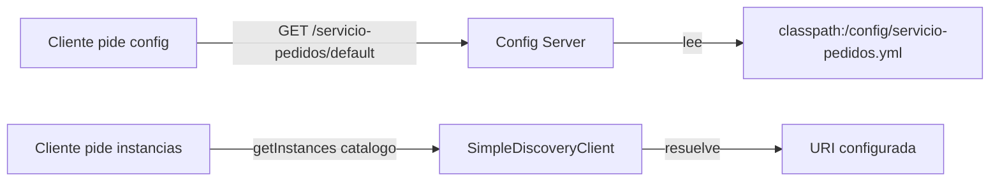
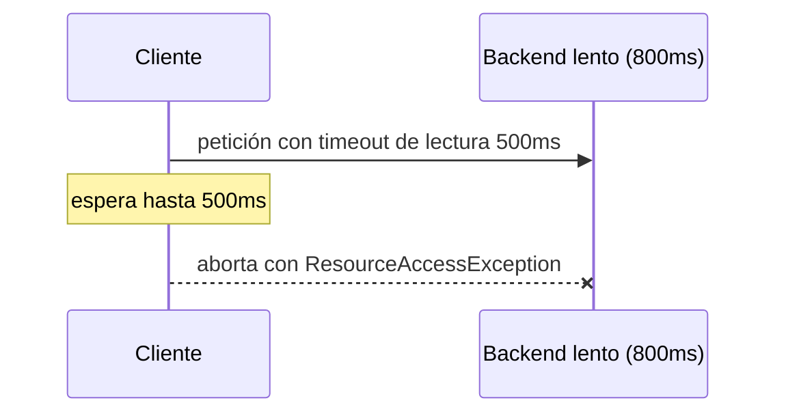
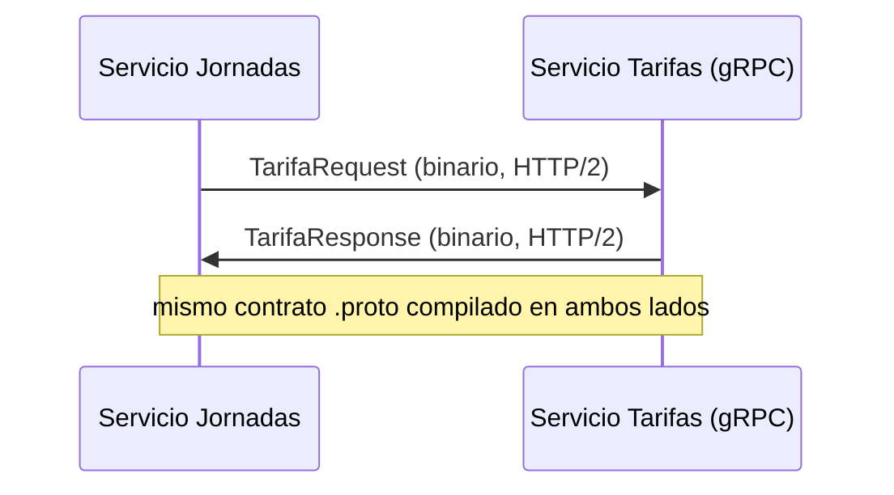
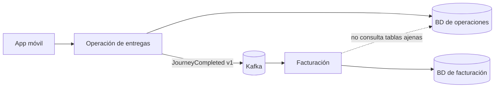
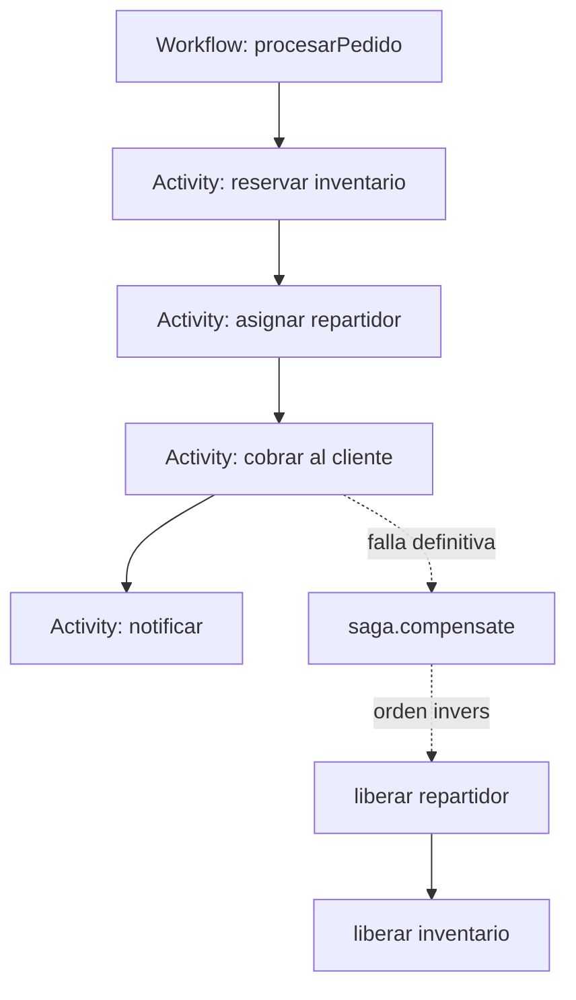
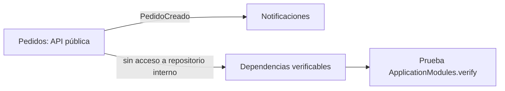
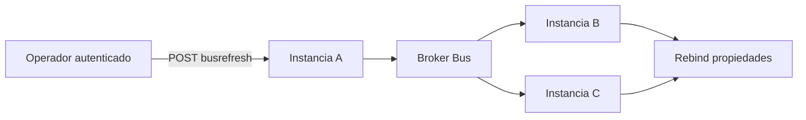
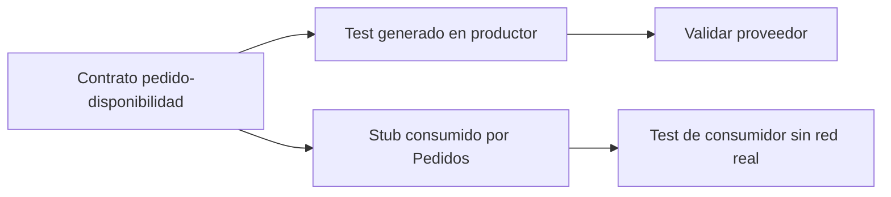

# Módulo 10: Microservicios con Spring Cloud


## Aprende construyendo

Cada tema demuestra un patrón de Spring Cloud con verificación real: config server nativo servido por HTTP, `SimpleDiscoveryClient` real de Spring Cloud Commons, Gateway enrutando de verdad contra un backend embebido, un `CircuitBreaker` de Resilience4j abriéndose por conteo real de fallos, seguridad de recurso probada con el post-processor oficial de `spring-security-test`, y un deadline HTTP real medido en milisegundos. Continúa sobre el proyecto `demo-cloud`.

### Tema 1: Config Server y service discovery

**Duración estimada:** 35 min.
**¿Por qué es importante?** Un Config Server entrega valores por aplicación y perfil; un DiscoveryClient resuelve nombres de servicio a direcciones sin fijar la URL en cada consumidor.
**Prerrequisitos:** Spring Boot M0 T1 y Spring Cloud compatible con Spring Boot 4.1.2. Usa JDK 25.
**Proyecto continuo:** crear un servicio de pedidos que obtiene su configuración y resuelve una instancia de catálogo.

#### Subtema 1.1: Sirve configuración desde archivos · 15 min

**1. Contexto**
Un servicio de pedidos debe obtener un valor compartido por HTTP para que puedas cambiarlo sin editar su código fuente.

**2. Hazlo tú**
Crea el proyecto demo-config-server con Spring Initializr y las dependencias web y cloud-config-server. Desde una terminal:

```bash
mkdir -p demo-config-server
cd demo-config-server
curl -fsSL https://start.spring.io/starter.zip -d dependencies=web,cloud-config-server -d javaVersion=25 -d artifactId=demo-config-server -o app.zip
unzip -o app.zip
mkdir -p src/main/resources/config
```

En src/main/resources/application.yml, crea esta configuración completa del servidor:

```yaml
server:
  port: 8888
spring:
  application:
    name: config-server
  cloud:
    config:
      server:
        native:
          search-locations: classpath:/config
  profiles:
    active: native
```

Crea src/main/resources/config/servicio-pedidos.yml:

```yaml
pedidos:
  descuento-maximo: 15
```

Reemplaza src/main/java/com/example/democonfigserver/DemoConfigServerApplication.java por:

```java
package com.example.democonfigserver;

import org.springframework.boot.SpringApplication;
import org.springframework.boot.autoconfigure.SpringBootApplication;
import org.springframework.cloud.config.server.EnableConfigServer;

@EnableConfigServer
@SpringBootApplication
public class DemoConfigServerApplication {
    public static void main(String[] args) {
        SpringApplication.run(DemoConfigServerApplication.class, args);
    }
}
```

Desde la raíz del proyecto, arranca la aplicación:

```bash
./mvnw spring-boot:run
```

En otra terminal, consulta el perfil default:

```bash
curl -i http://localhost:8888/servicio-pedidos/default
```

**Resultado esperado:** HTTP 200 y un Environment que incluye descuento-maximo con valor 15.

**Fallo deliberado:** cambia search-locations a classpath:/configs y repite la consulta. **Error esperado:** la respuesta no incluye la propiedad descuento-maximo. **Diagnóstico:** el archivo está en config, pero el servidor busca configs; corrige la ruta o mueve el archivo.

**3. Entiende**
El perfil native permite leer archivos del classpath o del sistema de archivos sin un remoto Git. La ruta HTTP combina el nombre de aplicación y el perfil para construir el Environment que recibe el cliente.

**4. Cierra**
Guarda la respuesta de curl y señala la propiedad que leyó el servidor.

#### Subtema 1.2: Separa configuración por perfil y diagnostica una app desconocida · 10 min

**1. Contexto**
El descuento permitido puede cambiar entre desarrollo y producción; un nombre de aplicación mal escrito debe diagnosticarse mirando el Environment que devolvió el servidor.

**2. Hazlo tú**
Crea src/main/resources/config/servicio-pedidos-produccion.yml:

```yaml
pedidos:
  descuento-maximo: 5
```

Consulta las dos rutas:

```bash
curl -s http://localhost:8888/servicio-pedidos/default
curl -s http://localhost:8888/servicio-pedidos/produccion
curl -i http://localhost:8888/servicio-inexistente/default
```

**Resultado esperado:** default informa 15 y produccion informa 5. Con la configuración predeterminada, el nombre inexistente puede responder 200 con un Environment sin propertySources útiles.

**Fallo deliberado:** cambia la ruta del perfil produccion a producion. **Resultado erróneo esperado:** la propiedad no toma el valor 5. **Diagnóstico:** compara el nombre escrito en la ruta con el sufijo del archivo; restaura produccion. Si necesitas 404 para aplicaciones desconocidas, configura spring.cloud.config.server.accept-empty=false.

**3. Entiende**
El perfil corresponde al sufijo del archivo, por ejemplo servicio-pedidos-produccion.yml. El Config Server acepta por defecto configuraciones vacías; el estado HTTP por sí solo no confirma que encontraste la aplicación solicitada.

**4. Cierra**
Entrega las dos respuestas válidas y explica por qué la respuesta de una app desconocida debe inspeccionarse.

#### Subtema 1.3: Resuelve una instancia por nombre lógico · 10 min

**1. Contexto**
El servicio de pedidos debe encontrar catálogo mediante su nombre de servicio y una dirección configurada, sin guardar esa URL dentro de su código.

**2. Hazlo tú**
Crea src/test/java/com/example/democonfigserver/DiscoveryClientTest.java con este test completo:

```java
package com.example.democonfigserver;

import java.util.List;
import org.junit.jupiter.api.Test;
import org.springframework.beans.factory.annotation.Autowired;
import org.springframework.boot.test.context.SpringBootTest;
import org.springframework.cloud.client.ServiceInstance;
import org.springframework.cloud.client.discovery.DiscoveryClient;

import static org.assertj.core.api.Assertions.assertThat;

@SpringBootTest(properties =
    "spring.cloud.discovery.client.simple.instances.catalogo[0].uri=http://localhost:8081")
class DiscoveryClientTest {
    @Autowired
    private DiscoveryClient discoveryClient;

    @Test
    void encuentraLaInstanciaConfiguradaPorNombre() {
        List<ServiceInstance> instancias = discoveryClient.getInstances("catalogo");

        assertThat(instancias).hasSize(1);
        assertThat(instancias.get(0).getUri().toString())
            .isEqualTo("http://localhost:8081");
    }
}
```

Desde la raíz del proyecto, ejecuta:

```bash
./mvnw test -Dtest=DiscoveryClientTest
```

**Resultado esperado:** BUILD SUCCESS y una instancia cuyo URI es http://localhost:8081.

**Fallo deliberado:** cambia catalogo en getInstances a pedidos. **Error esperado:** la aserción de tamaño falla porque no existe una instancia configurada con ese nombre lógico. **Diagnóstico:** las dos partes deben usar el mismo service ID; comprueba el prefijo de la propiedad simple.instances.

**3. Entiende**
SimpleDiscoveryClient obtiene instancias desde propiedades y permite probar el contrato DiscoveryClient sin operar un registro como Eureka o Consul. En producción el mecanismo de registro se selecciona según las necesidades de despliegue; este laboratorio solo demuestra la resolución por nombre.

**4. Cierra**
Entrega el resultado de la prueba y escribe el nombre lógico y la URI que resolvió.

**Hito del tema:**

- [ ] Levanté un Config Server native y serví un YAML por HTTP.
- [ ] Comparé configuración default y de producción.
- [ ] Diagnostiqué el resultado vacío para una aplicación inexistente.
- [ ] Resolví una URI mediante DiscoveryClient y SimpleDiscoveryClient.

**Diagrama del flujo:**



**Fuentes oficiales:** [backend nativo de Config Server](https://docs.spring.io/spring-cloud-config/reference/server/environment-repository/file-system-backend.html), [Environment y perfiles](https://docs.spring.io/spring-cloud-config/reference/server/environment-repository.html) y [SimpleDiscoveryClient](https://docs.spring.io/spring-cloud-commons/reference/spring-cloud-commons/common-abstractions.html).

**Transferencia al proyecto integrador:** carga el descuento desde configuración externa y resuelve por nombre la instancia del servicio que administra catálogo.

### Tema 2: Spring Cloud Gateway

El gateway recibe una petición y la reenvía al servicio elegido. En este tema vas a levantar dos procesos locales y comprobarlo con `curl`.

**¿Por qué es importante?** Con un gateway puedes ofrecer una dirección de entrada estable aunque los servicios vivan en procesos distintos. Cada petición debe llegar al servicio correcto y el servicio debe seguir autorizando sus propios datos.

#### Subtema 2.1: Crea una ruta para pedidos · 15 min

**1. Contexto**

Piensa en el gateway como una recepción: mira la dirección solicitada y decide a qué servicio entregarla. Aquí `/api/pedidos/**` se envía al servicio que escucha en el puerto `8081`.

**2. Hazlo tú**

Crea un proyecto Spring Boot con el starter oficial `org.springframework.cloud:spring-cloud-starter-gateway-server-webflux` y Spring Cloud BOM compatible con tu versión de Boot. En `src/main/resources/application.yml`, escribe:

```yaml
server:
  port: 8080
spring:
  cloud:
    gateway:
      server:
        webflux:
          routes:
            - id: pedidos
              uri: http://localhost:8081
              predicates:
                - Path=/api/pedidos/**
```

En `backend.py`, crea un backend pequeño para ver qué petición recibe:

```python
from http.server import BaseHTTPRequestHandler, HTTPServer

class Pedidos(BaseHTTPRequestHandler):
    def do_GET(self):
        print("Ruta recibida:", self.path)
        self.send_response(200)
        self.send_header("Content-Type", "application/json")
        self.end_headers()
        self.wfile.write(b'{"id":1,"estado":"EN_RUTA"}')

HTTPServer(("localhost", 8081), Pedidos).serve_forever()
```

Ejecuta el backend con `python3 backend.py`; en otra terminal ejecuta `./mvnw spring-boot:run` desde el proyecto del gateway. Envía `curl -i http://localhost:8080/api/pedidos/1`.

**Resultado esperado:** la respuesta es `200` con `{"id":1,"estado":"EN_RUTA"}` y el backend imprime `/api/pedidos/1`.

**Fallo deliberado:** en `src/main/resources/application.yml`, cambia `uri` a `http://localhost:8082` y repite el `curl`. **Resultado esperado:** recibes `5xx` y no aparece una petición en el backend del puerto `8081`. **Diagnóstico:** la ruta coincidió, pero el destino no escucha en ese puerto; restaura `8081`.

**3. Entiende**

`Path` decide si la ruta coincide; `uri` indica el destino. El gateway reenvía el mismo path porque todavía no configuramos ningún filtro para cambiarlo.

**4. Cierra**

Guarda la respuesta de `curl` y la línea del backend como evidencia. Esas dos señales confirman que la respuesta atravesó ambos procesos.

#### Subtema 2.2: Cambia el path que recibe el servicio · 10 min

**1. Contexto**

El cliente puede usar `/api/pedidos/1` mientras que el servicio espera `/pedidos/1`. El filtro `StripPrefix=1` quita el primer segmento (`api`) antes de reenviar.

**2. Hazlo tú**

En `src/main/resources/application.yml`, agrega el filtro dentro de la misma ruta:

```yaml
              filters:
                - StripPrefix=1
```

Haz que `backend.py` responda solo cuando recibe `/pedidos/1`; para cualquier otro path responde `404`:

```python
        if self.path != "/pedidos/1":
            self.send_error(404)
            return
```

Reinicia el backend y prueba `curl -i http://localhost:8080/api/pedidos/1`.

**Resultado esperado:** `curl` recibe `200`; el backend imprime `/pedidos/1`. Si llamas al backend directamente con `/api/pedidos/1`, devuelve `404`.

**Fallo deliberado:** en `src/main/resources/application.yml`, cambia temporalmente `StripPrefix=1` por `StripPrefix=2`. Repite el `curl`. **Resultado esperado:** el backend imprime `/1` y devuelve `404`. **Diagnóstico:** el filtro quitó dos segmentos y el backend espera `/pedidos/1`; restablece `StripPrefix=1`.

**3. Entiende**

El filtro solo transforma el path en el salto del gateway al servicio. El cliente sigue usando `/api/pedidos/1`; el contrato interno del backend puede ser distinto.

**4. Cierra**

Anota ambos paths y explica en una frase dónde se quitó `api`: el registro del backend debe mostrar `/pedidos/1`.

#### Subtema 2.3: Diagnostica una ruta que no coincide · 10 min

**1. Contexto**

Una letra distinta en el predicado puede hacer que la petición no llegue al backend. Primero separa “no hubo ruta” de “el backend respondió con error”.

**2. Hazlo tú**

En `src/main/resources/application.yml`, cambia temporalmente `Path=/api/pedidos/**` por `Path=/api/entregas/**`. Ejecuta:

```bash
curl -i http://localhost:8080/api/pedidos/1
```

Mira si aparece una nueva línea en la terminal del backend. Luego revierte el cambio y repite.

**Resultado esperado:** con el path desalineado el gateway devuelve `404` y el backend no imprime una petición nueva; al restaurar `/api/pedidos/**`, llega al backend y vuelve `200`.

**Fallo deliberado:** deja configurado `Path=/api/entregas/**` e intenta diagnosticar solo mirando el `404`, sin mirar la terminal del backend. **Diagnóstico:** la respuesta por sí sola no identifica quién la produjo; comprueba si el backend recibió una petición y luego restaura el path de pedidos.

**3. Entiende**

Un `404` puede venir del gateway o del servicio. La línea del backend te ayuda a saber si la petición alcanzó el servicio. En producción, el gateway puede centralizar autenticación de entrada y trazas, pero cada servicio debe autorizar el acceso a los datos que posee.

**4. Cierra**

Conserva dos evidencias: respuesta y log del caso correcto; respuesta y ausencia de log del fallo deliberado. El siguiente tema protege llamadas entre servicios cuando el destino falla.

**Fuentes oficiales:** [starter y requisitos de Gateway WebFlux](https://docs.spring.io/spring-cloud-gateway/reference/spring-cloud-gateway-server-webflux/starter.html), [rutas y configuración](https://docs.spring.io/spring-cloud-gateway/reference/spring-cloud-gateway-server-webflux/configuration.html).

**Cuándo usarlo:** cuando varios servicios necesitan un punto de entrada con rutas compartidas. Si solo publicas un servicio sencillo, añade el gateway cuando exista una necesidad concreta de enrutamiento o políticas transversales.

### Tema 3: Circuit breaker con Resilience4j

**Duración:** 30 min. **Prerrequisitos:** Spring Boot M10 T1 y T2 (configuración y gateway). **Proyecto continuo:** RutaFlow protege la consulta de pedidos cuando el servicio remoto falla.

**¿Por qué es importante?** Si cada petición espera hasta el timeout de un servicio caído, las llamadas pendientes consumen recursos y el fallo se propaga.

#### Subtema 3.1: Abre el circuito después de cuatro fallos · 10 min

**1. Contexto**
El circuito mide resultados. No se abre por un solo fallo si todavía no alcanza el mínimo de llamadas configurado.

**2. Hazlo tú**
Abre `examples/spring-resilience-rutaflow/src/test/java/academia/rutaflow/resilience/CircuitBreakerBehaviorTest.java` y ejecuta desde `examples/spring-resilience-rutaflow/`:

```bash
./mvnw -Dtest=CircuitBreakerBehaviorTest#abreDespuesDeCuatroFallosYBloqueaLaQuintaLlamada test
```

**Resultado esperado:** cuatro fallos medidos ponen el estado en `OPEN`; la prueba muestra que se ejecutó la llamada remota cuatro veces.

**Fallo deliberado:** modifica `minimumNumberOfCalls(4)` a `minimumNumberOfCalls(10)`. **Resultado esperado:** el test falla porque cuatro llamadas todavía no alcanzan el mínimo de diez. **Diagnóstico:** `minimumNumberOfCalls` y `slidingWindowSize` son límites distintos; la tasa no se calcula antes del mínimo.

**3. Entiende**
La ventana guarda resultados recientes. El mínimo indica cuántos resultados hacen falta antes de decidir si el circuito abre.

**4. Cierra**
Anota el umbral, tamaño de ventana y cantidad mínima de llamadas.

#### Subtema 3.2: Comprueba que OPEN detiene llamadas reales · 10 min

**1. Contexto**
El circuito debe rechazar rápido cuando está abierto, sin volver a invocar el servicio que ya está fallando.

**2. Hazlo tú**
Abre `examples/spring-resilience-rutaflow/src/test/java/academia/rutaflow/resilience/CircuitBreakerBehaviorTest.java`. Ejecuta el mismo test desde `examples/spring-resilience-rutaflow/`:

```bash
./mvnw -Dtest=CircuitBreakerBehaviorTest#abreDespuesDeCuatroFallosYBloqueaLaQuintaLlamada test
```

**Resultado esperado:** la quinta llamada lanza `CallNotPermittedException` y el contador permanece en `4`.

**Fallo deliberado:** quita `CircuitBreaker.decorateSupplier(breaker, ...)` y llama al supplier directamente. **Resultado esperado:** el contador llega a `5` y la prueba falla. **Diagnóstico:** la llamada dejó de pasar por el circuito; restaura la decoración.

**3. Entiende**
`OPEN` no repara el servicio remoto. Deja de enviarle llamadas por un intervalo y protege recursos locales; se puede combinar con timeout y fallback.

**4. Cierra**
Conserva el error de llamada bloqueada y explica qué valor comprobó el contador.

#### Subtema 3.3: Prueba recuperación en HALF_OPEN · 10 min

**1. Contexto**
Tras una pausa, el circuito permite unas pocas llamadas de prueba para saber si el servicio ya se recuperó.

**2. Hazlo tú**
Abre `examples/spring-resilience-rutaflow/src/test/java/academia/rutaflow/resilience/CircuitBreakerBehaviorTest.java` y ejecuta desde `examples/spring-resilience-rutaflow/`:

```bash
./mvnw -Dtest=CircuitBreakerBehaviorTest#vuelveACerradoCuandoLasDosLlamadasDePruebaTienenExito test
```

**Resultado esperado:** la prueba fuerza `HALF_OPEN`; dos respuestas correctas devuelven el estado a `CLOSED`.

**Fallo deliberado:** modifica el supplier recuperado para que falle en una de las dos llamadas. **Resultado esperado:** la recuperación no cumple las dos respuestas exitosas y el test falla al esperar `CLOSED`. **Diagnóstico:** el circuito solo cierra si sus llamadas de prueba superan la regla configurada.

**3. Entiende**
La secuencia es `CLOSED → OPEN → HALF_OPEN → CLOSED` cuando la recuperación tiene éxito. En producción el temporizador y las métricas observan esos cambios.

**4. Cierra**
Dibuja los estados y registra cuántas llamadas se permiten en la prueba de recuperación.

**Hito del tema:**

- [ ] Cuatro fallos medidos abren el circuito.
- [ ] `OPEN` bloquea la quinta llamada antes de llegar al servicio.
- [ ] Dos llamadas de prueba exitosas cierran el circuito.
- [ ] Expliqué que el circuito limita fallos, no repara el servicio.

**Proyecto integrador:** protege la consulta de pedidos de RutaFlow y registra el fallback que verá la persona usuaria cuando el circuito esté abierto.

**Fuentes oficiales:** [Resilience4j CircuitBreaker](https://resilience4j.readme.io/docs/circuitbreaker) y [roadmap.sh Spring Boot](https://roadmap.sh/spring-boot).

### Tema 4: OAuth2/OIDC, Keycloak y Token Relay sin perder la frontera de autorización

**Prerrequisito:** Módulo 4 de Spring Boot (Spring Security).

OAuth2 separa la autenticación de la API: Keycloak emite una credencial; cada servicio comprueba esa credencial y decide qué operaciones permite. El gateway ayuda con la entrada y el token relay, pero no sustituye la autorización del servicio que tiene los datos.

**¿Por qué es importante?** Si el servicio confía solo en que la petición pasó por el gateway, una ruta interna puede saltarse el control. La API valida su token, permiso y acceso al registro antes de revelar datos.

#### Subtema 4.1: Protege la API con el emisor de Keycloak · 15 min

**1. Contexto**

La API necesita comprobar quién emitió el token y que no esté vencido o alterado. Configurar el emisor permite a Spring Security descubrir las claves públicas del realm.

**2. Hazlo tú**

En un proyecto con `spring-boot-starter-web` y `spring-boot-starter-oauth2-resource-server`, crea `src/main/resources/application.yml`:

```yaml
spring:
  security:
    oauth2:
      resourceserver:
        jwt:
          issuer-uri: http://localhost:8081/realms/rutaflow
```

Crea `src/main/java/academia/rutaflow/SaludController.java`:

```java
package academia.rutaflow;

import org.springframework.web.bind.annotation.GetMapping;
import org.springframework.web.bind.annotation.PostMapping;
import org.springframework.web.bind.annotation.RestController;

@RestController
class SaludController {
    @GetMapping("/api/perfil")
    String perfil() {
        return "perfil protegido";
    }

    @PostMapping("/api/ubicaciones/{id}")
    String guardarUbicacion() {
        return "ubicación guardada";
    }
}
```

Configura un realm local llamado `rutaflow`, arranca la API y solicita `curl -i http://localhost:8080/api/perfil` sin token.

**Resultado esperado:** sin token la API contesta `401 Unauthorized`. Con una URL de realm incorrecta, Spring informa que no puede descubrir la configuración del emisor al iniciar.

**Fallo deliberado:** en `src/main/resources/application.yml`, cambia `/realms/rutaflow` por `/realms/inventado` y reinicia. **Diagnóstico:** revisa el issuer configurado y la URL de descubrimiento del realm en Keycloak; restáuralos antes de continuar.

**3. Entiende**

`issuer-uri` le dice a la API qué proveedor confiar. En producción usa HTTPS y secretos/configuración del entorno; `start-dev` de un proveedor de identidad es solo para desarrollo local.

**4. Cierra**

Guarda la respuesta `401` y la URL exacta del issuer de tu realm.

#### Subtema 4.2: Distingue autenticación de permiso · 10 min

**1. Contexto**

Una persona puede tener token válido y aun así no tener permiso para escribir ubicaciones. Eso es `403`; si no presenta credencial, es `401`.

**2. Hazlo tú**

En `src/main/java/academia/rutaflow/ApiSecurity.java`, exige el scope de escritura:

```java
package academia.rutaflow;

import org.springframework.context.annotation.Bean;
import org.springframework.context.annotation.Configuration;
import org.springframework.http.HttpMethod;
import org.springframework.security.config.Customizer;
import org.springframework.security.config.annotation.web.builders.HttpSecurity;
import org.springframework.security.web.SecurityFilterChain;

@Configuration
class ApiSecurity {
    @Bean
    SecurityFilterChain api(HttpSecurity http) throws Exception {
        return http
            .authorizeHttpRequests(auth -> auth
                .requestMatchers(HttpMethod.POST, "/api/ubicaciones/**")
                .hasAuthority("SCOPE_location:write")
                .anyRequest().authenticated())
            .oauth2ResourceServer(oauth -> oauth.jwt(Customizer.withDefaults()))
            .build();
    }
}
```

En `src/test/java/academia/rutaflow/ApiSecurityTest.java`, prueba la regla con `spring-security-test`:

```java
package academia.rutaflow;

import org.junit.jupiter.api.Test;
import org.springframework.beans.factory.annotation.Autowired;
import org.springframework.boot.test.autoconfigure.web.servlet.WebMvcTest;
import org.springframework.boot.test.context.TestConfiguration;
import org.springframework.context.annotation.Bean;
import org.springframework.context.annotation.Import;
import org.springframework.security.core.authority.SimpleGrantedAuthority;
import org.springframework.security.oauth2.jwt.Jwt;
import org.springframework.security.oauth2.jwt.JwtDecoder;
import org.springframework.test.web.servlet.MockMvc;

import static org.springframework.security.test.web.servlet.request.SecurityMockMvcRequestPostProcessors.jwt;
import static org.springframework.test.web.servlet.request.MockMvcRequestBuilders.post;
import static org.springframework.test.web.servlet.result.MockMvcResultMatchers.status;

@WebMvcTest(SaludController.class)
@Import({ApiSecurity.class, ApiSecurityTest.DecoderConfig.class})
class ApiSecurityTest {
    @Autowired MockMvc mockMvc;

    @Test
    void sinScopeRecibe403() throws Exception {
        mockMvc.perform(post("/api/ubicaciones/1").with(jwt()))
            .andExpect(status().isForbidden());
    }

    @Test
    void conScopeRecibeRespuestaExitosa() throws Exception {
        mockMvc.perform(post("/api/ubicaciones/1").with(jwt().authorities(
                new SimpleGrantedAuthority("SCOPE_location:write"))))
            .andExpect(status().is2xxSuccessful());
    }

    @TestConfiguration
    static class DecoderConfig {
        @Bean JwtDecoder jwtDecoder() {
            return token -> Jwt.withTokenValue(token).header("alg", "none")
                .claim("sub", "demo").build();
        }
    }
}
```

Ejecuta `./mvnw test -Dtest=ApiSecurityTest`.

**Resultado esperado:** el primer token simulado no tiene el scope y recibe `403`; el segundo tiene el scope y la regla lo autoriza. El post-processor prueba la autorización; no valida firma ni conexión con Keycloak.

**Fallo deliberado:** cambia `hasAuthority("SCOPE_location:write")` por `permitAll()` y vuelve a ejecutar el test. **Diagnóstico:** el test del scope insuficiente ya no obtiene `403`; restaura la regla. El nombre de la autoridad debe corresponder al scope del access token.

**3. Entiende**

`401` significa “falta una identidad aceptada”; `403` significa “identidad válida, permiso insuficiente”. Un test con `jwt()` ayuda a revisar reglas, pero no reemplaza una prueba de integración con el emisor real.

**4. Cierra**

Registra las dos respuestas y anota qué prueba necesita Keycloak real: validar el token firmado y el issuer.

#### Subtema 4.3: Comprueba que el recurso pertenece a la persona · 10 min

**1. Contexto**

El scope permite intentar una operación, pero no demuestra que el pedido pertenezca a quien lo solicita. La propiedad se comprueba con el usuario del token y el dueño del dato.

**2. Hazlo tú**

En `src/main/java/academia/rutaflow/PropiedadPedido.java`, compara los identificadores antes de devolver los datos:

```java
package academia.rutaflow;

import org.springframework.security.access.AccessDeniedException;

final class PropiedadPedido {
    static void exigirPropietario(String usuarioToken, String propietarioPedido) {
        if (!usuarioToken.equals(propietarioPedido)) {
            throw new AccessDeniedException("El pedido pertenece a otra persona");
        }
    }
}
```

Llama a `exigirPropietario(authentication.getName(), pedido.getPropietarioId())` después de buscar el pedido y antes de responder. Prueba un pedido propio y otro de distinto usuario en `src/test/java/academia/rutaflow/PropiedadPedidoTest.java`.

```java
package academia.rutaflow;

import org.junit.jupiter.api.Test;
import org.springframework.security.access.AccessDeniedException;

import static org.junit.jupiter.api.Assertions.assertDoesNotThrow;
import static org.junit.jupiter.api.Assertions.assertThrows;

class PropiedadPedidoTest {
    @Test
    void dejaPasarAlPropietario() {
        assertDoesNotThrow(() -> PropiedadPedido.exigirPropietario("ana", "ana"));
    }

    @Test
    void rechazaAotraPersona() {
        assertThrows(AccessDeniedException.class,
            () -> PropiedadPedido.exigirPropietario("ana", "luis"));
    }
}
```

Ejecuta `./mvnw test -Dtest=PropiedadPedidoTest`.

**Resultado esperado:** el dueño continúa; una persona distinta recibe `403` y no obtiene el contenido del pedido.

**Fallo deliberado:** elimina temporalmente la comparación y ejecuta la prueba con el pedido ajeno. **Diagnóstico:** el test debe detectar acceso indebido aunque la persona tenga el scope correcto; restablece la comprobación de propiedad.

**3. Entiende**

El scope responde “¿puede intentar esta clase de acción?”; la propiedad responde “¿puede actuar sobre este registro?”. El servicio debe comprobar ambas cosas porque es responsable de sus datos.

**4. Cierra**

Conserva el test de acceso propio y el de acceso ajeno. En el tema siguiente crearás un cliente HTTP con un límite de espera explícito.

**Fuentes oficiales:** [Resource Server JWT de Spring Security](https://docs.spring.io/spring-security/reference/servlet/oauth2/resource-server/jwt.html), [pruebas MockMvc con OAuth2](https://docs.spring.io/spring-security/reference/servlet/test/mockmvc/oauth2.html).

### Tema 5: HTTP Interfaces, deadlines y descubrimiento según el entorno

#### Paso 1 · Objetivo y preparación

Al finalizar podrás declarar un cliente HTTP con `@HttpExchange` y confirmar, midiendo tiempo real de ejecución contra un backend deliberadamente lento, que un deadline configurado corta la espera en vez de bloquear indefinidamente.

**Conocimiento previo:** Módulo 9 de este track (WebClient).

#### Paso 2 · Contexto y caso real

**¿Por qué es importante?** Un cliente HTTP declarativo describe el contrato de la dependencia sin mezclarlo con la regla de negocio, pero no elimina fallos de red: sin un deadline explícito, una llamada hacia un servicio lento puede bloquear la petición completa mucho más allá de lo tolerable para el usuario final.

#### Paso 3 · Teoría con analogía

**Conceptos clave:** contrato cliente declarativo, timeout de lectura, deadline medible.

Una interfaz `@HttpExchange` describe el contrato de la dependencia; Spring genera un proxy cliente real sobre `RestClient`, reduciendo código repetitivo. Definir un timeout de lectura explícito (vía `ClientHttpRequestFactorySettings`) establece cuánto tiempo el cliente está dispuesto a esperar antes de abortar la llamada, en vez de depender del timeout por defecto del sistema operativo (a menudo minutos).

**Analogía:** un deadline HTTP es como decirle a un mensajero "si no vuelves en 5 minutos, considero que la entrega falló y actúo en consecuencia", en vez de esperar indefinidamente sin ningún límite.

**Diagrama:**



#### Paso 4 · Demostración guiada desde cero

Continuando en `demo-cloud` (o, si prefieres un ejemplo independiente, parte de una carpeta vacía con `mkdir demo-http-client && cd demo-http-client && curl -fsSL https://start.spring.io/starter.zip -d dependencies=web -d javaVersion=25 -o app.zip && unzip app.zip`), crea `src/main/java/io/academia/routes/RouteClient.java`:

```bash
mkdir -p demo-cloud/http-client/src/main/java/io/academia/routes
cd demo-cloud/http-client
```

```java
// src/main/java/io/academia/routes/RouteClient.java
package io.academia.routes;

import org.springframework.boot.http.client.ClientHttpRequestFactorySettings;
import org.springframework.http.client.ClientHttpRequestFactory;
import org.springframework.http.client.support.ClientHttpRequestFactoryBuilder;
import org.springframework.web.bind.annotation.GetMapping;
import org.springframework.web.bind.annotation.PathVariable;
import org.springframework.web.client.RestClient;
import org.springframework.web.service.annotation.GetExchange;
import org.springframework.web.service.annotation.HttpExchange;
import org.springframework.web.client.support.RestClientAdapter;
import org.springframework.web.service.invoker.HttpServiceProxyFactory;

import java.time.Duration;

public interface RouteClient {
    @GetExchange("/{journeyId}")
    String find(@PathVariable String journeyId);

    static RouteClient with(String baseUrl, Duration deadline) {
        ClientHttpRequestFactory factory = ClientHttpRequestFactoryBuilder.detect().build(
            ClientHttpRequestFactorySettings.defaults().withReadTimeout(deadline));
        RestClient restClient = RestClient.builder().baseUrl(baseUrl).requestFactory(factory).build();
        HttpServiceProxyFactory proxyFactory = HttpServiceProxyFactory
            .builderFor(RestClientAdapter.create(restClient)).build();
        return proxyFactory.createClient(RouteClient.class);
    }
}
```

Confirma con `MockWebServer` (backend real con retraso configurado) que el deadline efectivamente corta la espera, midiendo el tiempo real transcurrido:

```java
// src/test/java/io/academia/routes/RouteClientDeadlineTest.java
package io.academia.routes;

import mockwebserver3.MockResponse;
import mockwebserver3.MockWebServer;
import org.junit.jupiter.api.AfterEach;
import org.junit.jupiter.api.BeforeEach;
import org.junit.jupiter.api.Test;
import org.springframework.web.client.ResourceAccessException;

import java.io.IOException;
import java.time.Duration;
import java.util.concurrent.TimeUnit;

import static org.assertj.core.api.Assertions.assertThat;
import static org.assertj.core.api.Assertions.assertThatThrownBy;

class RouteClientDeadlineTest {

    private MockWebServer backend;

    @BeforeEach
    void iniciar() throws IOException {
        backend = new MockWebServer();
        backend.start();
    }

    @AfterEach
    void detener() throws IOException {
        backend.shutdown();
    }

    @Test
    void unDeadlineDe500msAbortaUnaRespuestaQueTarda800ms() {
        backend.enqueue(new MockResponse.Builder()
            .body("{\"ruta\":\"ok\"}")
            .bodyDelay(800, TimeUnit.MILLISECONDS)
            .build());

        RouteClient cliente = RouteClient.with(backend.url("/").toString(), Duration.ofMillis(500));

        long inicio = System.nanoTime();
        assertThatThrownBy(() -> cliente.find("RF-001")).isInstanceOf(ResourceAccessException.class);
        long transcurridoMs = (System.nanoTime() - inicio) / 1_000_000;

        assertThat(transcurridoMs).isLessThan(700); // abortó cerca de los 500ms, no esperó los 800ms completos
    }
}
```

```bash
./mvnw test -Dtest=RouteClientDeadlineTest
```

**Resultado esperado:** `BUILD SUCCESS` con el test en verde: `System.nanoTime()` mide el tiempo REAL transcurrido, confirmando con evidencia cronométrica (no una suposición) que la llamada abortó cerca de los 500ms configurados y no esperó los 800ms completos que el backend real tardaba en responder.

**Fallo deliberado:** quita `.withReadTimeout(deadline)` de `RouteClient.with(...)` (usando el `ClientHttpRequestFactorySettings.defaults()` sin modificar) y ejecuta de nuevo el test. La llamada ahora SÍ espera los 800ms completos del backend (el timeout por defecto del sistema es mucho mayor), y la aserción `assertThatThrownBy` falla porque no se lanza ninguna excepción — diagnostica confirmando que sin un timeout de lectura explícito, el cliente espera indefinidamente (limitado solo por el timeout por defecto del sistema operativo, típicamente varios minutos), exactamente el riesgo que este Tema busca prevenir. Revierte el cambio antes de continuar.

#### Paso 5 · Práctica guiada — repetición progresiva

1. Agrega un timeout de conexión (`withConnectTimeout(...)`) distinto al timeout de lectura, y documenta con un comentario en el test la diferencia entre ambos (tiempo para establecer la conexión TCP frente a tiempo esperando la respuesta tras la conexión ya establecida).
2. Confirma con un test que una respuesta que llega ANTES del deadline (por ejemplo, `bodyDelay(200, TimeUnit.MILLISECONDS)` con un deadline de 500ms) SÍ se recibe exitosamente, contrastando con el caso del Paso 4.
3. Documenta en un comentario por qué agregar retries automáticos sobre una llamada con deadline, sin coordinarlos con el resto del sistema, puede multiplicar la latencia total percibida por el usuario final.
4. Escribe de memoria (sin mirar) un `RouteClient` con timeout de lectura configurado, y un test `MockWebServer` que mida el tiempo real transcurrido para confirmar que el deadline corta la espera. Compara después contra el patrón del Paso 4.

**Pista:** `System.nanoTime()` (no `System.currentTimeMillis()`) es la forma correcta de medir duraciones en Java, porque no se ve afectado por ajustes del reloj del sistema durante la medición.

#### Paso 6 · Práctica independiente

**Completa el código:** rellena el espacio con el método que configura el timeout de lectura sobre los settings del cliente HTTP:

```java
ClientHttpRequestFactorySettings.defaults().____(deadline);
```

**Reto de memoria sin mirar:** cierra este documento y escribe, solo de memoria, un cliente HTTP con deadline configurado y un test que mida con `System.nanoTime()` que ese deadline efectivamente corta una respuesta lenta. Compara después contra el patrón del Paso 4.

#### Paso 7 · Cierre y evidencia

Ya declaras contratos HTTP explícitos con `@HttpExchange` y confirmas, con medición cronométrica real, que un deadline configurado corta esperas indefinidas. El siguiente tema explora gRPC con Spring gRPC (Boot 4.1) como alternativa binaria para comunicación interna de alta frecuencia entre servicios. **Evidencia:** entrega el resultado de `RouteClientDeadlineTest` en verde, y la falta de excepción real que produce el fallo deliberado al quitar el timeout. Fuente oficial: [Spring Framework — HTTP Interface](https://docs.spring.io/spring-framework/reference/integration/rest-clients.html#rest-http-interface).

**Errores comunes:** no configurar ningún timeout explícito, dependiendo del timeout por defecto del sistema (a menudo demasiado largo para ser útil); agregar retries en múltiples capas (móvil, gateway, cada servicio) sin coordinación, multiplicando la latencia real ante un fallo.

**Cuándo no usarlo:** para una llamada local sin ningún componente de red real, ni `@HttpExchange` ni un deadline aportan ningún valor.

Los deadlines HTTP de este tema son los que evitarán que una llamada lenta bloquee el proyecto integrador de este track (microservicio productivo, Módulo 12).

### Tema 6: Spring gRPC para comunicación interna de alta frecuencia (Spring Boot 4.1)

#### Paso 1 · Objetivo y preparación

Al finalizar podrás definir un contrato gRPC con `.proto`, generar el stub, y exponer/consumir un servicio interno con Spring gRPC (Spring Boot 4.1), confirmando con un cliente real que la comunicación binaria funciona entre dos servicios.

**Conocimiento previo:** Tema 5 de este módulo.

#### Paso 2 · Contexto y caso real

**¿Por qué es importante?** La comunicación entre el servicio de Jornadas y el servicio de Tarifas ocurre decenas de veces por segundo en el camino crítico de cada entrega; serializar y parsear JSON sobre HTTP en cada llamada interna agrega una sobrecarga medible que gRPC (contrato binario tipado, HTTP/2 multiplexado) reduce sin cambiar la lógica de negocio.

#### Paso 3 · Teoría con analogía

**Conceptos clave:** contrato `.proto`, generación de stub, HTTP/2 multiplexado, Spring gRPC (Boot 4.1) frente a configuración manual de Netty.

```protobuf
// src/main/proto/tarifa.proto
syntax = "proto3";
service TarifaService {
  rpc Calcular (TarifaRequest) returns (TarifaResponse);
}
message TarifaRequest { double distanciaKm = 1; }
message TarifaResponse { double monto = 1; }
```

```java
@GrpcService
public class TarifaServiceImpl extends TarifaServiceGrpc.TarifaServiceImplBase {
    @Override
    public void calcular(TarifaRequest request, StreamObserver<TarifaResponse> responseObserver) {
        double monto = request.getDistanciaKm() * 1500;
        responseObserver.onNext(TarifaResponse.newBuilder().setMonto(monto).build());
        responseObserver.onCompleted();
    }
}
```

Spring gRPC (incorporado en Spring Boot 4.1) registra automáticamente el servidor gRPC y los clientes a partir de la configuración de `application.yml`, de la misma forma que Spring Boot ya autoconfigura un servidor HTTP embebido — sin la configuración manual de un `ServerBuilder` de Netty que gRPC puro requeriría; `@GrpcService` marca la implementación generada a partir del contrato `.proto` como un bean gestionado por Spring, con inyección de dependencias normal.

**Analogía:** gRPC con un contrato `.proto` es como un formulario preimpreso con casillas numeradas que ambos lados ya acordaron de antemano; JSON sobre HTTP es como una carta de texto libre que cada lado debe parsear e interpretar manualmente, más flexible pero con más trabajo de parseo repetido en cada intercambio.

**Diagrama:**



#### Paso 4 · Demostración guiada desde cero

Crea `src/main/proto/tarifa.proto` con el contrato anterior, genera el stub con el plugin `protobuf-maven-plugin`, implementa `TarifaServiceImpl` con `@GrpcService`, y un cliente de prueba:

```bash
mkdir -p academia-spring/src/main/proto
cd academia-spring
```

**Ejecuta el ejemplo** (genera el proyecto con Spring Initializr, pega el código y corre las pruebas):

```bash
curl -fsSL https://start.spring.io/starter.zip -d dependencies=web -d javaVersion=25 -o app.zip && unzip -o app.zip
./mvnw test
```
Equivalencias Maven/Gradle en el Módulo 1.


```java
// src/test/java/com/academia/microservicios/TarifaGrpcTest.java
@SpringBootTest
class TarifaGrpcTest {
    @GrpcClient("tarifa-service")
    private TarifaServiceGrpc.TarifaServiceBlockingStub cliente;

    @Test
    void calculaTarifaPorDistancia() {
        TarifaResponse respuesta = cliente.calcular(
            TarifaRequest.newBuilder().setDistanciaKm(10).build());
        assertThat(respuesta.getMonto()).isEqualTo(15000);
    }
}
```

**Resultado esperado:** el cliente gRPC invoca `TarifaServiceImpl` a través de HTTP/2 usando el stub generado del contrato `.proto`, recibiendo `TarifaResponse` con `monto=15000` para 10 km, sin ningún parseo manual de JSON en ninguno de los dos lados.

**Fallo deliberado:** en una nueva versión del `.proto`, quita el campo `distanciaKm = 1` y agrega un campo nuevo reusando el mismo número de campo (`double distanciaMillas = 1`) en vez de asignarle el siguiente número disponible. Diagnostica confirmando que un cliente viejo, compilado contra el contrato anterior, ahora interpreta el valor binario de `distanciaMillas` como si fuera `distanciaKm` (protobuf identifica campos por NÚMERO, no por nombre), produciendo un cálculo de tarifa silenciosamente incorrecto sin ningún error de compilación ni de red que lo señale.

#### Paso 5 · Práctica guiada — repetición progresiva

1. Corrige el Paso 4 asignando `distanciaMillas = 2` (el siguiente número disponible) en vez de reusar `= 1`, y confirma que un cliente viejo que solo conoce `distanciaKm = 1` simplemente no ve el campo nuevo, sin corromper ningún valor existente.
2. Agrega un segundo método RPC (`rpc CalcularConRecargo`) al mismo servicio y regenera el stub, confirmando que el cliente existente sigue compilando sin cambios.
3. Documenta, basándote en el Paso 3, por qué marcar un número de campo como `reserved` en el `.proto` evita que alguien lo reuse accidentalmente en el futuro.
4. Escribe de memoria (sin mirar) un contrato `.proto` mínimo con un servicio de un método. Compara después contra el Paso 4.

**Pista:** en protobuf, el NOMBRE de un campo es solo para legibilidad humana del código generado; el NÚMERO de campo es lo único que el protocolo binario transmite — renombrar un campo es seguro, reusar o reordenar su número no lo es.

#### Paso 6 · Práctica independiente

**Completa el código:** rellena la anotación que registra una implementación de servicio gRPC como bean de Spring:

```java
@____
public class TarifaServiceImpl extends TarifaServiceGrpc.TarifaServiceImplBase { }
```

**Reto de memoria sin mirar:** cierra este documento y escribe, solo de memoria, un contrato `.proto` con un mensaje y un servicio de un método, y la implementación `@GrpcService` correspondiente. Compara después contra el Paso 4.

#### Paso 7 · Cierre y evidencia

Ya exponés y consumís un servicio interno con Spring gRPC (Boot 4.1), confirmando con un cliente real que el contrato binario funciona, y reproducís el riesgo específico de reusar un número de campo en una evolución de contrato. El siguiente y último tema de este módulo aborda cuándo estos límites de servicio deben trazarse con DDD, en vez de por conveniencia técnica. **Evidencia:** entrega el test `TarifaGrpcTest` en verde, y la reproducción del cálculo corrupto al reusar un número de campo en el `.proto`. Fuente oficial: [Spring gRPC Reference](https://docs.spring.io/spring-grpc/reference/) y [Protocol Buffers — Updating a Message Type](https://protobuf.dev/programming-guides/proto3/#updating).

**Errores comunes:** reusar el número de un campo eliminado en vez de marcarlo `reserved`; exponer gRPC hacia clientes externos no confiables sin la misma capa de autenticación que ya protege las APIs REST del Módulo 4.

**Cuándo no usarlo:** para comunicación con un cliente de navegador (gRPC-Web requiere un proxy adicional) o con un tercero externo que espera JSON/REST estándar, gRPC agrega fricción de integración sin beneficio frente a HTTP Interfaces (Tema 5).

El contrato gRPC de este tema es el que usará la comunicación interna de alta frecuencia del proyecto integrador de este track (microservicio productivo, Módulo 12).
**Evidencia de aprendizaje:** entrega la salida de `./mvnw test` con `TarifaGrpcTest` en verde confirmando `monto=15000` para 10 km, y la explicación de por qué reusar el número de campo `= 1` para `distanciaMillas` corrompe silenciosamente el cálculo en un cliente viejo, frente a asignarle `= 2` como corrección en el Paso 5.
### Tema 7: DDD para decidir límites y propiedad de datos

#### Paso 1 · Objetivo y preparación

Al finalizar podrás formalizar en un test JUnit real una invariante de dominio (una jornada cerrada rechaza nuevas posiciones), demostrando que la propiedad de una regla de negocio vive en un agregado del contexto correcto, no dispersa entre servicios.

**Conocimiento previo:** Módulo 3 de este track (JPA y entidades).

#### Paso 2 · Contexto y caso real

**¿Por qué es importante?** Spring Cloud resuelve problemas de coordinación entre servicios; no corrige una separación de dominio equivocada. Distribuir primero y descubrir después los límites produce transacciones imposibles, llamadas circulares y cambios coordinados entre equipos.

#### Paso 3 · Teoría con analogía

**Conceptos clave:** contexto delimitado, agregado, invariante, propiedad de datos.

Un microservicio no es una capa técnica ni una tabla aislada. En un sistema de logística, `Journey` pertenece al contexto **Operación de entregas** porque allí viven reglas como «una jornada cerrada no acepta nuevas posiciones». Un **contexto delimitado** define dónde un término mantiene un significado coherente; dentro de él, un **agregado** protege sus invariantes en una única frontera transaccional. Una foreign key entre bases de servicios o una entidad JPA compartida rompen esa autonomía.

**Analogía:** cada contexto es un departamento con vocabulario, expedientes y autoridad propios. Puede enviar un documento firmado a otro departamento, pero no entrar a modificar directamente sus archivadores.

**Diagrama:**



#### Paso 4 · Demostración guiada desde cero

Continuando en `demo-cloud` (o, si prefieres un ejemplo independiente, parte de una carpeta vacía y genera un proyecto nuevo con Maven: `mkdir demo-domain && cd demo-domain && mvn archetype:generate -DgroupId=io.academia -DartifactId=demo-domain -DarchetypeArtifactId=maven-archetype-quickstart -DinteractiveMode=false`; o con Gradle: `mkdir demo-domain && cd demo-domain && gradle init --type java-library --dsl kotlin --project-name demo-domain --package io.academia`), crea `src/main/java/io/academia/operations/journey/Journey.java`:

```bash
mkdir -p demo-cloud/domain/src/main/java/io/academia/operations/journey
cd demo-cloud/domain
```

```java
// src/main/java/io/academia/operations/journey/Journey.java
package io.academia.operations.journey;

import java.util.ArrayList;
import java.util.List;

public final class Journey {
    private JourneyStatus status = JourneyStatus.OPEN;
    private final List<Position> positions = new ArrayList<>();

    public void record(Position position) {
        if (status == JourneyStatus.CLOSED) {
            throw new JourneyAlreadyClosed();
        }
        positions.add(position);
    }

    public void close() {
        status = JourneyStatus.CLOSED;
    }

    public List<Position> positions() {
        return List.copyOf(positions);
    }
}
```

```java
// src/main/java/io/academia/operations/journey/JourneyAlreadyClosed.java
package io.academia.operations.journey;

public class JourneyAlreadyClosed extends RuntimeException {
    public JourneyAlreadyClosed() {
        super("La jornada ya está cerrada y no acepta nuevas posiciones");
    }
}
```

Formaliza la invariante en un test real, sin necesitar Kafka ni PostgreSQL para probar la regla de dominio:

```java
// src/test/java/io/academia/operations/journey/JourneyTest.java
package io.academia.operations.journey;

import org.junit.jupiter.api.Test;

import static org.assertj.core.api.Assertions.assertThat;
import static org.assertj.core.api.Assertions.assertThatThrownBy;

class JourneyTest {

    @Test
    void unaJornadaCerradaRechazaNuevasPosiciones() {
        Journey journey = new Journey();
        journey.record(new Position(10.0, 20.0));
        journey.close();

        assertThatThrownBy(() -> journey.record(new Position(11.0, 21.0)))
            .isInstanceOf(JourneyAlreadyClosed.class);

        assertThat(journey.positions()).hasSize(1); // la posición posterior al cierre NUNCA se agregó
    }

    @Test
    void unaJornadaAbiertaAceptaPosicionesLibremente() {
        Journey journey = new Journey();
        journey.record(new Position(10.0, 20.0));
        journey.record(new Position(11.0, 21.0));

        assertThat(journey.positions()).hasSize(2);
    }
}
```

```bash
./mvnw test -Dtest=JourneyTest
```

**Resultado esperado:** `BUILD SUCCESS` con ambos tests en verde: el primero confirma que la invariante «jornada cerrada rechaza posiciones» se cumple SIN ninguna infraestructura (sin Kafka, sin PostgreSQL, sin HTTP) — la regla vive completamente en el agregado `Journey`, verificable de forma aislada y rápida; el segundo confirma que una jornada abierta acepta posiciones libremente, contrastando el comportamiento correcto en ambos estados.

**Fallo deliberado:** en `Journey.record(...)`, quita la comprobación `if (status == JourneyStatus.CLOSED)` por completo y ejecuta de nuevo `unaJornadaCerradaRechazaNuevasPosiciones`. El test FALLA porque `journey.record(...)` ya no lanza `JourneyAlreadyClosed` — diagnostica confirmando en código, no solo en documentación de diseño, que la invariante depende enteramente de esa comprobación explícita dentro del agregado: sin ella, cualquier código que use `Journey` (desde cualquier servicio) podría registrar posiciones en una jornada ya cerrada sin ningún error. Revierte el cambio antes de continuar.

#### Paso 5 · Práctica guiada — repetición progresiva

1. Agrega una segunda invariante (por ejemplo, «una jornada no puede cerrarse sin al menos una posición registrada») y un test que la confirme.
2. Escribe un test que confirme que `journey.positions()` devuelve una copia inmutable (`List.copyOf(...)`), no la lista interna mutable — intenta modificar la lista devuelta y confirma que lanza `UnsupportedOperationException`.
3. Documenta, en un comentario, por qué una foreign key directa desde la base de datos de Facturación hacia la tabla `journeys` de Operaciones rompería la propiedad de datos que este Tema defiende, incluso si técnicamente "funciona".
4. Escribe de memoria (sin mirar) el agregado `Journey` con su invariante de cierre, y un test `assertThatThrownBy` que la confirme. Compara después contra el patrón del Paso 4.

**Pista:** una invariante de dominio verificada por un test unitario puro (sin Spring, sin base de datos) se ejecuta en milisegundos y no depende de ninguna infraestructura — si una regla de negocio solo puede probarse levantando Kafka o PostgreSQL, es una señal de que la regla no está realmente encapsulada en el agregado.

#### Paso 6 · Práctica independiente

**Completa el código:** rellena el espacio con la excepción que la invariante debe lanzar al intentar registrar una posición en una jornada cerrada:

```java
if (status == JourneyStatus.CLOSED) {
    throw new ____();
}
```

**Reto de memoria sin mirar:** cierra este documento y escribe, solo de memoria, el agregado `Journey` con la invariante de cierre y un test JUnit que la confirme sin ninguna infraestructura externa. Compara después contra el patrón del Paso 4.

#### Paso 7 · Cierre y evidencia

Ya formalizas invariantes de dominio en tests unitarios puros, confirmando que la propiedad de una regla de negocio vive en el agregado del contexto correcto. Esto cierra el módulo de microservicios; el siguiente módulo aborda observabilidad distribuida con trazas y logs correlacionados. **Evidencia:** entrega el resultado de `JourneyTest` en verde, y la ausencia real de excepción que produce el fallo deliberado al quitar la comprobación de estado. Fuente oficial: [Domain-Driven Design — Eric Evans (resumen oficial de patrones)](https://martinfowler.com/bliki/DDD_Aggregate.html).

**Errores comunes:** dividir servicios por entidades técnicas en vez de por capacidades de negocio; compartir una entidad JPA o una foreign key entre bases de datos de servicios distintos, rompiendo la propiedad de datos.

**Cuándo no usarlo:** con límites de dominio todavía inciertos (un producto nuevo, sin historial de cambios), empezar con un monolito modular y paquetes explícitos es preferible a extraer microservicios sobre hipótesis de contexto delimitado aún no validadas.

---

Los límites de propiedad de datos que definas con DDD son los que delimitarán el alcance del proyecto integrador de este track (microservicio productivo, Módulo 12).

### Tema 8: Orquestación de microservicios con Temporal y Spring Boot

#### Paso 1 · Objetivo y preparación

Al finalizar podrás orquestar una transacción distribuida que cruza varios microservicios (aceptar un pedido, asignar un repartidor, cobrar y notificar) con un **Workflow de Temporal**, de forma que el proceso sobreviva a caídas y reinicios, reintente automáticamente los pasos que fallan de forma transitoria, y **compense** (deshaga) los pasos ya completados si uno posterior falla de forma definitiva, todo confirmado con el servidor de pruebas embebido de Temporal.

**Conocimiento previo:** Tema 3 de este módulo (circuit breaker con Resilience4j); el patrón Saga del track se introduce aquí de forma ejecutable. Nociones de microservicios que se comunican por red (Temas 1-7).

#### Paso 2 · Contexto y caso real

**¿Por qué es importante?** En RutaFlow, aceptar un pedido dispara una secuencia que toca varios servicios: reservar inventario, asignar un repartidor, cobrar al cliente y notificar. Si el cobro falla **después** de haber reservado inventario y asignado repartidor, no puedes dejar el sistema a medias: hay que deshacer lo hecho. Coordinar esto con llamadas HTTP y bases de datos sueltas lleva a estados inconsistentes cuando un servicio se cae a mitad del proceso. Temporal resuelve esto ejecutando la orquestación como un **workflow duradero**: si el proceso (o la máquina) se cae en el paso 3, al reiniciar Temporal lo retoma exactamente donde estaba, sin repetir los pasos ya completados.

#### Paso 3 · Teoría con analogía

**Conceptos clave:** Workflow (orquestador duradero), Activity (paso con efecto externo que puede fallar), reintentos automáticos, Saga y compensación.

Temporal separa dos cosas: el **Workflow** es código de orquestación determinista que decide el orden de los pasos y sobrevive a fallos porque Temporal registra cada decisión en un historial reproducible; las **Activities** son los pasos que tocan el mundo exterior (una API, una base de datos, un cobro) y que, por eso, pueden fallar. El Workflow invoca Activities a través de un *stub* con `RetryOptions`: Temporal reintenta automáticamente una Activity que falla de forma transitoria, sin que tú escribas el bucle de retry. Para deshacer efectos ya aplicados cuando un paso posterior falla, el Workflow usa la clase `Saga`: antes de ejecutar cada Activity, registra su **compensación**; si algo falla, llama a `saga.compensate()` y Temporal ejecuta las compensaciones en orden inverso.

**Analogía:** el Workflow es el director de orquesta que lleva la partitura y recuerda en qué compás va, aunque se apaguen las luces a mitad del concierto; las Activities son los músicos, que pueden equivocarse en una nota (y el director les hace repetir). La Saga es el plan de "si el final sale mal, deshacemos de atrás hacia adelante": primero devolvemos el cobro, luego liberamos el repartidor, luego liberamos el inventario — el orden inverso al que se reservaron.

**Diagrama:**



**Diagrama interactivo:** [Orquestación de pedido con Temporal y compensación Saga](/visuals/temas/spring-boot/modulo-10-tema-8-temporal-saga.html) — versión explorable con temas claro/oscuro y el camino de compensación resaltado.

#### Paso 4 · Demostración guiada desde cero

Genera un proyecto Spring Boot y añade el starter oficial de Temporal. La versión estable en Maven Central al momento de escribir es `1.39.x` (la documentación muestra ejemplos con `1.31.0`); fija la que confirmes vigente en [Maven Central](https://central.sonatype.com/artifact/io.temporal/temporal-spring-boot-starter).

```bash
mkdir demo-temporal && cd demo-temporal
# Maven (type=maven-project) o Gradle (type=gradle-project-kotlin)
curl -fsSL "https://start.spring.io/starter.zip?type=maven-project&dependencies=web&javaVersion=25&groupId=io.academia&artifactId=orquestador&packageName=io.academia.orquestador" -o app.zip
unzip -o app.zip
```

Añade la dependencia del starter de Temporal:

```xml
<!-- pom.xml (Maven) -->
<dependency>
  <groupId>io.temporal</groupId>
  <artifactId>temporal-spring-boot-starter</artifactId>
  <version>1.39.0</version>
</dependency>
```
```kotlin
// build.gradle.kts (Gradle, equivalente)
implementation("io.temporal:temporal-spring-boot-starter:1.39.0")
```

Define el **contrato de las Activities** (los pasos con efecto externo) y el **Workflow** (la orquestación):

```java
// src/main/java/io/academia/orquestador/PedidoActivities.java
package io.academia.orquestador;

import io.temporal.activity.ActivityInterface;

@ActivityInterface
public interface PedidoActivities {
    String reservarInventario(String pedidoId);
    void liberarInventario(String pedidoId);      // compensación
    String asignarRepartidor(String pedidoId);
    void liberarRepartidor(String repartidorId);  // compensación
    void cobrar(String pedidoId, long centavos);
    void notificar(String pedidoId, String mensaje);
}
```

```java
// src/main/java/io/academia/orquestador/PedidoWorkflow.java
package io.academia.orquestador;

import io.temporal.workflow.WorkflowInterface;
import io.temporal.workflow.WorkflowMethod;

@WorkflowInterface
public interface PedidoWorkflow {
    @WorkflowMethod
    String procesar(String pedidoId, long centavos);
}
```

```java
// src/main/java/io/academia/orquestador/PedidoWorkflowImpl.java
package io.academia.orquestador;

import io.temporal.activity.ActivityOptions;
import io.temporal.common.RetryOptions;
import io.temporal.spring.boot.WorkflowImpl;
import io.temporal.workflow.Saga;
import io.temporal.workflow.Workflow;

import java.time.Duration;

@WorkflowImpl(taskQueues = "pedidos")
public class PedidoWorkflowImpl implements PedidoWorkflow {

    // Stub de Activities con reintentos automáticos ante fallos transitorios.
    private final PedidoActivities actividades = Workflow.newActivityStub(
        PedidoActivities.class,
        ActivityOptions.newBuilder()
            .setStartToCloseTimeout(Duration.ofSeconds(10))
            .setRetryOptions(RetryOptions.newBuilder()
                .setInitialInterval(Duration.ofMillis(200))
                .setMaximumAttempts(3)      // reintenta hasta 3 veces
                .build())
            .build());

    @Override
    public String procesar(String pedidoId, long centavos) {
        // Compensación en orden inverso si algo falla después.
        Saga saga = new Saga(new Saga.Options.Builder().build());
        try {
            // 1. Reservar inventario; registra su compensación ANTES de ejecutar el siguiente paso.
            String reserva = actividades.reservarInventario(pedidoId);
            saga.addCompensation(() -> actividades.liberarInventario(pedidoId));

            // 2. Asignar repartidor.
            String repartidor = actividades.asignarRepartidor(pedidoId);
            saga.addCompensation(() -> actividades.liberarRepartidor(repartidor));

            // 3. Cobrar (si falla definitivamente tras sus reintentos, dispara la compensación).
            actividades.cobrar(pedidoId, centavos);

            // 4. Notificar.
            actividades.notificar(pedidoId, "Pedido confirmado");
            return "CONFIRMADO reserva=" + reserva + " repartidor=" + repartidor;
        } catch (Exception falla) {
            // Deshace inventario y repartidor en orden inverso al que se aplicaron.
            saga.compensate();
            throw Workflow.wrap(falla);
        }
    }
}
```

Implementa las Activities como un bean de Spring (anotado para auto-discovery del Worker):

```java
// src/main/java/io/academia/orquestador/PedidoActivitiesImpl.java
package io.academia.orquestador;

import io.temporal.spring.boot.ActivityImpl;
import org.springframework.stereotype.Component;

@Component
@ActivityImpl(taskQueues = "pedidos")
public class PedidoActivitiesImpl implements PedidoActivities {
    public String reservarInventario(String p) { return "INV-" + p; }
    public void liberarInventario(String p) { /* revierte la reserva */ }
    public String asignarRepartidor(String p) { return "REP-" + p; }
    public void liberarRepartidor(String r) { /* libera al repartidor */ }
    public void cobrar(String p, long c) { /* cobra; lanza excepción si falla */ }
    public void notificar(String p, String m) { /* envía notificación */ }
}
```

Configura la conexión y el Worker en `application.yml` (auto-discovery del paquete):

```yaml
# src/main/resources/application.yml
spring:
  temporal:
    connection:
      target: local          # servidor Temporal local (temporal server start-dev)
    workers-auto-discovery:
      packages:
        - io.academia.orquestador
```

Para probarlo **sin instalar un servidor Temporal**, usa el servidor de pruebas embebido que trae el starter:

```yaml
# src/test/resources/application.yml
spring:
  temporal:
    test-server:
      enabled: true          # TestWorkflowEnvironment en memoria; ignora 'connection'
    workers-auto-discovery:
      packages:
        - io.academia.orquestador
```

```java
// src/test/java/io/academia/orquestador/PedidoWorkflowTest.java
package io.academia.orquestador;

import io.temporal.client.WorkflowClient;
import io.temporal.client.WorkflowOptions;
import org.junit.jupiter.api.BeforeEach;
import org.junit.jupiter.api.Test;
import org.junit.jupiter.api.TestInstance;
import org.springframework.beans.factory.annotation.Autowired;
import org.springframework.boot.test.context.SpringBootTest;
import org.springframework.context.ConfigurableApplicationContext;
import org.springframework.context.annotation.ComponentScan;

import static org.junit.jupiter.api.Assertions.assertTrue;

@SpringBootTest(classes = PedidoWorkflowTest.Configuracion.class)
@TestInstance(TestInstance.Lifecycle.PER_CLASS)
class PedidoWorkflowTest {

    @Autowired ConfigurableApplicationContext contexto;
    @Autowired WorkflowClient cliente;

    @BeforeEach
    void iniciar() { contexto.start(); }

    @Test
    void elPedidoSeProcesaDePuntaAPunta() {
        PedidoWorkflow wf = cliente.newWorkflowStub(
            PedidoWorkflow.class,
            WorkflowOptions.newBuilder().setTaskQueue("pedidos").build());
        String resultado = wf.procesar("RF-1001", 25_000);
        assertTrue(resultado.startsWith("CONFIRMADO"));
    }

    @ComponentScan // descubre los beans de Activities anotados con @Component
    static class Configuracion {}
}
```

Ejecuta las pruebas:

```bash
mvn test -Dtest=PedidoWorkflowTest           # Maven
./gradlew test --tests PedidoWorkflowTest    # Gradle (equivalente)
```

**Resultado esperado:** el test pasa en verde contra el servidor de pruebas embebido de Temporal (en memoria, sin instalar nada): el Workflow ejecuta los cuatro pasos en orden y devuelve `CONFIRMADO ...`. **Fallo deliberado y diagnóstico:** en `PedidoActivitiesImpl.cobrar(...)` lanza siempre una excepción (`throw new RuntimeException("tarjeta rechazada");`). Vuelve a ejecutar el test: tras agotar los 3 reintentos de la Activity `cobrar`, el Workflow entra al `catch`, llama a `saga.compensate()` y ejecuta `liberarRepartidor` y `liberarInventario` **en orden inverso**. Diagnostica confirmando que el estado no queda a medias: lo que se reservó se libera. Es exactamente la garantía que una secuencia de llamadas HTTP sueltas no te da cuando el proceso se cae a mitad de camino.

#### Paso 5 · Práctica guiada — repetición progresiva

1. Cambia `setMaximumAttempts(3)` a `1` en el stub de Activities y confirma que `cobrar`, al fallar, ya no reintenta: la compensación se dispara al primer fallo.
2. Añade una quinta Activity (`emitirFactura`) después del cobro, con su compensación (`anularFactura`), y confirma que si `notificar` falla, se anulan factura, cobro, repartidor e inventario en orden inverso.
3. Haz que `reservarInventario` falle las dos primeras veces y tenga éxito a la tercera (un contador), y confirma con el test que el reintento automático de Temporal lleva el Workflow a éxito sin compensar.
4. Escribe de memoria (sin mirar) el esqueleto de un `@WorkflowMethod` que registre una compensación con `saga.addCompensation(...)` antes de cada Activity.

**Pista:** registra siempre la compensación **antes** de llamar a la Activity que compensa. Si la registras después y la Activity falla, esa línea nunca se ejecuta y la compensación nunca queda registrada.

#### Paso 6 · Práctica independiente

**Completa el código:** rellena el espacio para que la compensación del repartidor quede registrada antes del cobro:

```java
String repartidor = actividades.asignarRepartidor(pedidoId);
saga.____(() -> actividades.liberarRepartidor(repartidor));
actividades.cobrar(pedidoId, centavos);
```

**Reto de memoria sin mirar:** cierra este documento y escribe, solo de memoria, un `PedidoWorkflowImpl` con tres Activities, cada una con su compensación registrada antes de ejecutarse, y un `catch` que llame a `saga.compensate()`. Compara después contra el patrón del Paso 4.

#### Paso 7 · Cierre y evidencia

Ya orquestas una transacción distribuida con un Workflow duradero de Temporal: reintentos automáticos ante fallos transitorios y compensación (Saga) en orden inverso ante un fallo definitivo, confirmado con el servidor de pruebas embebido. Esto es la evolución del circuit breaker (Tema 3): el breaker protege una llamada; Temporal coordina toda la transacción de principio a fin y garantiza que no quede a medias. **Evidencia:** entrega el test en verde del flujo completo, y el resultado del fallo deliberado mostrando las compensaciones ejecutadas en orden inverso tras agotar los reintentos. Fuentes oficiales: [Temporal — Spring Boot integration](https://docs.temporal.io/develop/java/spring-boot-integration), [Temporal — Workflow basics (Java)](https://docs.temporal.io/develop/java/workflows/basics) y [Temporal — Saga pattern](https://docs.temporal.io/design-patterns/saga-pattern).

**Errores comunes:** registrar la compensación después de la Activity (nunca se registra si la Activity falla); meter efectos externos (llamadas HTTP, escrituras a BD) directamente en el Workflow en vez de dentro de una Activity (el código del Workflow debe ser determinista y reproducible); usar `Thread.sleep` o `System.currentTimeMillis()` dentro del Workflow en vez de `Workflow.sleep` y `Workflow.currentTimeMillis()`.

**Cuándo no usarlo:** para una operación local de un solo servicio que cabe en una transacción `@Transactional` de base de datos (Módulo 17), Temporal es sobreingeniería; su valor aparece cuando la transacción cruza varios servicios o sistemas externos, dura minutos u horas, o debe sobrevivir a caídas del proceso. La diferencia frente a Kafka/outbox (Módulo 8): la mensajería coordina eventos desacoplados; Temporal orquesta un proceso con estado, pasos ordenados y compensación explícita.

La orquestación con Temporal es el patrón que coordina la transacción distribuida del proyecto integrador de este track cuando una operación de negocio cruza varios servicios (microservicio productivo, Módulo 12).

---

## Laboratorio práctico

**Objetivo del laboratorio:** construir dos microservicios Spring Boot comunicándose vía gateway con circuit breaker.

**Requisitos previos:** Módulos 0-9 completados.

| Paso | Acción | Código | Explicación |
|---|---|---|---|
| 1 | Levantar dos microservicios que se comuniquen por HTTP | — | Verifica la comunicación básica |
| 2 | Registrar ambos en Eureka | Ver Tema 1 | Descubrimiento por nombre, no URL fija |
| 3 | Configurar Spring Cloud Gateway | Ver Tema 2 | Punto de entrada único |
| 4 | Agregar un circuit breaker con Resilience4j | Ver Tema 3 | Simula un fallo y observa el fallback |
| 5 | Proteger gateway y API con Keycloak | Ver Tema 4 | Distingue 401, 403, scope y propiedad |
| 6 | Implementar un cliente HTTP declarativo | Ver Tema 5 | Inyecta latencia y respeta el deadline total |
| 7 | Ejecutar en Kubernetes local | Ver Tema 5 | Compara DNS nativo con la necesidad real de Eureka |
| 8 | Exponer y consumir un servicio con Spring gRPC | Ver Tema 6 | Contrato `.proto`, stub generado y evolución segura de campos |
| 9 | Definir contextos y datos propietarios | Ver Tema 7 | Implementa una invariante sin infraestructura y publica un contrato mínimo |

**Verificación:** el laboratorio se considera exitoso si el gateway enruta correctamente hacia ambos microservicios según la ruta solicitada, si el circuit breaker efectivamente invoca el fallback tras simular fallos repetidos del servicio dependiente, y si el cliente gRPC recibe la respuesta esperada del contrato `.proto` compilado.

**Errores comunes y soluciones**

- **Codificar URLs fijas entre microservicios.** Usa service discovery para resolver por nombre lógico.
- **No configurar un circuit breaker para llamadas entre servicios.** Sin él, un servicio caído puede arrastrar en cascada a sus dependientes.
- **Confiar toda la seguridad al gateway.** Autentica en el borde, pero cada servicio protegido valida la credencial y autoriza el recurso que posee.
- **Acumular retries en todas las capas.** Define un único presupuesto y reintenta solamente operaciones seguras; mide la amplificación resultante.
- **Reusar el número de un campo `.proto` eliminado.** Márcalo `reserved` para evitar que un cliente viejo interprete mal un campo nuevo.
- **Dividir servicios por entidades o compartir su base de datos.** Separa por capacidades y reglas; un único servicio es dueño de cada dato y publica contratos.

---

### Tema 9: Spring Modulith para comprobar fronteras antes de separar servicios

#### Paso 1 · Objetivo y preparación

Al finalizar dividirás un monolito por módulos funcionales, verificarás dependencias permitidas y probarás una interacción por evento. **Prerrequisitos:** paquetes Java, eventos Spring y el modelo de dominios del Tema 7. Añade Spring Modulith desde el BOM compatible con tu Spring Boot.

#### Paso 2 · Contexto y caso real

Un equipo quiere desplegar Pedidos, Conductores y Notificaciones como microservicios porque sus clases ya tienen paquetes distintos. Sin embargo, Notificaciones importa repositorios internos de Pedidos y los tres módulos escriben las mismas tablas. Separarlos ahora convertiría dependencias invisibles en llamadas de red.

#### Paso 3 · Teoría y analogía

Spring Modulith modela módulos de aplicación dentro de un proceso Spring Boot, verifica ciclos y acceso a APIs, y prueba cada módulo con un contexto acotado. Los eventos de módulo reducen acoplamiento directo y su registro de publicaciones permite observar trabajo transaccional. Es como dividir una oficina con puertas y reglas de acceso antes de construir edificios separados. Modulith ayuda a reforzar estructura; no crea aislamiento de datos ni infraestructura distribuida por sí mismo.



#### Paso 4 · Demostración guiada

Crea `src/test/java/academia/entregas/ArquitecturaModularTest.java`:

```java
@Test
void modulosNoTienenCiclosNiAccesoInterno() {
    ApplicationModules.of(EntregasApplication.class).verify();
}
```

En `pedidos` publica `PedidoCreado`; en `notificaciones` escucha ese evento con `@ApplicationModuleListener`. Ejecuta `./mvnw test -Dtest=ArquitecturaModularTest`. **Resultado esperado:** la verificación pasa si no hay ciclos y si el módulo consumidor usa una API expuesta; al llamar a una clase del paquete interno, la prueba informa la dependencia inválida.

#### Paso 5 · Práctica guiada

**Fallo deliberado:** importa un repositorio interno de Pedidos desde Notificaciones. **Pista:** que ambos estén en el mismo JVM no convierte esa dependencia en contrato público. Diagnostica la infracción en el resultado de `verify()` y cambia la integración a un evento o una API publicada.

#### Paso 6 · Práctica independiente

Escribe una prueba de escenario que publique `PedidoCreado`, espere `AvisoPreparado` o un cambio observable y verifique el resultado. Agrega regla para permitir solo dependencias del módulo `catalogo`. Distingue ese test de una prueba de contrato HTTP entre procesos: el primero prueba módulos dentro de una app, el segundo acuerdos de despliegue entre servicios.

#### Paso 7 · Cierre y evidencia

Entrega el resultado de `verify`, el ciclo reproducido y el test del evento. **Proyecto integrador RutaFlow:** separa primero APIs y propiedad de datos; extrae un microservicio cuando un límite de equipo, despliegue o escala justifique el costo de red. Errores comunes: llamar microservicios a paquetes del mismo proceso, publicar todas las clases como API y creer que eventos en memoria sobreviven a caída sin registro durable. Siguiente paso: actualizar configuración de varias instancias cuando cambie una propiedad. Fuentes oficiales: [Spring Modulith: verificación](https://docs.spring.io/spring-modulith/reference/verification.html), [eventos](https://docs.spring.io/spring-modulith/reference/events.html) y [testing](https://docs.spring.io/spring-modulith/reference/testing.html).

**¿Por qué es importante?** Una frontera clara en un proceso es más fácil de revisar antes de pagar latencia, fallos parciales y operación de red.
**Evidencia de aprendizaje:** entrega la infracción reproducida, la corrección y la prueba de integración del módulo.
**Cuándo no usarlo:** si la aplicación es pequeña y no tiene límites de módulo que necesites comprobar, agrega esta herramienta solo cuando resuelva una necesidad real.

### Tema 10: Spring Cloud Bus para propagar cambios de configuración

#### Paso 1 · Objetivo y preparación

Al finalizar enviarás una actualización de configuración a varias instancias mediante un broker y medirás cuál cambió. **Prerrequisitos:** Spring Cloud Config, Actuator y RabbitMQ o Kafka operativo. Utiliza dependencias del mismo release train que el proyecto.

#### Paso 2 · Contexto y caso real

Se modifica el límite de concurrencia del servicio de entregas. Reiniciar una por una las réplicas deja un periodo con configuraciones distintas; llamar solo al endpoint local actualiza una instancia y no al grupo.

#### Paso 3 · Teoría y analogía

Spring Cloud Bus distribuye eventos de cambio entre instancias conectadas a un broker. `busrefresh` limpia el caché de RefreshScope y vuelve a enlazar `@ConfigurationProperties`; `busenv` puede modificar propiedades distribuidas. La aplicación sigue necesitando una fuente de configuración y clases refrescables. Es un anuncio por altavoz con destinatarios: hace llegar el cambio, pero no valida por sí solo que el nuevo valor sea correcto ni que todas las instancias estén listas.



#### Paso 4 · Demostración guiada

Añade `spring-cloud-starter-bus-amqp` (o el starter Kafka), Actuator y una propiedad en `src/main/resources/application.yml`:

```yaml
management:
  endpoints:
    web:
      exposure:
        include: health,busrefresh
```

Inyecta `@RefreshScope` en el bean de demostración, levanta dos instancias con IDs distintos y actualiza la fuente Config Server. Ejecuta `curl -X POST http://localhost:8080/actuator/busrefresh`. **Resultado esperado:** ambas instancias observan la nueva configuración sin reinicio completo. En producción no expongas este endpoint públicamente: protégelo con autorización de operador y red administrativa.

#### Paso 5 · Práctica guiada

**Fallo deliberado:** inicia una réplica con el mismo `spring.cloud.bus.id` que otra. **Pista:** los IDs deben identificar instancias; los duplicados pueden causar filtrado o procesamiento incorrecto. Revisa logs, ID y disponibilidad del broker. Corrige la identidad antes de repetir el refresh.

#### Paso 6 · Práctica independiente

Actualiza una propiedad a un valor inválido y mide cómo reacciona el bean, cómo lo detecta readiness y cómo se revierte el cambio. Compara un refresh global con destino dirigido a una instancia. Documenta una alternativa de reinicio gradual si la propiedad no es refrescable o si requiere recrear conexiones.

#### Paso 7 · Cierre y evidencia

Entrega trazas del evento, versión de propiedad observada en ambas instancias y el fallo de ID duplicado diagnosticado. **Proyecto integrador RutaFlow:** usa Bus para cambios operacionales limitados; conserva versionado, auditoría y rollback en Config Server. Errores comunes: asumir que todos los beans se actualizan, usar `busenv` como almacén de configuración permanente y dejar endpoint sin autorización. Siguiente paso: trazar una solicitud entre servicios con un identificador común. Fuentes oficiales: [Spring Cloud Bus](https://docs.spring.io/spring-cloud-bus/reference/), [bus refresh](https://docs.spring.io/spring-cloud-bus/reference/spring-cloud-bus/bus-endpoints.html) y [Actuator](https://docs.spring.io/spring-boot/reference/actuator/).

**¿Por qué es importante?** Una flota de réplicas debe cambiar de forma coordinada y comprobable.
**Evidencia de aprendizaje:** demuestra el cambio en dos instancias y el rollback del valor inválido.
**Cuándo no usarlo:** no agregues Bus si un despliegue gradual reiniciable es más simple y cumple el tiempo de actualización requerido.

### Tema 11: Micrometer Tracing entre servicios

#### Paso 1 · Objetivo y preparación

Al finalizar propagarás una traza desde una petición HTTP hasta otro servicio y localizarás el tramo que aumenta la latencia. **Prerrequisitos:** Actuator, cliente HTTP y al menos dos servicios locales. Levanta un receptor OTLP o Zipkin de desarrollo.

#### Paso 2 · Contexto y caso real

El endpoint de despacho tarda cuatro segundos, pero sus logs locales no muestran si esperó Gateway, inventario o geolocalización. Un `traceId` común permite inspeccionar los spans de esa solicitud.

#### Paso 3 · Teoría y analogía

Micrometer Tracing conecta las observaciones de Spring con un tracer como OpenTelemetry y exporta spans a un backend. Cada span mide una operación dentro de una traza. Para propagar contexto HTTP usa builders autoconfigurados de Spring, no clientes creados manualmente fuera de ellos. El `traceId` es el número de expediente que cruza departamentos; cada span es un sello de tiempo de una operación. Sampling controla cuánto se registra y debe ajustarse al tráfico y costo.

#### Paso 4 · Demostración guiada

Añade Actuator y el bridge/exporter compatible con el backend de desarrollo. En `application.yml` configura endpoint OTLP y sampling del perfil local. Crea `src/main/java/academia/entregas/ClienteInventario.java` usando el builder inyectado:

```java
@Bean
RestClient inventarioClient(RestClient.Builder builder) {
    return builder.baseUrl("http://localhost:8082").build();
}
```

Envía una petición a entregas, que llama inventario, y revisa ambos spans en el backend. Ejecuta `./mvnw test -Dtest=TrazaDistribuidaTest` y luego la app con el exporter activo. **Resultado esperado:** spans de entrada y salida comparten `traceId`, y los logs muestran correlación en el MDC.

#### Paso 5 · Práctica guiada

**Fallo deliberado:** construye `new RestClient()` directamente en vez de usar el builder de Boot. **Pista:** el cliente creado al margen puede no propagar el contexto de trace. Compara spans; vuelve al builder y diagnostica el encabezado de propagación ausente.

#### Paso 6 · Práctica independiente

Añade una observación de negocio para `reserva-conductor`, con tags de baja cardinalidad como `resultado=aprobado/rechazado`; evita agregar `pedidoId` como etiqueta métrica. Fuerza timeout en inventario, encuentra el span que espera y compara error con latencia total. Ajusta sampling solo en desarrollo para pruebas exhaustivas; documenta el valor de producción y el costo esperado.

#### Paso 7 · Cierre y evidencia

Entrega captura/exportación de una traza completa, el fallo sin contexto y el tiempo del span lento. **Proyecto integrador RutaFlow:** conserva propagación por HTTP y mensajería y vincula traces con logs sin poner datos privados en atributos. Errores comunes: crear clientes fuera de auto-configuración, poner IDs únicos como tags y muestrear 100% de tráfico de alto volumen indefinidamente. Siguiente paso: fijar contratos que permitan desplegar proveedor y consumidor por separado. Fuentes oficiales: [Spring Boot: tracing](https://docs.spring.io/spring-boot/reference/actuator/tracing.html), [observabilidad](https://docs.spring.io/spring-boot/reference/actuator/observability.html) y [métricas](https://docs.spring.io/spring-boot/reference/actuator/metrics.html).

**¿Por qué es importante?** La traza cruza procesos y hace visible dónde se gasta el tiempo de extremo a extremo.
**Evidencia de aprendizaje:** entrega la traza que cruza dos servicios y el span que explica la demora.
**Cuándo no usarlo:** no exportes todos los eventos o atributos a una etiqueta métrica; las trazas y métricas tienen límites distintos.

### Tema 12: Contract testing entre productor y consumidor

#### Paso 1 · Objetivo y preparación

Al finalizar escribirás un contrato HTTP de consumidor y comprobarás que el productor genera un stub compatible. **Prerrequisitos:** API REST, pruebas Spring y dos servicios con despliegues independientes. Alinea Spring Cloud Contract con el release train elegido.

#### Paso 2 · Contexto y caso real

Pedidos necesita consultar disponibilidad de Conductores. Una prueba unitaria con mock local no detecta que el productor cambió `conductorId` a `driverId` y desplegó primero, rompiendo al consumidor.

#### Paso 3 · Teoría y analogía

El contract test declara una interacción requerida: solicitud y respuesta que productor y consumidor acuerdan. Spring Cloud Contract puede generar pruebas para validar el productor y stubs para el consumidor. El contrato no implementa toda la lógica de negocio ni prueba producción; verifica el borde compartido. Es como un enchufe: ambos aparatos pueden cambiar internamente siempre que respeten forma y voltaje del conector.



#### Paso 4 · Demostración guiada

Crea `src/test/resources/contracts/conductores/disponibilidad.yml`:

```yaml
request:
  method: GET
  url: /conductores/c-12/disponibilidad
response:
  status: 200
  headers:
    Content-Type: application/json
  body:
    disponible: true
```

Configura plugin/dependencia de Spring Cloud Contract y la base de test del productor; genera el test del proveedor. En el consumidor agrega Stub Runner apuntando al artefacto del productor y llama el cliente HTTP contra el stub. Ejecuta `./mvnw clean verify`. **Resultado esperado:** el proveedor satisface el contrato y el consumidor recibe la respuesta esperada desde el stub sin levantar Conductores real.

#### Paso 5 · Práctica guiada

**Fallo deliberado:** cambia el productor a `disponibleAhora` y ejecuta el test generado. **Pista:** el contrato describe el JSON observado por el consumidor; el cambio rompe compatibilidad aun si el endpoint devuelve 200. Restaura el nombre o versiona explícitamente el contrato y despliega una transición compatible.

#### Paso 6 · Práctica independiente

Agrega caso 404 para conductor inexistente y una regla que acepte campos adicionales si el consumidor no depende de ellos. Corre contrato en CI del productor y stub test en CI del consumidor. Registra quién aprueba cambios, cómo se publica el artefacto de stubs y cómo se limpia una versión vieja. Combina contract tests con pruebas de integración, no intentes que un solo contrato sustituya casos de negocio completos.

#### Paso 7 · Cierre y evidencia

Entrega el contrato, test de proveedor generado, prueba de consumidor con stub y fallo por campo renombrado. **Proyecto integrador RutaFlow:** valida contratos antes de promover cada servicio y define política de compatibilidad durante despliegues graduales. Errores comunes: escribir contratos desde el proveedor sin confirmar necesidades reales del consumidor, poner lógica de negocio completa dentro del contrato y asumir que la prueba garantiza disponibilidad de red o base de datos. Siguiente paso: lleva la versión y el resultado del contrato al pipeline de despliegue. Fuentes oficiales: [Spring Cloud Contract](https://docs.spring.io/spring-cloud-contract/reference/), [contratos DSL](https://docs.spring.io/spring-cloud-contract/reference/project-features-contract.html) y [stubs](https://docs.spring.io/spring-cloud-contract/reference/project-features-stubrunner/).

**¿Por qué es importante?** Los equipos necesitan detectar incompatibilidades antes de que un cambio llegue al servicio consumidor.
**Evidencia de aprendizaje:** entrega test de proveedor, stub, prueba de consumidor y cambio incompatible reproducido.
**Cuándo no usarlo:** para dos componentes que siempre se despliegan juntos y no comparten contrato de red, una prueba de integración en el mismo módulo puede ser suficiente.
