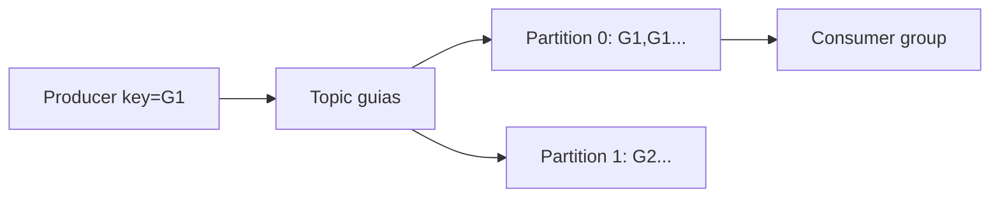
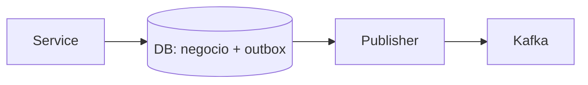

# Módulo 10: Kafka con Spring Boot

Kafka es un log distribuido para eventos/streams. Spring for Kafka integra productores y consumidores, pero el reto real es semántica de entrega: at-least-once, idempotencia, DLT, ordering por clave, outbox y evolución de esquemas.

**Entorno de referencia verificado (2026-05-22):** JDK 27.0.1.0.2, Maven 3.10.0, Spring Boot 3.5.0, Docker 29.9.3 disponible. Ejecuciones Kafka completas requieren broker; se marcan notas honestas.

## Aprende construyendo

### Tema 1: Productor, consumidor y claves de partición · Intermedio · 40 min

Caso guía: publicar eventos de guía y consumirlos en orden por `guiaId`.

#### Topic, partición, clave

**Definición formal.** Un topic es un log categorizado; particiones permiten paralelismo; la clave determina partición, preservando orden por clave.



**Ejemplo mínimo (concepto).**

```java
kafkaTemplate.send("guias", guiaId, payload);
```

**Error común.** Asumir orden global. Corrección: orden solo dentro de partición/clave.

### Tema 2: Idempotencia, retries y DLT · Avanzado · 45 min

Caso guía: consumidor falla por error transitorio y luego por mensaje inválido.

#### Retries y DLT

**Definición formal.** Retry reintenta procesamiento; DLT (Dead Letter Topic) recibe mensajes que no se pueden procesar tras política definida.

**Regla.** Distingue errores transitorios (retry) de permanentes (DLT). Consumidor debe ser idempotente por at-least-once.

**Error común.** Retry infinito o reintentar bug determinista. Corrección: backoff, max attempts, DLT, observabilidad.

**Nota de verificación.** Requiere broker Kafka; lab con Docker Compose/Testcontainers.

### Tema 3: Outbox, inbox y duplicados reales · Avanzado · 45 min

Caso guía: guardar en DB y publicar en Kafka sin perder consistencia.

#### Outbox

**Definición formal.** Patrón que escribe el evento en una tabla outbox en la misma transacción de negocio y un publisher lo envía después.



**Error común.** “Dual write” DB+Kafka sin coordinación. Corrección: outbox/inbox/idempotency.

### Tema 4: Evolución de esquemas y Schema Registry · Avanzado · 45 min

Caso guía: agregar campo a evento sin romper consumidores.

#### Evolución de esquema

**Definición formal.** Gestión versionada de schemas (Avro/Protobuf/JSON Schema) con reglas de compatibilidad (backward/forward/full).

**Error común.** Cambiar campo obligatorio sin default. Corrección: políticas de compatibilidad y registry.

**Nota de verificación.** Requiere Schema Registry; lab de infraestructura.

## Cierre

Kafka da throughput y desacoplamiento, pero exige diseñar por duplicados, orden por clave y evolución de contrato.

## Checklist

- Diseño clave de partición por orden requerido.
- Hago consumidores idempotentes.
- Uso DLT para errores permanentes.
- Uso outbox para consistencia DB-evento.
