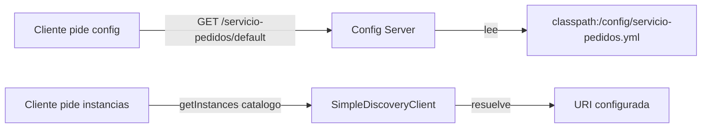
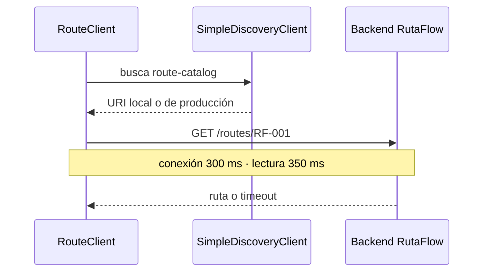
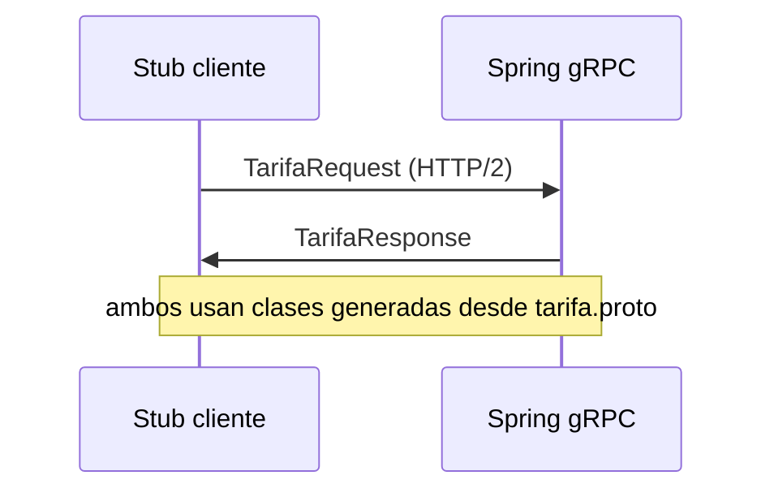
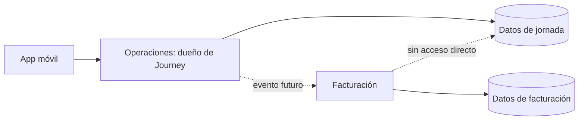
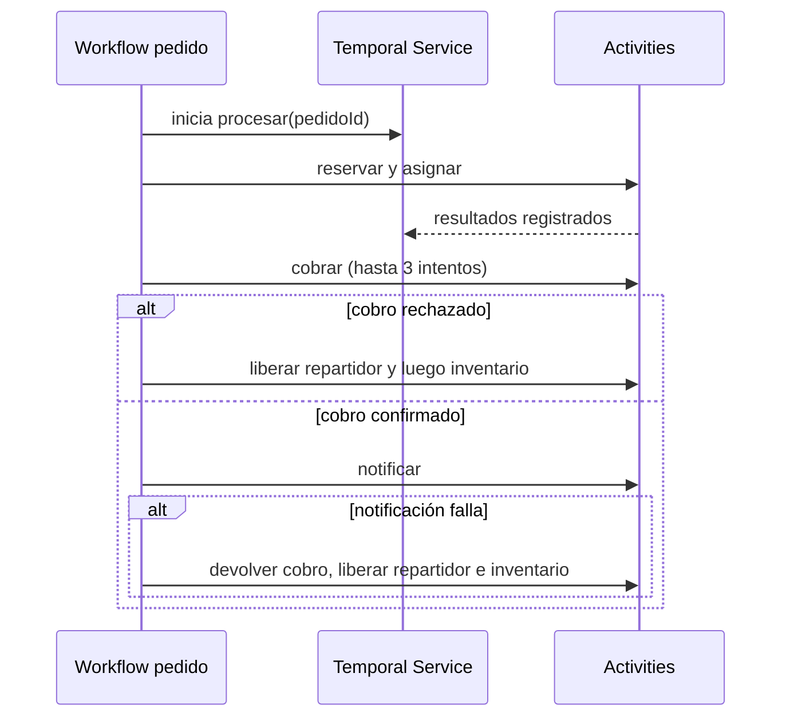

# Módulo 10: Microservicios con Spring Cloud


## Aprende construyendo

Cada tema demuestra un patrón de Spring Cloud con verificación real: config server nativo servido por HTTP, `SimpleDiscoveryClient` real de Spring Cloud Commons, Gateway enrutando de verdad contra un backend embebido, un `CircuitBreaker` de Resilience4j abriéndose por conteo real de fallos, seguridad de recurso probada con el post-processor oficial de `spring-security-test`, y un deadline HTTP real medido en milisegundos. Continúa sobre el proyecto `demo-cloud`.

### Tema 1: Config Server y service discovery

**Duración estimada:** 35 min.
**¿Por qué es importante?** Un Config Server entrega valores por aplicación y perfil; un DiscoveryClient resuelve nombres de servicio a direcciones sin fijar la URL en cada consumidor.
**Prerrequisitos:** Spring Boot M0 T1 y saber iniciar una app web. El laboratorio usa Boot 4.1.2, Java 25 y Spring Cloud 2025.1.4; Spring Cloud requiere la versión 2025.1.2 o posterior para Boot 4.1.x. Si generas otra versión, revisa la matriz antes de mezclar dependencias.
**Proyecto continuo:** crear un servicio de pedidos que obtiene su configuración y resuelve una instancia de catálogo.

#### Subtema 1.1: Sirve configuración desde archivos · 15 min

**1. Contexto**
Un servicio de pedidos debe obtener un valor compartido por HTTP para que puedas cambiarlo sin editar su código fuente.

**2. Hazlo tú**
Crea el proyecto `demo-config-server` con Spring Initializr, Java 25 y las dependencias web y `cloud-config-server`. Spring Initializr selecciona el BOM compatible. Para ejecutar la versión comprobada que acompaña este curso, usa `examples/spring-cloud-config-discovery-rutaflow/` desde la raíz del repositorio:

```bash
cd examples/spring-cloud-config-discovery-rutaflow
./mvnw -q clean test
```

Inspecciona `src/main/resources/application.yml`. Esta es la configuración completa del laboratorio; `accept-empty: false` permite distinguir una app sin archivos con un 404:

```yaml
server:
  port: 8888
spring:
  application:
    name: config-server
  cloud:
    config:
      server:
        native:
          search-locations: classpath:/config
  profiles:
    active: native
```

Crea src/main/resources/config/servicio-pedidos.yml:

```yaml
pedidos:
  descuento-maximo: 15
```

Reemplaza src/main/java/com/example/democonfigserver/DemoConfigServerApplication.java por:

```java
package com.example.democonfigserver;

import org.springframework.boot.SpringApplication;
import org.springframework.boot.autoconfigure.SpringBootApplication;
import org.springframework.cloud.config.server.EnableConfigServer;

@EnableConfigServer
@SpringBootApplication
public class DemoConfigServerApplication {
    public static void main(String[] args) {
        SpringApplication.run(DemoConfigServerApplication.class, args);
    }
}
```

Desde la carpeta del laboratorio, arranca la aplicación:

```bash
./mvnw spring-boot:run
```

En otra terminal, consulta el perfil default:

```bash
curl -i http://localhost:8888/servicio-pedidos/default
```

**Resultado esperado:** las pruebas pasan y HTTP devuelve 200 con un Environment que incluye `descuento-maximo` con valor 15. Para ver el JSON, ejecuta `./mvnw spring-boot:run` y en otra terminal repite el `curl`.

**Fallo deliberado:** cambia `search-locations` a `classpath:/configs` y ejecuta otra vez `./mvnw -q test`. **Error esperado:** falla la prueba HTTP porque el servidor no encuentra el YAML. **Diagnóstico:** el archivo está en `src/main/resources/config`, pero el servidor busca `configs`; restaura `classpath:/config`.

**3. Entiende**
El perfil native permite leer archivos del classpath o del sistema de archivos sin un remoto Git. La ruta HTTP combina el nombre de aplicación y el perfil para construir el Environment que recibe el cliente.

**4. Cierra**
Guarda la respuesta de curl y señala la propiedad que leyó el servidor.

#### Subtema 1.2: Separa configuración por perfil y diagnostica una app desconocida · 10 min

**1. Contexto**
El descuento permitido puede cambiar entre desarrollo y producción; un nombre de aplicación mal escrito debe diagnosticarse mirando el Environment que devolvió el servidor.

**2. Hazlo tú**
Abre `src/main/resources/config/servicio-pedidos-produccion.yml`, que ya contiene esta configuración, y compárala con `servicio-pedidos.yml`:

```yaml
pedidos:
  descuento-maximo: 5
```

Consulta las dos rutas:

```bash
curl -s http://localhost:8888/servicio-pedidos/default
curl -s http://localhost:8888/servicio-pedidos/produccion
curl -i http://localhost:8888/servicio-inexistente/default
```

**Resultado esperado:** default informa 15 y produccion informa 5. Con la configuración predeterminada, el nombre inexistente puede responder 200 con un Environment sin propertySources útiles.

En este laboratorio, `accept-empty: false` hace que la ruta de aplicación desconocida devuelva 404; `sirveConfiguracionDefaultYProduccionPorHttp` prueba los dos perfiles y `rechazaUnNombreDeAplicacionQueNoTieneArchivo` comprueba ese caso.

**Fallo deliberado:** cambia la ruta del perfil `produccion` a `producion`. **Resultado erróneo esperado:** la propiedad no toma el valor 5. **Diagnóstico:** compara el nombre escrito en la URL con el sufijo del archivo; restaura `produccion`. En el laboratorio el nombre desconocido devuelve 404 por `spring.cloud.config.server.accept-empty: false`.

**3. Entiende**
El perfil corresponde al sufijo del archivo, por ejemplo `servicio-pedidos-produccion.yml`. El Config Server puede aceptar una configuración vacía; para que el cliente detecte un ID no encontrado, este laboratorio establece `accept-empty: false`.

**4. Cierra**
Entrega las dos respuestas válidas y explica por qué la respuesta de una app desconocida debe inspeccionarse.

#### Subtema 1.3: Resuelve una instancia por nombre lógico · 10 min

**1. Contexto**
El servicio de pedidos debe encontrar catálogo mediante su nombre de servicio y una dirección configurada, sin guardar esa URL dentro de su código.

**2. Hazlo tú**
Abre `src/test/java/academia/rutaflow/cloud/ConfigServerAndDiscoveryTest.java` y localiza `resuelveInstanciaCatalogoConSimpleDiscoveryClient`. Ejecuta el test desde la carpeta del laboratorio:

```java
package com.example.democonfigserver;

import java.util.List;
import org.junit.jupiter.api.Test;
import org.springframework.beans.factory.annotation.Autowired;
import org.springframework.boot.test.context.SpringBootTest;
import org.springframework.cloud.client.ServiceInstance;
import org.springframework.cloud.client.discovery.DiscoveryClient;

import static org.assertj.core.api.Assertions.assertThat;

@SpringBootTest(properties =
    "spring.cloud.discovery.client.simple.instances.catalogo[0].uri=http://localhost:8081")
class DiscoveryClientTest {
    @Autowired
    private DiscoveryClient discoveryClient;

    @Test
    void encuentraLaInstanciaConfiguradaPorNombre() {
        List<ServiceInstance> instancias = discoveryClient.getInstances("catalogo");

        assertThat(instancias).hasSize(1);
        assertThat(instancias.get(0).getUri().toString())
            .isEqualTo("http://localhost:8081");
    }
}
```

Desde la raíz del proyecto, ejecuta:

```bash
./mvnw -q -Dtest=ConfigServerAndDiscoveryTest#resuelveInstanciaCatalogoConSimpleDiscoveryClient test
```

**Resultado esperado:** BUILD SUCCESS y una instancia cuyo URI es http://localhost:8081.

**Fallo deliberado:** cambia `getInstances("catalogo")` por `getInstances("pedidos")` y ejecuta el test de nuevo. **Error esperado:** la aserción falla porque no existe una instancia con ese nombre lógico. **Diagnóstico:** el ID consultado debe coincidir con la clave `catalogo` en `spring.cloud.discovery.client.simple.instances` de `application.yml`.

**3. Entiende**
SimpleDiscoveryClient obtiene instancias desde propiedades y permite probar el contrato DiscoveryClient sin operar un registro como Eureka o Consul. En producción el mecanismo de registro se selecciona según las necesidades de despliegue; este laboratorio solo demuestra la resolución por nombre.

**4. Cierra**
Entrega el resultado de la prueba y escribe el nombre lógico y la URI que resolvió.

**Hito del tema:**

- [ ] Levanté un Config Server native y serví un YAML por HTTP.
- [ ] Comparé configuración default y de producción.
- [ ] Diagnostiqué el resultado vacío para una aplicación inexistente.
- [ ] Resolví una URI mediante DiscoveryClient y SimpleDiscoveryClient.

**Diagrama del flujo:**



**Fuentes oficiales:** [matriz de compatibilidad de Spring Cloud](https://spring.io/projects/spring-cloud), [backend nativo de Config Server](https://docs.spring.io/spring-cloud-config/reference/server/environment-repository/file-system-backend.html), [Environment y perfiles](https://docs.spring.io/spring-cloud-config/reference/server/environment-repository.html) y [SimpleDiscoveryClient](https://docs.spring.io/spring-cloud-commons/reference/spring-cloud-commons/common-abstractions.html).

**Transferencia al proyecto integrador:** carga el descuento desde configuración externa y resuelve por nombre la instancia del servicio que administra catálogo.

### Tema 2: Spring Cloud Gateway

El gateway recibe una petición y la reenvía al servicio elegido. En este tema vas a levantar dos procesos locales y comprobarlo con `curl`.

**¿Por qué es importante?** Con un gateway puedes ofrecer una dirección de entrada estable aunque los servicios vivan en procesos distintos. Cada petición debe llegar al servicio correcto y el servicio debe seguir autorizando sus propios datos.

**Prerrequisitos:** M10 T1 y saber iniciar una app Spring Boot. El ejemplo verificado usa Java 25, Boot 4.1.2 y Cloud 2025.1.4; para Boot 4.1.x la matriz de Spring Cloud pide la línea 2025.1.2 o posterior. Gateway WebFlux necesita Netty y WebFlux, no una app Servlet.
**Laboratorio del tema:** `examples/spring-gateway-rutaflow/`. Ejecuta sus pruebas desde esa carpeta con `./mvnw -q clean test`; las rutas y el servicio HTTP local se comprueban sin instalar otro servicio.

#### Subtema 2.1: Crea una ruta para pedidos · 15 min

**1. Contexto**

Piensa en el gateway como una recepción: mira la dirección solicitada y decide a qué servicio entregarla. Aquí `/api/pedidos/**` se envía al servicio que escucha en el puerto `8081`.

**2. Hazlo tú**

Crea un proyecto Spring Boot con el starter oficial `org.springframework.cloud:spring-cloud-starter-gateway-server-webflux` y el Spring Cloud BOM compatible con Boot. En `src/main/resources/application.yml`, escribe:

```yaml
server:
  port: 8080
spring:
  cloud:
    gateway:
      server:
        webflux:
          routes:
            - id: pedidos
              uri: http://localhost:8081
              predicates:
                - Path=/api/pedidos/**
```

En `backend.py`, crea un backend pequeño para ver qué petición recibe:

```python
from http.server import BaseHTTPRequestHandler, HTTPServer

class Pedidos(BaseHTTPRequestHandler):
    def do_GET(self):
        print("Ruta recibida:", self.path)
        self.send_response(200)
        self.send_header("Content-Type", "application/json")
        self.end_headers()
        self.wfile.write(b'{"id":1,"estado":"EN_RUTA"}')

HTTPServer(("localhost", 8081), Pedidos).serve_forever()
```

Ejecuta el backend con `python3 backend.py`; en otra terminal ejecuta `./mvnw spring-boot:run` desde el proyecto del gateway. Envía `curl -i http://localhost:8080/api/pedidos/1`.

**Resultado esperado:** la respuesta es `200` con `{"id":1,"estado":"EN_RUTA"}` y el backend imprime `/api/pedidos/1`.

**Fallo deliberado:** en `src/main/resources/application.yml`, cambia `uri` a `http://localhost:8082` y repite el `curl`. **Resultado esperado:** recibes `5xx` y no aparece una petición en el backend del puerto `8081`. **Diagnóstico:** la ruta coincidió, pero el destino no escucha en ese puerto; restaura `8081`.

**3. Entiende**

`Path` decide si la ruta coincide; `uri` indica el destino. El gateway reenvía el mismo path porque todavía no configuramos ningún filtro para cambiarlo.

**4. Cierra**

Guarda la respuesta de `curl` y la línea del backend como evidencia. Esas dos señales confirman que la respuesta atravesó ambos procesos.

#### Subtema 2.2: Cambia el path que recibe el servicio · 10 min

**1. Contexto**

El cliente puede usar `/api/pedidos/1` mientras que el servicio espera `/pedidos/1`. El filtro `StripPrefix=1` quita el primer segmento (`api`) antes de reenviar.

**2. Hazlo tú**

En `src/main/resources/application.yml`, agrega el filtro dentro de la misma ruta:

```yaml
              filters:
                - StripPrefix=1
```

Haz que `backend.py` responda solo cuando recibe `/pedidos/1`; para cualquier otro path responde `404`:

```python
        if self.path != "/pedidos/1":
            self.send_error(404)
            return
```

Reinicia el backend y prueba `curl -i http://localhost:8080/api/pedidos/1`.

**Resultado esperado:** `curl` recibe `200`; el backend imprime `/pedidos/1`. Si llamas al backend directamente con `/api/pedidos/1`, devuelve `404`.

**Fallo deliberado:** en `src/main/resources/application.yml`, cambia temporalmente `StripPrefix=1` por `StripPrefix=2`. Repite el `curl`. **Resultado esperado:** el backend imprime `/1` y devuelve `404`. **Diagnóstico:** el filtro quitó dos segmentos y el backend espera `/pedidos/1`; restablece `StripPrefix=1`.

**3. Entiende**

El filtro solo transforma el path en el salto del gateway al servicio. El cliente sigue usando `/api/pedidos/1`; el contrato interno del backend puede ser distinto.

**4. Cierra**

Anota ambos paths y explica en una frase dónde se quitó `api`: el registro del backend debe mostrar `/pedidos/1`.

#### Subtema 2.3: Diagnostica una ruta que no coincide · 10 min

**1. Contexto**

Una letra distinta en el predicado puede hacer que la petición no llegue al backend. Primero separa “no hubo ruta” de “el backend respondió con error”.

**2. Hazlo tú**

En `src/main/resources/application.yml`, cambia temporalmente `Path=/api/pedidos/**` por `Path=/api/entregas/**`. Ejecuta:

```bash
curl -i http://localhost:8080/api/pedidos/1
```

Mira si aparece una nueva línea en la terminal del backend. Luego revierte el cambio y repite.

**Resultado esperado:** con el path desalineado el gateway devuelve `404` y el backend no imprime una petición nueva; al restaurar `/api/pedidos/**`, llega al backend y vuelve `200`.

**Fallo deliberado:** deja configurado `Path=/api/entregas/**` e intenta diagnosticar solo mirando el `404`, sin mirar la terminal del backend. **Diagnóstico:** la respuesta por sí sola no identifica quién la produjo; comprueba si el backend recibió una petición y luego restaura el path de pedidos.

**3. Entiende**

Un `404` puede venir del gateway o del servicio. La línea del backend te ayuda a saber si la petición alcanzó el servicio. En producción, el gateway puede centralizar autenticación de entrada y trazas, pero cada servicio debe autorizar el acceso a los datos que posee.

**4. Cierra**

Conserva dos evidencias: respuesta y log del caso correcto; respuesta y ausencia de log del fallo deliberado. El siguiente tema protege llamadas entre servicios cuando el destino falla.

**Fuentes oficiales:** [matriz de compatibilidad Spring Cloud](https://spring.io/projects/spring-cloud), [starter y requisitos de Gateway WebFlux](https://docs.spring.io/spring-cloud-gateway/reference/spring-cloud-gateway-server-webflux/starter.html), [rutas y configuración](https://docs.spring.io/spring-cloud-gateway/reference/spring-cloud-gateway-server-webflux/configuration.html).

**Cuándo usarlo:** cuando varios servicios necesitan un punto de entrada con rutas compartidas. Si solo publicas un servicio sencillo, añade el gateway cuando exista una necesidad concreta de enrutamiento o políticas transversales.

### Tema 3: Circuit breaker con Resilience4j

**Duración:** 30 min. **Prerrequisitos:** Java `Supplier`, excepciones y códigos HTTP; M10 T1 da el contexto del servicio, pero Gateway no es requisito para comprender el circuito. El laboratorio usa Resilience4j 2.4.0 con Java 21+.
**Proyecto continuo:** RutaFlow protege la consulta HTTP de pedidos cuando el servicio responde con error.

**¿Por qué es importante?** Si cada petición espera hasta el timeout de un servicio caído, las llamadas pendientes consumen recursos y el fallo se propaga. El laboratorio usa un servicio HTTP local que responde 503 o 200; el circuito cuenta solicitudes HTTP, no solo excepciones inventadas en memoria.

#### Subtema 3.1: Abre el circuito después de cuatro fallos · 10 min

**1. Contexto**
El circuito mide resultados. No se abre por un solo fallo si todavía no alcanza el mínimo de llamadas configurado.

**2. Hazlo tú**
Abre `examples/spring-resilience-rutaflow/src/main/java/academia/rutaflow/resilience/CircuitBreakerConfiguration.java` y lee los dos límites `slidingWindowSize` y `minimumNumberOfCalls`. Ejecuta desde `examples/spring-resilience-rutaflow/`:

```bash
./mvnw -Dtest=CircuitBreakerBehaviorTest#abreDespuesDeCuatroFallosYBloqueaLaQuintaLlamada test
```

**Resultado esperado:** cuatro respuestas HTTP 503 medidas ponen el estado en `OPEN`; la prueba muestra cuatro solicitudes recibidas por el servicio local.

**Fallo deliberado:** en `newCircuitBreaker()`, cambia ambos valores `slidingWindowSize(4)` y `minimumNumberOfCalls(4)` a `10`, y vuelve a ejecutar la prueba. **Resultado esperado:** falla la expectativa `OPEN`, porque cuatro respuestas no llenan la ventana de diez. **Diagnóstico:** para una ventana por cantidad, Resilience4j limita el mínimo al tamaño de la ventana; si solo cambias el mínimo a 10 y la ventana sigue en 4, el mínimo efectivo sigue siendo 4. Restaura los dos valores a 4.

**3. Entiende**
La ventana guarda resultados recientes. El mínimo indica cuántos resultados hacen falta antes de decidir si el circuito abre.

**4. Cierra**
Anota el umbral, tamaño de ventana y cantidad mínima de llamadas.

#### Subtema 3.2: Comprueba que OPEN detiene llamadas reales · 10 min

**1. Contexto**
El circuito debe rechazar rápido cuando está abierto, sin volver a invocar el servicio que ya está fallando.

**2. Hazlo tú**
Abre `examples/spring-resilience-rutaflow/src/main/java/academia/rutaflow/resilience/PedidosClient.java` y localiza `executeSupplier`. Ejecuta desde `examples/spring-resilience-rutaflow/`:

```bash
./mvnw -Dtest=CircuitBreakerBehaviorTest#openImpideLaQuintaPeticionHttpAlBackend test
```

**Resultado esperado:** la quinta llamada lanza `CallNotPermittedException` y el contador permanece en `4`.

**Fallo deliberado:** en `PedidosClient.consultarPedido()`, cambia `return circuitBreaker.executeSupplier(this::solicitarPedido);` por `return solicitarPedido();`. **Resultado esperado:** la quinta solicitud también alcanza el backend y el contador llega a `5`; la prueba falla porque esperaba el mensaje de circuito abierto y solo cuatro visitas al backend. **Diagnóstico:** retiraste el circuito de la llamada; restaura `executeSupplier`.

**3. Entiende**
`OPEN` no repara el servicio remoto. Deja de enviarle llamadas y protege recursos locales; se puede combinar con timeout y fallback. La prueba cuenta solicitudes HTTP a un servidor local; no es una prueba distribuida ni de carga.

**4. Cierra**
Conserva el error de llamada bloqueada y explica qué valor comprobó el contador.

#### Subtema 3.3: Prueba recuperación en HALF_OPEN · 10 min

**1. Contexto**
Tras una pausa, el circuito permite unas pocas llamadas de prueba para saber si el servicio ya se recuperó.

**2. Hazlo tú**
Abre `examples/spring-resilience-rutaflow/src/test/java/academia/rutaflow/resilience/CircuitBreakerBehaviorTest.java` y ejecuta desde `examples/spring-resilience-rutaflow/`:

```bash
./mvnw -Dtest=CircuitBreakerBehaviorTest#vuelveACerradoCuandoLasDosLlamadasDePruebaTienenExito test
```

En esta prueba, `transitionToHalfOpenState()` fuerza la transición para no esperar el minuto configurado. La prueba verifica las solicitudes de recuperación, no el temporizador automático.

**Resultado esperado:** la prueba fuerza `HALF_OPEN`; dos respuestas correctas devuelven el estado a `CLOSED`.

**Fallo deliberado:** en `CircuitBreakerBehaviorTest.java`, después de la primera solicitud HTTP correcta, agrega `respuestaBackend = 503;` antes de la segunda. **Resultado esperado:** la segunda llamada falla y el circuito vuelve a abrir; falla la expectativa de respuesta 200 y de estado `CLOSED`. **Diagnóstico:** las dos llamadas permitidas durante HALF_OPEN deben tener éxito; elimina la línea añadida.

**3. Entiende**
La secuencia es `CLOSED → OPEN → HALF_OPEN → CLOSED` cuando la recuperación tiene éxito. En producción el temporizador y las métricas observan esos cambios.

**4. Cierra**
Dibuja los estados y registra cuántas llamadas se permiten en la prueba de recuperación.

**Hito del tema:**

- [ ] Cuatro fallos medidos abren el circuito.
- [ ] `OPEN` bloquea la quinta llamada antes de llegar al servicio.
- [ ] Dos llamadas de prueba exitosas cierran el circuito.
- [ ] Expliqué que el circuito limita fallos, no repara el servicio.

**Proyecto integrador:** protege la consulta de pedidos de RutaFlow y registra el fallback que verá la persona usuaria cuando el circuito esté abierto.

**Fuentes oficiales:** [Resilience4j CircuitBreaker](https://resilience4j.readme.io/docs/circuitbreaker), [configuración de Resilience4j 2.4.0](https://github.com/resilience4j/resilience4j/blob/v2.4.0/resilience4j-circuitbreaker/src/main/java/io/github/resilience4j/circuitbreaker/CircuitBreakerConfig.java) y [Spring Cloud CircuitBreaker con Resilience4j](https://docs.spring.io/spring-cloud-circuitbreaker/reference/spring-cloud-circuitbreaker-resilience4j.html). El laboratorio integra el núcleo de Resilience4j como bean Spring; no usa el starter de Spring Cloud CircuitBreaker.

### Tema 4: OAuth2/OIDC, Keycloak y Token Relay sin perder la frontera de autorización

**Duración:** 45 min. **Prerrequisitos:** Spring Boot M4 de este track (Spring Security), métodos HTTP y lectura básica de JSON; M10 T2 se necesita para el cuarto subtema.

**¿Por qué es importante?** El Resource Server valida el token, pero el servicio debe decidir además qué acción y qué registro puede usar esa persona. Pasar por un gateway no sustituye esta decisión.

**Laboratorio:** `examples/spring-security-keycloak-rutaflow/`. El proyecto trae una app Boot, pruebas con tokens simulados, un realm importable y comandos para verificar tokens reales de Keycloak.

#### Subtema 4.1: Valida el emisor del token · 15 min

**1. Contexto**

Una firma válida no basta si el token lo emitió otro proveedor. El `issuer-uri` conecta el Resource Server con el documento OIDC y las claves públicas del realm que acepta.

**2. Hazlo tú**

Desde `examples/spring-security-keycloak-rutaflow/`, ejecuta las pruebas y revisa `src/main/resources/application.yml`:

```bash
./mvnw -q clean test
```

Para comprobar un issuer real, sigue en `README.md` las instrucciones para iniciar el realm local de Keycloak, solicitar el token de Ana y ejecutar la API. Sin bearer token, consulta `GET /api/pedidos/p-ana`; luego repite con el token.

**Resultado esperado:** las pruebas locales distinguen petición sin token (`401`) y token firmado por el realm (acceso permitido según las reglas). Con Keycloak levantado, Spring descubre el issuer y la API acepta la firma, vigencia y emisor del access token.

**Fallo deliberado:** cambia `http://localhost:8081/realms/rutaflow` por `/realms/realm-inexistente` en `application.yml`, inicia una petición con el token de Ana y observa el resultado. **Resultado esperado:** `401`; el decoder no puede validar el token contra el issuer indicado. Spring Security puede diferir la búsqueda OIDC hasta que recibe un bearer token, así que la app no necesariamente falla al iniciar. **Diagnóstico:** compara `iss` del token con `issuer-uri` y restaura el realm `rutaflow`.

**3. Entiende**

Spring Security obtiene metadatos y claves del issuer y valida la firma, expiración y claim `iss`. El test local usa un decoder simulado para probar autorización, así que no sustituye la llamada real a Keycloak.

**4. Cierra**

Guarda la respuesta sin token, la respuesta autenticada y el issuer exacto. Si Docker no está disponible, anota la verificación de Keycloak como pendiente; no marques la firma real como probada.

#### Subtema 4.2: Separa token válido de permiso de escritura · 10 min

**1. Contexto**

Luis puede presentar un token válido y aun así no tener permiso para guardar ubicaciones. El endpoint responde `403` porque identifica a Luis, pero su token no contiene el rol requerido.

**2. Hazlo tú**

Inspecciona `src/main/java/academia/rutaflow/security/ApiSecurity.java` y el realm `keycloak/rutaflow-realm.json`. Ejecuta cada prueba desde la carpeta del laboratorio:

```bash
./mvnw -q -Dtest=ApiSecurityTest#tokenSinRolDeEscrituraRecibe403 test
./mvnw -q -Dtest=ApiSecurityTest#rolDeEscrituraPermiteGuardarUbicacion test
```

La primera usa el bearer de prueba `luis`; la segunda usa `ana`, quien tiene el rol realm `location:write`.

**Resultado esperado:** Luis recibe `403`; Ana recibe `200`. La configuración convierte `realm_access.roles` de Keycloak en una autoridad Spring `ROLE_location:write` y la compara con la regla del POST.

**Fallo deliberado:** cambia `.hasAuthority("ROLE_location:write")` por `.permitAll()` y ejecuta la prueba de Luis. **Resultado esperado:** falla, porque ahora puede escribir. **Diagnóstico:** autenticar a una persona no le concede el rol; restaura la regla de autoridad.

**3. Entiende**

`401` indica que falta un token aceptado; `403` indica que el token fue aceptado, pero no cumple la regla de permiso. Este ejemplo usa un rol realm de Keycloak; scopes OAuth y roles son claims distintos.

**4. Cierra**

Registra el usuario, el claim/rol y la respuesta HTTP de ambos casos.

#### Subtema 4.3: Comprueba que el pedido pertenece al sujeto del token · 10 min

**1. Contexto**

El rol permite consultar pedidos, pero no todos los pedidos. El servicio debe comparar el sujeto autenticado con el propietario del registro antes de devolverlo.

**2. Hazlo tú**

Lee `PedidoOwnership.java` y `RutaflowApiController.java`. Ejecuta desde la carpeta del laboratorio:

```bash
./mvnw -q -Dtest=ApiSecurityTest#tokenSoloLeePedidosDeSuSubject test
```

La prueba usa `sub=ana`: `p-ana` pertenece a Ana y `p-luis` a otra persona. En una llamada real, sigue el README para configurar el `sub` de Ana que Keycloak emitió.

**Resultado esperado:** Ana obtiene `200` para `p-ana` y `403` para `p-luis`.

**Fallo deliberado:** comenta `pedidoOwnership.requireOwner(jwt.getSubject(), id)` y ejecuta el test. **Resultado esperado:** Ana también recibe `200` para `p-luis`; la prueba falla. **Diagnóstico:** autenticación y rol no prueban propiedad del registro; restaura la comprobación antes de responder.

**3. Entiende**

`sub` identifica al sujeto del token; no uses un nombre visible como clave permanente de propiedad. En el laboratorio los pedidos son datos en memoria para hacer visible la regla; una API real consulta el dueño persistido en su almacén.

**4. Cierra**

Entrega las dos respuestas y explica qué comprobación produce el 403 por propietario. Las pruebas automáticas usan un decoder de mentira controlada; solo el recorrido de README con Keycloak verifica firma e issuer reales.

#### Subtema 4.4: Reenvía el access token desde el Gateway · 10 min

**1. Contexto**

Tras iniciar sesión en el gateway, este puede pasar el access token a la API que protege sus propios recursos. El gateway no convierte ese token en autorización para todos los pedidos.

**2. Hazlo tú**

Abre `examples/spring-token-relay-rutaflow/src/main/resources/application.yml` y busca el filtro `TokenRelay=`. Revisa también el starter OAuth2 Client en su `pom.xml`. Levanta Keycloak y la API según `examples/spring-security-keycloak-rutaflow/README.md`; luego inicia Gateway desde `examples/spring-token-relay-rutaflow/`:

```bash
./mvnw spring-boot:run
```

Abre `http://localhost:8082/api/pedidos/p-ana`, inicia sesión como Ana y después solicita `/api/pedidos/p-luis`.

**Resultado esperado:** Ana entra y la API responde por `p-ana`; la API devuelve `403` para `p-luis`, aunque el token haya pasado por el gateway.

**Fallo deliberado:** elimina temporalmente `- TokenRelay=` y repite la primera petición. **Resultado esperado:** Gateway completa el login, pero la API recibe la solicitud sin bearer token y devuelve `401`. **Diagnóstico:** la sesión del gateway no agrega por sí sola el token a la petición saliente; restaura el filtro.

**3. Entiende**

`TokenRelay` obtiene el access token de la sesión OAuth2 autorizada y lo coloca en la llamada al backend. La API vuelve a validar el issuer y firma, y decide el acceso al pedido.

**4. Cierra**

Guarda el resultado del pedido propio y ajeno. Este recorrido manual requiere Keycloak, navegador y API local; el repositorio documenta los pasos, pero esta sesión no pudo ejecutarlo sin Docker.

**Hito del tema:**

- [ ] Diferencié 401, 403 y permiso sobre un recurso propio.
- [ ] Vi que el rol realm llega bajo `realm_access.roles`.
- [ ] Validé la petición real con el issuer local, o dejé explícita esa comprobación pendiente.
- [ ] Expliqué por qué un gateway no reemplaza los permisos del servicio.
- [ ] Vi que Token Relay entrega un token, pero la API conserva la autorización del recurso.

**Fuentes oficiales:** [Resource Server JWT de Spring Security](https://docs.spring.io/spring-security/reference/servlet/oauth2/resource-server/jwt.html), [administración de roles y tokens de Keycloak](https://www.keycloak.org/docs/26.8.1/server_admin/), [contenedor e importación de realms](https://www.keycloak.org/server/containers) y [TokenRelay de Spring Cloud Gateway](https://docs.spring.io/spring-cloud-gateway/reference/spring-cloud-gateway-server-webflux/gatewayfilter-factories/tokenrelay-factory.html).

### Tema 5: HTTP Interfaces, deadlines y descubrimiento según el entorno

**Duración:** 40 min. **Prerrequisitos:** Módulo 9 (WebClient), Tema 1 de este módulo (service discovery).

**Meta observable:** declara un cliente con `@HttpExchange`, llama a un servicio por su nombre lógico y demuestra con una medición que el timeout corta una respuesta lenta.

**¿Por qué es importante?** Una dependencia lenta puede retener recursos y retrasar una entrega; saber a qué instancia llamar y cuánto esperar permite reaccionar con límites explícitos.

**Laboratorio:** `examples/spring-http-deadline-rutaflow/`. No necesita Docker ni un servicio externo.



#### Subtema 5.1: Declara el contrato HTTP · 10 min

**1. Contexto**

La interfaz deja visible qué operación llama RutaFlow; Spring construye el cliente que ejecuta la petición.

**2. Hazlo tú**

Desde la carpeta del laboratorio, ejecuta:

```bash
./mvnw -q -Dtest=RouteClientDeadlineTest#interfaceHttpLlegaAlServicioEncontradoPorElNombre test
```

Después abre `src/main/java/academia/rutaflow/http/RouteClient.java`:

```java
@HttpExchange("/routes")
public interface RouteClient {
    @GetExchange("/{id}")
    String find(@PathVariable("id") String id);
}
```

**Resultado esperado:** prueba en verde y texto `ruta RF-001` recibido desde el servidor HTTP local.

**3. Entiende**

La interfaz es el contrato. La prueba verifica el proxy real y el cuerpo HTTP; no simula el método cliente.

**4. Cierra**

Di qué URL completa corresponde a `find("RF-001")`.

#### Subtema 5.2: Corta la espera de una respuesta lenta · 15 min

**1. Contexto**

El tiempo de conexión y el de lectura cubren momentos diferentes: abrir comunicación con el servidor y esperar los datos.

**2. Hazlo tú**

Inspecciona `RouteClientConfiguration.java`. Ejecuta:

```bash
./mvnw -q -Dtest=RouteClientDeadlineTest#timeoutDeLecturaCortaLaRespuestaLenta test
```

```java
HttpClientSettings.defaults()
    .withTimeouts(Duration.ofMillis(300), Duration.ofMillis(350));
```

**Resultado esperado:** el backend tarda 900 ms; el cliente recibe `ResourceAccessException` y la medición con `System.nanoTime()` queda bajo 750 ms.

**Fallo deliberado:** elimina `.withTimeouts(...)` y repite el test. Debe fallar: el backend responde antes de que el test alcance el límite esperado. Restaura el timeout.

**3. Entiende**

`HttpClientSettings` forma parte de `spring-boot-http-client` en el laboratorio. Un timeout de lectura limita la espera de respuesta; no equivale por sí solo a un presupuesto extremo a extremo para varias llamadas y reintentos.

**4. Cierra**

Anota el timeout configurado y el tiempo observado. No copies esos valores de demostración a producción sin medir el servicio.

#### Subtema 5.3: Resuelve el nombre del servicio por entorno · 10 min

**1. Contexto**

El cliente usa `route-catalog`; la ubicación física puede cambiar entre desarrollo y producción.

**2. Hazlo tú**

Lee `src/main/resources/application.yml` y ejecuta la prueba de `RouteClientDeadlineTest` que llama al nombre lógico. La prueba asigna al `SimpleDiscoveryClient` la URI del servidor local; el `RestClient` lleva `@LoadBalanced`.

**Resultado esperado:** `http://route-catalog/routes/RF-001` termina en el servidor local y devuelve `ruta RF-001`.

**Fallo deliberado:** cambia `route-catalog` en `RouteClientConfiguration.java` por `catalogo-inexistente`. La prueba debe fallar al no encontrar una instancia. Restaura el ID.

**3. Entiende**

`SimpleDiscoveryClient` lee instancias declaradas en configuración; no es un registro que detecta servicios automáticamente. El perfil `produccion` requiere `RUTAFLOW_CATALOG_URL`.

**4. Cierra**

**Analogía:** `route-catalog` es como un nombre en la agenda; discovery busca su dirección actual y el cliente llama ahí.

Escribe el nombre lógico y la URI física que resolvió el test. Explica qué componente elegiría otra instancia si configuraras varias.

#### Subtema 5.4: Ajusta el cliente al presupuesto de la operación · 5 min

**1. Contexto**

Un timeout excesivo mantiene recursos ocupados; uno demasiado corto corta respuestas válidas.

**2. Hazlo tú**

Como práctica independiente, añade un endpoint lento a la prueba y propone tiempos según el presupuesto de respuesta de una consulta de RutaFlow. Ejecuta:

```bash
./mvnw -q clean test
```

**Resultado esperado:** ambas pruebas pasan; registra el tiempo del caso lento y explica qué evidencia usarías para ajustar el límite en un servicio real.

**3. Entiende**

No agregues reintentos en varias capas sin calcular la latencia acumulada. Si la llamada no es idempotente, un reintento también puede repetir una operación.

**4. Cierra**

Entrega las dos pruebas en verde, el nombre lógico resuelto y el resultado del fallo deliberado restaurado.

**Fuentes oficiales:** [Spring HTTP Service Clients](https://docs.spring.io/spring-framework/reference/integration/rest-clients.html#rest-http-interface), [Spring Boot 4.1: clientes y timeouts](https://docs.spring.io/spring-boot/reference/io/rest-client.html), [HttpClientSettings 4.1.2](https://docs.spring.io/spring-boot/api/java/org/springframework/boot/http/client/HttpClientSettings.html) y [Spring Cloud Discovery y LoadBalancer](https://docs.spring.io/spring-cloud-commons/reference/spring-cloud-commons/common-abstractions.html).

Los límites de espera son una pieza del presupuesto de latencia del proyecto integrador; se deben ajustar con observaciones del servicio, no por intuición.

### Tema 6: Spring gRPC, contrato HTTP/2 y evolución segura

**Duración:** 40 min. **Prerrequisito:** Tema 5 de este módulo. **Meta observable:** genera Java desde un `.proto`, publica un servicio Spring gRPC y llama al stub por un canal TCP local.

**¿Por qué es importante?** Dos servicios necesitan acordar sus mensajes y cómo cambian con el tiempo. El contrato generado reduce conversiones manuales; un cambio inseguro puede romper clientes que se despliegan después.

**Laboratorio:** `examples/spring-grpc-rutaflow/`. No mide rendimiento relativo contra REST/JSON.



#### Subtema 6.1: Define el mensaje y el método remoto · 10 min

**1. Contexto**

`.proto` describe los mensajes y el nombre del método; el compilador crea las clases Java para leer y escribir esos mensajes.

**2. Hazlo tú**

Abre `src/main/proto/tarifa.proto` y ejecuta desde la carpeta del laboratorio:

```bash
./mvnw -q generate-sources
```

La operación y sus mensajes se declaran así:

```protobuf
service TarifaService {
  rpc Calcular (TarifaRequest) returns (TarifaResponse);
}
message TarifaRequest { double distancia_km = 1; }
message TarifaResponse { double monto = 1; }
```

**Resultado esperado:** aparecen `TarifaRequest`, `TarifaResponse` y `TarifaServiceGrpc` bajo `target/generated-sources/`.

**Fallo deliberado:** cambia el nombre del método a `Cotizar` en el `.proto` sin cambiar la implementación. Regenera; la compilación del servicio falla porque el stub nuevo ya no ofrece `calcular`.

**3. Entiende**

El `.proto` es el acuerdo compartido. Los números de campo se envían por la red; los nombres ayudan a leer el código.

**4. Cierra**

Señala cuál archivo es fuente y cuál genera Java. Restaura `Calcular`.

#### Subtema 6.2: Expón la implementación en Spring · 10 min

**1. Contexto**

El servicio recibe distancia en kilómetros y devuelve el cálculo de demostración.

**2. Hazlo tú**

Lee `src/main/java/academia/rutaflow/grpc/TarifaServiceImpl.java` y sigue el `StreamObserver`: `onNext` envía el resultado y `onCompleted` cierra la respuesta.

```java
@GrpcService
class TarifaServiceImpl extends TarifaServiceGrpc.TarifaServiceImplBase {
    public void calcular(TarifaRequest req, StreamObserver<TarifaResponse> out) {
        out.onNext(TarifaResponse.newBuilder().setMonto(req.getDistanciaKm() * 1500).build());
        out.onCompleted();
    }
}
```

**Resultado esperado:** el bean `@GrpcService` implementa la clase base generada y calcula `10 × 1500 = 15000`.

**3. Entiende**

Spring Boot 4.1 aporta starters y autoconfiguración gRPC; usa Netty por defecto. La anotación registra el servicio generado como bean disponible para gRPC.

**4. Cierra**

Explica en una frase qué hace `onCompleted`. El precio del ejemplo es fijo y no representa una regla real de tarifas.

#### Subtema 6.3: Llama el stub por el canal · 10 min

**1. Contexto**

Compilar el contrato no demuestra que el servidor reciba la llamada. El test configura un cliente separado y un servidor en puerto TCP local.

**2. Hazlo tú**

Ejecuta:

```bash
./mvnw -q -Dtest=TarifaGrpcTest test
```

Abre `src/test/java/academia/rutaflow/grpc/TarifaGrpcTest.java`; el stub se importa con `@ImportGrpcClients` y el servidor escucha en un puerto libre.

**Resultado esperado:** el cliente gRPC recibe `monto=15000` para `distancia_km=10`.

**Fallo deliberado:** cambia el target del canal a otro puerto y ejecuta el test. Debe fallar al no poder conectar; restaura el target dinámico para evitar depender de un puerto ocupado.

**3. Entiende**

Esta prueba demuestra una llamada cliente-servidor por TCP local. No es un benchmark, no despliega dos procesos ni prueba un clúster.

**4. Cierra**

Entrega el resultado y explica qué parte demuestra generación y cuál demuestra transporte.

#### Subtema 6.4: Cambia el contrato sin romper datos · 10 min

**1. Contexto**

Un servicio móvil o retrasado puede conservar una versión anterior del cliente.

**2. Hazlo tú**

En una copia de `tarifa.proto`, cambia el significado de `distancia_km = 1` por millas manteniendo el tag 1. Predice qué leerá un cliente viejo y no publiques ese cambio. Luego añade un campo nuevo con tag 2.

**Resultado esperado:** el tag 1 conserva su significado; el cliente viejo puede ignorar el campo nuevo. Cuando elimines un campo, el `.proto` debe reservar su tag y su nombre.

**3. Entiende**

El wire format identifica campos por número. Reutilizar un tag puede hacer que un sistema viejo interprete el dato con el significado anterior y no detectar el error de negocio.

**4. Cierra**

Entrega `./mvnw -q clean test` en verde y una propuesta de evolución con `reserved`. La compatibilidad entre dos versiones de clientes debe validarse con contratos/versiones concretos.

**Cuándo conviene:** usa gRPC si el equipo necesita contratos tipados y llamadas internas en streaming o HTTP/2; mide carga y latencia antes de afirmar que es más rápido que HTTP/JSON. Para navegador o terceros que esperan REST, conserva una API HTTP adecuada.

**Proyecto integrador RutaFlow:** evalúa gRPC para la consulta interna de tarifas y compara latencia y costo operativo con el cliente HTTP del Tema 5 antes de adoptarlo.

**Fuentes oficiales:** [Spring Boot gRPC 4.1](https://docs.spring.io/spring-boot/reference/io/grpc.html), [Spring gRPC](https://docs.spring.io/spring-grpc/reference/) y [Protocol Buffers: evolución de mensajes](https://protobuf.dev/programming-guides/proto3/#updating).
### Tema 7: DDD para decidir límites y propiedad de datos

**Duración:** 35 min. **Prerrequisito:** Módulo 3 de este track (entidades y JPA). **Meta observable:** protege una regla de negocio dentro de un agregado y explica qué contexto es dueño de esos datos.

**¿Por qué es importante?** Separar tablas en servicios antes de entender el negocio produce llamadas circulares y cambios coordinados. Primero aclara las reglas y la propiedad; luego decide si realmente necesitas desplegar los módulos por separado.

**Laboratorio:** `examples/spring-ddd-rutaflow/`. Las pruebas no necesitan Spring, Kafka, HTTP ni base de datos.



El diagrama representa límites conceptuales; el laboratorio no publica eventos ni implementa esas bases de datos.

#### Subtema 7.1: Encuentra quién es dueño de la regla · 10 min

**1. Contexto**

Solo Operaciones decide si una jornada acepta nuevas posiciones. Facturación no debe editar la jornada para aplicar sus propias reglas.

**2. Hazlo tú**

Abre `src/main/java/academia/rutaflow/operations/Journey.java` y sigue `status`, `positions` y `record`.

```java
public void record(Position position) {
    if (status == JourneyStatus.CLOSED) throw new JourneyAlreadyClosed();
    positions.add(Objects.requireNonNull(position));
}
```

**Resultado esperado:** la regla está en `Journey`, junto a los datos que protege.

**3. Entiende**

Un agregado conserva consistencia en una frontera pequeña. El contexto delimitado define vocabulario y propiedad; no equivale a una tabla o paquete cualquiera.

**Analogía:** cada contexto cuida su propio archivador. Otro equipo puede recibir una copia acordada, pero no entrar a cambiar sus expedientes.

**4. Cierra**

Nombra el contexto dueño y la operación que protege la invariante.

#### Subtema 7.2: Prueba la invariante sin infraestructura · 10 min

**1. Contexto**

Una regla útil sigue siendo verificable sin arrancar servicios ni una base de datos.

**2. Hazlo tú**

Desde `examples/spring-ddd-rutaflow/`, ejecuta:

```bash
./mvnw -q -Dtest=JourneyTest#unaJornadaCerradaRechazaNuevasPosiciones test
```

Lee `src/test/java/academia/rutaflow/operations/JourneyTest.java`.

**Resultado esperado:** la jornada conserva una posición y el segundo registro lanza `JourneyAlreadyClosed`.

**Fallo deliberado:** quita la comprobación de `status` en `Journey.record` y repite el test. Falla porque el agregado deja registrar una posición luego del cierre. Restáurala.

**3. Entiende**

El test verifica el resultado observable de la regla, no el nombre de un método ni una descripción en un documento.

**4. Cierra**

Entrega el test en verde y la excepción que se esperaba antes de la mutación.

#### Subtema 7.3: Evita compartir almacenamiento entre contextos · 5 min

**1. Contexto**

Una foreign key de Facturación hacia la tabla de Operaciones acopla despliegues y datos aunque las aplicaciones estén separadas.

**2. Hazlo tú**

Ejecuta `./mvnw -q -Dtest=JourneyTest#laListaExpuestaNoPermiteModificarElAgregado test` y revisa que `positions()` devuelve `List.copyOf`.

**Resultado esperado:** modificar la lista recibida lanza `UnsupportedOperationException`; el agregado conserva su estado.

**3. Entiende**

Para colaborar, define un contrato o evento versionado con los datos que el otro contexto necesita. El laboratorio solo demuestra la propiedad dentro del agregado; no implementa publicación confiable ni persistencia.

**4. Cierra**

Escribe qué datos posee Operaciones y cuál copia mínima podría necesitar Facturación.

#### Subtema 7.4: Decide si separar el despliegue · 10 min

**1. Contexto**

Un límite de dominio no obliga por sí solo a crear otro proceso o servicio.

**2. Hazlo tú**

Como práctica independiente, añade una regla para una jornada vacía o valida rangos de latitud y longitud en `Position.java`; agrega un test y ejecuta la suite completa:

```bash
./mvnw -q clean test
```

**Resultado esperado:** las tres pruebas existentes y tu nueva prueba pasan.

**3. Entiende**

Mantén un monolito modular mientras los límites o los equipos sean inciertos. Extrae un servicio cuando propiedad de datos, despliegue, escala o autonomía de equipos compensen el costo de red y operación.

**4. Cierra**

Entrega los tests y una decisión explicada sobre qué módulo sería dueño de `Journey` en el proyecto integrador RutaFlow.

**Fuentes:** [Fowler — Aggregate](https://martinfowler.com/bliki/DDD_Aggregate.html) y el laboratorio ejecutable enlazado arriba.

### Tema 8: Orquestar pedidos con Temporal y Spring Boot

**Objetivo observable:** ejecutar un Workflow que reserva inventario, asigna repartidor, cobra y notifica; comprobar reintentos limitados y compensaciones en orden inverso ante un fallo final.

**¿Por qué es importante?** Si un pedido cruza inventario, asignación y pagos, una caída a mitad puede dejar recursos o dinero en un estado incorrecto. Temporal conserva el proceso y permite definir reintentos y acciones de compensación observables.

**Prerrequisitos:** clases e interfaces Java, excepciones, pruebas JUnit y beans de Spring. La Saga distribuida retoma el concepto del track; aquí se ejecuta en código.

**Evidencia del tema:** tres pruebas del [laboratorio de Temporal](../../../../examples/spring-temporal-rutaflow/): un fallo temporal que se recupera, un cobro rechazado tras agotar intentos y una notificación fallida después del cobro.



#### Subtema 8.1: Separa el plan de los efectos · 10 min

**1. Contexto**

Un Workflow conserva el orden del proceso. Una Activity realiza una tarea que puede tocar otro servicio, base de datos o proveedor de pagos. El Workflow debe ser determinista: no pongas dentro del plan llamadas HTTP, `Thread.sleep`, reloj del sistema ni estado mutable global.

**2. Hazlo tú**

Desde `examples/spring-temporal-rutaflow/`, abre `src/main/java/academia/rutaflow/temporal/PedidoWorkflow.java` y `PedidoActivities.java`. Ejecuta:

```bash
./mvnw -q -DskipTests package
```

Revisa el contrato: `PedidoWorkflow.procesar` devuelve el resultado de negocio; cada operación externa está declarada en `PedidoActivities`.

**Resultado esperado:** Maven termina con código 0 y compila ambos contratos.

**Fallo deliberado:** en `PedidoActivities.java`, cambia la declaración por `void reservarInventario(String pedidoId);` sin actualizar su implementación. El compilador debe señalar que la implementación ya no cumple la interfaz. Diagnóstico: la interfaz es el contrato entre el plan y el código que ejecuta el efecto.

**3. Entiende**

Temporal registra el historial de decisiones y resultados de Activities. Si un Worker reinicia, el servicio de Temporal puede reproducir el Workflow a partir del historial. Eso no guarda por arte de magia la base de datos de cada servicio: la durabilidad requiere un Temporal Service operativo y los efectos externos requieren sus propias garantías.

**4. Cierra**

Señala qué llamadas del proceso RutaFlow deben ser Activities y cuál es la decisión de orden que pertenece al Workflow.

#### Subtema 8.2: Registra Workers y código Spring · 10 min

**1. Contexto**

Una Task Queue es la cola lógica donde Temporal entrega trabajo. En esta integración, `workers` en las anotaciones identifica el nombre del Worker configurado; el `task-queue` del YAML determina qué cola atiende.

**2. Hazlo tú**

Revisa `PedidoWorkflowImpl.java`, `PedidoActivitiesImpl.java` y `src/main/resources/application.yml`. La configuración ejecutable del Worker es:

```yaml
spring:
  temporal:
    connection:
      target: local
    workers-auto-discovery:
      packages:
        - academia.rutaflow.temporal
    workers:
      - name: pedidos
        task-queue: pedidos
```

Las implementaciones marcan el mismo Worker, `@WorkflowImpl(workers = "pedidos")` y `@ActivityImpl(workers = "pedidos")`; la Activity es además un bean `@Component`. Para correr la aplicación completa necesitas un Temporal Server en `localhost:7233`.

**Resultado esperado:** al iniciar el Worker aparecen registros del Workflow y las Activities en la cola `pedidos`.

**Fallo deliberado:** quita `workers` del YAML y ejecuta `./mvnw test`. Spring indica que no encuentra el Worker llamado `pedidos`. **Diagnóstico:** la anotación referencia un nombre que debe estar definido como Worker; restaura la configuración y vuelve a ejecutar.

**3. Entiende**

Auto-discovery encuentra implementaciones dentro de los paquetes indicados; las anotaciones las relacionan con un Worker. Auto-discovery no crea el servidor de Temporal ni sustituye la definición de su cola.

**4. Cierra**

Escribe en una línea qué valor debe coincidir entre anotaciones y `name`, y qué valor configura la cola que escucha.

#### Subtema 8.3: Reintenta un error transitorio · 10 min

**1. Contexto**

Una API puede fallar temporalmente por red o límite de uso. Temporal puede reintentar una Activity con una política acotada; `maximumAttempts(3)` significa tres intentos totales, incluido el primero.

**2. Hazlo tú**

En `PedidoWorkflowImpl.java` observa `RetryOptions` y en `PedidoWorkflowTest.java` ejecuta solo la prueba de retry:

```bash
./mvnw -q -Dtest='PedidoWorkflowTest#retriesTransientFailureAndCompletes' test
```

`ActivityRecorder` hace fallar el primer cobro y deja pasar el segundo.

**Resultado esperado:** la respuesta comienza con `CONFIRMADO`, el cobro ocurre dos veces y la notificación se ejecuta; no hay compensaciones.

**Fallo deliberado:** cambia `setMaximumAttempts(3)` por `setMaximumAttempts(1)` y repite la prueba. Fallará porque se esperaba que el segundo intento completara el pago. **Diagnóstico:** inspecciona el resultado de `retriesTransientFailureAndCompletes`; el cobro terminó en el primer fallo al no quedar intentos disponibles. Restaura el límite de tres intentos.

**3. Entiende**

El límite evita reintentos infinitos, pero no garantiza que repetir un cobro sea seguro. Una Activity puede haber cobrado y perder la respuesta; el siguiente intento no sabe por sí solo si ocurrió el efecto. Envía una clave idempotente, por ejemplo `pedidoId`, al proveedor y consulta su resultado antes de repetir.

**4. Cierra**

Anota el número de intentos observado y una clave que haría idempotente una llamada real a pagos.

#### Subtema 8.4: Compensa solo lo que ya ocurrió · 15 min

**1. Contexto**

Una Saga no revierte automáticamente servicios externos. Cada compensación es una operación de negocio explícita, que también puede fallar y debe admitir repetición segura.

**2. Hazlo tú**

En `PedidoWorkflowImpl.java`, observa el orden: tras cada Activity exitosa se registra su compensación. Ejecuta las dos pruebas de fallo:

```bash
./mvnw -q -Dtest='PedidoWorkflowTest#permanentChargeFailureCompensatesInReverseOrder+notificationFailureAlsoRefundsTheSuccessfulCharge' test
```

La primera rechaza todos los intentos de cobro. La segunda permite cobrar pero hace fallar la notificación.

**Resultado esperado:** si el cobro no termina, se libera repartidor y luego inventario. Si falla la notificación tras cobrar, se devuelve el cobro, se libera repartidor y se libera inventario. Las verificaciones comparan el orden real registrado.

**Fallo deliberado:** mueve `saga.addCompensation(activities::devolverCobro, pedidoId, centavos)` antes de `cobrar`. Repite la prueba de cobro rechazado: verás que intentaría devolver un pago que nunca ocurrió. **Diagnóstico:** compara los eventos `cobrar` y `devolver-cobro` de la aserción; restaura el registro después del cobro exitoso.

**3. Entiende**

Se registra la compensación después de confirmar el efecto, antes del paso siguiente. Si una Activity produce un efecto externo y su respuesta se pierde, el Workflow puede reintentarla; por eso la operación original y su compensación deben usar identificadores idempotentes. La prueba usa el servidor de Temporal en memoria: valida el Workflow y el Worker, no tolerancia a caída del servidor ni llamadas reales de pago.

**4. Cierra**

Ejecuta toda la suite con `./mvnw -q clean test`. Entrega el código de salida y explica qué quedó compensado en cada escenario. Para producción, documenta cómo confirmar el estado del cobro y hacer idempotentes tanto el cargo como el reembolso.

**Proyecto integrador RutaFlow:** adapta el Workflow para cancelar un pedido antes del cobro. Cambia `PedidoWorkflowImpl.java`, añade el estado observable en `ActivityRecorder.java` y una prueba en `PedidoWorkflowTest.java`; verifica que al cancelar no se ejecute el cobro y se liberen solo los recursos ya reservados.

**Fuentes:** [Integración oficial de Temporal con Spring Boot](https://docs.temporal.io/develop/java/integrations/spring-boot-integration), [pruebas del SDK Java](https://docs.temporal.io/develop/java/best-practices/testing-suite), [definición determinista de Workflows](https://docs.temporal.io/workflow-definition) y [patrones de diseño, incluida Saga](https://docs.temporal.io/design-patterns). Versión fijada del starter: `1.40.0`, contrastada con [Maven Central](https://central.sonatype.com/artifact/io.temporal/temporal-spring-boot-starter).

**Cuándo usarlo:** un proceso largo con estado, pasos coordinados o compensaciones explícitas. Para una operación local de una base de datos, una transacción puede bastar. Kafka entrega eventos y desacopla consumidores; Temporal conduce el estado y el orden de un proceso. Pueden convivir. El laboratorio no implementa una pasarela de pagos ni prueba despliegue de varios servicios.

---

### Tema 9: Comprueba módulos antes de separar servicios

**Objetivo observable:** verificar que Pedidos y Notificaciones no tengan ciclos ni accedan a paquetes internos, publicar `PedidoCreado` y observar que el módulo dependiente lo recibe.

**¿Por qué es importante?** Un paquete separado no garantiza una frontera real. Si Notificaciones importa la implementación privada de Pedidos, extraerlos luego obliga a coordinar cambios o expone datos que pertenecen al otro módulo.

**Prerrequisitos:** paquetes Java, beans Spring, publicación de eventos y las decisiones de límites del Tema 7. El [laboratorio Spring Modulith](../../../../examples/spring-modulith-rutaflow/) usa Spring Boot 4.1.2 y Modulith 2.1.1.

#### Subtema 9.1: Traza las dependencias de paquetes · 10 min

**1. Contexto**

Spring Modulith interpreta los paquetes directos bajo el paquete raíz como módulos de aplicación. Los tipos en el paquete del módulo sirven como API por defecto; los subpaquetes, como `pedidos.internal`, son implementación interna.

**2. Hazlo tú**

Desde `examples/spring-modulith-rutaflow/`, revisa `RutaFlowModulithApplication.java`, `pedidos/PedidosService.java` y `pedidos/internal/PedidoInterno.java`. Ejecuta:

```bash
./mvnw -q -DskipTests package
```

**Resultado esperado:** compila la app con los paquetes `pedidos` y `notificaciones`.

**Fallo deliberado:** cambia el `package` de `PedidosService.java` a `academia.rutaflow.modulith.pedidos.internal` sin actualizar sus consumidores. **Diagnóstico:** la compilación señala que el tipo dejó de estar en la API del módulo; restáuralo al paquete `pedidos`.

**3. Entiende**

Un módulo puede tener paquetes internos sin volverse otro módulo. Mantén sus reglas y persistencia dentro del dueño; publica solo el contrato mínimo que los demás necesitan.

**4. Cierra**

Dibuja qué módulo posee la clase `PedidoInterno` y qué dato mínimo expone `PedidoCreado`.

#### Subtema 9.2: Haz que la arquitectura falle cuando se cruza un límite · 10 min

**1. Contexto**

Una revisión manual no detecta de forma confiable un ciclo de dependencias o una importación interna que alguien añadió meses después.

**2. Hazlo tú**

Abre `src/test/java/academia/rutaflow/modulith/ArquitecturaModularTest.java` y ejecuta:

```bash
./mvnw -q -Dtest=ArquitecturaModularTest test
```

El test llama a `ApplicationModules.of(RutaFlowModulithApplication.class).verify()`.

**Resultado esperado:** el proceso termina con código 0 cuando los módulos respetan los límites.

**Fallo deliberado:** en `NotificacionListener.java`, cambia el tipo de evento `PedidoCreado` por `PedidoInterno`. Ejecuta el test otra vez. **Diagnóstico:** el reporte debe señalar el acceso de Notificaciones al paquete interno de Pedidos; restaura el contrato `PedidoCreado`.

**3. Entiende**

`verify()` comprueba ciclos y acceso a paquetes internos. Puede verificar también dependencias permitidas si se declaran. No comprueba límites de bases de datos, permisos en producción ni contratos de red.

**4. Cierra**

Guarda el resultado verde después de restaurar el contrato. Explica qué infracción bloquea este test antes de crear otro proceso.

#### Subtema 9.3: Define el evento público del módulo · 10 min

**1. Contexto**

Pedidos necesita avisar que creó un pedido; no necesita conocer el formato de una notificación ni llamar directamente a Notificaciones.

**2. Hazlo tú**

Abre `pedidos/PedidoCreado.java`, `pedidos/PedidosService.java` y `notificaciones/NotificacionListener.java`. El productor publica un evento pequeño:

```java
public record PedidoCreado(String pedidoId) {}

public void crear(String pedidoId) {
    events.publishEvent(new PedidoCreado(pedidoId));
}
```

El consumidor escucha el mismo tipo:

```java
@ApplicationModuleListener
void on(PedidoCreado event) {
    bandeja.agregar(event.pedidoId());
}
```

Ejecuta `./mvnw -q -Dtest=PedidosModuleTest test`.

**Resultado esperado:** `PublishedEvents` contiene un único `PedidoCreado` con ID `RF-205`.

**Fallo deliberado:** renombra `pedidoId` a `id` en el record sin actualizar el listener ni la prueba. **Diagnóstico:** el compilador marca los accesos al método anterior; restaura ambos lados del contrato.

**3. Entiende**

Los módulos comparten un objeto de evento tipado, no una llamada directa a la implementación receptora. El starter JDBC registra publicaciones transaccionales; la configuración del test las escribe en H2 en memoria. Un registro en memoria se pierde al cerrar el proceso.

**4. Cierra**

Anota los campos del evento y elimina cualquier dato que Notificaciones no necesite.

#### Subtema 9.4: Comprueba la interacción entre módulos · 15 min

**1. Contexto**

Verificar paquetes no comprueba que un evento real llegue al código receptor. Para esa evidencia hay que ejecutar los dos módulos en el mismo contexto de Spring.

**2. Hazlo tú**

Desde la carpeta del laboratorio ejecuta:

```bash
./mvnw -q -Dtest=NotificacionesModuleTest test
./mvnw -q clean test
```

La prueba inicia Spring, crea `RF-204` dentro de una transacción y espera a que el listener añada un aviso a la bandeja.

**Resultado esperado:** aparece `Pedido recibido: RF-204`; las tres pruebas de arquitectura, publicación y consumo quedan verdes.

**Fallo deliberado:** comenta `@ApplicationModuleListener` y repite `NotificacionesModuleTest`. **Diagnóstico:** el evento queda registrado pero la bandeja no cambia antes del límite de espera; restaura la anotación.

**3. Entiende**

`ApplicationModuleTest` inicia el módulo bajo prueba con alcance acotado; `NotificacionesModuleTest` usa `@SpringBootTest` para verificar la interacción entre ambos módulos. Las pruebas son locales a una JVM. No prueban dos despliegues, un broker ni la recuperación de H2 al reiniciar.

**4. Cierra**

Entrega el resultado de `verify()` y de las pruebas de evento. Si necesitas garantía ante reinicios, configura una base de datos persistente y prueba la republicación de eventos pendientes; el registro transaccional no convierte cualquier evento en una entrega externa garantizada.

**Proyecto integrador RutaFlow:** añade un tercer módulo de Facturación que consuma solo `PedidoCreado`. Define el dato de contrato, comprueba `ApplicationModules.verify()` y prueba la publicación y recepción sin importar repositorios de Pedidos.

**Fuentes:** [verificación de módulos](https://docs.spring.io/spring-modulith/reference/verification.html), [eventos de aplicación y registro de publicaciones](https://docs.spring.io/spring-modulith/reference/events.html), [pruebas de módulos](https://docs.spring.io/spring-modulith/reference/testing.html), [API de `ApplicationModuleTest`](https://docs.spring.io/spring-modulith/docs/current/api/org/springframework/modulith/test/ApplicationModuleTest.html) y [starter 2.1.1](https://central.sonatype.com/artifact/org.springframework.modulith/spring-modulith-starter-test).

**Cuándo conviene:** cuando un monolito necesita fronteras que el compilador y la integración continua puedan revisar. No convierte paquetes en servicios, no impone una base por módulo y no prueba compatibilidad HTTP entre despliegues. Extrae servicios cuando autonomía de datos, equipo, despliegue o escala justifique operar la red.

---

### Tema 10: Spring Cloud Bus para propagar cambios de configuración

Duración: 35–45 min. **Meta:** propagar un límite operacional entre dos instancias y comprobarlo con HTTP. El laboratorio runnable está en `examples/spring-cloud-bus-rutaflow/`. Usa Spring Boot 4.1.2 y Spring Cloud 2025.1.4; la matriz oficial indica compatibilidad del tren 2025.1 con Boot 4.1. No necesitas Config Server para este ejercicio: `busenv` añade un override temporal para demostrar el transporte. En un sistema real, conserva la configuración duradera en su fuente central.

#### Subtema 10.1: Arranca el broker y revisa las dependencias · 8 min

**1. Contexto**

El límite de pedidos debe llegar a dos réplicas. Ambas necesitan conectarse al mismo broker y compartir el canal Bus.

**2. Hazlo tú**

En `examples/spring-cloud-bus-rutaflow/`, abre `pom.xml` y encuentra `spring-cloud-starter-bus-amqp`. Revisa también `compose.yaml`; inicia RabbitMQ:

```bash
cd examples/spring-cloud-bus-rutaflow
docker compose up -d
docker compose ps
```

**Resultado esperado:** el contenedor `rabbitmq` aparece como `healthy`. Si usas Podman, los mismos comandos funcionan con `podman compose` si tienes el proveedor Compose instalado.

**Fallo deliberado:** cambia el puerto publicado `5672:5672` a `5673:5672` sin cambiar la aplicación. **Diagnóstico:** la app intenta conectar a `localhost:5672`; el broker solo está publicado en `5673`. Restaura `5672:5672` o configura `RABBIT_PORT=5673`.

**3. Entiende**

El starter AMQP conecta Bus a RabbitMQ. Sin broker no hay canal compartido y cada instancia solo conoce sus propios eventos. La versión del starter llega del BOM Spring Cloud configurado en el laboratorio.

**4. Cierra**

Guarda el estado saludable y anota el host y puerto que usarán las dos instancias.

#### Subtema 10.2: Levanta dos instancias con identidades distintas · 8 min

**1. Contexto**

Bus debe reconocer las dos copias del servicio `rutaflow-policy` como participantes diferentes.

**2. Hazlo tú**

En dos terminales, desde la carpeta del laboratorio, ejecuta:

```bash
./mvnw spring-boot:run -Dspring-boot.run.arguments='--server.port=8081'
```

```bash
./mvnw spring-boot:run -Dspring-boot.run.arguments='--server.port=8082'
```

En una tercera terminal lee el límite inicial:

```bash
curl -s http://localhost:8081/config
curl -s http://localhost:8082/config
```

**Resultado esperado:** ambos responden `{"maxPedidos":3}`. `application.yml` genera un Bus ID con nombre de app y puerto.

**Fallo deliberado:** apaga RabbitMQ y reinicia una instancia. **Diagnóstico:** busca `localhost:5672` en el log y confirma que el servicio broker no está saludable. Vuelve a iniciar el broker y observa la reconexión.

**3. Entiende**

El nombre identifica la aplicación; el puerto diferencia cada proceso local. Un ID repetido puede hacer que un proceso ignore eventos destinados a su propia identidad.

**4. Cierra**

Registra las dos respuestas iniciales y verifica que los logs indiquen conexión de ambas instancias al broker.

#### Subtema 10.3: Propaga un valor y refresca el bean · 12 min

**1. Contexto**

El límite sube de 3 a 9 sin reiniciar las dos aplicaciones. El bean `RoutePolicy` usa `@RefreshScope` para reconstruirse al refrescarse.

**2. Hazlo tú**

Revisa `src/main/java/academia/rutaflow/bus/RoutePolicy.java`, `RoutePolicyController.java` y `src/main/resources/application.yml`. Luego envía un override temporal y solicita el refresh del grupo:

```bash
curl -i -X POST http://localhost:8081/actuator/busenv \
  -H 'Content-Type: application/json' \
  -d '{"name":"ruta.max-pedidos","value":"9"}'
curl -i -X POST http://localhost:8081/actuator/busrefresh
curl -s http://localhost:8081/config
curl -s http://localhost:8082/config
```

**Resultado esperado:** ambos POST responden `204`; las dos lecturas devuelven `{"maxPedidos":9}`.

**Fallo deliberado:** quita `@RefreshScope` y repite en una ejecución limpia. **Diagnóstico:** el valor nuevo llega al Environment, pero el bean existente conserva el valor anterior. Restaura la anotación y reinicia ambas instancias.

**3. Entiende**

`busenv` difunde el cambio temporal del Environment. `busrefresh` difunde la limpieza de caché de `@RefreshScope`; no guarda el cambio al reiniciar ni reemplaza Config Server. Mantener ambas operaciones separadas ayuda a ubicar si falló la entrega o la reconstrucción del bean.

**4. Cierra**

Guarda las dos respuestas `9` y el código que las produjo. Después reinicia una instancia: debe volver a `3`, evidencia de que el override no es almacenamiento permanente.

#### Subtema 10.4: Diagnostica propagación y limita el endpoint · 10 min

**1. Contexto**

Una instancia quedó en 3 y otra en 9. Hay que distinguir una caída del broker, un proceso desconectado y un bean que no se refrescó.

**2. Hazlo tú**

Con ambas instancias conectadas, ejecuta el verificador completo:

```bash
./scripts/verify-bus.sh
```

**Resultado esperado:** el script imprime el valor inicial y las respuestas finales `9` de A y B. Revisa qué Actuator endpoints se exponen en `application.yml` y quién podría invocarlos.

**Fallo deliberado:** detén la instancia B antes de ejecutar el script. **Diagnóstico:** A cambia, B sigue con su valor previo o deja de responder; comprueba `curl`, logs y conexión de B a RabbitMQ antes de volver a publicar el evento.

**3. Entiende**

El endpoint Bus es una operación administrativa. En despliegue real, permite acceso solo desde la red de operación, exige autorización, registra quién cambió qué y valida rangos antes de aplicar el valor. Un `204` confirma que se aceptó la petición local; la lectura en cada réplica confirma el resultado observado.

**4. Cierra**

Entrega la salida del script, el valor tras reinicio y un plan de acceso para producción. Proyecto RutaFlow: usa configuración versionada para el límite persistente y Bus para coordinar la actualización de instancias. Siguiente tema: propagar una traza entre servicios para encontrar latencia.

**Fuentes oficiales:** [compatibilidad Spring Cloud](https://spring.io/projects/spring-cloud/), [endpoints Bus](https://docs.spring.io/spring-cloud-bus/reference/spring-cloud-bus/bus-endpoints.html) y [Spring Cloud Bus](https://docs.spring.io/spring-cloud-bus/reference/).

**¿Por qué es importante?** Si el límite operativo cambia en una sola réplica, los pedidos reciben decisiones distintas; Bus comunica el cambio al grupo y las lecturas HTTP comprueban qué instancias lo aplicaron.

### Tema 11: Micrometer Tracing entre servicios

Duración: 35–45 min. **Meta:** seguir una petición desde Entregas hasta Inventario y comprobar que ambos procesos comparten trace ID. El laboratorio en `examples/spring-tracing-rutaflow/` usa Spring Boot 4.1.2, Micrometer Tracing, OpenTelemetry y Jaeger con OTLP. Spring Boot documenta `spring-boot-starter-opentelemetry` y sus propiedades de exportación; el cliente HTTP debe salir del `RestClient.Builder` autoconfigurado para propagar el contexto.

#### Subtema 11.1: Arranca Jaeger y conoce el rastro · 8 min

**1. Contexto**

Un usuario informa que consultar `RF-314` tarda. El log de Entregas dice que terminó, pero necesitamos ver si esperó a Inventario.

**2. Hazlo tú**

Desde `examples/spring-tracing-rutaflow/`, inicia Jaeger con Docker Compose o Podman Compose y revisa su estado:

```bash
docker compose up -d
curl -I http://localhost:16686/
```

Con Podman, usa `podman compose up -d`.

**Resultado esperado:** Jaeger responde `200` y la interfaz queda en `http://localhost:16686`. El contenedor conserva trazas en memoria mientras siga iniciado.

**Fallo deliberado:** cambia el puerto `4318` publicado en `compose.yaml`. **Diagnóstico:** la app intenta exportar OTLP HTTP a `localhost:4318/v1/traces`; restaura el puerto o cambia `OTEL_EXPORTER_OTLP_TRACES_ENDPOINT`.

**3. Entiende**

Jaeger recibe OTLP por el puerto 4318 y muestra los spans en la interfaz. Es el receptor local de este laboratorio, no una base persistente.

**4. Cierra**

Deja Jaeger ejecutándose y anota dirección de interfaz y endpoint OTLP.

#### Subtema 11.2: Sigue una petición HTTP entre procesos · 12 min

**1. Contexto**

Entregas responde la ruta del pedido y solicita el inventario a otro servicio. La traza debe cruzar HTTP sin agregar un ID manual a cada método.

**2. Hazlo tú**

Desde la carpeta del laboratorio, construye el jar:

```bash
./mvnw -q clean package
```

En terminales separadas, levanta el rol Inventario y el rol Entregas:

```bash
java -jar target/spring-tracing-rutaflow-0.1.0.jar --spring.application.name=inventario --rutaflow.role=inventory --server.port=8082 --rutaflow.inventory-url=http://localhost:8082
```

```bash
java -jar target/spring-tracing-rutaflow-0.1.0.jar --spring.application.name=entregas --rutaflow.role=delivery --server.port=8081 --rutaflow.inventory-url=http://localhost:8082
```

En una tercera terminal envía la solicitud:

```bash
curl -s http://localhost:8081/deliveries/RF-314
```

**Resultado esperado:** llega una respuesta con `estado=en ruta` e Inventario reservado para `RF-314`. En `DeliveryController`, el cliente se crea con el builder inyectado.

La llamada que cruza a Inventario está en `src/main/java/academia/rutaflow/tracing/DeliveryController.java`:

```java
this.inventory = builder.baseUrl(inventoryUrl).build();
inventory.get().uri("/inventory/RF-314").retrieve().body(InventoryResponse.class);
```

**Fallo deliberado:** cambia la URL de Inventario a puerto `8083`. **Diagnóstico:** Entregas responde con error de conexión; arranca el receptor en `8082` o corrige la URL antes de investigar el trace.

**3. Entiende**

El trace ID identifica esta solicitud completa. Cada span es una operación con inicio y fin; el span de Inventario queda dentro de la llamada de Entregas.

**4. Cierra**

Guarda la respuesta HTTP y confirma que el pedido pasó por dos procesos distintos.

#### Subtema 11.3: Encuentra la traza común y un span de negocio · 12 min

**1. Contexto**

La respuesta correcta no prueba por sí sola que el exporter recibió la traza. Comprueba los dos nombres de servicio dentro del mismo trace ID.

**2. Hazlo tú**

Revisa `src/main/java/academia/rutaflow/tracing/DeliveryController.java`; ahí Entregas agrupa el trabajo de negocio. Detén cualquier instancia anterior, comprueba el contenedor y ejecuta desde el laboratorio:

```bash
podman compose ps
./scripts/verify-trace.sh
```

**Resultado esperado:** el verificador imprime una respuesta, un `Trace ID` y `entregas, inventario` como servicios de la misma traza. Abre la traza en Jaeger si quieres recorrer los spans visualmente; el script detiene sus procesos al terminar.

**Fallo deliberado:** reemplaza en `DeliveryController` `builder.baseUrl(inventoryUrl).build()` por `RestClient.create(inventoryUrl)`. **Diagnóstico:** la llamada HTTP sigue respondiendo, pero el servicio Inventario no aparece como hijo de la traza; vuelve al builder de Spring Boot y repite.

**3. Entiende**

`Observation.createNotStarted` añade el span de negocio `rutaflow.delivery.prepare`. Su etiqueta `operation=reserve-inventory` tiene pocos valores posibles. No agregues el pedido como etiqueta métrica: cada ID crearía una serie distinta.

```java
Observation.createNotStarted("rutaflow.delivery.prepare", observations)
    .lowCardinalityKeyValue("operation", "reserve-inventory")
    .observe(() -> reservarInventario());
```

**4. Cierra**

Entrega el ID que encontró el script y los nombres de servicios que confirma. Si falla, distingue conexión HTTP, cabecera de propagación y exportación a Jaeger.

#### Subtema 11.4: Ajusta sampling y cuida lo que exportas · 10 min

**1. Contexto**

Enviar cada traza ayuda en esta práctica corta, pero aumenta el volumen al crecer el tráfico.

**2. Hazlo tú**

Revisa `src/main/resources/application.yml` y cambia temporalmente `probability: 1.0` a `0.0`. Reempaqueta y reinicia los procesos, llama a la ruta y ejecuta el verificador:

```bash
./mvnw -q package
./scripts/verify-trace.sh
```

**Resultado esperado:** la petición sigue contestando; el verificador informa que no encontró la traza. Restaura `1.0` para repetir la comprobación.

**Fallo deliberado:** busca `pedidoId` como etiqueta en `DeliveryController`. **Diagnóstico:** el ID no está en la etiqueta de baja cardinalidad; el pedido forma parte de la ruta, pero no debe convertirse en dimensión métrica. Conserva etiquetas estables como `operation`.

**3. Entiende**

Sampling decide qué solicitudes exporta el tracer. El 100% es cómodo para pocas peticiones de desarrollo, pero no debe copiarse automáticamente a producción. Jaeger de este laboratorio guarda datos en memoria y los borra al reiniciar.

**4. Cierra**

Entrega la misma traza con sampling activo, el resultado de sampling en cero y la tasa propuesta para el entorno de prueba real. Proyecto RutaFlow: vincula trazas con logs sin exportar datos personales. Siguiente tema: probar contratos entre productor y consumidor.

**Fuentes oficiales:** [tracing en Spring Boot](https://docs.spring.io/spring-boot/reference/actuator/tracing.html), [exportación y propagación OTLP](https://docs.spring.io/spring-boot/4.1-SNAPSHOT/reference/actuator/observability.html), [Micrometer Tracing](https://docs.micrometer.io/tracing/reference/) y [Jaeger local con OTLP](https://www.jaegertracing.io/docs/2.22/getting-started/).

**¿Por qué es importante?** Un trace ID compartido permite ver el tiempo y el resultado de cada salto entre servicios en una sola solicitud.

### Tema 12: Contract testing entre productor y consumidor

Duración: 35–45 min. **Meta:** comprobar el mismo JSON desde dos lados: pruebas generadas contra Conductores y prueba de Pedidos contra el stub publicado. El laboratorio `examples/spring-cloud-contract-rutaflow/` usa Spring Boot 4.1.2, Spring Cloud 2025.1.4 y Spring Cloud Contract 5.0.3. Los equipos acuerdan el contrato; en este ejemplo vive en el repositorio del productor.

#### Subtema 12.1: Define la respuesta pública que necesita Pedidos · 8 min

**1. Contexto**

Pedidos necesita saber si `DR-7` está disponible. El JSON que devuelve Conductores es la frontera que ambos equipos deben mantener.

**2. Hazlo tú**

Abre `conductor-producer/src/test/resources/contracts/availability/returnsAvailableDriver.groovy`. Compara el contrato con `DriverController.java`; el contrato describe `GET /drivers/DR-7` y la respuesta pública:

```groovy
request { method GET(); urlPath("/drivers/DR-7") }
response {
    status OK()
    headers { contentType(applicationJson()) }
    body([driverId: "DR-7", available: true])
}
```

Desde la raíz del laboratorio ejecuta:

```bash
./mvnw -pl conductor-producer -am test
```

**Resultado esperado:** el build detecta un contrato y genera su prueba en `conductor-producer/target/generated-test-sources/contracts/`.

**Fallo deliberado:** cambia la ruta contractual a `/drivers/DR-8`. **Diagnóstico:** la solicitud ya no describe el caso de `DR-7`; conserva el mismo ID en petición y respuesta.

**3. Entiende**

El contrato es una interacción concreta, no la implementación ni todas las reglas de asignación. Aquí un archivo Groovy define método, ruta, estado, tipo de contenido y campos JSON.

**4. Cierra**

Señala qué campos usa Pedidos y quién debe aprobar un cambio de esos campos.

#### Subtema 12.2: Ejecuta la prueba que genera el contrato · 10 min

**1. Contexto**

Conductores puede compilar y responder HTTP, pero eso no asegura que su respuesta respete el acuerdo.

**2. Hazlo tú**

Revisa `conductor-producer/src/main/java/academia/rutaflow/conductor/DriverController.java` y `conductor-producer/src/test/java/academia/rutaflow/conductor/ContractBase.java`. Ejecuta:

```bash
./mvnw -pl conductor-producer -am test
```

**Resultado esperado:** la prueba generada invoca el controlador con MockMvc y comprueba `200` y el JSON del contrato.

**Fallo deliberado:** cambia `driverId` a `driverCode` en `DriverController`. **Diagnóstico:** la ruta puede responder `200`, pero el campo contratado falta; restaura `driverId` y repite el test del productor.

**3. Entiende**

El plugin deriva una prueba a partir del contrato; `ContractBase` conecta esa prueba con la aplicación web. Si pasa, la implementación actual cumple ese ejemplo del contrato.

**4. Cierra**

Guarda el resultado de Maven y el fragmento de JSON que la prueba verifica.

#### Subtema 12.3: Usa el stub desde el cliente de Pedidos · 12 min

**1. Contexto**

El equipo Pedidos necesita probar su cliente antes de desplegar Conductores. Un stub reproduce solo la respuesta pactada.

**2. Hazlo tú**

Desde `examples/spring-cloud-contract-rutaflow/` ejecuta el flujo completo:

```bash
./scripts/verify-contracts.sh
```

Revisa `pedidos-consumer/src/main/java/academia/rutaflow/pedidos/ConductorClient.java` y `ConductorContractTest.java`. El cliente usa Spring `RestClient` y el test lee el stub clasificado desde el repositorio Maven local.

```java
return builder.clone().baseUrl("http://localhost:" + port).build()
    .get().uri("/drivers/{driverId}", driverId)
    .retrieve().body(DriverAvailability.class);
```

**Resultado esperado:** Maven pasa las pruebas del productor y `pedidosCanReadAvailabilityFromThePublishedContract`; Pedidos recibe `DR-7` y `available=true` desde WireMock.

**Fallo deliberado:** cambia `available` a `availableNow` en `DriverAvailability`. **Diagnóstico:** el stub devuelve `available`, pero el tipo del consumidor espera otro campo; restaura el nombre de contrato.

**3. Entiende**

El productor instala un artefacto `stubs`; Stub Runner lo carga desde `~/.m2` y abre un servidor HTTP local. El test de Pedidos no arranca el servicio real.

**4. Cierra**

Entrega el resultado de ambos módulos y especifica qué prueba protege al proveedor y cuál protege el uso del consumidor.

#### Subtema 12.4: Detecta una rotura y define publicación · 10 min

**1. Contexto**

Si Conductores quita `driverId` mientras Pedidos sigue dependiendo de ese campo, el despliegue gradual puede romper pedidos.

**2. Hazlo tú**

Renombra el campo en `conductor-producer/src/main/java/academia/rutaflow/conductor/DriverController.java` y ejecuta solo la verificación del productor:

```bash
./mvnw -pl conductor-producer -am test
```

**Resultado esperado:** la prueba generada falla porque el proveedor dejó de cumplir el contrato. Restaura el campo y vuelve a ejecutar `./scripts/verify-contracts.sh` para reinstalar el stub compatible.

**Fallo deliberado:** edita solo la prueba del consumidor para buscar un artefacto de versión que no se instaló. **Diagnóstico:** Stub Runner reporta que no encuentra el stub; verifica `groupId`, `artifactId`, versión `0.1.0-SNAPSHOT` y classifier `stubs`.

**3. Entiende**

Un contrato aprobado no asegura disponibilidad, autorización ni lógica completa en producción. Versiona y publica stubs con el build del productor; combina estas pruebas con pruebas de integración y casos de negocio.

**4. Cierra**

Entrega la falla del proveedor, el test del consumidor y una regla de aprobación para cambios incompatibles. Proyecto RutaFlow: acuerda contrato con los equipos antes de publicar, usa una transición con campos compatibles y elimina campos viejos solo cuando consumidores hayan migrado.

**Fuentes oficiales:** [compatibilidad Spring Cloud](https://spring.io/projects/spring-cloud/), [Maven y generación de pruebas](https://docs.spring.io/spring-cloud-contract/reference/maven-project.html), [contratos](https://docs.spring.io/spring-cloud-contract/reference/project-features-contract.html) y [Stub Runner](https://docs.spring.io/spring-cloud-contract/reference/project-features-stubrunner/stub-runner-core.html).

**¿Por qué es importante?** Los contratos permiten encontrar un cambio incompatible antes de desplegarlo y afectar a otro servicio.
