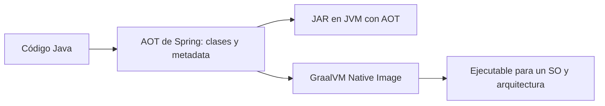

# Módulo 11: Empaquetado y despliegue


## Aprende construyendo

Cada tema se verifica con mecanismos reales y ejecutables sin depender de un daemon de Docker disponible en este entorno: el modo `layertools` embebido en el propio JAR de Spring Boot, la meta de Maven `spring-boot:process-aot` (que ejecuta de verdad el motor de AOT de Spring, sin necesitar un compilador nativo de GraalVM instalado), y los endpoints reales de Actuator agrupados por probes de Kubernetes. Continúa sobre `demo-cloud` (Módulo 10) o un proyecto nuevo.

### Tema 1: Fat JAR vs capas de Docker

Duración: 35–45 min. **Meta:** empaquetar RutaFlow en un JAR ejecutable, separar sus partes y construir una imagen con capas que puedan reutilizarse entre versiones. Sigue `examples/spring-boot-layered-jar-rutaflow/`; necesita Java 25 y Maven Wrapper. Para construir la imagen, usa Docker o Podman.

**¿Por qué es importante?** Cuando publicas una versión, las capas que no cambiaron se pueden reutilizar; esto puede reducir lo que reconstruyes y transfieres entre despliegues.


**Proyecto integrador RutaFlow:** deja este empaquetado preparado para publicar el microservicio de seguimiento sin reconstruir todas sus dependencias cada vez que cambie `/ruta`.

#### Subtema 1.1: Mira qué contiene el JAR · 8 min

**1. Contexto**

El JAR se parece a un ZIP que reúne tu código y las bibliotecas que necesita. Primero vamos a ver esos archivos.

**2. Hazlo tú**

En la terminal, entra a `examples/spring-boot-layered-jar-rutaflow/` y ejecuta:

```bash
./mvnw clean package
jar tf target/spring-boot-layered-jar-rutaflow-0.1.0-SNAPSHOT.jar | head -20
```

Busca `BOOT-INF/classes/` y `BOOT-INF/lib/`. La primera carpeta guarda la aplicación; la segunda, las bibliotecas.

**Resultado esperado:** el comando lista clases de `academia.rutaflow` y archivos `.jar` dentro de `BOOT-INF/lib/`.

**Fallo deliberado:** ejecuta `jar tf target/spring-boot-layered-jar-rutaflow-0.1.0-SNAPSHOT.jar.original`. **Diagnóstico:** verás clases, pero no el contenido ejecutable bajo `BOOT-INF/lib/`; compara el JAR original con el repaquetado para identificar qué agregó Spring Boot.

**3. Entiende**

Un Fat JAR es cómodo para ejecutar con `java -jar`. Si Docker copia ese único archivo como una capa, un cambio pequeño del código invalida la capa completa.

**4. Cierra**

Escribe el nombre de una clase propia y de una biblioteca que encontraste.

#### Subtema 1.2: Pide a Spring Boot el mapa de capas · 10 min

**1. Contexto**

Spring Boot puede ordenar el JAR en grupos. Las bibliotecas normalmente cambian menos que el código de la aplicación.

**2. Hazlo tú**

Abre `pom.xml`: el plugin `spring-boot-maven-plugin` vuelve ejecutable el JAR y activa el índice de capas por defecto. Ejecuta:

```bash
java -Djarmode=tools -jar target/spring-boot-layered-jar-rutaflow-0.1.0-SNAPSHOT.jar list-layers
```

**Resultado esperado:** aparecen `dependencies`, `spring-boot-loader`, `snapshot-dependencies` y `application`.

**Fallo deliberado:** ejecuta el mismo comando sobre `target/spring-boot-layered-jar-rutaflow-0.1.0-SNAPSHOT.jar.original`. **Resultado real:** `no hay ningún atributo de manifiesto principal`. **Diagnóstico:** Maven guardó ahí el JAR común, que no tiene el lanzador de Spring Boot; usa el archivo ejecutable que no termina en `.original`.

**3. Entiende**

En Spring Boot 4, el comando vigente es `jarmode=tools list-layers`. Los tutoriales antiguos pueden mostrar `jarmode=layertools list`; esa instrucción no coincide con esta versión.

**4. Cierra**

Explica por qué el código propio queda en la capa que suele cambiar con más frecuencia.

#### Subtema 1.3: Extrae y copia las capas en el orden correcto · 12 min

**1. Contexto**

Docker puede guardar cada instrucción `COPY` como una capa. Si las dependencias siguen iguales, el motor puede reutilizar esa parte al reconstruir la imagen.

**2. Hazlo tú**

Extrae el JAR a `target/extracted/`:

```bash
java -Djarmode=tools -jar target/spring-boot-layered-jar-rutaflow-0.1.0-SNAPSHOT.jar extract --layers --destination target/extracted
```

Revisa `Dockerfile`. Tiene una etapa de construcción que extrae el JAR y una etapa final que copia primero lo que cambia poco:

```dockerfile
COPY --from=builder /builder/extracted/dependencies/ ./
COPY --from=builder /builder/extracted/spring-boot-loader/ ./
COPY --from=builder /builder/extracted/snapshot-dependencies/ ./
COPY --from=builder /builder/extracted/application/ ./
```

Comprueba los cuatro directorios bajo `target/extracted/`. Después construye y ejecuta la imagen:

```bash
podman build -t rutaflow-capas:local .
podman run --rm -p 8080:8080 rutaflow-capas:local
```

En otra terminal, pide el estado: `curl -s http://localhost:8080/ruta`.

**Resultado esperado:** `{"codigo":"RF-314","estado":"en camino"}`.

**Fallo deliberado:** ejecuta `podman build --build-arg JAR_FILE=target/no-existe.jar -t rutaflow-capas:error .`. **Diagnóstico:** la etapa `COPY` no encuentra el JAR; recompila y revisa la ruta `JAR_FILE`.

**3. Entiende**

El contenedor final no ejecuta el Fat JAR original; ejecuta el JAR reorganizado que quedó junto con las capas extraídas. El orden de `COPY` ayuda a aprovechar caché cuando solo cambia el código.

**4. Cierra**

Marca en el Dockerfile cuál de las cuatro instrucciones copiaría el controlador `/ruta`.

#### Subtema 1.4: Comprueba qué se reutiliza y diagnostica una capa faltante · 10 min

**1. Contexto**

Una imagen por capas solo ayuda si la reconstrucción deja intactas las partes que no cambiaron.

**2. Hazlo tú**

Detén el contenedor. Cambia el texto `"en camino"` en `EstadoRutaController.java` por `"entregado"`, reconstruye el JAR y luego la imagen:

```bash
./mvnw -q package
podman build -t rutaflow-capas:local .
```

Observa la salida: Podman debe marcar como reutilizadas las instrucciones `COPY` de capas sin cambios; la instrucción de `application/` se vuelve a ejecutar. Ejecuta la imagen y vuelve a consultar `/ruta`.

**Resultado esperado:** la respuesta cambia a `{"codigo":"RF-314","estado":"entregado"}`; las capas de dependencias aparecen como `Using cache`.

**Fallo deliberado:** comenta `COPY --from=builder /builder/extracted/application/ ./` y reconstruye. **Diagnóstico:** si la imagen se construye, el error aparece al arrancar porque falta la clase principal; restaura la copia de `application/`.

**3. Entiende**

La caché ahorra reconstrucción y transferencia de capas sin cambios; no hace que el JAR sea más pequeño ni garantiza un despliegue más rápido en todos los casos. Para un prototipo que se publica una sola vez, el Dockerfile más simple puede ser suficiente.

**Cuándo no usarlo:** si el prototipo se publica una vez y no vas a reconstruirlo, mantener un Dockerfile multicapa puede costar más que el tiempo que ahorra.

**4. Cierra**

Entrega la respuesta antes y después del cambio, la lista de capas y la línea de build donde se ve la capa reutilizada. Antes de producción, fija también la imagen base a una versión o digest revisado.

Fuentes oficiales: [capas y empaquetado Maven de Spring Boot](https://docs.spring.io/spring-boot/maven-plugin/packaging.html) y [Dockerfiles para imágenes de contenedor](https://docs.spring.io/spring-boot/reference/packaging/container-images/dockerfiles.html). Siguiente: Tema 2, imagen nativa con GraalVM.

### Tema 2: GraalVM native image

Duración: 45–60 min. **Meta:** ejecutar una app con el AOT de Spring y aprender qué hace falta para convertirla en un binario nativo. Usa `examples/spring-boot-native-rutaflow/`, Java 25 y Maven Wrapper.

**¿Por qué es importante?** Un binario nativo puede iniciar rápido y usar menos memoria en algunos servicios; hay que medirlo porque su compilación tarda más y limita funciones dinámicas.



**Proyecto integrador RutaFlow:** compila el endpoint `/estado` para JVM y Native Image y compara inicio, memoria y tamaño en el mismo entorno.

#### Subtema 2.1: Distingue AOT de un binario nativo · 10 min

**1. Contexto**

Spring puede preparar parte de la aplicación durante el build. Eso no convierte por sí solo el JAR en un ejecutable nativo.

**2. Hazlo tú**

En `examples/spring-boot-native-rutaflow/`, ejecuta:

```bash
./scripts/verify-aot.sh
```

Abre `scripts/verify-aot.sh`: usa `-Pnative package`, arranca el JAR con `spring.aot.enabled=true` y llama dos rutas.

**Resultado esperado:** `GET /estado` devuelve `{"codigo":"RF-314","estado":"en camino"}` y `GET /mensaje` devuelve `Tu entrega RF-314 va en camino.`

**Fallo deliberado:** arranca el JAR sin `-Dspring.aot.enabled=true`. **Diagnóstico:** la respuesta puede ser igual porque ejecutas la app normal en la JVM; el modo AOT se confirma en el comando y en las clases de `target/spring-aot/`, no por cambiar el JSON.

**3. Entiende**

El JAR continúa corriendo sobre una JVM. Native Image es otro paso: toma clases y metadata AOT y produce un ejecutable para un sistema operativo y una arquitectura concretos.

**4. Cierra**

Escribe dos cosas que generó Spring y una que todavía no produjo el script.

#### Subtema 2.2: Registra un recurso dinámico para Native Image · 12 min

**1. Contexto**

En una JVM, la app puede leer recursos que encuentre al arrancar. Un binario nativo se construye antes y necesita saber qué archivos debe incluir.

**2. Hazlo tú**

Compara `src/main/java/academia/rutaflow/nativeimage/MensajeHints.java` con `NativeRutaApplication.java` y `src/main/resources/mensajes/ruta.txt`:

```java
public class MensajeHints implements RuntimeHintsRegistrar {
    @Override
    public void registerHints(RuntimeHints hints, ClassLoader loader) {
        hints.resources().registerPattern("mensajes/*.txt");
    }
}
```

La clase de aplicación importa el registrador con `@ImportRuntimeHints(MensajeHints.class)`. Ejecuta `./scripts/verify-aot.sh` y busca `mensajes` en `target/spring-aot/main/resources/META-INF/native-image/academia.rutaflow/spring-boot-native-rutaflow/reachability-metadata.json`.

**Resultado esperado:** la metadata generada incluye el patrón `mensajes/*.txt` y `/mensaje` puede leer `mensajes/ruta.txt`.

**Fallo deliberado:** quita `@ImportRuntimeHints(MensajeHints.class)` y vuelve a ejecutar `./mvnw -q clean package -Pnative`. **Diagnóstico:** el build puede terminar, pero el patrón `mensajes/*.txt` desaparece de la metadata; sin esa pista, un binario nativo no tiene garantizado el recurso. Restaura la anotación.

**3. Entiende**

El AOT prepara archivos y código. Las pistas dicen al compilador qué cosas dinámicas debe conservar. No todas las bibliotecas ni formas de reflexión funcionan automáticamente.

**4. Cierra**

Entrega el nombre del recurso, el patrón que lo incluye y la clase que registra ese patrón.

#### Subtema 2.3: Construye el ejecutable nativo · 12 min

**1. Contexto**

El JAR corre en distintos sistemas con una JVM; el binario nativo se ajusta al sistema y arquitectura de compilación.

**2. Hazlo tú**

Abre `pom.xml` y localiza `org.graalvm.buildtools:native-maven-plugin`. Comprueba que `native-image --version` funcione con un JDK GraalVM y que tu sistema tenga el compilador C/C++ requerido. Desde la raíz del proyecto ejecuta:

```bash
./mvnw -Pnative native:compile
```

El perfil `native` del padre Spring Boot ejecuta AOT y configura el plugin de Native Build Tools. En un contenedor GraalVM ARM64/Linux se puede compilar así:

```bash
podman run --rm -v "$PWD:/workspace:Z" -w /workspace ghcr.io/graalvm/native-image-community:25 ./mvnw -Pnative native:compile
```

**Resultado esperado:** el build crea `target/spring-boot-native-rutaflow`; `file` debe identificar un ejecutable nativo para la plataforma de compilación.

**Práctica:** anota la versión de GraalVM y plataforma junto al tamaño de `target/spring-boot-native-rutaflow`.

**Fallo deliberado:** ejecuta `./mvnw -Pnative native:compile` con un JDK que no tenga `native-image`. **Diagnóstico:** el plugin indica que no encuentra el compilador; selecciona GraalVM y verifica `JAVA_HOME` y `PATH`.

**3. Entiende**

El build nativo suele tardar más y consume más recursos que `package`. El archivo resultante no es un JAR universal: compílalo para cada sistema operativo y arquitectura de destino.

**4. Cierra**

Registra sistema, arquitectura, versión de GraalVM, duración y tamaño del ejecutable.

#### Subtema 2.4: Ejecuta y compara con JVM · 15 min

**1. Contexto**

El inicio rápido importa si una instancia debe atender tráfico pronto; el tiempo de compilación también forma parte del costo.

**2. Hazlo tú**

Ejecuta `target/spring-boot-native-rutaflow` en el mismo sistema donde lo compilaste y comprueba `/estado` y `/mensaje`. Si lo compilaste dentro del contenedor ARM64/Linux, sigue el comando de ejecución de `examples/spring-boot-native-rutaflow/README.md`; consulta `http://localhost:18081`. Después ejecuta el JAR normal y compara las dos salidas y los tamaños:

```bash
du -h target/spring-boot-native-rutaflow target/spring-boot-native-rutaflow-0.1.0-SNAPSHOT.jar
```

Mide el inicio con el mismo equipo y condiciones; detén cada servidor después de hacer las peticiones.

**Resultado esperado:** ambas versiones devuelven el mismo JSON y mensaje. La diferencia de inicio, memoria y tamaño se anota con valores medidos, no se adivina.

**Fallo deliberado:** elimina temporalmente la anotación de hints, reconstruye el binario y llama `/mensaje`. **Diagnóstico:** si falla la lectura del recurso, compara la metadata entre builds, restaura el registrador y recompila.

**3. Entiende**

Un inicio más rápido no garantiza menor costo total. Revisa el tiempo de build, memoria, tamaño, compatibilidad de dependencias y facilidad de depuración antes de escoger.

**Cuándo no usarlo:** conserva JVM si no tienes presión por arranque o memoria y la mayoría de tus dependencias dependen de carga dinámica.

**4. Cierra**

Entrega las dos respuestas, sus mediciones y una razón concreta para elegir JVM o binario nativo en el microservicio de seguimiento.

Fuentes oficiales: [AOT y perfil Maven `native`](https://docs.spring.io/spring-boot/maven-plugin/aot.html), [imágenes nativas de Spring Boot](https://docs.spring.io/spring-boot/reference/packaging/native-image/introducing-graalvm-native-images.html), [metadata y hints personalizados](https://docs.spring.io/spring-boot/reference/packaging/native-image/advanced-topics.html) y [prerrequisitos y build Native Image](https://www.graalvm.org/reference-manual/native-image/). Siguiente: Tema 3, health checks de Actuator para Kubernetes.

### Tema 3: Health checks para Kubernetes

#### Paso 1 · Objetivo y preparación

Al finalizar podrás confirmar, con una petición HTTP real, que los endpoints de Actuator agrupados por probes (`/actuator/health/liveness` y `/actuator/health/readiness`) responden con el código de estado correcto según el estado real de disponibilidad de la aplicación.

**Conocimiento previo:** Módulo 7 de este track (Actuator y `AvailabilityChangeEvent`).

#### Paso 2 · Contexto y caso real

**¿Por qué es importante?** Kubernetes decide automáticamente cuándo reiniciar un pod (liveness) y cuándo un pod puede recibir tráfico real (readiness) consultando estos endpoints periódicamente; sin una conexión correcta y probada entre el estado real de la aplicación y estas señales, Kubernetes toma decisiones operativas basadas en información incorrecta.

#### Paso 3 · Teoría con analogía

**Conceptos clave:** liveness/readiness probes agrupados, conectados a Actuator.

Con `management.endpoint.health.probes.enabled=true`, Spring Boot expone automáticamente `/actuator/health/liveness` y `/actuator/health/readiness` como grupos de health separados. Liveness responde "¿el proceso sigue vivo y debería seguir corriendo, o Kubernetes debería reiniciarlo?"; readiness responde "¿el proceso está listo para recibir tráfico real ahora mismo?" — la misma distinción de `AvailabilityChangeEvent` construida en el Módulo 7, ahora expuesta en el formato exacto que Kubernetes consulta.

**Analogía:** conectar Actuator a los probes de Kubernetes es instalar sensores automáticos que informan al sistema de gestión de una flota cuándo un vehículo necesita mantenimiento (reiniciarse) o simplemente no está listo para un nuevo viaje todavía (no recibir tráfico).

**Diagrama:**

```
┌── liveness ──────────────┐   ┌── readiness ──────────────┐
│ ¿sigue vivo el proceso?   │   │ ¿puede recibir tráfico ya? │
│ DOWN → Kubernetes reinicia│   │ DOWN → Kubernetes NO enruta│
└──────────────────┘   └──────────────────────┘
```

#### Paso 4 · Demostración guiada desde cero

Continuando en `demo-empaquetado` (o, si prefieres un ejemplo independiente, parte de una carpeta vacía y genera un proyecto nuevo con `mkdir demo-probes && cd demo-probes && curl -fsSL https://start.spring.io/starter.zip -d dependencies=web,actuator -d javaVersion=25 -o app.zip && unzip app.zip`), crea `src/main/resources/application.yml` con los probes habilitados explícitamente (necesario fuera de un clúster real de Kubernetes, donde se autodetectan):

```bash
mkdir -p src/main/resources src/test/java/io/academia/empaquetado
```

```yaml
# src/main/resources/application.yml
management:
  endpoint:
    health:
      probes:
        enabled: true
      show-details: always
  endpoints:
    web:
      exposure:
        include: health
```

Confirma con `MockMvc` real, disparando el mismo `AvailabilityChangeEvent` del Módulo 7, que ambos endpoints reflejan el estado real de la aplicación:

```java
// src/test/java/io/academia/empaquetado/ProbesTest.java
package io.academia.empaquetado;

import org.junit.jupiter.api.Test;
import org.springframework.beans.factory.annotation.Autowired;
import org.springframework.boot.availability.AvailabilityChangeEvent;
import org.springframework.boot.availability.ReadinessState;
import org.springframework.boot.test.autoconfigure.web.servlet.AutoConfigureMockMvc;
import org.springframework.boot.test.context.SpringBootTest;
import org.springframework.context.ApplicationEventPublisher;
import org.springframework.test.web.servlet.MockMvc;

import static org.springframework.test.web.servlet.request.MockMvcRequestBuilders.get;
import static org.springframework.test.web.servlet.result.MockMvcResultMatchers.jsonPath;
import static org.springframework.test.web.servlet.result.MockMvcResultMatchers.status;

@SpringBootTest
@AutoConfigureMockMvc
class ProbesTest {

    @Autowired
    private MockMvc mockMvc;

    @Autowired
    private ApplicationEventPublisher publisher;

    @Test
    void livenessRespondeUpMientrasElProcesoSigaVivo() throws Exception {
        mockMvc.perform(get("/actuator/health/liveness"))
            .andExpect(status().isOk())
            .andExpect(jsonPath("$.status").value("UP"));
    }

    @Test
    void readinessResponde503CuandoLaAplicacionDejaDeAceptarTrafico() throws Exception {
        AvailabilityChangeEvent.publish(publisher, this, ReadinessState.REFUSING_TRAFFIC);

        mockMvc.perform(get("/actuator/health/readiness"))
            .andExpect(status().isServiceUnavailable())
            .andExpect(jsonPath("$.status").value("OUT_OF_SERVICE"));

        AvailabilityChangeEvent.publish(publisher, this, ReadinessState.ACCEPTING_TRAFFIC); // restaura para no afectar otros tests
    }
}
```

```bash
./mvnw test -Dtest=ProbesTest
```

**Resultado esperado:** `BUILD SUCCESS` con ambos tests en verde: el primero confirma con una petición HTTP real que `/actuator/health/liveness` responde `200 UP` mientras el proceso está sano; el segundo confirma, publicando el mismo `AvailabilityChangeEvent` real usado en el Módulo 7, que `/actuator/health/readiness` refleja genuinamente `503 OUT_OF_SERVICE` cuando la aplicación deja de aceptar tráfico — la misma señal que Kubernetes consultaría para dejar de enrutar peticiones hacia ese pod.

**Fallo deliberado:** comenta la línea `probes: enabled: true` en `application.yml` y ejecuta de nuevo ambos tests. `/actuator/health/liveness` y `/actuator/health/readiness` responden `404 NOT_FOUND` en vez de `200`/`503` — diagnostica confirmando que estos grupos de health NO existen automáticamente fuera de un entorno Kubernetes detectado; sin la propiedad explícita (necesaria para pruebas locales o entornos no-K8s), Kubernetes recibiría un `404` al consultar los probes, un fallo de configuración silencioso y fácil de pasar por alto hasta el primer despliegue real. Restaura la línea antes de continuar.

#### Paso 5 · Práctica guiada — repetición progresiva

1. Agrega un `HealthIndicator` personalizado (como en el Módulo 7) que reporte `DOWN` cuando una dependencia crítica falla, y confirma con un test que ese indicador afecta a `/actuator/health` general pero NO necesariamente al grupo `liveness` (que por defecto solo incluye señales de vida del proceso, no de dependencias externas).
2. Escribe el manifiesto YAML completo (`livenessProbe`, `readinessProbe`, con `initialDelaySeconds` y `periodSeconds`) para el servicio de este Tema.
3. Documenta, en un comentario, por qué un `readinessProbe` que depende de una base de datos externa es apropiado, pero un `livenessProbe` que depende de esa misma base de datos externa es peligroso (podría causar reinicios en cascada de todos los pods si la base de datos se cae, sin resolver el problema real).
4. Escribe de memoria (sin mirar) un test `MockMvc` que confirme `200 UP` en liveness y, tras publicar un `AvailabilityChangeEvent`, `503` en readiness. Compara después contra el patrón del Paso 4.

**Pista:** `AvailabilityChangeEvent.publish(publisher, this, ReadinessState.REFUSING_TRAFFIC)` es el mismo mecanismo real usado en el Módulo 7 para desacoplar readiness de liveness — Spring lo consume automáticamente y lo refleja en el grupo `readiness` cuando `probes.enabled=true`.

#### Paso 6 · Práctica independiente

**Completa el código:** rellena el espacio con la propiedad que habilita explícitamente los grupos de health por probes:

```yaml
management:
  endpoint:
    health:
      ____:
        enabled: true
```

**Reto de memoria sin mirar:** cierra este documento y escribe, solo de memoria, la configuración YAML que habilita los probes, y un test `MockMvc` que confirme el `503` real en readiness tras publicar `ReadinessState.REFUSING_TRAFFIC`. Compara después contra el patrón del Paso 4.

#### Paso 7 · Cierre y evidencia

Ya confirmas con peticiones HTTP reales que los endpoints de probes de Kubernetes reflejan el estado genuino de disponibilidad de la aplicación. Esto cierra el módulo de empaquetado y despliegue; el siguiente módulo aborda observabilidad distribuida con trazas y logs correlacionados. **Evidencia:** entrega el resultado de `ProbesTest` en verde, y el `404` real que produce el fallo deliberado al deshabilitar los probes. Fuente oficial: [Spring Boot — Kubernetes Probes](https://docs.spring.io/spring-boot/reference/actuator/kubernetes-probes.html).

**Errores comunes:** no habilitar `probes.enabled=true` fuera de un clúster Kubernetes real, recibiendo `404` en pruebas locales; acoplar `livenessProbe` a dependencias externas, causando reinicios en cascada ante un fallo de infraestructura ajeno al proceso mismo.

**Cuándo no usarlo:** para una aplicación que no se despliega en Kubernetes (o un orquestador equivalente que consulte probes HTTP), habilitar estos grupos específicos de health no aporta ningún beneficio operativo adicional sobre el endpoint `/actuator/health` general.

---

Los health checks de Kubernetes de este tema son los que decidirán si Kubernetes reinicia o enruta tráfico al proyecto integrador de este track (microservicio productivo, Módulo 12).

## Laboratorio práctico

**Objetivo del laboratorio:** construir una imagen Docker de un servicio Spring Boot optimizada por capas.

**Requisitos previos:** Módulos 0-10 completados.

| Paso | Acción | Código | Explicación |
|---|---|---|---|
| 1 | Generar el fat JAR y ejecutarlo | `./mvnw package` + `java -jar` | Verifica el funcionamiento básico |
| 2 | Construir la imagen por capas | Ver Tema 1 | Compara el tamaño con un JAR simple |
| 3 | Compilar a GraalVM native image | Ver Tema 2 | Mide el tiempo de arranque |
| 4 | Configurar los health checks de Kubernetes | Ver Tema 3 | Conectados a Actuator |

**Verificación:** el laboratorio se considera exitoso si la imagen por capas reduce mensurablemente el tamaño de actualización en un segundo deploy simulado (comparado con reconstruir el JAR completo), y si el binario nativo arranca en milisegundos comparado con la JVM tradicional.

**Errores comunes y soluciones**

- **Empaquetar todo en una única capa de Docker.** Separa dependencias (estables) del código de la aplicación (cambiante).
- **Asumir que GraalVM native image no requiere ninguna configuración adicional.** Verifica que el uso de reflexión esté correctamente configurado para el compilador nativo.
- **No conectar los health checks de Actuator a los probes de Kubernetes.** Sin esa conexión, Kubernetes no puede tomar decisiones informadas sobre el estado real de la aplicación.

---
