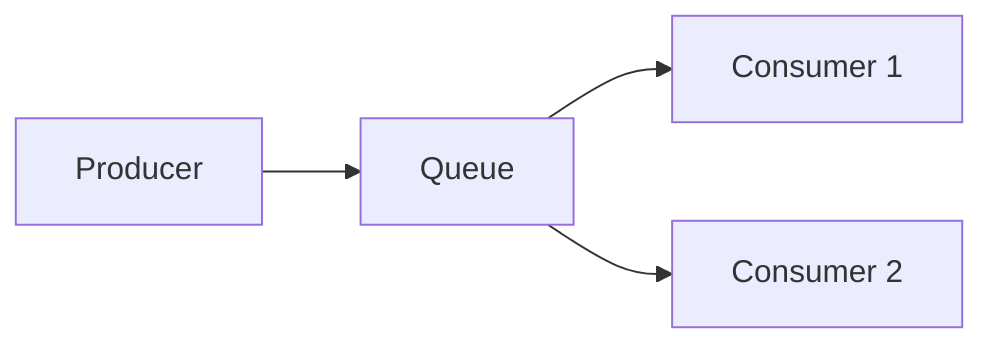

# Módulo 11: Messaging con JMS, RabbitMQ y Spring Cloud Stream

No todo messaging es Kafka. RabbitMQ/JMS/Cloud Stream resuelven casos distintos: colas de trabajo, routing, integración empresarial y abstracción de broker. El objetivo es elegir por semántica, no por moda.

**Entorno de referencia verificado (2026-05-22):** JDK 27.0.1.0.2, Maven 3.10.0, Spring Boot 3.5.0, Docker 29.9.3 disponible para labs.

## Aprende construyendo

### Tema 1: Colas, trabajo asíncrono y consumidores · Intermedio · 40 min

Caso guía: procesar generación de etiquetas en background.

#### Cola de trabajo

**Definición formal.** Patrón donde productores encolan mensajes y consumidores los procesan asíncronamente, desacoplando tiempo de respuesta.



**Error común.** No hacer consumidor idempotente. Corrección: IDs de mensaje, deduplicación, ACK después de procesar.

### Tema 2: RabbitMQ: exchanges, routing, ACK y DLQ · Avanzado · 45 min

Caso guía: enrutar eventos por tipo a colas distintas.

#### Exchange, binding, routing key

**Definición formal.** En RabbitMQ el producer publica a un exchange; el exchange enruta a colas por bindings y routing keys.

**ACK/DLQ.** ACK confirma procesamiento; mensajes rechazados/nackeados pueden ir a DLQ según política.

**Error común.** Auto-ack antes de procesar. Corrección: manual ack tras éxito; DLQ para fallos permanentes.

**Nota de verificación.** Lab requiere RabbitMQ (Docker/Testcontainers).

### Tema 3: JMS y mensajería empresarial · Avanzado · 40 min

Caso guía: integrar con sistema empresarial que habla JMS.

#### JMS

**Definición formal.** Java Message Service es una API estándar de mensajería Java (colas/topics), implementada por brokers como ActiveMQ/IBM MQ.

**Error común.** Acoplar dominio a API JMS. Corrección: adaptadores en borde.

### Tema 4: Spring Cloud Stream: binding de mensajería sin acoplarse al broker · Avanzado · 45 min

Caso guía: cambiar binder sin reescribir lógica de negocio.

#### Binder abstraction

**Definición formal.** Spring Cloud Stream abstrae input/output bindings sobre brokers (Kafka, RabbitMQ, etc.).

**Ejemplo mínimo (conceptual).**

```java
@Bean
public Consumer<String> procesar() { return msg -> System.out.println(msg); }
```

**Error común.** Asumir que la abstracción elimina diferencias semánticas del broker. Corrección: entender garantías de entrega/orden del binder real.

## Cierre

Messaging es semántica de entrega y operación. Elige broker y abstracción según garantías, no solo ergonomía.

## Checklist

- Diseño idempotencia y ACK.
- Uso DLQ para veneno/permanentes.
- Aíslo protocolo/broker del dominio.
- Conozco diferencias Rabbit/JMS/Kafka/Cloud Stream.
