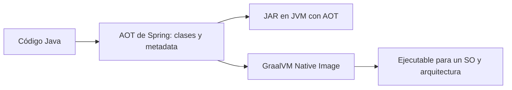
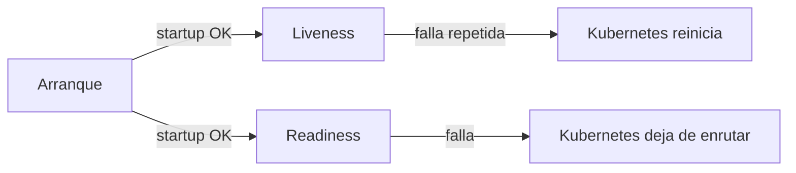

# Módulo 11: Empaquetado y despliegue


## Aprende construyendo

Cada tema se verifica con mecanismos reales y ejecutables sin depender de un daemon de Docker disponible en este entorno: el modo `layertools` embebido en el propio JAR de Spring Boot, la meta de Maven `spring-boot:process-aot` (que ejecuta de verdad el motor de AOT de Spring, sin necesitar un compilador nativo de GraalVM instalado), y los endpoints reales de Actuator agrupados por probes de Kubernetes. Continúa sobre `demo-cloud` (Módulo 10) o un proyecto nuevo.

### Tema 1: Fat JAR vs capas de Docker

Duración: 35–45 min. **Meta:** empaquetar RutaFlow en un JAR ejecutable, separar sus partes y construir una imagen con capas que puedan reutilizarse entre versiones. Sigue `examples/spring-boot-layered-jar-rutaflow/`; necesita Java 25 y Maven Wrapper. Para construir la imagen, usa Docker o Podman.

**¿Por qué es importante?** Cuando publicas una versión, las capas que no cambiaron se pueden reutilizar; esto puede reducir lo que reconstruyes y transfieres entre despliegues.


**Proyecto integrador RutaFlow:** deja este empaquetado preparado para publicar el microservicio de seguimiento sin reconstruir todas sus dependencias cada vez que cambie `/ruta`.

#### Subtema 1.1: Mira qué contiene el JAR · 8 min

**1. Contexto**

El JAR se parece a un ZIP que reúne tu código y las bibliotecas que necesita. Primero vamos a ver esos archivos.

**2. Hazlo tú**

En la terminal, entra a `examples/spring-boot-layered-jar-rutaflow/` y ejecuta:

```bash
./mvnw clean package
jar tf target/spring-boot-layered-jar-rutaflow-0.1.0-SNAPSHOT.jar | head -20
```

Busca `BOOT-INF/classes/` y `BOOT-INF/lib/`. La primera carpeta guarda la aplicación; la segunda, las bibliotecas.

**Resultado esperado:** el comando lista clases de `academia.rutaflow` y archivos `.jar` dentro de `BOOT-INF/lib/`.

**Fallo deliberado:** ejecuta `jar tf target/spring-boot-layered-jar-rutaflow-0.1.0-SNAPSHOT.jar.original`. **Diagnóstico:** verás clases, pero no el contenido ejecutable bajo `BOOT-INF/lib/`; compara el JAR original con el repaquetado para identificar qué agregó Spring Boot.

**3. Entiende**

Un Fat JAR es cómodo para ejecutar con `java -jar`. Si Docker copia ese único archivo como una capa, un cambio pequeño del código invalida la capa completa.

**4. Cierra**

Escribe el nombre de una clase propia y de una biblioteca que encontraste.

#### Subtema 1.2: Pide a Spring Boot el mapa de capas · 10 min

**1. Contexto**

Spring Boot puede ordenar el JAR en grupos. Las bibliotecas normalmente cambian menos que el código de la aplicación.

**2. Hazlo tú**

Abre `pom.xml`: el plugin `spring-boot-maven-plugin` vuelve ejecutable el JAR y activa el índice de capas por defecto. Ejecuta:

```bash
java -Djarmode=tools -jar target/spring-boot-layered-jar-rutaflow-0.1.0-SNAPSHOT.jar list-layers
```

**Resultado esperado:** aparecen `dependencies`, `spring-boot-loader`, `snapshot-dependencies` y `application`.

**Fallo deliberado:** ejecuta el mismo comando sobre `target/spring-boot-layered-jar-rutaflow-0.1.0-SNAPSHOT.jar.original`. **Resultado real:** `no hay ningún atributo de manifiesto principal`. **Diagnóstico:** Maven guardó ahí el JAR común, que no tiene el lanzador de Spring Boot; usa el archivo ejecutable que no termina en `.original`.

**3. Entiende**

En Spring Boot 4, el comando vigente es `jarmode=tools list-layers`. Los tutoriales antiguos pueden mostrar `jarmode=layertools list`; esa instrucción no coincide con esta versión.

**4. Cierra**

Explica por qué el código propio queda en la capa que suele cambiar con más frecuencia.

#### Subtema 1.3: Extrae y copia las capas en el orden correcto · 12 min

**1. Contexto**

Docker puede guardar cada instrucción `COPY` como una capa. Si las dependencias siguen iguales, el motor puede reutilizar esa parte al reconstruir la imagen.

**2. Hazlo tú**

Extrae el JAR a `target/extracted/`:

```bash
java -Djarmode=tools -jar target/spring-boot-layered-jar-rutaflow-0.1.0-SNAPSHOT.jar extract --layers --destination target/extracted
```

Revisa `Dockerfile`. Tiene una etapa de construcción que extrae el JAR y una etapa final que copia primero lo que cambia poco:

```dockerfile
COPY --from=builder /builder/extracted/dependencies/ ./
COPY --from=builder /builder/extracted/spring-boot-loader/ ./
COPY --from=builder /builder/extracted/snapshot-dependencies/ ./
COPY --from=builder /builder/extracted/application/ ./
```

Comprueba los cuatro directorios bajo `target/extracted/`. Después construye y ejecuta la imagen:

```bash
podman build -t rutaflow-capas:local .
podman run --rm -p 8080:8080 rutaflow-capas:local
```

En otra terminal, pide el estado: `curl -s http://localhost:8080/ruta`.

**Resultado esperado:** `{"codigo":"RF-314","estado":"en camino"}`.

**Fallo deliberado:** ejecuta `podman build --build-arg JAR_FILE=target/no-existe.jar -t rutaflow-capas:error .`. **Diagnóstico:** la etapa `COPY` no encuentra el JAR; recompila y revisa la ruta `JAR_FILE`.

**3. Entiende**

El contenedor final no ejecuta el Fat JAR original; ejecuta el JAR reorganizado que quedó junto con las capas extraídas. El orden de `COPY` ayuda a aprovechar caché cuando solo cambia el código.

**4. Cierra**

Marca en el Dockerfile cuál de las cuatro instrucciones copiaría el controlador `/ruta`.

#### Subtema 1.4: Comprueba qué se reutiliza y diagnostica una capa faltante · 10 min

**1. Contexto**

Una imagen por capas solo ayuda si la reconstrucción deja intactas las partes que no cambiaron.

**2. Hazlo tú**

Detén el contenedor. Cambia el texto `"en camino"` en `EstadoRutaController.java` por `"entregado"`, reconstruye el JAR y luego la imagen:

```bash
./mvnw -q package
podman build -t rutaflow-capas:local .
```

Observa la salida: Podman debe marcar como reutilizadas las instrucciones `COPY` de capas sin cambios; la instrucción de `application/` se vuelve a ejecutar. Ejecuta la imagen y vuelve a consultar `/ruta`.

**Resultado esperado:** la respuesta cambia a `{"codigo":"RF-314","estado":"entregado"}`; las capas de dependencias aparecen como `Using cache`.

**Fallo deliberado:** comenta `COPY --from=builder /builder/extracted/application/ ./` y reconstruye. **Diagnóstico:** si la imagen se construye, el error aparece al arrancar porque falta la clase principal; restaura la copia de `application/`.

**3. Entiende**

La caché ahorra reconstrucción y transferencia de capas sin cambios; no hace que el JAR sea más pequeño ni garantiza un despliegue más rápido en todos los casos. Para un prototipo que se publica una sola vez, el Dockerfile más simple puede ser suficiente.

**Cuándo no usarlo:** si el prototipo se publica una vez y no vas a reconstruirlo, mantener un Dockerfile multicapa puede costar más que el tiempo que ahorra.

**4. Cierra**

Entrega la respuesta antes y después del cambio, la lista de capas y la línea de build donde se ve la capa reutilizada. Antes de producción, fija también la imagen base a una versión o digest revisado.

Fuentes oficiales: [capas y empaquetado Maven de Spring Boot](https://docs.spring.io/spring-boot/maven-plugin/packaging.html) y [Dockerfiles para imágenes de contenedor](https://docs.spring.io/spring-boot/reference/packaging/container-images/dockerfiles.html). Siguiente: Tema 2, imagen nativa con GraalVM.

### Tema 2: GraalVM native image

Duración: 45–60 min. **Meta:** ejecutar una app con el AOT de Spring y aprender qué hace falta para convertirla en un binario nativo. Usa `examples/spring-boot-native-rutaflow/`, Java 25 y Maven Wrapper.

**¿Por qué es importante?** Un binario nativo puede iniciar rápido y usar menos memoria en algunos servicios; hay que medirlo porque su compilación tarda más y limita funciones dinámicas.



**Proyecto integrador RutaFlow:** compila el endpoint `/estado` para JVM y Native Image y compara inicio, memoria y tamaño en el mismo entorno.

#### Subtema 2.1: Distingue AOT de un binario nativo · 10 min

**1. Contexto**

Spring puede preparar parte de la aplicación durante el build. Eso no convierte por sí solo el JAR en un ejecutable nativo.

**2. Hazlo tú**

En `examples/spring-boot-native-rutaflow/`, ejecuta:

```bash
./scripts/verify-aot.sh
```

Abre `scripts/verify-aot.sh`: usa `-Pnative package`, arranca el JAR con `spring.aot.enabled=true` y llama dos rutas.

**Resultado esperado:** `GET /estado` devuelve `{"codigo":"RF-314","estado":"en camino"}` y `GET /mensaje` devuelve `Tu entrega RF-314 va en camino.`

**Fallo deliberado:** arranca el JAR sin `-Dspring.aot.enabled=true`. **Diagnóstico:** la respuesta puede ser igual porque ejecutas la app normal en la JVM; el modo AOT se confirma en el comando y en las clases de `target/spring-aot/`, no por cambiar el JSON.

**3. Entiende**

El JAR continúa corriendo sobre una JVM. Native Image es otro paso: toma clases y metadata AOT y produce un ejecutable para un sistema operativo y una arquitectura concretos.

**4. Cierra**

Escribe dos cosas que generó Spring y una que todavía no produjo el script.

#### Subtema 2.2: Registra un recurso dinámico para Native Image · 12 min

**1. Contexto**

En una JVM, la app puede leer recursos que encuentre al arrancar. Un binario nativo se construye antes y necesita saber qué archivos debe incluir.

**2. Hazlo tú**

Compara `src/main/java/academia/rutaflow/nativeimage/MensajeHints.java` con `NativeRutaApplication.java` y `src/main/resources/mensajes/ruta.txt`:

```java
public class MensajeHints implements RuntimeHintsRegistrar {
    @Override
    public void registerHints(RuntimeHints hints, ClassLoader loader) {
        hints.resources().registerPattern("mensajes/*.txt");
    }
}
```

La clase de aplicación importa el registrador con `@ImportRuntimeHints(MensajeHints.class)`. Ejecuta `./scripts/verify-aot.sh` y busca `mensajes` en `target/spring-aot/main/resources/META-INF/native-image/academia.rutaflow/spring-boot-native-rutaflow/reachability-metadata.json`.

**Resultado esperado:** la metadata generada incluye el patrón `mensajes/*.txt` y `/mensaje` puede leer `mensajes/ruta.txt`.

**Fallo deliberado:** quita `@ImportRuntimeHints(MensajeHints.class)` y vuelve a ejecutar `./mvnw -q clean package -Pnative`. **Diagnóstico:** el build puede terminar, pero el patrón `mensajes/*.txt` desaparece de la metadata; sin esa pista, un binario nativo no tiene garantizado el recurso. Restaura la anotación.

**3. Entiende**

El AOT prepara archivos y código. Las pistas dicen al compilador qué cosas dinámicas debe conservar. No todas las bibliotecas ni formas de reflexión funcionan automáticamente.

**4. Cierra**

Entrega el nombre del recurso, el patrón que lo incluye y la clase que registra ese patrón.

#### Subtema 2.3: Construye el ejecutable nativo · 12 min

**1. Contexto**

El JAR corre en distintos sistemas con una JVM; el binario nativo se ajusta al sistema y arquitectura de compilación.

**2. Hazlo tú**

Abre `pom.xml` y localiza `org.graalvm.buildtools:native-maven-plugin`. Comprueba que `native-image --version` funcione con un JDK GraalVM y que tu sistema tenga el compilador C/C++ requerido. Desde la raíz del proyecto ejecuta:

```bash
./mvnw -Pnative native:compile
```

El perfil `native` del padre Spring Boot ejecuta AOT y configura el plugin de Native Build Tools. En un contenedor GraalVM ARM64/Linux se puede compilar así:

```bash
podman run --rm -v "$PWD:/workspace:Z" -w /workspace ghcr.io/graalvm/native-image-community:25 ./mvnw -Pnative native:compile
```

**Resultado esperado:** el build crea `target/spring-boot-native-rutaflow`; `file` debe identificar un ejecutable nativo para la plataforma de compilación.

**Práctica:** anota la versión de GraalVM y plataforma junto al tamaño de `target/spring-boot-native-rutaflow`.

**Fallo deliberado:** ejecuta `./mvnw -Pnative native:compile` con un JDK que no tenga `native-image`. **Diagnóstico:** el plugin indica que no encuentra el compilador; selecciona GraalVM y verifica `JAVA_HOME` y `PATH`.

**3. Entiende**

El build nativo suele tardar más y consume más recursos que `package`. El archivo resultante no es un JAR universal: compílalo para cada sistema operativo y arquitectura de destino.

**4. Cierra**

Registra sistema, arquitectura, versión de GraalVM, duración y tamaño del ejecutable.

#### Subtema 2.4: Ejecuta y compara con JVM · 15 min

**1. Contexto**

El inicio rápido importa si una instancia debe atender tráfico pronto; el tiempo de compilación también forma parte del costo.

**2. Hazlo tú**

Ejecuta `target/spring-boot-native-rutaflow` en el mismo sistema donde lo compilaste y comprueba `/estado` y `/mensaje`. Si lo compilaste dentro del contenedor ARM64/Linux, sigue el comando de ejecución de `examples/spring-boot-native-rutaflow/README.md`; consulta `http://localhost:18081`. Después ejecuta el JAR normal y compara las dos salidas y los tamaños:

```bash
du -h target/spring-boot-native-rutaflow target/spring-boot-native-rutaflow-0.1.0-SNAPSHOT.jar
```

Mide el inicio con el mismo equipo y condiciones; detén cada servidor después de hacer las peticiones.

**Resultado esperado:** ambas versiones devuelven el mismo JSON y mensaje. La diferencia de inicio, memoria y tamaño se anota con valores medidos, no se adivina.

**Fallo deliberado:** elimina temporalmente la anotación de hints, reconstruye el binario y llama `/mensaje`. **Diagnóstico:** si falla la lectura del recurso, compara la metadata entre builds, restaura el registrador y recompila.

**3. Entiende**

Un inicio más rápido no garantiza menor costo total. Revisa el tiempo de build, memoria, tamaño, compatibilidad de dependencias y facilidad de depuración antes de escoger.

**Cuándo no usarlo:** conserva JVM si no tienes presión por arranque o memoria y la mayoría de tus dependencias dependen de carga dinámica.

**4. Cierra**

Entrega las dos respuestas, sus mediciones y una razón concreta para elegir JVM o binario nativo en el microservicio de seguimiento.

Fuentes oficiales: [AOT y perfil Maven `native`](https://docs.spring.io/spring-boot/maven-plugin/aot.html), [imágenes nativas de Spring Boot](https://docs.spring.io/spring-boot/reference/packaging/native-image/introducing-graalvm-native-images.html), [metadata y hints personalizados](https://docs.spring.io/spring-boot/reference/packaging/native-image/advanced-topics.html) y [prerrequisitos y build Native Image](https://www.graalvm.org/reference-manual/native-image/). Siguiente: Tema 3, health checks de Actuator para Kubernetes.

### Tema 3: Health checks para Kubernetes

Duración: 40–50 min. **Meta:** configurar Spring Actuator para que Kubernetes pueda distinguir un contenedor que debe reiniciar de uno que solo debe dejar de recibir tráfico. Usa `examples/spring-boot-probes-rutaflow/`, Java 25 y Maven Wrapper. El laboratorio local prueba la app; para observar acciones del kubelet necesitas un clúster.

**¿Por qué es importante?** Una ruta de salud mal escrita puede hacer que Kubernetes marque el pod como fallido, aunque la aplicación esté funcionando.



**Proyecto integrador RutaFlow:** conecta los endpoints de Actuator con el `Deployment` del servicio de entregas y comprueba cuál señal reinicia el contenedor y cuál solo retira tráfico.

#### Subtema 3.1: Enciende los probes de Spring · 8 min

**1. Contexto**

En Spring Boot 4.1.2 estos grupos están habilitados por defecto. El proyecto los declara igual en su archivo para que sea fácil ver y cambiar la configuración.

**2. Hazlo tú**

Abre `src/main/resources/application.properties` y revisa:

```properties
management.endpoint.health.probes.enabled=true
management.endpoints.web.exposure.include=health
```

Desde `examples/spring-boot-probes-rutaflow/` ejecuta:

```bash
./mvnw -q test
```

**Resultado esperado:** las dos pruebas de `ProbeEndpointsTest.java` pasan; localmente existen `/actuator/health/liveness` y `/actuator/health/readiness`.

**Fallo deliberado:** cambia el valor a `false` y repite `./mvnw -q test`. **Resultado comprobado:** liveness esperaba `200` y recibió `404`; readiness esperaba `503` y recibió `404`. **Diagnóstico:** la propiedad deshabilita los grupos; restáurala a `true` y ejecuta otra vez.

**3. Entiende**

La exposición de `health` permite consultar estos endpoints. `probes.enabled` vale `true` por defecto en esta versión; declararlo aquí hace visible la intención. Actuator oculta detalles internos por defecto; evita publicarlos sin control en producción.

**4. Cierra**

Escribe las dos rutas completas y señala la propiedad que las habilita en local.

#### Subtema 3.2: Distingue vivo de listo para tráfico · 10 min

**1. Contexto**

Un proceso puede seguir vivo mientras todavía rechaza pedidos. Kubernetes necesita saberlo para poder sacarlo temporalmente del balanceo.

**2. Hazlo tú**

En `src/test/java/academia/rutaflow/probes/ProbeEndpointsTest.java`, ubica la prueba de readiness. Esta publica el mismo evento que usa Spring para cambiar disponibilidad:

```java
AvailabilityChangeEvent.publish(events, this, ReadinessState.REFUSING_TRAFFIC);
http.perform(get("/actuator/health/readiness"))
    .andExpect(status().isServiceUnavailable())
    .andExpect(jsonPath("$.status").value("OUT_OF_SERVICE"));
```

Ejecuta solo esas pruebas:

```bash
./mvnw -q -Dtest=ProbeEndpointsTest test
```

**Resultado esperado:** liveness da `200 UP`; readiness da `503 OUT_OF_SERVICE` después del evento. `@AfterEach` devuelve la aplicación a `ACCEPTING_TRAFFIC`.

**Fallo deliberado:** quita temporalmente la publicación `REFUSING_TRAFFIC`. **Diagnóstico:** readiness permanece `200 UP`; la prueba falla porque nadie cambió el estado de disponibilidad.

**3. Entiende**

Si liveness falla repetidamente, Kubernetes reinicia el contenedor. Si readiness falla, lo conserva, pero deja de enviarle tráfico del Service.

**4. Cierra**

Explica por qué `503` en readiness puede ser correcto sin que el proceso tenga que reiniciarse.

#### Subtema 3.3: Conecta Actuator con el Deployment · 12 min

**1. Contexto**

Un endpoint de salud solo influye en Kubernetes cuando el `Deployment` lo consulta.

**2. Hazlo tú**

Abre `k8s/deployment.yaml`. El manifiesto define tres comprobaciones:

```yaml
startupProbe:
  httpGet: { path: /actuator/health/liveness, port: http }
  periodSeconds: 10
  failureThreshold: 30
livenessProbe:
  httpGet: { path: /actuator/health/liveness, port: http }
  periodSeconds: 10
  failureThreshold: 3
readinessProbe:
  httpGet: { path: /actuator/health/readiness, port: http }
  periodSeconds: 5
  failureThreshold: 2
```

Construye la imagen `rutaflow-probes:local` con `Dockerfile`. Si tienes un clúster configurado y la imagen disponible para él, aplica y revisa:

```bash
kubectl apply -f k8s/deployment.yaml
kubectl rollout status deployment/rutaflow-probes
kubectl get pods -l app=rutaflow-probes
```

**Resultado esperado:** la réplica termina `Ready`; `kubectl describe pod` muestra las tres rutas de probe y no registra eventos `Unhealthy`.

**Fallo deliberado:** cambia readiness a `/actuator/health/ready`. **Diagnóstico:** `kubectl describe pod` muestra fallos HTTP 404 y el pod queda `NotReady`; restaura `/readiness` y espera el rollout.

**3. Entiende**

`startupProbe` da tiempo de arranque; mientras no tenga éxito, Kubernetes espera para empezar liveness y readiness. Después, cada probe cumple un propósito distinto.

**4. Cierra**

Asocia cada probe con su acción: dar tiempo, reiniciar o retirar tráfico.

#### Subtema 3.4: Evita reinicios en cascada · 10 min

**1. Contexto**

Si una base de datos cae, reiniciar todos los pods de la aplicación no la arregla y puede aumentar la carga cuando vuelve.

**2. Hazlo tú**

Compara el `Deployment` con `application.properties`. Aquí liveness solo revisa el estado del proceso y readiness señala si la app acepta tráfico. Si tu servicio requiere una base de datos, agrega la comprobación externa a readiness solo cuando no pueda responder pedidos sin ella; conserva liveness independiente.

En un clúster observa fallos y eventos con:

```bash
kubectl describe pod -l app=rutaflow-probes
kubectl get events --sort-by=.lastTimestamp
```

**Resultado esperado:** una dependencia temporalmente no disponible puede retirar el pod del tráfico sin provocar por sí misma un reinicio liveness.

**Fallo deliberado:** agrega la base externa a liveness y simula que la base no responde. **Diagnóstico:** todos los pods pueden reiniciarse sin que cambie el estado de la base; mueve esa condición a readiness y despliega gradualmente.

**3. Entiende**

Los grupos de probes de Spring no incluyen automáticamente todas las dependencias. La decisión depende del servicio: readiness evalúa si debe recibir solicitudes; liveness pregunta si el proceso puede recuperarse sin reinicio.

**Cuándo no usarlo:** si no despliegas con Kubernetes ni un orquestador que consulte probes, estas rutas no cambian cómo se opera tu app.

**4. Cierra**

Entrega la salida de `./scripts/verify-probes.sh`, el manifiesto y la decisión de qué dependencias deben afectar readiness.

Fuentes oficiales: [probes de Spring Boot](https://docs.spring.io/spring-boot/reference/actuator/kubernetes-probes.html), [propiedad probes en Spring Boot 4.1.2](https://docs.spring.io/spring-boot/appendix/application-properties/), [pruebas MockMvc de Spring Boot 4.1.2](https://docs.spring.io/spring-boot/api/java/org/springframework/boot/webmvc/test/autoconfigure/AutoConfigureMockMvc.html), [diferencias entre probes en Kubernetes](https://kubernetes.io/docs/concepts/workloads/pods/probes/). El manifiesto de ejemplo no se aplicó a un clúster en esta revisión.

## Laboratorio práctico

**Objetivo:** empaquetar RutaFlow, ejecutar el modo AOT disponible y dejar probes configurados para un despliegue. Los tres ejemplos están en `examples/spring-boot-layered-jar-rutaflow/`, `examples/spring-boot-native-rutaflow/` y `examples/spring-boot-probes-rutaflow/`.

| Evidencia | Comando | Debe observarse |
|---|---|---|
| JAR organizado | `./scripts/verify-layers.sh` en el laboratorio de capas | Cuatro directorios bajo `target/extracted/` |
| Caché de capas | Cambia solo `/ruta` y repite `podman build` | Dependencias reutilizadas; capa de aplicación reconstruida |
| Spring AOT | `./scripts/verify-aot.sh` en el laboratorio native | JAR JVM responde `/estado` y `/mensaje`; metadata contiene el recurso |
| Probes | `./scripts/verify-probes.sh` en el laboratorio de Actuator | MockMvc confirma `200 UP` y `503 OUT_OF_SERVICE`; HTTP local responde ambos grupos |

Para producir un binario nativo, sigue la parte GraalVM del Tema 2 con una toolchain compatible. No trates el JAR en modo AOT como binario nativo. El manifiesto de Kubernetes se aplica solo si tienes clúster y la imagen está disponible para sus nodos.

**Criterio de cierre:** entrega las cuatro salidas, registra plataforma y mediciones nativas solo si completaste ese build y, si usaste Kubernetes, adjunta estado del Deployment. No se exige una mejora fija de tamaño o arranque: mídela en el mismo entorno y conserva el resultado.

---
