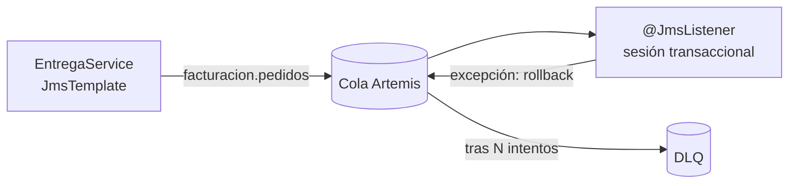

# Módulo 11: RabbitMQ, JMS y Spring Cloud Stream

## Aprende construyendo

El laboratorio [`examples/spring-stream-rutaflow/`](https://github.com/NICORUIZ93/The_Imperial_Book/tree/main/examples/spring-stream-rutaflow) convierte un envío en una solicitud de ruta. La función se mantiene; el perfil selecciona el broker.

**Prerrequisitos del módulo:** Spring Boot M10 T1 (tópicos, keys y grupos de Kafka). Los Temas 1–3 comparan Kafka con RabbitMQ y enseñan Spring AMQP y JMS; los Temas 4–7 escriben una sola función y la conectan a los dos brokers con Spring Cloud Stream. Usa JDK 25.

Cada tema toma 20–45 min. Completa sus subtemas y el hito antes de avanzar.

### Tema 1: Kafka frente a RabbitMQ · Avanzado · 45 min

**Duración estimada:** 45 min.

**Resultado:** eliges el broker según quién debe recibir cada mensaje, cuánto tiempo necesitas conservarlo y cómo confirmas su procesamiento.

**¿Por qué es importante?** Kafka y RabbitMQ pueden transportar eventos, pero sus grupos, colas, retención y confirmaciones no significan lo mismo.

**Prerrequisitos:** M10 T1 y el laboratorio `examples/spring-stream-rutaflow/`.

#### Subtema 1.1 · Repartir mensajes o dar una copia a cada grupo · 10 min

**1. Contexto**

En Kafka, cada consumer group lleva su propio avance; dos grupos independientes pueden leer el mismo tópico. En RabbitMQ, consumers sobre una misma cola compiten por las entregas. Para que dos aplicaciones reciban sus propias copias, se crean dos colas y se enruta el mensaje a ambas; no se agrega un `groupId` a la cola.

**2. Hazlo tú**

En `examples/spring-kafka-rutaflow/src/main/java/academia/rutaflow/event/`, compara los `groupId` `rutaflow-ruteo` y `rutaflow-notificaciones`. Ejecuta la prueba que envía un evento y espera a ambos listeners:

```bash
cd examples/spring-kafka-rutaflow
./mvnw -Dtest=EnvioEventPublisherTest#publicaConKeyDelEnvioYElListenerLaRecibe test
```

Después abre `examples/node-messaging/rabbit/topology.mjs`: hoy declara una cola `envios` y la vincula a un exchange. Un segundo worker que consuma `envios` competiría por las entregas. Para fan-out, necesitarías otra cola durable enlazada al exchange.

**Resultado esperado:** La prueba de Kafka recibe el evento en ambos grupos. Puedes dibujar las dos topologías y señalar que dos consumers de una sola cola Rabbit se reparten mensajes, mientras dos colas enlazadas pueden recibir copias.

**Fallo deliberado:** En una copia, pon ambos `@KafkaListener` en el mismo `groupId`. **Diagnóstico:** dejan de ser dos suscripciones independientes y compiten por las particiones; la prueba que espera ambos listeners puede fallar.

**3. Entiende**

Kafka replica la lectura por grupo; RabbitMQ replica por rutas a colas. RabbitMQ puede hacer fan-out con exchange y varias colas. La comparación correcta es topología completa, no “Kafka tiene fan-out y RabbitMQ no”.

**4. Cierra**

Dibuja el destino necesario para que dos servicios procesen cada uno una copia, primero en Kafka y luego en RabbitMQ.

#### Subtema 1.2 · Releer historial o conservar mensajes pendientes · 10 min

**1. Contexto**

Kafka conserva registros según las políticas de retención del tópico, aunque un consumer ya los haya leído; un consumer group nuevo puede empezar desde el inicio si el dato sigue retenido y se configura `auto.offset.reset=earliest`. RabbitMQ conserva un mensaje en una cola mientras esté pendiente; después de una confirmación de consumo, el broker puede eliminar esa entrega. Una cola nueva no recibe automáticamente el historial de una cola distinta.

**2. Hazlo tú**

Compara el log de Kafka en [Módulo 10, Tema 1](/curso/spring-boot/10) y la cola `envios` de `examples/node-messaging/rabbit/topology.mjs`. En RabbitMQ abre `examples/node-messaging/rabbit/worker.mjs` y localiza `channel.ack(message)`. Para ver la persistencia por broker, inicia cada ejemplo desde sus carpetas según sus README:

```bash
cd examples/spring-stream-rutaflow
./mvnw test
```

El test binder comprueba la función, no retención ni broker. La práctica de broker real se describe en `examples/spring-stream-rutaflow/README.md` y requiere Docker Compose.

**Resultado esperado:** Explicas la diferencia entre “ya consumido” y “ya no retenido”: Kafka puede expirar registros por política; RabbitMQ elimina una entrega confirmada de su cola, pero puede retener mensajes aún no confirmados y reenviarlos tras un fallo.

**Fallo deliberado:** Cambia mentalmente el `ack` a antes del procesamiento: si el proceso cae luego, RabbitMQ ya puede tratar la entrega como terminada. **Diagnóstico:** En el laboratorio Node no cambies ni ejecutes esa mutación; escribe qué dato de negocio podrías perder.

**3. Entiende**

No prometas que Kafka guarda el historial para siempre: depende de `retention.ms`, bytes, compactación y configuración. Tampoco afirmes que RabbitMQ borra siempre al primer intento: con ack manual un mensaje sin confirmar puede reencolarse.

**4. Cierra**

Completa dos frases: “Kafka permite releer mientras…” y “RabbitMQ conserva un mensaje hasta…”.

#### Subtema 1.3 · Distinguir confirmación de publicación y confirmación de consumo · 10 min

**1. Contexto**

Que el broker acepte una publicación no significa que la aplicación destino haya procesado el mensaje. RabbitMQ tiene publisher confirms para el lado productor y acknowledgements del consumer para el procesamiento; son señales separadas. Kafka confirma la escritura del productor y administra offsets de lectura por grupo como otro estado.

**2. Hazlo tú**

Lee `examples/node-messaging/rabbit/producer.mjs`: crea un confirm channel, publica y espera `waitForConfirms()`. Luego lee `examples/node-messaging/rabbit/worker.mjs`: usa `prefetch(5)` y confirma cada entrega con `channel.ack(message)` tras procesarla. Compara con `EnvioEventPublisherTest` de M10 T1, que espera el ACK del productor y verifica la recepción de listeners por separado.

```bash
cd examples/node-messaging
npm ci
npm test
```

`npm test` verifica topología y flujo local definido por el test; no demuestra conexión con broker real. El README incluye el comando Docker para practicar la entrega real.

**Resultado esperado:** Identificas dos confirmaciones de RabbitMQ y dos etapas de Kafka sin llamarlas “exactly once”. Si el consumer procesa y cae antes de confirmar, puede aparecer una redelivery; el efecto debe ser idempotente.

**Fallo deliberado:** En una hoja, intercambia las etiquetas “publisher confirm” y “consumer ack”. **Diagnóstico:** una confirma la recepción por el broker; la otra confirma el manejo de una entrega. No prueban mutuamente el trabajo opuesto.

**3. Entiende**

Las confirmaciones ayudan a detectar fallos, pero entre persistir el efecto y confirmar puede ocurrir una caída. Outbox, inbox e idempotencia siguen siendo necesarios para cubrir esa frontera.

**4. Cierra**

Describe qué confirma `waitForConfirms()` y qué confirma `channel.ack()` en estos archivos.

#### Subtema 1.4 · Elegir por el flujo y comprobar ambos binders · 15 min

**1. Contexto**

Kafka suele encajar cuando varias aplicaciones necesitan leer el mismo log a su ritmo o reprocesar offsets retenidos. RabbitMQ suele encajar cuando el exchange enruta trabajo a colas y los workers compiten por cada entrega. Ambos pueden conservar datos, reintentar y enrutar; la topología, los límites operativos y el requisito definen la decisión.

**2. Hazlo tú**

Abre `examples/spring-stream-rutaflow/README.md`. Ejecuta primero el test binder:

```bash
cd examples/spring-stream-rutaflow
./mvnw test
```

El binder prueba la función y el mapping dentro de Spring. Después, si Docker está disponible, levanta los brokers y ejecuta un perfil a la vez:

```bash
docker compose up -d
./mvnw spring-boot:run -Dspring-boot.run.profiles=kafka
```

Prueba el mensaje válido y el código postal `XX` según el README; observa el destino de error en Kafka. Detén la aplicación y repite con `-Dspring-boot.run.profiles=rabbit`; revisa la cola y dead-letter queue en la consola de RabbitMQ. La configuración es real, pero el test binder por sí solo no certifica integración con los brokers.

**Resultado esperado:** La función de negocio se mantiene igual; cada perfil configura su binder y su política de error. Escribe para cada caso si necesitas repetición por offset, distribución entre workers o copias en varias colas, y elige con esa necesidad.

**Fallo deliberado:** Intenta afirmar que el test binder prueba publisher confirms, offsets Kafka y acknowledgements Rabbit. **Diagnóstico:** el test no se conecta a ninguno de los brokers; esa evidencia requiere ejecutar los perfiles reales y observar sus destinos.

**3. Entiende**

La abstracción de Spring Cloud Stream reduce código de integración, pero no convierte garantías diferentes en una garantía común. Mantén visible el binder, el grupo/cola, la retención, el manejo de error y la forma de confirmar.

**4. Cierra**

Entrega una decisión breve para un flujo de reprocesamiento histórico y otra para una cola de trabajo, nombrando evidencia y configuración que revisarías.

**Fuentes oficiales:** [log y retención de Kafka 4.2](https://kafka.apache.org/42/implementation/log/), [retención de tópicos Kafka](https://kafka.apache.org/42/configuration/topic-configs/), [consumers RabbitMQ](https://www.rabbitmq.com/docs/consumers), [acks y confirms RabbitMQ](https://www.rabbitmq.com/docs/confirms), [ack mode de Spring AMQP](https://docs.spring.io/spring-amqp/reference/amqp/containerAttributes.html) y [publisher confirms en Spring AMQP](https://docs.spring.io/spring-amqp/reference/amqp/connections.html), [binder abstraction de Spring Cloud Stream](https://docs.spring.io/spring-cloud-stream/reference/spring-cloud-stream/overview-binder-abstraction.html) y [testing binder](https://docs.spring.io/spring-cloud-stream/reference/spring-cloud-stream/spring_integration_test_binder.html).

**Transferencia al proyecto integrador:** documenta por evento quién lo necesita, si necesita copia independiente o competencia por trabajo, cuánto retenerlo, qué confirma publicación y qué confirma procesamiento, cómo reintenta y qué efecto idempotente protege una redelivery.

### Tema 2: RabbitMQ con Spring AMQP: routing, ack y prefetch · Avanzado · 40 min

Este tema continúa la comparación Kafka/RabbitMQ y el trabajo con binders de T5–T6. Aquí usamos Spring AMQP directamente para ver el contrato de una cola y el ciclo de una entrega.

#### Subtema 2.1 · Declarar exchange, cola, binding y DLQ · 10 min

**1. Contexto**

Una guía de envío entra al exchange `rutaflow.dispatch`. La routing key elige la cola de trabajo; un rechazo permanente sale por la DLX hacia la cola de mensajes rechazados.

**2. Hazlo tú**

Desde `examples/spring-amqp-rutaflow`, abre `src/main/java/academia/rutaflow/amqp/RabbitTopology.java`. Lee `dispatchExchange`, `dispatchQueue`, `dispatchBinding` y sus equivalentes de DLX. La cola principal es durable y declara la dead-letter exchange y su routing key.

Ejecuta las pruebas de topología sin iniciar RabbitMQ:

```bash
./mvnw -Dtest=RabbitTopologyTest test
```

**Resultado esperado:** Pasan dos pruebas. Verás el nombre de cada cola, la clave del binding y los argumentos `x-dead-letter-exchange` / `x-dead-letter-routing-key`.

**Fallo deliberado:** Cambia `ROUTING_KEY` a `dispatch.wrong` sin cambiar el test. Debe fallar la aserción del binding. **Diagnóstico:** el binding usa una clave que no coincide con el contrato esperado. Restaura `dispatch.requested`.

**3. Entiende**

Un exchange no almacena mensajes. El binding conecta el exchange con una cola según una clave. Una cola durable conserva su definición al reiniciar el broker; para que el mensaje sobreviva también debe publicarse como persistente. Esta práctica no configura persistencia explícita del mensaje.

**4. Cierra**

Dibuja el recorrido del envío válido y del rechazo permanente, anotando exchange, clave, cola y DLX.

#### Subtema 2.2 · Publicar y distinguir confirm de return · 10 min

**1. Contexto**

El productor necesita saber si el broker aceptó la publicación y si el mensaje encontró una cola. Son preguntas separadas: publisher confirm no significa que el consumidor haya terminado, y un mensaje sin binding puede ser devuelto.

**2. Hazlo tú**

Desde `examples/spring-amqp-rutaflow`, levanta RabbitMQ y ejecuta la aplicación:

```bash
docker compose up -d --wait
./mvnw spring-boot:run -Dspring-boot.run.arguments="--tracking-code=RF-1200"
```

Abre `src/main/resources/application.yml` y `src/main/java/academia/rutaflow/amqp/DispatchPublisher.java`. La configuración activa confirms correlated y returns; el template usa `mandatory`. El publicador espera el confirm correlacionado y revisa el mensaje retornado.

**Resultado esperado:** La consola muestra `publicado y enrutado=RF-1200`; la cola `dispatch.requested` aparece en RabbitMQ Management (`http://localhost:15672`, usuario/clave `guest`).

**Fallo deliberado:** En una copia cambia el routing key usado por `DispatchPublisher` a `dispatch.missing`. El broker puede confirmar la publicación al exchange y a la vez devolverla porque no encontró una cola. **Diagnóstico:** el confirm fue positivo, pero `CorrelationData` contiene el mensaje retornado; la aplicación debe reportar que no hubo ruta. Restaura `dispatch.requested`.

**3. Entiende**

El confirm cubre la publicación entre el productor y el broker. `mandatory` más publisher returns permite detectar que ningún binding aceptó el mensaje. Ninguno confirma el resultado de negocio del consumidor. Si el productor reintenta tras perder una confirmación, el mismo envío puede aparecer más de una vez; la idempotencia de negocio se resuelve aparte.

**4. Cierra**

Registra qué observaste en un envío normal y en el routing key incorrecto. Explica por qué un confirm positivo no prueba que se creó la guía.

#### Subtema 2.3 · Confirmar después del trabajo y mandar fallos permanentes a DLQ · 10 min

**1. Contexto**

Con ack manual, el consumidor decide cuándo RabbitMQ puede retirar la entrega. Si confirma antes de completar el trabajo, una caída puede perderlo; si no confirma y el canal se cierra, el broker puede entregarlo otra vez.

**2. Hazlo tú**

Abre `src/main/java/academia/rutaflow/amqp/DispatchListener.java` y `DispatchService.java`. El listener valida y procesa antes de `basicAck`. Para un código inválido usa `basicNack(tag, false, false)`; la cola tiene DLX configurada.

Ejecuta las pruebas unitarias:

```bash
./mvnw -Dtest=DispatchListenerTest test
```

**Resultado esperado:** Pasan dos pruebas: un código válido llama al servicio y confirma el tag; una entrada inválida se rechaza sin requeue.

Con RabbitMQ activo, ejecuta la aplicación con un código inválido:

```bash
./mvnw spring-boot:run -Dspring-boot.run.arguments="--tracking-code=sin-formato"
```

En Management, observa que la publicación fue enrutada a la cola de trabajo y que el rechazo aparece en `dispatch.rejected`.

**Fallo deliberado:** Cambia el tercer argumento de `basicNack` a `true`. La prueba de rechazo debe fallar: el mensaje se reencola en vez de seguir la ruta de DLX, lo que puede repetir indefinidamente un error permanente. **Diagnóstico:** compara el tercer argumento con la expectativa `requeue=false` de `DispatchListenerTest`. Restáuralo a `false`.

**3. Entiende**

`deliveryTag` identifica una entrega en su canal; el ack debe usar ese mismo canal. `requeue=false` envía el mensaje a la DLX si la cola tiene esa configuración; sin DLX, RabbitMQ lo descarta. Una caída después de guardar y antes del ack puede causar una redelivery, así que una aplicación real necesita idempotencia persistente. Este laboratorio solo imprime la guía: no prueba una escritura duradera ni deduplicación.

**4. Cierra**

Anota el orden de validar, guardar y confirmar. Explica qué debe persistir antes del ack y qué evidencia falta para afirmar que el trabajo es idempotente.

#### Subtema 2.4 · Limitar entregas en vuelo con prefetch · 10 min

**1. Contexto**

Un consumidor puede recibir más mensajes de los que procesa a la vez. `prefetch` limita las entregas sin ack en vuelo por consumidor/canal según la configuración del broker, y evita acumular una cantidad ilimitada en memoria.

**2. Hazlo tú**

Desde `examples/spring-amqp-rutaflow`, revisa `spring.rabbitmq.listener.simple.prefetch: 5` en `src/main/resources/application.yml`. Inicia el broker y la aplicación. En RabbitMQ Management abre la cola `dispatch.requested` y su consumidor; identifica el prefetch anunciado.

Para observar entregas pendientes, coloca un breakpoint en `DispatchListener.java` justo antes de `channel.basicAck`, publica varios códigos válidos y observa `Unacknowledged` en la cola. Repite después de cambiar `prefetch` a `1`; no conserves el breakpoint ni el cambio al cerrar.

**Resultado esperado:** Con ack pausado, el límite observado sigue el valor configurado; al confirmar entregas se liberan espacios para que lleguen más. Sin broker y pausa del consumidor, el test unitario no demuestra este comportamiento de red.

**Fallo deliberado:** Configura `prefetch: 0` y observa que significa sin límite, no “cero mensajes”. **Diagnóstico:** la cola deja de aplicar el límite del número de entregas sin ack; vuelve a `5`.

**3. Entiende**

Un valor bajo limita trabajo pendiente y memoria, pero puede reducir el rendimiento cuando hay latencia. Uno alto puede mejorar el uso de consumidores rápidos, pero reserva más entregas para cada consumidor y puede empeorar el reparto. Cinco es un valor didáctico, no una recomendación universal; mídelo con la carga y el tiempo de procesamiento reales.

**4. Cierra**

Entrega una captura o registro de prefetch y mensajes sin ack para los valores 1 y 5. Añade cuánto tardó la prueba y qué dato medirías antes de elegir uno en producción.

**Prerrequisitos del tema:** Spring Boot y AMQP básico; Docker disponible para los ejercicios con broker. **Verificación local:** `./mvnw test` cubre la topología declarada y la decisión ack/nack mediante pruebas unitarias; no sustituye la práctica RabbitMQ en vivo.

**Fuentes oficiales:** [Spring Boot AMQP](https://docs.spring.io/spring-boot/reference/messaging/amqp.html), [Spring AMQP: conexión, confirms y returns](https://docs.spring.io/spring-amqp/reference/amqp/connections.html), [RabbitMQ: confirms y acknowledgements](https://www.rabbitmq.com/docs/confirms).

**Transferencia a RutaFlow:** antes de confirmar una entrega, persiste el resultado con una clave idempotente. En una práctica posterior integra RabbitMQ con una base de datos y prueba caída entre commit y ack.

**¿Por qué es importante?** El destino, el límite de entregas pendientes y el momento del ack deciden si un trabajo se pierde, se repite o queda atascado.

**Aplicación y decisión:** En el proyecto integrador, confirma después de persistir el efecto y guarda una clave idempotente para la redelivery. El laboratorio AMQP no prueba deduplicación durable; una confirmación de publicación no acredita procesamiento del consumidor.

### Tema 3: JMS con Spring y ActiveMQ Artemis: colas punto a punto y transacciones · Avanzado · 45 min

**Prerrequisito:** temas «RabbitMQ con Spring AMQP» y «Kafka frente a RabbitMQ» de este módulo.

**Al finalizar podrás:** enviar y recibir mensajes por una cola JMS con `JmsTemplate` y `@JmsListener` sobre ActiveMQ Artemis, y comprobar que un mensaje que falla vuelve a la cola gracias a la sesión transaccional.

**¿Por qué es importante?** JMS es el estándar de mensajería de Java empresarial. Muchos sistemas bancarios y logísticos existentes lo usan. Integrarse con ellos exige conocer su modelo, que no es igual al de Kafka ni al de AMQP.

#### Paso 1 · Objetivo y preparación

Usa Spring Boot 4.1.2 y JDK 25 en `academia-spring` (paquete `com.example.demo`), agrega `spring-boot-starter-artemis` y levanta el broker con Docker: `docker run -d --name artemis -p 61616:61616 -p 8161:8161 -e ARTEMIS_USER=admin -e ARTEMIS_PASSWORD=admin apache/activemq-artemis`.

#### Paso 2 · Contexto y caso real

El sistema de facturación de un cliente de RutaFlow solo acepta pedidos por una cola JMS. Cada envío entregado debe generar exactamente un mensaje de facturación, incluso si el consumidor falla a la mitad.

#### Paso 3 · Teoría, modelo mental y analogía

**Conceptos clave:** JMS, cola (punto a punto), tópico (publicar/suscribir), `JmsTemplate`, `@JmsListener`, sesión transaccional, reentrega, cola de mensajes muertos (DLQ).

JMS define dos modelos:

- **Cola:** cada mensaje lo procesa **un solo** consumidor. Para trabajo que se reparte (facturar un envío).
- **Tópico:** cada suscriptor recibe una copia. Para avisar a varios sistemas.

Spring Boot configura la conexión a **Artemis** con `spring.artemis.*`. `JmsTemplate.convertAndSend` envía y `@JmsListener` recibe.

Con `spring.jms.listener.session.transacted=true`, si el método del listener lanza una excepción, la sesión **revierte** y el broker **reentrega** el mensaje. Después de varios intentos, Artemis lo mueve a la cola `DLQ` para que no bloquee a los demás.

**Analogía:** una cola JMS es la ventanilla de un banco con un turnero: cada turno lo atiende un solo cajero, y si el cajero se levanta sin terminar, el turno vuelve a la fila. La analogía falla en que, tras varios intentos fallidos, el turno se aparta a otra fila (DLQ) para revisión.

**Límite de uso:** JMS no es un log de eventos: un mensaje consumido desaparece y no se puede releer como en Kafka. La reentrega implica que el consumidor puede ver un mensaje dos veces: hazlo idempotente.



#### Paso 4 · Demostración guiada desde cero

Archivo `academia-spring/src/main/resources/application.properties`:

```properties
spring.artemis.mode=native
spring.artemis.broker-url=tcp://localhost:61616
spring.artemis.user=admin
spring.artemis.password=admin
spring.jms.listener.session.transacted=true
```

Archivo `academia-spring/src/main/java/com/example/demo/facturacion/Facturacion.java` (dentro de `com.example.demo`, para que el escaneo registre el listener):

```java
package com.example.demo.facturacion;

import java.util.concurrent.atomic.AtomicInteger;
import org.springframework.boot.CommandLineRunner;
import org.springframework.jms.annotation.JmsListener;
import org.springframework.jms.core.JmsTemplate;
import org.springframework.stereotype.Component;

@Component
class Facturacion implements CommandLineRunner {
    private final JmsTemplate jms;
    private final AtomicInteger intentos = new AtomicInteger();

    Facturacion(JmsTemplate jms) { this.jms = jms; }

    @Override
    public void run(String... args) {
        jms.convertAndSend("facturacion.pedidos", "ENV-42;5000");
        System.out.println("enviado ENV-42");
    }

    @JmsListener(destination = "facturacion.pedidos")
    void facturar(String pedido) {
        int intento = intentos.incrementAndGet();
        System.out.println("intento " + intento + " para " + pedido);
        if (intento == 1) throw new IllegalStateException("el sistema de facturación no respondió");
        System.out.println("facturado " + pedido);
    }
}
```

Ejecútalo:

```bash
docker run -d --name artemis -p 61616:61616 -p 8161:8161 \
  -e ARTEMIS_USER=admin -e ARTEMIS_PASSWORD=admin apache/activemq-artemis
./mvnw spring-boot:run
```

**Explicación por bloques:** Las propiedades apuntan al broker en modo `native` y activan sesiones transaccionales para los listeners. Al arrancar, `run` envía un pedido a la cola. El listener simula una caída en el primer intento lanzando una excepción: la sesión revierte y Artemis vuelve a entregar el mismo mensaje. En el segundo intento, el pedido se factura. Si fallara siempre, después de los intentos configurados en el broker el mensaje terminaría en `DLQ`.

**Resultado esperado:**

```text
enviado ENV-42
intento 1 para ENV-42;5000
... Execution of JMS message listener failed ... el sistema de facturación no respondió
intento 2 para ENV-42;5000
facturado ENV-42;5000
```

**Fallo deliberado:** cambia `spring.jms.listener.session.transacted` a `false`. **Error esperado:** solo aparece «intento 1» y el pedido nunca se factura. **Diagnóstico:** sin transacción, el mensaje se confirmó al entregarse y la excepción no lo devuelve a la cola. Usa sesiones transaccionales y un consumidor idempotente.

#### Paso 5 · Práctica guiada

1. **Reproducción:** ejecuta el ejemplo y busca la cola `facturacion.pedidos` en la consola web de Artemis (http://localhost:8161).
2. **Variación:** haz que el listener falle siempre y encuentra el mensaje en la cola `DLQ`.
3. **Diagnóstico:** reproduce el fallo deliberado sin transacciones.
4. **Integración:** publica en un tópico con `jms.setPubSubDomain(true)` y crea dos listeners que reciban el mismo mensaje.
5. **Diseño:** escribe cómo harías idempotente la facturación para que una reentrega no cobre dos veces.

**Pista:** si un mensaje «desaparece» después de un error, revisa si la sesión del listener es transaccional.

#### Paso 6 · Práctica independiente

Escribe una prueba con Testcontainers (`ArtemisContainer`) que envíe un pedido, haga fallar el primer intento y compruebe que el segundo lo factura.

#### Paso 7 · Cierre

- [ ] Explicas la diferencia entre cola y tópico.
- [ ] El registro muestra el primer intento fallido y el segundo exitoso.
- [ ] Reprodujiste la pérdida del mensaje sin transacción.
- [ ] Sabes dónde termina un mensaje que siempre falla.

Si fallas dos o más, vuelve al Paso 3. **Errores comunes:** confirmar mensajes antes de procesarlos, suponer que cada mensaje llega una sola vez y usar JMS como si fuera un log de eventos. **Siguiente paso:** el tema «Spring Cloud Stream y binders» abstrae el broker para cambiar entre RabbitMQ y Kafka sin tocar el código.

**Transferencia al proyecto integrador «RutaFlow»:** en RutaFlow, envía cada entrega confirmada a la cola JMS del cliente con sesiones transaccionales y una tabla de idempotencia por código de envío.

**Fuente oficial:** [Spring Boot — JMS](https://docs.spring.io/spring-boot/reference/messaging/jms.html) y [Apache ActiveMQ Artemis — Documentation](https://activemq.apache.org/components/artemis/documentation/).

### Tema 4: bindings y destinations · Avanzado · 25 min

**Duración estimada:** 25 min.
**¿Por qué es importante?** Separar función y binding permite cambiar el broker sin duplicar la regla de negocio.

#### Subtema 4.1: Transforma un envío en una ruta · 8 min

**1. Contexto**
El servicio recibe `ShipmentCreated` y deriva una región para el planificador.

**2. Hazlo tú**
Desde la raíz del repositorio, abre `examples/spring-stream-rutaflow/src/main/java/academia/rutaflow/stream/RouteFunctions.java` y corre el test:

```bash
cd examples/spring-stream-rutaflow
./mvnw -Dtest=RouteFunctionsTest#transformaEnvioEnSolicitudDeRuta test
```

**Salida esperada:** `Tests run: 1, Failures: 0, Errors: 0`; la entrada `sh-42 / 10ABC` sale como JSON con `sh-42 / 10`.

**Fallo deliberado:** cambia `substring(0, 2)` por `substring(0, 3)`. **Resultado esperado:** la salida ya no contiene región `10`. **Diagnóstico:** alteraste el recorte; vuelve a tomar los dos caracteres del código postal.

**3. Entiende**
`Function<I,O>` recibe un tipo y devuelve otro. En esta práctica transforma los datos; no decide cómo se transportan.

**4. Cierra**
Conserva la salida del test y escribe qué campo de entrada produce `region`.

#### Subtema 4.2: Conecta la función a destinos · 8 min

**1. Contexto**
El binding es el nombre lógico de entrada/salida. `destination` nombra el tópico o exchange que usa el broker.

**2. Hazlo tú**
Abre `examples/spring-stream-rutaflow/src/main/resources/application.yml`; compara `planRoute-in-0` y `planRoute-out-0`. Ejecuta desde `examples/spring-stream-rutaflow/`:

```bash
./mvnw -Dtest=RouteFunctionsTest#transformaEnvioEnSolicitudDeRuta test
```

**Salida esperada:** la configuración conecta entrada `shipments.created` y salida `routes.requested`.

**Fallo deliberado:** renombra el bean `planRoute` sin cambiar los bindings. **Error esperado:** los canales `planRoute-in-0` y `planRoute-out-0` dejan de conectarse. **Diagnóstico:** los nombres de binding salen del nombre y posición de la función; actualiza ambos juntos.

**3. Entiende**
Separar nombre lógico y destino permite cambiar el recurso externo sin reescribir la transformación.

**4. Cierra**
Anota los dos nombres de binding y sus destinos. No llames “broker probado” a esta prueba en memoria.

#### Subtema 4.3: Rechaza una entrada incompleta · 9 min

**1. Contexto**
Un código postal demasiado corto no permite derivar región y debe fallar antes de publicar salida.

**2. Hazlo tú**
Ejecuta el test de validación de `src/test/java/academia/rutaflow/stream/RouteFunctionsTest.java`:

```bash
./mvnw -Dtest=RouteFunctionsTest#codigoPostalCortoFallaEnLaFuncion test
```

**Salida esperada:** `BUILD SUCCESS`; la función lanza `IllegalArgumentException: El código postal debe tener dos caracteres`.

**Fallo deliberado:** quita la validación de longitud. **Resultado esperado:** el test no recibe la excepción y falla. **Diagnóstico:** valida el dato en la frontera antes de derivar la ruta.

**3. Entiende**
El test binder hace circular mensajes dentro de la aplicación sin conectarse a Kafka ni RabbitMQ.

**4. Cierra**
Guarda la salida y el mensaje exacto que indica por qué se rechaza el dato.

**Hito del tema:**

- [ ] La función convierte el envío en una ruta.
- [ ] Binding y destination están identificados.
- [ ] La entrada corta falla con un mensaje legible.
- [ ] Los dos tests pasan con `./mvnw test`.

**Fuente:** [abstracción de binders](https://docs.spring.io/spring-cloud-stream/reference/spring-cloud-stream/overview-binder-abstraction.html).


**Aplicación y decisión:** En el proyecto integrador, conserva nombres lógicos de binding en código y destinos de broker en configuración. Límite: cambiar destination puede desconectar un consumidor sin cambiar una sola línea de la función.

### Tema 5: binder Kafka y binder RabbitMQ · Avanzado · 30 min

**Duración estimada:** 30 min.
**¿Por qué es importante?** Probar ambos perfiles muestra qué comportamiento depende del broker elegido.

#### Subtema 5.1: Publica y consume con Kafka · 10 min

**1. Contexto**
Kafka guarda el flujo en un tópico; el grupo conserva su avance mediante offsets.

**2. Hazlo tú**
Abre `examples/spring-stream-rutaflow/compose.yaml` y `examples/spring-stream-rutaflow/src/main/resources/application-kafka.yml`. Desde `examples/spring-stream-rutaflow/`, levanta los brokers y la app con perfil Kafka:

```bash
docker compose up -d
./mvnw spring-boot:run -Dspring-boot.run.profiles=kafka
```

En otra terminal, consume el resultado y publica un envío de prueba:

```bash
docker compose exec kafka /opt/kafka/bin/kafka-console-consumer.sh --bootstrap-server localhost:9092 --topic routes.requested --from-beginning
docker compose exec -T kafka /opt/kafka/bin/kafka-console-producer.sh --bootstrap-server localhost:9092 --topic shipments.created
```

Escribe `{"shipmentId":"sh-42","postalCode":"10ABC"}` en el productor y ciérralo con Ctrl-D.

**Salida esperada:** el consumer del tópico `routes.requested` recibe JSON con `shipmentId=sh-42` y `region=10`.

**Fallo deliberado:** cambia `KAFKA_BOOTSTRAP_SERVERS` a un puerto cerrado. **Error esperado:** el cliente no puede conectar. **Diagnóstico:** revisa que Kafka esté arriba y que el puerto sea `19092` desde el host; la aplicación usa localhost.

**3. Entiende**
El test binder anterior no usa socket ni broker. Este paso sí comprueba la conexión Kafka y sus destinos.

**4. Cierra**
Guarda la salida del consumer y escribe qué tópico publicó el resultado.

#### Subtema 5.2: Publica y consume con RabbitMQ · 10 min

**1. Contexto**
RabbitMQ enruta mensajes de un exchange a colas. Cada grupo tiene su cola.

**2. Hazlo tú**
Abre `examples/spring-stream-rutaflow/src/main/resources/application-rabbit.yml`. Desde `examples/spring-stream-rutaflow/`, arranca el perfil Rabbit:

```bash
./mvnw spring-boot:run -Dspring-boot.run.profiles=rabbit
```

Abre `http://localhost:15672`, entra con `guest`/`guest` en local, crea la cola `rutas-observadas` y enlázala al exchange `routes.requested` con routing key `#`. Publica el JSON de envío en el exchange `shipments.created` con routing key `#`.

**Salida esperada:** la cola `rutas-observadas` muestra la solicitud con región `10`.

**Fallo deliberado:** cambia `RABBITMQ_PORT` a un puerto cerrado. **Error esperado:** Rabbit rechaza la conexión. **Diagnóstico:** verifica el contenedor y el puerto `5672`; no cambies la función.

**3. Entiende**
El binder declara exchange y cola de entrada; la cola de observación de salida se crea para que puedas inspeccionar el mensaje.

**4. Cierra**
Guarda una captura de la cola y registra exchange, cola y routing key que usaste.

#### Subtema 5.3: Compara lo que realmente cambia · 10 min

**1. Contexto**
La transformación puede ser idéntica y las garantías de entrega no.

**2. Hazlo tú**
Abre `examples/spring-stream-rutaflow/src/main/resources/application-kafka.yml` y `examples/spring-stream-rutaflow/src/main/resources/application-rabbit.yml`; consulta luego cada broker desde `examples/spring-stream-rutaflow/`:

```bash
docker compose ps
docker compose logs --tail=30 kafka rabbitmq
```

**Salida esperada:** Kafka muestra tópico/partición; RabbitMQ muestra exchange/cola y mensajes pendientes.

**Fallo deliberado:** activa un perfil sin levantar su broker. **Resultado esperado:** la app no enlaza con el servicio. **Diagnóstico:** selecciona el perfil que coincide con el broker arriba.

**3. Entiende**
Kafka ofrece retención y lectura por offset. RabbitMQ centra el flujo en routing, colas y acknowledgements. No traduzcas una garantía como si fuera equivalente.

**4. Cierra**
Entrega una comparación con una evidencia observada en cada broker.

**Hito del tema:**

- [ ] El perfil Kafka publica y consume un mensaje.
- [ ] El perfil Rabbit publica y consume un mensaje.
- [ ] Registré destino físico y grupo/cola.
- [ ] Distinguí evidencia del test binder y del broker real.

**Fuentes:** [binder Kafka](https://docs.spring.io/spring-cloud-stream/reference/kafka/kafka-binder/), [binder RabbitMQ](https://docs.spring.io/spring-cloud-stream/reference/rabbit/rabbit_overview.html).


**Aplicación y decisión:** Práctica del proyecto integrador: ejecuta la misma entrada en perfiles separados y registra el tópico Kafka o exchange/cola Rabbit que recibió la salida. La diferencia de transporte no desaparece por compartir Function; el test binder no acredita esa ejecución de broker.

### Tema 6: reintentos, error handler y dead-letter · Avanzado · 30 min

**Duración estimada:** 30 min.
**¿Por qué es importante?** Una política de reintentos evita ciclos infinitos y conserva los mensajes que requieren reparación.

#### Subtema 6.1: Limita los reintentos en Kafka · 10 min

**1. Contexto**
El grupo `route-planner` debe evitar ciclos infinitos si el mensaje siempre es inválido.

**2. Hazlo tú**
Abre `examples/spring-stream-rutaflow/src/main/resources/application-kafka.yml`; revisa `max-attempts: 3` y `enable-dlq: true`. Desde `examples/spring-stream-rutaflow/`, reinicia con perfil Kafka y publica `{"shipmentId":"sh-50","postalCode":"XX123"}`.

```bash
./mvnw spring-boot:run -Dspring-boot.run.profiles=kafka
```

**Salida esperada:** tras tres ejecuciones fallidas, el mensaje queda en el tópico DLQ del grupo Kafka. La configuración necesita el `group` explícito ya definido en `application.yml`.

**Fallo deliberado:** quita `enable-dlq`. **Resultado esperado:** el tópico DLQ deja de recibir el mensaje. **Diagnóstico:** el binder Kafka no activa DLQ por defecto; vuelve a habilitarlo.

**3. Entiende**
En este binder `max-attempts` y el grupo participan en la política DLQ. La retención del mensaje fallido no arregla el dato inválido.

**4. Cierra**
Guarda el mensaje observado en el tópico principal y la evidencia del destino de error.

#### Subtema 6.2: Declara DLQ en RabbitMQ · 10 min

**1. Contexto**
Una cola con mensajes que fallan requiere un destino para inspección y corrección.

**2. Hazlo tú**
Abre `examples/spring-stream-rutaflow/src/main/resources/application-rabbit.yml`; comprueba `max-attempts: 3` y `auto-bind-dlq: true`. Desde `examples/spring-stream-rutaflow/`, arranca el perfil Rabbit y publica el mismo JSON con región `XX`.

```bash
./mvnw spring-boot:run -Dspring-boot.run.profiles=rabbit
```

**Salida esperada:** RabbitMQ crea una DLQ enlazada al destino y recibe el mensaje cuando se agotan los intentos.

**Fallo deliberado:** quita `auto-bind-dlq`. **Resultado esperado:** no aparece la cola de dead-letter configurada. **Diagnóstico:** el binder Rabbit no crea DLQ si no se solicita.

**3. Entiende**
RabbitMQ enruta fallos a un dead-letter exchange/queue; Kafka conserva el mensaje en un tópico. Los nombres y propiedades cambian por binder.

**4. Cierra**
Anota el nombre de la DLQ y el número de intentos de cada broker.

#### Subtema 6.3: Distingue fallo transitorio de dato inválido · 10 min

**1. Contexto**
Una caída del servicio puede recuperarse; una región inválida necesita corrección, no más reintentos.

**2. Hazlo tú**
Abre `examples/spring-stream-rutaflow/src/main/java/academia/rutaflow/stream/RouteFunctions.java` y `examples/spring-stream-rutaflow/src/main/resources/application-kafka.yml`. Envía primero el evento válido `10ABC` y luego `XX123` por el broker activo. Compara el destino normal y el de error en la consola.

```bash
./mvnw -Dtest=RouteFunctionsTest test
```

**Salida esperada:** el válido llega a `routes.requested`; el `XX123` se conserva en el destino DLQ del perfil activo.

**Fallo deliberado:** reenvía el payload inválido repetidamente como si fuera transitorio. **Resultado esperado:** consume intentos y vuelve a la DLQ. **Diagnóstico:** corrige o aparta el dato antes de hacer replay.

**3. Entiende**
Una DLQ es una bandeja de revisión, no una reparación automática. El replay debe conservar identidad y evitar duplicar el efecto.

**4. Cierra**
Escribe qué persona o proceso revisaría el mensaje antes de reenviarlo.

**Hito del tema:**

- [ ] Kafka agota tres intentos y conserva el error.
- [ ] RabbitMQ agota tres intentos y conserva el error.
- [ ] El evento válido sigue el flujo normal.
- [ ] Documenté cómo revisar antes de replay.

**Fuentes:** [DLQ para Kafka](https://docs.spring.io/spring-cloud-stream/reference/kafka/kafka-binder/dlq.html), [dead-letter en RabbitMQ](https://docs.spring.io/spring-cloud-stream/reference/rabbit/rabbit_overview.html).


**Aplicación y decisión:** Práctica del proyecto integrador: clasifica un fallo transitorio y otro permanente, fija intentos y demuestra el destino final del evento. Límite: replay desde DLQ puede repetir efectos; conserva idempotencia y no reintentes errores de contrato indefinidamente.

### Tema 7: test binder y límites de la prueba · Avanzado · 25 min

**Duración estimada:** 25 min.
**¿Por qué es importante?** Un test en memoria no detecta problemas de red o topología; declarar su límite evita falsa confianza.

#### Subtema 7.1: Verifica mapping en memoria · 8 min

**1. Contexto**
La lógica de transformación debe probarse sin tener Kafka o Rabbit instalados.

**2. Hazlo tú**
Abre `examples/spring-stream-rutaflow/src/test/java/academia/rutaflow/stream/RouteFunctionsTest.java` y ejecuta el test binder desde `examples/spring-stream-rutaflow/`:

```bash
cd examples/spring-stream-rutaflow
./mvnw -Dtest=RouteFunctionsTest#transformaEnvioEnSolicitudDeRuta test
```

**Salida esperada:** `Tests run: 1, Failures: 0, Errors: 0`.

**Fallo deliberado:** espera región `11` en lugar de `10`. **Resultado esperado:** el test falla. **Diagnóstico:** la salida usa los dos primeros caracteres de `10ABC`.

**3. Entiende**
El test binder conecta entrada y salida dentro de la JVM. No abre conexiones al broker.

**4. Cierra**
Guarda la salida y la predicción que escribiste antes de ejecutar.

#### Subtema 7.2: Comprueba una entrada inválida · 8 min

**1. Contexto**
Una prueba local también debe mostrar qué ocurre antes de enviar datos externos.

**2. Hazlo tú**
Abre `examples/spring-stream-rutaflow/src/test/java/academia/rutaflow/stream/RouteFunctionsTest.java` y ejecuta el test de código postal corto desde `examples/spring-stream-rutaflow/`:

```bash
./mvnw -Dtest=RouteFunctionsTest#codigoPostalCortoFallaEnLaFuncion test
```

**Salida esperada:** `BUILD SUCCESS`; el test observa `El código postal debe tener dos caracteres`.

**Fallo deliberado:** cambia el mensaje esperado en el test. **Resultado esperado:** la aserción falla. **Diagnóstico:** el test documenta el contrato de error; restaura el texto de la función.

**3. Entiende**
Un test unitario verifica la regla. El test binder verifica la transformación conectada a los bindings.

**4. Cierra**
Guarda el nombre del test y la condición que protege.

#### Subtema 7.3: Separa prueba local y broker real · 9 min

**1. Contexto**
Ningún test en memoria confirma que un servicio externo esté disponible o cree la topología correcta.

**2. Hazlo tú**
Abre `examples/spring-stream-rutaflow/pom.xml` y `examples/spring-stream-rutaflow/compose.yaml`. Ejecuta toda la suite y luego consulta los brokers por separado desde `examples/spring-stream-rutaflow/`:

```bash
./mvnw test
docker compose ps
```

**Salida esperada:** dos tests locales verdes; `docker compose ps` muestra si cada broker está arriba. Son evidencias distintas.

**Fallo deliberado:** detén RabbitMQ y ejecuta el perfil Rabbit. **Resultado esperado:** la suite test binder sigue pasando, pero la conexión real falla. **Diagnóstico:** el test binder sustituye el broker en memoria; no valida red ni topología real.

**3. Entiende**
Mantén separadas la prueba de mapping, la prueba del binder real y la revisión humana de la explicación.

**4. Cierra**
Marca cada capa como ejecutada o pendiente y enlaza su evidencia.

**Hito del tema:**

- [ ] Pasan los tests de transformación y validación.
- [ ] Identifiqué lo que prueba el binder en memoria.
- [ ] Observé la conexión a cada broker por separado.
- [ ] No presenté una prueba local como certificación de integración.

**Fuente:** [test binder de Spring Cloud Stream](https://docs.spring.io/spring-cloud-stream/reference/spring-cloud-stream/spring_integration_test_binder.html).


**Aplicación y decisión:** Práctica del proyecto integrador: agrega otra zona válida y un código inválido al test binder. Registra qué comprueba la función en memoria y qué queda para el broker; no informes una cola desplegada a partir de InputDestination.

## Capstone del módulo

Desde una copia limpia de `examples/spring-stream-rutaflow/`, ejecuta `./mvnw test`, levanta Kafka y RabbitMQ, procesa un envío con ambos perfiles y conserva evidencias de salida normal y DLQ. No guardes credenciales reales; los valores `guest` son solo para el contenedor local.

**Fuentes oficiales:** [compatibilidad Spring Cloud y Spring Boot](https://docs.spring.io/spring-cloud-release/reference/index.html), [abstracción binder y pruebas](https://docs.spring.io/spring-cloud-stream/reference/spring-cloud-stream/overview-binder-abstraction.html), [DLQ Kafka](https://docs.spring.io/spring-cloud-stream/reference/kafka/kafka-binder/dlq.html), [binder RabbitMQ](https://docs.spring.io/spring-cloud-stream/reference/rabbit/rabbit_overview.html).
