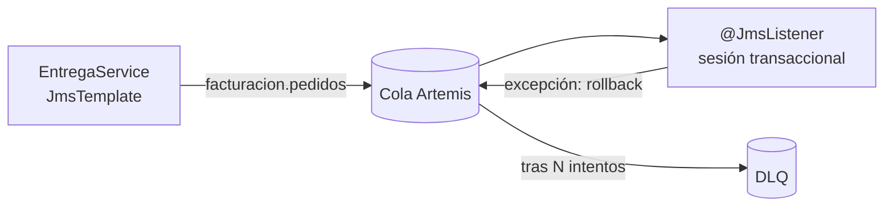

# Módulo 11: RabbitMQ, JMS y Spring Cloud Stream

## Aprende construyendo

El laboratorio `spring-stream-rutaflow` convierte un envío en una solicitud de ruta. La función se mantiene; el perfil selecciona el broker.

**Prerrequisitos del módulo:** Spring Boot M10 T1 (tópicos, keys y grupos de Kafka). Los Temas 1–3 comparan Kafka con RabbitMQ y enseñan Spring AMQP y JMS; los Temas 4–7 escriben una sola función y la conectan a los dos brokers con Spring Cloud Stream. Usa JDK 25.

Cada tema toma 20–45 min. Completa sus subtemas y el hito antes de avanzar.


### Tema 1: Kafka frente a RabbitMQ · Avanzado · 45 min

<details open>
<summary><strong>Capa 1 — Lectura</strong></summary>

#### ► DE QUÉ TRATA
Este tema te guía por kafka frente a rabbitmq con foco en comprensión antes de implementación.

#### ► LA IDEA EN UNA FRASE
**Entender kafka frente a rabbitmq te permite tomar mejores decisiones técnicas.**

#### ► POR QUÉ EXISTE ESTO
Resuelve un problema real de diseño o implementación y evita decisiones a ciegas.

#### ► LA ANALOGÍA
Piensa en kafka frente a rabbitmq como una herramienta de taller: útil cuando conoces su propósito y sus límites.
**Dónde se rompe la analogía:** en software, los efectos dependen del contexto, la escala y los trade-offs.

#### ► CÓMO FUNCIONA
1. Identifica el problema que kafka frente a rabbitmq resuelve.
2. Observa sus componentes y relaciones.
3. Aplica la opción más simple que funcione.
4. Verifica el resultado y los límites.

#### ► LO QUE PUEDE SALIR MAL
| Síntoma | Causa probable | Arreglo |
|---|---|---|
| Kafka frente a RabbitMQ se aplica pero el resultado no mejora | Se usó sin medir el problema real | Mide antes y compara contra la alternativa simple |
| Aparece complejidad inesperada | Se adoptó la técnica sin comprender sus trade-offs | Vuelve a la sección de trade-offs y reduce el alcance |
| Falla en un caso límite | Se asumió un contexto que no se cumple | Prueba el caso límite y documenta cuándo NO usarlo |

#### ► TRADE-OFFS
| Opción | Cuándo usarla | Cuándo NO usarla |
|---|---|---|
| Usar Kafka frente a RabbitMQ | Cuando el problema coincide con su propósito y el beneficio es observable | Cuando agrega complejidad sin resolver un problema real |
| Alternativa más simple | Cuando el contexto es pequeño, estable o fácil de razonar | Cuando ya demostró no escalar o no cumplir el requisito |
| Postergar la decisión | Cuando falta evidencia del problema | Cuando el costo de esperar es mayor que el costo de probar |

#### ► CUÁNDO NO USAR ESTO
No uses kafka frente a rabbitmq por defecto. Aplícalo cuando el problema lo justifique y puedas verificar el beneficio; si una alternativa más simple resuelve igual, prefiérela.

#### ► DE VUELTA A LA ANALOGÍA
Volviendo a la analogía: kafka frente a rabbitmq funciona como el modelo inicial, pero recuerda dónde se rompe: en producción importan la evidencia, la escala y el costo de equivocarte.

#### ► LO QUE DEBES RECORDAR
- Kafka frente a RabbitMQ existe para resolver un problema específico.
- Mide antes de adoptar complejidad.
- Conoce el caso donde NO usarlo.
- Verifica con evidencia observable.

#### ► PREGUNTAS PARA PENSAR
1. ¿Qué problema concreto resuelve kafka frente a rabbitmq en tu contexto?
2. ¿Cómo sabrías que kafka frente a rabbitmq no está funcionando bien?
3. ¿Qué alternativa más simple considerarías antes de usar kafka frente a rabbitmq?

</details>

<details>
<summary><strong>Capa 2 — Construcción</strong></summary>

#### Código y verificación
```bash
./mvnw -Dtest=EnvioEventPublisherTest#publicaConKeyDelEnvioYElListenerLaRecibe test
```

```bash
./mvnw test
```

```bash
npm ci
npm test
```

```bash
./mvnw test
```

```bash
docker compose up -d
./mvnw spring-boot:run -Dspring-boot.run.profiles=kafka
```

</details>

### Tema 2: RabbitMQ con Spring AMQP: routing, ack y prefetch · Avanzado · 40 min

<details open>
<summary><strong>Capa 1 — Lectura</strong></summary>

#### ► DE QUÉ TRATA
Este tema te guía por rabbitmq con spring amqp: routing, ack y prefetch con foco en comprensión antes de implementación.

#### ► LA IDEA EN UNA FRASE
**Entender rabbitmq con spring amqp: routing, ack y prefetch te permite tomar mejores decisiones técnicas.**

#### ► POR QUÉ EXISTE ESTO
Resuelve un problema real de diseño o implementación y evita decisiones a ciegas.

#### ► LA ANALOGÍA
Piensa en rabbitmq con spring amqp: routing, ack y prefetch como una herramienta de taller: útil cuando conoces su propósito y sus límites.
**Dónde se rompe la analogía:** en software, los efectos dependen del contexto, la escala y los trade-offs.

#### ► CÓMO FUNCIONA
1. Identifica el problema que rabbitmq con spring amqp: routing, ack y prefetch resuelve.
2. Observa sus componentes y relaciones.
3. Aplica la opción más simple que funcione.
4. Verifica el resultado y los límites.

#### ► LO QUE PUEDE SALIR MAL
| Síntoma | Causa probable | Arreglo |
|---|---|---|
| RabbitMQ con Spring AMQP: routing, ack y prefetch se aplica pero el resultado no mejora | Se usó sin medir el problema real | Mide antes y compara contra la alternativa simple |
| Aparece complejidad inesperada | Se adoptó la técnica sin comprender sus trade-offs | Vuelve a la sección de trade-offs y reduce el alcance |
| Falla en un caso límite | Se asumió un contexto que no se cumple | Prueba el caso límite y documenta cuándo NO usarlo |

#### ► TRADE-OFFS
| Opción | Cuándo usarla | Cuándo NO usarla |
|---|---|---|
| Usar RabbitMQ con Spring AMQP: routing, ack y prefetch | Cuando el problema coincide con su propósito y el beneficio es observable | Cuando agrega complejidad sin resolver un problema real |
| Alternativa más simple | Cuando el contexto es pequeño, estable o fácil de razonar | Cuando ya demostró no escalar o no cumplir el requisito |
| Postergar la decisión | Cuando falta evidencia del problema | Cuando el costo de esperar es mayor que el costo de probar |

#### ► CUÁNDO NO USAR ESTO
No uses rabbitmq con spring amqp: routing, ack y prefetch por defecto. Aplícalo cuando el problema lo justifique y puedas verificar el beneficio; si una alternativa más simple resuelve igual, prefiérela.

#### ► DE VUELTA A LA ANALOGÍA
Volviendo a la analogía: rabbitmq con spring amqp: routing, ack y prefetch funciona como el modelo inicial, pero recuerda dónde se rompe: en producción importan la evidencia, la escala y el costo de equivocarte.

#### ► LO QUE DEBES RECORDAR
- RabbitMQ con Spring AMQP: routing, ack y prefetch existe para resolver un problema específico.
- Mide antes de adoptar complejidad.
- Conoce el caso donde NO usarlo.
- Verifica con evidencia observable.

#### ► PREGUNTAS PARA PENSAR
1. ¿Qué problema concreto resuelve rabbitmq con spring amqp: routing, ack y prefetch en tu contexto?
2. ¿Cómo sabrías que rabbitmq con spring amqp: routing, ack y prefetch no está funcionando bien?
3. ¿Qué alternativa más simple considerarías antes de usar rabbitmq con spring amqp: routing, ack y prefetch?

</details>

<details>
<summary><strong>Capa 2 — Construcción</strong></summary>

#### Código y verificación
```bash
./mvnw -Dtest=RabbitTopologyTest test
```

```bash
docker compose up -d --wait
./mvnw spring-boot:run -Dspring-boot.run.arguments="--tracking-code=RF-1200"
```

```bash
./mvnw -Dtest=DispatchListenerTest test
```

```bash
./mvnw spring-boot:run -Dspring-boot.run.arguments="--tracking-code=sin-formato"
```

</details>

### Tema 3: JMS con Spring y ActiveMQ Artemis: colas punto a punto y transacciones · Avanzado · 45 min

<details open>
<summary><strong>Capa 1 — Lectura</strong></summary>

#### ► DE QUÉ TRATA
Usa Spring Boot 4.1.2 y JDK 25 en academia-spring (paquete com.example.demo), agrega spring-boot-starter-artemis y levanta el broker con Docker: docker run -d --name artemis -p 61616:61616 -p 8161:8161 -e ARTEMIS_USER=admin -e ARTEMIS_PASSWORD=admin apache/activemq-artemis.

#### ► LA IDEA EN UNA FRASE
**Usa Spring Boot 4.1.2 y JDK 25 en academia-spring (paquete com.example.demo), agrega spring-boot-starter-artemis y levanta el broker con Docker: docker run -d --name artemis -p 61616:61616 -p 8161:8161 -e ARTEMIS_USER=admin -e ARTEMIS_PASSWORD=admin apache/activemq-artemis.**

#### ► POR QUÉ EXISTE ESTO
Resuelve un problema real de diseño o implementación y evita decisiones a ciegas.

#### ► LA ANALOGÍA
Piensa en jms con spring y activemq artemis: colas punto a punto y transacciones como una herramienta de taller: útil cuando conoces su propósito y sus límites.
**Dónde se rompe la analogía:** en software, los efectos dependen del contexto, la escala y los trade-offs.

#### ► CÓMO FUNCIONA


#### ► LO QUE PUEDE SALIR MAL
| Síntoma | Causa probable | Arreglo |
|---|---|---|
| JMS con Spring y ActiveMQ Artemis: colas punto a punto y transacciones se aplica pero el resultado no mejora | Se usó sin medir el problema real | Mide antes y compara contra la alternativa simple |
| Aparece complejidad inesperada | Se adoptó la técnica sin comprender sus trade-offs | Vuelve a la sección de trade-offs y reduce el alcance |
| Falla en un caso límite | Se asumió un contexto que no se cumple | Prueba el caso límite y documenta cuándo NO usarlo |

#### ► TRADE-OFFS
| Opción | Cuándo usarla | Cuándo NO usarla |
|---|---|---|
| Usar JMS con Spring y ActiveMQ Artemis: colas punto a punto y transacciones | Cuando el problema coincide con su propósito y el beneficio es observable | Cuando agrega complejidad sin resolver un problema real |
| Alternativa más simple | Cuando el contexto es pequeño, estable o fácil de razonar | Cuando ya demostró no escalar o no cumplir el requisito |
| Postergar la decisión | Cuando falta evidencia del problema | Cuando el costo de esperar es mayor que el costo de probar |

#### ► CUÁNDO NO USAR ESTO
No uses jms con spring y activemq artemis: colas punto a punto y transacciones por defecto. Aplícalo cuando el problema lo justifique y puedas verificar el beneficio; si una alternativa más simple resuelve igual, prefiérela.

#### ► DE VUELTA A LA ANALOGÍA
Volviendo a la analogía: jms con spring y activemq artemis: colas punto a punto y transacciones funciona como el modelo inicial, pero recuerda dónde se rompe: en producción importan la evidencia, la escala y el costo de equivocarte.

#### ► LO QUE DEBES RECORDAR
- JMS con Spring y ActiveMQ Artemis: colas punto a punto y transacciones existe para resolver un problema específico.
- Mide antes de adoptar complejidad.
- Conoce el caso donde NO usarlo.
- Verifica con evidencia observable.

#### ► PREGUNTAS PARA PENSAR
1. ¿Qué problema concreto resuelve jms con spring y activemq artemis: colas punto a punto y transacciones en tu contexto?
2. ¿Cómo sabrías que jms con spring y activemq artemis: colas punto a punto y transacciones no está funcionando bien?
3. ¿Qué alternativa más simple considerarías antes de usar jms con spring y activemq artemis: colas punto a punto y transacciones?

</details>

<details>
<summary><strong>Capa 2 — Construcción</strong></summary>

#### Código y verificación


```properties
spring.artemis.mode=native
spring.artemis.broker-url=tcp://localhost:61616
spring.artemis.user=admin
spring.artemis.password=admin
spring.jms.listener.session.transacted=true
```

```java
package com.example.demo.facturacion;

import java.util.concurrent.atomic.AtomicInteger;
import org.springframework.boot.CommandLineRunner;
import org.springframework.jms.annotation.JmsListener;
import org.springframework.jms.core.JmsTemplate;
import org.springframework.stereotype.Component;

@Component
class Facturacion implements CommandLineRunner {
    private final JmsTemplate jms;
    private final AtomicInteger intentos = new AtomicInteger();

    Facturacion(JmsTemplate jms) { this.jms = jms; }

    @Override
    public void run(String... args) {
        jms.convertAndSend("facturacion.pedidos", "ENV-42;5000");
        System.out.println("enviado ENV-42");
    }

    @JmsListener(destination = "facturacion.pedidos")
    void facturar(String pedido) {
        int intento = intentos.incrementAndGet();
        System.out.println("intento " + intento + " para " + pedido);
        if (intento == 1) throw new IllegalStateException("el sistema de facturación no respondió");
        System.out.println("facturado " + pedido);
    }
}
```

```bash
docker run -d --name artemis -p 61616:61616 -p 8161:8161 \
  -e ARTEMIS_USER=admin -e ARTEMIS_PASSWORD=admin apache/activemq-artemis
./mvnw spring-boot:run
```

```text
enviado ENV-42
intento 1 para ENV-42;5000
... Execution of JMS message listener failed ... el sistema de facturación no respondió
intento 2 para ENV-42;5000
facturado ENV-42;5000
```

</details>

### Tema 4: bindings y destinations · Avanzado · 25 min

<details open>
<summary><strong>Capa 1 — Lectura</strong></summary>

#### ► DE QUÉ TRATA
Este tema te guía por bindings y destinations con foco en comprensión antes de implementación.

#### ► LA IDEA EN UNA FRASE
**Entender bindings y destinations te permite tomar mejores decisiones técnicas.**

#### ► POR QUÉ EXISTE ESTO
Resuelve un problema real de diseño o implementación y evita decisiones a ciegas.

#### ► LA ANALOGÍA
Piensa en bindings y destinations como una herramienta de taller: útil cuando conoces su propósito y sus límites.
**Dónde se rompe la analogía:** en software, los efectos dependen del contexto, la escala y los trade-offs.

#### ► CÓMO FUNCIONA
1. Identifica el problema que bindings y destinations resuelve.
2. Observa sus componentes y relaciones.
3. Aplica la opción más simple que funcione.
4. Verifica el resultado y los límites.

#### ► LO QUE PUEDE SALIR MAL
| Síntoma | Causa probable | Arreglo |
|---|---|---|
| bindings y destinations se aplica pero el resultado no mejora | Se usó sin medir el problema real | Mide antes y compara contra la alternativa simple |
| Aparece complejidad inesperada | Se adoptó la técnica sin comprender sus trade-offs | Vuelve a la sección de trade-offs y reduce el alcance |
| Falla en un caso límite | Se asumió un contexto que no se cumple | Prueba el caso límite y documenta cuándo NO usarlo |

#### ► TRADE-OFFS
| Opción | Cuándo usarla | Cuándo NO usarla |
|---|---|---|
| Usar bindings y destinations | Cuando el problema coincide con su propósito y el beneficio es observable | Cuando agrega complejidad sin resolver un problema real |
| Alternativa más simple | Cuando el contexto es pequeño, estable o fácil de razonar | Cuando ya demostró no escalar o no cumplir el requisito |
| Postergar la decisión | Cuando falta evidencia del problema | Cuando el costo de esperar es mayor que el costo de probar |

#### ► CUÁNDO NO USAR ESTO
No uses bindings y destinations por defecto. Aplícalo cuando el problema lo justifique y puedas verificar el beneficio; si una alternativa más simple resuelve igual, prefiérela.

#### ► DE VUELTA A LA ANALOGÍA
Volviendo a la analogía: bindings y destinations funciona como el modelo inicial, pero recuerda dónde se rompe: en producción importan la evidencia, la escala y el costo de equivocarte.

#### ► LO QUE DEBES RECORDAR
- bindings y destinations existe para resolver un problema específico.
- Mide antes de adoptar complejidad.
- Conoce el caso donde NO usarlo.
- Verifica con evidencia observable.

#### ► PREGUNTAS PARA PENSAR
1. ¿Qué problema concreto resuelve bindings y destinations en tu contexto?
2. ¿Cómo sabrías que bindings y destinations no está funcionando bien?
3. ¿Qué alternativa más simple considerarías antes de usar bindings y destinations?

</details>

<details>
<summary><strong>Capa 2 — Construcción</strong></summary>

#### Código y verificación
```bash
./mvnw -Dtest=RouteFunctionsTest#transformaEnvioEnSolicitudDeRuta test
```

```bash
./mvnw -Dtest=RouteFunctionsTest#transformaEnvioEnSolicitudDeRuta test
```

```bash
./mvnw -Dtest=RouteFunctionsTest#codigoPostalCortoFallaEnLaFuncion test
```

</details>

### Tema 5: binder Kafka y binder RabbitMQ · Avanzado · 30 min

<details open>
<summary><strong>Capa 1 — Lectura</strong></summary>

#### ► DE QUÉ TRATA
Este tema te guía por binder kafka y binder rabbitmq con foco en comprensión antes de implementación.

#### ► LA IDEA EN UNA FRASE
**Entender binder kafka y binder rabbitmq te permite tomar mejores decisiones técnicas.**

#### ► POR QUÉ EXISTE ESTO
Resuelve un problema real de diseño o implementación y evita decisiones a ciegas.

#### ► LA ANALOGÍA
Piensa en binder kafka y binder rabbitmq como una herramienta de taller: útil cuando conoces su propósito y sus límites.
**Dónde se rompe la analogía:** en software, los efectos dependen del contexto, la escala y los trade-offs.

#### ► CÓMO FUNCIONA
1. Identifica el problema que binder kafka y binder rabbitmq resuelve.
2. Observa sus componentes y relaciones.
3. Aplica la opción más simple que funcione.
4. Verifica el resultado y los límites.

#### ► LO QUE PUEDE SALIR MAL
| Síntoma | Causa probable | Arreglo |
|---|---|---|
| binder Kafka y binder RabbitMQ se aplica pero el resultado no mejora | Se usó sin medir el problema real | Mide antes y compara contra la alternativa simple |
| Aparece complejidad inesperada | Se adoptó la técnica sin comprender sus trade-offs | Vuelve a la sección de trade-offs y reduce el alcance |
| Falla en un caso límite | Se asumió un contexto que no se cumple | Prueba el caso límite y documenta cuándo NO usarlo |

#### ► TRADE-OFFS
| Opción | Cuándo usarla | Cuándo NO usarla |
|---|---|---|
| Usar binder Kafka y binder RabbitMQ | Cuando el problema coincide con su propósito y el beneficio es observable | Cuando agrega complejidad sin resolver un problema real |
| Alternativa más simple | Cuando el contexto es pequeño, estable o fácil de razonar | Cuando ya demostró no escalar o no cumplir el requisito |
| Postergar la decisión | Cuando falta evidencia del problema | Cuando el costo de esperar es mayor que el costo de probar |

#### ► CUÁNDO NO USAR ESTO
No uses binder kafka y binder rabbitmq por defecto. Aplícalo cuando el problema lo justifique y puedas verificar el beneficio; si una alternativa más simple resuelve igual, prefiérela.

#### ► DE VUELTA A LA ANALOGÍA
Volviendo a la analogía: binder kafka y binder rabbitmq funciona como el modelo inicial, pero recuerda dónde se rompe: en producción importan la evidencia, la escala y el costo de equivocarte.

#### ► LO QUE DEBES RECORDAR
- binder Kafka y binder RabbitMQ existe para resolver un problema específico.
- Mide antes de adoptar complejidad.
- Conoce el caso donde NO usarlo.
- Verifica con evidencia observable.

#### ► PREGUNTAS PARA PENSAR
1. ¿Qué problema concreto resuelve binder kafka y binder rabbitmq en tu contexto?
2. ¿Cómo sabrías que binder kafka y binder rabbitmq no está funcionando bien?
3. ¿Qué alternativa más simple considerarías antes de usar binder kafka y binder rabbitmq?

</details>

<details>
<summary><strong>Capa 2 — Construcción</strong></summary>

#### Código y verificación
```bash
docker compose up -d
./mvnw spring-boot:run -Dspring-boot.run.profiles=kafka
```

```bash
docker compose exec kafka /opt/kafka/bin/kafka-console-consumer.sh --bootstrap-server localhost:9092 --topic routes.requested --from-beginning
docker compose exec -T kafka /opt/kafka/bin/kafka-console-producer.sh --bootstrap-server localhost:9092 --topic shipments.created
```

```bash
./mvnw spring-boot:run -Dspring-boot.run.profiles=rabbit
```

```bash
docker compose ps
docker compose logs --tail=30 kafka rabbitmq
```

</details>

### Tema 6: reintentos, error handler y dead-letter · Avanzado · 30 min

<details open>
<summary><strong>Capa 1 — Lectura</strong></summary>

#### ► DE QUÉ TRATA
Este tema te guía por reintentos, error handler y dead-letter con foco en comprensión antes de implementación.

#### ► LA IDEA EN UNA FRASE
**Entender reintentos, error handler y dead-letter te permite tomar mejores decisiones técnicas.**

#### ► POR QUÉ EXISTE ESTO
Resuelve un problema real de diseño o implementación y evita decisiones a ciegas.

#### ► LA ANALOGÍA
Piensa en reintentos, error handler y dead-letter como una herramienta de taller: útil cuando conoces su propósito y sus límites.
**Dónde se rompe la analogía:** en software, los efectos dependen del contexto, la escala y los trade-offs.

#### ► CÓMO FUNCIONA
1. Identifica el problema que reintentos, error handler y dead-letter resuelve.
2. Observa sus componentes y relaciones.
3. Aplica la opción más simple que funcione.
4. Verifica el resultado y los límites.

#### ► LO QUE PUEDE SALIR MAL
| Síntoma | Causa probable | Arreglo |
|---|---|---|
| reintentos, error handler y dead-letter se aplica pero el resultado no mejora | Se usó sin medir el problema real | Mide antes y compara contra la alternativa simple |
| Aparece complejidad inesperada | Se adoptó la técnica sin comprender sus trade-offs | Vuelve a la sección de trade-offs y reduce el alcance |
| Falla en un caso límite | Se asumió un contexto que no se cumple | Prueba el caso límite y documenta cuándo NO usarlo |

#### ► TRADE-OFFS
| Opción | Cuándo usarla | Cuándo NO usarla |
|---|---|---|
| Usar reintentos, error handler y dead-letter | Cuando el problema coincide con su propósito y el beneficio es observable | Cuando agrega complejidad sin resolver un problema real |
| Alternativa más simple | Cuando el contexto es pequeño, estable o fácil de razonar | Cuando ya demostró no escalar o no cumplir el requisito |
| Postergar la decisión | Cuando falta evidencia del problema | Cuando el costo de esperar es mayor que el costo de probar |

#### ► CUÁNDO NO USAR ESTO
No uses reintentos, error handler y dead-letter por defecto. Aplícalo cuando el problema lo justifique y puedas verificar el beneficio; si una alternativa más simple resuelve igual, prefiérela.

#### ► DE VUELTA A LA ANALOGÍA
Volviendo a la analogía: reintentos, error handler y dead-letter funciona como el modelo inicial, pero recuerda dónde se rompe: en producción importan la evidencia, la escala y el costo de equivocarte.

#### ► LO QUE DEBES RECORDAR
- reintentos, error handler y dead-letter existe para resolver un problema específico.
- Mide antes de adoptar complejidad.
- Conoce el caso donde NO usarlo.
- Verifica con evidencia observable.

#### ► PREGUNTAS PARA PENSAR
1. ¿Qué problema concreto resuelve reintentos, error handler y dead-letter en tu contexto?
2. ¿Cómo sabrías que reintentos, error handler y dead-letter no está funcionando bien?
3. ¿Qué alternativa más simple considerarías antes de usar reintentos, error handler y dead-letter?

</details>

<details>
<summary><strong>Capa 2 — Construcción</strong></summary>

#### Código y verificación
```bash
./mvnw spring-boot:run -Dspring-boot.run.profiles=kafka
```

```bash
./mvnw spring-boot:run -Dspring-boot.run.profiles=rabbit
```

```bash
./mvnw -Dtest=RouteFunctionsTest test
```

</details>

### Tema 7: test binder y límites de la prueba · Avanzado · 25 min

<details open>
<summary><strong>Capa 1 — Lectura</strong></summary>

#### ► DE QUÉ TRATA
Este tema te guía por test binder y límites de la prueba con foco en comprensión antes de implementación.

#### ► LA IDEA EN UNA FRASE
**Entender test binder y límites de la prueba te permite tomar mejores decisiones técnicas.**

#### ► POR QUÉ EXISTE ESTO
Resuelve un problema real de diseño o implementación y evita decisiones a ciegas.

#### ► LA ANALOGÍA
Piensa en test binder y límites de la prueba como una herramienta de taller: útil cuando conoces su propósito y sus límites.
**Dónde se rompe la analogía:** en software, los efectos dependen del contexto, la escala y los trade-offs.

#### ► CÓMO FUNCIONA
1. Identifica el problema que test binder y límites de la prueba resuelve.
2. Observa sus componentes y relaciones.
3. Aplica la opción más simple que funcione.
4. Verifica el resultado y los límites.

#### ► LO QUE PUEDE SALIR MAL
| Síntoma | Causa probable | Arreglo |
|---|---|---|
| test binder y límites de la prueba se aplica pero el resultado no mejora | Se usó sin medir el problema real | Mide antes y compara contra la alternativa simple |
| Aparece complejidad inesperada | Se adoptó la técnica sin comprender sus trade-offs | Vuelve a la sección de trade-offs y reduce el alcance |
| Falla en un caso límite | Se asumió un contexto que no se cumple | Prueba el caso límite y documenta cuándo NO usarlo |

#### ► TRADE-OFFS
| Opción | Cuándo usarla | Cuándo NO usarla |
|---|---|---|
| Usar test binder y límites de la prueba | Cuando el problema coincide con su propósito y el beneficio es observable | Cuando agrega complejidad sin resolver un problema real |
| Alternativa más simple | Cuando el contexto es pequeño, estable o fácil de razonar | Cuando ya demostró no escalar o no cumplir el requisito |
| Postergar la decisión | Cuando falta evidencia del problema | Cuando el costo de esperar es mayor que el costo de probar |

#### ► CUÁNDO NO USAR ESTO
No uses test binder y límites de la prueba por defecto. Aplícalo cuando el problema lo justifique y puedas verificar el beneficio; si una alternativa más simple resuelve igual, prefiérela.

#### ► DE VUELTA A LA ANALOGÍA
Volviendo a la analogía: test binder y límites de la prueba funciona como el modelo inicial, pero recuerda dónde se rompe: en producción importan la evidencia, la escala y el costo de equivocarte.

#### ► LO QUE DEBES RECORDAR
- test binder y límites de la prueba existe para resolver un problema específico.
- Mide antes de adoptar complejidad.
- Conoce el caso donde NO usarlo.
- Verifica con evidencia observable.

#### ► PREGUNTAS PARA PENSAR
1. ¿Qué problema concreto resuelve test binder y límites de la prueba en tu contexto?
2. ¿Cómo sabrías que test binder y límites de la prueba no está funcionando bien?
3. ¿Qué alternativa más simple considerarías antes de usar test binder y límites de la prueba?

</details>

<details>
<summary><strong>Capa 2 — Construcción</strong></summary>

#### Código y verificación
```bash
./mvnw -Dtest=RouteFunctionsTest#transformaEnvioEnSolicitudDeRuta test
```

```bash
./mvnw -Dtest=RouteFunctionsTest#codigoPostalCortoFallaEnLaFuncion test
```

```bash
./mvnw test
docker compose ps
```

</details>
