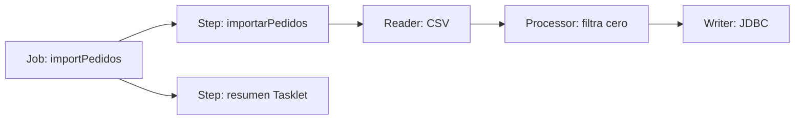
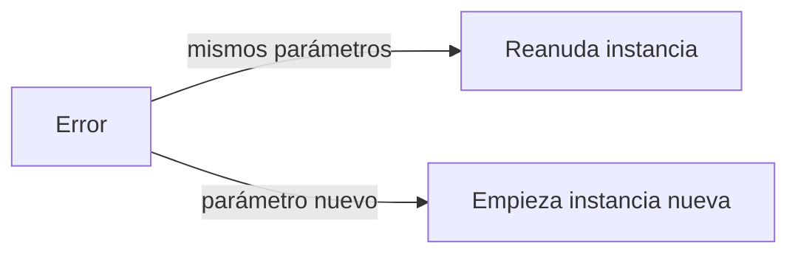

# Módulo 12: Spring Batch: jobs, chunks y procesamiento masivo

## Aprende construyendo

Construirás un job que importa pedidos desde CSV, valida y transforma cada fila, y persiste resultados por lotes. Después ensayarás reinicio y políticas de error con datos deliberadamente inválidos. El objetivo es procesamiento reanudable, observable y acotado en memoria.


### Dos ejemplos: primero visible, luego real

<details open>
<summary><strong>Capa 1 — Lectura</strong></summary>

#### ► DE QUÉ TRATA
Este tema te guía por dos ejemplos: primero visible, luego real con foco en comprensión antes de implementación.

#### ► LA IDEA EN UNA FRASE
**Entender dos ejemplos: primero visible, luego real te permite tomar mejores decisiones técnicas.**

#### ► POR QUÉ EXISTE ESTO
Resuelve un problema real de diseño o implementación y evita decisiones a ciegas.

#### ► LA ANALOGÍA
Piensa en dos ejemplos: primero visible, luego real como una herramienta de taller: útil cuando conoces su propósito y sus límites.
**Dónde se rompe la analogía:** en software, los efectos dependen del contexto, la escala y los trade-offs.

#### ► CÓMO FUNCIONA
1. Identifica el problema que dos ejemplos: primero visible, luego real resuelve.
2. Observa sus componentes y relaciones.
3. Aplica la opción más simple que funcione.
4. Verifica el resultado y los límites.

#### ► LO QUE PUEDE SALIR MAL
| Síntoma | Causa probable | Arreglo |
|---|---|---|
| Dos ejemplos: primero visible, luego real se aplica pero el resultado no mejora | Se usó sin medir el problema real | Mide antes y compara contra la alternativa simple |
| Aparece complejidad inesperada | Se adoptó la técnica sin comprender sus trade-offs | Vuelve a la sección de trade-offs y reduce el alcance |
| Falla en un caso límite | Se asumió un contexto que no se cumple | Prueba el caso límite y documenta cuándo NO usarlo |

#### ► TRADE-OFFS
| Opción | Cuándo usarla | Cuándo NO usarla |
|---|---|---|
| Usar Dos ejemplos: primero visible, luego real | Cuando el problema coincide con su propósito y el beneficio es observable | Cuando agrega complejidad sin resolver un problema real |
| Alternativa más simple | Cuando el contexto es pequeño, estable o fácil de razonar | Cuando ya demostró no escalar o no cumplir el requisito |
| Postergar la decisión | Cuando falta evidencia del problema | Cuando el costo de esperar es mayor que el costo de probar |

#### ► CUÁNDO NO USAR ESTO
No uses dos ejemplos: primero visible, luego real por defecto. Aplícalo cuando el problema lo justifique y puedas verificar el beneficio; si una alternativa más simple resuelve igual, prefiérela.

#### ► DE VUELTA A LA ANALOGÍA
Volviendo a la analogía: dos ejemplos: primero visible, luego real funciona como el modelo inicial, pero recuerda dónde se rompe: en producción importan la evidencia, la escala y el costo de equivocarte.

#### ► LO QUE DEBES RECORDAR
- Dos ejemplos: primero visible, luego real existe para resolver un problema específico.
- Mide antes de adoptar complejidad.
- Conoce el caso donde NO usarlo.
- Verifica con evidencia observable.

#### ► PREGUNTAS PARA PENSAR
1. ¿Qué problema concreto resuelve dos ejemplos: primero visible, luego real en tu contexto?
2. ¿Cómo sabrías que dos ejemplos: primero visible, luego real no está funcionando bien?
3. ¿Qué alternativa más simple considerarías antes de usar dos ejemplos: primero visible, luego real?

</details>

<details>
<summary><strong>Capa 2 — Construcción</strong></summary>

#### Nota de construcción
Este tema es principalmente conceptual en esta versión. La verificación se realiza con las preguntas de comprensión y el criterio de cuándo NO usar dos ejemplos: primero visible, luego real.

</details>

### Tema 1: Job, Step, Tasklet y chunk processing · Intermedio · 35 min

<details open>
<summary><strong>Capa 1 — Lectura</strong></summary>

#### ► DE QUÉ TRATA
Este tema te guía por job, step, tasklet y chunk processing con foco en comprensión antes de implementación.

#### ► LA IDEA EN UNA FRASE
**Entender job, step, tasklet y chunk processing te permite tomar mejores decisiones técnicas.**

#### ► POR QUÉ EXISTE ESTO
Resuelve un problema real de diseño o implementación y evita decisiones a ciegas.

#### ► LA ANALOGÍA
Piensa en job, step, tasklet y chunk processing como una herramienta de taller: útil cuando conoces su propósito y sus límites.
**Dónde se rompe la analogía:** en software, los efectos dependen del contexto, la escala y los trade-offs.

#### ► CÓMO FUNCIONA


#### ► LO QUE PUEDE SALIR MAL
| Síntoma | Causa probable | Arreglo |
|---|---|---|
| Job, Step, Tasklet y chunk processing se aplica pero el resultado no mejora | Se usó sin medir el problema real | Mide antes y compara contra la alternativa simple |
| Aparece complejidad inesperada | Se adoptó la técnica sin comprender sus trade-offs | Vuelve a la sección de trade-offs y reduce el alcance |
| Falla en un caso límite | Se asumió un contexto que no se cumple | Prueba el caso límite y documenta cuándo NO usarlo |

#### ► TRADE-OFFS
| Opción | Cuándo usarla | Cuándo NO usarla |
|---|---|---|
| Usar Job, Step, Tasklet y chunk processing | Cuando el problema coincide con su propósito y el beneficio es observable | Cuando agrega complejidad sin resolver un problema real |
| Alternativa más simple | Cuando el contexto es pequeño, estable o fácil de razonar | Cuando ya demostró no escalar o no cumplir el requisito |
| Postergar la decisión | Cuando falta evidencia del problema | Cuando el costo de esperar es mayor que el costo de probar |

#### ► CUÁNDO NO USAR ESTO
No uses job, step, tasklet y chunk processing por defecto. Aplícalo cuando el problema lo justifique y puedas verificar el beneficio; si una alternativa más simple resuelve igual, prefiérela.

#### ► DE VUELTA A LA ANALOGÍA
Volviendo a la analogía: job, step, tasklet y chunk processing funciona como el modelo inicial, pero recuerda dónde se rompe: en producción importan la evidencia, la escala y el costo de equivocarte.

#### ► LO QUE DEBES RECORDAR
- Job, Step, Tasklet y chunk processing existe para resolver un problema específico.
- Mide antes de adoptar complejidad.
- Conoce el caso donde NO usarlo.
- Verifica con evidencia observable.

#### ► PREGUNTAS PARA PENSAR
1. ¿Qué problema concreto resuelve job, step, tasklet y chunk processing en tu contexto?
2. ¿Cómo sabrías que job, step, tasklet y chunk processing no está funcionando bien?
3. ¿Qué alternativa más simple considerarías antes de usar job, step, tasklet y chunk processing?

</details>

<details>
<summary><strong>Capa 2 — Construcción</strong></summary>

#### Código y verificación


```bash
./mvnw -q test
```

```java
return pedido.importe().signum() > 0 ? pedido : null;
```

```java
.<PedidoImportado, PedidoImportado>chunk(2)
.reader(pedidosReader)
.processor(positiveAmountsOnly)
.writer(pedidosWriter)
```

```bash
./mvnw -q clean test
```

</details>

### Tema 2: Reinicio, JobParameters, retry, skip y listeners · Avanzado · 40 min

<details open>
<summary><strong>Capa 1 — Lectura</strong></summary>

#### ► DE QUÉ TRATA
Este tema te guía por reinicio, jobparameters, retry, skip y listeners con foco en comprensión antes de implementación.

#### ► LA IDEA EN UNA FRASE
**Entender reinicio, jobparameters, retry, skip y listeners te permite tomar mejores decisiones técnicas.**

#### ► POR QUÉ EXISTE ESTO
Resuelve un problema real de diseño o implementación y evita decisiones a ciegas.

#### ► LA ANALOGÍA
Piensa en reinicio, jobparameters, retry, skip y listeners como una herramienta de taller: útil cuando conoces su propósito y sus límites.
**Dónde se rompe la analogía:** en software, los efectos dependen del contexto, la escala y los trade-offs.

#### ► CÓMO FUNCIONA


#### ► LO QUE PUEDE SALIR MAL
| Síntoma | Causa probable | Arreglo |
|---|---|---|
| Reinicio, JobParameters, retry, skip y listeners se aplica pero el resultado no mejora | Se usó sin medir el problema real | Mide antes y compara contra la alternativa simple |
| Aparece complejidad inesperada | Se adoptó la técnica sin comprender sus trade-offs | Vuelve a la sección de trade-offs y reduce el alcance |
| Falla en un caso límite | Se asumió un contexto que no se cumple | Prueba el caso límite y documenta cuándo NO usarlo |

#### ► TRADE-OFFS
| Opción | Cuándo usarla | Cuándo NO usarla |
|---|---|---|
| Usar Reinicio, JobParameters, retry, skip y listeners | Cuando el problema coincide con su propósito y el beneficio es observable | Cuando agrega complejidad sin resolver un problema real |
| Alternativa más simple | Cuando el contexto es pequeño, estable o fácil de razonar | Cuando ya demostró no escalar o no cumplir el requisito |
| Postergar la decisión | Cuando falta evidencia del problema | Cuando el costo de esperar es mayor que el costo de probar |

#### ► CUÁNDO NO USAR ESTO
No uses reinicio, jobparameters, retry, skip y listeners por defecto. Aplícalo cuando el problema lo justifique y puedas verificar el beneficio; si una alternativa más simple resuelve igual, prefiérela.

#### ► DE VUELTA A LA ANALOGÍA
Volviendo a la analogía: reinicio, jobparameters, retry, skip y listeners funciona como el modelo inicial, pero recuerda dónde se rompe: en producción importan la evidencia, la escala y el costo de equivocarte.

#### ► LO QUE DEBES RECORDAR
- Reinicio, JobParameters, retry, skip y listeners existe para resolver un problema específico.
- Mide antes de adoptar complejidad.
- Conoce el caso donde NO usarlo.
- Verifica con evidencia observable.

#### ► PREGUNTAS PARA PENSAR
1. ¿Qué problema concreto resuelve reinicio, jobparameters, retry, skip y listeners en tu contexto?
2. ¿Cómo sabrías que reinicio, jobparameters, retry, skip y listeners no está funcionando bien?
3. ¿Qué alternativa más simple considerarías antes de usar reinicio, jobparameters, retry, skip y listeners?

</details>

<details>
<summary><strong>Capa 2 — Construcción</strong></summary>

#### Código y verificación


```bash
./mvnw -q -Dtest=RestartJobTest#mismaInstanciaReanudaTrasElPrimerChunkConfirmadoSinDuplicarlo test
```

```java
var params = new JobParametersBuilder()
    .addString("inputFile", "restart-pedidos.csv")
    .addLong("run", run)
    .toJobParameters();
```

```java
.faultTolerant()
.retry(TransientDataAccessException.class).retryLimit(2)
.skip(FlatFileParseException.class).skipLimit(2)
```

</details>
