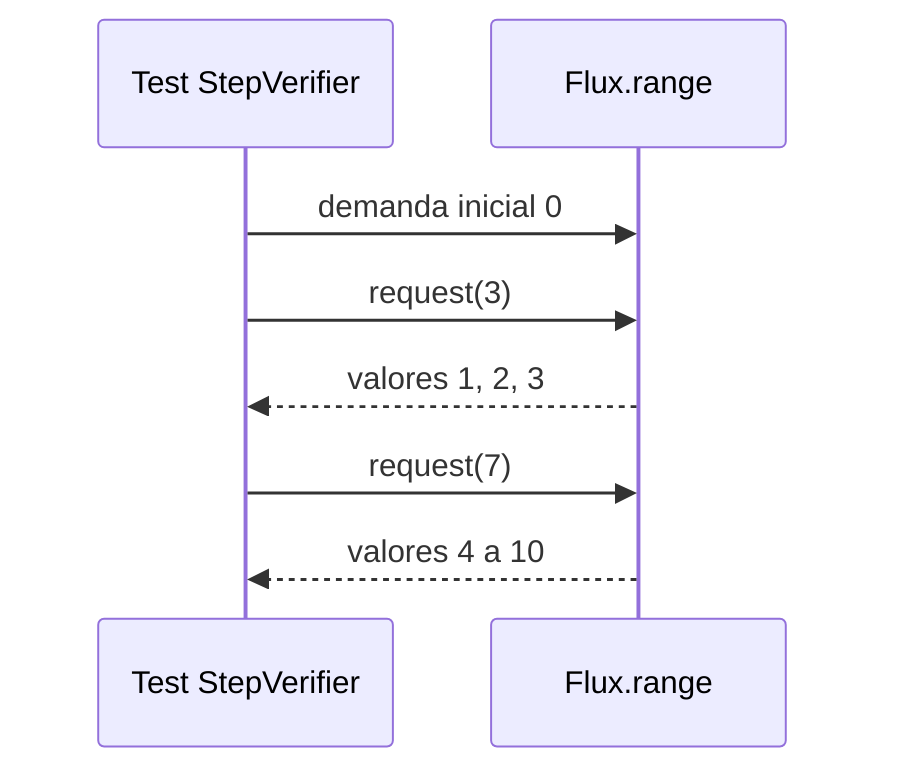

# Módulo 13: Programación reactiva con WebFlux

## Comienza desde cero: crea una API WebFlux ejecutable

Este capítulo no presupone que ya tienes una aplicación reactiva. Crearás `demo-reactive`, una API mínima que guarda entregas en H2 mediante R2DBC y expone un flujo HTTP. Primero harás funcionar una vertical pequeña; después introducirás `WebClient` y compararás el resultado con MVC.


### 1. Comprueba el entorno antes de generar archivos

<details open>
<summary><strong>Capa 1 — Lectura</strong></summary>

#### ► DE QUÉ TRATA
Este tema te guía por 1. comprueba el entorno antes de generar archivos con foco en comprensión antes de implementación.

#### ► LA IDEA EN UNA FRASE
**Entender 1. comprueba el entorno antes de generar archivos te permite tomar mejores decisiones técnicas.**

#### ► POR QUÉ EXISTE ESTO
Resuelve un problema real de diseño o implementación y evita decisiones a ciegas.

#### ► LA ANALOGÍA
Piensa en 1. comprueba el entorno antes de generar archivos como una herramienta de taller: útil cuando conoces su propósito y sus límites.
**Dónde se rompe la analogía:** en software, los efectos dependen del contexto, la escala y los trade-offs.

#### ► CÓMO FUNCIONA
1. Identifica el problema que 1. comprueba el entorno antes de generar archivos resuelve.
2. Observa sus componentes y relaciones.
3. Aplica la opción más simple que funcione.
4. Verifica el resultado y los límites.

#### ► LO QUE PUEDE SALIR MAL
| Síntoma | Causa probable | Arreglo |
|---|---|---|
| 1. Comprueba el entorno antes de generar archivos se aplica pero el resultado no mejora | Se usó sin medir el problema real | Mide antes y compara contra la alternativa simple |
| Aparece complejidad inesperada | Se adoptó la técnica sin comprender sus trade-offs | Vuelve a la sección de trade-offs y reduce el alcance |
| Falla en un caso límite | Se asumió un contexto que no se cumple | Prueba el caso límite y documenta cuándo NO usarlo |

#### ► TRADE-OFFS
| Opción | Cuándo usarla | Cuándo NO usarla |
|---|---|---|
| Usar 1. Comprueba el entorno antes de generar archivos | Cuando el problema coincide con su propósito y el beneficio es observable | Cuando agrega complejidad sin resolver un problema real |
| Alternativa más simple | Cuando el contexto es pequeño, estable o fácil de razonar | Cuando ya demostró no escalar o no cumplir el requisito |
| Postergar la decisión | Cuando falta evidencia del problema | Cuando el costo de esperar es mayor que el costo de probar |

#### ► CUÁNDO NO USAR ESTO
No uses 1. comprueba el entorno antes de generar archivos por defecto. Aplícalo cuando el problema lo justifique y puedas verificar el beneficio; si una alternativa más simple resuelve igual, prefiérela.

#### ► DE VUELTA A LA ANALOGÍA
Volviendo a la analogía: 1. comprueba el entorno antes de generar archivos funciona como el modelo inicial, pero recuerda dónde se rompe: en producción importan la evidencia, la escala y el costo de equivocarte.

#### ► LO QUE DEBES RECORDAR
- 1. Comprueba el entorno antes de generar archivos existe para resolver un problema específico.
- Mide antes de adoptar complejidad.
- Conoce el caso donde NO usarlo.
- Verifica con evidencia observable.

#### ► PREGUNTAS PARA PENSAR
1. ¿Qué problema concreto resuelve 1. comprueba el entorno antes de generar archivos en tu contexto?
2. ¿Cómo sabrías que 1. comprueba el entorno antes de generar archivos no está funcionando bien?
3. ¿Qué alternativa más simple considerarías antes de usar 1. comprueba el entorno antes de generar archivos?

</details>

<details>
<summary><strong>Capa 2 — Construcción</strong></summary>

#### Código y verificación
```bash
java --version
javac --version
git --version
curl --version
```

</details>

### 2. Genera el proyecto con Spring Initializr

<details open>
<summary><strong>Capa 1 — Lectura</strong></summary>

#### ► DE QUÉ TRATA
Este tema te guía por 2. genera el proyecto con spring initializr con foco en comprensión antes de implementación.

#### ► LA IDEA EN UNA FRASE
**Entender 2. genera el proyecto con spring initializr te permite tomar mejores decisiones técnicas.**

#### ► POR QUÉ EXISTE ESTO
Resuelve un problema real de diseño o implementación y evita decisiones a ciegas.

#### ► LA ANALOGÍA
Piensa en 2. genera el proyecto con spring initializr como una herramienta de taller: útil cuando conoces su propósito y sus límites.
**Dónde se rompe la analogía:** en software, los efectos dependen del contexto, la escala y los trade-offs.

#### ► CÓMO FUNCIONA
1. Identifica el problema que 2. genera el proyecto con spring initializr resuelve.
2. Observa sus componentes y relaciones.
3. Aplica la opción más simple que funcione.
4. Verifica el resultado y los límites.

#### ► LO QUE PUEDE SALIR MAL
| Síntoma | Causa probable | Arreglo |
|---|---|---|
| 2. Genera el proyecto con Spring Initializr se aplica pero el resultado no mejora | Se usó sin medir el problema real | Mide antes y compara contra la alternativa simple |
| Aparece complejidad inesperada | Se adoptó la técnica sin comprender sus trade-offs | Vuelve a la sección de trade-offs y reduce el alcance |
| Falla en un caso límite | Se asumió un contexto que no se cumple | Prueba el caso límite y documenta cuándo NO usarlo |

#### ► TRADE-OFFS
| Opción | Cuándo usarla | Cuándo NO usarla |
|---|---|---|
| Usar 2. Genera el proyecto con Spring Initializr | Cuando el problema coincide con su propósito y el beneficio es observable | Cuando agrega complejidad sin resolver un problema real |
| Alternativa más simple | Cuando el contexto es pequeño, estable o fácil de razonar | Cuando ya demostró no escalar o no cumplir el requisito |
| Postergar la decisión | Cuando falta evidencia del problema | Cuando el costo de esperar es mayor que el costo de probar |

#### ► CUÁNDO NO USAR ESTO
No uses 2. genera el proyecto con spring initializr por defecto. Aplícalo cuando el problema lo justifique y puedas verificar el beneficio; si una alternativa más simple resuelve igual, prefiérela.

#### ► DE VUELTA A LA ANALOGÍA
Volviendo a la analogía: 2. genera el proyecto con spring initializr funciona como el modelo inicial, pero recuerda dónde se rompe: en producción importan la evidencia, la escala y el costo de equivocarte.

#### ► LO QUE DEBES RECORDAR
- 2. Genera el proyecto con Spring Initializr existe para resolver un problema específico.
- Mide antes de adoptar complejidad.
- Conoce el caso donde NO usarlo.
- Verifica con evidencia observable.

#### ► PREGUNTAS PARA PENSAR
1. ¿Qué problema concreto resuelve 2. genera el proyecto con spring initializr en tu contexto?
2. ¿Cómo sabrías que 2. genera el proyecto con spring initializr no está funcionando bien?
3. ¿Qué alternativa más simple considerarías antes de usar 2. genera el proyecto con spring initializr?

</details>

<details>
<summary><strong>Capa 2 — Construcción</strong></summary>

#### Código y verificación
```bash
mkdir -p academia-labs && cd academia-labs

curl -G https://start.spring.io/starter.zip \
  -d type=maven-project \
  -d language=java \
  -d javaVersion=25 \
  -d groupId=io.academia \
  -d artifactId=demo-reactive \
  -d name=demo-reactive \
  -d packageName=io.academia \
  -d dependencies=webflux,data-r2dbc,h2,validation \
  -o demo-reactive.zip

unzip demo-reactive.zip -d demo-reactive
cd demo-reactive
./mvnw test
```

```powershell
.\mvnw.cmd test
```

</details>

### 3. Crea una estructura pequeña y explícita

<details open>
<summary><strong>Capa 1 — Lectura</strong></summary>

#### ► DE QUÉ TRATA
Este tema te guía por 3. crea una estructura pequeña y explícita con foco en comprensión antes de implementación.

#### ► LA IDEA EN UNA FRASE
**Entender 3. crea una estructura pequeña y explícita te permite tomar mejores decisiones técnicas.**

#### ► POR QUÉ EXISTE ESTO
Resuelve un problema real de diseño o implementación y evita decisiones a ciegas.

#### ► LA ANALOGÍA
Piensa en 3. crea una estructura pequeña y explícita como una herramienta de taller: útil cuando conoces su propósito y sus límites.
**Dónde se rompe la analogía:** en software, los efectos dependen del contexto, la escala y los trade-offs.

#### ► CÓMO FUNCIONA
1. Identifica el problema que 3. crea una estructura pequeña y explícita resuelve.
2. Observa sus componentes y relaciones.
3. Aplica la opción más simple que funcione.
4. Verifica el resultado y los límites.

#### ► LO QUE PUEDE SALIR MAL
| Síntoma | Causa probable | Arreglo |
|---|---|---|
| 3. Crea una estructura pequeña y explícita se aplica pero el resultado no mejora | Se usó sin medir el problema real | Mide antes y compara contra la alternativa simple |
| Aparece complejidad inesperada | Se adoptó la técnica sin comprender sus trade-offs | Vuelve a la sección de trade-offs y reduce el alcance |
| Falla en un caso límite | Se asumió un contexto que no se cumple | Prueba el caso límite y documenta cuándo NO usarlo |

#### ► TRADE-OFFS
| Opción | Cuándo usarla | Cuándo NO usarla |
|---|---|---|
| Usar 3. Crea una estructura pequeña y explícita | Cuando el problema coincide con su propósito y el beneficio es observable | Cuando agrega complejidad sin resolver un problema real |
| Alternativa más simple | Cuando el contexto es pequeño, estable o fácil de razonar | Cuando ya demostró no escalar o no cumplir el requisito |
| Postergar la decisión | Cuando falta evidencia del problema | Cuando el costo de esperar es mayor que el costo de probar |

#### ► CUÁNDO NO USAR ESTO
No uses 3. crea una estructura pequeña y explícita por defecto. Aplícalo cuando el problema lo justifique y puedas verificar el beneficio; si una alternativa más simple resuelve igual, prefiérela.

#### ► DE VUELTA A LA ANALOGÍA
Volviendo a la analogía: 3. crea una estructura pequeña y explícita funciona como el modelo inicial, pero recuerda dónde se rompe: en producción importan la evidencia, la escala y el costo de equivocarte.

#### ► LO QUE DEBES RECORDAR
- 3. Crea una estructura pequeña y explícita existe para resolver un problema específico.
- Mide antes de adoptar complejidad.
- Conoce el caso donde NO usarlo.
- Verifica con evidencia observable.

#### ► PREGUNTAS PARA PENSAR
1. ¿Qué problema concreto resuelve 3. crea una estructura pequeña y explícita en tu contexto?
2. ¿Cómo sabrías que 3. crea una estructura pequeña y explícita no está funcionando bien?
3. ¿Qué alternativa más simple considerarías antes de usar 3. crea una estructura pequeña y explícita?

</details>

<details>
<summary><strong>Capa 2 — Construcción</strong></summary>

#### Código y verificación
```text
demo-reactive/
├─ pom.xml
├─ src/main/java/io/academia/
│  ├─ DemoReactiveApplication.java
│  └─ delivery/
│     ├─ Delivery.java
│     ├─ DeliveryRepository.java
│     └─ DeliveryController.java
├─ src/main/resources/
│  ├─ application.yml
│  └─ schema.sql
└─ src/test/java/io/academia/delivery/
   └─ DeliveryControllerTest.java
```

</details>

### 4. Configura una base reactiva local

<details open>
<summary><strong>Capa 1 — Lectura</strong></summary>

#### ► DE QUÉ TRATA
Este tema te guía por 4. configura una base reactiva local con foco en comprensión antes de implementación.

#### ► LA IDEA EN UNA FRASE
**Entender 4. configura una base reactiva local te permite tomar mejores decisiones técnicas.**

#### ► POR QUÉ EXISTE ESTO
Resuelve un problema real de diseño o implementación y evita decisiones a ciegas.

#### ► LA ANALOGÍA
Piensa en 4. configura una base reactiva local como una herramienta de taller: útil cuando conoces su propósito y sus límites.
**Dónde se rompe la analogía:** en software, los efectos dependen del contexto, la escala y los trade-offs.

#### ► CÓMO FUNCIONA
1. Identifica el problema que 4. configura una base reactiva local resuelve.
2. Observa sus componentes y relaciones.
3. Aplica la opción más simple que funcione.
4. Verifica el resultado y los límites.

#### ► LO QUE PUEDE SALIR MAL
| Síntoma | Causa probable | Arreglo |
|---|---|---|
| 4. Configura una base reactiva local se aplica pero el resultado no mejora | Se usó sin medir el problema real | Mide antes y compara contra la alternativa simple |
| Aparece complejidad inesperada | Se adoptó la técnica sin comprender sus trade-offs | Vuelve a la sección de trade-offs y reduce el alcance |
| Falla en un caso límite | Se asumió un contexto que no se cumple | Prueba el caso límite y documenta cuándo NO usarlo |

#### ► TRADE-OFFS
| Opción | Cuándo usarla | Cuándo NO usarla |
|---|---|---|
| Usar 4. Configura una base reactiva local | Cuando el problema coincide con su propósito y el beneficio es observable | Cuando agrega complejidad sin resolver un problema real |
| Alternativa más simple | Cuando el contexto es pequeño, estable o fácil de razonar | Cuando ya demostró no escalar o no cumplir el requisito |
| Postergar la decisión | Cuando falta evidencia del problema | Cuando el costo de esperar es mayor que el costo de probar |

#### ► CUÁNDO NO USAR ESTO
No uses 4. configura una base reactiva local por defecto. Aplícalo cuando el problema lo justifique y puedas verificar el beneficio; si una alternativa más simple resuelve igual, prefiérela.

#### ► DE VUELTA A LA ANALOGÍA
Volviendo a la analogía: 4. configura una base reactiva local funciona como el modelo inicial, pero recuerda dónde se rompe: en producción importan la evidencia, la escala y el costo de equivocarte.

#### ► LO QUE DEBES RECORDAR
- 4. Configura una base reactiva local existe para resolver un problema específico.
- Mide antes de adoptar complejidad.
- Conoce el caso donde NO usarlo.
- Verifica con evidencia observable.

#### ► PREGUNTAS PARA PENSAR
1. ¿Qué problema concreto resuelve 4. configura una base reactiva local en tu contexto?
2. ¿Cómo sabrías que 4. configura una base reactiva local no está funcionando bien?
3. ¿Qué alternativa más simple considerarías antes de usar 4. configura una base reactiva local?

</details>

<details>
<summary><strong>Capa 2 — Construcción</strong></summary>

#### Código y verificación
```yaml
spring:
  application:
    name: demo-reactive
  r2dbc:
    url: r2dbc:h2:mem:///demo;DB_CLOSE_DELAY=-1
    username: sa
    password: ""
  sql:
    init:
      mode: always
server:
  port: 8080
```

```sql
CREATE TABLE IF NOT EXISTS delivery (
  id BIGINT GENERATED BY DEFAULT AS IDENTITY PRIMARY KEY,
  tracking_code VARCHAR(40) NOT NULL UNIQUE,
  status VARCHAR(30) NOT NULL
);
```

</details>

### 5. Implementa el modelo y el repositorio

<details open>
<summary><strong>Capa 1 — Lectura</strong></summary>

#### ► DE QUÉ TRATA
Este tema te guía por 5. implementa el modelo y el repositorio con foco en comprensión antes de implementación.

#### ► LA IDEA EN UNA FRASE
**Entender 5. implementa el modelo y el repositorio te permite tomar mejores decisiones técnicas.**

#### ► POR QUÉ EXISTE ESTO
Resuelve un problema real de diseño o implementación y evita decisiones a ciegas.

#### ► LA ANALOGÍA
Piensa en 5. implementa el modelo y el repositorio como una herramienta de taller: útil cuando conoces su propósito y sus límites.
**Dónde se rompe la analogía:** en software, los efectos dependen del contexto, la escala y los trade-offs.

#### ► CÓMO FUNCIONA
1. Identifica el problema que 5. implementa el modelo y el repositorio resuelve.
2. Observa sus componentes y relaciones.
3. Aplica la opción más simple que funcione.
4. Verifica el resultado y los límites.

#### ► LO QUE PUEDE SALIR MAL
| Síntoma | Causa probable | Arreglo |
|---|---|---|
| 5. Implementa el modelo y el repositorio se aplica pero el resultado no mejora | Se usó sin medir el problema real | Mide antes y compara contra la alternativa simple |
| Aparece complejidad inesperada | Se adoptó la técnica sin comprender sus trade-offs | Vuelve a la sección de trade-offs y reduce el alcance |
| Falla en un caso límite | Se asumió un contexto que no se cumple | Prueba el caso límite y documenta cuándo NO usarlo |

#### ► TRADE-OFFS
| Opción | Cuándo usarla | Cuándo NO usarla |
|---|---|---|
| Usar 5. Implementa el modelo y el repositorio | Cuando el problema coincide con su propósito y el beneficio es observable | Cuando agrega complejidad sin resolver un problema real |
| Alternativa más simple | Cuando el contexto es pequeño, estable o fácil de razonar | Cuando ya demostró no escalar o no cumplir el requisito |
| Postergar la decisión | Cuando falta evidencia del problema | Cuando el costo de esperar es mayor que el costo de probar |

#### ► CUÁNDO NO USAR ESTO
No uses 5. implementa el modelo y el repositorio por defecto. Aplícalo cuando el problema lo justifique y puedas verificar el beneficio; si una alternativa más simple resuelve igual, prefiérela.

#### ► DE VUELTA A LA ANALOGÍA
Volviendo a la analogía: 5. implementa el modelo y el repositorio funciona como el modelo inicial, pero recuerda dónde se rompe: en producción importan la evidencia, la escala y el costo de equivocarte.

#### ► LO QUE DEBES RECORDAR
- 5. Implementa el modelo y el repositorio existe para resolver un problema específico.
- Mide antes de adoptar complejidad.
- Conoce el caso donde NO usarlo.
- Verifica con evidencia observable.

#### ► PREGUNTAS PARA PENSAR
1. ¿Qué problema concreto resuelve 5. implementa el modelo y el repositorio en tu contexto?
2. ¿Cómo sabrías que 5. implementa el modelo y el repositorio no está funcionando bien?
3. ¿Qué alternativa más simple considerarías antes de usar 5. implementa el modelo y el repositorio?

</details>

<details>
<summary><strong>Capa 2 — Construcción</strong></summary>

#### Código y verificación
```java
package io.academia.delivery;

import org.springframework.data.annotation.Id;
import org.springframework.data.relational.core.mapping.Table;

@Table("delivery")
public record Delivery(
    @Id Long id,
    String trackingCode,
    String status
) {}
```

```java
package io.academia.delivery;

import org.springframework.data.repository.reactive.ReactiveCrudRepository;
import reactor.core.publisher.Mono;

public interface DeliveryRepository
    extends ReactiveCrudRepository<Delivery, Long> {

  Mono<Delivery> findByTrackingCode(String trackingCode);
}
```

</details>

### 6. Expón endpoints sin llamar subscribe()

<details open>
<summary><strong>Capa 1 — Lectura</strong></summary>

#### ► DE QUÉ TRATA
Este tema te guía por 6. expón endpoints sin llamar subscribe() con foco en comprensión antes de implementación.

#### ► LA IDEA EN UNA FRASE
**Entender 6. expón endpoints sin llamar subscribe() te permite tomar mejores decisiones técnicas.**

#### ► POR QUÉ EXISTE ESTO
Resuelve un problema real de diseño o implementación y evita decisiones a ciegas.

#### ► LA ANALOGÍA
Piensa en 6. expón endpoints sin llamar subscribe() como una herramienta de taller: útil cuando conoces su propósito y sus límites.
**Dónde se rompe la analogía:** en software, los efectos dependen del contexto, la escala y los trade-offs.

#### ► CÓMO FUNCIONA
1. Identifica el problema que 6. expón endpoints sin llamar subscribe() resuelve.
2. Observa sus componentes y relaciones.
3. Aplica la opción más simple que funcione.
4. Verifica el resultado y los límites.

#### ► LO QUE PUEDE SALIR MAL
| Síntoma | Causa probable | Arreglo |
|---|---|---|
| 6. Expón endpoints sin llamar subscribe() se aplica pero el resultado no mejora | Se usó sin medir el problema real | Mide antes y compara contra la alternativa simple |
| Aparece complejidad inesperada | Se adoptó la técnica sin comprender sus trade-offs | Vuelve a la sección de trade-offs y reduce el alcance |
| Falla en un caso límite | Se asumió un contexto que no se cumple | Prueba el caso límite y documenta cuándo NO usarlo |

#### ► TRADE-OFFS
| Opción | Cuándo usarla | Cuándo NO usarla |
|---|---|---|
| Usar 6. Expón endpoints sin llamar subscribe() | Cuando el problema coincide con su propósito y el beneficio es observable | Cuando agrega complejidad sin resolver un problema real |
| Alternativa más simple | Cuando el contexto es pequeño, estable o fácil de razonar | Cuando ya demostró no escalar o no cumplir el requisito |
| Postergar la decisión | Cuando falta evidencia del problema | Cuando el costo de esperar es mayor que el costo de probar |

#### ► CUÁNDO NO USAR ESTO
No uses 6. expón endpoints sin llamar subscribe() por defecto. Aplícalo cuando el problema lo justifique y puedas verificar el beneficio; si una alternativa más simple resuelve igual, prefiérela.

#### ► DE VUELTA A LA ANALOGÍA
Volviendo a la analogía: 6. expón endpoints sin llamar subscribe() funciona como el modelo inicial, pero recuerda dónde se rompe: en producción importan la evidencia, la escala y el costo de equivocarte.

#### ► LO QUE DEBES RECORDAR
- 6. Expón endpoints sin llamar subscribe() existe para resolver un problema específico.
- Mide antes de adoptar complejidad.
- Conoce el caso donde NO usarlo.
- Verifica con evidencia observable.

#### ► PREGUNTAS PARA PENSAR
1. ¿Qué problema concreto resuelve 6. expón endpoints sin llamar subscribe() en tu contexto?
2. ¿Cómo sabrías que 6. expón endpoints sin llamar subscribe() no está funcionando bien?
3. ¿Qué alternativa más simple considerarías antes de usar 6. expón endpoints sin llamar subscribe()?

</details>

<details>
<summary><strong>Capa 2 — Construcción</strong></summary>

#### Código y verificación
```java
package io.academia.delivery;

import org.springframework.http.HttpStatus;
import org.springframework.web.bind.annotation.*;
import reactor.core.publisher.Flux;
import reactor.core.publisher.Mono;

@RestController
@RequestMapping("/deliveries")
public final class DeliveryController {
  private final DeliveryRepository repository;

  public DeliveryController(DeliveryRepository repository) {
    this.repository = repository;
  }

  @GetMapping
  public Flux<Delivery> findAll() {
    return repository.findAll();
  }

  @GetMapping("/{trackingCode}")
  public Mono<Delivery> findOne(@PathVariable String trackingCode) {
    return repository.findByTrackingCode(trackingCode);
  }

  @PostMapping
  @ResponseStatus(HttpStatus.CREATED)
  public Mono<Delivery> create(@RequestBody Delivery input) {
    Delivery unsaved = new Delivery(null, input.trackingCode(), "CREATED");
    return repository.save(unsaved);
  }
}
```

</details>

### 7. Ejecuta y observa un resultado concreto

<details open>
<summary><strong>Capa 1 — Lectura</strong></summary>

#### ► DE QUÉ TRATA
Este tema te guía por 7. ejecuta y observa un resultado concreto con foco en comprensión antes de implementación.

#### ► LA IDEA EN UNA FRASE
**Entender 7. ejecuta y observa un resultado concreto te permite tomar mejores decisiones técnicas.**

#### ► POR QUÉ EXISTE ESTO
Resuelve un problema real de diseño o implementación y evita decisiones a ciegas.

#### ► LA ANALOGÍA
Piensa en 7. ejecuta y observa un resultado concreto como una herramienta de taller: útil cuando conoces su propósito y sus límites.
**Dónde se rompe la analogía:** en software, los efectos dependen del contexto, la escala y los trade-offs.

#### ► CÓMO FUNCIONA
1. Identifica el problema que 7. ejecuta y observa un resultado concreto resuelve.
2. Observa sus componentes y relaciones.
3. Aplica la opción más simple que funcione.
4. Verifica el resultado y los límites.

#### ► LO QUE PUEDE SALIR MAL
| Síntoma | Causa probable | Arreglo |
|---|---|---|
| 7. Ejecuta y observa un resultado concreto se aplica pero el resultado no mejora | Se usó sin medir el problema real | Mide antes y compara contra la alternativa simple |
| Aparece complejidad inesperada | Se adoptó la técnica sin comprender sus trade-offs | Vuelve a la sección de trade-offs y reduce el alcance |
| Falla en un caso límite | Se asumió un contexto que no se cumple | Prueba el caso límite y documenta cuándo NO usarlo |

#### ► TRADE-OFFS
| Opción | Cuándo usarla | Cuándo NO usarla |
|---|---|---|
| Usar 7. Ejecuta y observa un resultado concreto | Cuando el problema coincide con su propósito y el beneficio es observable | Cuando agrega complejidad sin resolver un problema real |
| Alternativa más simple | Cuando el contexto es pequeño, estable o fácil de razonar | Cuando ya demostró no escalar o no cumplir el requisito |
| Postergar la decisión | Cuando falta evidencia del problema | Cuando el costo de esperar es mayor que el costo de probar |

#### ► CUÁNDO NO USAR ESTO
No uses 7. ejecuta y observa un resultado concreto por defecto. Aplícalo cuando el problema lo justifique y puedas verificar el beneficio; si una alternativa más simple resuelve igual, prefiérela.

#### ► DE VUELTA A LA ANALOGÍA
Volviendo a la analogía: 7. ejecuta y observa un resultado concreto funciona como el modelo inicial, pero recuerda dónde se rompe: en producción importan la evidencia, la escala y el costo de equivocarte.

#### ► LO QUE DEBES RECORDAR
- 7. Ejecuta y observa un resultado concreto existe para resolver un problema específico.
- Mide antes de adoptar complejidad.
- Conoce el caso donde NO usarlo.
- Verifica con evidencia observable.

#### ► PREGUNTAS PARA PENSAR
1. ¿Qué problema concreto resuelve 7. ejecuta y observa un resultado concreto en tu contexto?
2. ¿Cómo sabrías que 7. ejecuta y observa un resultado concreto no está funcionando bien?
3. ¿Qué alternativa más simple considerarías antes de usar 7. ejecuta y observa un resultado concreto?

</details>

<details>
<summary><strong>Capa 2 — Construcción</strong></summary>

#### Código y verificación
```bash
./mvnw spring-boot:run
```

```bash
curl -i -X POST http://localhost:8080/deliveries \
  -H 'Content-Type: application/json' \
  -d '{"trackingCode":"RF-001","status":"IGNORED"}'

curl -i http://localhost:8080/deliveries/RF-001
curl -i http://localhost:8080/deliveries
```

</details>

### 8. Provoca tres fallos antes de continuar

<details open>
<summary><strong>Capa 1 — Lectura</strong></summary>

#### ► DE QUÉ TRATA
Este tema te guía por 8. provoca tres fallos antes de continuar con foco en comprensión antes de implementación.

#### ► LA IDEA EN UNA FRASE
**Entender 8. provoca tres fallos antes de continuar te permite tomar mejores decisiones técnicas.**

#### ► POR QUÉ EXISTE ESTO
Resuelve un problema real de diseño o implementación y evita decisiones a ciegas.

#### ► LA ANALOGÍA
Piensa en 8. provoca tres fallos antes de continuar como una herramienta de taller: útil cuando conoces su propósito y sus límites.
**Dónde se rompe la analogía:** en software, los efectos dependen del contexto, la escala y los trade-offs.

#### ► CÓMO FUNCIONA
1. Identifica el problema que 8. provoca tres fallos antes de continuar resuelve.
2. Observa sus componentes y relaciones.
3. Aplica la opción más simple que funcione.
4. Verifica el resultado y los límites.

#### ► LO QUE PUEDE SALIR MAL
| Síntoma | Causa probable | Arreglo |
|---|---|---|
| 8. Provoca tres fallos antes de continuar se aplica pero el resultado no mejora | Se usó sin medir el problema real | Mide antes y compara contra la alternativa simple |
| Aparece complejidad inesperada | Se adoptó la técnica sin comprender sus trade-offs | Vuelve a la sección de trade-offs y reduce el alcance |
| Falla en un caso límite | Se asumió un contexto que no se cumple | Prueba el caso límite y documenta cuándo NO usarlo |

#### ► TRADE-OFFS
| Opción | Cuándo usarla | Cuándo NO usarla |
|---|---|---|
| Usar 8. Provoca tres fallos antes de continuar | Cuando el problema coincide con su propósito y el beneficio es observable | Cuando agrega complejidad sin resolver un problema real |
| Alternativa más simple | Cuando el contexto es pequeño, estable o fácil de razonar | Cuando ya demostró no escalar o no cumplir el requisito |
| Postergar la decisión | Cuando falta evidencia del problema | Cuando el costo de esperar es mayor que el costo de probar |

#### ► CUÁNDO NO USAR ESTO
No uses 8. provoca tres fallos antes de continuar por defecto. Aplícalo cuando el problema lo justifique y puedas verificar el beneficio; si una alternativa más simple resuelve igual, prefiérela.

#### ► DE VUELTA A LA ANALOGÍA
Volviendo a la analogía: 8. provoca tres fallos antes de continuar funciona como el modelo inicial, pero recuerda dónde se rompe: en producción importan la evidencia, la escala y el costo de equivocarte.

#### ► LO QUE DEBES RECORDAR
- 8. Provoca tres fallos antes de continuar existe para resolver un problema específico.
- Mide antes de adoptar complejidad.
- Conoce el caso donde NO usarlo.
- Verifica con evidencia observable.

#### ► PREGUNTAS PARA PENSAR
1. ¿Qué problema concreto resuelve 8. provoca tres fallos antes de continuar en tu contexto?
2. ¿Cómo sabrías que 8. provoca tres fallos antes de continuar no está funcionando bien?
3. ¿Qué alternativa más simple considerarías antes de usar 8. provoca tres fallos antes de continuar?

</details>

<details>
<summary><strong>Capa 2 — Construcción</strong></summary>

#### Nota de construcción
Este tema es principalmente conceptual en esta versión. La verificación se realiza con las preguntas de comprensión y el criterio de cuándo NO usar 8. provoca tres fallos antes de continuar.

</details>

### Tema 1: Mono y Flux · Intermedio · 40 min

<details open>
<summary><strong>Capa 1 — Lectura</strong></summary>

#### ► DE QUÉ TRATA
Este tema te guía por mono y flux con foco en comprensión antes de implementación.

#### ► LA IDEA EN UNA FRASE
**Entender mono y flux te permite tomar mejores decisiones técnicas.**

#### ► POR QUÉ EXISTE ESTO
Resuelve un problema real de diseño o implementación y evita decisiones a ciegas.

#### ► LA ANALOGÍA
Piensa en mono y flux como una herramienta de taller: útil cuando conoces su propósito y sus límites.
**Dónde se rompe la analogía:** en software, los efectos dependen del contexto, la escala y los trade-offs.

#### ► CÓMO FUNCIONA
1. Identifica el problema que mono y flux resuelve.
2. Observa sus componentes y relaciones.
3. Aplica la opción más simple que funcione.
4. Verifica el resultado y los límites.

#### ► LO QUE PUEDE SALIR MAL
| Síntoma | Causa probable | Arreglo |
|---|---|---|
| Mono y Flux se aplica pero el resultado no mejora | Se usó sin medir el problema real | Mide antes y compara contra la alternativa simple |
| Aparece complejidad inesperada | Se adoptó la técnica sin comprender sus trade-offs | Vuelve a la sección de trade-offs y reduce el alcance |
| Falla en un caso límite | Se asumió un contexto que no se cumple | Prueba el caso límite y documenta cuándo NO usarlo |

#### ► TRADE-OFFS
| Opción | Cuándo usarla | Cuándo NO usarla |
|---|---|---|
| Usar Mono y Flux | Cuando el problema coincide con su propósito y el beneficio es observable | Cuando agrega complejidad sin resolver un problema real |
| Alternativa más simple | Cuando el contexto es pequeño, estable o fácil de razonar | Cuando ya demostró no escalar o no cumplir el requisito |
| Postergar la decisión | Cuando falta evidencia del problema | Cuando el costo de esperar es mayor que el costo de probar |

#### ► CUÁNDO NO USAR ESTO
No uses mono y flux por defecto. Aplícalo cuando el problema lo justifique y puedas verificar el beneficio; si una alternativa más simple resuelve igual, prefiérela.

#### ► DE VUELTA A LA ANALOGÍA
Volviendo a la analogía: mono y flux funciona como el modelo inicial, pero recuerda dónde se rompe: en producción importan la evidencia, la escala y el costo de equivocarte.

#### ► LO QUE DEBES RECORDAR
- Mono y Flux existe para resolver un problema específico.
- Mide antes de adoptar complejidad.
- Conoce el caso donde NO usarlo.
- Verifica con evidencia observable.

#### ► PREGUNTAS PARA PENSAR
1. ¿Qué problema concreto resuelve mono y flux en tu contexto?
2. ¿Cómo sabrías que mono y flux no está funcionando bien?
3. ¿Qué alternativa más simple considerarías antes de usar mono y flux?

</details>

<details>
<summary><strong>Capa 2 — Construcción</strong></summary>

#### Código y verificación
```bash
./mvnw -Dtest=MonoFluxTest#monoEntregaCeroOUnaGuia test
```

```bash
./mvnw -Dtest=MonoFluxTest#errorEsUnaSenalDistintaDeCompletarVacio test
```

```bash
./mvnw -Dtest=MonoFluxTest#deferEjecutaElCalculoUnaVezPorSuscripcion test
```

```bash
./mvnw -Dtest=MonoFluxTest#fluxRespetaLaDemandaYEmiteEnOrden test
```

</details>

### Tema 2: WebClient y composición no bloqueante · Avanzado · 40 min

<details open>
<summary><strong>Capa 1 — Lectura</strong></summary>

#### ► DE QUÉ TRATA
Este tema te guía por webclient y composición no bloqueante con foco en comprensión antes de implementación.

#### ► LA IDEA EN UNA FRASE
**Entender webclient y composición no bloqueante te permite tomar mejores decisiones técnicas.**

#### ► POR QUÉ EXISTE ESTO
Resuelve un problema real de diseño o implementación y evita decisiones a ciegas.

#### ► LA ANALOGÍA
Piensa en webclient y composición no bloqueante como una herramienta de taller: útil cuando conoces su propósito y sus límites.
**Dónde se rompe la analogía:** en software, los efectos dependen del contexto, la escala y los trade-offs.

#### ► CÓMO FUNCIONA
1. Identifica el problema que webclient y composición no bloqueante resuelve.
2. Observa sus componentes y relaciones.
3. Aplica la opción más simple que funcione.
4. Verifica el resultado y los límites.

#### ► LO QUE PUEDE SALIR MAL
| Síntoma | Causa probable | Arreglo |
|---|---|---|
| WebClient y composición no bloqueante se aplica pero el resultado no mejora | Se usó sin medir el problema real | Mide antes y compara contra la alternativa simple |
| Aparece complejidad inesperada | Se adoptó la técnica sin comprender sus trade-offs | Vuelve a la sección de trade-offs y reduce el alcance |
| Falla en un caso límite | Se asumió un contexto que no se cumple | Prueba el caso límite y documenta cuándo NO usarlo |

#### ► TRADE-OFFS
| Opción | Cuándo usarla | Cuándo NO usarla |
|---|---|---|
| Usar WebClient y composición no bloqueante | Cuando el problema coincide con su propósito y el beneficio es observable | Cuando agrega complejidad sin resolver un problema real |
| Alternativa más simple | Cuando el contexto es pequeño, estable o fácil de razonar | Cuando ya demostró no escalar o no cumplir el requisito |
| Postergar la decisión | Cuando falta evidencia del problema | Cuando el costo de esperar es mayor que el costo de probar |

#### ► CUÁNDO NO USAR ESTO
No uses webclient y composición no bloqueante por defecto. Aplícalo cuando el problema lo justifique y puedas verificar el beneficio; si una alternativa más simple resuelve igual, prefiérela.

#### ► DE VUELTA A LA ANALOGÍA
Volviendo a la analogía: webclient y composición no bloqueante funciona como el modelo inicial, pero recuerda dónde se rompe: en producción importan la evidencia, la escala y el costo de equivocarte.

#### ► LO QUE DEBES RECORDAR
- WebClient y composición no bloqueante existe para resolver un problema específico.
- Mide antes de adoptar complejidad.
- Conoce el caso donde NO usarlo.
- Verifica con evidencia observable.

#### ► PREGUNTAS PARA PENSAR
1. ¿Qué problema concreto resuelve webclient y composición no bloqueante en tu contexto?
2. ¿Cómo sabrías que webclient y composición no bloqueante no está funcionando bien?
3. ¿Qué alternativa más simple considerarías antes de usar webclient y composición no bloqueante?

</details>

<details>
<summary><strong>Capa 2 — Construcción</strong></summary>

#### Código y verificación
```bash
./mvnw -Dtest=TarifaClientTest#composesLocationAndTariffRequestsInOrder test
```

```bash
./mvnw -Dtest=TarifaClientTest#composesLocationAndTariffRequestsInOrder test
```

```bash
./mvnw -Dtest=TarifaClientTest#httpServerErrorArrivesAsReactiveError test
```

```bash
./mvnw -Dtest=TarifaClientTest#timeoutCancelsAResponseThatArrivesTooLate test
```

</details>

### Tema 3: Cuándo WebFlux vale la complejidad, y R2DBC · Avanzado · 40 min

<details open>
<summary><strong>Capa 1 — Lectura</strong></summary>

#### ► DE QUÉ TRATA
Este tema te guía por cuándo webflux vale la complejidad, y r2dbc con foco en comprensión antes de implementación.

#### ► LA IDEA EN UNA FRASE
**Entender cuándo webflux vale la complejidad, y r2dbc te permite tomar mejores decisiones técnicas.**

#### ► POR QUÉ EXISTE ESTO
Resuelve un problema real de diseño o implementación y evita decisiones a ciegas.

#### ► LA ANALOGÍA
Piensa en cuándo webflux vale la complejidad, y r2dbc como una herramienta de taller: útil cuando conoces su propósito y sus límites.
**Dónde se rompe la analogía:** en software, los efectos dependen del contexto, la escala y los trade-offs.

#### ► CÓMO FUNCIONA
1. Identifica el problema que cuándo webflux vale la complejidad, y r2dbc resuelve.
2. Observa sus componentes y relaciones.
3. Aplica la opción más simple que funcione.
4. Verifica el resultado y los límites.

#### ► LO QUE PUEDE SALIR MAL
| Síntoma | Causa probable | Arreglo |
|---|---|---|
| Cuándo WebFlux vale la complejidad, y R2DBC se aplica pero el resultado no mejora | Se usó sin medir el problema real | Mide antes y compara contra la alternativa simple |
| Aparece complejidad inesperada | Se adoptó la técnica sin comprender sus trade-offs | Vuelve a la sección de trade-offs y reduce el alcance |
| Falla en un caso límite | Se asumió un contexto que no se cumple | Prueba el caso límite y documenta cuándo NO usarlo |

#### ► TRADE-OFFS
| Opción | Cuándo usarla | Cuándo NO usarla |
|---|---|---|
| Usar Cuándo WebFlux vale la complejidad, y R2DBC | Cuando el problema coincide con su propósito y el beneficio es observable | Cuando agrega complejidad sin resolver un problema real |
| Alternativa más simple | Cuando el contexto es pequeño, estable o fácil de razonar | Cuando ya demostró no escalar o no cumplir el requisito |
| Postergar la decisión | Cuando falta evidencia del problema | Cuando el costo de esperar es mayor que el costo de probar |

#### ► CUÁNDO NO USAR ESTO
No uses cuándo webflux vale la complejidad, y r2dbc por defecto. Aplícalo cuando el problema lo justifique y puedas verificar el beneficio; si una alternativa más simple resuelve igual, prefiérela.

#### ► DE VUELTA A LA ANALOGÍA
Volviendo a la analogía: cuándo webflux vale la complejidad, y r2dbc funciona como el modelo inicial, pero recuerda dónde se rompe: en producción importan la evidencia, la escala y el costo de equivocarte.

#### ► LO QUE DEBES RECORDAR
- Cuándo WebFlux vale la complejidad, y R2DBC existe para resolver un problema específico.
- Mide antes de adoptar complejidad.
- Conoce el caso donde NO usarlo.
- Verifica con evidencia observable.

#### ► PREGUNTAS PARA PENSAR
1. ¿Qué problema concreto resuelve cuándo webflux vale la complejidad, y r2dbc en tu contexto?
2. ¿Cómo sabrías que cuándo webflux vale la complejidad, y r2dbc no está funcionando bien?
3. ¿Qué alternativa más simple considerarías antes de usar cuándo webflux vale la complejidad, y r2dbc?

</details>

<details>
<summary><strong>Capa 2 — Construcción</strong></summary>

#### Código y verificación
```bash
./mvnw -Dtest=DecisionApplicationTest#blockInsideNettyEventLoopIsRejected test
```

```bash
./mvnw -Dtest=DecisionApplicationTest#r2dbcReadsAnExistingDelivery test
```

```bash
./mvnw -Dtest=DecisionApplicationTest#unavoidableBlockingCallCanBeIsolatedOnBoundedElastic test
```

```java
Mono.fromCallable(() -> clienteBloqueante.consultar(codigo))
    .subscribeOn(Schedulers.boundedElastic());
```

</details>

### Tema 4: Backpressure real en WebFlux con reactor-test · Avanzado · 35 min

<details open>
<summary><strong>Capa 1 — Lectura</strong></summary>

#### ► DE QUÉ TRATA
Este tema te guía por backpressure real en webflux con reactor-test con foco en comprensión antes de implementación.

#### ► LA IDEA EN UNA FRASE
**Entender backpressure real en webflux con reactor-test te permite tomar mejores decisiones técnicas.**

#### ► POR QUÉ EXISTE ESTO
Resuelve un problema real de diseño o implementación y evita decisiones a ciegas.

#### ► LA ANALOGÍA
Piensa en backpressure real en webflux con reactor-test como una herramienta de taller: útil cuando conoces su propósito y sus límites.
**Dónde se rompe la analogía:** en software, los efectos dependen del contexto, la escala y los trade-offs.

#### ► CÓMO FUNCIONA


#### ► LO QUE PUEDE SALIR MAL
| Síntoma | Causa probable | Arreglo |
|---|---|---|
| Backpressure real en WebFlux con reactor-test se aplica pero el resultado no mejora | Se usó sin medir el problema real | Mide antes y compara contra la alternativa simple |
| Aparece complejidad inesperada | Se adoptó la técnica sin comprender sus trade-offs | Vuelve a la sección de trade-offs y reduce el alcance |
| Falla en un caso límite | Se asumió un contexto que no se cumple | Prueba el caso límite y documenta cuándo NO usarlo |

#### ► TRADE-OFFS
| Opción | Cuándo usarla | Cuándo NO usarla |
|---|---|---|
| Usar Backpressure real en WebFlux con reactor-test | Cuando el problema coincide con su propósito y el beneficio es observable | Cuando agrega complejidad sin resolver un problema real |
| Alternativa más simple | Cuando el contexto es pequeño, estable o fácil de razonar | Cuando ya demostró no escalar o no cumplir el requisito |
| Postergar la decisión | Cuando falta evidencia del problema | Cuando el costo de esperar es mayor que el costo de probar |

#### ► CUÁNDO NO USAR ESTO
No uses backpressure real en webflux con reactor-test por defecto. Aplícalo cuando el problema lo justifique y puedas verificar el beneficio; si una alternativa más simple resuelve igual, prefiérela.

#### ► DE VUELTA A LA ANALOGÍA
Volviendo a la analogía: backpressure real en webflux con reactor-test funciona como el modelo inicial, pero recuerda dónde se rompe: en producción importan la evidencia, la escala y el costo de equivocarte.

#### ► LO QUE DEBES RECORDAR
- Backpressure real en WebFlux con reactor-test existe para resolver un problema específico.
- Mide antes de adoptar complejidad.
- Conoce el caso donde NO usarlo.
- Verifica con evidencia observable.

#### ► PREGUNTAS PARA PENSAR
1. ¿Qué problema concreto resuelve backpressure real en webflux con reactor-test en tu contexto?
2. ¿Cómo sabrías que backpressure real en webflux con reactor-test no está funcionando bien?
3. ¿Qué alternativa más simple considerarías antes de usar backpressure real en webflux con reactor-test?

</details>

<details>
<summary><strong>Capa 2 — Construcción</strong></summary>

#### Código y verificación
```bash
./mvnw -q -Dtest=BackpressureDemandTest test
```


```bash
./mvnw -q test
```

```java
StepVerifier.create(source, 0)
    .thenRequest(3).expectNext(1, 2, 3)
    .thenRequest(7).expectNext(4, 5, 6, 7, 8, 9, 10)
    .verifyComplete();

assertThat(upstreamRequests).containsExactly(3L, 7L);
```

```bash
./mvnw -q test
```

```bash
./mvnw -q test
```

</details>
