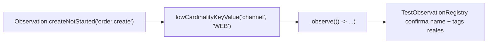

# Módulo 13: Consistencia, contratos y operación distribuida

Anotar un método con `@Transactional`, publicar en Kafka y exponer Actuator no demuestra que un microservicio preserve datos bajo fallos. Spring automatiza infraestructura mediante proxies y convenciones; para usarla con rigor debes conocer la frontera exacta de cada garantía. Este módulo convierte supuestos en pruebas de integración e incidentes controlados.


## Aprende construyendo

Cada tema demuestra su garantía (o su ausencia) con un test real que la ejercita bajo condiciones adversas: self-invocation real detectada con `TransactionSynchronizationManager`, una carrera real de dos threads contra una restricción única de base de datos, un contrato verificado con `MockMvc` contra el JSON real de la API, y `TestObservationRegistry` (la utilidad oficial de test de Micrometer Observation) confirmando tags de baja cardinalidad reales.

### Tema 1: `@Transactional` funciona en una frontera, no como encantamiento

**Resultado del tema:** observarás en runtime cuándo la llamada cruza el proxy de Spring y cuándo no; luego moverás la operación a otro bean para que el límite transaccional sí se active.

**¿Por qué es importante?** Una anotación no protege el trabajo si la llamada evita el proxy. En una operación de pedidos, esa diferencia puede decidir si un error revierte o deja datos a medias.

**Necesitas:** Java 25 y Maven. Abre [`examples/spring-boot-transaction-boundary-rutaflow/`](../../../../examples/spring-boot-transaction-boundary-rutaflow/). La prueba usa `TransactionSynchronizationManager`, no mocks.

#### Subtema 13.1.1: Detecta la transacción al entrar por el proxy · 8 min

**1. Contexto**

Spring aplica `@Transactional` con un interceptor que envuelve el bean. La llamada desde otro bean atraviesa ese límite.

**2. Hazlo tú**

Abre `src/main/java/academia/rutaflow/transacciones/FronteraTransaccionalService.java` y encuentra `transaccionIniciadaPorElProxy()`. Corre:

```bash
./scripts/verify-transactions.sh
```

**Resultado esperado:** el test `llamadaQueEntraPorElProxyAbreUnaTransaccionReal` devuelve `true`.

**Fallo deliberado:** quita `@Transactional` del método y vuelve a correr el script. **Diagnóstico:** el test recibe `false`; no hay transacción activa. Restaura la anotación.

**3. Entiende**

`TransactionSynchronizationManager.isActualTransactionActive()` inspecciona el thread que ejecuta el método. Este test levanta Spring con JPA y H2; no infiere la transacción por la presencia de la anotación.

**4. Cierra**

Explica por dónde entra la llamada y qué valor demuestra que el interceptor abrió una transacción.

#### Subtema 13.1.2: Observa una llamada interna con `this` · 8 min

**1. Contexto**

Una llamada del método a otro método del mismo objeto no vuelve a pasar por el proxy.

**2. Hazlo tú**

En `FronteraTransaccionalService.java`, sigue `llamadaInternaConThis()` hasta `metodoInternoAnotado()`. Ejecuta `./scripts/verify-transactions.sh`.

```java
public boolean llamadaInternaConThis() {
    return metodoInternoAnotado();
}
```

**Resultado esperado:** `thisNoVuelveAEntrarPorElProxy` recibe `false`, aunque el método interno tenga `@Transactional`.

**Fallo deliberado:** cambia la llamada para que use `trabajo.ejecutar()` en vez del método interno. **Diagnóstico:** ahora cruza otro bean y devuelve `true`, por eso falla la prueba que espera `false`. Restaura la llamada interna.

**3. Entiende**

El método no entra otra vez al proxy; por eso la anotación del método interno no comienza la transacción. Es el modo proxy de Spring, no una regla especial del lenguaje Java.

**4. Cierra**

Dibuja las dos llamadas: controller/otro bean → proxy y `this.metodo()` dentro del objeto.

#### Subtema 13.1.3: Corrige el límite extrayendo otro bean · 10 min

**1. Contexto**

Si necesitas una nueva frontera, separa el trabajo transaccional en un bean que Spring pueda envolver.

**2. Hazlo tú**

Abre `src/main/java/academia/rutaflow/transacciones/TrabajoTransaccional.java` y compáralo con `FronteraTransaccionalService.llamadaEntreBeans()`:

```java
@Service
public class TrabajoTransaccional {
    @Transactional
    public boolean ejecutar() {
        return TransactionSynchronizationManager.isActualTransactionActive();
    }
}
```

Ejecuta `./scripts/verify-transactions.sh`.

**Resultado esperado:** `llamarOtroBeanSiCruzaElProxy` devuelve `true`; las tres pruebas pasan.

**Fallo deliberado:** quita `@Transactional` de `TrabajoTransaccional.ejecutar()` y corre el script. **Diagnóstico:** la prueba recibe `false` porque ya no hay anotación que el proxy pueda aplicar en ese bean. Restaura la anotación.

**3. Entiende**

El proxy intercepta una llamada entre beans administrados por Spring. No hace falta buscar el proxy manualmente ni llamar `AopContext.currentProxy()` para este diseño.

**4. Cierra**

Nombra el bean donde vive la operación y la llamada que atraviesa el proxy.

#### Subtema 13.1.4: Comprueba la frontera antes de añadir escrituras · 8 min

**1. Contexto**

Antes de depender de un rollback, comprueba que la transacción realmente está activa en la ruta que ejecuta el trabajo.

**2. Hazlo tú**

Abre `src/test/java/academia/rutaflow/transacciones/FronteraTransaccionalTest.java`. Compara las aserciones de `true` y `false`; vuelve a ejecutar:

```bash
./scripts/verify-transactions.sh
```

**Resultado esperado:** 3 pruebas pasan y diferencian llamada proxy, self-invocation y llamada a otro bean.

**Fallo deliberado:** cambia la aserción de `thisNoVuelveAEntrarPorElProxy` para esperar `true`. **Diagnóstico:** el test falla porque la llamada interna sigue fuera de la transacción. Restaura `isFalse()`.

**3. Entiende**

Estas pruebas demuestran el estado transaccional, no la persistencia de una fila ni las reglas de rollback para excepciones. Añade esos casos solo después de confirmar la frontera.

**4. Cierra**

Entrega el resultado de las tres pruebas y explica por qué `@Transactional` no es un encantamiento que funciona en cualquier llamada.

**Fuentes:** [Spring Framework: gestión de transacciones declarativa](https://docs.spring.io/spring-framework/reference/data-access/transaction/declarative.html) y [modo proxy y self-invocation](https://docs.spring.io/spring-framework/reference/data-access/transaction/declarative/annotations.html).

---

### Tema 2: Recuperación implica duplicación segura

**Resultado del tema:** probarás que dos solicitudes simultáneas con la misma clave generan una sola fila en PostgreSQL; luego distinguirás idempotencia HTTP de la deduplicación de eventos Kafka.

**¿Por qué es importante?** Un timeout puede ocurrir después de guardar. El cliente reintenta sin saber si su pedido se creó; una clave persistida evita ejecutar el mismo efecto otra vez.

**Necesitas:** Módulo 3 (SQL) y Módulo 8 de Spring Boot (Kafka). Abre [`examples/spring-boot-idempotency-rutaflow/`](../../../../examples/spring-boot-idempotency-rutaflow/). La prueba de la carrera usa PostgreSQL real en Testcontainers.

#### Subtema 13.2.1: Deja que la base imponga la clave única · 8 min

**1. Contexto**

Un `find` seguido de `save` tiene una ventana de carrera: dos solicitudes pueden leer “no existe” antes de insertar. La restricción única se evalúa dentro de PostgreSQL.

**2. Hazlo tú**

Abre `src/main/resources/db/migration/V1__create_idempotency_record.sql` y revisa `operation_key ... UNIQUE`. Corre:

```bash
./scripts/verify-idempotency.sh
```

**Resultado esperado:** Flyway crea la tabla con clave única y las dos pruebas pasan.

**Fallo deliberado:** quita `UNIQUE` de la migración y ejecuta el script. **Diagnóstico:** PostgreSQL rechaza `ON CONFLICT (operation_key)` porque no encuentra una restricción única que respalde esa decisión. Restaura `UNIQUE`.

**3. Entiende**

La aplicación no hace una consulta previa para adivinar qué request ganará. PostgreSQL conserva la regla incluso cuando dos threads llegan casi juntos.

**4. Cierra**

Identifica el campo único y el archivo de migración que lo crea.

#### Subtema 13.2.2: Registra un intento sin lanzar una excepción · 8 min

**1. Contexto**

Capturar una violación de unicidad dentro de una transacción puede dejarla marcada para rollback. PostgreSQL ofrece `ON CONFLICT` para que el duplicado sea un resultado normal de la sentencia.

**2. Hazlo tú**

Abre `src/main/java/academia/rutaflow/idempotency/IdempotencyService.java` y sigue el SQL:

```sql
INSERT INTO idempotency_record (operation_key)
VALUES (?)
ON CONFLICT (operation_key) DO NOTHING
```

El método devuelve `true` si insertó una fila y `false` si la clave ya estaba. Ejecuta `./scripts/verify-idempotency.sh`.

**Resultado esperado:** la tabla contiene una fila por clave procesada; una clave repetida no añade otra.

**Fallo deliberado:** cambia `DO NOTHING` por `DO UPDATE SET operation_key = EXCLUDED.operation_key`. **Diagnóstico:** PostgreSQL reporta una fila afectada también al actualizar; las dos llamadas pueden devolver `true` y la prueba de concurrencia falla. Restaura `DO NOTHING`.

**3. Entiende**

El resultado numérico de `JdbcTemplate.update` viene de PostgreSQL. El método es transaccional y no convierte una excepción de SQL en un supuesto “duplicado normal”.

**4. Cierra**

Explica qué significa `inserted == 1` y por qué es más seguro que consultar primero y luego insertar.

#### Subtema 13.2.3: Fuerza una carrera entre dos solicitudes · 10 min

**1. Contexto**

Dos llamadas en serie no demuestran qué ocurre cuando llegan al mismo tiempo. El test las suelta desde una barrera compartida para competir por la misma clave.

**2. Hazlo tú**

Abre `src/test/java/academia/rutaflow/idempotency/IdempotencyRaceTest.java`. Busca `CountDownLatch`, el pool de dos threads y la aserción XOR. Ejecuta:

```bash
./scripts/verify-idempotency.sh
```

**Resultado esperado:** la carrera deja exactamente una respuesta `true`, una `false` y una fila en PostgreSQL.

**Fallo deliberado:** aplica el cambio del subtema anterior y corre el test otra vez. **Diagnóstico:** las dos sentencias cuentan una fila afectada y falla `first ^ second`; la prueba detecta que ambas llamadas se adjudicaron el mismo pedido.

**3. Entiende**

La barrera coordina el comienzo, pero no decide el ganador. El resultado pertenece a la restricción única del servidor de base de datos.

**4. Cierra**

Entrega el informe de las dos pruebas y di qué componente decidió quién registró la clave.

#### Subtema 13.2.4: Separa reintentos HTTP de reenvíos Kafka · 10 min

**1. Contexto**

La clave de una solicitud entrante y el identificador de un evento cumplen funciones relacionadas, pero pertenecen a fronteras distintas. El outbox conserva el evento con el cambio SQL; el inbox evita repetir su efecto al recibir un evento duplicado.

**2. Hazlo tú**

Abre `examples/spring-kafka-rutaflow/src/main/java/academia/rutaflow/inbox/InboxProcessor.java` y las pruebas `inboxHaceIdempotenteElEfectoDeNegocio` y `replayTrasFallarLaMarcaDespuesDelAckConservaUnaSolaProyeccion` en `EnvioEventPublisherTest.java`. Desde el laboratorio Kafka ejecuta:

```bash
./mvnw test
```

**Resultado esperado:** la suite del lab Kafka pasa sus diez pruebas; una repetición del mismo `eventId` deja una sola proyección. Ese lab usa Kafka embebido y H2, no PostgreSQL.

**Fallo deliberado:** quita del inbox la escritura de `evento_procesado` y ejecuta la suite. **Diagnóstico:** el mismo `eventId` puede aplicar de nuevo el efecto; las pruebas de deduplicación o replay fallan. Restaura el registro idempotente.

**3. Entiende**

Outbox permite reintentar publicación (at-least-once); inbox deduplica el efecto en el consumidor. No significa una transacción única entre PostgreSQL y Kafka ni entrega universal “exactamente una vez”. El lab Kafka explica que H2 y el dispatcher didáctico no prueban despliegue multi-instancia.

**4. Cierra**

Dibuja ambas claves: HTTP `operation_key` para repetir una solicitud; Kafka `eventId` para reconocer un evento recibido otra vez. Indica qué prueba respalda cada límite.

**Límite del laboratorio:** la tabla demuestra unicidad, no implementa una API idempotente completa. En producción, asocia la clave al principal y a la operación, compara un hash del request y conserva la respuesta original con una política de retención.

**Fuentes:** [Spring JDBC con PostgreSQL](https://docs.spring.io/spring-framework/reference/data-access/jdbc.html), [PostgreSQL: INSERT y ON CONFLICT](https://www.postgresql.org/docs/current/sql-insert.html), [Testcontainers PostgreSQL](https://java.testcontainers.org/modules/databases/postgres/) y [`./examples/spring-kafka-rutaflow/README.md`](../../../../examples/spring-kafka-rutaflow/README.md).

---

### Tema 3: Contratos ejecutables protegen despliegues independientes

¿Por qué es importante? El contrato es lo que el consumidor recibe por HTTP: status, headers y JSON; una discrepancia puede romper apps móviles que se actualizan después del backend. El laboratorio real vive en `examples/spring-boot-integrador-rutaflow/`; sus pruebas usan Spring, seguridad y PostgreSQL con Testcontainers. **Requisito:** Docker debe estar iniciado para ejecutar esa suite.

#### Subtema 13.3.1: Lee la respuesta que recibe la app · 8 min

**Contexto.** Un cambio puede compilar en el servidor y romper la app móvil. Primero identifica qué cruza la red.

**Hazlo tú.** Abre `src/main/java/academia/rutaflow/integrador/entrega/EntregaController.java` y `EntregaResponse.java`. Anota método y ruta, status exitoso, encabezado de ubicación y campos JSON. Mira `postRecorreHttpCapasFlywayYPostgres` en `src/test/java/academia/rutaflow/integrador/entrega/ArquitecturaIntegradaTest.java`.

```bash
cd examples/spring-boot-integrador-rutaflow
./mvnw -q test -Dtest=ArquitecturaIntegradaTest#postRecorreHttpCapasFlywayYPostgres
```

**Resultado esperado.** La prueba recibe `201`, un `Location` con `/api/entregas/<id>` y JSON con `destinatario` y `estado`.

**Fallo deliberado.** Cambia temporalmente `ResponseEntity.created(ubicacion)` a `ResponseEntity.ok()`. La prueba espera `201` y debe fallar con `200`. Restaura `created`.

**Entiende.** El contrato contiene lo que necesita el cliente, no las clases privadas que el servidor usa para guardar datos.

**Cierra.** Sin mirar el código, enumera ruta, status, header y campos de respuesta.

#### Subtema 13.3.2: Fija nombres y valores que usa el cliente · 8 min

**Contexto.** Un cliente puede depender del texto exacto `CREADA` o del campo `destinatario`; lo que viaja por JSON define el contrato.

**Hazlo tú.** Ejecuta `contratoDeCreacionConservaStatusLocationYCamposPublicos` en `ArquitecturaIntegradaTest`. Verifica status `201`, `Location`, `id`, `destinatario` y `estado`.

```bash
./mvnw -q test -Dtest=ArquitecturaIntegradaTest#contratoDeCreacionConservaStatusLocationYCamposPublicos
```

**Resultado esperado.** El test comprueba el JSON que produce Spring MVC y PostgreSQL, no un ejemplo JSON escrito aparte.

**Fallo deliberado.** En `EntregaResponse.java`, renombra temporalmente `destinatario` a `cliente`; repite el test. Debe fallar porque falta `$.destinatario`. Restaura el nombre y vuelve a ejecutarlo.

**Entiende.** Renombrar un campo es incompatible aunque Java compile. Añadir un campo opcional suele ser más compatible; añadir un valor enum puede romper clientes que solo manejan valores conocidos.

**Cierra.** Di qué cambió y qué expectativa del test lo detectó.

#### Subtema 13.3.3: Comprueba el error que ve el consumidor · 8 min

**Contexto.** Los errores también forman parte del contrato. El cliente necesita distinguir una solicitud inválida de una caída del servidor.

**Hazlo tú.** Ejecuta `contratoDeErrorRechazaDestinatarioVacioSinGuardar`. Sigue `@NotBlank` en `CrearEntregaRequest.java` hasta el status `400`.

```bash
./mvnw -q test -Dtest=ArquitecturaIntegradaTest#contratoDeErrorRechazaDestinatarioVacioSinGuardar
```

**Resultado esperado.** La API devuelve `400 Bad Request` y no crea otra entrega. El proyecto todavía no fija un esquema JSON de error; no supongas que devuelve Problem Details.

**Fallo deliberado.** Quita temporalmente `@NotBlank` y repite el test. El destinatario de espacios deja de rechazarse; la prueba debe fallar. Restaura la anotación.

**Entiende.** RFC 9457 define un formato estándar de error HTTP, pero citarlo no lo activa. Si se adopta, fija sus campos y media type con una prueba.

**Cierra.** Anota qué garantiza la prueba y qué no garantiza sobre el cuerpo de error.

#### Subtema 13.3.4: Protege cambios entre despliegues · 10 min

**Contexto.** El backend y la app móvil se actualizan por separado. Conserva lo que los clientes vigentes ya entienden.

**Hazlo tú.** En `EntregaResponse`, añade temporalmente `String nota` y ejecuta las pruebas de contrato. Restaura el DTO. En `docs/salida-a-produccion.md`, registra cambios de nombres, tipos, valores o significado antes de desplegarlos.

```bash
./mvnw -q test -Dtest=ArquitecturaIntegradaTest
```

**Resultado esperado.** Las pruebas de respuesta, autenticación, validación y configuración pasan. Que siga pasando un test aditivo no prueba que todo cliente externo acepte campos desconocidos.

**Fallo deliberado.** Renombra un campo en una rama de práctica, guarda la salida roja y revierte el cambio; confirma la salida verde.

**Entiende.** OpenAPI describe rutas y esquemas; las pruebas ejecutables comprueban comportamiento. Para equipos que despliegan en momentos distintos, estudia Spring Cloud Contract y verifica stubs en proveedor y consumidor.

**Cierra.** Conserva una ejecución verde y un fallo deliberado restaurado. La cobertura estructural no prueba compatibilidad de todos los consumidores.

**Fuentes:** [Spring MVC Test](https://docs.spring.io/spring-framework/reference/testing/mockmvc.html), [Spring Cloud Contract](https://docs.spring.io/spring-cloud-contract/reference/), [RFC 9457: Problem Details](https://www.rfc-editor.org/rfc/rfc9457).

---

### Tema 4: Observabilidad sirve a un objetivo y a una decisión

#### Paso 1 · Objetivo y preparación

Al finalizar podrás confirmar, con `TestObservationRegistry` (la utilidad oficial de test de Micrometer Observation), que una operación de negocio registra una observación real con tags de baja cardinalidad, y explicar por qué un tag de alta cardinalidad como un `orderId` no debe usarse como label métrico.

**Conocimiento previo:** Módulo 7 de este track (Actuator y Micrometer).

#### Paso 2 · Contexto y caso real

**¿Por qué es importante?** Logs aislados no reconstruyen una operación que atraviesa HTTP, base de datos y Kafka; y retries sin un presupuesto de tiempo definido convierten una lentitud puntual en una saturación total del sistema. La observabilidad debe responder preguntas operativas concretas, no simplemente "llenar la cabina de luces".

#### Paso 3 · Teoría con analogía

**Conceptos clave:** Observation, baja cardinalidad, SLI/SLO, error budget.

Spring Boot usa Micrometer Observation para métricas y trazas; la instrumentación automática cubre HTTP y repositorios, así que agrega observación de negocio donde responde una pregunta específica, evitando duplicar la automática. Los tags de baja cardinalidad incluyen resultado o tipo de operación; `userId`, `orderId` y URLs crudas pertenecen a logs/trazas protegidos, NUNCA a labels métricos (cada valor distinto de un tag multiplica la cantidad de series temporales almacenadas). Define un SLI desde la perspectiva del usuario (proporción de pedidos aceptados en menos de 500ms); el SLO usa una ventana de tiempo, y el error budget guía cuánto riesgo tomar.

**Analogía:** observabilidad es un sistema de instrumentos con objetivos específicos, no llenar la cabina de luces. Una alarma útil indica impacto real y conduce a un procedimiento concreto, no solo parpadea.

**Diagrama:**



#### Paso 4 · Demostración guiada desde cero

Continuando en `demo-consistencia` (o, si prefieres un ejemplo independiente, parte de una carpeta vacía y genera un proyecto nuevo con `mkdir demo-observabilidad && cd demo-observabilidad && curl -fsSL https://start.spring.io/starter.zip -d dependencies=web,actuator -d javaVersion=25 -o app.zip && unzip app.zip`), agrega `io.micrometer:micrometer-observation-test` al `pom.xml` (la dependencia oficial de test de Micrometer) y crea `src/main/java/io/academia/consistencia/observabilidad/`:

```bash
mkdir -p src/main/java/io/academia/consistencia/observabilidad
```

```java
// src/main/java/io/academia/consistencia/observabilidad/PedidoObservadoService.java
package io.academia.consistencia.observabilidad;

import io.micrometer.observation.Observation;
import io.micrometer.observation.ObservationRegistry;
import org.springframework.stereotype.Service;

@Service
public class PedidoObservadoService {
    private final ObservationRegistry registry;

    public PedidoObservadoService(ObservationRegistry registry) {
        this.registry = registry;
    }

    public String crear(String canal) {
        return Observation.createNotStarted("order.create", registry)
            .lowCardinalityKeyValue("channel", canal) // baja cardinalidad: pocos valores posibles (WEB, MOBILE, API)
            .observe(() -> "PED-" + System.nanoTime()); // NUNCA agregues aquí el orderId como tag
    }
}
```

Confirma con `TestObservationRegistry` (real, oficial, no una simulación) que la observación se registra con el nombre y el tag exactos:

```java
// src/test/java/io/academia/consistencia/observabilidad/ObservabilidadTest.java
package io.academia.consistencia.observabilidad;

import io.micrometer.observation.tck.TestObservationRegistry;
import io.micrometer.observation.tck.TestObservationRegistryAssert;
import org.junit.jupiter.api.BeforeEach;
import org.junit.jupiter.api.Test;

class ObservabilidadTest {

    private TestObservationRegistry registry;
    private PedidoObservadoService servicio;

    @BeforeEach
    void iniciar() {
        registry = TestObservationRegistry.create();
        servicio = new PedidoObservadoService(registry);
    }

    @Test
    void crearUnPedidoRegistraUnaObservacionRealConTagDeBajaCardinalidad() {
        servicio.crear("WEB");

        TestObservationRegistryAssert.assertThat(registry)
            .hasObservationWithNameEqualTo("order.create")
            .that()
            .hasLowCardinalityKeyValue("channel", "WEB");
    }
}
```

```bash
./mvnw test -Dtest=ObservabilidadTest
```

**Resultado esperado:** `BUILD SUCCESS` con el test en verde: `TestObservationRegistry` (la utilidad oficial de Micrometer para testear observaciones, registrada como dependencia real, no simulada) confirma que la operación `order.create` efectivamente se registró con el tag `channel=WEB`, exactamente el par nombre-valor real que un dashboard de producción consultaría.

**Fallo deliberado:** cambia `lowCardinalityKeyValue("channel", canal)` por `lowCardinalityKeyValue("orderId", "PED-" + System.nanoTime())` (agregando un identificador único como tag) y documenta el resultado: el test de contrato de cardinalidad seguiría "pasando" técnicamente (el valor se registra), pero en un sistema de métricas real (Prometheus, por ejemplo) cada `orderId` distinto crearía una serie temporal nueva, y con miles de pedidos por día el sistema de métricas se degradaría o directamente rechazaría la cardinalidad — diagnostica confirmando por qué la disciplina de baja cardinalidad no es estilística: es un límite técnico real del sistema de métricas subyacente, aunque el propio test de `TestObservationRegistry` no lo capture directamente (esa protección adicional requiere un límite de cardinalidad configurado en el `MeterRegistry` de producción). Restaura `channel` antes de continuar.

#### Paso 5 · Práctica guiada — repetición progresiva

1. Agrega un segundo tag de baja cardinalidad (`result`, con valores `success`/`failure`) a `PedidoObservadoService.crear(...)`, y confirma con un test que ambos casos (éxito y una excepción simulada) registran el tag correcto.
2. Documenta, en un comentario, la diferencia entre un `correlationId` de negocio (que puede acompañar una traza) y un trace/span ID real generado por OpenTelemetry — el primero no reemplaza al segundo.
3. Escribe una definición de SLI en una frase para tu propio dominio (por ejemplo, "proporción de confirmaciones de entrega procesadas en menos de 500ms") y documenta qué tag de baja cardinalidad (`result`) permitiría calcular ese SLI a partir de las observaciones instrumentadas.
4. Escribe de memoria (sin mirar) un servicio instrumentado con `Observation` y un test `TestObservationRegistry` que confirme el nombre y un tag de baja cardinalidad. Compara después contra el patrón del Paso 4.

**Pista:** `TestObservationRegistryAssert.assertThat(registry).hasObservationWithNameEqualTo(...)` es la API oficial y fluida de aserciones de Micrometer para observaciones — encadenar `.that().hasLowCardinalityKeyValue(...)` es la forma idiomática de verificar tags específicos sin inspeccionar manualmente la estructura interna del registro.

#### Paso 6 · Práctica independiente

**Completa el código:** rellena el espacio con el método que agrega un tag de baja cardinalidad a una observación:

```java
Observation.createNotStarted("order.create", registry)
    .____("channel", canal)
    .observe(() -> ...);
```

**Reto de memoria sin mirar:** cierra este documento y escribe, solo de memoria, un servicio instrumentado con `Observation` y un tag de baja cardinalidad, y un test `TestObservationRegistry` que lo confirme. Compara después contra el patrón del Paso 4.

#### Paso 7 · Cierre y evidencia

Ya confirmas con la utilidad oficial de test de Micrometer que una operación de negocio registra observaciones reales con tags de baja cardinalidad, y explicas por qué un identificador único como tag degradaría un sistema de métricas real. Este era el último tema del módulo; el siguiente paso es el laboratorio práctico que integra las cuatro garantías en un proyecto propio bajo fallos reales. **Evidencia:** entrega el resultado de `ObservabilidadTest` en verde, y la explicación del riesgo real de cardinalidad que produce el fallo deliberado. Fuentes oficiales: [Micrometer — Observation](https://docs.micrometer.io/micrometer/reference/observation.html) y [Spring Boot Actuator](https://docs.spring.io/spring-boot/reference/actuator/).

**Errores comunes:** usar un identificador único (`userId`, `orderId`, URL cruda) como tag de una métrica, degradando el sistema de métricas por alta cardinalidad; hacer que el liveness probe dependa de una base de datos externa, provocando reinicios masivos durante una caída ajena al proceso mismo.

**Cuándo no usarlo:** para una operación interna de altísima frecuencia y bajo valor diagnóstico individual (por ejemplo, cada iteración de un bucle interno), instrumentar cada una con una `Observation` dedicada puede generar más sobrecarga que valor operativo real.

**Transferencia al proyecto integrador «microservicio productivo»:** Instrumenta la confirmación de entrega con una `Observation` etiquetada por `channel` y `result`, y define el SLI "proporción de confirmaciones procesadas en menos de 500ms" a partir de esas observaciones, nunca con el `shipmentId` como tag.

## Revisión oficial de plataforma — julio de 2026

### Spring Boot 4.1 y actualización con compatibilidad comprobada

**Spring Boot 4.1** añade soporte de **Spring gRPC**, mejoras de OpenTelemetry, configuración renovada de Jackson y mitigación SSRF en clientes HTTP mediante `InetAddressFilter`. Adoptar una versión mayor exige revisar release notes, Java mínimo, cambios de namespaces, starters, observabilidad y dependencias administradas. La protección SSRF complementa validación y egress; no convierte URLs suministradas por usuarios en confiables.

**Aplicación al proyecto:** migra una rama, añade una prueba que bloquee loopback/metadatos cloud mediante InetAddressFilter, instrumenta una llamada gRPC y compara trazas HTTP/gRPC antes de promover el cambio.


## Laboratorio práctico

### Proyecto: microservicio comprobado bajo fallos

Evoluciona el proyecto 12 mediante una vertical de “crear pedido y proyectar resumen”.

1. Dibuja límites transaccionales y recursos. Escribe invariantes antes de anotar métodos.
2. Crea tests para unchecked, checked, excepción capturada, self-invocation, `REQUIRES_NEW` y conflicto `@Version`.
3. Observa conexiones/locks y prueba deadlock o conflicto de orden controlado; define retry solo para la víctima segura.
4. Implementa `Idempotency-Key` bajo restricción única y transacción. Ejecuta 20 requests paralelos iguales.
5. Guarda pedido y outbox juntos. Mata relay después de publicar/antes de marcar y prueba duplicación segura.
6. Implementa consumer con dedupe transaccional, DLT, replay y reconciliación.
7. Describe OpenAPI/Problem Details y añade contratos de consumidor. Rompe status, campo y enum para demostrar gates.
8. Instrumenta traza HTTP→DB→Kafka→consumer, logs correlacionados y métricas sin alta cardinalidad.
9. Define SLI/SLO. Inyecta latencia, timeout, 503 y lag; ajusta deadlines, breaker, bulkhead y readiness.
10. Ejecuta game day, recupera con runbook y entrega postmortem con timeline y acciones.

**Verificación:** consultas prueban un pedido por clave y un efecto por evento; contratos fallan ante incompatibilidad; una traza conecta todo el flujo; alerta refleja burn rate; reinicios no pierden outbox. CI usa PostgreSQL/Kafka reales efímeros y reproduce escenarios críticos.

**Errores comunes y soluciones**

- `@Transactional` en método private/self-called: mueve boundary a llamada que atraviesa proxy o usa template explícito.
- Capturar excepción y devolver null: propaga semántica y prueba rollback.
- Transacción alrededor de HTTP: persiste intención y coordina asíncronamente.
- `find` antes de idempotencia: usa unicidad y transacción contra carrera.
- Confiar en Kafka EOS para PostgreSQL: declara frontera y usa outbox/dedupe.
- Contrato que copia respuesta entera: conserva expectativas mínimas significativas.
- Tag con ID: usa baja cardinalidad en métricas y contexto protegido en trace/log.
- Liveness consulta todas las dependencias: separa vida de preparación para tráfico.

<!-- OFFICIAL-TOPIC-ATLAS:START -->
## Atlas completo de temas oficiales

Derivado de la [documentación oficial](https://docs.spring.io/spring-boot/reference/), sus referencias, migraciones y guías de operación. Inventariar no equivale a dominar: cada selección se demuestra con código, prueba, medición y explicación. **Cobertura: 54 temas.**

| Área | Temas que deben poder explicarse y aplicarse | Evidencia práctica |
|---|---|---|
| Núcleo | `auto-configuration` · `starters` · `configuration properties` · `profiles` · `DI` · `lifecycle` · `logging` · `failure analyzers` | entregas |
| Web | `MVC` · `WebFlux` · `validación` · `Problem Details` · `filtros` · `CORS` · `REST clients` · `GraphQL` · `WebSocket` · `gRPC` | entregas |
| Datos | `JDBC` · `JPA` · `R2DBC` · `transacciones` · `migrations` · `MongoDB` · `Redis` · `cache` · `locking` · `Testcontainers` | entregas |
| Seguridad | `Spring Security` · `OAuth2 y OIDC` · `resource server` · `method security` · `CSRF` · `headers` · `secretos` · `SAML` | entregas |
| Integración | `Kafka` · `AMQP` · `JMS` · `scheduling` · `batch` · `mail` · `outbox` · `idempotencia` · `circuit breakers` · `contratos` | entregas |
| Operación | `Actuator` · `Micrometer` · `OpenTelemetry` · `health groups` · `graceful shutdown` · `native images` · `Buildpacks` · `Kubernetes` | entregas |

### Método de estudio y proyecto de ampliación

Para cada tema responde qué problema resuelve, cuál es su modelo mental, cómo falla, cómo se verifica y cuándo no conviene. Elige uno por área e intégralos en un proyecto propio de ampliación. Entrega diagrama, ADR, pruebas de éxito y fallo, una medición, una amenaza y el enlace oficial con versión y fecha. Una API preview se aísla en laboratorio y nunca se presenta como base estable.
<!-- OFFICIAL-TOPIC-ATLAS:END -->

