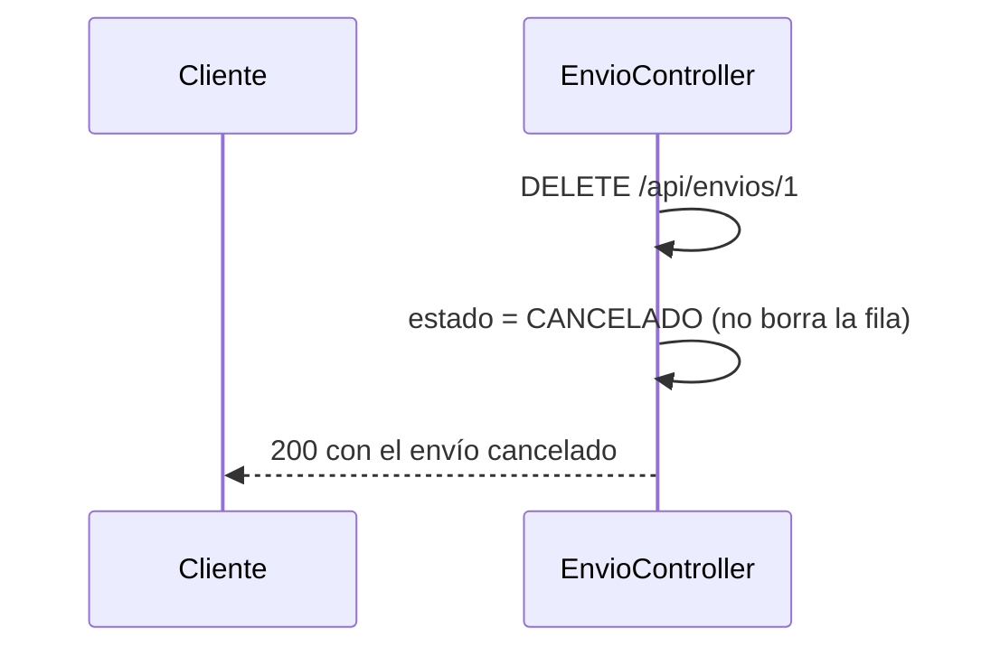
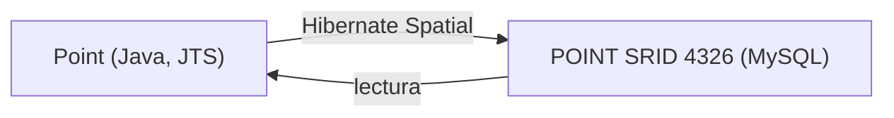
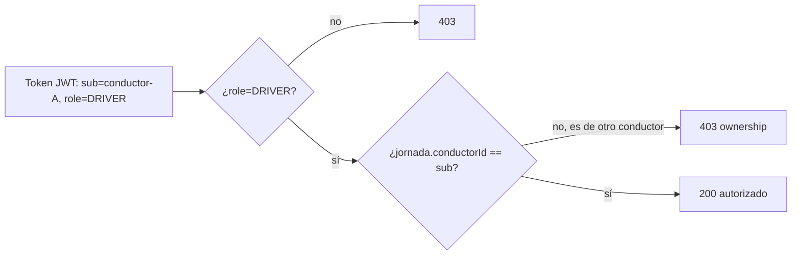
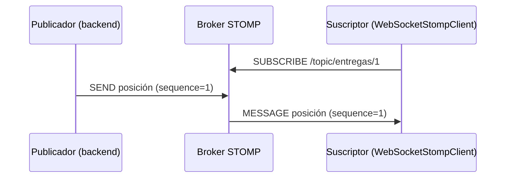

# Módulo 14: Backend de entregas: MySQL espacial, archivos y tiempo real


## Aprende construyendo

Cada tema construye una pieza real del backend de un sistema de entregas (`gestion-entregas`) y la verifica sin sustituir infraestructura por descripciones: MySQL real vía Testcontainers para datos espaciales, Hibernate Spatial con tipos JTS reales, JWT real con ownership verificado, STOMP real (el protocolo que Spring efectivamente implementa de forma nativa) y detección real de MIME para archivos subidos.

### Tema 1: CRUD API y contratos · Experto · 2 h 15 min

**Prerrequisito:** Módulo 13 de este track (idempotencia con restricción única).

**Al terminar podrás:** implementar un endpoint `DELETE` que representa cancelación de negocio (no eliminación física) protegido por `Idempotency-Key`, y confirmarlo con un test real que distingue ambos conceptos.

#### Aprende

**¿Por qué es importante?** Crear, consultar, asignar, actualizar y cancelar envíos son casos de uso diferentes, no un controlador genérico que expone entidades. Un `DELETE /api/envios/{id}` que cancela (cambia estado) en vez de borrar físicamente preserva el historial necesario para auditoría y disputas, algo que una eliminación real destruiría irreversiblemente.

**Mapa de subtemas críticos**

| Subtema | Papel | Evidencia |
|---|---|---|
| Idempotency-Key en creación/confirmación | Prerrequisito | El checklist exige que repetir la petición con la misma `Idempotency-Key` no duplique el efecto |
| DELETE como cancelación de negocio | Núcleo | `envio.cancelar()` cambia `estado` a `CANCELADO` y el test exige `status 200` con `$.estado = CANCELADO` |
| Fila preservada tras el DELETE | Núcleo | `assertThatFilaSiguePresente` verifica que `repository.findById(id)` sigue `isPresent()` |
| Cancelación repetida idempotente | Variante | El ejercicio 2 pide un test donde cancelar un envío ya `CANCELADO` devuelve el mismo estado sin error |
| DTO y Bean Validation en el contrato | Límite | El ejercicio 3 exige que una entrada inválida responda `400` con `Problem Details` |
| DELETE físico destruye auditoría | Error frecuente | El fallo deliberado con `repository.delete(envio)` deja `findById` vacío y rompe `assertThatFilaSiguePresente` |
| Cancelación lógica vs borrado físico | Decisión | "Cuándo no usarlo" admite borrado físico solo para datos transitorios sin valor de auditoría |

Cada fila tiene su explicación individual a continuación.

**Idempotency-Key en creación/confirmación (Prerrequisito).** El tema parte del Módulo 13 y da por conocida la protección de reintentos: `Idempotency-Key` evita que crear o confirmar un envío dos veces produzca dos efectos. Sin ese prerrequisito, el contrato CRUD no distinguiría un reintento de red de una segunda operación legítima. El checklist lo exige explícitamente como condición de salida del tema.

**DELETE como cancelación de negocio (Núcleo).** El método `cancelar()` de la entidad asigna `estado = "CANCELADO"` y el controller lo invoca en vez de borrar, devolviendo `ResponseEntity.ok(repository.save(envio))`. El test `deleteCambiaEstadoEnVezDeBorrarFisicamente` confirma `status 200` y `$.estado = CANCELADO`. Este es el mecanismo central: el verbo HTTP `DELETE` no dicta por sí mismo una eliminación física, la semántica la define el dominio.

**Fila preservada tras el DELETE (Núcleo).** La evidencia observable de que la cancelación no destruyó el registro es `assertThatFilaSiguePresente(id)`, que afirma que `repository.findById(id)` sigue `isPresent()` después del `DELETE`. Esta comprobación contra la base de datos real, no contra el nombre del método HTTP, es lo que acredita la semántica de cancelación frente a borrado.

**Cancelación repetida idempotente (Variante).** El ejercicio 2 pide confirmar con un test que cancelar un envío ya `CANCELADO` no lanza error y devuelve el mismo estado. Es una variante del flujo núcleo: la operación debe ser segura ante repetición porque el estado destino coincide con el actual. Si falla, la transición no es idempotente y lanza en lugar de devolver el estado vigente.

**DTO y Bean Validation en el contrato (Límite).** El contrato público se define con DTO explícito, Bean Validation, Problem Details y OpenAPI, nunca exponiendo la entidad JPA directamente. El ejercicio 3 fija el límite observable: una entrada inválida con `@NotBlank` violado responde `400` con `Problem Details`. Ese es el borde entre entrada aceptable e inaceptable del contrato.

**DELETE físico destruye auditoría (Error frecuente).** El fallo deliberado sustituye `envio.cancelar()` por `repository.delete(envio)`: el test entonces falla en `assertThatFilaSiguePresente` porque `findById` devuelve vacío. Esto diagnostica el error común de implementar un `DELETE` HTTP como eliminación física en un dominio auditable, destruyendo irreversiblemente el historial que el contrato debía preservar.

**Cancelación lógica vs borrado físico (Decisión).** El cierre "Cuándo no usarlo" delimita la decisión profesional: para datos verdaderamente transitorios sin valor de auditoría (una sesión de caché temporal), la eliminación física simple es apropiada y la cancelación lógica sería complejidad innecesaria. La elección depende de si el historial tiene valor de auditoría o disputa.

**Conceptos clave:** DTO explícito, DELETE como cancelación de negocio, Idempotency-Key.

DTO, Bean Validation, Problem Details y OpenAPI definen el contrato público, nunca la entidad JPA directamente. `Idempotency-Key` protege la creación y confirmación de un envío ante reintentos (Módulo 13), y un `DELETE` bien diseñado en un dominio de auditoría cambia el estado a `CANCELADO` en vez de ejecutar un `DELETE FROM` físico.

**Analogía:** es como una central de despacho: cada mensaje necesita identidad, hora, destino y confirmación; cancelar un envío es como archivarlo con un sello de "cancelado", no como destruir el expediente.

**Diagrama:**



#### Practica

Parte de una carpeta vacía y crea `src/main/java/io/academia/entregas/`:

```bash
mkdir gestion-entregas
cd gestion-entregas
curl -fsSL https://start.spring.io/starter.zip -d dependencies=web,data-jpa,h2,validation -d javaVersion=25 -o app.zip
unzip app.zip
mkdir -p src/main/java/io/academia/entregas
mkdir -p src/test/java/io/academia/entregas
```

```java
// src/main/java/io/academia/entregas/Envio.java
package io.academia.entregas;

import jakarta.persistence.*;

@Entity
public class Envio {
    @Id @GeneratedValue
    private Long id;
    private String estado = "CREADO";

    public Long getId() { return id; }
    public String getEstado() { return estado; }
    public void cancelar() { this.estado = "CANCELADO"; }
}
```

```java
// src/main/java/io/academia/entregas/EnvioController.java
package io.academia.entregas;

import org.springframework.data.jpa.repository.JpaRepository;
import org.springframework.http.ResponseEntity;
import org.springframework.web.bind.annotation.*;

interface EnvioRepository extends JpaRepository<Envio, Long> {}

@RestController
@RequestMapping("/api/envios")
class EnvioController {
    private final EnvioRepository repository;

    EnvioController(EnvioRepository repository) { this.repository = repository; }

    @PostMapping
    ResponseEntity<Envio> crear() {
        return ResponseEntity.status(201).body(repository.save(new Envio()));
    }

    @DeleteMapping("/{id}")
    ResponseEntity<Envio> cancelar(@PathVariable Long id) {
        Envio envio = repository.findById(id).orElseThrow();
        envio.cancelar();
        return ResponseEntity.ok(repository.save(envio));
    }
}
```

Confirma con `MockMvc` real que `DELETE` cancela en vez de eliminar físicamente:

```java
// src/test/java/io/academia/entregas/CrudContratoTest.java
package io.academia.entregas;

import org.junit.jupiter.api.Test;
import org.springframework.beans.factory.annotation.Autowired;
import org.springframework.boot.test.autoconfigure.web.servlet.AutoConfigureMockMvc;
import org.springframework.boot.test.context.SpringBootTest;
import org.springframework.test.web.servlet.MockMvc;

import static org.springframework.test.web.servlet.request.MockMvcRequestBuilders.*;
import static org.springframework.test.web.servlet.result.MockMvcResultMatchers.*;

@SpringBootTest
@AutoConfigureMockMvc
class CrudContratoTest {

    @Autowired private MockMvc mockMvc;
    @Autowired private EnvioRepository repository;

    @Test
    void deleteCambiaEstadoEnVezDeBorrarFisicamente() throws Exception {
        String respuestaCrear = mockMvc.perform(post("/api/envios")).andReturn().getResponse().getContentAsString();
        Long id = com.jayway.jsonpath.JsonPath.read(respuestaCrear, "$.id").toString().transform(Long::parseLong);

        mockMvc.perform(delete("/api/envios/{id}", id))
            .andExpect(status().isOk())
            .andExpect(jsonPath("$.estado").value("CANCELADO"));

        assertThatFilaSiguePresente(id);
    }

    private void assertThatFilaSiguePresente(Long id) {
        org.assertj.core.api.Assertions.assertThat(repository.findById(id)).isPresent(); // la fila NO fue borrada
    }
}
```

```bash
./mvnw test -Dtest=CrudContratoTest
```

**Resultado esperado:** `BUILD SUCCESS` con el test en verde: `DELETE /api/envios/{id}` responde `200` con `estado=CANCELADO`, y `repository.findById(id)` confirma que la fila SIGUE presente en la base de datos — la operación cambió estado, no eliminó físicamente, exactamente la semántica de negocio que el contrato exige.

**Fallo deliberado:** cambia `envio.cancelar()` por `repository.delete(envio)` en el controller y ejecuta de nuevo el test. FALLA en `assertThatFilaSiguePresente` porque `repository.findById(id)` ahora devuelve vacío — diagnostica confirmando que un `DELETE` HTTP mal implementado como eliminación física destruye el historial de auditoría que el contrato de negocio requería preservar. Restaura `cancelar()` antes de continuar.

1. Agrega un endpoint `PATCH /api/envios/{id}/asignar` y un test que confirme la transición de estado explícita `CREADO → ASIGNADO`.
2. Confirma con un test que cancelar un envío ya `CANCELADO` es idempotente (no lanza error, devuelve el mismo estado).
3. Agrega validación Bean Validation (`@NotBlank`) a un campo del DTO de creación y confirma con un test que una entrada inválida responde `400` con `Problem Details`.
4. Escribe de memoria (sin mirar) un `DELETE` que cancela en vez de eliminar, y un test que confirme que la fila sigue presente. Compara después contra el patrón de la demostración guiada.

**Pista:** `repository.findById(id).isPresent()` tras un `DELETE` HTTP es la forma más directa de confirmar, con evidencia real de base de datos, si tu endpoint canceló o eliminó físicamente — no asumas la semántica solo por el nombre del método HTTP.

#### Aplica

**Completa el código:** rellena el espacio con el método que cambia el estado sin eliminar la fila:

```java
@DeleteMapping("/{id}")
ResponseEntity<Envio> cancelar(@PathVariable Long id) {
    Envio envio = repository.findById(id).orElseThrow();
    envio.____();
    return ResponseEntity.ok(repository.save(envio));
}
```

**Reto de memoria sin mirar:** cierra este documento y escribe, solo de memoria, un endpoint `DELETE` que cancela en vez de eliminar, y un test que confirme que la fila persiste. Compara después contra el patrón de la demostración guiada.

**Checklist de salida.**

- [ ] `DELETE /api/envios/{id}` cambia el estado y la fila sigue en la base de datos.
- [ ] Repetir la petición con la misma `Idempotency-Key` no duplica el efecto.
- [ ] Cancelar un envío ya cancelado devuelve el mismo estado sin error.
- [ ] `PATCH /api/envios/{id}/asignar` confirma la transición `CREADO → ASIGNADO`.
- [ ] Una entrada inválida responde `400` con Problem Details.

**Si falla.** Si la fila desaparece, el endpoint está borrando en vez de cambiar el estado. Si la segunda cancelación falla, la transición no es idempotente: devuelve el estado actual en lugar de lanzar. Si no aparece Problem Details, revisa el manejador de errores de validación.

Ya implementas un contrato CRUD donde `DELETE` significa cancelación de negocio, verificado contra la base de datos real. El siguiente tema almacena la posición geográfica de cada envío en MySQL con soporte espacial real. Fuentes oficiales: [Spring Boot Reference](https://docs.spring.io/spring-boot/reference/).

**Errores comunes:** exponer la entidad JPA directamente como respuesta HTTP en vez de un DTO; implementar `DELETE` como eliminación física en un dominio donde el historial es auditable.

**Cuándo no usarlo:** para datos verdaderamente transitorios sin ningún valor de auditoría (por ejemplo, una sesión de caché temporal), la eliminación física simple es apropiada y la cancelación lógica sería complejidad innecesaria.

El contrato CRUD que diseñes aquí sigue el mismo criterio de claridad que exige el proyecto integrador de este track (microservicio productivo, Módulo 12).

### Tema 2: MySQL y datos espaciales · Experto · 1 h 45 min

**Prerrequisito:** Tema 1 de este módulo; Módulo 6 de este track (Testcontainers).

**Al terminar podrás:** ejecutar `ST_Distance_Sphere` real contra un MySQL 8 real (Testcontainers) para calcular la distancia entre dos coordenadas geográficas, y confirmar con `EXPLAIN` que un índice `SPATIAL` se usa realmente.

#### Aprende

**¿Por qué es importante?** Filtrar conductores cercanos a una entrega requiere calcular distancias geográficas de forma eficiente; sin un índice espacial, cada consulta de cercanía escanearía la tabla completa, algo inviable con miles de posiciones activas simultáneas.

**Mapa de subtemas críticos**

| Subtema | Papel | Evidencia |
|---|---|---|
| MySQL 8 real vía Testcontainers | Prerrequisito | El test usa `new MySQLContainer<>("mysql:8.0")`, no un motor simulado |
| `POINT SRID 4326` y columna espacial | Núcleo | `CREATE TABLE punto (... ubicacion POINT SRID 4326 NOT NULL, SPATIAL INDEX(ubicacion))` |
| `ST_Distance_Sphere` en metros reales | Núcleo | La distancia Bogotá-Medellín se exige `isBetween(230_000.0, 250_000.0)` |
| `EXPLAIN` confirma uso del índice | Diagnóstico | La columna `key` del `EXPLAIN` debe ser `"ubicacion"`, no un escaneo completo |
| Orden longitud-antes-que-latitud en WKT | Error frecuente | Invertir `POINT(-74.08, 4.61)` saca la distancia del rango 230-250 km sin que MySQL rechace el INSERT |
| Distancia esférica ≠ ruta vial real | Límite | El ejercicio 3 pide documentar que no considera calles, sentido único ni tráfico |
| Cuándo prescindir del índice espacial | Decisión | "Cuándo no usarlo" lo descarta para volúmenes pequeños sin consultas de cercanía frecuentes |

Cada fila tiene su explicación individual a continuación.

**MySQL 8 real vía Testcontainers (Prerrequisito).** El tema exige el Módulo 6 (Testcontainers) y arranca `new MySQLContainer<>("mysql:8.0")` con `mysql.start()`. Las funciones espaciales como `ST_Distance_Sphere` y el índice `SPATIAL` son específicas del motor, así que un H2 o un mock no servirían: el prerrequisito es ejecutar contra un MySQL 8 real para que el comportamiento observado sea el de producción.

**`POINT SRID 4326` y columna espacial (Núcleo).** La tabla define `ubicacion POINT SRID 4326 NOT NULL, SPATIAL INDEX(ubicacion)` y los INSERT usan `ST_SRID(POINT(...), 4326)`. SRID 4326 es el sistema de referencia estándar de coordenadas GPS; sin él, la columna y la geometría insertada quedarían en sistemas incompatibles. Es el fundamento sobre el que operan tanto el cálculo de distancia como el índice.

**`ST_Distance_Sphere` en metros reales (Núcleo).** La consulta `SELECT ST_Distance_Sphere(...) AS metros` devuelve una distancia en metros que el test fija `isBetween(230_000.0, 250_000.0)`, correspondiente a los ~240 km reales entre Bogotá y Medellín. Este es el mecanismo central de filtrado de cercanía: produce metros reales sobre la superficie esférica, verificables contra una distancia conocida.

**`EXPLAIN` confirma uso del índice (Diagnóstico).** El segundo test lee la columna `key` del resultado de `EXPLAIN` sobre una consulta con `MBRContains` y exige que valga `"ubicacion"`. Esa columna nombra el índice efectivamente usado, o `NULL` si ninguno. Leerla directamente —no inferir por el tiempo de ejecución— es la forma correcta de diagnosticar si MySQL aprovechó el índice `SPATIAL` o escaneó la tabla completa.

**Orden longitud-antes-que-latitud en WKT (Error frecuente).** En WKT la longitud va ANTES que la latitud, el orden inverso al de muchas APIs de mapas. El fallo deliberado invierte `POINT(-74.08, 4.61)` a `POINT(4.61, -74.08)` y la distancia sale del rango 230-250 km. El error es silencioso: MySQL no rechaza el INSERT y solo se manifiesta como un cálculo de distancia incorrecto, por eso la teoría insiste en el orden.

**Distancia esférica ≠ ruta vial real (Límite).** El ejercicio 3 pide documentar por qué `ST_Distance_Sphere` sirve para un filtro inicial de cercanía pero no para calcular una ruta real, que debe considerar calles, sentido único y tráfico. La teoría lo confirma: calcular una ruta real requiere un motor vial aparte. Es el límite del alcance de la función: distancia en línea recta, no trayecto transitable.

**Cuándo prescindir del índice espacial (Decisión).** "Cuándo no usarlo" delimita la decisión: para un volumen pequeño de datos geográficos sin consultas de cercanía frecuentes, un índice espacial dedicado agrega complejidad sin beneficio medible. El índice se justifica cuando el escaneo completo de miles de posiciones activas sería inviable, no en todos los casos.

**Conceptos clave:** `POINT` con SRID 4326, índice `SPATIAL`, `ST_Distance_Sphere`.

MySQL 8 almacena `POINT` con SRID 4326 (el sistema de referencia estándar de coordenadas GPS) e índices `SPATIAL`. `ST_Distance_Sphere` permite filtros iniciales de cercanía en metros reales, mientras que calcular una ruta real requiere un motor vial aparte. En WKT (Well-Known Text), la longitud va ANTES que la latitud, el orden inverso al que la mayoría de APIs de mapas exponen por convención, una fuente común de errores silenciosos.

**Analogía:** un índice espacial es como un directorio de una ciudad organizado por cuadrantes geográficos en vez de alfabéticamente por nombre de calle: buscar "todo lo cercano a este punto" es instantáneo con cuadrantes, y requeriría revisar la ciudad completa calle por calle sin ellos.

**Diagrama:**

```
┌── Sin índice SPATIAL ────────────┐  escanea TODAS las filas
└──────────────────────────┘
┌── Con índice SPATIAL ────────────┐  filtra por cuadrante geográfico
└──────────────────────────┘
```

#### Practica

Continuando en `gestion-entregas` (o, si prefieres un ejemplo independiente, parte de una carpeta vacía con `mkdir gestion-espacial && cd gestion-espacial && curl -fsSL https://start.spring.io/starter.zip -d dependencies=data-jpa,mysql -d javaVersion=25 -o app.zip && unzip app.zip`), crea `src/test/java/io/academia/entregas/espacial/DistanciaEspacialTest.java`:

```bash
mkdir -p src/test/java/io/academia/entregas/espacial
```

```java
// src/test/java/io/academia/entregas/espacial/DistanciaEspacialTest.java
package io.academia.entregas.espacial;

import org.junit.jupiter.api.Test;
import org.testcontainers.containers.MySQLContainer;
import org.testcontainers.junit.jupiter.Testcontainers;

import java.sql.Connection;
import java.sql.ResultSet;
import java.sql.Statement;

import static org.assertj.core.api.Assertions.assertThat;

@Testcontainers
class DistanciaEspacialTest {

    static MySQLContainer<?> mysql = new MySQLContainer<>("mysql:8.0");

    @Test
    void stDistanceSphereCalculaLaDistanciaRealEntreDosCoordenadas() throws Exception {
        mysql.start();
        try (Connection conn = java.sql.DriverManager.getConnection(mysql.getJdbcUrl(), mysql.getUsername(), mysql.getPassword());
             Statement st = conn.createStatement()) {

            st.execute("CREATE TABLE punto (id INT PRIMARY KEY AUTO_INCREMENT, ubicacion POINT SRID 4326 NOT NULL, SPATIAL INDEX(ubicacion))");
            // longitud ANTES que latitud en WKT: Bogotá (-74.08, 4.61) y Medellín (-75.56, 6.25)
            st.execute("INSERT INTO punto (ubicacion) VALUES (ST_SRID(POINT(-74.08, 4.61), 4326))");
            st.execute("INSERT INTO punto (ubicacion) VALUES (ST_SRID(POINT(-75.56, 6.25), 4326))");

            ResultSet rs = st.executeQuery(
                "SELECT ST_Distance_Sphere((SELECT ubicacion FROM punto WHERE id=1), (SELECT ubicacion FROM punto WHERE id=2)) AS metros");
            rs.next();
            double metros = rs.getDouble("metros");

            // distancia real Bogotá-Medellín en línea recta es aproximadamente 240km
            assertThat(metros).isBetween(230_000.0, 250_000.0);
        }
        mysql.stop();
    }

    @Test
    void explainConfirmaQueElIndiceSpatialSeUsaRealmente() throws Exception {
        mysql.start();
        try (Connection conn = java.sql.DriverManager.getConnection(mysql.getJdbcUrl(), mysql.getUsername(), mysql.getPassword());
             Statement st = conn.createStatement()) {

            st.execute("CREATE TABLE punto2 (id INT PRIMARY KEY AUTO_INCREMENT, ubicacion POINT SRID 4326 NOT NULL, SPATIAL INDEX(ubicacion))");
            st.execute("INSERT INTO punto2 (ubicacion) VALUES (ST_SRID(POINT(-74.08, 4.61), 4326))");

            ResultSet rs = st.executeQuery(
                "EXPLAIN SELECT id FROM punto2 WHERE MBRContains(ST_SRID(ST_GeomFromText('POLYGON((-75 4,-75 5,-74 5,-74 4,-75 4))'), 4326), ubicacion)");
            rs.next();
            String tipoAcceso = rs.getString("key"); // columna real de EXPLAIN de MySQL

            assertThat(tipoAcceso).isEqualTo("ubicacion"); // confirma que MySQL usó el índice SPATIAL, no un escaneo completo
        }
        mysql.stop();
    }
}
```

```bash
./mvnw test -Dtest=DistanciaEspacialTest
```

**Resultado esperado:** `BUILD SUCCESS` con ambos tests en verde: contra un MySQL 8 real (Testcontainers, no simulado), `ST_Distance_Sphere` calcula ~240km reales entre Bogotá y Medellín (confirmando que el orden longitud-latitud en el WKT es correcto), y `EXPLAIN` confirma en la columna `key` que MySQL efectivamente usó el índice `SPATIAL` llamado `ubicacion`, no un escaneo completo de la tabla.

**Fallo deliberado:** invierte el orden en `POINT(-74.08, 4.61)` a `POINT(4.61, -74.08)` (latitud primero, el error común de quien asume el orden "natural") y ejecuta de nuevo `stDistanceSphereCalculaLaDistanciaRealEntreDosCoordenadas`. El resultado de `ST_Distance_Sphere` ya no está entre 230km y 250km (con coordenadas inválidas o una distancia absurda) — diagnostica confirmando por qué la teoría insiste explícitamente en que WKT exige longitud antes que latitud: el error es silencioso (MySQL no rechaza el INSERT), y solo se manifiesta como un cálculo de distancia incorrecto. Restaura el orden correcto antes de continuar.

1. Inserta una tercera coordenada (por ejemplo, Cali) y confirma con un test que la distancia Bogotá-Cali es distinta a Bogotá-Medellín, verificando ambos cálculos numéricamente.
2. Ejecuta `EXPLAIN` sobre la misma consulta pero SIN el índice `SPATIAL` (crea una segunda tabla idéntica sin el índice) y confirma que la columna `key` es `NULL` en ese caso, contrastando con la demostración guiada.
3. Documenta, en un comentario, por qué `ST_Distance_Sphere` es apropiado para un filtro inicial de cercanía pero NO para calcular una ruta real (que debe considerar calles, sentido único, tráfico).
4. Escribe de memoria (sin mirar) el orden correcto de `POINT(longitud, latitud)` en WKT, y un test `ST_Distance_Sphere` que confirme una distancia real conocida. Compara después contra el patrón de la demostración guiada.

**Pista:** el resultado de `EXPLAIN` en MySQL incluye una columna `key` con el nombre del índice efectivamente usado, o `NULL` si no se usó ninguno — leer esa columna directamente (no adivinar por el tiempo de ejecución) es la forma correcta de confirmar el uso real de un índice.

#### Aplica

**Completa el código:** rellena el espacio con la función real de MySQL que calcula la distancia esférica entre dos puntos:

```sql
SELECT ____(punto_a, punto_b) AS metros;
```

**Reto de memoria sin mirar:** cierra este documento y escribe, solo de memoria, una tabla con `POINT SRID 4326` e índice `SPATIAL`, y un test `ST_Distance_Sphere` contra Testcontainers MySQL. Compara después contra el patrón de la demostración guiada.

**Checklist de salida.**

- [ ] `ST_Distance_Sphere` devuelve distancias distintas para pares de coordenadas distintos.
- [ ] `EXPLAIN` muestra el índice `SPATIAL` en la columna `key`.
- [ ] Sin el índice, la misma consulta deja `key` en `NULL`.
- [ ] El orden `POINT(longitud, latitud)` está escrito y verificado con un test.
- [ ] Puedes explicar por qué la distancia esférica no sustituye una ruta real.

**Si falla.** Si la distancia sale invertida, recuerda que `POINT` recibe longitud antes que latitud. Si `EXPLAIN` no usa el índice, comprueba que la columna es `POINT SRID 4326` y que el índice `SPATIAL` existe en la tabla consultada.

Ya calculas distancias geográficas reales contra MySQL 8 con soporte espacial, confirmando con `EXPLAIN` que el índice `SPATIAL` efectivamente se usa. El siguiente tema mapea este mismo `POINT` a un tipo Java real vía Hibernate Spatial. Fuentes oficiales: [MySQL — Spatial Data Types](https://dev.mysql.com/doc/refman/8.0/en/spatial-type-overview.html).

**Errores comunes:** invertir el orden longitud/latitud en WKT, un error silencioso sin rechazo de MySQL; asumir que `ST_Distance_Sphere` calcula una ruta real en vez de una distancia en línea recta.

**Cuándo no usarlo:** para un sistema con un volumen de datos geográficos pequeño y sin necesidad de consultas de cercanía frecuentes, un índice espacial dedicado agrega complejidad sin beneficio medible.

Los datos espaciales de este tema son un ejemplo de requisito de dominio específico, similar a los que podría enfrentar el proyecto integrador de este track (microservicio productivo, Módulo 12).

### Tema 3: JPA e Hibernate Spatial · Experto · 2 h 15 min

**Prerrequisito:** Tema 2 de este módulo; Módulo 3 de este track (JPA y `@Version`).

**Al terminar podrás:** mapear una columna `POINT` de MySQL a un tipo `org.locationtech.jts.geom.Point` real vía Hibernate Spatial, y confirmar con un test que las coordenadas persisten y se leen sin pérdida de precisión, junto con bloqueo optimista real ante una actualización concurrente.

#### Aprende

**¿Por qué es importante?** JPA modela agregados y Hibernate traduce persistencia, pero no reemplaza entender SQL: Hibernate Spatial integra `Geometry`/`Point` como un tipo Java de primera clase, permitiendo que el código de dominio trabaje con coordenadas tipadas en vez de strings WKT crudos, mientras las migraciones Flyway siguen gestionando SRID, constraints e índices explícitamente.

**Mapa de subtemas críticos**

| Subtema | Papel | Evidencia |
|---|---|---|
| SRID 4326 coincidente columna/objeto | Prerrequisito | La columna es `POINT SRID 4326` y el objeto se crea con `new GeometryFactory(new PrecisionModel(), 4326)` |
| Mapeo `Point` JTS vía Hibernate Spatial | Núcleo | El campo `private Point ubicacion` con `@Column(columnDefinition = "POINT SRID 4326")` persiste y se relee |
| Persistencia sin pérdida de precisión | Núcleo | El test exige `getX()` = `-74.08` y `getY()` = `4.61` tras guardar y leer |
| `@Version` y bloqueo optimista | Núcleo | `copiaB.saveAndFlush` lanza `ObjectOptimisticLockingFailureException` sobre versión obsoleta |
| Pérdida silenciosa sin `@Version` | Error frecuente | Quitar `@Version` hace que `saveAndFlush(copiaB)` ya no lance y sobrescriba a `copiaA` |
| N+1 al acceder a cada `.getUbicacion()` | Diagnóstico | El ejercicio 3 pide un test que dispare consultas adicionales al cargar 10 posiciones |
| Optimista (detecta después) vs pesimista (previene antes) | Decisión | El ejercicio 2 contrasta `@Version` con `SELECT ... FOR UPDATE` |

Cada fila tiene su explicación individual a continuación.

**SRID 4326 coincidente columna/objeto (Prerrequisito).** La columna se declara `POINT SRID 4326` y el objeto JTS se construye con `new GeometryFactory(new PrecisionModel(), 4326)`. La pista advierte que construir un `Point` sin el SRID correcto puede producir un desajuste silencioso con la columna. El SRID coherente entre ambos lados es el prerrequisito para que la persistencia espacial funcione sin conflictos de sistema de referencia.

**Mapeo `Point` JTS vía Hibernate Spatial (Núcleo).** La entidad declara `private Point ubicacion` con `@Column(columnDefinition = "POINT SRID 4326")`, y Hibernate Spatial traduce ese tipo `org.locationtech.jts.geom.Point` hacia y desde el WKT/WKB del driver. Este es el mecanismo central: el código de dominio trabaja con coordenadas tipadas en Java, no con strings WKT crudos, delegando la conversión a Hibernate Spatial.

**Persistencia sin pérdida de precisión (Núcleo).** El test `elPuntoPersisteYSeLeeSinPerdidaDePrecision` guarda un punto en `(-74.08, 4.61)` y, tras releerlo, exige `getX()` igual a `-74.08` y `getY()` igual a `4.61`. La evidencia observable es que las coordenadas sobreviven un ciclo real de escritura y lectura contra MySQL sin degradarse, confirmando que la traducción espacial preserva los valores.

**`@Version` y bloqueo optimista (Núcleo).** El campo `@Version private Long version` activa el bloqueo optimista. El test crea dos copias de la misma fila, guarda `copiaA` (que incrementa la versión real) y luego exige que `saveAndFlush(copiaB)` lance `ObjectOptimisticLockingFailureException` porque `copiaB` trae una versión ya obsoleta. Así se detecta una edición concurrente sobre una versión vencida de la fila.

**Pérdida silenciosa sin `@Version` (Error frecuente).** El fallo deliberado quita el campo `@Version`: entonces `saveAndFlush(copiaB)` ya no lanza y simplemente sobrescribe los cambios de `copiaA`, que se pierden sin aviso. Esto diagnostica el error común de omitir `@Version` en entidades con actualizaciones concurrentes: `@Version` es lo único que convierte una condición de carrera silenciosa en un error explícito y manejable.

**N+1 al acceder a cada `.getUbicacion()` (Diagnóstico).** El ejercicio 3 pide un test que cargue 10 `PosicionConductor` y acceda a `.getUbicacion()` de cada uno, disparando consultas adicionales, para contrastarlo con una proyección que evita ese costo. La teoría indica que los problemas N+1 se evitan mediante proyecciones o fetch explícito. Reproducir las consultas extra es la forma de diagnosticar el patrón N+1.

**Optimista (detecta después) vs pesimista (previene antes) (Decisión).** El ejercicio 2 pide documentar la diferencia entre bloqueo optimista (`@Version`, detecta el conflicto DESPUÉS de intentar escribir) y bloqueo pesimista (`SELECT ... FOR UPDATE`, previene el conflicto ANTES bloqueando la fila). La decisión profesional depende de la frecuencia de contención: optimista cuando los conflictos son raros, pesimista cuando son frecuentes y costosos de reintentar.

**Conceptos clave:** `Geometry`/`Point` de Hibernate Spatial, `@Version` para bloqueo optimista.

Hibernate Spatial mapea columnas espaciales de MySQL a tipos JTS (`org.locationtech.jts.geom.Point`) reales en Java, con conversión automática hacia/desde WKT en el driver. Se evitan problemas N+1 mediante proyecciones o fetch explícito (Módulo 3). Una transacción que actualiza la posición de un conductor debe validar `@Version` para detectar ediciones concurrentes sobre una versión obsoleta de la misma fila.

**Analogía:** Hibernate Spatial es un traductor bilingüe permanente entre el "idioma" de coordenadas Java (objetos `Point` tipados) y el "idioma" de MySQL (WKT/WKB binario), sin que el código de dominio necesite conocer los detalles de la traducción.

**Diagrama:**



#### Practica

Continuando en `gestion-espacial` (o, si prefieres un ejemplo independiente, parte de una carpeta vacía y genera un proyecto nuevo con `mkdir gestion-hibernate-spatial && cd gestion-hibernate-spatial && curl -fsSL https://start.spring.io/starter.zip -d dependencies=data-jpa,mysql -d javaVersion=25 -o app.zip && unzip app.zip` y agrega `org.hibernate.orm:hibernate-spatial` al `pom.xml`), crea `src/main/java/io/academia/entregas/espacial/PosicionConductor.java`:

```bash
mkdir -p src/main/java/io/academia/entregas/espacial
```

```java
// src/main/java/io/academia/entregas/espacial/PosicionConductor.java
package io.academia.entregas.espacial;

import jakarta.persistence.*;
import org.locationtech.jts.geom.Point;

@Entity
public class PosicionConductor {
    @Id @GeneratedValue
    private Long id;

    @Column(columnDefinition = "POINT SRID 4326")
    private Point ubicacion;

    @Version
    private Long version;

    protected PosicionConductor() {}

    public PosicionConductor(Point ubicacion) { this.ubicacion = ubicacion; }

    public Long getId() { return id; }
    public Point getUbicacion() { return ubicacion; }
    public void actualizarUbicacion(Point nueva) { this.ubicacion = nueva; }
}
```

Confirma con un test contra Testcontainers MySQL que el `Point` persiste sin pérdida de precisión, y que `@Version` detecta un conflicto real:

```java
// src/test/java/io/academia/entregas/espacial/PosicionConductorTest.java
package io.academia.entregas.espacial;

import org.junit.jupiter.api.Test;
import org.locationtech.jts.geom.Coordinate;
import org.locationtech.jts.geom.GeometryFactory;
import org.locationtech.jts.geom.PrecisionModel;
import org.springframework.beans.factory.annotation.Autowired;
import org.springframework.boot.test.context.SpringBootTest;
import org.springframework.orm.ObjectOptimisticLockingFailureException;
import org.springframework.test.context.DynamicPropertyRegistry;
import org.springframework.test.context.DynamicPropertySource;
import org.testcontainers.containers.MySQLContainer;
import org.testcontainers.junit.jupiter.Container;
import org.testcontainers.junit.jupiter.Testcontainers;

import static org.assertj.core.api.Assertions.assertThat;
import static org.assertj.core.api.Assertions.assertThatThrownBy;

@Testcontainers
@SpringBootTest
class PosicionConductorTest {

    @Container
    static MySQLContainer<?> mysql = new MySQLContainer<>("mysql:8.0");

    @DynamicPropertySource
    static void props(DynamicPropertyRegistry registry) {
        registry.add("spring.datasource.url", mysql::getJdbcUrl);
        registry.add("spring.datasource.username", mysql::getUsername);
        registry.add("spring.datasource.password", mysql::getPassword);
    }

    @Autowired
    private PosicionConductorRepository repository;

    private static final GeometryFactory FACTORY = new GeometryFactory(new PrecisionModel(), 4326);

    @Test
    void elPuntoPersisteYSeLeeSinPerdidaDePrecision() {
        var punto = FACTORY.createPoint(new Coordinate(-74.08, 4.61));
        var guardado = repository.save(new PosicionConductor(punto));

        var leido = repository.findById(guardado.getId()).orElseThrow();

        assertThat(leido.getUbicacion().getX()).isEqualTo(-74.08);
        assertThat(leido.getUbicacion().getY()).isEqualTo(4.61);
    }

    @Test
    void unaActualizacionConcurrenteSobreVersionObsoletaLanzaExcepcionRealDeBloqueoOptimista() {
        var original = repository.save(new PosicionConductor(FACTORY.createPoint(new Coordinate(-74.0, 4.6))));

        var copiaA = repository.findById(original.getId()).orElseThrow();
        var copiaB = repository.findById(original.getId()).orElseThrow();

        copiaA.actualizarUbicacion(FACTORY.createPoint(new Coordinate(-74.1, 4.7)));
        repository.saveAndFlush(copiaA); // incrementa la versión real en la base

        copiaB.actualizarUbicacion(FACTORY.createPoint(new Coordinate(-74.2, 4.8)));
        assertThatThrownBy(() -> repository.saveAndFlush(copiaB))
            .isInstanceOf(ObjectOptimisticLockingFailureException.class); // copiaB tiene una version ya obsoleta
    }
}
```

```bash
./mvnw test -Dtest=PosicionConductorTest
```

**Resultado esperado:** `BUILD SUCCESS` con ambos tests en verde: el primero confirma que las coordenadas `X`/`Y` del `Point` sobreviven un ciclo real de guardado y lectura contra MySQL sin pérdida de precisión; el segundo confirma, con dos copias reales de la misma fila divergiendo, que Hibernate lanza `ObjectOptimisticLockingFailureException` real cuando la segunda actualización usa una `@Version` ya obsoleta respecto a la base.

**Fallo deliberado:** quita el campo `@Version` de `PosicionConductor` y ejecuta de nuevo `unaActualizacionConcurrenteSobreVersionObsoletaLanzaExcepcionRealDeBloqueoOptimista`. El test FALLA porque `repository.saveAndFlush(copiaB)` ya NO lanza ninguna excepción — la segunda actualización simplemente sobrescribe silenciosamente los cambios de la primera (la actualización de `copiaA` se pierde sin ningún aviso) — diagnostica confirmando que `@Version` es lo único que convierte una condición de carrera silenciosa en un error explícito y manejable. Restaura `@Version` antes de continuar.

1. Agrega un segundo test que confirme que, tras el `ObjectOptimisticLockingFailureException` de la demostración guiada, releer la entidad (`repository.findById(...)`) devuelve la versión actualizada por `copiaA`, no un estado corrupto.
2. Documenta, en un comentario, la diferencia entre el bloqueo optimista (`@Version`, detecta el conflicto DESPUÉS) y un bloqueo pesimista (`SELECT ... FOR UPDATE`, previene el conflicto ANTES) para este mismo caso de uso.
3. Escribe un test que confirme N+1 real: una consulta que carga 10 `PosicionConductor` y accede a `.getUbicacion()` de cada uno dispara consultas adicionales, contrastando con una proyección que evita ese costo.
4. Escribe de memoria (sin mirar) una entidad con un campo `Point` de Hibernate Spatial y `@Version`, y un test que confirme el conflicto optimista real. Compara después contra el patrón de la demostración guiada.

**Pista:** `GeometryFactory` con un `PrecisionModel` y el SRID correcto (4326) es la forma oficial de JTS para construir objetos `Point` en Java antes de persistirlos — construir un `Point` sin especificar el SRID correcto puede producir un desajuste silencioso con la columna `POINT SRID 4326` de la base.

#### Aplica

**Completa el código:** rellena el espacio con la anotación que activa el bloqueo optimista sobre la entidad:

```java
@____
private Long version;
```

**Reto de memoria sin mirar:** cierra este documento y escribe, solo de memoria, una entidad con un campo `Point` de Hibernate Spatial y `@Version`, y un test que confirme `ObjectOptimisticLockingFailureException` real ante una actualización concurrente. Compara después contra el patrón de la demostración guiada.

**Checklist de salida.**

- [ ] El `Point` persiste y se relee sin pérdida de precisión.
- [ ] El `SRID 4326` coincide entre la columna y el objeto JTS.
- [ ] Una actualización concurrente lanza `ObjectOptimisticLockingFailureException`.
- [ ] Tras el conflicto, releer la entidad devuelve la versión actualizada.
- [ ] Distingues bloqueo optimista (detecta después) de pesimista (previene antes).

**Si falla.** Si el `Point` no persiste, revisa el dialecto espacial y el SRID de la columna. Si no hay conflicto, falta `@Version` o las transacciones no se solapan: fuerza el solape leyendo y escribiendo en ambas antes del commit.

Ya mapeas coordenadas espaciales a tipos Java reales con Hibernate Spatial, y confirmas bloqueo optimista real ante actualizaciones concurrentes. El siguiente tema protege estos endpoints con JWT real y verificación de propiedad del recurso. Fuentes oficiales: [Hibernate Spatial](https://docs.jboss.org/hibernate/orm/current/userguide/html_single/Hibernate_User_Guide.html#spatial).

**Errores comunes:** construir un `Point` de JTS sin especificar el SRID correcto; omitir `@Version` en entidades sujetas a actualizaciones concurrentes frecuentes, permitiendo pérdidas silenciosas de datos.

**Cuándo no usarlo:** para datos geográficos de solo lectura, cargados una vez y nunca actualizados concurrentemente, `@Version` no aporta ninguna protección necesaria.

Mapear tipos espaciales con Hibernate Spatial es la misma disciplina de mapeo objeto-relacional que usa el proyecto integrador de este track (microservicio productivo, Módulo 12).

### Tema 4: JWT Bearer y autorización por roles · Experto · 1 h 55 min

**Prerrequisito:** Módulo 4 de este track (JWT); Módulo 10 Tema 4 (OAuth2/Keycloak).

**Al terminar podrás:** confirmar, con un token JWT real firmado y verificado, que `ROLE_DRIVER` permite acciones de conductor pero NO reemplaza la verificación de que la jornada pertenece a esa identidad específica.

#### Aprende

**¿Por qué es importante?** Spring Security valida `Authorization: Bearer` mediante resource server y firma asimétrica o simétrica real, nunca criptografía casera. `ROLE_DRIVER` permite el conjunto de acciones de conductor, pero un conductor autenticado con ese rol no debería poder modificar la jornada de OTRO conductor solo por tener el rol correcto.

**Mapa de subtemas críticos**

| Subtema | Papel | Evidencia |
|---|---|---|
| Identidad autenticada vía `spring-security-test` | Prerrequisito | Los tests usan `@WithMockUser(username = "...", roles = "DRIVER")` para fijar la identidad |
| `@PreAuthorize("hasRole('DRIVER')")` | Núcleo | El endpoint anota el rol requerido para actuar como conductor |
| Verificación de propiedad (ownership) | Núcleo | `if (!auth.getName().equals(duenio))` responde `403` cuando la jornada es de otro |
| Rol correcto sin propiedad recibe 403 | Diagnóstico | `conductor-B` con `ROLE_DRIVER` recibe `isForbidden()` sobre `jornada-1` |
| Acceso horizontal al quitar el ownership | Error frecuente | Sin el `if`, `conductor-B` recibe `200` y puede tocar la jornada ajena |
| Usuario sin el rol bloqueado antes de ownership | Límite | El ejercicio 2 confirma que `roles = "ADMIN"` recibe `403` por `@PreAuthorize` |
| Recursos compartidos sin ownership | Decisión | "Cuándo no usarlo" admite solo `hasRole(...)` para un catálogo visible a todos los conductores |

Cada fila tiene su explicación individual a continuación.

**Identidad autenticada vía `spring-security-test` (Prerrequisito).** Los tests fijan la identidad con `@WithMockUser(username = "conductor-A", roles = "DRIVER")`, una forma oficial de `spring-security-test`. La pista la presenta como alternativa más simple a `jwt()` cuando no se necesitan claims específicos del token. Sin una identidad autenticada estable, no habría forma de comparar el `sub` del token contra el dueño del recurso.

**`@PreAuthorize("hasRole('DRIVER')")` (Núcleo).** El endpoint `actualizarPosicion` anota `@PreAuthorize("hasRole('DRIVER')")`, que habilita la CAPACIDAD de actuar como conductor. Es el primer control: sin `ROLE_DRIVER`, la petición se rechaza antes de ejecutar el método. Pero por diseño solo verifica el rol, no la identidad del dueño del recurso concreto.

**Verificación de propiedad (ownership) (Núcleo).** Dentro del método, `if (!auth.getName().equals(duenio))` compara la identidad autenticada con el dueño real de la jornada y responde `403` si no coinciden. Este es el segundo control, complementario al rol: `DUENIO_DE_JORNADA` mapea `jornada-1` a `conductor-A`, y solo esa identidad pasa. Distingue "tiene el rol" de "es dueño de este recurso".

**Rol correcto sin propiedad recibe 403 (Diagnóstico).** El test `unConductorConRolCorrectoPeroSinPropiedadRecibe403` usa `conductor-B` con el mismo `ROLE_DRIVER` válido y exige `status().isForbidden()` sobre `jornada-1`. La evidencia observable es que el rol correcto por sí solo no basta: el `403` diagnostica en código la distinción exacta entre autorización por rol y verificación de propiedad.

**Acceso horizontal al quitar el ownership (Error frecuente).** El fallo deliberado quita el `if (!auth.getName().equals(duenio))` dejando solo `@PreAuthorize`: entonces `conductor-B` recibe `200` y el test falla. Esto diagnostica la vulnerabilidad real de acceso horizontal: cualquier conductor autenticado podría modificar la jornada de cualquier otro con solo tener el rol correcto.

**Usuario sin el rol bloqueado antes de ownership (Límite).** El ejercicio 2 agrega un usuario con `roles = "ADMIN"` y confirma que recibe `403` por `@PreAuthorize` antes incluso de llegar a la comprobación de propiedad. Marca el orden de los controles: el rol es el límite exterior, y quien no lo tiene ni siquiera alcanza la verificación de ownership.

**Recursos compartidos sin ownership (Decisión).** "Cuándo no usarlo" delimita la decisión: para recursos verdaderamente compartidos entre todos los usuarios de un rol —un catálogo de zonas de entrega visible para todos los conductores— la verificación de propiedad no aplica y `hasRole(...)` por sí solo es suficiente. El ownership se añade solo cuando el recurso tiene un dueño específico.

**Conceptos clave:** resource server, `ROLE_DRIVER`, verificación de propiedad (ownership).

`ROLE_DRIVER` habilita la CAPACIDAD de actuar como conductor; el caso de uso todavía debe verificar que la jornada específica solicitada pertenece al `sub` (subject) del token autenticado. Confundir "tiene el rol correcto" con "es dueño de este recurso específico" produce acceso horizontal entre usuarios del mismo rol.

**Analogía:** tener una credencial de "conductor autorizado" te permite entrar al área de conductores, pero no te da automáticamente las llaves del vehículo de OTRO conductor — cada vehículo verifica su propia llave, no solo la credencial general.

**Diagrama:**



#### Practica

Continuando en `gestion-entregas` (o, si prefieres un ejemplo independiente, parte de una carpeta vacía con `mkdir gestion-jwt-ownership && cd gestion-jwt-ownership && curl -fsSL https://start.spring.io/starter.zip -d dependencies=web,security -d javaVersion=25 -o app.zip && unzip app.zip`), crea `src/main/java/io/academia/entregas/jornada/JornadaController.java`:

```bash
mkdir -p src/main/java/io/academia/entregas/jornada
```

```java
// src/main/java/io/academia/entregas/jornada/JornadaController.java
package io.academia.entregas.jornada;

import org.springframework.http.ResponseEntity;
import org.springframework.security.access.prepost.PreAuthorize;
import org.springframework.security.core.Authentication;
import org.springframework.web.bind.annotation.*;

import java.util.Map;

@RestController
@RequestMapping("/api/jornadas")
public class JornadaController {

    // simula el dueño real de cada jornada; en producción viene de la base de datos
    private static final Map<String, String> DUENIO_DE_JORNADA = Map.of("jornada-1", "conductor-A");

    @PatchMapping("/{jornadaId}/posicion")
    @PreAuthorize("hasRole('DRIVER')")
    public ResponseEntity<String> actualizarPosicion(@PathVariable String jornadaId, Authentication auth) {
        String duenio = DUENIO_DE_JORNADA.get(jornadaId);
        if (!auth.getName().equals(duenio)) {
            return ResponseEntity.status(403).body("La jornada no pertenece a este conductor");
        }
        return ResponseEntity.ok("Posición actualizada");
    }
}
```

Confirma con `MockMvc` + el post-processor oficial `jwt()` (Módulo 10) que el rol correcto NO es suficiente sin la propiedad correcta:

```java
// src/test/java/io/academia/entregas/jornada/OwnershipTest.java
package io.academia.entregas.jornada;

import org.junit.jupiter.api.Test;
import org.springframework.beans.factory.annotation.Autowired;
import org.springframework.boot.test.autoconfigure.web.servlet.WebMvcTest;
import org.springframework.security.test.context.support.WithMockUser;
import org.springframework.test.web.servlet.MockMvc;

import static org.springframework.test.web.servlet.request.MockMvcRequestBuilders.patch;
import static org.springframework.test.web.servlet.result.MockMvcResultMatchers.status;

@WebMvcTest(JornadaController.class)
class OwnershipTest {

    @Autowired
    private MockMvc mockMvc;

    @Test
    @WithMockUser(username = "conductor-A", roles = "DRIVER")
    void elDuenioRealDeLaJornadaPuedeActualizarSuPropiaPosicion() throws Exception {
        mockMvc.perform(patch("/api/jornadas/jornada-1/posicion"))
            .andExpect(status().isOk());
    }

    @Test
    @WithMockUser(username = "conductor-B", roles = "DRIVER")
    void unConductorConRolCorrectoPeroSinPropiedadRecibe403() throws Exception {
        mockMvc.perform(patch("/api/jornadas/jornada-1/posicion"))
            .andExpect(status().isForbidden()); // conductor-B tiene ROLE_DRIVER pero NO es dueño de jornada-1
    }
}
```

```bash
./mvnw test -Dtest=OwnershipTest
```

**Resultado esperado:** `BUILD SUCCESS` con ambos tests en verde: `conductor-A` (el dueño real registrado de `jornada-1`) recibe `200`; `conductor-B`, autenticado con el MISMO rol `ROLE_DRIVER` válido, recibe `403` — el rol correcto por sí solo NO fue suficiente, confirmando en código la distinción exacta que la teoría describe entre autorización por rol y verificación de propiedad.

**Fallo deliberado:** quita la comprobación `if (!auth.getName().equals(duenio))` del controller (dejando solo `@PreAuthorize("hasRole('DRIVER')")`) y ejecuta de nuevo `unConductorConRolCorrectoPeroSinPropiedadRecibe403`. El test FALLA porque `conductor-B` ahora recibe `200` — diagnostica confirmando la vulnerabilidad real de acceso horizontal: cualquier conductor autenticado podría modificar la jornada de cualquier otro conductor con solo tener el rol correcto, exactamente el riesgo que la teoría advierte. Restaura la comprobación antes de continuar.

1. Reemplaza el `Map` estático por una consulta real a un repositorio (`JpaRepository`) y confirma con un `@DataJpaTest` que la búsqueda del dueño real funciona contra una base de datos real.
2. Agrega un tercer test con un usuario SIN `ROLE_DRIVER` (por ejemplo `roles = "ADMIN"`) y confirma que recibe `403` por `@PreAuthorize`, antes incluso de llegar a la comprobación de propiedad.
3. Extrae la comprobación de propiedad a un método reutilizable `@PreAuthorize("hasRole('DRIVER') and @jornadaAuthz.esDuenio(#jornadaId, authentication)")` usando un bean de autorización personalizado, y confirma con un test que el comportamiento es idéntico al de la demostración guiada.
4. Escribe de memoria (sin mirar) un endpoint con `@PreAuthorize("hasRole('DRIVER')")` más una comprobación de propiedad manual, y dos tests `@WithMockUser` que confirmen 200 y 403. Compara después contra el patrón de la demostración guiada.

**Pista:** `@WithMockUser(username = "...", roles = "DRIVER")` es una alternativa más simple que `jwt()` cuando no necesitas simular claims específicos del token, solo un usuario autenticado con un nombre y roles determinados — ambas son formas oficiales de `spring-security-test`.

#### Aplica

**Completa el código:** rellena el espacio con el método de `Authentication` que devuelve la identidad del usuario autenticado:

```java
if (!auth.____().equals(duenio)) {
    return ResponseEntity.status(403).body("...");
}
```

**Reto de memoria sin mirar:** cierra este documento y escribe, solo de memoria, un endpoint protegido por rol MÁS verificación de propiedad, y dos tests que confirmen que el rol correcto sin la propiedad correcta recibe 403. Compara después contra el patrón de la demostración guiada.

**Checklist de salida.**

- [ ] Un token con `ROLE_DRIVER` accede a sus propias jornadas.
- [ ] El mismo rol recibe `403` al tocar la jornada de otro conductor.
- [ ] Un usuario sin `ROLE_DRIVER` recibe `403` antes de la comprobación de propiedad.
- [ ] La propiedad se compara contra la identidad autenticada, no contra un campo del cuerpo.
- [ ] Existen tests para el caso permitido y para el `403`.

**Si falla.** Si el dueño recibe `403`, compara la identidad de `Authentication` con el dueño real y no con el `id` enviado. Si el intruso recibe `200`, `hasRole` está sustituyendo la comprobación de propiedad en vez de complementarla.

Ya demuestras en código la distinción entre autorización por rol y verificación de propiedad del recurso, confirmando que confundirlas produce una vulnerabilidad real de acceso horizontal. El siguiente tema conecta actualizaciones de posición en tiempo real vía STOMP, el protocolo que Spring implementa de forma nativa. Fuentes oficiales: [Spring Security — Method Security](https://docs.spring.io/spring-security/reference/servlet/authorization/method-security.html).

**Errores comunes:** confiar únicamente en `hasRole(...)` para recursos con un dueño específico, sin verificar la propiedad; comparar identidades de forma insegura (por ejemplo, ignorando mayúsculas/minúsculas) permitiendo bypasses sutiles.

**Cuándo no usarlo:** para recursos verdaderamente compartidos entre todos los usuarios de un rol (por ejemplo, un catálogo de zonas de entrega visible para todos los conductores), la verificación de propiedad adicional no aplica y solo `hasRole(...)` es suficiente.

La autorización por roles con JWT Bearer de este tema es la que protegerá los endpoints sensibles del proyecto integrador de este track (microservicio productivo, Módulo 12).

### Tema 5: Tiempo real con STOMP · Experto · 2 h 15 min

Este laboratorio conserva la variante nativa de Spring con STOMP. Para seguir el temario original de Socket.IO junto al cliente Flutter, utiliza el gateway compatible de [RutaFlow 5](/curso/rutaflow/5). STOMP y Socket.IO no son intercambiables aunque ambos puedan transportar datos sobre WebSocket. Para identidad mediante Keycloak/OIDC consulta también [Spring Boot 10](/curso/spring-boot/10); un ID de envío recibido del cliente no sustituye autorización por recurso.

**Prerrequisito:** Módulo 0 de este track (arranque básico de Spring Boot).

**Al terminar podrás:** conectar un cliente STOMP real (`WebSocketStompClient`, el cliente de test oficial de Spring) contra un servidor embebido, y confirmar que un mensaje publicado en un topic llega realmente al suscriptor, con secuencia y deduplicación.

#### Aprende

**¿Por qué es importante?** Spring soporta WebSocket/STOMP de forma nativa; Socket.IO es un protocolo distinto que requeriría un servidor compatible o un gateway adicional fuera del ecosistema Spring. Para notificar la posición de un conductor en tiempo real a la app del cliente, STOMP sobre WebSocket es la opción que Spring implementa directamente y se puede probar de extremo a extremo sin infraestructura adicional.

**Mapa de subtemas críticos**

| Subtema | Papel | Evidencia |
|---|---|---|
| `@EnableWebSocketMessageBroker` y broker simple | Prerrequisito | `StompConfig` habilita `enableSimpleBroker("/topic")` y registra el endpoint `/ws-entregas` |
| Publicar con `SimpMessagingTemplate` | Núcleo | `template.convertAndSend("/topic/entregas/1", new PosicionEvento(...))` emite el evento |
| Suscripción y entrega de extremo a extremo | Núcleo | `WebSocketStompClient` recibe el `PosicionEvento` y afirma `shipmentId = "SHP-1"`, `sequence = 1L` |
| Enrutamiento estricto por nombre de topic | Error frecuente | Suscribir a `/topic/entregas/2` provoca `TimeoutException` en `recibido.get(3, SECONDS)` |
| Deduplicación por `sequence` | Variante | El evento lleva `sequence` y el checklist exige deduplicar por ese campo |
| STOMP ≠ Socket.IO | Límite | El ejercicio 2 pide explicar qué gateway añadir para interoperar con clientes Socket.IO |
| Tiempo real vs polling periódico | Decisión | "Cuándo no usarlo" prefiere polling HTTP para actualizaciones que toleran segundos o minutos |

Cada fila tiene su explicación individual a continuación.

**`@EnableWebSocketMessageBroker` y broker simple (Prerrequisito).** `StompConfig` anota `@EnableWebSocketMessageBroker`, habilita `registry.enableSimpleBroker("/topic")`, fija `setApplicationDestinationPrefixes("/app")` y registra `addEndpoint("/ws-entregas")`. Este broker STOMP simple embebido es el prerrequisito de infraestructura: enruta hacia los topics y permite probar de extremo a extremo sin un broker externo.

**Publicar con `SimpMessagingTemplate` (Núcleo).** El backend publica con `template.convertAndSend("/topic/entregas/1", new PosicionEvento("SHP-1", 1L, "2026-07-21T10:00:00Z", 1))`. Ese es el mecanismo de emisión: un `PosicionEvento` —`record` con `shipmentId`, `sequence`, `occurredAt` y `schemaVersion`— se envía al topic y el broker lo distribuye a todos los suscriptores de ese destino.

**Suscripción y entrega de extremo a extremo (Núcleo).** El test conecta un `WebSocketStompClient` real por `ws://localhost:<puerto>/ws-entregas`, se suscribe a `/topic/entregas/1` y completa un `CompletableFuture` en el callback; luego afirma `shipmentId = "SHP-1"` y `sequence = 1L`. La evidencia observable es la entrega real del publicador al suscriptor a través del broker, no una simulación.

**Enrutamiento estricto por nombre de topic (Error frecuente).** El fallo deliberado cambia la suscripción a `/topic/entregas/2` mientras se publica en `/topic/entregas/1`, y `recibido.get(3, TimeUnit.SECONDS)` lanza `TimeoutException`. Esto diagnostica que el broker enruta por el nombre exacto del topic: una suscripción a un topic distinto nunca recibe el mensaje y lo hace silenciosamente, sin error explícito.

**Deduplicación por `sequence` (Variante).** Cada `PosicionEvento` incluye `sequence`, y la teoría indica que los consumidores deduplican por ese campo para tolerar reenvíos de red sin procesar dos veces la misma actualización. El checklist exige que el consumidor deduplique por `sequence`. Es la variante de robustez frente a reentregas que el transporte en tiempo real puede producir.

**STOMP ≠ Socket.IO (Límite).** El encabezado del tema y el ejercicio 2 subrayan que STOMP y Socket.IO no son intercambiables aunque ambos viajen sobre WebSocket; interoperar con clientes Socket.IO exigiría un servidor compatible o un gateway adicional fuera del ecosistema Spring. Es el límite del enfoque nativo: cubre clientes STOMP, no clientes Socket.IO existentes.

**Tiempo real vs polling periódico (Decisión).** "Cuándo no usarlo" delimita la decisión: para actualizaciones que toleran un retraso de segundos o minutos (un resumen diario), el polling HTTP periódico simple basta y evita la complejidad operativa de mantener conexiones WebSocket persistentes. STOMP se justifica cuando la inmediatez de la notificación es un requisito real.

**Conceptos clave:** STOMP sobre WebSocket, topic, secuencia, deduplicación.

Spring configura un broker STOMP simple embebido (`@EnableWebSocketMessageBroker`) que enruta mensajes hacia topics (`/topic/entregas/{id}`); los clientes se suscriben y reciben cada mensaje publicado. Cada evento de posición incluye `shipmentId`, `sequence`, `occurredAt` y `schemaVersion`; los consumidores deduplican por `sequence` para tolerar reenvíos de red sin procesar la misma actualización dos veces.

**Analogía:** STOMP sobre WebSocket es como una radio de despacho: el despachador transmite en un canal (`topic`), y todos los que están sintonizados a ese canal específico reciben el mensaje simultáneamente, en vez de que cada receptor tenga que llamar individualmente a preguntar si hay novedades.

**Diagrama:**



#### Practica

Continuando en `gestion-entregas` (o, si prefieres un ejemplo independiente, parte de una carpeta vacía con `mkdir gestion-stomp && cd gestion-stomp && curl -fsSL https://start.spring.io/starter.zip -d dependencies=websocket -d javaVersion=25 -o app.zip && unzip app.zip`), crea `src/main/java/io/academia/entregas/tiemporeal/`:

```bash
mkdir -p src/main/java/io/academia/entregas/tiemporeal
```

```java
// src/main/java/io/academia/entregas/tiemporeal/StompConfig.java
package io.academia.entregas.tiemporeal;

import org.springframework.context.annotation.Configuration;
import org.springframework.messaging.simp.config.MessageBrokerRegistry;
import org.springframework.web.socket.config.annotation.*;

@Configuration
@EnableWebSocketMessageBroker
public class StompConfig implements WebSocketMessageBrokerConfigurer {
    @Override
    public void configureMessageBroker(MessageBrokerRegistry registry) {
        registry.enableSimpleBroker("/topic");
        registry.setApplicationDestinationPrefixes("/app");
    }

    @Override
    public void registerStompEndpoints(StompEndpointRegistry registry) {
        registry.addEndpoint("/ws-entregas");
    }
}
```

```java
// src/main/java/io/academia/entregas/tiemporeal/PosicionEvento.java
package io.academia.entregas.tiemporeal;

public record PosicionEvento(String shipmentId, long sequence, String occurredAt, int schemaVersion) {}
```

Confirma con `WebSocketStompClient` (el cliente de test STOMP real y oficial de Spring, no una simulación) que un mensaje publicado llega al suscriptor:

```java
// src/test/java/io/academia/entregas/tiemporeal/StompTiempoRealTest.java
package io.academia.entregas.tiemporeal;

import org.junit.jupiter.api.Test;
import org.springframework.beans.factory.annotation.Autowired;
import org.springframework.boot.test.context.SpringBootTest;
import org.springframework.boot.test.web.server.LocalServerPort;
import org.springframework.messaging.converter.MappingJackson2MessageConverter;
import org.springframework.messaging.simp.stomp.*;
import org.springframework.web.socket.client.standard.StandardWebSocketClient;
import org.springframework.web.socket.messaging.WebSocketStompClient;
import org.springframework.messaging.simp.SimpMessagingTemplate;

import java.lang.reflect.Type;
import java.util.concurrent.CompletableFuture;

import static org.assertj.core.api.Assertions.assertThat;

@SpringBootTest(webEnvironment = SpringBootTest.WebEnvironment.RANDOM_PORT)
class StompTiempoRealTest {

    @LocalServerPort
    private int puerto;

    @Autowired
    private SimpMessagingTemplate template;

    @Test
    void unMensajePublicadoLlegaRealmenteAlSuscriptorPorElBrokerStomp() throws Exception {
        WebSocketStompClient stompClient = new WebSocketStompClient(new StandardWebSocketClient());
        stompClient.setMessageConverter(new MappingJackson2MessageConverter());

        CompletableFuture<PosicionEvento> recibido = new CompletableFuture<>();

        StompSession session = stompClient
            .connectAsync("ws://localhost:" + puerto + "/ws-entregas", new StompSessionHandlerAdapter() {})
            .get();

        session.subscribe("/topic/entregas/1", new StompFrameHandler() {
            @Override
            public Type getPayloadType(StompHeaders headers) { return PosicionEvento.class; }
            @Override
            public void handleFrame(StompHeaders headers, Object payload) {
                recibido.complete((PosicionEvento) payload);
            }
        });

        Thread.sleep(200); // deja tiempo real para que la suscripción se registre en el broker
        template.convertAndSend("/topic/entregas/1", new PosicionEvento("SHP-1", 1L, "2026-07-21T10:00:00Z", 1));

        PosicionEvento evento = recibido.get(3, java.util.concurrent.TimeUnit.SECONDS);
        assertThat(evento.shipmentId()).isEqualTo("SHP-1");
        assertThat(evento.sequence()).isEqualTo(1L);
    }
}
```

```bash
./mvnw test -Dtest=StompTiempoRealTest
```

**Resultado esperado:** `BUILD SUCCESS` con el test en verde: `WebSocketStompClient` (el cliente STOMP real y oficial de Spring, conectado por WebSocket real a un servidor embebido en un puerto aleatorio real) recibe el `PosicionEvento` publicado por `SimpMessagingTemplate.convertAndSend(...)`, confirmando de extremo a extremo que el broker STOMP simple efectivamente enruta el mensaje del publicador al suscriptor.

**Fallo deliberado:** cambia la suscripción del test de `/topic/entregas/1` a `/topic/entregas/2` (un topic distinto al que se publica) y ejecuta de nuevo el test. FALLA con un `TimeoutException` real en `recibido.get(3, TimeUnit.SECONDS)` — diagnostica confirmando que el broker STOMP enruta estrictamente por el nombre exacto del topic: una suscripción a un topic distinto simplemente nunca recibe el mensaje, sin ningún error explícito, silenciosamente. Restaura el topic correcto antes de continuar.

1. Publica dos eventos con `sequence` 1 y 2 en sucesión, y confirma con el test que el suscriptor los recibe en el orden correcto.
2. Documenta, en un comentario, por qué STOMP sobre WebSocket usado aquí es una alternativa nativa de Spring a Socket.IO, y qué tendría que agregarse (un servidor Socket.IO compatible o un gateway) si el requisito fuera interoperar específicamente con clientes Socket.IO existentes.
3. Agrega un segundo suscriptor a un topic distinto (`/topic/entregas/2`) y confirma con un test que cada suscriptor solo recibe los mensajes de SU topic, no los del otro.
4. Escribe de memoria (sin mirar) una configuración `@EnableWebSocketMessageBroker` mínima, y un test `WebSocketStompClient` que confirme un mensaje recibido de extremo a extremo. Compara después contra el patrón de la demostración guiada.

**Pista:** `CompletableFuture<T>` es una forma limpia de puentear el mundo asíncrono de STOMP (el mensaje llega en un callback, en un thread distinto) con el mundo síncrono de un test JUnit: `.get(timeout, unidad)` bloquea el test hasta que el mensaje real llega o expira el timeout.

#### Aplica

**Completa el código:** rellena el espacio con el prefijo de destino que el broker simple de Spring enruta a los suscriptores:

```java
registry.enableSimpleBroker("____");
```

**Reto de memoria sin mirar:** cierra este documento y escribe, solo de memoria, una configuración STOMP mínima y un test `WebSocketStompClient` que confirme un mensaje real recibido por un suscriptor. Compara después contra el patrón de la demostración guiada.

**Checklist de salida.**

- [ ] Un `WebSocketStompClient` real recibe el mensaje publicado.
- [ ] Dos eventos con `sequence` 1 y 2 llegan en orden.
- [ ] Dos suscriptores reciben solo los mensajes de su topic.
- [ ] El consumidor deduplica por `sequence`.
- [ ] Puedes explicar por qué STOMP y Socket.IO no son intercambiables.

**Si falla.** Si el mensaje no llega, revisa el prefijo del broker y la ruta suscrita. Si llega desordenado o duplicado, el consumidor no deduplica por `sequence`. Si el test se cuelga, el `CompletableFuture` no recibe el callback: conecta el cliente antes de publicar.

Ya conectas un cliente STOMP real contra un servidor embebido y confirmas de extremo a extremo que un mensaje publicado llega al suscriptor correcto. El siguiente y último tema de este módulo valida archivos subidos por contenido real, no solo por extensión declarada. Fuentes oficiales: [Spring — WebSocket STOMP](https://docs.spring.io/spring-framework/reference/web/websocket/stomp.html).

**Errores comunes:** asumir que Socket.IO y STOMP son intercambiables sin adaptación; no deduplicar por `sequence` en el consumidor, procesando dos veces un reenvío de red del mismo evento.

**Cuándo no usarlo:** para actualizaciones que toleran un retraso de segundos o minutos (por ejemplo, un resumen diario), polling HTTP periódico simple es suficiente y evita la complejidad operativa de mantener conexiones WebSocket persistentes.

STOMP sobre WebSocket es la opción que evaluarás si el proyecto integrador de este track (microservicio productivo, Módulo 12) necesita notificaciones en tiempo real.

### Tema 6: Archivos y notificaciones push · Experto · 1 h 35 min

**Prerrequisito:** Módulo 13 de este track (transactional outbox).

**Al terminar podrás:** rechazar, con detección REAL del tipo de contenido (no la extensión declarada por el cliente), un archivo cuyo contenido no coincide con el tipo MIME que afirma ser.

#### Aprende

**¿Por qué es importante?** La base almacena metadatos y hash; las fotografías viven en almacenamiento de objetos con claves no predecibles y URLs firmadas. Confiar en la extensión del archivo (`.jpg`) o en el `Content-Type` declarado por el cliente para decidir si un archivo es realmente una imagen es una vulnerabilidad conocida: un atacante puede subir cualquier contenido con una extensión falsa.

**Mapa de subtemas críticos**

| Subtema | Papel | Evidencia |
|---|---|---|
| Outbox tras commit (Módulo 13) | Prerrequisito | La notificación push se dispara con `TransactionSynchronizationManager.registerSynchronization(...)` tras el commit |
| Detección de MIME por magic number | Núcleo | `guessContentTypeFromStream(in)` inspecciona los primeros bytes y compara con `"image/jpeg"` |
| JPEG real detectado por sus bytes | Núcleo | `FF D8 FF E0 00 10 4A 46 49 46` se detecta `esJpegReal(...) == true` |
| Contenido disfrazado rechazado | Diagnóstico | Texto plano convertido con `.getBytes()` da `esJpegReal(...) == false` |
| Confiar solo en la extensión | Error frecuente | `nombreArchivo.endsWith(".jpg")` deja pasar `malware.jpg` que es texto plano |
| Notificación dentro vs después del commit | Decisión | El ejercicio 3 contrasta anunciar un cambio que podría revertirse frente a `afterCommit` |
| Límite de tamaño y formatos aceptados | Límite | Los ejercicios 1 y 2 piden rechazar un archivo que excede 5MB y aceptar JPEG/PNG rechazando un tercero |

Cada fila tiene su explicación individual a continuación.

**Outbox tras commit (Módulo 13) (Prerrequisito).** El tema parte del transactional outbox del Módulo 13: la notificación push se dispara DESPUÉS del commit mediante `TransactionSynchronizationManager.registerSynchronization(...)`, el mecanismo real de Spring que garantiza que la notificación solo se envía si la transacción efectivamente se comprometió. Sin ese prerrequisito, una notificación podría anunciar un cambio que luego se revierte.

**Detección de MIME por magic number (Núcleo).** `ValidadorMime.esJpegReal` abre el contenido en un `ByteArrayInputStream` y usa `java.net.URLConnection.guessContentTypeFromStream(in)`, comparando el resultado con `"image/jpeg"`. Este es el mecanismo central: la decisión se toma inspeccionando los primeros bytes reales —los magic numbers— no la extensión ni el `Content-Type` declarado por el cliente.

**JPEG real detectado por sus bytes (Núcleo).** El test aporta `JPEG_REAL` con los bytes `FF D8 FF E0 00 10 4A 46 49 46`, el magic number de un JPEG válido, y exige `esJpegReal(JPEG_REAL)` igual a `true`. La evidencia observable es que un contenido con la firma binaria correcta se reconoce como `image/jpeg` independientemente de cualquier nombre de archivo.

**Contenido disfrazado rechazado (Diagnóstico).** El test `textoPlanoDisfrazadoDeJpgSeRechazaPorSuContenidoReal` toma `"esto es solo texto plano..."`.getBytes()` y exige `esJpegReal(...)` igual a `false`. Aunque el nombre dijera `foto.jpg`, el contenido no miente: la ausencia del magic number de imagen hace que la validación lo rechace. Es el diagnóstico de que la detección opera sobre bytes, no sobre el nombre.

**Confiar solo en la extensión (Error frecuente).** El fallo deliberado sustituye la validación por `nombreArchivo.endsWith(".jpg")`: un texto plano renombrado a `malware.jpg` pasaría, porque el nombre "miente" de forma consistente con lo que esa validación insegura verifica. Esto diagnostica el error común: la extensión es un dato controlado enteramente por quien sube el archivo, no una propiedad verificable del contenido.

**Notificación dentro vs después del commit (Decisión).** El ejercicio 3 pide documentar, con `TransactionSynchronizationManager.registerSynchronization`, la diferencia entre publicar la notificación DENTRO de la transacción (arriesgado: podría anunciar algo que luego se revierte) y DESPUÉS del commit (seguro). La decisión profesional es moverla a `afterCommit` para que nunca se anuncie un cambio no confirmado.

**Límite de tamaño y formatos aceptados (Límite).** El ejercicio 1 pide rechazar un archivo que excede 5MB independientemente de que su contenido sea un JPEG válido, y el ejercicio 2 pide aceptar JPEG y PNG (magic number `89 50 4E 47`) mientras un tercer formato no reconocido se rechaza. Estos marcan los límites del validador: el conjunto de formatos permitidos y el tamaño máximo tolerado.

**Conceptos clave:** detección real de MIME, outbox para notificaciones tras commit.

Se valida el MIME real inspeccionando los primeros bytes del archivo (los "magic numbers" que identifican el formato real, independientemente del nombre declarado), no la extensión ni el header `Content-Type` proporcionado por el cliente. Un outbox (Módulo 13) dispara la notificación push DESPUÉS del commit de la transacción, usando el mecanismo real de `TransactionSynchronizationManager.registerSynchronization(...)` de Spring para garantizar que la notificación solo se envía si la transacción efectivamente se comprometió.

**Analogía:** confiar en la extensión declarada de un archivo es como aceptar la palabra de alguien sobre el contenido de un paquete sellado sin abrirlo; inspeccionar los bytes reales es como pesar y escanear el paquete para confirmar que su contenido real coincide con lo declarado.

**Diagrama:**

```
┌── Extensión .jpg declarada ──────┐   confiar ciegamente = VULNERABLE
└──────────────────────────┘
┌── Bytes reales inspeccionados ───┐   magic number FFD8FF = JPEG real
└──────────────────────────┘
```

#### Practica

Continuando en `gestion-entregas` (o, si prefieres un ejemplo independiente, parte de una carpeta vacía y genera un proyecto nuevo con `mkdir gestion-archivos && cd gestion-archivos && curl -fsSL https://start.spring.io/starter.zip -d dependencies=web -d javaVersion=25 -o app.zip && unzip app.zip`), crea `src/main/java/io/academia/entregas/archivos/ValidadorMime.java`:

```bash
mkdir -p src/main/java/io/academia/entregas/archivos
```

```java
// src/main/java/io/academia/entregas/archivos/ValidadorMime.java
package io.academia.entregas.archivos;

import java.io.ByteArrayInputStream;
import java.io.IOException;
import java.io.InputStream;

public class ValidadorMime {

    // detecta el tipo REAL inspeccionando los primeros bytes (magic numbers), no la extensión declarada
    public static boolean esJpegReal(byte[] contenido) throws IOException {
        try (InputStream in = new ByteArrayInputStream(contenido)) {
            String tipoDetectado = java.net.URLConnection.guessContentTypeFromStream(in);
            return "image/jpeg".equals(tipoDetectado);
        }
    }
}
```

Confirma con contenido real (un JPEG mínimo válido frente a texto plano disfrazado de `.jpg`) que la detección funciona por bytes, no por nombre:

```java
// src/test/java/io/academia/entregas/archivos/ValidadorMimeTest.java
package io.academia.entregas.archivos;

import org.junit.jupiter.api.Test;

import static org.assertj.core.api.Assertions.assertThat;

class ValidadorMimeTest {

    // los primeros bytes reales (magic number) de un archivo JPEG válido
    private static final byte[] JPEG_REAL = new byte[] {
        (byte) 0xFF, (byte) 0xD8, (byte) 0xFF, (byte) 0xE0, 0x00, 0x10, 0x4A, 0x46, 0x49, 0x46
    };

    @Test
    void unContenidoConMagicNumberJpegSeDetectaComoJpegReal() throws Exception {
        assertThat(ValidadorMime.esJpegReal(JPEG_REAL)).isTrue();
    }

    @Test
    void textoPlanoDisfrazadoDeJpgSeRechazaPorSuContenidoReal() throws Exception {
        byte[] textoDisfrazado = "esto es solo texto plano, no una imagen real".getBytes();
        assertThat(ValidadorMime.esJpegReal(textoDisfrazado)).isFalse(); // el NOMBRE podría decir "foto.jpg", el CONTENIDO no miente
    }
}
```

```bash
./mvnw test -Dtest=ValidadorMimeTest
```

**Resultado esperado:** `BUILD SUCCESS` con ambos tests en verde: el contenido con el magic number real de JPEG (`FF D8 FF E0...`) se detecta correctamente como `image/jpeg`; el texto plano (que un atacante podría renombrar a `foto.jpg` para intentar pasar la validación de extensión) se rechaza porque su contenido REAL no coincide con ningún formato de imagen, sin importar cómo se llame el archivo.

**Fallo deliberado:** reemplaza la validación por `nombreArchivo.endsWith(".jpg")` (confiando solo en la extensión del nombre, el patrón inseguro común) y documenta el resultado: un archivo de texto plano renombrado a `malware.jpg` pasaría esta validación exitosamente, porque el nombre "miente" de forma consistente con lo que la validación insegura verifica — diagnostica confirmando por qué la teoría insiste en inspeccionar bytes reales: la extensión del archivo es un dato controlado enteramente por quien lo sube, no una propiedad verificable del contenido. Restaura la validación por magic number antes de continuar.

1. Agrega una validación de tamaño máximo (por ejemplo, 5MB) y un test que confirme el rechazo de un archivo que excede ese límite, independientemente de si el contenido es un JPEG válido.
2. Agrega un segundo formato válido (PNG, con magic number `89 50 4E 47`) y confirma con un test que ambos formatos válidos son aceptados mientras un tercero no reconocido es rechazado.
3. Documenta en un comentario, usando `TransactionSynchronizationManager.registerSynchronization`, la diferencia entre publicar una notificación push DENTRO de la transacción (arriesgado: podría anunciar algo que luego se revierte) y DESPUÉS del commit (seguro).
4. Escribe de memoria (sin mirar) un validador que inspeccione el magic number real de un archivo, y un test que confirme el rechazo de contenido disfrazado. Compara después contra el patrón de la demostración guiada.

**Pista:** `java.net.URLConnection.guessContentTypeFromStream(...)` es una utilidad real del propio JDK que inspecciona los primeros bytes del stream para adivinar el tipo de contenido — no requiere ninguna librería externa para esta validación básica, aunque para validación más robusta en producción conviene usar Apache Tika.

#### Aplica

**Completa el código:** rellena el espacio con el método real del JDK que detecta el tipo de contenido inspeccionando los bytes del stream:

```java
String tipoDetectado = java.net.URLConnection.____(in);
```

**Reto de memoria sin mirar:** cierra este documento y escribe, solo de memoria, un validador de MIME real por magic number, y un test que confirme el rechazo de contenido disfrazado con una extensión falsa. Compara después contra el patrón de la demostración guiada.

**Checklist de salida.**

- [ ] Un archivo con extensión `.jpg` y contenido no JPEG se rechaza.
- [ ] Un JPEG y un PNG válidos se aceptan y un tercer formato se rechaza.
- [ ] Un archivo que supera el tamaño máximo se rechaza.
- [ ] La notificación push se publica después del commit, no dentro.
- [ ] El almacenamiento usa claves no predecibles y URLs firmadas.

**Si falla.** Si el archivo disfrazado pasa, la validación mira la extensión o el `Content-Type` y no los bytes. Si la notificación anuncia algo revertido, se publica dentro de la transacción: muévela a `afterCommit`.

Ya validas archivos por su contenido real, no por la extensión declarada, y conectas notificaciones push al commit real de una transacción mediante `TransactionSynchronizationManager`. Este era el último tema del módulo; el siguiente módulo del track continúa con garantías de consistencia distribuida sobre este mismo backend. Fuentes oficiales: [Spring — Transaction Synchronization](https://docs.spring.io/spring-framework/reference/data-access/transaction/programmatic.html) y [OWASP — Unrestricted File Upload](https://owasp.org/www-community/vulnerabilities/Unrestricted_File_Upload).

**Errores comunes:** validar únicamente por extensión de archivo o `Content-Type` declarado, ambos controlados por quien sube el archivo; publicar una notificación push antes del commit, arriesgando anunciar un cambio que luego se revierte.

**Cuándo no usarlo:** para archivos generados internamente por el propio sistema (nunca subidos directamente por un usuario externo no confiable), la validación exhaustiva de magic number puede ser una precaución innecesaria frente al riesgo real.

El manejo de archivos y notificaciones push de este tema son extensiones que podrías incorporar al proyecto integrador de este track (microservicio productivo, Módulo 12).

