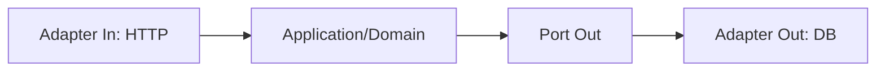

# Módulo 15: Arquitectura, DDD, C4 y Modulith

Cuando un sistema crece, el problema deja de ser “cómo escribir un controller” y pasa a ser “dónde poner la lógica y cómo evitar que todo dependa de todo”. Este módulo cubre arquitectura hexagonal, Clean, C4, ADR y Spring Modulith.

**Entorno de referencia verificado (2026-05-22):** JDK 27.0.1.0.2, Spring Boot 3.5.0, Spring Modulith (verificar versión del proyecto).

## Aprende construyendo

### Tema 1: Hexagonal y puertos/adaptadores · Avanzado · 45 min

Caso guía: el dominio debe poder testearse sin DB ni HTTP.

#### Arquitectura hexagonal

**Definición formal.** El dominio/aplicación define puertos (interfaces); los adaptadores implementan entrada/salida (HTTP, DB, Kafka).

**Error común.** Anotar el dominio con dependencias de infraestructura por todos lados. Corrección: dependencias hacia adentro.

### Tema 2: Clean Architecture, C4 y ADR · Avanzado · 45 min

Caso guía: documentar por qué se eligió Kafka y no RabbitMQ.

#### C4

**Definición formal.** Modelo de diagramas en 4 niveles: Context, Containers, Components, Code.

#### ADR

**Definición formal.** Architecture Decision Record: documento breve que registra decisión, contexto, alternativas y consecuencias.

**Error común.** Decisiones arquitectónicas solo en chats. Corrección: ADR versionado.

### Tema 3: Spring Modulith y fronteras de módulos · Avanzado · 45 min

Caso guía: separar módulos `pedido`, `inventario`, `envio` dentro de un monolito.

#### Spring Modulith

**Definición formal.** Herramienta para estructurar y verificar módulos lógicos dentro de una app Spring Boot, con eventos y pruebas de arquitectura.

**Error común.** Paquetes “modulares” sin reglas de dependencia. Corrección: verificar fronteras con tests Modulith.

**Nota de verificación.** Requiere dependencia Spring Modulith; lab ejecutable.

## Cierre

La arquitectura controla el cambio. Los límites claros valen más que capas dibujadas sin enforcement.

## Checklist

- Separo dominio de infraestructura.
- Documento decisiones con ADR.
- Uso C4 para comunicar niveles.
- Verifico fronteras con Modulith/tests.
