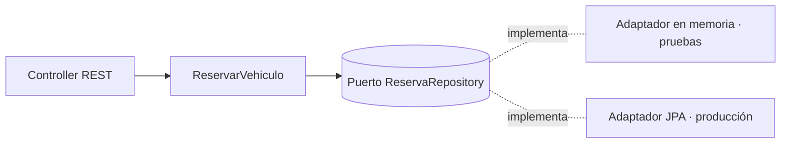

# Módulo 15: Arquitectura, DDD, C4 y Modulith

Cuando un sistema crece, el problema deja de ser “cómo escribir un controller” y pasa a ser “dónde poner la lógica y cómo evitar que todo dependa de todo”. Este módulo cubre arquitectura hexagonal, Clean, C4, ADR y Spring Modulith.

**Entorno de referencia verificado (2026-05-22):** JDK 27.0.1.0.2, Spring Boot 3.5.0, Spring Modulith (verificar versión del proyecto).

## Aprende construyendo

### Tema 1: Arquitectura hexagonal: puertos con tipos del dominio · Avanzado · 60 min

## Motivación

Un servicio de alquiler de vehículos tiene la regla «un vehículo no se puede reservar dos veces en fechas que se cruzan». Si esa regla vive en un controller o en un repositorio de Spring Data, probarla exige levantar Spring y una base de datos, y cambiar de base de datos obliga a tocarla. La arquitectura hexagonal existe para que la regla no dependa de nada de eso.

## Concepto

En la **arquitectura hexagonal** (o de *puertos y adaptadores*) el código se divide en dos zonas:

- **El dominio y los casos de uso**, en el centro: entidades, reglas y operaciones del negocio. No importan Spring, JPA ni HTTP.
- **Los adaptadores**, alrededor: un controller REST, un repositorio JPA, un consumidor de Kafka.

Entre ambas zonas están los **puertos**: interfaces que **define el dominio**. Un *puerto de entrada* es lo que el mundo puede pedirle a la aplicación (un caso de uso); un *puerto de salida* es lo que la aplicación necesita del mundo (guardar, consultar, publicar). Las dependencias apuntan siempre hacia el centro: el adaptador JPA conoce el dominio, nunca al revés.

La prueba de fuego está en la firma de los puertos de salida:

```java
// ✗ Puerto atado al framework: el dominio depende de Spring Data y de una entidad JPA
public interface ReservaRepository {
    Page<ReservaEntity> buscar(Pageable pageable);
}

// ✓ Puerto con tipos del dominio: habla el idioma del negocio
public interface ReservaRepository {
    List<Reserva> deVehiculo(Vehiculo vehiculo);
    void guardar(Reserva reserva);
}
```

Si tu dominio sabe que existe Spring, no tienes arquitectura hexagonal: tienes carpetas con nombres bonitos.

## Ejemplo mínimo

Dominio, puerto, caso de uso y un adaptador en memoria, en un solo archivo para poder ejecutarlo sin Spring:

**Archivo:** `ReservasHexagonal.java`

```java
import java.time.LocalDate;
import java.util.ArrayList;
import java.util.List;

public class ReservasHexagonal {

    // ───────── Dominio: no importa nada de Spring ni de JPA ─────────

    record Vehiculo(String placa) {}

    record Periodo(LocalDate desde, LocalDate hasta) {
        Periodo {
            if (hasta.isBefore(desde)) throw new IllegalArgumentException("el periodo termina antes de empezar");
        }
        boolean seCruzaCon(Periodo otro) {
            return !hasta.isBefore(otro.desde) && !otro.hasta.isBefore(desde);
        }
    }

    record Reserva(Vehiculo vehiculo, Periodo periodo) {}

    /** Puerto de salida: lo define el dominio y habla con tipos del dominio. */
    interface ReservaRepository {
        List<Reserva> deVehiculo(Vehiculo vehiculo);
        void guardar(Reserva reserva);
    }

    /** Caso de uso: la regla de negocio vive aquí, no en el controller ni en el repositorio. */
    static class ReservarVehiculo {
        private final ReservaRepository reservas;

        ReservarVehiculo(ReservaRepository reservas) { this.reservas = reservas; }

        Reserva ejecutar(Vehiculo vehiculo, Periodo periodo) {
            boolean ocupado = reservas.deVehiculo(vehiculo).stream()
                    .anyMatch(r -> r.periodo().seCruzaCon(periodo));
            if (ocupado) throw new IllegalStateException(vehiculo.placa() + " ya está reservado en esas fechas");
            Reserva nueva = new Reserva(vehiculo, periodo);
            reservas.guardar(nueva);
            return nueva;
        }
    }

    // ───────── Adaptador de salida: una implementación del puerto ─────────

    static class ReservaRepositoryEnMemoria implements ReservaRepository {
        private final List<Reserva> datos = new ArrayList<>();
        public List<Reserva> deVehiculo(Vehiculo v) {
            return datos.stream().filter(r -> r.vehiculo().equals(v)).toList();
        }
        public void guardar(Reserva r) { datos.add(r); }
    }

    // ───────── Prueba del caso de uso sin levantar Spring ─────────

    public static void main(String[] args) {
        var casoDeUso = new ReservarVehiculo(new ReservaRepositoryEnMemoria());
        var taxi = new Vehiculo("ABC-123");

        casoDeUso.ejecutar(taxi, new Periodo(LocalDate.of(2026, 12, 1), LocalDate.of(2026, 12, 5)));
        System.out.println("reserva 1-5 dic: aceptada");

        try {
            casoDeUso.ejecutar(taxi, new Periodo(LocalDate.of(2026, 12, 4), LocalDate.of(2026, 12, 8)));
        } catch (IllegalStateException e) {
            System.out.println("reserva 4-8 dic: rechazada → " + e.getMessage());
        }

        casoDeUso.ejecutar(taxi, new Periodo(LocalDate.of(2026, 12, 6), LocalDate.of(2026, 12, 9)));
        System.out.println("reserva 6-9 dic: aceptada");
    }
}
```

```text
$ java ReservasHexagonal.java
reserva 1-5 dic: aceptada
reserva 4-8 dic: rechazada → ABC-123 ya está reservado en esas fechas
reserva 6-9 dic: aceptada
```

La regla se probó en milisegundos sin base de datos: el caso de uso solo conoce el puerto, y aquí lo cumple una lista en memoria.

## Cómo funciona por dentro

En la aplicación real se añade un adaptador JPA que implementa el **mismo puerto**. Traduce entre la entidad de persistencia y el objeto del dominio, y es el único sitio donde aparecen `@Entity`, `JpaRepository` o `Pageable`:

```java
// Esquema del adaptador de salida (requiere Spring Data JPA; no está en el archivo ejecutable)
@Component
class ReservaRepositoryJpa implements ReservaRepository {
    private final ReservaJpaRepository jpa;          // interfaz de Spring Data

    ReservaRepositoryJpa(ReservaJpaRepository jpa) { this.jpa = jpa; }

    public List<Reserva> deVehiculo(Vehiculo v) {
        return jpa.findByPlaca(v.placa()).stream().map(ReservaEntity::aDominio).toList();
    }

    public void guardar(Reserva r) { jpa.save(ReservaEntity.desdeDominio(r)); }
}
```

Spring inyecta `ReservaRepositoryJpa` donde el caso de uso pide un `ReservaRepository`. El caso de uso no cambia ni una línea.



## Reglas y casos límite

- **Los puertos devuelven tipos del dominio**, nunca entidades JPA, `Page` ni DTOs de HTTP.
- **El caso de uso no lleva anotaciones de infraestructura.** Si necesitas `@Transactional`, ponla en un adaptador o en una capa de aplicación fina, no en las entidades del dominio.
- **No todo proyecto lo necesita.** Un CRUD sin reglas de negocio gana poco con puertos y paga más clases. Aplícalo donde hay reglas que proteger.

## Compruébalo

1. Escribe un segundo adaptador, `ReservaRepositoryQueFalla`, cuyo `guardar` lance una excepción. ¿Qué parte del código tuviste que cambiar para probarlo?
2. ¿Por qué `Periodo` valida sus fechas en el constructor del record y no en el controller?

### Tema 2: C4 y ADR: documentar el sistema y sus decisiones · Avanzado · 45 min

## Motivación

Dentro de un año alguien preguntará por qué Tienda Aurora usa Kafka y no RabbitMQ. Si la respuesta solo existe en un chat o en la memoria de quien se fue, la decisión se vuelve a discutir desde cero o se revierte sin entender el motivo. Un diagrama muestra *cómo* es el sistema; no explica *por qué* es así.

## Concepto

El **modelo C4** describe un sistema con cuatro niveles de zoom, como un mapa:

| Nivel | Qué muestra | Ejemplo en Tienda Aurora |
|---|---|---|
| 1. Contexto | El sistema y quién lo usa, con los sistemas externos | Cliente → Tienda Aurora → pasarela de pagos |
| 2. Contenedores | Aplicaciones y almacenes que se despliegan por separado | App web, API de pedidos, worker de envíos, PostgreSQL, Kafka |
| 3. Componentes | Piezas dentro de un contenedor | Controller, caso de uso `CrearPedido`, repositorio |
| 4. Código | Clases y relaciones | Normalmente lo genera el IDE; rara vez se dibuja a mano |

Un **ADR** (*Architecture Decision Record*) es un archivo corto y versionado junto al código que registra una decisión importante. Tiene cuatro secciones: **contexto** (qué problema había), **decisión** (qué se eligió), **alternativas** (qué más se consideró y por qué no) y **consecuencias** (qué se gana y qué se paga).

Regla práctica: dibuja el sistema con C4 y, por cada decisión que alguien podría no entender dentro de un año, escribe un ADR.

## Ejemplo mínimo

**Archivo:** `docs/adr/0007-mensajeria-con-kafka.md`

```markdown
# ADR 0007 · Mensajería entre servicios con Kafka

- Estado: aceptada (2026-11-24)

## Contexto
Pedidos, inventario y envíos deben reaccionar a los mismos eventos.
Necesitamos reprocesar eventos pasados al desplegar un servicio nuevo
y conservar el orden por pedido.

## Decisión
Usar Apache Kafka, con un topic por tipo de evento y el id del pedido
como clave de partición.

## Alternativas
- RabbitMQ: más simple de operar, pero los mensajes se borran al
  consumirse y no permite releer el historial.
- Llamadas HTTP síncronas: acoplan la disponibilidad de los servicios.

## Consecuencias
+ Reprocesamiento y orden por pedido.
- Más operación (brokers, retención, monitoreo) y curva de aprendizaje.
```

## Reglas y casos límite

- **Un ADR no se edita, se reemplaza.** Si la decisión cambia, se escribe un ADR nuevo con estado «reemplaza a 0007» y el viejo pasa a «reemplazada».
- **Pocas decisiones, bien escritas.** No hace falta un ADR para el nombre de una variable; sí para el broker, la base de datos o el estilo de arquitectura.
- **El diagrama C4 vive con el código.** Herramientas como Structurizr o Mermaid permiten versionarlo como texto.

## Compruébalo

1. Dibuja el nivel 2 (contenedores) de Tienda Aurora con los servicios del curso.
2. Escribe el ADR de una decisión que ya tomaste en este curso, por ejemplo usar un circuit breaker en pedidos (módulo 7).

### Tema 3: Spring Modulith y fronteras de módulos · Avanzado · 45 min

Caso guía: separar módulos `pedido`, `inventario`, `envio` dentro de un monolito.

#### Spring Modulith

**Definición formal.** Herramienta para estructurar y verificar módulos lógicos dentro de una app Spring Boot, con eventos y pruebas de arquitectura.

**Error común.** Paquetes “modulares” sin reglas de dependencia. Corrección: verificar fronteras con tests Modulith.

**Nota de verificación.** Requiere dependencia Spring Modulith; lab ejecutable.

## Cierre

La arquitectura controla el cambio. Los límites claros valen más que capas dibujadas sin enforcement.

## Checklist

- Separo dominio de infraestructura.
- Documento decisiones con ADR.
- Uso C4 para comunicar niveles.
- Verifico fronteras con Modulith/tests.
