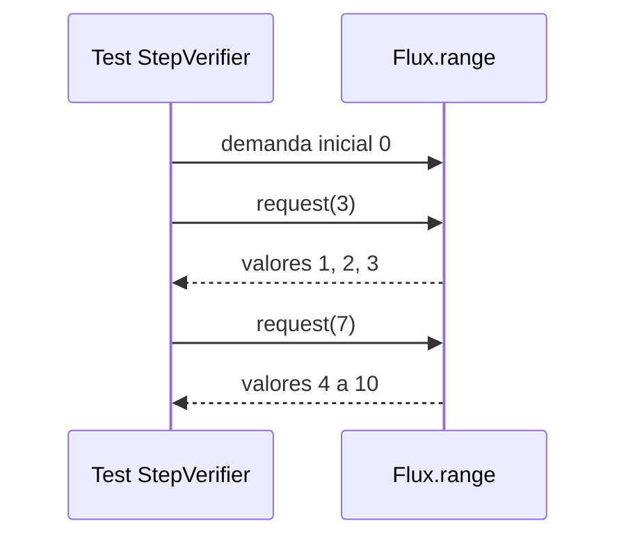
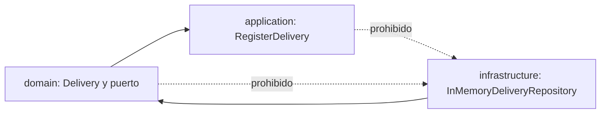

# Módulo 15: Spring Master: hexagonal, reactivo y microservicios


## Aprende construyendo

Este módulo cierra el nivel "master" del track con ocho temas avanzados: backpressure medido con `reactor-test`, reutilización de contenedores Testcontainers, reglas con ArchUnit, Bulkhead y RateLimiter con Resilience4j, una saga con compensación, event sourcing con replay, recuperación de compensaciones fallidas y Clean Architecture con DDD táctico. Cada tema debe enlazar sus herramientas y pruebas reales; el inventario de herramientas no sustituye evidencia de ejecución.

### Tema 1: Backpressure real en WebFlux con reactor-test

**Objetivo observable:** usar `StepVerifier` para pedir elementos por tandas y comprobar los valores emitidos y las solicitudes que llegan al origen.

**¿Por qué es importante?** Si el consumidor va más lento que el productor, Reactive Streams deja que solicite la cantidad que puede procesar. Los operadores pueden guardar elementos o cambiar las tandas de demanda; por eso la posición donde medimos importa.

**Antes de empezar:** conocer `Flux` y una prueba básica de `StepVerifier` (Módulo 9). Continúa en el ejemplo existente `examples/spring-reactor-rutaflow/`, que ya incluye `reactor-test`.

```bash
cd examples/spring-reactor-rutaflow
./mvnw -q -Dtest=BackpressureDemandTest test
```



#### Subtema 15.1.1: Empieza con cero solicitudes · 8 min

**Contexto.** `Flux.range(1, 10)` produce diez enteros. Para ver cuándo llegan, `StepVerifier` puede suscribirse con una demanda inicial de cero.

**Hazlo tú.** Abre `src/test/java/academia/rutaflow/reactor/BackpressureDemandTest.java`. Encuentra `StepVerifier.create(source, 0)` y la lista `received`. Corre el comando del laboratorio.

**Resultado esperado.** El test confirma que la lista sigue vacía justo después de la suscripción; los valores aparecen solo después de `thenRequest`.

**Fallo deliberado.** Cambia `create(source, 0)` por `create(source)`. Ejecuta `emiteTresYDespuesSieteSoloCuandoElSuscriptorLosSolicita`: llegan los diez valores antes de la comprobación de lista vacía. Restaura `0`.

**Entiende.** La demanda es un pedido de elementos, como pedir tres piezas de una línea de armado. El productor no debe enviar más valores que los pedidos por esa suscripción.

**Cierra.** Describe qué cambio observable produjo quitar la demanda inicial controlada.

#### Subtema 15.1.2: Solicita tres y luego siete · 8 min

**Contexto.** La prueba observa tanto lo recibido como las llamadas de demanda al `Flux`.

**Hazlo tú.** Lee el tramo del test y predice qué valores aparecen tras cada pedido:

```java
StepVerifier.create(source, 0)
    .thenRequest(3).expectNext(1, 2, 3)
    .thenRequest(7).expectNext(4, 5, 6, 7, 8, 9, 10)
    .verifyComplete();

assertThat(upstreamRequests).containsExactly(3L, 7L);
```

Ejecuta la prueba y compara tu predicción con `upstreamRequests`.

**Resultado esperado.** El consumidor ve los diez valores en orden en dos grupos, y `doOnRequest` registra exactamente `3` y `7` en ese punto del flujo.

**Fallo deliberado.** Cambia el segundo `.thenRequest(7)` a `.thenRequest(6)`. `verifyComplete` falla porque queda un elemento sin solicitar. Restaura la cantidad y corre la prueba verde.

**Entiende.** `thenRequest(n)` aumenta la demanda acumulada; no reinicia el pedido anterior. `doOnRequest` registra la solicitud que llega a esa ubicación del publisher.

**Cierra.** Guarda el resultado JUnit y los dos valores registrados por la lista.

#### Subtema 15.1.3: Mira la demanda sin límite · 8 min

**Contexto.** Si no configuras demanda inicial, `StepVerifier.create(source)` solicita demanda ilimitada para recorrer la secuencia y terminarla.

**Hazlo tú.** Ejecuta `stepVerifierSinParametroInicialSolicitaDemandaIlimitada` y lee la lista capturada por `doOnRequest`.

**Resultado esperado.** El test registra `Long.MAX_VALUE`, que Reactor puede tratar como demanda efectivamente ilimitada, y consume los tres valores finitos.

**Fallo deliberado.** Cambia `StepVerifier.create(source)` en ese test por `StepVerifier.create(source, 0).thenRequest(3)`. La aserción de demanda ilimitada falla porque el origen vio `3`, no `Long.MAX_VALUE`. Restaura el valor por defecto y corre la suite.

**Entiende.** **Límite:** esta prueba mide `Flux.range`, no demuestra por sí sola cuánto almacena cada operador ni que un endpoint WebFlux vaya a soportar cualquier carga. `flatMap`, `buffer` y otros operadores pueden cambiar la demanda hacia arriba.

**Cierra.** Explica por qué “usa WebFlux” no equivale a “memoria ilimitada protegida”.

#### Subtema 15.1.4: Observa cómo `limitRate` cambia las tandas · 10 min

**Contexto.** El consumidor sigue viendo lo que solicitó, pero `limitRate` agrupa las peticiones que llegan al origen.

**Hazlo tú.** En `limitRateAgrupaLoQueSolicitaAlOrigen`, encuentra `.limitRate(4, 0)` y revisa dónde se puso `doOnRequest`:

```java
Flux<Integer> source = Flux.range(1, 10)
    .doOnRequest(upstreamRequests::add)
    .limitRate(4, 0);
```

Ejecuta `./mvnw -q -Dtest=BackpressureDemandTest test`.

**Resultado esperado.** StepVerifier conserva los valores y su orden; la lista del origen registra tandas `4`, `4`, `4`, incluida la solicitud final de dos elementos que Reactor completa al tamaño de tanda configurado.

**Fallo deliberado.** Cambia temporalmente el tamaño a `2` y corre el test: la expectativa deja de coincidir; `doOnRequest` observó `[2, 2, 2, 2, 2, 2]` en vez de `[4, 4, 4]`. Restaura el `4` original y confirma los tests verdes.

**Entiende.** Los operadores pueden transformar demanda entre suscriptor y origen. Para evaluar el proyecto integrador, coloca la medición en el límite que quieres comprender y prueba con el operador real de tu cadena.

**Cierra.** Evidencia: reporte verde de `BackpressureDemandTest`, captura de demandas `3/7` y `4/4/4`, y explicación del cambio con `limitRate`.

**Transferencia al proyecto integrador:** si una ruta WebFlux procesa un flujo grande, prueba la cadena real con demanda limitada y revisa operadores que almacenan o solicitan elementos por adelantado; no uses este ejemplo como prueba de carga del servicio.

**Fuentes oficiales:** [Project Reactor: testing](https://projectreactor.io/docs/core/release/reference/testing.html), [Project Reactor: backpressure y operadores](https://projectreactor.io/docs/core/release/reference/subscribe-backpressure.html) y [Reactive Streams: reglas de demanda](https://github.com/reactive-streams/reactive-streams-jvm).

### Tema 2: Contenedores Testcontainers reutilizados entre clases

**Objetivo observable:** hacer que dos clases JUnit consulten el mismo PostgreSQL Testcontainers dentro de una ejecución de pruebas y comparar el ID real observado por cada una.

**¿Por qué es importante?** Crear contenedores cuesta tiempo. Un singleton puede evitar arranques repetidos cuando varias clases necesitan la misma base; también significa que esas pruebas comparten estado y ciclo de vida.

**Antes de empezar:** conocer Testcontainers básico (Módulo 6). El laboratorio `examples/testcontainers-singleton-rutaflow/` usa Testcontainers 2.0.5, dos clases JUnit y Postgres. Solo ejecuta `SELECT 1`, no comparte filas modificadas.

**Comando:** desde esa carpeta, Docker compatible ejecuta `./mvnw -q test`. En macOS con Podman, sigue los comandos exactos del README para apuntar al socket local y desactivar Ryuk rootless.

```bash
cd examples/testcontainers-singleton-rutaflow
./mvnw -q test
```

#### Subtema 15.2.1: Arranca el singleton una sola vez · 8 min

**Contexto.** `@Container` estático comparte el contenedor entre métodos de una clase. El patrón singleton manual permite compartirlo entre varias clases que heredan una base común.

**Hazlo tú.** Abre `src/test/java/academia/rutaflow/containers/SharedPostgres.java`. Encuentra el campo estático y el bloque de arranque:

```java
static final PostgreSQLContainer POSTGRES = new PostgreSQLContainer("postgres:16-alpine");

static {
    POSTGRES.start();
}
```

**Resultado esperado.** El contenedor comienza al cargar la clase base y las dos clases lectoras heredan la misma referencia.

**Fallo deliberado.** Quita temporalmente `POSTGRES.start()` y ejecuta la suite. Las dos clases fallan con `Mapped port can only be obtained after the container is started`. Restaura el bloque y vuelve a probar.

**Entiende.** Una sola cocina prepara comida para dos mesas; ambas dependen de que esa cocina exista. El cierre ocurre cuando termina la JVM de tests.

**Cierra.** Señala por qué esta base no lleva las anotaciones `@Testcontainers` y `@Container`.

#### Subtema 15.2.2: Comprueba la base desde cada clase · 8 min

**Contexto.** Que un ID exista no confirma que PostgreSQL acepte consultas. Cada clase ejecuta una consulta pequeña y guarda el ID que observó.

**Hazlo tú.** Abre `FirstRepositoryTest.java` y `SecondRepositoryTest.java`; ambas llaman al método heredado `queryAndRecordContainerId()`.

```java
try (Connection connection = DriverManager.getConnection(
        POSTGRES.getJdbcUrl(), POSTGRES.getUsername(), POSTGRES.getPassword());
     Statement statement = connection.createStatement();
     ResultSet result = statement.executeQuery("SELECT 1")) {
    assertThat(result.next()).isTrue();
    assertThat(result.getInt(1)).isEqualTo(1);
}
```

Corre `./mvnw -q test` y compara las dos líneas `usa containerId=`.

**Resultado esperado.** Ambas consultas pasan y muestran el mismo ID de contenedor. Al terminar la segunda clase, el `@AfterAll` heredado verifica la igualdad sin depender del orden de las clases.

**Fallo deliberado.** Cambia una de las consultas de `SELECT 1` a `SELECT columna_que_no_existe`. Solo la clase que ejecuta esa consulta falla. Restaura `SELECT 1` y corre la suite completa.

**Entiende.** El ID igual en ambos logs es la evidencia de que las clases accedieron al mismo contenedor en esa JVM. No mide cuánto tiempo se ahorró.

**Cierra.** Guarda el reporte JUnit y los IDs iguales de la ejecución actual.

#### Subtema 15.2.3: Aísla los datos compartidos · 8 min

**Contexto.** Las clases comparten la base junto con el contenedor. Una prueba que inserta filas puede alterar lo que observa la siguiente.

**Hazlo tú.** Lee `junit-platform.properties` y confirma que el paralelismo de Jupiter está apagado. Inspecciona las dos pruebas: usan `SELECT 1` y no cambian filas.

**Resultado esperado.** Las dos clases pasan en secuencia y no necesitan limpiar datos.

**Fallo deliberado.** En `SharedPostgres.queryAndRecordContainerId`, guarda temporalmente el texto `id-falso` en lugar del ID real para `SecondRepositoryTest`. La consulta todavía pasa, pero la comprobación `@AfterAll` falla al encontrar IDs distintos. Restaura el ID real y confirma la suite verde.

**Entiende.** **Límite:** singleton no significa base limpia por clase. Si cambias datos, limpia cada prueba con claves únicas, transacciones realmente aisladas o esquemas por clase.

**Cierra.** Escribe qué limpieza necesitaría tu caso de prueba si insertara una entrega.

#### Subtema 15.2.4: Decide si conviene compartir · 8 min

**Contexto.** El singleton comparte el ciclo de vida dentro de una JVM; el modo `withReuse(true)` trata de conservar contenedores entre ejecuciones locales y tiene una configuración diferente.

**Hazlo tú.** Lee el README del laboratorio y la guía oficial de ciclo manual. Busca las diferencias entre `@Container` estático por clase, el singleton manual entre clases y la reutilización persistente local.

**Resultado esperado.** Puedes decir qué alcance comparte cada patrón y cuándo debes limpiar filas o evitar forks paralelos.

**Fallo deliberado.** Ejecuta cada clase por separado con `./mvnw -q -Dtest=FirstRepositoryTest test` y luego `./mvnw -q -Dtest=SecondRepositoryTest test`. Los IDs cambian porque son dos ejecuciones/JVM distintas; el singleton solo comparte dentro de la ejecución conjunta. Después vuelve a correr `./mvnw -q test` para comprobar un ID compartido.

**Entiende.** Usa singleton si has medido que el arranque repetido domina el tiempo de pruebas y puedes aislar estado. Para pocas clases, conserva el ciclo de vida administrado por JUnit.

**Cierra.** Evidencia: ambas consultas verdes, dos IDs reales iguales y una razón concreta para usar o no el patrón en el proyecto integrador.

**Transferencia al proyecto integrador:** úsalo solo si varias suites comparten el mismo servicio externo y cada prueba conserva aislamiento de datos. La prueba actual no demuestra ahorro de tiempo; mide tu pipeline antes de decidir.

**Fuentes oficiales:** [Testcontainers: ciclo manual y singleton](https://java.testcontainers.org/test_framework_integration/manual_lifecycle_control/), [integración JUnit 5](https://java.testcontainers.org/test_framework_integration/junit_5/) y [configuración Podman](https://java.testcontainers.org/supported_docker_environment/).

### Tema 3: Arquitectura hexagonal verificada con ArchUnit

**Objetivo observable:** agregar una regla ejecutable que bloquee dependencias desde `domain` y `application` hacia `infrastructure`.

**¿Por qué es importante?** El dominio conserva las reglas del negocio; si importa una clase de base de datos o un framework, cambiar esa infraestructura puede arrastrar cambios al negocio. ArchUnit convierte la frontera en un test que muestra qué clase la cruzó.

**Antes de empezar:** entender puertos y adaptadores (Módulo 10, Tema 6). El ejemplo `examples/archunit-hexagonal-rutaflow/` usa Java 25, ArchUnit 1.5.1 y JUnit; no necesita Spring ni Docker.

```bash
cd examples/archunit-hexagonal-rutaflow
./mvnw -q test
```



#### Subtema 15.3.1: Ubica el puerto y el adaptador · 8 min

**Contexto.** El puerto expresa qué necesita el caso de uso; el adaptador decide cómo guardar.

**Hazlo tú.** Desde `examples/archunit-hexagonal-rutaflow/`, abre `src/main/java/academia/rutaflow/hexagonal/domain/DeliveryRepository.java`, `application/RegisterDelivery.java` e `infrastructure/InMemoryDeliveryRepository.java`. Sigue el tipo que inyecta el caso de uso y la interfaz que implementa el adaptador.

**Resultado esperado.** `RegisterDelivery` depende de `DeliveryRepository`; no conoce el mapa de `InMemoryDeliveryRepository`.

**Fallo deliberado.** En `RegisterDelivery`, cambia temporalmente el tipo del campo y del parámetro del constructor de `DeliveryRepository` a `InMemoryDeliveryRepository`. Ejecuta la suite: compila, pero ArchUnit rechaza la dependencia application→infrastructure. Restaura el puerto en ambos lugares y confirma los tests verdes.

**Entiende.** El puerto es el enchufe acordado; el adaptador es el aparato conectado. El negocio describe el enchufe, no el fabricante.

**Cierra.** Anota la ruta del puerto y la ruta de su implementación.

#### Subtema 15.3.2: Escribe la regla sobre el bytecode · 8 min

**Contexto.** ArchUnit importa las clases compiladas del paquete y comprueba las relaciones que quedaron en el bytecode.

**Hazlo tú.** Desde `examples/archunit-hexagonal-rutaflow/`, abre `src/test/java/academia/rutaflow/hexagonal/HexagonalArchitectureTest.java`. Lee la regla y ejecútala:

```java
ArchRule rule = noClasses().that().resideInAPackage("..domain..")
    .should().dependOnClassesThat().resideInAPackage("..infrastructure..");

rule.check(project);
```

**Resultado esperado.** La regla pasa con las clases actuales y se examina el mismo paquete `academia.rutaflow.hexagonal`.

**Fallo deliberado.** Añade temporalmente a `domain/Delivery.java` un método que devuelva `InMemoryDeliveryRepository`. Corre `./mvnw -q -Dtest=HexagonalArchitectureTest#dominioNoDependeDeDetallesDeInfraestructura test`: el fallo señala el tipo de retorno. Quita método e import y ejecuta la suite completa.

**Entiende.** La regla mira referencias de bytecode, por ejemplo tipos de campo, retorno, herencia y llamadas. Una cadena con el nombre de una clase usada vía reflexión no es necesariamente una dependencia de bytecode detectada por esta regla.

**Cierra.** Conserva el mensaje de ArchUnit que nombra `Delivery` y `InMemoryDeliveryRepository`.

#### Subtema 15.3.3: Protege también el caso de uso · 8 min

**Contexto.** Prohibir la fuga desde el dominio no basta si application importa la base concreta directamente.

**Hazlo tú.** Abre `examples/archunit-hexagonal-rutaflow/src/test/java/academia/rutaflow/hexagonal/HexagonalArchitectureTest.java`, sigue `aplicacionNoDependeDeDetallesDeInfraestructura` y compara el nombre de paquetes con la primera regla.

**Práctica guiada.** Cambia el puerto de `RegisterDelivery` por el adaptador concreto, ejecuta solo esta regla y vuelve a inyectar la interfaz cuando veas la infracción.

**Resultado esperado.** Los dos tests pasan: ni `domain` ni `application` tienen dependencia hacia `infrastructure`.

**Fallo deliberado.** Cambia `RegisterDelivery` para declarar una referencia a `InMemoryDeliveryRepository`; corre solo `aplicacionNoDependeDeDetallesDeInfraestructura`. ArchUnit marca esa referencia. Restaura la dependencia por interfaz.

**Entiende.** Una regla es tan completa como los paquetes que incluye. Su límite es lo que ArchUnit importó y los tipos de dependencia que la regla detecta. Si aparece un nuevo paquete como `adapter`, decide y documenta qué lado de la frontera ocupa antes de ampliar el patrón.

**Cierra.** Guarda el reporte verde de las dos reglas.

#### Subtema 15.3.4: Decide qué reglas merece mantener · 8 min

**Contexto.** Una regla demasiado general puede bloquear decisiones válidas; una regla ausente deja la frontera a la memoria del equipo.

**Hazlo tú.** Desde `examples/archunit-hexagonal-rutaflow/`, lee `src/test/java/academia/rutaflow/hexagonal/HexagonalArchitectureTest.java`, busca `adaptersDeInfraestructuraSeIdentificanComoRepository` y ejecuta `./mvnw -q test`. La regla de ejemplo comprueba el sufijo del adaptador; registra qué paquetes y clases quedan dentro de su alcance.

**Resultado esperado.** La regla nueva pasa con el adaptador actual y explica su alcance en el nombre o comentario.

**Fallo deliberado.** Renombra temporalmente el archivo/clase `InMemoryDeliveryRepository` a `InMemoryDeliveryStore` sin actualizar la regla. Ejecuta `adaptersDeInfraestructuraSeIdentificanComoRepository`: falla al encontrar `InMemoryDeliveryStore`. Restaura el nombre y corre la suite completa.

**Entiende.** ArchUnit valida estructura de clases, no calidad del modelo completo ni comportamiento de negocio. Mantén el alcance visible y revisa excepciones en vez de ampliar los patrones hasta que todo pase.

**Cierra.** Evidencia: suite verde restaurada y explicación de una regla útil para el proyecto integrador.

**Transferencia al proyecto integrador:** protege con ArchUnit las capas de una ruta real (controller → caso de uso → puerto → adapter). La prueba actual solo cubre un ejemplo mínimo en memoria; no inspecciona el microservicio del Módulo 12.

**Fuentes oficiales:** [ArchUnit User Guide](https://www.archunit.org/userguide/html/000_Index.html), [ArchUnit Getting Started](https://www.archunit.org/getting-started).

### Tema 4: Bulkhead y RateLimiter de Resilience4j

#### Subtema 15.4.1: Separa concurrencia de ritmo · 8 min

**Contexto.** El `CircuitBreaker` del Módulo 10 reacciona a fallos. El Bulkhead limita cuántas llamadas están dentro al mismo tiempo; el RateLimiter cuenta permisos durante un período.

**¿Por qué es importante?** Una dependencia lenta o una ráfaga pueden agotar recursos o saturar un servicio externo. Estos límites hacen explícita la protección, siempre que las llamadas pasen por ellos y que la configuración refleje la capacidad medida.

```text
2 llamadas activas ──> [Bulkhead: 2 espacios] ──> la tercera se rechaza
2 permisos / período ──> [RateLimiter: 2] ─────> la tercera se rechaza
```

**Hazlo tú.** Abre `examples/spring-resilience-rutaflow/README.md` y `src/test/java/academia/rutaflow/resilience/BulkheadRateLimiterBehaviorTest.java`. En una hoja, dibuja dos llamadas ocupando los dos espacios del Bulkhead y tres solicitudes que compiten por dos permisos del RateLimiter.

**Resultado esperado.** El primer límite depende de cuántas llamadas siguen activas; el segundo, de cuántos permisos quedan en el período. La tercera llamada de cada ejemplo se rechaza por una razón distinta.

**Fallo deliberado.** Cambia `maxConcurrentCalls(2)` por `maxConcurrentCalls(3)` y ejecuta `./mvnw -q -Dtest=BulkheadRateLimiterBehaviorTest#semaphoreBulkheadRechazaUnaTerceraLlamadaMientrasDosSiguenDentro test` desde `examples/spring-resilience-rutaflow/`. El test debe fallar porque hay un espacio disponible para la tercera llamada. Restaura el límite a 2 y corre la prueba de nuevo.

**Entiende.** El Bulkhead de semáforo regula el acceso; no crea un grupo aislado de hilos. Resilience4j también ofrece `ThreadPoolBulkhead`, que sí usa un pool y una cola limitada. No prometas que estas primitivas aíslan toda la aplicación.

**Cierra.** Anota qué recurso proteges y qué tipo de rechazo puede observar quien llama.

#### Subtema 15.4.2: Mantén la llamada dentro del Bulkhead · 8 min

**Contexto.** Configurar el objeto no cambia una llamada por sí solo: hay que ejecutar la operación a través de la decoración.

**Hazlo tú.** En `examples/spring-resilience-rutaflow/src/test/java/academia/rutaflow/resilience/BulkheadRateLimiterBehaviorTest.java`, sigue `Bulkhead.of`, `decorateRunnable`, los dos `CountDownLatch` y `getAvailableConcurrentCalls()`. Ejecuta desde la carpeta del laboratorio:

```bash
./mvnw -q -Dtest=BulkheadRateLimiterBehaviorTest#semaphoreBulkheadRechazaUnaTerceraLlamadaMientrasDosSiguenDentro test
```

**Resultado esperado.** El test espera a que dos tareas reales entren, observa cero espacios disponibles y comprueba `BulkheadFullException` en la tercera; luego libera ambas tareas y termina sin dejar hilos ocupados.

**Fallo deliberado.** Quita `Bulkhead.decorateRunnable(bulkhead, ...)` de la tercera llamada y ejecútala directamente. El rechazo desaparece y la prueba falla. Restaura la decoración y repite el comando.

**Entiende.** El límite solo cubre el código que atraviesa este Bulkhead. Si una ruta alternativa llama directo al servicio externo, esta protección no la alcanza.

**Cierra.** Explica en una frase dónde debe colocarse la llamada protegida en el servicio de tu proyecto.

#### Subtema 15.4.3: Cuenta permisos por período · 8 min

**Contexto.** El RateLimiter renueva un número de permisos al empezar cada período. Con espera cero, una llamada sin permiso se rechaza en vez de quedarse esperando.

**Hazlo tú.** Abre `examples/spring-resilience-rutaflow/src/test/java/academia/rutaflow/resilience/BulkheadRateLimiterBehaviorTest.java` y localiza `rateLimiterEntregaDosPermisosYRechazaElTerceroEnElMismoPeriodo`. Ejecuta:

```bash
./mvnw -q -Dtest=BulkheadRateLimiterBehaviorTest#rateLimiterEntregaDosPermisosYRechazaElTerceroEnElMismoPeriodo test
```

**Resultado esperado.** Las dos primeras llamadas reciben `true`, la tercera `false`; la ventana de una hora mantiene el ejemplo determinista sin depender de que el reloj avance durante la prueba.

**Fallo deliberado.** Cambia `limitForPeriod(2)` a `limitForPeriod(3)`. El test falla porque la tercera solicitud también consigue permiso. Restablece el límite y ejecútalo otra vez.

**Entiende.** El contador pertenece a esta instancia local del RateLimiter. Varias réplicas de un servicio tienen sus propios contadores; esto no implementa por sí solo una cuota global de cliente.

**Cierra.** Describe qué debería ocurrir en tu API cuando el permiso se agota: responder con límite excedido o esperar un tiempo acotado.

#### Subtema 15.4.4: Decide el límite y observa sus fronteras · 8 min

**Contexto.** Un límite elegido sin medir la dependencia puede rechazar tráfico útil o dejar pasar más carga de la que soporta.

**Hazlo tú.** Revisa `examples/spring-resilience-rutaflow/pom.xml`, `README.md` y los dos tests nuevos. Ejecuta la suite completa:

```bash
./mvnw -q clean test
```

**Resultado esperado.** Pasan las pruebas de CircuitBreaker ya existentes y las dos nuevas de concurrencia y tasa. El proyecto usa Resilience4j 2.4.0; ambos límites son locales al proceso y el ejemplo no llama a un proveedor real.

**Fallo deliberado.** Cambia `timeoutDuration(Duration.ZERO)` del RateLimiter por `Duration.ofSeconds(1)` y deja el período largo. La tercera llamada puede esperar hasta agotar el segundo; registra esa diferencia de comportamiento y restaura cero para conservar una suite rápida y determinista.

**Entiende.** El número correcto sale de medir capacidad, tiempos y política de rechazo. Un RateLimiter por instancia no equivale a una cuota compartida; el Bulkhead de semáforo no equivale a un pool separado. Aplicar ambos a la misma operación también requiere decidir cuál debe rechazar primero.

**Cierra.** Evidencia: resultado verde de la suite, configuración final elegida y límite explícito del laboratorio. Para el microservicio del Módulo 12, primero registra latencia y tasa observada; luego dimensiona y prueba el límite con su tráfico real.

**Proyecto integrador:** en el cliente HTTP del servicio de pedidos del Módulo 12, identifica una dependencia lenta y documenta un límite de concurrencia inicial y una tasa por instancia. Añade pruebas equivalentes antes de habilitar esos límites; los valores del laboratorio no se deben copiar como capacidad de producción.

**Fuentes oficiales:** [Resilience4j Bulkhead](https://resilience4j.readme.io/docs/bulkhead), [Resilience4j RateLimiter](https://resilience4j.readme.io/docs/ratelimiter).

### Tema 5: Saga con compensación real

#### Subtema 15.5.1: Dibuja los pasos del pedido · 8 min

**Contexto.** Una compra puede necesitar reservar inventario, cobrar y confirmar el envío. Cada paso cambia un estado distinto y no existe un botón universal de deshacer para todos.

**¿Por qué es importante?** Si un paso posterior falla, dejar activos los cambios anteriores puede producir cobros sin envío o inventario bloqueado. La compensación da una acción explícita para esos efectos parciales.

**Hazlo tú.** Abre `examples/spring-saga-rutaflow/README.md` y revisa el recorrido antes de abrir el código:

```text
┌────────────────────┐  ┌──────────────┐  ┌────────────────┐
│ Reservar inventario├─>│ Cobrar pago  ├─>│ Confirmar envío│
└─────────┬──────────┘  └──────┬───────┘  └────────────────┘
          ↑                    ↑
   Liberar reserva       Devolver pago
```

**Resultado esperado.** Si falla el envío, el dinero y la reserva se revierten en orden inverso: primero se devuelve el cobro, luego se libera el inventario.

**Fallo deliberado.** Cambia el dibujo para devolver primero el inventario. Luego compáralo con la prueba del siguiente subtema y explica por qué el orden inverso mantiene disponibles las dependencias necesarias para deshacer el paso anterior.

**Entiende.** Una compensación es una acción nueva que intenta corregir un efecto previo; no borra el historial ni garantiza que el mundo vuelva exactamente al estado anterior.

**Cierra.** Nombra un efecto que se pueda compensar y otro que quizá no (por ejemplo, una notificación ya leída).

#### Subtema 15.5.2: Ejecuta y compensa en orden inverso · 8 min

**Contexto.** El orquestador registra una compensación solo después de que termina cada paso. Cuando falla un paso, recorre esas acciones completadas desde la última hacia la primera.

**Hazlo tú.** Abre `examples/spring-saga-rutaflow/src/main/java/academia/rutaflow/saga/OrderSaga.java` y `src/test/java/academia/rutaflow/saga/OrderSagaTest.java`. Ejecuta desde `examples/spring-saga-rutaflow/`:

```bash
./mvnw -q -Dtest=OrderSagaTest#ifShippingFailsItRefundsAndReleasesInReverseOrder test
```

**Resultado esperado.** La prueba fuerza un fallo del envío, comprueba que el pago vuelve y la reserva se libera; el registro contiene `devolver pago` antes de `liberar inventario`.

**Fallo deliberado.** Cambia el recorrido inverso por uno que compense desde la primera acción hasta la última. Ejecuta la misma prueba: falla porque las acciones observadas ya no están en el orden esperado. Restaura el recorrido inverso y repite el comando.

**Entiende.** Un paso que falla no se añade a la lista de compensaciones completadas. Por eso no se intenta cancelar un envío que nunca se confirmó.

**Cierra.** Dibuja el estado final del inventario y el pago después de la compensación; ambos deben quedar sin efecto para ese pedido.

#### Subtema 15.5.3: Compara fallo y éxito · 8 min

**Contexto.** Una compensación solo se ejecuta si un paso posterior falla. Si todos terminan bien, los cambios permanecen.

**Hazlo tú.** En `examples/spring-saga-rutaflow/src/test/java/academia/rutaflow/saga/OrderSagaTest.java`, lee `ifAllParticipantsSucceedItKeepsTheOrderEffects` y ejecuta:

```bash
./mvnw -q test
```

**Resultado esperado.** En éxito, la reserva, el cobro y el envío quedan registrados, y no aparecen acciones de compensación. En fallo, la prueba anterior verifica las acciones inversas y el estado restaurado.

**Fallo deliberado.** Mueve la compensación de inventario al camino de éxito en `OrderSaga.place`. El test del caso exitoso falla porque la reserva desaparece. Restaura la compensación dentro del bloque de fallo.

**Entiende.** Las pruebas inspeccionan el estado de tres participantes en memoria y el orden del registro; eso permite comprobar la regla del ejemplo sin depender de una interpretación del log.

**Cierra.** Explica qué resultado debería guardar tu servicio: pedido confirmado, pedido rechazado o recuperación pendiente.

#### Subtema 15.5.4: Delimita la demo y planea la recuperación · 8 min

**Contexto.** La saga de este laboratorio corre en una sola JVM con participantes locales. Una caída del proceso borraría el estado y la lista de acciones.

**Hazlo tú.** Revisa el límite al final de `examples/spring-saga-rutaflow/README.md` y compara este orquestador síncrono con el Módulo 13 y el próximo M15 T7.

**Resultado esperado.** Puedes señalar qué falta para coordinar microservicios reales: persistir el estado, comunicar comandos/eventos de forma fiable, definir idempotencia y reintentar compensaciones fallidas.

**Fallo deliberado.** Imagina que el cobro fue aceptado por el proveedor, pero la respuesta se perdió antes de que el orquestador lo registrara. Anota por qué repetir el cobro puede duplicarlo y qué clave o consulta de idempotencia necesitaría la integración.

**Entiende.** Esta implementación demuestra el orden de orquestación y compensación; no es una transacción distribuida ni un sistema durable. Una saga no ofrece aislamiento ACID y puede requerir mecanismos adicionales para evitar estados intermedios visibles.

**Cierra.** **Proyecto integrador:** para el pedido del Módulo 12, enumera los servicios participantes, el estado que cambia cada uno y la acción compensatoria concreta. No copies este almacenamiento en memoria como solución de producción.

**Fuentes:** [Microservices.io — Saga](https://microservices.io/patterns/data/saga.html). La referencia describe tanto coordinación por orquestación como coreografía y destaca que las compensaciones se diseñan explícitamente; este laboratorio solo ejercita la variante orquestada local.

### Tema 6: Event Sourcing con replay real

#### Subtema 15.6.1: Guarda hechos, no solo el estado final · 8 min

**Contexto.** Una tabla que solo dice `CANCELADO` no cuenta cuándo se creó o confirmó el pedido. Event Sourcing conserva los cambios como eventos ordenados y calcula el estado al reproducirlos.

**¿Por qué es importante?** El historial permite reconstruir cómo llegó el pedido a su estado actual y explicar decisiones pasadas. Ese beneficio solo compensa el trabajo adicional si el negocio necesita historial o reconstrucción.

**Hazlo tú.** Abre `examples/spring-eventsourcing-rutaflow/src/main/java/academia/rutaflow/eventsourcing/OrderEvent.java` y `OrderEventStore.java`. Sigue cómo se guarda cada evento en el stream del pedido.

```text
PedidoCreado → PedidoConfirmado → PedidoCancelado
       └──────────── replay ──────────────> CANCELADO
```

**Resultado esperado.** Hay tres eventos para el pedido, en orden; el evento más reciente no reemplaza los anteriores.

**Fallo deliberado.** Intenta guardar `OrderCancelled` antes de confirmar el pedido usando la prueba `anInvalidEventIsNotAddedToTheStream`. El store rechaza la transición y conserva solo `OrderCreated`.

**Entiende.** Un evento describe un hecho ya ocurrido. Un comando pide hacer algo; un evento registra que algo pasó.

**Cierra.** Explica qué se perdería si solo guardáramos el último estado `CANCELLED`.

#### Subtema 15.6.2: Reconstruye el pedido paso a paso · 8 min

**Contexto.** El replay empieza sin pedido y aplica cada evento en el orden guardado; cada paso produce un nuevo estado inmutable.

**Hazlo tú.** Abre `examples/spring-eventsourcing-rutaflow/src/main/java/academia/rutaflow/eventsourcing/OrderState.java`. Lee `replay` y `apply`, luego ejecuta:

```bash
./mvnw -q -Dtest=OrderReplayTest#eventStreamCanRebuildTheCurrentOrderWithoutSavingASnapshot test
```

Ejecuta el comando desde `examples/spring-eventsourcing-rutaflow/`.

**Resultado esperado.** Al volver a leer los tres eventos, el estado coincide con `CANCELLED` y conserva el motivo de cancelación, sin cargar una copia del estado final.

**Fallo deliberado.** En `replayRejectsEventsStoredInAnImpossibleOrder`, mueve `OrderConfirmed` después de `OrderCancelled`. La prueba falla porque la secuencia ya no genera la transición inválida que espera detectar. Restaura el historial inválido y vuelve a correrla.

**Entiende.** El orden es parte del significado: confirmar un pedido cancelado no equivale a cancelarlo después de confirmar.

**Cierra.** Cuenta en voz alta qué estado produce cada evento de la lista.

#### Subtema 15.6.3: Rechaza eventos que rompen las reglas · 8 min

**Contexto.** Un replay que acepta cualquier secuencia puede construir estados que nunca debieron existir en el negocio.

**Hazlo tú.** En `examples/spring-eventsourcing-rutaflow/src/main/java/academia/rutaflow/eventsourcing/OrderState.java`, inspecciona las reglas: un pedido debe crearse antes de confirmarse y confirmarse antes de cancelarse. Luego lee `anInvalidEventIsNotAddedToTheStream` en `src/test/java/academia/rutaflow/eventsourcing/OrderReplayTest.java`.

**Resultado esperado.** El intento de cancelar el pedido recién creado lanza `IllegalStateException` y el evento no se añade al stream.

**Fallo deliberado.** Quita la validación de estado previo a `OrderCancelled` y corre `./mvnw -q -Dtest=OrderReplayTest#replayRejectsEventsStoredInAnImpossibleOrder test`. El replay deja de proteger la regla y la prueba falla. Restaura la validación.

**Entiende.** Los eventos registrados son la fuente de verdad de esta demo; `currentState` es una lectura derivada. En un sistema grande, reconstruir cada vez cuesta más y pueden usarse snapshots como atajo, verificándolos contra el stream.

**Cierra.** Añade una regla de negocio que deba cumplirse antes de guardar un nuevo evento.

#### Subtema 15.6.4: Delimita el almacenamiento y la reconstrucción · 8 min

**Contexto.** El store del ejemplo vive en memoria; reiniciar el proceso borra el historial. Sirve para estudiar el modelo y no para guardar pedidos reales.

**Hazlo tú.** Revisa `examples/spring-eventsourcing-rutaflow/README.md` y ejecuta toda la suite desde la carpeta del laboratorio:

```bash
./mvnw -q test
```

**Resultado esperado.** Pasan cuatro pruebas: replay con tres eventos, rechazo de orden imposible, stream vacío y rechazo de un evento que no debe añadirse.

**Fallo deliberado.** Cierra el proceso y vuelve a levantarlo. El stream ya no existe. Anota qué almacenamiento duradero necesitaría un servicio real antes de afirmar que conserva el historial.

**Entiende.** Event Sourcing no es lo mismo que publicar eventos en Kafka ni que guardar un outbox. En producción requiere almacenamiento durable, control de escrituras concurrentes, evolución de versiones y cuidado para no repetir efectos externos durante un replay.

**Cierra.** **Proyecto integrador:** para el envío del Módulo 12, propone eventos inmutables de creación, recogida y entrega; indica qué estado se reconstruye y cómo se guardaría el historial de forma durable. El laboratorio no integra Kafka, base de datos ni proyecciones externas.

**Fuente:** [Martin Fowler — Event Sourcing](https://martinfowler.com/eaaDev/EventSourcing.html). La fuente describe almacenar los cambios como secuencia y reconstruir el estado desde el log; este laboratorio usa un stream local en memoria, sin persistencia.

## Trazabilidad de la auditoría original

- **Spring WebFlux**: cubierto mediante fundamento, laboratorio y evidencia del capítulo.
- **Testing Avanzado**: cubierto mediante fundamento, laboratorio y evidencia del capítulo.
- **Arquitectura Hexagonal**: cubierto mediante fundamento, laboratorio y evidencia del capítulo.
- **Microservicios Avanzado**: cubierto mediante fundamento, laboratorio y evidencia del capítulo.
- **Spring Cloud Avanzado**: cubierto mediante fundamento, laboratorio y evidencia del capítulo.


## Aplicación del material de referencia

### Tema 7: Compensación que falla: conservar trabajo pendiente y reintentar sin duplicar

#### Subtema 15.7.1: Conserva el trabajo pendiente · 8 min

**Contexto.** Una compensación también puede fallar. Si solo guardamos el error en un log y marcamos la saga como terminada, la acción pendiente puede perderse.

**¿Por qué es importante?** Un pedido puede quedar con el inventario reservado aunque ya se rechazó el pago. Un estado `PENDING` permite saber qué reparación falta después de un reinicio.

**Hazlo tú.** Abre `examples/spring-saga-recovery-rutaflow/src/main/resources/schema.sql` y revisa `compensation_job`. Localiza `PENDING` y `DONE` en `CompensationService.java`.

```text
PENDING ── compensación exitosa ──> DONE
   │
   └── falla la transacción ───────> PENDING
```

**Resultado esperado.** La tarea fallida mantiene un ID y puede buscarse para un nuevo intento.

**Fallo deliberado.** Cambia temporalmente el estado inicial insertado en `schedule` de `PENDING` a `DONE`. Ejecuta la prueba completa: el servicio debe omitir la tarea y el test falla al esperar una liberación.

**Entiende.** `PENDING` significa “queda trabajo”; no es solo un mensaje de error.

**Cierra.** Indica dónde consultaría el equipo el trabajo pendiente tras reiniciar.

#### Subtema 15.7.2: Confirma juntos el efecto y su estado · 8 min

**Contexto.** Liberar inventario y marcar la compensación deben confirmarse juntos. Si solo ocurre el primero, un reintento podría repetirlo; si solo el segundo, el trabajo se pierde.

**Hazlo tú.** Abre `examples/spring-saga-recovery-rutaflow/src/main/java/academia/rutaflow/sagarecovery/CompensationService.java`. Sigue el `TransactionTemplate`, la lectura `FOR UPDATE` y las escrituras de inventario y estado. Ejecuta desde `examples/spring-saga-recovery-rutaflow/`:

```bash
./mvnw -q -Dtest=CompensationRecoveryTest test
```

El núcleo que mantiene juntas las dos escrituras se ve así:

```java
jdbc.update("UPDATE inventory_reservation SET released = TRUE, release_count = release_count + 1 WHERE id = ?",
    job.reservationId());
jdbc.update("UPDATE compensation_job SET status = 'DONE' WHERE id = ? AND status = 'PENDING'",
    compensationId);
```

**Resultado esperado.** El fallo inyectado después de actualizar el inventario provoca rollback: la reserva sigue sin liberar y la tarea permanece `PENDING`.

**Fallo deliberado.** Después de crear `TransactionTemplate`, agrega temporalmente `transaction.setPropagationBehavior(org.springframework.transaction.TransactionDefinition.PROPAGATION_NOT_SUPPORTED);`. Ejecuta el test: la primera escritura queda aplicada cuando ocurre el fallo y se detecta el estado parcial. Quita esa línea y repite el test.

**Entiende.** Este límite es una sola base de datos de un participante. La transacción de Spring no convierte varios microservicios en una transacción global.

**Cierra.** Nombra las dos escrituras que esta transacción debe proteger juntas.

#### Subtema 15.7.3: Reabre y reintenta sin duplicar · 8 min

**Contexto.** La memoria del proceso desaparece; una tarea guardada en una base de archivo puede sobrevivir a que la aplicación cierre su conexión.

**Hazlo tú.** En `examples/spring-saga-recovery-rutaflow/src/test/java/academia/rutaflow/sagarecovery/CompensationRecoveryTest.java`, sigue el fallo, el cierre del pool, la reapertura del mismo archivo H2 y la nueva instancia del servicio.

**Resultado esperado.** La nueva instancia lee `PENDING`, completa el trabajo y lo marca `DONE`. Al repetirlo, responde `ALREADY_DONE`; el contador `release_count` sigue en 1.

**Fallo deliberado.** Quita la salida temprana para un trabajo `DONE` y ejecuta el test. La segunda llamada vuelve a liberar inventario y el contador termina en 2. Restaura la comprobación idempotente.

**Entiende.** El ID estable identifica el mismo trabajo entre reintentos. El bloqueo de fila serializa dos intentos simultáneos sobre esta base local.

**Cierra.** Explica por qué el sistema debe reutilizar el mismo ID al reintentar la misma compensación.

#### Subtema 15.7.4: Define los límites de recuperación · 8 min

**Contexto.** El ejemplo conserva el trabajo en H2 y una prueba lo vuelve a ejecutar; todavía no hay un trabajador que descubra pendientes ni un plan de reintentos.

**Hazlo tú.** Revisa `examples/spring-saga-recovery-rutaflow/README.md` y corre la suite completa:

```bash
./mvnw -q test
```

**Resultado esperado.** La prueba comprueba fallo después de una escritura, rollback, reapertura de archivo y repetición con un único efecto.

**Fallo deliberado.** En `CompensationRecoveryTest`, cambia `DATABASE_URL` de `jdbc:h2:file:` a `jdbc:h2:mem:`. Al cerrar el pool, el historial se pierde y el test falla al reabrir la base.

**Entiende.** El ejercicio no implementa un broker, outbox, espera entre reintentos, métricas ni alarmas. El ejemplo usa el ID de compensación como clave estable y una transacción local; no coordina bases distintas.

**Cierra.** **Proyecto integrador:** para el pedido del Módulo 12, define el ID estable, el estado pendiente, la operación idempotente y una alarma para trabajos demasiado antiguos. Decide cómo guardar el outbox si el comando de reintento se publica en Kafka o RabbitMQ.

**Fuentes:** [Spring Framework — Transaction Management](https://docs.spring.io/spring-framework/reference/data-access/transaction.html), [H2 — Connection Modes and Database URLs](https://h2database.com/html/features.html#database_url), [Microservices.io — Saga](https://microservices.io/patterns/data/saga.html). La transacción aquí solo cubre cambios en la base del participante local.

#### Material Python de referencia RutaFlow · consulta optativa

El tema se estudia por la ruta Java/Spring Boot anterior. Este anexo conserva el
material Python original de RutaFlow para comparar una compensación local con
SQLite. Puedes ejecutarlo desde `examples/rutaflow-material/sagas/` con
`python3 -m unittest test_compensacion.py`.

Archivo: `examples/rutaflow-material/sagas/compensacion.py` (`compensacion.py`):

```python
import sqlite3


def iniciar(db):
    db.executescript('''CREATE TABLE IF NOT EXISTS stock(id TEXT PRIMARY KEY, cantidad INTEGER);
    CREATE TABLE IF NOT EXISTS compensaciones(id TEXT PRIMARY KEY, estado TEXT);
    INSERT OR IGNORE INTO stock VALUES ('reserva-42', 9);
    INSERT OR IGNORE INTO compensaciones VALUES ('liberar-42', 'PENDIENTE');''')


def compensar(db, falla=False):
    estado = db.execute("SELECT estado FROM compensaciones WHERE id='liberar-42'").fetchone()[0]
    if estado == 'HECHA':
        return
    if falla:
        raise ConnectionError('Inventario temporalmente no disponible')
    # El efecto y su marcador son atómicos EN ESTA base local del participante.
    with db:
        db.execute("UPDATE stock SET cantidad=cantidad+1 WHERE id='reserva-42'")
        db.execute("UPDATE compensaciones SET estado='HECHA' WHERE id='liberar-42'")


if __name__ == '__main__':
    with sqlite3.connect('saga.db') as db:
        iniciar(db)
        try:
            compensar(db, falla=True)
        except ConnectionError:
            print('Compensación pendiente; requiere reintento')
        compensar(db)
        compensar(db)
        print('Stock final:', db.execute('SELECT cantidad FROM stock').fetchone()[0])
```

Archivo: `examples/rutaflow-material/sagas/test_compensacion.py` (`test_compensacion.py`):

```python
import sqlite3
import tempfile
from pathlib import Path
import unittest
from compensacion import iniciar, compensar

class CompensacionTest(unittest.TestCase):
    def test_reinicio_y_reintento_no_duplican_efecto(self):
        with tempfile.TemporaryDirectory() as tmp:
            path=Path(tmp)/'saga.db'
            with sqlite3.connect(path) as db:
                iniciar(db)
                with self.assertRaises(ConnectionError): compensar(db, falla=True)
                self.assertEqual('PENDIENTE', db.execute('SELECT estado FROM compensaciones').fetchone()[0])
            with sqlite3.connect(path) as db:
                compensar(db)
                compensar(db)
                self.assertEqual(10, db.execute('SELECT cantidad FROM stock').fetchone()[0])
                self.assertEqual('HECHA', db.execute('SELECT estado FROM compensaciones').fetchone()[0])
if __name__=='__main__':unittest.main()
```

### Tema 8: Clean Architecture y DDD táctico: caso de uso antes que framework

#### Subtema 15.8.1: Haz que el agregado proteja la regla · 8 min

**Contexto.** Un envío sin destino puede asignarse; uno ya asignado no debe cambiar de destino por una segunda petición.

**¿Por qué es importante?** Si la regla vive solo en el controller, una tarea programada o un nuevo endpoint podría saltársela. El agregado protege el cambio desde cualquier entrada.

**Hazlo tú.** Abre `examples/spring-clean-architecture-rutaflow/src/main/java/academia/rutaflow/clean/domain/Delivery.java` y sigue `assignTo`. El agregado usa los value objects `DeliveryId` y `Destination`.

```java
public Delivery assignTo(Destination nextDestination) {
    if (status != DeliveryStatus.CREATED) {
        throw new DeliveryAlreadyAssigned();
    }
    return new Delivery(id, nextDestination, DeliveryStatus.ASSIGNED);
}
```

Ejecuta desde `examples/spring-clean-architecture-rutaflow/`:

```bash
./mvnw -q -Dtest=AssignDeliveryTest#domainRuleRejectsAssigningADestinationTwice test
```

**Resultado esperado.** La primera asignación crea el destino; la siguiente se rechaza y deja intacta la regla del dominio.

**Fallo deliberado.** Quita la comprobación de estado en `assignTo`. La prueba falla porque el mismo envío acepta una segunda asignación. Restáurala y corre el test de nuevo.

**Entiende.** El agregado `Delivery` es dueño de su estado y de las reglas para cambiarlo. No necesita conocer HTTP, Spring ni una base de datos.

**Cierra.** Escribe qué otra transición debería controlar este agregado y desde qué estado sería válida.

#### Subtema 15.8.2: Conecta el caso de uso a un puerto · 8 min

**Contexto.** El caso de uso coordina una acción y pide guardar el resultado mediante una interfaz; el adaptador decide dónde se guarda.

**Hazlo tú.** Abre `application/AssignDelivery.java` y `application/DeliveryRepository.java` dentro de `examples/spring-clean-architecture-rutaflow/`:

```text
web ──> caso de uso ──> puerto de repositorio
                           ▲
                    adaptador de datos
              dominio usado por el caso de uso
```

Ejecuta:

```bash
./mvnw -q -Dtest=AssignDeliveryTest,ArchitectureBoundariesTest test
```

**Resultado esperado.** La prueba de aplicación funciona con un repositorio falso sin iniciar Spring; ArchUnit confirma que el dominio no importa Spring/web y que application no depende de infrastructure/web.

**Fallo deliberado.** En `AssignDelivery`, agrega temporalmente un campo `private InMemoryDeliveryRepository forbiddenDependency;` y su import. Corre `./mvnw -q -Dtest=ArchitectureBoundariesTest#applicationDoesNotDependOnInfrastructureOrWebAdapters test`: ArchUnit señala el campo que cruzó la frontera. Quita el campo/import y repite la prueba.

**Entiende.** El caso de uso conoce el puerto; el adaptador implementa el puerto. Esto permite cambiar el repositorio sin reescribir la regla de negocio.

**Cierra.** Explica qué clase reemplazarías para guardar los envíos en PostgreSQL.

#### Subtema 15.8.3: Usa Spring como adaptador HTTP · 8 min

**Contexto.** El controller traduce una petición web y llama al caso de uso; no contiene la regla para asignar dos veces.

**Hazlo tú.** Abre `web/DeliveryController.java` y `src/test/java/academia/rutaflow/clean/web/DeliveryHttpTest.java` dentro de `examples/spring-clean-architecture-rutaflow/`. Ejecuta:

```bash
./mvnw -q -Dtest=DeliveryHttpTest test
```

**Resultado esperado.** El primer `POST /api/deliveries/D-HTTP-1/assignment` devuelve `201` y `ASSIGNED`; repetir el ID devuelve `409`. El controller traduce la excepción del dominio a una respuesta HTTP.

**Fallo deliberado.** Cambia temporalmente `HttpStatus.CONFLICT` por `HttpStatus.OK`. La prueba de repetición falla porque un envío ya asignado debe producir un conflicto. Restaura `CONFLICT`.

**Entiende.** El controller es un adaptador de entrada: sabe de HTTP y de la forma de la respuesta. La entidad de persistencia y el dominio no se envían directamente como contrato externo.

**Cierra.** Dibuja la ruta de una petición hasta la regla del agregado y de vuelta a la respuesta.

#### Subtema 15.8.4: Comprueba el corte vertical y sus límites · 8 min

**Contexto.** El recorrido completo combina un agregado, un caso de uso, un puerto, un adaptador y un endpoint; una estructura de carpetas por sí sola no garantiza esa dirección.

**Hazlo tú.** Lee `examples/spring-clean-architecture-rutaflow/README.md` y ejecuta:

```bash
./mvnw -q test
```

Para iniciar la app y probar el endpoint manualmente, sigue los comandos del README.

**Resultado esperado.** Pasan seis pruebas: dos de dominio/aplicación, dos de límites ArchUnit y dos HTTP con el contexto Spring.

**Fallo deliberado.** En `DeliveryController`, reemplaza temporalmente la llamada a `assignDelivery.execute(...)` por `Delivery.create(new DeliveryId(id)).assignTo(new Destination(request.destination()))`. Ejecuta `DeliveryHttpTest`: la segunda petición vuelve a crear el envío y devuelve `201` en lugar de `409`. Restaura la llamada al caso de uso.

**Entiende.** Este laboratorio usa memoria y se vacía al reiniciar; no incluye JPA, seguridad ni persistencia. Para proyectos pequeños, conserva estos límites dentro de un monolito modular; añade servicios separados solo cuando propiedad de datos, escala o equipos lo justifiquen.

**Cierra.** **Proyecto integrador:** en la API de envíos del Módulo 12, identifica agregado e invariantes, caso de uso, puerto, adaptadores HTTP/JPA y reglas de dependencia. Migra el repositorio sin cambiar la regla de asignación.

**Fuente:** [Martin Fowler — DDD Aggregate](https://martinfowler.com/bliki/DDD_Aggregate.html), [Spring Boot Reference](https://docs.spring.io/spring-boot/reference/). La demo prueba un recorrido local; no certifica el diseño completo ni su rendimiento.

#### Ejercicio original RutaFlow · referencia opcional

Este ejercicio corto en Java puro conserva el diseño original sin iniciar
Spring. La ruta principal anterior amplía el recorrido con Spring Boot, prueba
HTTP y verifica las fronteras con ArchUnit.

Archivo: `examples/rutaflow-material/clean-architecture/Main.java` (`Main.java`):

```java
import java.util.ArrayList;
import java.util.List;

record ShipmentId(String value) {
    ShipmentId {
        if (value == null || value.isBlank()) throw new IllegalArgumentException("id requerido");
    }
}

record Shipment(ShipmentId id, String status) {
    Shipment {
        if (status == null || status.isBlank()) throw new IllegalArgumentException("estado requerido");
    }
}

interface ShipmentRepository {
    void save(Shipment shipment);
    Shipment find(ShipmentId id);
}

final class InMemoryShipmentRepository implements ShipmentRepository {
    private final List<Shipment> values = new ArrayList<>();

    @Override public void save(Shipment shipment) { values.removeIf(value -> value.id().equals(shipment.id())); values.add(shipment); }
    @Override public Shipment find(ShipmentId id) { return values.stream().filter(value -> value.id().equals(id)).findFirst().orElse(null); }
}

final class CreateShipment {
    private final ShipmentRepository repository;

    CreateShipment(ShipmentRepository repository) { this.repository = repository; }

    Shipment execute(String id) {
        Shipment shipment = new Shipment(new ShipmentId(id), "CREATED");
        repository.save(shipment);
        return shipment;
    }
}

public class Main {
    public static void main(String[] args) {
        ShipmentRepository repository = new InMemoryShipmentRepository();
        CreateShipment useCase = new CreateShipment(repository);
        Shipment shipment = useCase.execute("ENV-42");
        if (!"CREATED".equals(repository.find(shipment.id()).status())) throw new AssertionError("estado incorrecto");
        System.out.println("shipment=" + shipment.id().value() + " status=" + shipment.status());
    }
}
```

Archivo: `examples/rutaflow-material/clean-architecture/test.sh` (`test.sh`):

```bash
#!/usr/bin/env bash
set -euo pipefail
build_dir="$(mktemp -d)"
trap 'rm -rf "$build_dir"' EXIT
javac -d "$build_dir" Main.java
java -cp "$build_dir" Main
```
