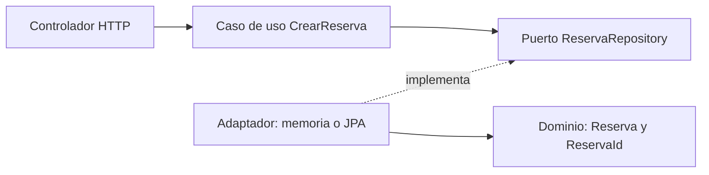
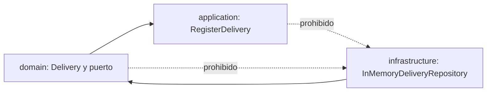
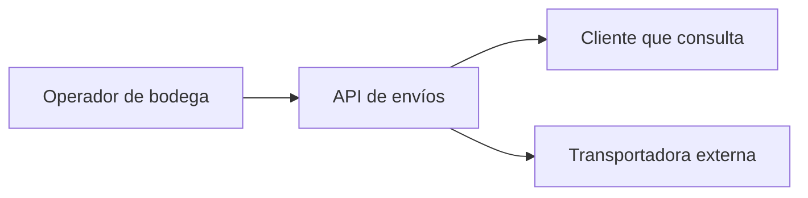
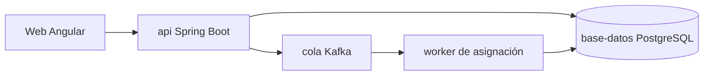
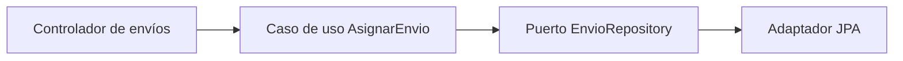
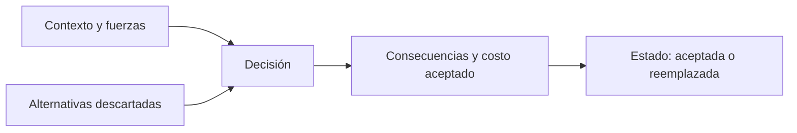

# Módulo 15: Arquitectura: hexagonal, Clean, C4, ADR y Spring Modulith

## Aprende construyendo

Cada Tema parte de una carpeta vacía, produce un artefacto concreto y lo verifica con un comando real. El recorrido va de dentro hacia afuera: puertos y adaptadores (Temas 1–3), cómo documentar y decidir la arquitectura (Temas 4–5) y cómo verificar los límites dentro de un mismo proceso con Spring Modulith (Temas 6–9). Un módulo de Modulith es una frontera lógica, no un microservicio; la decisión de separar servicios se estudia en el curso [Microservicios](/curso/microservices/0).


### Tema 1: Hexagonal: puertos que hablan el idioma del dominio · Avanzado · 35 min

<details open>
<summary><strong>Capa 1 — Lectura</strong></summary>

#### ► DE QUÉ TRATA
Este tema te guía por hexagonal: puertos que hablan el idioma del dominio con foco en comprensión antes de implementación.

#### ► LA IDEA EN UNA FRASE
**Entender hexagonal: puertos que hablan el idioma del dominio te permite tomar mejores decisiones técnicas.**

#### ► POR QUÉ EXISTE ESTO
Resuelve un problema real de diseño o implementación y evita decisiones a ciegas.

#### ► LA ANALOGÍA
Piensa en hexagonal: puertos que hablan el idioma del dominio como una herramienta de taller: útil cuando conoces su propósito y sus límites.
**Dónde se rompe la analogía:** en software, los efectos dependen del contexto, la escala y los trade-offs.

#### ► CÓMO FUNCIONA


#### ► LO QUE PUEDE SALIR MAL
| Síntoma | Causa probable | Arreglo |
|---|---|---|
| Hexagonal: puertos que hablan el idioma del dominio se aplica pero el resultado no mejora | Se usó sin medir el problema real | Mide antes y compara contra la alternativa simple |
| Aparece complejidad inesperada | Se adoptó la técnica sin comprender sus trade-offs | Vuelve a la sección de trade-offs y reduce el alcance |
| Falla en un caso límite | Se asumió un contexto que no se cumple | Prueba el caso límite y documenta cuándo NO usarlo |

#### ► TRADE-OFFS
| Opción | Cuándo usarla | Cuándo NO usarla |
|---|---|---|
| Usar Hexagonal: puertos que hablan el idioma del dominio | Cuando el problema coincide con su propósito y el beneficio es observable | Cuando agrega complejidad sin resolver un problema real |
| Alternativa más simple | Cuando el contexto es pequeño, estable o fácil de razonar | Cuando ya demostró no escalar o no cumplir el requisito |
| Postergar la decisión | Cuando falta evidencia del problema | Cuando el costo de esperar es mayor que el costo de probar |

#### ► CUÁNDO NO USAR ESTO
No uses hexagonal: puertos que hablan el idioma del dominio por defecto. Aplícalo cuando el problema lo justifique y puedas verificar el beneficio; si una alternativa más simple resuelve igual, prefiérela.

#### ► DE VUELTA A LA ANALOGÍA
Volviendo a la analogía: hexagonal: puertos que hablan el idioma del dominio funciona como el modelo inicial, pero recuerda dónde se rompe: en producción importan la evidencia, la escala y el costo de equivocarte.

#### ► LO QUE DEBES RECORDAR
- Hexagonal: puertos que hablan el idioma del dominio existe para resolver un problema específico.
- Mide antes de adoptar complejidad.
- Conoce el caso donde NO usarlo.
- Verifica con evidencia observable.

#### ► PREGUNTAS PARA PENSAR
1. ¿Qué problema concreto resuelve hexagonal: puertos que hablan el idioma del dominio en tu contexto?
2. ¿Cómo sabrías que hexagonal: puertos que hablan el idioma del dominio no está funcionando bien?
3. ¿Qué alternativa más simple considerarías antes de usar hexagonal: puertos que hablan el idioma del dominio?

</details>

<details>
<summary><strong>Capa 2 — Construcción</strong></summary>

#### Código y verificación
```bash
cp -R spring-architecture-rutaflow practica-arquitectura
cd practica-arquitectura
```

```bash
mkdir arquitectura-hexagonal && cd arquitectura-hexagonal
mkdir src
```

```java
import java.util.ArrayList;
import java.util.List;
import java.util.Optional;

public final class Hexagonal {
    record ReservaId(String valor) {
        ReservaId {
            if (valor == null || valor.isBlank()) throw new IllegalArgumentException("id requerido");
        }
    }

    record Reserva(ReservaId id, String vehiculo, int dias) {
        Reserva {
            if (dias <= 0) throw new IllegalArgumentException("dias debe ser positivo");
        }
    }

    // Puerto: declara lo que la aplicación necesita, con tipos del dominio.
    interface ReservaRepository {
        void guardar(Reserva reserva);
        Optional<Reserva> buscar(ReservaId id);
    }

    static final class CrearReserva {
        private final ReservaRepository repositorio;
        CrearReserva(ReservaRepository repositorio) { this.repositorio = repositorio; }

        Reserva ejecutar(ReservaId id, String vehiculo, int dias) {
            Reserva reserva = new Reserva(id, vehiculo, dias);
            repositorio.guardar(reserva);
            return reserva;
        }
    }

    static final class EnMemoria implements ReservaRepository {
        private final List<Reserva> datos = new ArrayList<>();

        public void guardar(Reserva reserva) { datos.add(reserva); }

        public Optional<Reserva> buscar(ReservaId id) {
            return datos.stream().filter(reserva -> reserva.id().equals(id)).findFirst();
        }
    }

    public static void main(String[] args) {
        ReservaRepository repositorio = new EnMemoria();
        Reserva creada = new CrearReserva(repositorio).ejecutar(new ReservaId("RES-1"), "camion-1", 3);
        Reserva recuperada = repositorio.buscar(creada.id()).orElseThrow();
        System.out.println("reserva=" + recuperada.id().valor() + " vehiculo=" + recuperada.vehiculo());
    }
}
```

```bash
javac -d out src/Hexagonal.java
java -cp out Hexagonal
```

```java
interface ReservaRepository {
    org.springframework.data.domain.Page<ReservaEntity> buscar(
        org.springframework.data.domain.Pageable pageable);
}
```

```text
Hexagonal.java:19: error: package org.springframework.data.domain does not exist
```

</details>

### Tema 2: Arquitectura hexagonal verificada con ArchUnit · Avanzado · 35 min

<details open>
<summary><strong>Capa 1 — Lectura</strong></summary>

#### ► DE QUÉ TRATA
Este tema te guía por arquitectura hexagonal verificada con archunit con foco en comprensión antes de implementación.

#### ► LA IDEA EN UNA FRASE
**Entender arquitectura hexagonal verificada con archunit te permite tomar mejores decisiones técnicas.**

#### ► POR QUÉ EXISTE ESTO
Resuelve un problema real de diseño o implementación y evita decisiones a ciegas.

#### ► LA ANALOGÍA
Piensa en arquitectura hexagonal verificada con archunit como una herramienta de taller: útil cuando conoces su propósito y sus límites.
**Dónde se rompe la analogía:** en software, los efectos dependen del contexto, la escala y los trade-offs.

#### ► CÓMO FUNCIONA


#### ► LO QUE PUEDE SALIR MAL
| Síntoma | Causa probable | Arreglo |
|---|---|---|
| Arquitectura hexagonal verificada con ArchUnit se aplica pero el resultado no mejora | Se usó sin medir el problema real | Mide antes y compara contra la alternativa simple |
| Aparece complejidad inesperada | Se adoptó la técnica sin comprender sus trade-offs | Vuelve a la sección de trade-offs y reduce el alcance |
| Falla en un caso límite | Se asumió un contexto que no se cumple | Prueba el caso límite y documenta cuándo NO usarlo |

#### ► TRADE-OFFS
| Opción | Cuándo usarla | Cuándo NO usarla |
|---|---|---|
| Usar Arquitectura hexagonal verificada con ArchUnit | Cuando el problema coincide con su propósito y el beneficio es observable | Cuando agrega complejidad sin resolver un problema real |
| Alternativa más simple | Cuando el contexto es pequeño, estable o fácil de razonar | Cuando ya demostró no escalar o no cumplir el requisito |
| Postergar la decisión | Cuando falta evidencia del problema | Cuando el costo de esperar es mayor que el costo de probar |

#### ► CUÁNDO NO USAR ESTO
No uses arquitectura hexagonal verificada con archunit por defecto. Aplícalo cuando el problema lo justifique y puedas verificar el beneficio; si una alternativa más simple resuelve igual, prefiérela.

#### ► DE VUELTA A LA ANALOGÍA
Volviendo a la analogía: arquitectura hexagonal verificada con archunit funciona como el modelo inicial, pero recuerda dónde se rompe: en producción importan la evidencia, la escala y el costo de equivocarte.

#### ► LO QUE DEBES RECORDAR
- Arquitectura hexagonal verificada con ArchUnit existe para resolver un problema específico.
- Mide antes de adoptar complejidad.
- Conoce el caso donde NO usarlo.
- Verifica con evidencia observable.

#### ► PREGUNTAS PARA PENSAR
1. ¿Qué problema concreto resuelve arquitectura hexagonal verificada con archunit en tu contexto?
2. ¿Cómo sabrías que arquitectura hexagonal verificada con archunit no está funcionando bien?
3. ¿Qué alternativa más simple considerarías antes de usar arquitectura hexagonal verificada con archunit?

</details>

<details>
<summary><strong>Capa 2 — Construcción</strong></summary>

#### Código y verificación
```bash
./mvnw -q test
```


```bash
./mvnw -q test
```

```java
ArchRule rule = noClasses().that().resideInAPackage("..domain..")
    .should().dependOnClassesThat().resideInAPackage("..infrastructure..");

rule.check(project);
```

```bash
./mvnw -q test
```

</details>

### Tema 3: Clean Architecture y DDD táctico: caso de uso antes que framework · Experto · 35 min

<details open>
<summary><strong>Capa 1 — Lectura</strong></summary>

#### ► DE QUÉ TRATA
Este tema te guía por clean architecture y ddd táctico: caso de uso antes que framework con foco en comprensión antes de implementación.

#### ► LA IDEA EN UNA FRASE
**Entender clean architecture y ddd táctico: caso de uso antes que framework te permite tomar mejores decisiones técnicas.**

#### ► POR QUÉ EXISTE ESTO
Resuelve un problema real de diseño o implementación y evita decisiones a ciegas.

#### ► LA ANALOGÍA
Piensa en clean architecture y ddd táctico: caso de uso antes que framework como una herramienta de taller: útil cuando conoces su propósito y sus límites.
**Dónde se rompe la analogía:** en software, los efectos dependen del contexto, la escala y los trade-offs.

#### ► CÓMO FUNCIONA
1. Identifica el problema que clean architecture y ddd táctico: caso de uso antes que framework resuelve.
2. Observa sus componentes y relaciones.
3. Aplica la opción más simple que funcione.
4. Verifica el resultado y los límites.

#### ► LO QUE PUEDE SALIR MAL
| Síntoma | Causa probable | Arreglo |
|---|---|---|
| Clean Architecture y DDD táctico: caso de uso antes que framework se aplica pero el resultado no mejora | Se usó sin medir el problema real | Mide antes y compara contra la alternativa simple |
| Aparece complejidad inesperada | Se adoptó la técnica sin comprender sus trade-offs | Vuelve a la sección de trade-offs y reduce el alcance |
| Falla en un caso límite | Se asumió un contexto que no se cumple | Prueba el caso límite y documenta cuándo NO usarlo |

#### ► TRADE-OFFS
| Opción | Cuándo usarla | Cuándo NO usarla |
|---|---|---|
| Usar Clean Architecture y DDD táctico: caso de uso antes que framework | Cuando el problema coincide con su propósito y el beneficio es observable | Cuando agrega complejidad sin resolver un problema real |
| Alternativa más simple | Cuando el contexto es pequeño, estable o fácil de razonar | Cuando ya demostró no escalar o no cumplir el requisito |
| Postergar la decisión | Cuando falta evidencia del problema | Cuando el costo de esperar es mayor que el costo de probar |

#### ► CUÁNDO NO USAR ESTO
No uses clean architecture y ddd táctico: caso de uso antes que framework por defecto. Aplícalo cuando el problema lo justifique y puedas verificar el beneficio; si una alternativa más simple resuelve igual, prefiérela.

#### ► DE VUELTA A LA ANALOGÍA
Volviendo a la analogía: clean architecture y ddd táctico: caso de uso antes que framework funciona como el modelo inicial, pero recuerda dónde se rompe: en producción importan la evidencia, la escala y el costo de equivocarte.

#### ► LO QUE DEBES RECORDAR
- Clean Architecture y DDD táctico: caso de uso antes que framework existe para resolver un problema específico.
- Mide antes de adoptar complejidad.
- Conoce el caso donde NO usarlo.
- Verifica con evidencia observable.

#### ► PREGUNTAS PARA PENSAR
1. ¿Qué problema concreto resuelve clean architecture y ddd táctico: caso de uso antes que framework en tu contexto?
2. ¿Cómo sabrías que clean architecture y ddd táctico: caso de uso antes que framework no está funcionando bien?
3. ¿Qué alternativa más simple considerarías antes de usar clean architecture y ddd táctico: caso de uso antes que framework?

</details>

<details>
<summary><strong>Capa 2 — Construcción</strong></summary>

#### Código y verificación
```java
public Delivery assignTo(Destination nextDestination) {
    if (status != DeliveryStatus.CREATED) {
        throw new DeliveryAlreadyAssigned();
    }
    return new Delivery(id, nextDestination, DeliveryStatus.ASSIGNED);
}
```

```bash
./mvnw -q -Dtest=AssignDeliveryTest#domainRuleRejectsAssigningADestinationTwice test
```

```text
web ──> caso de uso ──> puerto de repositorio
                           ▲
                    adaptador de datos
              dominio usado por el caso de uso
```

```bash
./mvnw -q -Dtest=AssignDeliveryTest,ArchitectureBoundariesTest test
```

```bash
./mvnw -q -Dtest=DeliveryHttpTest test
```

```bash
./mvnw -q test
```

</details>

### Tema 4: C4: contexto, contenedores, componentes y código · Experto · 35 min

<details open>
<summary><strong>Capa 1 — Lectura</strong></summary>

#### ► DE QUÉ TRATA
Este tema te guía por c4: contexto, contenedores, componentes y código con foco en comprensión antes de implementación.

#### ► LA IDEA EN UNA FRASE
**Entender c4: contexto, contenedores, componentes y código te permite tomar mejores decisiones técnicas.**

#### ► POR QUÉ EXISTE ESTO
Resuelve un problema real de diseño o implementación y evita decisiones a ciegas.

#### ► LA ANALOGÍA
Piensa en c4: contexto, contenedores, componentes y código como una herramienta de taller: útil cuando conoces su propósito y sus límites.
**Dónde se rompe la analogía:** en software, los efectos dependen del contexto, la escala y los trade-offs.

#### ► CÓMO FUNCIONA


#### ► LO QUE PUEDE SALIR MAL
| Síntoma | Causa probable | Arreglo |
|---|---|---|
| C4: contexto, contenedores, componentes y código se aplica pero el resultado no mejora | Se usó sin medir el problema real | Mide antes y compara contra la alternativa simple |
| Aparece complejidad inesperada | Se adoptó la técnica sin comprender sus trade-offs | Vuelve a la sección de trade-offs y reduce el alcance |
| Falla en un caso límite | Se asumió un contexto que no se cumple | Prueba el caso límite y documenta cuándo NO usarlo |

#### ► TRADE-OFFS
| Opción | Cuándo usarla | Cuándo NO usarla |
|---|---|---|
| Usar C4: contexto, contenedores, componentes y código | Cuando el problema coincide con su propósito y el beneficio es observable | Cuando agrega complejidad sin resolver un problema real |
| Alternativa más simple | Cuando el contexto es pequeño, estable o fácil de razonar | Cuando ya demostró no escalar o no cumplir el requisito |
| Postergar la decisión | Cuando falta evidencia del problema | Cuando el costo de esperar es mayor que el costo de probar |

#### ► CUÁNDO NO USAR ESTO
No uses c4: contexto, contenedores, componentes y código por defecto. Aplícalo cuando el problema lo justifique y puedas verificar el beneficio; si una alternativa más simple resuelve igual, prefiérela.

#### ► DE VUELTA A LA ANALOGÍA
Volviendo a la analogía: c4: contexto, contenedores, componentes y código funciona como el modelo inicial, pero recuerda dónde se rompe: en producción importan la evidencia, la escala y el costo de equivocarte.

#### ► LO QUE DEBES RECORDAR
- C4: contexto, contenedores, componentes y código existe para resolver un problema específico.
- Mide antes de adoptar complejidad.
- Conoce el caso donde NO usarlo.
- Verifica con evidencia observable.

#### ► PREGUNTAS PARA PENSAR
1. ¿Qué problema concreto resuelve c4: contexto, contenedores, componentes y código en tu contexto?
2. ¿Cómo sabrías que c4: contexto, contenedores, componentes y código no está funcionando bien?
3. ¿Qué alternativa más simple considerarías antes de usar c4: contexto, contenedores, componentes y código?

</details>

<details>
<summary><strong>Capa 2 — Construcción</strong></summary>

#### Código y verificación
```bash
cp -R spring-architecture-rutaflow practica-arquitectura
cd practica-arquitectura
```

```bash
mkdir c4-envios && cd c4-envios
mkdir -p docs/c4
```

```javascript
// Comprueba que el C4 tenga los cuatro niveles y los contenedores propuestos.
import { readFile } from 'node:fs/promises';

const texto = await readFile('docs/c4/envios.md', 'utf8');
const contenedores = ['api', 'worker', 'base-datos', 'cola'];
const faltantes = contenedores.filter((nombre) => !texto.toLowerCase().includes(nombre));
if (faltantes.length) {
  console.error(`Faltan contenedores en el C4: ${faltantes.join(', ')}`);
  process.exit(1);
}

const niveles = ['Contexto', 'Contenedores', 'Componentes', 'Código'];
const sinNivel = niveles.filter((nivel) => !texto.includes(`## ${nivel}`));
if (sinNivel.length) {
  console.error(`Faltan niveles: ${sinNivel.join(', ')}`);
  process.exit(1);
}

const relaciones = (texto.match(/-->/g) ?? []).length;
if (relaciones < 12) {
  console.error(`Se esperaban al menos 12 relaciones y hay ${relaciones}`);
  process.exit(1);
}

console.log(`C4 OK: ${niveles.length} niveles y ${relaciones} relaciones`);
```






</details>

### Tema 5: ADR: decisiones con contexto, alternativas y consecuencias · Experto · 35 min

<details open>
<summary><strong>Capa 1 — Lectura</strong></summary>

#### ► DE QUÉ TRATA
Este tema te guía por adr: decisiones con contexto, alternativas y consecuencias con foco en comprensión antes de implementación.

#### ► LA IDEA EN UNA FRASE
**Entender adr: decisiones con contexto, alternativas y consecuencias te permite tomar mejores decisiones técnicas.**

#### ► POR QUÉ EXISTE ESTO
Resuelve un problema real de diseño o implementación y evita decisiones a ciegas.

#### ► LA ANALOGÍA
Piensa en adr: decisiones con contexto, alternativas y consecuencias como una herramienta de taller: útil cuando conoces su propósito y sus límites.
**Dónde se rompe la analogía:** en software, los efectos dependen del contexto, la escala y los trade-offs.

#### ► CÓMO FUNCIONA


#### ► LO QUE PUEDE SALIR MAL
| Síntoma | Causa probable | Arreglo |
|---|---|---|
| ADR: decisiones con contexto, alternativas y consecuencias se aplica pero el resultado no mejora | Se usó sin medir el problema real | Mide antes y compara contra la alternativa simple |
| Aparece complejidad inesperada | Se adoptó la técnica sin comprender sus trade-offs | Vuelve a la sección de trade-offs y reduce el alcance |
| Falla en un caso límite | Se asumió un contexto que no se cumple | Prueba el caso límite y documenta cuándo NO usarlo |

#### ► TRADE-OFFS
| Opción | Cuándo usarla | Cuándo NO usarla |
|---|---|---|
| Usar ADR: decisiones con contexto, alternativas y consecuencias | Cuando el problema coincide con su propósito y el beneficio es observable | Cuando agrega complejidad sin resolver un problema real |
| Alternativa más simple | Cuando el contexto es pequeño, estable o fácil de razonar | Cuando ya demostró no escalar o no cumplir el requisito |
| Postergar la decisión | Cuando falta evidencia del problema | Cuando el costo de esperar es mayor que el costo de probar |

#### ► CUÁNDO NO USAR ESTO
No uses adr: decisiones con contexto, alternativas y consecuencias por defecto. Aplícalo cuando el problema lo justifique y puedas verificar el beneficio; si una alternativa más simple resuelve igual, prefiérela.

#### ► DE VUELTA A LA ANALOGÍA
Volviendo a la analogía: adr: decisiones con contexto, alternativas y consecuencias funciona como el modelo inicial, pero recuerda dónde se rompe: en producción importan la evidencia, la escala y el costo de equivocarte.

#### ► LO QUE DEBES RECORDAR
- ADR: decisiones con contexto, alternativas y consecuencias existe para resolver un problema específico.
- Mide antes de adoptar complejidad.
- Conoce el caso donde NO usarlo.
- Verifica con evidencia observable.

#### ► PREGUNTAS PARA PENSAR
1. ¿Qué problema concreto resuelve adr: decisiones con contexto, alternativas y consecuencias en tu contexto?
2. ¿Cómo sabrías que adr: decisiones con contexto, alternativas y consecuencias no está funcionando bien?
3. ¿Qué alternativa más simple considerarías antes de usar adr: decisiones con contexto, alternativas y consecuencias?

</details>

<details>
<summary><strong>Capa 2 — Construcción</strong></summary>

#### Código y verificación
```bash
cp -R spring-architecture-rutaflow practica-arquitectura
cd practica-arquitectura
```

```bash
mkdir adr-envios && cd adr-envios
mkdir -p docs/adr
```

```javascript
// Verifica que cada ADR tenga las secciones y al menos dos alternativas.
import { readdir, readFile } from 'node:fs/promises';

const archivos = (await readdir('docs/adr'))
  .filter((nombre) => /^\d{4}-.+\.md$/.test(nombre))
  .sort();
if (archivos.length < 3) {
  console.error(`Se esperaban 3 ADR y hay ${archivos.length}`);
  process.exit(1);
}

const secciones = ['## Contexto', '## Decisión', '## Alternativas', '## Consecuencias', '## Estado'];
for (const archivo of archivos) {
  const texto = await readFile(`docs/adr/${archivo}`, 'utf8');
  const faltan = secciones.filter((seccion) => !texto.includes(seccion));
  if (faltan.length) {
    console.error(`${archivo}: faltan ${faltan.join(', ')}`);
    process.exit(1);
  }
  const alternativas = (texto.match(/^- \*\*/gm) ?? []).length;
  if (alternativas < 2) {
    console.error(`${archivo}: se esperaban al menos 2 alternativas y hay ${alternativas}`);
    process.exit(1);
  }
}

console.log(`ADR OK: ${archivos.length} decisiones con contexto, alternativas y consecuencias`);
```

```markdown
# 0001 — PostgreSQL para el estado de envíos

## Contexto

El estado de un envío cambia con reglas de negocio (transiciones válidas) y se consulta por
identificador y por fecha. El equipo ya opera PostgreSQL en local y necesita transacciones.

## Decisión

Usar PostgreSQL como base de datos del estado de envíos.

## Alternativas

- **MongoDB:** documentos flexibles, pero sin transacciones multi-documento simples en nuestro caso de uso.
- **SQLite:** suficiente para una demo, no para varias instancias concurrentes.

## Consecuencias

Se gana consistencia transaccional y consultas por fecha con índices. Se paga operación de
migraciones y un esquema que exige revisar cada cambio.

## Estado

Aceptada el 2026-10-30.
```

```bash
node validar-adr.mjs
```


</details>

### Tema 6: módulos y límites entre paquetes · Experto · 30 min

<details open>
<summary><strong>Capa 1 — Lectura</strong></summary>

#### ► DE QUÉ TRATA
Este tema te guía por módulos y límites entre paquetes con foco en comprensión antes de implementación.

#### ► LA IDEA EN UNA FRASE
**Entender módulos y límites entre paquetes te permite tomar mejores decisiones técnicas.**

#### ► POR QUÉ EXISTE ESTO
Resuelve un problema real de diseño o implementación y evita decisiones a ciegas.

#### ► LA ANALOGÍA
Piensa en módulos y límites entre paquetes como una herramienta de taller: útil cuando conoces su propósito y sus límites.
**Dónde se rompe la analogía:** en software, los efectos dependen del contexto, la escala y los trade-offs.

#### ► CÓMO FUNCIONA
1. Identifica el problema que módulos y límites entre paquetes resuelve.
2. Observa sus componentes y relaciones.
3. Aplica la opción más simple que funcione.
4. Verifica el resultado y los límites.

#### ► LO QUE PUEDE SALIR MAL
| Síntoma | Causa probable | Arreglo |
|---|---|---|
| módulos y límites entre paquetes se aplica pero el resultado no mejora | Se usó sin medir el problema real | Mide antes y compara contra la alternativa simple |
| Aparece complejidad inesperada | Se adoptó la técnica sin comprender sus trade-offs | Vuelve a la sección de trade-offs y reduce el alcance |
| Falla en un caso límite | Se asumió un contexto que no se cumple | Prueba el caso límite y documenta cuándo NO usarlo |

#### ► TRADE-OFFS
| Opción | Cuándo usarla | Cuándo NO usarla |
|---|---|---|
| Usar módulos y límites entre paquetes | Cuando el problema coincide con su propósito y el beneficio es observable | Cuando agrega complejidad sin resolver un problema real |
| Alternativa más simple | Cuando el contexto es pequeño, estable o fácil de razonar | Cuando ya demostró no escalar o no cumplir el requisito |
| Postergar la decisión | Cuando falta evidencia del problema | Cuando el costo de esperar es mayor que el costo de probar |

#### ► CUÁNDO NO USAR ESTO
No uses módulos y límites entre paquetes por defecto. Aplícalo cuando el problema lo justifique y puedas verificar el beneficio; si una alternativa más simple resuelve igual, prefiérela.

#### ► DE VUELTA A LA ANALOGÍA
Volviendo a la analogía: módulos y límites entre paquetes funciona como el modelo inicial, pero recuerda dónde se rompe: en producción importan la evidencia, la escala y el costo de equivocarte.

#### ► LO QUE DEBES RECORDAR
- módulos y límites entre paquetes existe para resolver un problema específico.
- Mide antes de adoptar complejidad.
- Conoce el caso donde NO usarlo.
- Verifica con evidencia observable.

#### ► PREGUNTAS PARA PENSAR
1. ¿Qué problema concreto resuelve módulos y límites entre paquetes en tu contexto?
2. ¿Cómo sabrías que módulos y límites entre paquetes no está funcionando bien?
3. ¿Qué alternativa más simple considerarías antes de usar módulos y límites entre paquetes?

</details>

<details>
<summary><strong>Capa 2 — Construcción</strong></summary>

#### Código y verificación
```bash
cp -R spring-modulith-rutaflow practica-m23-t1
cd practica-m23-t1
./mvnw -q test
```

```bash
./mvnw -q -Dtest=ArquitecturaModularTest test
```

```bash
./mvnw -q -Dtest=ArquitecturaModularTest,PedidosModuleTest test
```

```bash
./mvnw -q test
```

</details>

### Tema 7: eventos entre módulos sin importar implementación · Experto · 30 min

<details open>
<summary><strong>Capa 1 — Lectura</strong></summary>

#### ► DE QUÉ TRATA
Este tema te guía por eventos entre módulos sin importar implementación con foco en comprensión antes de implementación.

#### ► LA IDEA EN UNA FRASE
**Entender eventos entre módulos sin importar implementación te permite tomar mejores decisiones técnicas.**

#### ► POR QUÉ EXISTE ESTO
Resuelve un problema real de diseño o implementación y evita decisiones a ciegas.

#### ► LA ANALOGÍA
Piensa en eventos entre módulos sin importar implementación como una herramienta de taller: útil cuando conoces su propósito y sus límites.
**Dónde se rompe la analogía:** en software, los efectos dependen del contexto, la escala y los trade-offs.

#### ► CÓMO FUNCIONA
1. Identifica el problema que eventos entre módulos sin importar implementación resuelve.
2. Observa sus componentes y relaciones.
3. Aplica la opción más simple que funcione.
4. Verifica el resultado y los límites.

#### ► LO QUE PUEDE SALIR MAL
| Síntoma | Causa probable | Arreglo |
|---|---|---|
| eventos entre módulos sin importar implementación se aplica pero el resultado no mejora | Se usó sin medir el problema real | Mide antes y compara contra la alternativa simple |
| Aparece complejidad inesperada | Se adoptó la técnica sin comprender sus trade-offs | Vuelve a la sección de trade-offs y reduce el alcance |
| Falla en un caso límite | Se asumió un contexto que no se cumple | Prueba el caso límite y documenta cuándo NO usarlo |

#### ► TRADE-OFFS
| Opción | Cuándo usarla | Cuándo NO usarla |
|---|---|---|
| Usar eventos entre módulos sin importar implementación | Cuando el problema coincide con su propósito y el beneficio es observable | Cuando agrega complejidad sin resolver un problema real |
| Alternativa más simple | Cuando el contexto es pequeño, estable o fácil de razonar | Cuando ya demostró no escalar o no cumplir el requisito |
| Postergar la decisión | Cuando falta evidencia del problema | Cuando el costo de esperar es mayor que el costo de probar |

#### ► CUÁNDO NO USAR ESTO
No uses eventos entre módulos sin importar implementación por defecto. Aplícalo cuando el problema lo justifique y puedas verificar el beneficio; si una alternativa más simple resuelve igual, prefiérela.

#### ► DE VUELTA A LA ANALOGÍA
Volviendo a la analogía: eventos entre módulos sin importar implementación funciona como el modelo inicial, pero recuerda dónde se rompe: en producción importan la evidencia, la escala y el costo de equivocarte.

#### ► LO QUE DEBES RECORDAR
- eventos entre módulos sin importar implementación existe para resolver un problema específico.
- Mide antes de adoptar complejidad.
- Conoce el caso donde NO usarlo.
- Verifica con evidencia observable.

#### ► PREGUNTAS PARA PENSAR
1. ¿Qué problema concreto resuelve eventos entre módulos sin importar implementación en tu contexto?
2. ¿Cómo sabrías que eventos entre módulos sin importar implementación no está funcionando bien?
3. ¿Qué alternativa más simple considerarías antes de usar eventos entre módulos sin importar implementación?

</details>

<details>
<summary><strong>Capa 2 — Construcción</strong></summary>

#### Código y verificación
```bash
cp -R spring-modulith-rutaflow practica-m23-t2
cd practica-m23-t2
./mvnw -q test
```

```bash
./mvnw -q -Dtest=PedidosModuleTest test
```

```bash
./mvnw -q -Dtest=NotificacionesModuleTest test
```

```bash
./mvnw -q -Dtest=NotificacionesModuleTest test
```

</details>

### Tema 8: documentación generada y mapa de dependencias · Experto · 30 min

<details open>
<summary><strong>Capa 1 — Lectura</strong></summary>

#### ► DE QUÉ TRATA
Este tema te guía por documentación generada y mapa de dependencias con foco en comprensión antes de implementación.

#### ► LA IDEA EN UNA FRASE
**Entender documentación generada y mapa de dependencias te permite tomar mejores decisiones técnicas.**

#### ► POR QUÉ EXISTE ESTO
Contexto: Un artefacto de build puede regenerarse; las decisiones y límites también deben conservarse.

#### ► LA ANALOGÍA
Piensa en documentación generada y mapa de dependencias como una herramienta de taller: útil cuando conoces su propósito y sus límites.
**Dónde se rompe la analogía:** en software, los efectos dependen del contexto, la escala y los trade-offs.

#### ► CÓMO FUNCIONA
1. Contexto: Un artefacto de build puede regenerarse; las decisiones y límites también deben conservarse.

#### ► LO QUE PUEDE SALIR MAL
| Síntoma | Causa probable | Arreglo |
|---|---|---|
| documentación generada y mapa de dependencias se aplica pero el resultado no mejora | Se usó sin medir el problema real | Mide antes y compara contra la alternativa simple |
| Aparece complejidad inesperada | Se adoptó la técnica sin comprender sus trade-offs | Vuelve a la sección de trade-offs y reduce el alcance |
| Falla en un caso límite | Se asumió un contexto que no se cumple | Prueba el caso límite y documenta cuándo NO usarlo |

#### ► TRADE-OFFS
| Opción | Cuándo usarla | Cuándo NO usarla |
|---|---|---|
| Usar documentación generada y mapa de dependencias | Cuando el problema coincide con su propósito y el beneficio es observable | Cuando agrega complejidad sin resolver un problema real |
| Alternativa más simple | Cuando el contexto es pequeño, estable o fácil de razonar | Cuando ya demostró no escalar o no cumplir el requisito |
| Postergar la decisión | Cuando falta evidencia del problema | Cuando el costo de esperar es mayor que el costo de probar |

#### ► CUÁNDO NO USAR ESTO
No uses documentación generada y mapa de dependencias por defecto. Aplícalo cuando el problema lo justifique y puedas verificar el beneficio; si una alternativa más simple resuelve igual, prefiérela.

#### ► DE VUELTA A LA ANALOGÍA
Volviendo a la analogía: documentación generada y mapa de dependencias funciona como el modelo inicial, pero recuerda dónde se rompe: en producción importan la evidencia, la escala y el costo de equivocarte.

#### ► LO QUE DEBES RECORDAR
- Contexto: Un artefacto de build puede regenerarse; las decisiones y límites también deben conservarse.

#### ► PREGUNTAS PARA PENSAR
1. ¿Qué problema concreto resuelve documentación generada y mapa de dependencias en tu contexto?
2. ¿Cómo sabrías que documentación generada y mapa de dependencias no está funcionando bien?
3. ¿Qué alternativa más simple considerarías antes de usar documentación generada y mapa de dependencias?

</details>

<details>
<summary><strong>Capa 2 — Construcción</strong></summary>

#### Código de referencia / ejecutable
**Contexto:** Notificaciones depende del contrato de Pedidos para interpretar PedidoCreado.

**Hazlo tú:** Abre un.puml bajo `target/spring-modulith-docs` y contrasta la dependencia con el import de `src/main/java/academia/rutaflow/modulith/notificaciones/NotificacionListener.java`.

```bash
./mvnw -q -Dtest=ArquitecturaModularTest,DocumentacionModularTest test
```

**Resultado esperado:** La relación del mapa tiene un import rastreable y la verificación modular sigue pasando.

**Fallo deliberado:** Dibuja manualmente una dependencia Pedidos hacia Notificaciones sin cambiar el código.

**Diagnóstico:** el mapa editado ya no es una salida fiel de Documenter; regenera y contrasta los archivos en lugar de tratar la edición como evidencia.

**Entiende:** El diagrama describe módulos y relaciones estáticas; no demuestra dónde corre cada módulo ni si una llamada ocurrió durante un incidente.

**Cierra:** Escribe archivo origen, símbolo importado y relación que lo representa.

</details>

### Tema 9: pruebas de integración por módulo · Experto · 30 min

<details open>
<summary><strong>Capa 1 — Lectura</strong></summary>

#### ► DE QUÉ TRATA
Este tema te guía por pruebas de integración por módulo con foco en comprensión antes de implementación.

#### ► LA IDEA EN UNA FRASE
**Entender pruebas de integración por módulo te permite tomar mejores decisiones técnicas.**

#### ► POR QUÉ EXISTE ESTO
Resuelve un problema real de diseño o implementación y evita decisiones a ciegas.

#### ► LA ANALOGÍA
Piensa en pruebas de integración por módulo como una herramienta de taller: útil cuando conoces su propósito y sus límites.
**Dónde se rompe la analogía:** en software, los efectos dependen del contexto, la escala y los trade-offs.

#### ► CÓMO FUNCIONA
1. Identifica el problema que pruebas de integración por módulo resuelve.
2. Observa sus componentes y relaciones.
3. Aplica la opción más simple que funcione.
4. Verifica el resultado y los límites.

#### ► LO QUE PUEDE SALIR MAL
| Síntoma | Causa probable | Arreglo |
|---|---|---|
| pruebas de integración por módulo se aplica pero el resultado no mejora | Se usó sin medir el problema real | Mide antes y compara contra la alternativa simple |
| Aparece complejidad inesperada | Se adoptó la técnica sin comprender sus trade-offs | Vuelve a la sección de trade-offs y reduce el alcance |
| Falla en un caso límite | Se asumió un contexto que no se cumple | Prueba el caso límite y documenta cuándo NO usarlo |

#### ► TRADE-OFFS
| Opción | Cuándo usarla | Cuándo NO usarla |
|---|---|---|
| Usar pruebas de integración por módulo | Cuando el problema coincide con su propósito y el beneficio es observable | Cuando agrega complejidad sin resolver un problema real |
| Alternativa más simple | Cuando el contexto es pequeño, estable o fácil de razonar | Cuando ya demostró no escalar o no cumplir el requisito |
| Postergar la decisión | Cuando falta evidencia del problema | Cuando el costo de esperar es mayor que el costo de probar |

#### ► CUÁNDO NO USAR ESTO
No uses pruebas de integración por módulo por defecto. Aplícalo cuando el problema lo justifique y puedas verificar el beneficio; si una alternativa más simple resuelve igual, prefiérela.

#### ► DE VUELTA A LA ANALOGÍA
Volviendo a la analogía: pruebas de integración por módulo funciona como el modelo inicial, pero recuerda dónde se rompe: en producción importan la evidencia, la escala y el costo de equivocarte.

#### ► LO QUE DEBES RECORDAR
- pruebas de integración por módulo existe para resolver un problema específico.
- Mide antes de adoptar complejidad.
- Conoce el caso donde NO usarlo.
- Verifica con evidencia observable.

#### ► PREGUNTAS PARA PENSAR
1. ¿Qué problema concreto resuelve pruebas de integración por módulo en tu contexto?
2. ¿Cómo sabrías que pruebas de integración por módulo no está funcionando bien?
3. ¿Qué alternativa más simple considerarías antes de usar pruebas de integración por módulo?

</details>

<details>
<summary><strong>Capa 2 — Construcción</strong></summary>

#### Código y verificación
```bash
cp -R spring-modulith-rutaflow practica-m23-t4
cd practica-m23-t4
./mvnw -q test
```

```bash
./mvnw -q -Dtest=PedidosModuleTest test
```

```bash
./mvnw -q -Dtest=PedidosModuleTest,NotificacionesModuleTest test
```

```bash
./mvnw -q clean test
```

</details>
